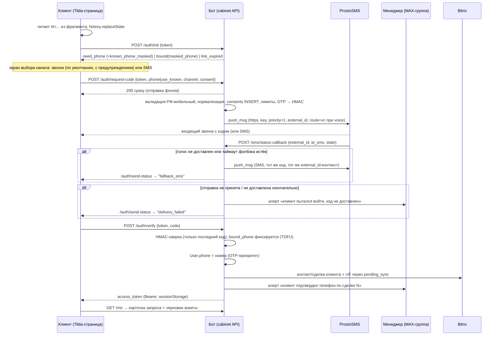

# Личный кабинет клиента: дизайн-документ и план реализации

## Summary

Личный кабинет клиента — страница на Tilda-поддомене дилера, вход по индивидуальной ссылке из чата (токен во фрагменте URL) с подтверждением 4-значным кодом по модели TOFU-привязки номера. Код доставляется голосовым роботом или SMS через прямую интеграцию с ProstoSMS. Кабинет решает две задачи: получение подтверждённого телефона для перевода диалога на живого менеджера (главная) и структурированный сбор данных по кредиту и трейд-ину, который неудобно вести в чате. Данные живут в отдельных таблицах поверх `users.id`; верифицированный телефон уходит в `User.phone`, Bitrix24 и алертом дилеру; поля анкеты — в UF-поля сделки Bitrix по явному нажатию «Отправить».

---

## Problem Frame

В чате неудобно и ненадёжно собирать структурированные данные по кредиту (доход, занятость, стаж) и трейд-ину (VIN, пробег, состояние) — свободный текст требует переспрашиваний и парсинга. Одновременно кабинет — единственный источник телефона клиента: на момент отправки ссылки телефона у бота нет и быть не может, клиент вводит его именно в кабинете. Отсюда главный критерий качества: **любой путь, при котором клиент авторизуется, но телефон не попадает к нам, — неприемлем**. Фолбэка «код в мессенджер» нет принципиально: он ломает основную цель. Код OTP несёт только функцию верификации номера и входа — доказательной (подписной) нагрузки у него нет.

Доставка кода через Bitrix24 проверена и отклонена: прямого REST-метода отправки SMS не существует, а механизм через роботов CRM проверен на портале и отклонён по производительности (медленно и ненадёжно). Выбрана прямая интеграция с агрегатором ProstoSMS: Python сам вызывает сервис по HTTP API и получает результат отправки, включая статусы доставки.

---

## Key Decisions

Каждое решение закрывает один из открытых вопросов: решение, отвергнутые альтернативы, обоснование.

- **SMS-транспорт: прямая интеграция с ProstoSMS (`push_msg`), за абстракцией `SmsGateway`.**
  Отвергнутые альтернативы: (а) прямой REST-метод Bitrix — не существует; (б) шаблон БП + `bizproc.workflow.start` — БП недоступны на тарифе; (в) роботы CRM в технической воронке — проверено на портале, отклонено по производительности. Принято: `ProstoSmsGateway` вызывает `push_msg` (POST, `format=json`) только на `https://ssl.bs00.ru` — незашифрованный `http://api.sms-prosto.ru:80` для передачи кода недопустим. Авторизация параметром `key` (API-ключ в переменных окружения, не в логах и не в репозитории). `priority=1` — только для OTP (документация закрепляет его за кодами авторизации). `external_id` = UUID нашей записи OTP для сопоставления статусов. Не используются: `set_aside_time`, `time=local` (отложенная отправка добавляет задержку), каскадная маршрутизация (не рекомендована для кодов). Абстракция `SmsGateway` (по образцу `BaseBotClient`/`get_client`) сохраняется: второй агрегатор добавляется позже без переписывания логики авторизации.

- **Два канала доставки кода: голосовой робот по умолчанию, SMS альтернативой; автофолбэк голос → SMS.**
  Голосовой канал (`route=vc`) — входящий звонок со случайного номера, робот диктует код; не зависит от согласования имени отправителя с операторами. SMS — вторая опция на экране выбора. При неудаче голосового вызова система однократно и автоматически досылает **тот же код** в SMS. Разведение с правилом «действителен только последний код»: автофолбэк — повторная доставка того же кода (запись OTP не меняется, попытки клиента не тратятся); ручной повтор по кнопке — новый код, предыдущий отменяется. В обратную сторону автофолбэка нет: при недоставке SMS интерфейс предлагает кнопку «получить код звонком» — ручной повтор с новым кодом; автоматический звонок клиенту, выбравшему SMS, выглядит навязчиво, а кнопка сохраняет контроль за клиентом без новой логики.

- **Отправка асинхронная; Bitrix в момент OTP не участвует.**
  Эндпоинт запроса кода отвечает браузеру мгновенно; вызов ProstoSMS уходит фоновой задачей. Bitrix вызывается только после успешной верификации — обычным путём через `pending_sync`; изоляция OTP-трафика от `BitrixService` больше не нужна.

- **Аутентификация кабинета: Bearer-токен в `sessionStorage`, не cookie.**
  Страница кабинета — на Tilda-поддомене дилера, API — на едином домене бота (dockhost), новые DNS-записи не заводим (ограничение владельца). Значит, API всегда кросс-доменный: first-party cookie невозможна, third-party cookie блокируется Safari/ITP и постепенно всеми браузерами. Bearer снимает и проблему множества дилерских доменов: whitelist CORS нужен только для origin-проверки, credentials-режим не требуется. Цена: сессия кабинета умирает с закрытием вкладки, повторный вход — снова OTP на привязанный номер (принято как допустимая цена).

- **Размещение фронтенда: вариант (а) — страница на Tilda + `app.js` с домена бота.**
  Альтернатива (б) — SPA, раздаваемый ботом: требует либо новой DNS-записи (исключено), либо iframe с Tilda-страницы (хуже мобильный UX, двойная прокрутка, ломается `history.replaceState` для фрагмента в родительском окне). Принято: Tilda-страница `/cabinet` на поддомене дилера с HTML-блоком: `
` + `<script src="https://{домен-бота}/cabinet-app/app.js">` + `window.UNIFIEDBOT_URL` — тот же паттерн, что у виджета. Статика раздаётся существующим механизмом `add_static`.

- **Адрес кабинета и CORS-whitelist — из существующего поля `Website_URL` таблицы Dealers NocoDB (`muruk10ipof33m5`).**
  Отдельная колонка не нужна. Адрес кабинета = `Website_URL` + путь `/cabinet`; значение разбирается как URL и собирается заново, а не склеивается строкой (в поле могут быть завершающий слеш, путь, query-параметры). Origin для whitelist — только схема и хост из того же поля. Схема обязана быть `https`: дилеры с `http` кабинет не получают; проверка — при построении whitelist на старте, несоответствие — запись в лог. Для префикса `/cabinet/api/*` — echo конкретного Origin при совпадении, `Vary: Origin`, preflight с `Authorization`; для `/catalog/*`, виджета и SSE существующее `Access-Control-Allow-Origin: *` (`main.py:2477-2497`) сохраняется как есть.

- **Токен ссылки: stateful opaque, в БД — только хеш; выдача идемпотентна.**
  Альтернатива — подписанный stateless (JWT-подобный): не требует таблицы, но отзыв возможен только через blacklist — таблица всё равно появляется, а короткий TTL конфликтует с долгоживущим кабинетом. Принято: 32 байта `secrets.token_urlsafe`, в БД SHA-256, статусы `active/revoked/expired`. При наличии активного токена повторный запрос ссылки возвращает **тот же URL**; отзыв — только по истечении срока (поле `revoked` в схеме остаётся на будущее, интерфейсной кнопки отзыва нет).

- **Данные анкеты: источник истины — наш Postgres; в Bitrix — по явному сабмиту, через конфиг-маппинг UF-полей.**
  Черновик автосохраняется только в Postgres; в CRM данные уходят один раз, по нажатию «Отправить». Соответствие «поле формы → UF-поле» хранится в конфиге, а не в коде; поля без сопоставления не роняют отправку — уходят текстом в комментарий таймлайна как фолбэк. В NocoDB данные формы не передаются; в n8n значения полей не передаются — только статус `cabinet_status`. Загрузка фотографий и файлов — вне рамок.

- **Расчёт агента в кабинете не отображается.**
  Агент «Александр» больше не собирает и не передаёт в Bitrix параметры кредита (первоначальный взнос убран из сценария диалога). Единственное значение, существующее до входа в кабинет, — желаемый ежемесячный платёж из квалификации Dialogflow; оно копируется в `cabinet_profile` при генерации ссылки и предзаполняет форму. Читать его из `USER_CONTEXT` нельзя: контекст удаляется после финализации, кабинет живёт дольше.

- **Alembic: вводим.**
  Сейчас схема создаётся `Base.metadata.create_all` (`database.py:54`) — он не умеет ALTER существующих таблиц. Кабинет добавляет 7 таблиц, плюс прод PostgreSQL / дев SQLite: ручные SQL-миграции пришлось бы писать в двух диалектах. Alembic с `render_as_batch=True` закрывает SQLite-ограничения. Baseline-миграция фиксирует текущую схему, `create_all` остаётся только как дев-фолбэк первого запуска.

- **Финализированная сессия не «размораживается».**
  Кабинет — параллельный контур, живущий дольше диалога: он читает и пишет только свои таблицы и не трогает `USER_CONTEXT`, `context_json`, `is_finalized`. Идемпотентность архивации в `sync_worker` не затрагивается вовсе. Если после привязки телефона клиент возвращается в чат — это обычный сценарий восстановления контекста из БД, уже существующий.

- **Триггер выдачи ссылки: гибрид.**
  Python генерирует токен и полный URL заранее (при передаче в AI handoff), кладёт ссылку в payload n8n как переменную `cabinet_url`; момент отправки выбирает агент по промпту (минимальная правка промпта — в рамках ограничения). Детерминированная выдача из Python остаётся фолбэком: в ветке A (Call-сценарий) и при каскадном фолбэке n8n ссылку отправляет сам Python вместо запроса телефона в чате.

- **Приём статусов доставки: один общий эндпоинт для SMS и голосовых кодов.**
  URL статусов SMS и URL статусов голосовых кодов настраиваются в разных подразделах кабинета сервиса, но набор полей совпадает — различение по `reporter`/`id_sms`. Альтернатива — два раздельных эндпоинта: чуть проще разбор, но дублирование кода сопоставления и идемпотентности. Принят общий.

---

## Trust Model

### Что подтверждает OTP

Телефона в базе нет, поэтому при первом входе OTP подтверждает **владение номером**, а не личность. Идентичность держится на токене ссылки: токен выдан конкретному `users.id` в конкретном чате. Схема — привязка при первом использовании (TOFU). Индивидуальная ссылка — единственная дверь в кабинет; вход по прямому адресу с паролем отменён.

### Оценка TOFU и усиления

Базовая схема корректна; критические точки и принятые меры:

- **Пересланная ссылка до привязки** — главный риск TOFU: кто первым открыл и ввёл свой номер, тот и привязал. Полностью устранить нельзя (телефона для сверки нет by design). Митигации: (1) до успешной верификации страница не показывает ничего персонального — только марку/модель и брендинг дилера; (2) короткий TTL непривязанного токена — 72 часа; (3) алерт дилеру при каждой привязке — менеджер видит номер и сверяет с контекстом сделки при звонке. Остаточный риск признан приемлемым: злоумышленник получает возможность привязать свой номер к чужой заявке — это испорченный лид, не утечка данных.
- **Пересланная ссылка после привязки** — не риск: код уходит только на привязанный номер, поле заменено маской, чужой номер отклоняется. Со второго входа схема эквивалентна 2FA (владение ссылкой + владение номером).
- **TTL до привязки: 72 часа.** Кабинет должен переживать сценарий «клиент открыл через сутки после архивации сессии»; 24 ч — мало, 7 дней непривязанного токена — неоправданно широкое окно для пересылки. Протухание — статус `expired`, чистит `sync_worker`.
- **TTL после привязки: 30 дней скользящих.** Каждый успешный вход продлевает срок. После привязки это 2FA, длинный срок безопасен и избавляет от повторной выдачи ссылок живым лидам.
- **Телефон, уже известный из чата** (regex-перехватчик или vCard, не верифицирован): `auth/init` показывает его маску и предлагает отправить код на него, с возможностью ввести другой номер. Привязка происходит только по успешной верификации — известный номер статуса доверия не получает.
- **Расхождение номеров кабинет/чат.** OTP-верифицированный номер — единственный источник истины для `User.phone`; номер, полученный позже в чате, верифицированный **не перезаписывает**. При расхождении: второй номер уходит комментарием в таймлайн сделки + алерт дилеру «клиент назвал в чате другой номер» — решение за менеджером. Обратный порядок симметричен: OTP-номер записывается в `User.phone`, прежний — в комментарий с пометкой.
- **Статус доставки никогда не служит основанием для верификации** — он влияет только на автофолбэк, лимиты и алерты. Верификация — исключительно ввод кода клиентом.

---

## Actors

- A1. Клиент — получает ссылку в чате (MAX/Telegram/веб-виджет), выбирает канал кода (звонок/SMS), проходит OTP, заполняет анкету.
- A2. Python-бот — генерирует токены, обслуживает API кабинета, шлёт коды через `SmsGateway`, принимает статусы доставки, алертит.
- A3. LLM-агент «Александр» (n8n) — решает момент отправки ссылки, узнаёт о статусе кабинета из payload.
- A4. Менеджер дилера — получает алерты в MAX-группу (`Max_Group_ID`), продолжает вручную при сбоях.
- A5. ProstoSMS — доставляет код голосовым звонком или SMS, пушит статусы доставки на наш эндпоинт.
- A6. Bitrix24 — принимает телефон и поля анкеты через `pending_sync` после верификации.
- A7. Техподдержка (`TECH_ADMIN_ID`) — получает системные алерты (аварии конфигурации, баланс, недоступность сервисов).

---

## DB Schema

Все таблицы привязаны к `users.id` (внутренний ID, не `platform_user_id`). `context_json` не используется. Новый модуль моделей — рядом с существующими `User`/`PendingSync` в `database.py` (или `cabinet_models.py` — решается в плане).

### cabinet_tokens

| Поле | Тип | Назначение |
|---|---|---|
| id | Integer PK | |
| user_id | FK users.id, indexed | владелец |
| dealer_code | String(2) | ключ в `CACHED_DEALERS` |
| deal_id | String, nullable | сделка на момент выдачи |
| token_hash | String(64), unique | SHA-256 от токена; сам токен не хранится |
| bound_phone | String, nullable | E.164; NULL до первой верификации; источник истины по подтверждённому номеру — эта колонка, не Bitrix |
| status | String | `active` / `revoked` / `expired` |
| failed_attempts, attempts_window_start | Integer, DateTime | счётчик неверных вводов кода (см. cabinet_otp) |
| created_at, bound_at, last_login_at, expires_at | DateTime | TTL: 72 ч до привязки, 30 дн скользящих после |

Частичная уникальность: один `active` токен на `user_id` (в PostgreSQL — partial unique index; в SQLite дев-режима — проверка на уровне приложения). Выдача идемпотентна: при активном токене возвращается тот же URL.

### cabinet_otp

| Поле | Тип | Назначение |
|---|---|---|
| id | Integer PK | |
| token_id | FK cabinet_tokens.id | |
| phone | String | куда отправлен код (нормализованный) |
| code_hmac | String(64) | HMAC-SHA256(код, server key); код не хранится |
| external_id | String(36), unique | UUID для `external_id` ProstoSMS; по нему сопоставляются входящие статусы |
| channel | String | выбранный клиентом канал: `voice` / `sms` |
| voice_msg_id, sms_msg_id | String, nullable | ID сообщений сервиса (голосовой вызов и SMS-фолбэк соответственно) |
| delivery_state | String, nullable | последний принятый статус доставки |
| fallback_at | DateTime, nullable | момент автофолбэка голос → SMS; NULL = не срабатывал |
| sent_at, expires_at | DateTime | TTL кода 5 минут |
| status | String | `sent` / `superseded` / `verified` / `expired` / `failed_send` |

Действителен только последний код: **ручной повтор** создаёт новую запись и переводит предыдущую в `superseded`. **Автофолбэк** голос → SMS повторно доставляет тот же код в той же записи (заполняются `sms_msg_id`, `fallback_at`) — `superseded` не наступает, попытки клиента не тратятся. Параллельные вызовы `request-code` не создают двух активных записей: частичный уникальный индекс на запись в статусе `sent` на токен (в SQLite дев-режима — блокировка строки токена на уровне приложения). Счётчик неверных вводов живёт **на токене за окно**, не на коде: максимум 5 неверных вводов за 30 минут на токен — счётчик не сбрасывается повторной отправкой кода. При превышении — блокировка попыток на токене на 30 минут.

### cabinet_sessions

| Поле | Тип | Назначение |
|---|---|---|
| id | Integer PK | |
| token_id, user_id | FK | |
| session_hash | String(64), unique | SHA-256 от bearer-значения |
| created_at, expires_at | DateTime | 40 мин бездействия, скользящие (любой авторизованный запрос продлевает); абсолютный максимум 12 ч |
| ip, user_agent | String | аудит |

Пока вкладка открыта, страница фоново продлевает сессию (автосохранение черновика и периодический опрос делают это естественно).

### cabinet_profile

| Поле | Тип | Назначение |
|---|---|---|
| user_id | FK, unique | |
| deal_id, dealer_code, brand_model, scenario_type | String | карточка «Ваш запрос» |
| qualification_payment | Integer, nullable | желаемый ежемесячный платёж из квалификации Dialogflow; копируется при генерации ссылки, кабинетом **не перезаписывается** — остаётся для аналитики |
| steps_status | Text (JSON) | `phone_confirmed` / `form_submitted` |

### cabinet_form

Хранение анкеты. Варианты: (а) отдельная таблица; (б) поля в `cabinet_profile` с флагом `submitted_at`. **Рекомендация — (а), отдельная таблица:** черновик обновляется автосохранением часто, профиль — редко; разделение упрощает retention и обезличивание ПДн одной таблицей; `submitted_at IS NULL` естественно кодирует черновик.

| Поле | Тип | Назначение |
|---|---|---|
| user_id | FK, unique | |
| deal_id | String | |
| credit_initial, credit_term, credit_payment | Integer, nullable | взнос, срок, платёж |
| income, employment, work_experience, family_composition | String/Integer, nullable | доход, занятость, стаж, состав семьи |
| tradein_make, tradein_model, tradein_year, tradein_mileage | String/Integer, nullable | |
| tradein_condition, tradein_damage, tradein_engine | String, nullable | свободный текст, ограничен по длине |
| tradein_plate, tradein_vin, tradein_owners | String/Integer, nullable | |
| updated_at | DateTime | последнее автосохранение |
| submitted_at | DateTime, nullable | NULL = черновик; заполняется по явному «Отправить» |

### consents

Сохраняется: доход, занятость, состав семьи, VIN — персональные данные, согласие обязательно до отправки первого кода.

| Поле | Тип | Назначение |
|---|---|---|
| id, user_id, token_id | | |
| consent_version | String | версия текста согласия |
| consent_text_hash | String(64) | SHA-256 текста, который видел клиент |
| granted_at, ip, user_agent | | фиксация до отправки первого кода |

### cabinet_events (аудит)

`id, user_id, token_id, event_type, created_at, ip, meta_json` — `link_opened`, `code_requested`, `code_sent`, `delivery_failed`, `fallback_sms`, `send_failed`, `verified`, `verify_failed`, `form_submitted`, `session_expired`. Источник триггеров для алертов о брошенных попытках; телефоны в `meta_json` — только маской.

### Миграции

1. `0001_baseline` — фиксация текущих `users` + `pending_sync` (autogenerate от существующей metadata, пустой upgrade для прода).
2. `0002_cabinet` — `cabinet_tokens`, `cabinet_otp`, `cabinet_sessions`, `cabinet_profile`, `cabinet_form`, `consents`, `cabinet_events`.

---

## API Contract

Клиентские эндпоинты — под префиксом `/cabinet/api/`, JSON. Телефон в любых ответах — только маской (`+7•••••••123`). Токен ссылки в теле запросов, не в URL (не попадает в access-логи).

### Принцип неразличимости

Для защиты от перебора токенов ответы не раскрывают, существует ли токен: `init`, `request-code` и `send-status` возвращают для несуществующего токена те же ответы и тайминги, что и для валидного (для несуществующего код просто не отправляется); сравнение хешей — константное по времени, с холостым HMAC-вычислением. Поскольку у валидного токена состояние `send-status` эволюционирует (`sent` → `fallback_sms` → `delivery_failed`), для несуществующего токена состояние тоже эволюционирует по правдоподобному сценарию, привязанному ко времени первого обращения, — иначе наблюдатель отличил бы валидный токен по самому факту изменения. Практическая значимость невелика (пространство токенов 32 байта, перебор невозможен), но заявленный в R5 принцип должен совпадать с реализацией. Для **валидного** токена клиент видит реальное состояние доставки: «код отправлен» → «звонок не дошёл, отправили SMS» → «не доставлено, попробуйте другой канал или менеджер свяжется». Исключение — статус `expired`: токен существовал легитимно, честный ответ «ссылка устарела, запросите новую в чате» допустим и спасает живого клиента от тупика.

### Валидация телефона

Принимаются только мобильные номера РФ (код `9xx`); казахстанские (`+7 7xx`) отклоняются. Номер нормализуется к единому формату (E.164) до любого сохранения и сравнения — ошибка формата отсекается на нашей стороне, до вызова сервиса (код 617 не должен возникать).

### Эндпоинты

| Метод и путь | Auth | Запрос | Ответ 200 | Ошибки |
|---|---|---|---|---|
| POST `/cabinet/api/auth/init` | token | `{token}` | `{state: "need_phone" \| "bound", masked_phone?, known_phone_masked?, dealer: {name, brand_model}}` | 410 `link_expired` |
| POST `/cabinet/api/auth/request-code` | token | `{token, phone \| use_known: true, channel: "voice" \| "sms", consent: {version, accepted: true}}` | `{status: "ok", retry_after: 60}` — мгновенно, отправка фоном | 410 `link_expired`, 429 `rate_limited {retry_after}`, 422 `consent_required` / `invalid_phone`, 409 `phone_mismatch` |
| POST `/cabinet/api/auth/send-status` | token | `{token}` | `{state: "sending" \| "sent" \| "fallback_sms" \| "delivery_failed"}` — опрашивается экраном ввода кода каждые 3–5 с (интервал в конфиге); опрос прекращается при финальном состоянии или истечении TTL кода | 410 `link_expired` |
| POST `/cabinet/api/auth/verify` | token | `{token, code}` | `{access_token, expires_in: 2400, profile}` | 400 `invalid_code {attempts_left}`, 423 `locked {retry_after}`, 410 `link_expired` |
| GET `/cabinet/api/me` | Bearer | — | `{profile, form, steps_status}` | 401 `unauthorized` |
| PUT `/cabinet/api/form` | Bearer | частичные поля анкеты | `{status: "draft_saved"}` — только Postgres, без обращений к Bitrix | 401, 422 |
| POST `/cabinet/api/form/submit` | Bearer | — | `{status: "submitted"}` — отправка в UF-поля Bitrix через `pending_sync`, один раз | 401, 409 `already_submitted`, 422 `validation` |

`known_phone_masked` возвращается в `state: "need_phone"`, когда номер уже известен из чата (не верифицирован); `use_known: true` отправляет код на него без повторного ввода. `channel` по умолчанию — `voice`. `invalid_code` для несуществующего токена и для неверного кода — одинаковый ответ. Verify принимает только последний отправленный код (`superseded` отклоняются как неверные); код, доставленный автофолбэком, — тот же последний код.

### Сервисный эндпоинт статусов (не под `/cabinet/api/`, вне CORS-whitelist)

POST/GET `/sms/status-callback` — приём push-статусов от ProstoSMS (общий для SMS и голосовых кодов; различение по `reporter`/`id_sms`):

- Публичный, без аутентификации (сервис не подписывает запросы) — обязательна привязка по `external_id` и `id_sms` к нашей записи OTP; параметру `phone` из запроса не доверять; неизвестные `external_id` игнорируются молча.
- Статус доставки не является подтверждением верификации — влияет только на автофолбэк, лимиты и алерты.
- По возможности ограничить приём по IP-адресам сервиса (уточнить в поддержке).
- Идемпотентность: повторный статус по тому же сообщению не приводит к повторному фолбэку или повторным алертам.
- Разбор устойчив к неточностям документации: в примерах `reporter` фигурирует и как `sms_platform`, и как `voice_platform`, значения `state` в примере и расшифровке расходятся (45 против 1) — реальные значения снять на тестовой отправке, парсер не полагается на примеры.

### Rate limits

Лимиты защищают и от перебора, и баланс от расстрела ботнетом. Паттерн — `spam_control` (окно + счётчик), состояние на токене/номере — в БД. **Попытка засчитывается, только если сервис принял сообщение (`err_code = 0`)**: ошибки конфигурации, недостатка средств и чёрного списка попытку клиента не расходуют — клиент не запирается на сутки из-за сбоя на нашей стороне.

| Измерение | Лимит |
|---|---|
| Ручные запросы кода на токен | cooldown 60 с; максимум 3 в сутки. Автофолбэк голос → SMS в лимит клиента не входит |
| Номер телефона | 3 в сутки (по всем токенам) |
| IP | 10 запросов кода в час; 30 запросов к `/cabinet/api/auth/*` в минуту (кроме `send-status`) |
| Опрос `send-status` | собственный потолок вне общего лимита: 60 запросов в минуту на токен — легитимный опрос раз в 3–5 с не должен упираться в защиту от перебора |
| Неверные вводы кода | 5 за 30 мин на токен, без сброса при resend → блок 30 мин |
| Дилер (глобально) | суточный кап отправок, конфиг, дефолт 100; считаются **все фактические отправки, включая автофолбэки** → при превышении алерт в `TECH_ADMIN_ID` и отказ |

Допущение: монолит работает одним процессом (dockhost) — IP-лимитер в памяти допустим; лимиты на токен/номер — в БД, переживают рестарт.

---

## Auth Flow

Передача токена во фрагменте (`#t=...`) подтверждена: фрагмент не попадает в логи Tilda, хиты веб-аналитики и Referer. Дополнительно на странице кабинета: `<meta name="robots" content="noindex">` и `<meta name="referrer" content="no-referrer">`; `app.js` читает фрагмент до инициализации любых счётчиков и сразу делает `history.replaceState`.

Для веб-канала ссылка открывается в новой вкладке (`target="_blank"` в виджете): SSE-соединение чата продолжает жить в исходной вкладке, диалог с агентом не рвётся. Для MAX/Telegram — обычная ссылка.

---

## SMS Layer

### Транспорт

- Адрес: только `https://ssl.bs00.ru` (443). `http://api.sms-prosto.ru:80` не используется — передача кода по незашифрованному каналу недопустима.
- Метод `push_msg`, POST, `format=json`. Авторизация параметром `key` (API-ключ из переменных окружения; в логи не попадает, в репозиторий не коммитится).
- `priority=1` — только для OTP (закреплён документацией за кодами авторизации).
- `external_id` — UUID нашей записи OTP; по нему сопоставляются входящие статусы.
- Не используются: `set_aside_time`, `time=local` (буферизация добавляет задержку), каскадная маршрутизация (не рекомендована для кодов).

### Два канала

| Канал | Параметр | Что видит клиент |
|---|---|---|
| Голосовой робот | `route=vc` | Входящий звонок со случайного номера, робот диктует код |
| SMS | без `route` | Обычное сообщение с буквенным именем отправителя |

Голосовой робот — вариант по умолчанию на экране запроса кода; SMS — вторая опция, выбирается клиентом.

Ограничения голосового канала:

- Платформа вырезает цифры из текста и диктует их — текст для `route=vc` не должен содержать никаких цифр, кроме самого кода. Нужны **два отдельных шаблона**: голосовой (без цифр вне кода) и SMS (может содержать срок действия кода).
- Код — ровно 4 цифры (совпадает с текущим дизайном).
- **Обязательный элемент интерфейса, не пожелание:** до отправки клиент предупреждается, что поступит звонок, на который нужно ответить и прослушать код, — без предупреждения клиент не возьмёт трубку с незнакомого номера. Предупреждение размещается на экране выбора канала, до отправки.
- `sender_name` передаётся всегда — параметр обязателен для `push_msg`; на голосовой канал он не влияет (звонок идёт с произвольного номера).

### Автофолбэк голос → SMS

Если клиент выбрал голосовой канал и звонок не прошёл, система автоматически досылает SMS **с тем же самым кодом**. Разведение с правилом «действителен только последний код» (R22/R30):

- Автофолбэк — повторная доставка того же кода: код не меняется, запись OTP не переводится в `superseded`, счётчик попыток клиента не тратится; в лимит клиента отправка не входит, но учитывается в суточном капе дилера.
- Ручной повтор по кнопке — новый код: предыдущий переводится в `superseded`, действителен только последний.

Триггеры автофолбэка — **оба обязательны**:

1. Пришёл статус «не доставлено» по голосовому вызову.
2. Истёк таймаут без финального статуса — задержка прихода статусов не гарантирована, полагаться только на них нельзя. Значение — в конфиге; варианты: 45 с / 60 с / 90 с. **Рекомендация — 45 с:** держит клиента в ожидании минимально, а идемпотентность колбэка гарантирует, что поздний статус не вызовет второй отправки.

Автофолбэк срабатывает не более одного раза на запрос кода. Клиент видит на экране, что произошло: «Звонок не дошёл, отправили код в SMS» (через опрос `send-status`).

**Механизм срабатывания по таймауту — ленивое вычисление.** Отложенная задача в памяти процесса не годится: перезапуск бота потерял бы все ожидающие фолбэки, и клиент с непрошедшим звонком не получил бы SMS вообще. Принято: при каждом обращении к `send-status` проверяется условие «прошло больше `fallback_timeout` секунд с `sent_at`, финального статуса нет, `fallback_at IS NULL`» — при выполнении инициируется SMS-досылка и проставляется `fallback_at`. Состояние живёт в БД, перезапуск ничего не ломает, отдельный планировщик не нужен. Страховка — в `sync_worker`, для случая закрытой вкладки без опроса: проход по записям OTP в подходящем состоянии (там же — 15-минутная проверка R26). Гонка между ленивой проверкой и воркером исключается атомарным условным обновлением `fallback_at` — досылка происходит ровно один раз.

### Отказ SMS-канала

Симметричного автофолбэка SMS → голос нет. При `delivery_failed` для SMS интерфейс явно предлагает кнопку «получить код звонком» — обычный ручной повтор с новым кодом. Автоматический звонок клиенту, выбравшему SMS, навязчив; кнопка сохраняет контроль за клиентом и не требует логики сверх уже описанной.

### Ручной повтор

Клиент может запросить код заново любым из двух каналов — в том числе если не расслышал или не запомнил продиктованный код. Каждый ручной запрос генерирует новый код и подчиняется общим лимитам. Кулдаун между ручными запросами — 60 секунд.

### Обработка кодов ошибок `push_msg`

| Ситуация | Поведение |
|---|---|
| 0 — принято к отправке | Записать `id`, ждать статус |
| 623 — недостаточно средств | Алерт в `TECH_ADMIN_ID`, попытку клиенту не засчитывать, нейтральное сообщение клиенту, алерт дилеру |
| 3, 602, 625, 626, 627 — API отключено, неверный ключ, запрос с незаявленного IP | Авария конфигурации: алерт в `TECH_ADMIN_ID`, попытку не засчитывать |
| 617 — неверный формат номера | Ошибка нашей валидации — до отправки не доводить |
| 618, 622 — номер в чёрном списке | Сообщить клиенту, предложить второй канал, попытку не засчитывать |
| 632, 607, 608, 620, 621 — проблемы с именем отправителя | Авария конфигурации, алерт в техподдержку; для голосового канала неприменимо |
| 628 — тестовый режим | Отправка только на номер, привязанный к кабинету сервиса; до заполнения реквизитов компании полноценное тестирование невозможно — учтено в плане тестирования |
| 624, 631, 645, 671 — отклонение по тексту | Алерт в техподдержку: шаблон требует правки |
| 99, 699, сетевая ошибка, таймаут | Ретрай один раз, затем — как неудачная отправка |

Антифлуд оператора: два сообщения с одинаковым текстом на один номер за короткий промежуток могут дать «не доставлено в SMSC». Правило «ручной повтор = новый код» снимает это автоматически, но при автофолбэке голос → SMS текст содержит тот же код — **проверить на тестах**, не срабатывает ли защита при смене канала.

### Мониторинг баланса и самопроверка канала

`get_profile` вызывается при старте бота и периодически в `sync_worker` — это одновременно мониторинг баланса и проверка того, что запрос уходит с заявленного адреса (R32). Алерт в `TECH_ADMIN_ID` при падении баланса ниже порога из конфига; варианты порога: фиксированная сумма в рублях (просто, предсказуемо) или динамический — X дней среднего расхода (точнее, но требует накопленной статистики). **Рекомендация — фиксированная сумма, дефолт 500 ₽,** с пересмотром после накопления статистики отправок.

Ответ с кодом 602 или 627 при неизменном ключе означает смену исходящего адреса — немедленный алерт в `TECH_ADMIN_ID`. Эти коды не различают «неверный ключ» и «запрос с незаявленного адреса», а ключ в проде не меняется, поэтому алерт обязан содержать текущий исходящий IP-адрес бота и результат резолва `ssl.bs00.ru` (R33) — без них причина отказа неочевидна, и разбираться придётся вручную под потоком жалоб.

### Компенсация вместо фолбэка в мессенджер

Фолбэка «код в мессенджер» нет. Вместо него — алерт дилеру через `send_dealer_alert` (существующий, `main.py:779-784`):

- Триггеры: (1) окончательная неудача доставки (после автофолбэка) или непринятие сервисом; (2) **обязательный**: `code_requested` без `verified` в течение 15 минут (проверяет `sync_worker` по `cabinet_events`) — теперь не единственная страховка, но остаётся сеткой под быстрым триггером по статусу; (3) исчерпание лимита попыток ввода.
- Формат: `⚠️ Личный кабинет: {имя} ({канал}) по сделке {deal_id} ({модель}) — {что случилось}. Телефон: {номер, пометка «не подтверждён»}. Продолжите в чате вручную.`
- Что видит клиент при окончательной неудаче: «Не удалось доставить код. Попробуйте другой канал — или менеджер свяжется с вами в чате».

### Абстракция

`SmsGateway` (ABC, по образцу `base_client.py`): `send_otp(phone, code, channel, external_id) -> SendResult`. Реализации: `ProstoSmsGateway` (MVP), второй агрегатор — позже, вне рамок. Выбор — конфигом, роутер по образцу `get_client`. Абстракция — не только про удобство добавления второго провайдера, но и про бизнес-непрерывность: способность быстро переключиться, если маршрут к ProstoSMS перестанет работать. Интерфейс не должен препятствовать подключению провайдера с другим адресом или транспортом.

### Исходящая маршрутизация (диагностика dockhost)

Исходящий адрес контейнера зависит от **направления запроса**, а не от библиотеки или прокси (прокси не задан; поведение `urllib` и `aiohttp` идентично). Два пути: основная российская сеть `45.92.179.192/28` (адреса `.193–.206`, статичные, о смене поддержка предупреждает заранее) и зарубежная сеть с непубличными, часто меняющимися адресами. Путь выбирается по классификации адреса назначения (запрос к ifconfig.me ушёл с `45.92.179.194`, к api.ipify.org за Cloudflare — с `103.112.69.233`).

`ssl.bs00.ru` резолвится в единственную A-запись `195.133.70.4` — российский адрес не за CDN (проверено `gethostbyname_ex` с боевого контейнера). Маршрут к ProstoSMS однозначен: основная сеть `45.92.179.192/28` — её и заявляем в IP-фильтре сервиса (все 14 адресов или подсетью, если сервис принимает CIDR). Сценарий плавающих отказов из-за адресов, классифицированных как зарубежные, исключён на момент проектирования.

Остаточный риск: если `ssl.bs00.ru` переедет за CDN, сменит адрес на классифицируемый как зарубежный, либо геобаза провайдера изменит классификацию `195.133.70.4`, маршрут молча переключится на непубличную сеть и отправка кодов перестанет работать. Отказ тихий — клиенты просто не смогут войти; контроль — самопроверка `get_profile` (R32) и алерт с IP и резолвом (R33).

---

## Cabinet Form

Содержимое кабинета после авторизации: карточка «Ваш запрос» (марка/модель, тип воронки, статус шагов) и анкета из двух блоков. Загрузка фотографий и файлов — вне рамок этой работы.

**Поля, кредит:** первоначальный взнос, срок, ежемесячный платёж, доход, занятость, стаж, состав семьи.

**Поля, трейд-ин:** марка, модель, год, пробег, состояние, имеющиеся повреждения, двигатель, госномер, VIN, количество владельцев.

### Источник кредитных параметров

Конкурирующих источников нет. Агент больше не собирает и не передаёт параметры кредита. Единственное значение, существующее до входа в кабинет, — **желаемый ежемесячный платёж** из квалификации Dialogflow:

- копируется в `cabinet_profile.qualification_payment` в момент генерации ссылки (из `USER_CONTEXT` читать нельзя — контекст удаляется после финализации, кабинет живёт дольше);
- предзаполняет поле «ежемесячный платёж» формы;
- исходное значение не перезаписывается: если клиент скорректирует платёж в кабинете, первоначальный ответ остаётся в `qualification_payment` для аналитики;
- в UF-поля Bitrix пишет только кабинет.

### Маршруты данных

- **Postgres** — хранение всех полей формы, включая черновик (`cabinet_form`).
- **Bitrix** — известные UF-поля (маппинг в конфиге, не в коде):

| Поле формы | UF-поле |
|---|---|
| credit_initial | `UF_CRM_1770634607` |
| credit_term | `UF_CRM_1770634728` |
| credit_payment | `UF_CRM_1770634992` |
| tradein_make | `UF_CRM_1770635063` |
| tradein_model | `UF_CRM_1770635116` |
| tradein_year | `UF_CRM_1770635208` |
| tradein_mileage | `UF_CRM_1770635257` |
| tradein_plate | `UF_CRM_1770635310` |

  Остальные UF-поля будут заведены позже. Поля без сопоставления не роняют отправку — уходят текстом в комментарий таймлайна как фолбэк.
- **NocoDB** — данные формы не передаются.
- **n8n** — значения полей агенту не передаются; только `cabinet_status` со значением «анкета заполнена», чтобы агент не переспрашивал уже собранное. Правка промпта минимальная.

### Обработка ввода

Поля свободного текста («состояние», «имеющиеся повреждения») ограничиваются по длине (500 символов) и экранируются перед отправкой в BBCode-комментарий Bitrix (`[`/`]`).

### Черновик и сессия

- Автосохранение черновика по мере заполнения — **только в Postgres**; обращений к Bitrix при автосохранении нет. В CRM данные уходят один раз, по явному нажатию «Отправить» (`submitted_at`).
- Пока вкладка открыта, страница фоново продлевает сессию; TTL сессии — 40 минут бездействия.
- **Доступ менеджера к частично заполненному черновику — принято:** при брошенном черновике (нет сабмита 30 минут после последнего автосохранения) содержимое уходит комментарием в таймлайн сделки, дилеру — алерт-факт «клиент начал анкету, не завершил» без значений полей. Отвергнуты: «ничего до сабмита» (теряет ценность недозаполненных анкет) и «алерт с содержимым при каждом обновлении» (шумит и гонит ПДн в мессенджер, противоречит духу R16).

---

## Legal

- **Согласие 152-ФЗ.** Чекбокс + ссылка на текст на экране ввода телефона, до отправки первого кода. `request-code` без `consent.accepted` → 422. Запись в `consents` (версия, хеш текста, время, IP, UA) — до вызова `SmsGateway`. Согласие покрывает данные анкеты (доход, занятость, состав семьи, VIN, госномер) и передачу номера оператору рассылки (ProstoSMS) для доставки кода — включить в текст согласия (вопрос юристу).
- **Хранение и удаление.** Данные формы хранятся в нашем Postgres и являются ПДн. Срок хранения и процедура удаления — вопрос юристу (Outstanding). Удаление по запросу субъекта ПДн: ручная административная процедура — обезличивание строк кабинета в нашей БД + заявка на удаление в Bitrix; автоматического self-service эндпоинта в рамках этой работы нет.
- **Изоляция от логирующего конвейера.** Значения полей кабинета (телефон, код, токен, поля анкеты) не должны попадать в `python_logs`, `chat_history`, `Dialogues_Archive`, таймлайн Bitrix в открытом виде (исключение — явные маршруты: UF-поля и комментарий по сабмиту/брошенному черновику). Механизм — три уровня:
  1. Модуль кабинета не вызывает `log_session` (пишущий в `ctx['python_logs']`) — у него собственный логгер `cabinet`, пишущий только event-типы и ID, никогда — значения полей.
  2. Типы-обёртки для чувствительных значений (телефон, код, токен, поля анкеты, API-ключ ProstoSMS) с маскирующим `__repr__`/`__str__` — случайный `f-string` или traceback печатает маску, не значение. Код OTP не логируется никогда и нигде; токен — только первые 8 символов хеша.
  3. Страховочный `logging.Filter` на root-логгере с regex-маскированием телефонных паттернов — ловит утечки из чужого кода, включая Global Error Middleware (traceback с телом запроса уходит в MAX-группу техподдержки — фильтр применяется и к тексту алерта).

---

## Bot Integration

- **Выдача ссылки.** Python генерирует токен при первом AI handoff (и в ветке A перед запросом контакта), кладёт `cabinet_url` в `qualification_context` payload n8n; одновременно копирует желаемый платёж в `cabinet_profile.qualification_payment`. Правка промпта — минимальная: «когда уместно предложить кабинет — отправь ссылку {cabinet_url}». Фолбэк-точки детерминированной отправки из Python: Call-сценарий, каскадный фолбэк n8n.
- **После привязки телефона:** `save_user_phone()` (существующий, `database.py:92`), алерт дилеру, `crm.contact.update` + комментарий в таймлайн через `pending_sync`, сдвиг стадии сделки — переиспользуется существующая логика ветки сбора контакта (тот же путь, что при vCard/regex-перехвате), с пометкой источника «кабинет».
- **Склейка при завершении охоты за дублями:** подтверждённый номер входит в перечень полей, переносимых из временной сделки в основную; основная и временная сделки различаются в коде явными именами.
- **n8n узнаёт о статусе кабинета** из payload: `user_data.phone` уже передаётся; добавляется `qualification_context.cabinet_status` (`link_sent` / `phone_confirmed` / `form_submitted`). Промпт: «если телефон уже подтверждён — не запрашивай его»; параметры кредита агент не собирает.
- **Переиспользуется без изменений:** `pending_sync` + `sync_worker` (плюс три новые обязанности: экспирация токенов, детект брошенных попыток, мониторинг баланса ProstoSMS), Global Error Middleware (с маск-фильтром), паттерн `spam_control` для лимитов, каталог-прокси, `add_static`, `send_dealer_alert`.

---

## Requirements

Нумерация стабильна; R14, R15, R18, R23 удалены ревизиями (ПЭП, паспорт, снапшот расчёта, технические сущности Bitrix) — номера не переиспользуются.

**Авторизация**

- R1. Вход в кабинет — только по индивидуальной ссылке с opaque-токеном во фрагменте URL и подтверждением 4-значным кодом; иных способов входа нет.
- R2. При первой верификации номер фиксируется как `bound_phone` навсегда; последующие входы отправляют код только на него, ввод другого номера отклоняется.
- R3. До успешной верификации страница не отображает ничего персонального — только марку/модель и брендинг дилера (маска известного из чата номера — допустимое исключение по R27).
- R4. В БД хранятся только хеш токена и HMAC кода; открытые значения не сохраняются и не логируются.
- R5. Ответы auth-эндпоинтов неразличимы по коду и времени для валидного и несуществующего токена; статус `expired` — единственное раскрываемое состояние.
- R6. Счётчик неверных вводов кода не сбрасывается при повторной отправке кода.

**Телефон и CRM**

- R7. Успешная верификация записывает номер в `User.phone`, обновляет контакт и сделку в Bitrix (через `pending_sync`) и отправляет алерт в MAX-группу дилера.
- R8. OTP-верифицированный номер не перезаписывается номером из чата; расхождение фиксируется в таймлайне сделки и алертом дилеру.

**Доставка кода**

- R9. Коды уходят через `SmsGateway`; реализация MVP — прямая интеграция с ProstoSMS по `push_msg`, два канала (голосовой робот `route=vc` и SMS); добавление второго агрегатора не требует изменений логики авторизации.
- R10. Фолбэка «код в мессенджер» нет; при неудачной доставке, брошенной попытке или исчерпании лимита дилер получает алерт с данными для ручного продолжения в чате.
- R11. Действуют лимиты по токену (3 ручных запроса/сутки), номеру, IP и суточный кап на дилера; попытка засчитывается, только если сервис принял сообщение (`err_code = 0`) — ошибки конфигурации, недостатка средств и чёрного списка попытку клиента не расходуют.
- R20. Эндпоинт запроса кода отвечает мгновенно; отправка уходит фоновой задачей.
- R21. Принимаются только мобильные номера РФ (`9xx`); номер нормализуется до любого сохранения и сравнения.
- R22. Действителен только последний отправленный код; ручной повтор отменяет предыдущий.
- R26. Алерт «код запрошен, но не подтверждён в течение 15 минут» — обязательное требование; статус «не доставлено» даёт дополнительный быстрый триггер, но не отменяет 15-минутный.
- R28. Клиент выбирает канал получения кода (голосовой робот по умолчанию, SMS альтернативой); до отправки голосового кода интерфейс обязан предупредить о входящем звонке.
- R29. При неудаче голосового канала система однократно и автоматически досылает тот же код в SMS; автофолбэк не отменяет код, не расходует попытки клиента и не является ручным повтором.
- R30. Ручной повтор генерирует новый код и отменяет предыдущий; автофолбэк — нет.
- R31. Входящие статусы доставки принимаются публичным эндпоинтом, сопоставляются по `external_id`/`id_sms`, обрабатываются идемпотентно и никогда не служат основанием для верификации.
- R32. Работоспособность канала доставки контролируется автоматически: `get_profile` вызывается при старте бота и периодически в `sync_worker` — мониторинг баланса и одновременно проверка, что запрос уходит с заявленного адреса; коды 602/627 при неизменном ключе означают смену исходящего адреса и дают немедленный алерт в `TECH_ADMIN_ID`.
- R33. Любой алерт в `TECH_ADMIN_ID` по кодам 602 и 627 содержит текущий исходящий IP-адрес бота и результат резолва `ssl.bs00.ru` — сами коды не различают «неверный ключ» и «незаявленный адрес».

**Данные и право**

- R12. Все данные кабинета привязаны к `users.id` и живут в отдельных таблицах; `context_json` не читается и не пишется кабинетом.
- R13. Согласие на обработку ПДн фиксируется (версия, хеш текста, время, IP, UA) до отправки первого кода.
- R16. Значения полей кабинета (телефон, код, токен, поля анкеты) не попадают в `python_logs`, `chat_history`, `Dialogues_Archive` и таймлайн Bitrix в открытом виде; исключение — явные маршруты сабмита и брошенного черновика.

**Жизненный цикл**

- R17. Кабинет работает после финализации и архивации сессии: всё чтение/запись — через БД, `is_finalized` и идемпотентность `sync_worker` не затрагиваются.
- R19. Выдача ссылки идемпотентна: при активном токене возвращается тот же URL; отзыв — только по истечении срока.

**Анкета**

- R24. Черновик анкеты автосохраняется только в Postgres; в Bitrix данные уходят один раз, по явному нажатию «Отправить», через конфиг-маппинг UF-полей с фолбэком в комментарий таймлайна.
- R25. Желаемый платёж из квалификации предзаполняет форму и хранится отдельно; кабинет его не перезаписывает.
- R27. Если номер известен из чата, `auth/init` предлагает отправить код на него (маска) с возможностью ввести другой.

---

## Acceptance Examples

Нумерация стабильна; AE10 удалён вместе с требованием R23 — номер не переиспользуется.

- AE1. **Covers R2, R5.** Given привязанный токен, When ввод другого номера в `request-code`, Then 409 `phone_mismatch`, код не отправляется, счётчики не тратятся.
- AE2. **Covers R6.** Given 4 неверных ввода кода, When клиент запрашивает новый код и ошибается ещё раз, Then блокировка на 30 минут — новый код не обнуляет счётчик.
- AE3. **Covers R5, R20.** Given несуществующий токен, When `request-code` и опрос `send-status`, Then мгновенный ответ, тайминг и состояние `sent` идентичны валидному случаю, отправки нет, `cabinet_events` фиксирует попытку по IP.
- AE4. **Covers R10, R26.** Given доставка окончательно не удалась, When прошло 15 минут без верификации, Then дилер получает алерт с неподтверждённым номером; `TECH_ADMIN_ID` — техалерт при аварии конфигурации.
- AE5. **Covers R17.** Given сессия финализирована сутки назад, `USER_CONTEXT` пуст, When клиент открывает ссылку, Then кабинет работает полностью из БД; `sync_worker` не архивирует ничего повторно.
- AE6. **Covers R8.** Given телефон подтверждён в кабинете, When клиент позже присылает vCard с другим номером в чате, Then `User.phone` не меняется, в таймлайн уходит комментарий, дилер получает алерт о расхождении.
- AE7. **Covers R19.** Given активный токен, When агент повторно запрашивает ссылку для того же клиента, Then возвращается тот же URL; старый токен не отзывается.
- AE8. **Covers R22.** Given отправлено два кода подряд ручными запросами, When клиент вводит первый, Then отказ как при неверном коде; проходит только последний.
- AE9. **Covers R16.** Given искусственно вызванная ошибка обработчика с телефоном и кодом в теле запроса, When Global Error Middleware шлёт алерт в группу техподдержки, Then телефон в алерте замаскирован, код отсутствует полностью.
- AE11. **Covers R29, R30.** Given клиент запросил код голосом, When приходит статус «не доставлено», Then тот же код уходит в SMS, запись OTP не переведена в `superseded`, счётчик попыток клиента не изменился.
- AE12. **Covers R29.** Given голосовой вызов без финального статуса, When истёк таймаут фолбэка, Then SMS отправлена ровно один раз; повторный приход статуса позже не вызывает второй отправки.
- AE13. **Covers R30.** Given отправлен код голосом, When клиент нажимает «отправить заново», Then генерируется новый код, старый отклоняется как неверный.
- AE14. **Covers R11.** Given сервис вернул ошибку недостатка средств, When клиент повторяет запрос, Then попытка не была засчитана, лимит не израсходован, дилер и техподдержка получили алерты.
- AE15. **Covers R32, R33.** Given `get_profile` вернул код 627, When срабатывает проверка в `sync_worker`, Then в `TECH_ADMIN_ID` уходит алерт с текстом ошибки и текущим исходящим IP-адресом.

---

## Implementation Stages

Оценки — чистые дни разработки, последовательность обязательна только там, где указана зависимость.

| Этап | Содержание | Оценка | Затрагиваемые файлы |
|---|---|---|---|
| 1. Alembic + схема | Ввод Alembic (baseline + `0002_cabinet`), модели, конфиг PG/SQLite (batch mode) | 1–2 | `database.py`, новые `alembic/`, `alembic.ini`, `requirements.txt` |
| 2. SMS-слой | `SmsGateway` ABC + `ProstoSmsGateway` (`push_msg`, два канала, два шаблона текстов), эндпоинт статусов с идемпотентностью, ленивый автофолбэк со страховкой в воркере, таблица кодов ошибок, мониторинг баланса и стартовая самопроверка (R32/R33), суточный кап | 3–4 | новый `sms_gateway.py`, `main.py` (роут колбэка, sync_worker) |
| 3. Auth API | Токены (идемпотентная выдача), OTP, сессии (40 мин скользящих), rate limits, неразличимость, валидация/нормализация номера, `send-status`, CORS-ветка для `/cabinet/api/*` (origin из `Website_URL`) | 3–5 | новый `cabinet_api.py`, `main.py` (роуты, middleware), `database.py` |
| 4. Фронт | `cabinet-app/app.js`: фрагмент-токен, replaceState, экраны телефон+согласие → выбор канала (с предупреждением о звонке) → код с отображением состояния и автофолбэка → кабинет; форма с автосохранением, фоновое продление сессии; Tilda-блок | 3–4 | новый `widget-custom/cabinet-app/`, инструкция для Tilda |
| 5. Интеграция с ботом | Генерация ссылки в handoff, копирование `qualification_payment`, `cabinet_url`+`cabinet_status` в payload n8n, фолбэк-точки, алерты дилеру, детект брошенных попыток | 2–3 | `main.py`, `payload_v2.py`, минимальная правка промпта в NocoDB |
| 6. Форма → CRM | API формы (draft/submit), конфиг-маппинг UF-полей, фолбэк-комментарий, экранирование BBCode, брошенный черновик → таймлайн | 2–3 | `cabinet_api.py`, `main.py` |
| 7. Право и логи | `consents`, маск-типы, root-фильтр логов, маскирование в Error Middleware, тексты согласия (от юриста) | 1–2 | `cabinet_api.py`, `main.py` |
| Итого | | **15–23** | |

---

## Risks

| Риск | Митигация |
|---|---|
| Тихое переключение исходящего маршрута: `ssl.bs00.ru` переедет за CDN, сменит адрес на «зарубежный» или геобаза переклассифицирует `195.133.70.4` — запросы уйдут с непубличной сети, коды перестанут отправляться без явной ошибки | Самопроверка `get_profile` при старте и в `sync_worker` (R32); алерт с исходящим IP и резолвом (R33); перепроверка A-записей при каждом отказе интеграции; запасной вариант — выделенный статический адрес dockhost (уточнить наличие и стоимость) |
| Общее имя отправителя площадки не согласовано с МТС и Мегафоном — SMS могут не доходить их абонентам | Тестовая отправка на номера всех крупных операторов до релиза; голосовой канал по умолчанию снижает зависимость от имени отправителя |
| Клиент не отвечает на звонок с незнакомого номера | Обязательное предупреждение до отправки (R28); автофолбэк в SMS; возможность сразу выбрать SMS |
| Клиент не успел записать продиктованный код | Ручной повтор любым каналом; рассмотреть повтор диктовки роботом (уточнить у поддержки сервиса) |
| Антифлуд оператора на одинаковый текст: автофолбэк шлёт тот же код после голосовой попытки | Проверить на тестах; при срабатывании — вариация текста SMS-шаблона при неизменном коде |
| Тестовый режим сервиса ограничивает отправку одним номером | Заполнить реквизиты компании до начала этапа 2; учесть в плане тестирования |
| Задержка прихода статусов не гарантирована | Автофолбэк по таймауту, не только по статусу |
| Публичный эндпоинт статусов без аутентификации | Сопоставление по `external_id`, игнорирование неизвестных, идемпотентность, ограничение по IP сервиса |
| Баланс аккаунта закончился | Мониторинг `get_profile`, алерт при пороге, ошибка не расходует попытку клиента |
| Ботнет жжёт баланс | Лимиты R11 + суточный кап + circuit breaker на всплеск неудач |
| Однопроцессное допущение лимитеров | Зафиксировано как Assumption; при горизонтальном масштабировании — вынос в БД |
| Tilda ограничит вставку скрипта / CSP | Тот же механизм, что у виджета (уже работает на Tilda) — риск низкий |

### Чек-лист на стороне дилера / площадки

1. Включить API-шлюз в кабинете ProstoSMS (обращение в поддержку); заявить сеть `45.92.179.192/28` — полным списком из 14 адресов или подсетью (уточнить, принимает ли сервис CIDR и есть ли лимит на количество адресов).
2. Получить API-ключ.
3. После получения ключа выполнить реальный `get_profile` с боевого контейнера — единственная окончательная проверка маршрута: с фальшивым ключом сервис возвращает 627 независимо от адреса, предварительная проверка невозможна.
4. Проверка A-записей `ssl.bs00.ru` выполнена: одна запись, `195.133.70.4`. Перепроверять при каждом отказе интеграции — вторая запись или смена адреса на «зарубежный» означает переключение маршрута на непубличную сеть; резолв и его результат входят в текст алерта по R33.
5. Уточнить у dockhost наличие и стоимость опции выделенного статического исходящего адреса — запасной вариант при нестабильном маршруте.
6. Согласовать с поддержкой примерный текст сообщений — от этого зависит приоритет и скорость доставки.
7. Уточнить имя отправителя общего аккаунта площадки и его статус согласования с операторами.
8. Заполнить реквизиты компании для выхода из тестового режима.
9. Настроить URL приёма статусов SMS и URL приёма статусов голосовых кодов (оба — на наш общий эндпоинт).
10. Проверить баланс и порядок его пополнения.
11. Tilda: страница `/cabinet` на каждом дилерском поддомене с HTML-блоком кабинета.
12. Юрист: текст согласия ПДн (версионируемый, покрывает поля анкеты и передачу номера оператору рассылки), сроки хранения данных формы.

---

## Dependencies / Assumptions

- Монолит работает одним процессом — in-memory IP-лимитер корректен.
- `active_deal_id` существует к моменту выдачи ссылки (гарантируется deal hunt / временной сделкой).
- Один портал Bitrix24 на всех дилеров; алерты дилерам разводятся по `Max_Group_ID`.
- Origin кабинета каждого дилера выводится из существующего поля `Website_URL` таблицы Dealers NocoDB (`muruk10ipof33m5`) — разбор как URL, только `https`.
- Исходящий адрес бота выбирается платформой dockhost по направлению запроса: для российских адресатов — статичная сеть `45.92.179.192/28` (её и заявляем в ProstoSMS), для зарубежных — непубличный пул, который заявить невозможно. `ssl.bs00.ru` (`195.133.70.4`, одна A-запись, не CDN) классифицируется как российское направление — маршрут однозначен на момент проектирования; контроль смены маршрута — R32/R33.
- В проекте нет существующей крипто/OTP/JWT-логики — весь auth-слой пишется с нуля (подтверждено поиском по коду).

---

## Outstanding Questions

**Resolve Before Planning**

- Включение API-шлюза и получение ключа ProstoSMS, контрольный `get_profile` с боевого контейнера (блокирует этап 2).
- Юрист: срок хранения и процедура удаления данных формы (`cabinet_form`, `consents`), текст согласия (включая передачу номера оператору рассылки).

**Deferred to Planning**

- Реальные значения `reporter`/`state` в статус-колбэках — снять на тестовой отправке (документация противоречива).
- Возможность повтора диктовки голосовым роботом — уточнить у поддержки сервиса.
- Ограничение приёма статусов по IP-адресам сервиса — уточнить в поддержке.
- Полный список UF-полей (остальные поля анкеты заведут на портале позже); где живёт конфиг маппинга.
- Точное размещение моделей (в `database.py` или отдельный модуль).
- Значения по умолчанию: таймаут автофолбэка (рекомендация 45 с), суточный кап дилера (100), порог баланса (500 ₽), порог circuit breaker.
- Формат `steps_status`, состав `profile` в `/me`, механизм фонового продления сессии (авто-пинг или только автосейв).

---

## Sources

- `docs/ARCHITECTURE.md`, `docs/TECH_BREAKDOWN.md`, `docs/N8N_ARCHITECTURE.md` — архитектурный контекст.
- Верифицированные точки кода: CORS `main.py:2477-2497`; `get_client` `main.py:92-93`; `send_dealer_alert` `main.py:779-784`; `spam_control` `main.py:1777-1807`; `sync_worker` `main.py:2816-2879`; `BITRIX_WEBHOOK_URL` `main.py:78`; SSE `main.py:3183`, статика `main.py:3244-3245`; `CACHED_DEALERS` `main.py:1202-1224`; модели `database.py:20-50`; `save_user_phone` `database.py:92`; n8n payload `main.py:991-1030`. Крипто/OTP/JWT-логики в проекте нет (grep по `jwt|hmac|secrets.token|otp|bcrypt|hashlib` — пусто).
- ProstoSMS: метод `push_msg`, статусы и коды ошибок — `https://lk.sms-prosto.ru/help.php?faq=43`; голосовой робот `route=vc` — `https://lk.sms-prosto.ru/help.php?faq=68`; приём статусов push-ом, `get_msg_report`, `get_profile` — та же документация. Перед реализацией сверить с актуальной версией.
- Механизм отправки через Bitrix24 исследован и отклонён: прямого REST-метода отправки в `messageservice` нет (apidocs.bitrix24.com, зеркала `github.com/bitrix-tools/b24-rest-docs`); БП недоступны на тарифе; роботы CRM проверены на портале и отклонены по производительности.
- Известные UF-поля сделки для анкеты — предоставлены владельцем портала (см. Cabinet Form).
