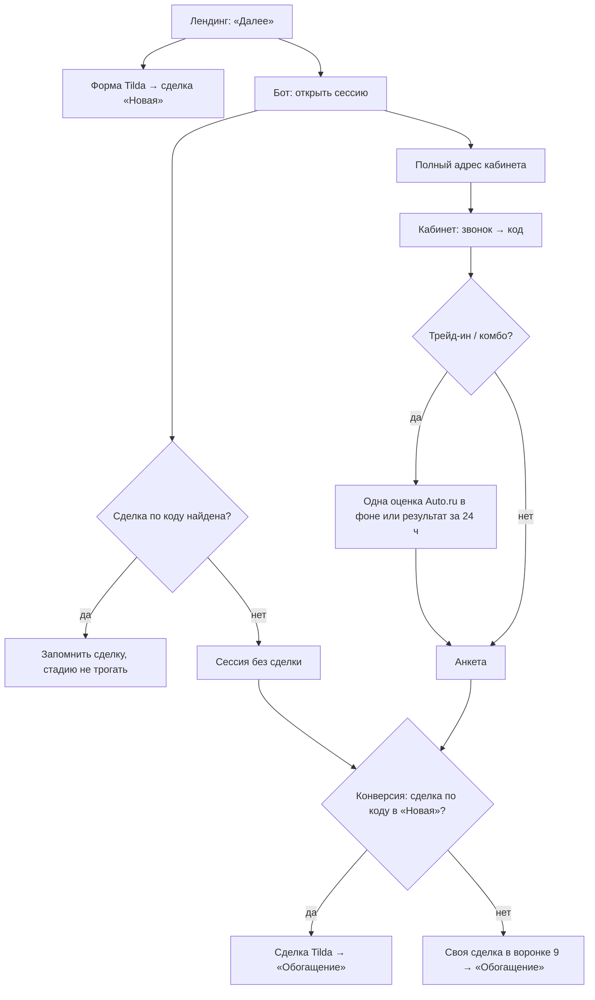

# Вход в личный кабинет с сайта без Александра

## Summary

На шаге 2 лендинга появляется вкладка «В личном кабинете»: клиент выбирает сценарий и желаемый платёж (для трейд-ина — госномер и пробег), лендинг отправляет форму Tilda и открывает у бота сессию, бот возвращает полный адрес кабинета v3. Цену и снапшот расчёта бот считает сам по каталогу NocoDB, оценку Auto.ru запускает один раз в фоне после авторизации звонком. Всё, что клиент делает в кабинете, попадает в одну сделку Битрикса, а цепочка конверсии не опирается на несуществующий диалог.

---

## Problem Frame

Сейчас в кабинет можно попасть только по ссылке, которую выдаёт Александр в диалоге. Выдача токена, снапшот расчёта, оценка трейд-ина и вся конверсия после сабмита рассчитаны на то, что до кабинета был диалог: снапшот берётся из `n8n_cache`, оценку делает n8n по ходу разговора, а конверсия пишет «Заявка из MAX», шлёт «Александр покинул чат» в мессенджер и архивирует несуществующую стенограмму. Клиент лендинга, который хочет сразу считать кредит и оставить анкету, вынужден либо идти в чат, либо оставлять заявку «по телефону».

Попутно диагностика нашла дефекты, которые в веб-потоке становятся штатными состояниями: комбо в кабинете считается от `credit_price` без скидки за трейд-ин, минимальный взнос читается из несуществующей колонки, комбо без оценки показывает два взноса, фронт не узнаёт об обновлении снапшота, а обновление страницы на экране звонка возвращает клиента к вводу телефона на 10 минут.

---

## Actors

- A1. Клиент лендинга — выбирает авто и условия, авторизуется звонком, заполняет анкету.
- A2. Лендинг (Tilda, папка `Ver_4_dev`) — отправляет форму Tilda, открывает сессию, переходит в кабинет.
- A3. Бот — открывает сессию, считает цену и снапшот, привязывает сделку, запускает оценку, ведёт конверсию.
- A4. Кабинет v3 (`widget-custom/cabinet-app/`) — авторизация, калькулятор, анкета.
- A5. n8n — вебхук-обёртка оценки Auto.ru.
- A6. Битрикс24 — сделка Tilda (воронка 9, стадия «Новая» `C9:NEW`, код `skuId_utm`), при необходимости сделка бота.
- A7. Менеджер дилера — получает алерт и сделку.

---

## Key Decisions

- **Бот считает цену сам для обоих входов.** `credit_price` и `combo_price` считаются по каталогу NocoDB от прайса «Price old» за вычетом скидок, и для веб-клиентов, и для клиентов Александра; «Price new» — цена со всеми скидками — в расчётах не участвует и служит только для «от N ₽» на карточке машины (решение владельца 2026-09-30). Снапшот кабинета перестаёт зависеть от `credit_price` из `n8n_cache`. Нода n8n Combo Calculator считает комбо от «Price new» неверно и будет исправлена; до этого паритет по `combo_price` (R48) сойтись не может.
- **Сделку не ждём и не склеиваем (только веб-сессии).** Кабинет открывается сразу, даже если сделка Tilda ещё не появилась в «Новая». Конверсия сама ищет сделку по коду в «Новая»: нашла — работает с ней, не нашла — создаёт свою в воронке 9 «Обогащение» с полями о машине, и это финальное состояние: заявка передана дилеру. Охоты за дублем, склейки и фонового добора сделки для веб-сессий нет. Для клиентов Александра охота, склейка и поведение сделок не меняются.
- **Открытие сессии не трогает сделку.** Бот только запоминает найденную сделку; стадия («Новая») и контакт не меняются до отправки анкеты или таймаута кабинета.
- **В веб-потоке нет «менеджер перезвонит».** До авторизации у бота нет телефона клиента, поэтому любой сбой до входа в кабинет предлагает повторить попытку или получить расчёт другим способом (вкладки «В чате» / «По телефону»).
- **Оценка — строго один вызов на сессию.** Любой неуспех (NOT_FOUND, INVALID_DATA, NO_REGION, IN_PROGRESS, таймаут, сбой) окончателен; повторной оценки и кнопки «Повторить оценку» нет. Тот же госномер у того же дилера в течение 24 ч берёт прошлый результат без нового вызова.
- **Комбо — всегда один взнос.** Строка «Зачёт вашего автомобиля» есть во всех состояниях со статусом; пока оценки нет, кредит считается от доплаты по `combo_price`, с оценкой — пересчитывается с зачётом (макет v4, кадры 8a–8e).
- **Источник ставит лендинг, а не бот.** Форма Tilda во вкладке «В личном кабинете» несёт `offer` = «ЛК с сайта» и `form_type` по сценарию; интеграция Tilda переносит их в сделку. Бот повторяет «Тип лида 1» только в своей fallback-сделке.
- **«Тип обращения» после кабинета — как сейчас.** Форма ставит сценарий («В кредит» / «В трейдин» / «Комбо»), конверсия кабинета перезаписывает его на «Анкета / Авторизация {сценарий}», как у клиентов Александра. Источник остаётся виден по «Тип лида 1» = «ЛК с сайта», который бот не трогает.
- **Веб-вход — признак сессии, а не отдельный продукт.** Сессия с лендинга помечается как веб-вход; этот признак отключает SMS, включает повторный звонок и убирает всё диалоговое из кабинета и конверсии. Остальной кабинет v3 общий.
- **Одноразовость отдельно не делается.** Ссылки у клиента нет, сессия 40 минут как сейчас, повторного входа нет.
- **Имя «Клиент» не затирает существующее имя нигде.** Правило общее для всех путей, где бот пишет имя контакта: привязка сделки, охота, конверсия.
- **Восстановление экрана звонка после F5 — для всех клиентов.** Дефект общий, чинится для обоих входов.
- **Min_Down_Payment в n8n — отдельная задача.** Кабинет читает правильную колонку в этой задаче; n8n правится параллельно агентом n8n (см. Scope Boundaries).

---

## Key Flows

- F1. Веб-вход, кредит
  - **Trigger:** клиент на вкладке «В личном кабинете» нажимает «Далее».
  - **Actors:** A1, A2, A3, A4, A6
  - **Steps:** лендинг блокирует «Далее», отправляет форму Tilda и вызывает «открыть сессию»; бот запоминает сделку по коду (стадию не трогает), создаёт веб-пользователя, собирает снапшот, выпускает токен, возвращает полный адрес; лендинг переходит в той же вкладке; клиент вводит телефон, получает звонок (при необходимости — повторный), вводит код; кабинет открывает анкету с платежом, прижатым к границам; клиент отправляет анкету; конверсия пишет в сделку.
  - **Outcome:** одна сделка с подтверждённым телефоном, UF анкеты и стадией «Обогащение».
  - **Covered by:** R1–R24, R32–R35, R49–R55, R60–R62

- F2. Веб-вход, трейд-ин или комбо
  - **Trigger:** как F1, сценарий «трейд-ин» или «кредит+трейд-ин».
  - **Actors:** A1–A6
  - **Steps:** как F1 до успешного кода; бот запускает оценку в фоне (или берёт результат за 24 ч); кабинет показывает состояние «оцениваем…» (8a), комбо сразу считает кредит от доплаты; по готовности кабинет без перезагрузки показывает карточку авто и оценку и пересчитывает комбо с зачётом (8b); при неуспехе — 8c / 8d / 8e; анкету можно отправить в любой момент, поздняя оценка дописывается в сделку.
  - **Outcome:** оценка и данные авто в анкете и в сделке, либо штатный отказ без повторных вызовов и с комментарием о причине.
  - **Covered by:** R23–R31, R55–R58

- F3. Сделка Tilda не найдена при открытии сессии
  - **Trigger:** при открытии сессии сделка с кодом не найдена в «Новая».
  - **Actors:** A3, A6
  - **Steps:** сессия открывается без сделки; при отправке анкеты или таймауте конверсия ищет сделку по коду в «Новая»; нашла — работает с ней; не нашла — создаёт свою в «Обогащение». Сделка Tilda, появившаяся после этого, не трогается.
  - **Outcome:** заявка с подтверждённым телефоном и данными кабинета передана дилеру одной сделкой; поздняя сделка Tilda без телефона остаётся в «Новая» и через 12 ч уходит в архив.
  - **Covered by:** R36–R38

---

## Requirements

**Лендинг (агент CE landing, папка `Ver_4_dev`)**

- R1. На шаге 2 есть третья вкладка «В личном кабинете», она первая; выбор вкладки не попадает в ветку «По телефону» (сейчас `calcOffer` двоичный в 4 местах).
- R2. Вкладка содержит выбор сценария (кредит / трейд-ин / кредит+трейд-ин) и шкалу желаемого платежа; для трейд-ина и комбо — госномер с маской и пробег.
- R3. Платёж по умолчанию — 30 000 ₽; если он вне границ шкалы, он прижимается к ближайшей границе.
- R4. Границы шкалы считаются от «Price new» выбранной позиции: минимум — взнос 90 % и 36 мес, максимум — взнос 30 % и 36 мес (решение владельца 2026-10-04; было 10 % и 12 мес). Ставка — `Rate` из таблицы `[brand]_Credit_Rates`, строка с минимальным `Downpayment_From`. Шкала — прикидка, расчёт делает кабинет.
- R5. Данные для шкалы (цена, ставки) лендинг получает через бота, как сейчас.
- R6. «Далее» заблокировано при пустом пробеге и при номере, не проходящем проверку формата (R14); согласие — как сейчас.
- R7. По «Далее» лендинг отправляет ту же форму Tilda, что сейчас, со скрытыми полями `offer` = «ЛК с сайта» и `form_type` по сценарию — «В кредит» / «В трейдин» / «Комбо»; остальные поля формы — как сейчас. Затем лендинг вызывает «открыть сессию» и переходит по возвращённому адресу.
- R8. Позиция передаётся парой «Model id» + «Complectation id» из `window.ucQuiz.selectedCar`; `skuId` ключом позиции не служит.
- R9. При сбое отправки формы Tilda или отказе бота (лимит по IP, суточный лимит дилера, бот недоступен, любая ошибка контракта) лендинг показывает: кабинет открыть не удалось, попробуйте ещё раз или получите расчёт другим способом — с переключением на вкладку «В чате» или «По телефону». «Менеджер перезвонит» в веб-потоке не используется.
- R10. Вёрстка: классы макета — `uc-calc-*`; на мобильном вкладки ведут себя как в макете `uc-calc-lk-mockup.html` (горизонтальная прокрутка таб-бара).
- R51. Кнопка «Далее» блокируется до ответа бота; переход в кабинет — в той же вкладке.
- R62. В «открыть сессию» лендинг передаёт блок `form` — все поля формы Tilda как есть (те же значения, что уходят в форму, включая `FORMID` — id своей формы Tilda), плюс UTM из адреса страницы (`utm_source`, `utm_medium`, `utm_campaign`, `utm_content`, `utm_term`) и cookies `_ct_session_id`, `_ym_uid`, `WhiteCallback_visit`; ключи — имена переменных Tilda. Бот сохраняет блок в данных сессии без проверки по смыслу — только типы (объект «строка → строка») и размер; используется он только для fallback-сделки (R61). Данные о машине бот берёт из каталога; из блока — только `LINK` как запасной «Вход в ЛК» после проверки домена (R61). Отдельного блока `car` в контракте нет (решение 2026-09-30). Вместе с кодом лендинг передаёт случайный `nonce` на каждую отправку; повтор с тем же кодом и `nonce` возвращает тот же адрес, с другим `nonce` — отказ.
- R52. Во вкладке «В личном кабинете» лендинг генерирует код того же формата, что сейчас, но со случайным хвостом из 4 букв вместо 2; этот же код уходит в форму Tilda и в «открыть сессию».

**Бот: открытие сессии**

- R11. Бот открывает веб-сессию по HTTP-запросу лендинга без диалога (контракт — раздел Contracts).
- R12. Бот создаёт веб-пользователя как пользователя чата на сайте: имя «Клиент», признак веб-входа. Источник «ЛК с сайта» в сделку Tilda ставит лендинг (R7), не бот.
- R13. При открытии веб-сессии бот ищет сделку по коду в «Новая» и только запоминает её: стадия и контакт не меняются, сделка остаётся в «Новая». Если сделка не найдена, сессия всё равно открывается (R36).
- R14. Госномер проверяется на бэке: только стандартный легковой — буква, 3 цифры, 2 буквы, регион 2–3 цифры; 12 кириллических букв АВЕКМНОРСТУХ, латиница приводится к кириллице. Невалидный номер — отказ открытия сессии.
- R15. Пробег для трейд-ина и комбо обязателен: целое от 0 до 1 000 000 км; больше — `invalid_input`.
- R16. Бот возвращает полный адрес кабинета: дев-бот — путь `/cabinet_dev`, боевой — `/cabinet`.
- R49. «Открыть сессию» принимает запросы только с доменов из whitelist по `Website_URL` дилеров, так же как `/cabinet/api/*`; `Access-Control-Allow-Origin: *`, как у `/catalog`, не используется.
- R53. `dealer_code` запроса должен совпадать с префиксом кода; иначе сессия не открывается. Найденная сделка привязывается, только если её дилер совпадает с `dealer_code`; иначе сессия открывается без сделки, как при F3.

**Бот: цена и снапшот расчёта**

- R17. Бот считает `credit_price = round10k(Price old) − round10k(Cash in hook) − round10k(Credit bonus)` и `combo_price = round10k(Price old) − round10k(Cash in hook) − round10k(Credit bonus) − round10k(Trade-in bonus)` по каталогу NocoDB; округление — «половина вверх», как `Math.round` в JS; пустая скидка — 0. «Price new» в расчётах не участвует.
- R18. Снапшот веб-сессии собирается ботом без `n8n_cache`: позиция, обе цены, ставки, программа, желаемый платёж; оценка дописывается после R26.
- R19. Для клиентов Александра снапшот тоже берёт цены из расчёта бота (R17), а не `credit_price` из n8n.
- R20. Кабинет считает кредит от `credit_price`, комбо — от `combo_price`; для обоих входов.
- R21. Минимальный первый взнос в кабинете — `Min_Down_Payment` (проценты) из `[brand]_Credit_Programs`; колонка `Min_Down_Payment_Pct` больше не используется. Если колонки нет, значение пустое или у дилера нет таблицы программ — умолчание 20 % и техалерт.
- R22. Желаемый платёж с лендинга кабинет прижимает к своим границам; поведение для клиентов Александра не меняется.

**Кабинет: авторизация**

- R23. В веб-сессии код приходит только звонком: SMS недоступна ни на фронте (нет плитки и ссылок «Получить код в SMS»), ни на сервере (запрос SMS для веб-сессии отклоняется). Для клиентов Александра SMS остаётся.
- R24. Обновление страницы на экране «Звоним на номер…» возвращает клиента на тот же экран с тем же номером и остатком кулдауна, а не на ввод телефона; для всех клиентов.
- R25. Опционально: если поддержка ProstoSMS подтвердит отключение подмены повторного звонка на SMS для аккаунта, интервал R55 можно сократить до ~60 с отдельной правкой. Не блокирует: повтор через 5:15 уже вне окна подмены.
- R55. В веб-сессии, если код не дошёл, клиент может запросить повторный звонок роботом не раньше чем через 5 минут 15 секунд после первого (таймер «Позвонить повторно через …»; 15 секунд — запас на сетевую задержку, чтобы не попасть в окно подмены звонка на SMS у ProstoSMS); не больше 2 звонков за 10 мин — и на номер, и на сессию. «Изменить номер» доступно, но лимит сессии не сбрасывает. Для клиентов Александра окно «1 звонок на номер за 10 мин» не меняется.
- R50. В веб-сессии все состояния «недействительно / истекло / нет токена» (истёкшая сессия, закрытая вкладка, `link_expired`, отсутствие токена) ведут на экран «Сессия завершена — вернуться на сайт» (8f); кнопка ведёт на страницу лендинга, с которой открыта сессия (проверенную по whitelist `Website_URL`), запасной вариант — корень `Website_URL`. Исчерпанный лимит звонков или входов — экран «Слишком много попыток» (8g). Упоминаний чата и ассистента для веб-входа нет; экран после отправки анкеты остаётся как сейчас.

**Кабинет: оценка трейд-ина**

- R26. Для трейд-ина и комбо бот запускает оценку Auto.ru только после успешной авторизации, в фоне, через вебхук n8n (R39–R41, R59); регион — Москва (213).
- R27. На сессию — не больше одного вызова вебхука; любой неуспех окончателен, повторной оценки нет.
- R56. Если тот же госномер у того же дилера оценивался в течение 24 ч, бот берёт прошлый результат (включая неуспех) без нового вызова вебхука.
- R28. Состояние оценки (идёт / готово / не удалась) доступно кабинету; фронт узнаёт об изменении без перезагрузки страницы и применяет новые данные.
- R29. Пока оценка идёт (8a): строка «Зачёт вашего автомобиля» со статусом «оцениваем…»; в комбо кредит считается от доплаты по `combo_price`, доплата, платёж и срок доступны сразу; анкета доступна, отправка не блокируется.
- R30. Успех (8b): карточка авто из `found_info` и оценка (`ti_valuation = tradein_price_to`); комбо пересчитывается с зачётом, платёж клиента сохраняется и прижимается к новым границам; смена режима объявляется скринридеру. Частый штатный случай — `SUCCESS` без `found_info` (13 из 22 успешных оценок по истории): сумма оценки и пояснение как в 8b, поля марка, модель, год, руль — редактируемые, как в 8c; пробег и госномер предзаполнены с лендинга.
- R31. Неуспех: авто не найдено (8c) или ошибка оценки (8e) — редактируемые обычные текстовые поля (марка, модель, год, руль, пробег, госномер; пробег и госномер предзаполнены с лендинга), без справочника; авто найдено без оценки (8d) — карточка с данными и «Оценка — после осмотра». Строка зачёта показывает «после осмотра» или «не получен»; комбо считает кредит от доплаты по `combo_price`. Двух взносов не бывает ни в одном состоянии. Соответствие ответа вебхука кадрам — в разделе Contracts.
- R57. Анкету можно отправить, пока оценка идёт. Поздняя оценка (UF оценки и данные авто) дописывается в ту же сделку существующей переотправкой; кабинет в режиме только чтения её показывает.
- R58. При любом неуспехе оценки в комментарий сделки пишется строка «Оценка не получена: <причина>». Отдельного поля в Битриксе не заводится.

**Конверсия и Битрикс**

- R32. Все изменения из кабинета пишутся в ту же сделку, к которой привязана сессия; моменты записи — как в кабинете v3 (сабмит, таймаут), плюс поздняя оценка (R57).
- R60. Стадии веб-сделки: при открытии сессии и после авторизации сделка остаётся в «Новая» (`C9:NEW`) — авторизация сейчас в сделку не пишет; после отправки анкеты или таймаута кабинета конверсия ставит найденной сделке «Обогащение» (`STAGE_QUALIFIED` = `C9:UC_0SOJJA`), той же логикой, что сейчас в кабинете. После веб-авторизации дилер получает алерт «телефон подтверждён», как для клиентов Александра: имя «Клиент», номер сделки — только если сделка уже известна, источник — «личный кабинет с сайта».
- R33. Для веб-сессии конверсия не выполняет диалоговые действия: нет сообщения «Александр покинул чат», нет комментария «Итоги AI-диалога» и архива стенограммы с `Dealer_Code "00"`.
- R34. Если сделка Tilda не нашлась и бот создаёт свою (fallback), она создаётся в воронке 9 в стадии «Новая» (`C9:NEW`), и бот сам сразу переводит её в «Обогащение» (`C9:UC_0SOJJA`) — так по ней срабатывают роботы обеих стадий, как по сделке Tilda (на «Новой» роботов, которые ломают процесс, нет — подтверждено владельцем 2026-09-30); не в «NO КОНТАКТЫ» общей воронки. В неё бот пишет «Тип лида 1» = «ЛК с сайта», как форма Tilda (R7), «Тип обращения» — кабинетное значение конверсии, заголовок — по шаблону сделок Tilda из этой формы («Сделка #ID»), а не «Заявка из MAX». Алерт дилеру уходит в группу дилера сессии и не говорит «свяжитесь в MAX».
- R61. Fallback-сделка заполняется так же, как сделка, созданная интеграцией Tilda → Битрикс, по её таблице соответствий (Dependencies, «Поля сделки Tilda»):
  - если сделка Tilda найдена, блок `form` (R62) не используется;
  - если бот создаёт свою сделку, он раскладывает блок `form` по полям Битрикса по таблице соответствий из одного конфиг-файла бота;
  - поля, которые кабинет знает сам, бот пишет своими значениями поверх блока: платёж, срок, первый взнос, стоимость авто, госномер и пробег трейд-ина, «Тип обращения», «Тип лида 1», «Чат ID» (код, R52–R53) и поля о машине. Поля о машине — из строки каталога по паре (Model id, Complectation id), а не из запроса; «Вход в ЛК» — из колонки «Link» каталога, а если она пуста — из `form.LINK`, только относительный путь или https-адрес на домене `Website_URL` этого дилера, иначе поле не пишется;
  - «ip пользователя» бот берёт сам — настоящий IP клиента от доверенного прокси (R42), а не из блока (у сделок Tilda там адрес сервера интеграции — принято);
  - cookies лендинг передаёт сырыми; в строковые поля («CT_sessionId», «Ya_id», «Envybox код») бот пишет значение с «;» на конце, как интеграция; «CT_sessionId_num» — целое без «;»;
  - «SB Трейдин Оценка autoru» бот в веб-сделку не пишет — оценка только в «Кабинет: Оценка трейд-ина» (R57).
- R35. Бот нигде не записывает имя «Клиент» поверх непустого имени существующего контакта — ни при привязке сделки, ни в охоте, ни в конверсии, ни для клиентов Александра.
- R54. Бот не перезаписывает контакт сделки, если у него уже есть другой подтверждённый телефон.

**Дубли сделок**

- R36. Для веб-сессий фонового добора сделки Tilda нет: конверсия (сабмит или таймаут) ищет сделку по коду в «Новая» (`main.py:681–684`); нашла — работает с ней, не нашла — создаёт свою по R34.
- R37. Для веб-сессий охота за дублем не запускается. Сделка Tilda, появившаяся после создания сделки бота, не трогается: без телефона она остаётся в «Новая» и через 12 ч уходит в архив штатно.
- R38. Для клиентов Александра охота, склейка и поведение сделок не меняются.

**n8n (агент n8n, импорт — владелец)**

- R39. Новый вебхук-обёртка: Webhook → Execute Workflow «TOOL: AUTO.RU EVALUATION» → ответ.
- R40. Вебхук принимает госномер и пробег, регион фиксирован (213), и отвечает синхронно в пределах ~32 с; бот вызывает его асинхронно, не блокируя кабинет.
- R41. Дев- и боевой вебхук разделены так же, как существующие тестовые вебхуки n8n.
- R59. Вебхук принимает только запросы с общим секретом в заголовке `X-Cabinet-Eval-Secret`; секрет отдельный для дева и боя и хранится в env бота и n8n. Запрос без секрета или с неверным секретом отклоняется до вызова Auto.ru (n8n отвечает 403; бот считает отказом и 401, и 403).

**Лимиты**

- R42. Открытие сессии — не больше 5 в час с одного IP клиента; IP берётся только от доверенного прокси.
- R43. Открытие сессии — не больше 100 в сутки на дилера; значение в env `CABINET_WEB_DEALER_DAILY_CAP`. 0 — выключатель: веб-вход останавливается для всех дилеров (как у OTP-капа), лендинг получает ошибку и показывает L5.
- R44. При превышении любого из лимитов R42–R43 лендинг показывает сообщение R9; бот шлёт техалерт не чаще раза в сутки на лимит и дилера.
- R45. Существующие OTP-лимиты (кулдаун, кап дилера, блокировка неверных кодов) действуют в веб-сессии без изменений; окно звонка на номер для веб-сессии — по R55.

**Тестовый стенд и выкладка**

- R46. Тестовый лендинг `demo.autodc.org/page154296216` целиком работает с дев-ботом, включая каталог (сейчас каталог берётся с боевого).
- R47. Кабинет дев-стенда — страница `/cabinet_dev`; её домен разрешён CORS-whitelist дев-бота.
- R48. Проверка паритета цен — повторяемый скрипт: для всех активных позиций каталога тестового дилера и хотя бы одного боевого `credit_price` и `combo_price` бота сравниваются с расчётом n8n (Car Search, Combo Calculator). Скрипт запускается до выкладки и при каждом изменении каталога или формул n8n; любое расхождение — стоп.

---

## Contracts

### «Открыть сессию» (лендинг → бот)

Запрос — публичный, из браузера лендинга; CORS — whitelist по `Website_URL` дилеров, как у `/cabinet/api/*` (R49).

| Поле | Обязательно | Смысл |
|---|---|---|
| `dealer_code` | да | код дилера (2 символа); совпадает с префиксом `lead_code` (R53) |
| `lead_code` | да | код `skuId_utm` со случайным хвостом из 4 букв (R52), отправленный в форме Tilda, — ключ поиска сделки |
| `nonce` | да | случайная строка не меньше 128 бит, новая на каждую отправку; повтор с тем же кодом возвращает адрес только при совпадении (R62) |
| `model_id`, `complectation_id` | да | пара идентификации позиции каталога |
| `scenario` | да | `credit` / `tradein` / `combo` |
| `desired_payment` | да для `credit`, `combo` | желаемый платёж, ₽/мес, целое |
| `plate` | да для `tradein`, `combo` | госномер в любом регистре и раскладке |
| `mileage` | да для `tradein`, `combo` | пробег, км, целое 0…1 000 000 |
| `form` | да | все поля формы Tilda как есть (в том числе `FORMID` — id формы Tilda; `LINK` — запасной «Вход в ЛК», R61) + UTM + cookies `_ct_session_id`, `_ym_uid`, `WhiteCallback_visit` (R62); объект «имя переменной Tilda → строка»; нет значения — ключ не передаётся; не больше 80 ключей, ключ до 64 символов, значение до 2 000, весь блок до 16 КБ; иначе `invalid_input` с полем `form` |

Ответ при успехе: `cabinet_url` — полный адрес кабинета с токеном во фрагменте.

| Ошибка | Когда |
|---|---|
| `invalid_input` + список полей | нет обязательного поля, неверный тип или сценарий, `dealer_code` не совпадает с префиксом кода |
| `invalid_plate` | номер не проходит R14 |
| `unknown_dealer`, `unknown_position` | дилер или пара позиции не найдены |
| `rate_limited` + `limit_source: ip \| dealer` | превышены R42–R43 |
| `cabinet_unavailable` | у дилера нет https-сайта, каталог или ставки недоступны |

На любую ошибку, а также при сетевом сбое или отсутствии ответа лендинг показывает сообщение R9.

### Вебхук оценки (бот → n8n)

Запрос несёт общий секрет в заголовке `X-Cabinet-Eval-Secret` (R59). Пути n8n: дев — `/webhook/cabinet-tradein-eval-test`, бой — `/webhook/cabinet-tradein-eval`. Таймаут вызова в боте — 60 с.

| Поле запроса | Смысл |
|---|---|
| `plate` | госномер, нормализованный (кириллица, без пробелов) |
| `mileage` | пробег, км |
| `request_id` | идентификатор для сопоставления в логах |

| Поле ответа | Смысл |
|---|---|
| `status` | `SUCCESS` / `IN_PROGRESS` / `NOT_FOUND` / `INVALID_DATA` / `NO_REGION` |
| `tradein_price_from`, `tradein_price_to` | вилка оценки, ₽; `ti_valuation = tradein_price_to` |
| `found_info` | данные авто (при `SUCCESS`) |

Соответствие ответа кадрам макета v4:

| Ответ вебхука | Кадр | Что видит клиент |
|---|---|---|
| ещё нет ответа | 8a | «оцениваем…», комбо считает от доплаты |
| `SUCCESS`, есть `found_info`, `tradein_price_to > 0` | 8b | карточка авто и оценка, комбо с зачётом |
| `SUCCESS` без `found_info`, `tradein_price_to > 0` | 8b + поля 8c | сумма оценки и пояснение как в 8b; марка, модель, год, руль — редактируемые; пробег и госномер предзаполнены; комбо с зачётом |
| `SUCCESS`, есть `found_info`, оценки нет (`tradein_price_to` пусто или 0) | 8d | карточка с данными, «Оценка — после осмотра» |
| `NOT_FOUND`, `INVALID_DATA` | 8c | редактируемые поля, авто не найдено |
| `IN_PROGRESS`, `NO_REGION`, HTTP 400 `BAD_REQUEST`, HTTP 502 `ERROR`, 401/403 (секрет), таймаут 60 с, сетевая ошибка, другой 5xx, ответ без ожидаемых полей | 8e | редактируемые поля, оценка не пришла |

Во всех кадрах 8c–8e срабатывает R58. HTTP 400, 502, 401/403, таймаут и сетевые ошибки — сбои, которые не кэшируются (R56 относится только к ответам Auto.ru).

---

## Acceptance Examples

- AE1. **Covers R3, R4.** Given позиция, у которой 30 000 ₽ вне границ шкалы, when вкладка открывается, then ползунок прижат к ближайшей границе.
- AE2. **Covers R22.** Given платёж с лендинга ниже минимума кабинета, when кабинет открывается, then платёж равен минимуму, без статуса «невозможно».
- AE3. **Covers R14, R6.** Given ввод `a123bc77`, when проверка, then номер принят как `А123ВС77`; given `А123ВС00` или `АБ123В77`, then «Далее» заблокировано, бэк отвечает `invalid_plate`.
- AE4. **Covers R24.** Given код запрошен звонком, when клиент нажимает F5, then он видит «Звоним на номер +7 900 …» с остатком кулдауна и может ввести пришедший код.
- AE5. **Covers R23.** Given веб-сессия, when клиент или скрипт запрашивает код по SMS, then сервер отказывает, звонок остаётся единственным каналом; given клиент Александра, then SMS доступна как сейчас.
- AE6. **Covers R27, R29, R31.** Given комбо, вебхук вернул `IN_PROGRESS`, when кабинет получает результат, then повторного вызова нет, показан кадр 8e: строка зачёта «не получен», кредит от доплаты по `combo_price`, один взнос.
- AE7. **Covers R28–R30.** Given комбо, кабинет открыт, строка зачёта «оцениваем…», клиент выставил платёж 25 000 ₽, when через 20 с приходит `SUCCESS` с оценкой, then карточка авто и оценка появляются без перезагрузки, расчёт пересчитывается с зачётом, платёж остаётся 25 000 ₽ или прижимается к новой ближайшей границе, скринридер получает объявление о смене расчёта.
- AE8. **Covers R36–R38.** Given веб-сессия, сделка Tilda не найдена при открытии и при конверсии, when клиент отправил анкету, then бот создаёт сделку в воронке 9 «Обогащение» с полями о машине; when через 15 минут сделка Tilda с тем же кодом появилась в «Новая», then бот её не трогает и охота не запускается; given клиент Александра, then охота и склейка работают как сейчас.
- AE9. **Covers R35, R54.** Given контакт с тем же телефоном называется «Иван Петров», when идёт привязка, охота или конверсия, then имя остаётся «Иван Петров»; given у контакта сделки другой подтверждённый телефон, then контакт не перезаписывается.
- AE10. **Covers R42, R44, R9.** Given с одного IP за час открыто 5 сессий, when шестая попытка, then лендинг показывает «кабинет открыть не удалось» с предложением повторить или перейти на вкладку «В чате» / «По телефону», техалерт уходит не чаще раза в сутки.
- AE11. **Covers R7, R34, R61, R62.** Given сценарий «кредит+трейд-ин», when лендинг отправляет форму, then в сделке Tilda «Тип лида 1» = «ЛК с сайта», «Тип обращения» = «Комбо»; when клиент отправил анкету, then «Тип обращения» = «Анкета комбо», «Тип лида 1» не меняется; given сделка Tilda не нашлась и бот создал свою, then она в воронке 9 в стадии «Обогащение», в ней «Тип лида 1» = «ЛК с сайта», кабинетный «Тип обращения», заголовок «Сделка #ID» и те же значения «Модель», «Модификация», «Комплектация 1», «Цена_прайс», «Цена_прайс_», «Цена_скидка», «Вход в ЛК», «Чат ID», что в сделке Tilda той же позиции.
- AE12. **Covers R13, R60.** Given сделка Tilda найдена при открытии сессии, when клиент авторизовался, then сделка остаётся в «Новая»; when клиент отправил анкету, then сделка переходит в «Обогащение».
- AE13. **Covers R57.** Given трейд-ин, оценка ещё идёт, when клиент отправляет анкету, then отправка проходит сразу; when оценка приходит, then UF оценки и данные авто дописываются в ту же сделку, кабинет показывает их в режиме только чтения.
- AE14. **Covers R56.** Given госномер `А123ВС77` оценён у дилера 01 два часа назад, when этот клиент снова открывает кабинет с сайта и авторизуется, then вебхук не вызывается, показан прошлый результат.
- AE15. **Covers R55.** Given веб-сессия, звонок не дошёл, when прошло 5:14, then кнопка недоступна и идёт таймер «Позвонить повторно через …»; when прошло 5:15, then доступен повторный звонок; when второй звонок тоже не дошёл и клиент сменил номер, then третий звонок недоступен до конца 10-минутного окна.

---

## Success Criteria

- Проверка паритета (R48) даёт ноль расхождений на тестовом и боевом дилере.
- На тестовом лендинге с дев-ботом проходят F1, F2 (успех и все варианты неуспеха оценки) и F3 (сделка Tilda найдена и не найдена) без ручных правок в Битриксе.
- Ни в одной сделке веб-входа нет «Заявка из MAX», «покинул чат», «Итоги AI-диалога» и затёртого имени.
- Затраты на оценку не превышают одного вызова вебхука на сессию и одного на госномер у дилера за 24 ч.

---

## Scope Boundaries

- Чтение `Min_Down_Payment` в n8n (сейчас n8n берёт умолчания 20 % / 84 мес) — отдельная задача агенту n8n, запускается параллельно и должна быть сделана до выкладки веб-входа; до неё минимальный взнос у Александра и в кабинете расходится.
- Капча, повторный вход по ссылке, отдельная логика одноразовости.
- SMS для веб-сессий; «менеджер перезвонит» в веб-потоке.
- Повторная оценка и кнопка «Повторить оценку», правка госномера в кабинете с перезапуском оценки, регион оценки кроме Москвы.
- Сбор статистики по `IN_PROGRESS`.
- Нестандартные номера: мото, прицепы, транзит, дипломатические, старые форматы.
- Склейка двух сделок Tilda при повторном входе с сайта — дубли сделок Tilda остаются как сейчас.
- Изменения диалога Александра, кроме цены снапшота (R19), восстановления экрана звонка (R24) и правила имени (R35); в том числе порядок «первый платёж из диалога побеждает последний».
- Выкладка кабинета v3 на бой — отдельная работа; веб-вход строится на нём.

---

## Dependencies / Assumptions

- **Макеты v4.** `docs/design/lk-source-v4.html`, кадры 8a–8h: 8a оценка идёт, 8b отчёт готов, 8c авто не найдено, 8d авто найдено без оценки, 8e оценка не пришла, 8f «Сессия завершена», 8g «Слишком много попыток», 8h повторный звонок с таймером. Требования задают поведение, макеты — вид. Кнопку «Повторить оценку» Claude Design из макетов убирает (R27).
- **В доработке у Claude Design.** Экраны входа для веб-сессии без SMS и с повторным звонком (R23, R55); макеты лендинга — ошибка формата номера (R6), ожидание после «Далее» (R51), ошибка открытия кабинета (R9).
- **Вебхук оценки.** Создаёт агент n8n, импортирует и активирует владелец; без импорта F2 не проходит.
- **Лендинг.** Ведёт агент CE landing в папке `Ver_4_dev`; тестовая страница `page154296216`.
- **Таблицы программ (проверено в NocoDB 2026-09-30, только чтение).** `Min_Down_Payment` есть во всех таблицах программ: 99 и 01 (`my7rg0l7j6varzn`, 10 — колонка переименована владельцем), 02 и 09 (`msa0pe85fmadg8n`, 10), 03 (`m7a1rkmtih8o9yo`, 12). У дилеров 98, 04–08, 10–13 таблицы программ нет — умолчание 20 % (R21).
- **Колонки каталога.** «Credit bonus» и «Trade-in bonus» есть в каталогах дилеров NocoDB (сейчас бот их не читает; n8n читает). Не проверено по коду бота — проверяется при планировании.
- **Совпадение кодов.** С хвостом из 4 букв на одну комплектацию дилера приходится 26⁴ = 456 976 вариантов, а сделка лежит в «Новая» 12 часов и затем уходит в архив; поиск идёт только в «Новая», поэтому вероятность совпасть с чужой сделкой пренебрежимо мала. R53 и R54 страхуют остаток риска.
- **Подмена повторного звонка на SMS.** По ответу поддержки ProstoSMS из прошлого плана (`docs/plans/2026-08-27-001-feat-prostosms-real-send-plan.md:15, 100`) повторный запрос звонка на номер в 5-минутном окне молча подменяется на SMS, и обойти это «нельзя гарантированно». Поэтому R55 ставит второй звонок не раньше чем через 5 минут. Кадр 8h в макете v4 нарисован с таймером 0:47 — это пример, фактическое значение 5 минут. Если ProstoSMS подтвердит отключение подмены для аккаунта (R25), интервал можно сократить до ~60 с отдельной правкой.
- **Стадии Битрикса (проверено в Битриксе 2026-09-29, только чтение).**

| Константа / значение | Код стадии | Название | Кто ставит |
|---|---|---|---|
| — | `C9:NEW` | Новая | форма Tilda; веб-сделка до отправки анкеты |
| `STAGE_SUCCESS` | `C9:PREPAYMENT_INVOICE` | Квалификация | `check_and_link_deal` при начале диалога в чате (`main.py:2427`) |
| литерал | `C9:UC_CKY0IR` | AI Обработка | начало диалога с Александром (`main.py:3288`) |
| `STAGE_QUALIFIED` | `C9:UC_0SOJJA` | Обогащение | конверсия кабинета (`main.py:677`), охота при подтверждённом телефоне |
| литерал | `C9:LOSE` | Сделка не але | конверсия при отказе, охота без телефона |
| `STAGE_NEW_BOT` | `UC_WGXF0B` | NO КОНТАКТЫ (общая воронка) | создание сделки ботом (`main.py:603`); для веб-сессии не используется — R34 |
| `STAGE_MANUAL` | `UC_3NL90C` | ОЖИДАНИЕ (общая воронка) | охота не нашла сделку Tilda (`main.py:781`) |

  Оба триггера «Квалификация» и «AI Обработка» в веб-потоке не срабатывают (R13).
- **Поля о машине (проверено в Битриксе 2026-09-30 на сделках 52673 и 52543 с `https://demo.autodc.org`, только чтение; скрытые поля формы — `u3-card-sliders.html:1303–1309`, `u6-gallery.html:1491–1493` в `Tilda/Landing_2.0/docs/tilda-blocks/Ver_4_dev`).**

| Поле формы | Откуда на лендинге (и откуда берёт бот) | Поле сделки | Код UF |
|---|---|---|---|
| `Model` | каталог «Model» | Модель | `UF_CRM_65B0A4605FA7C` |
| `modification` | каталог «Model Modification» | Модификация | `UF_CRM_65B0A4606E9CA` |
| `complectation` | каталог «Complectation» | Комплектация 1 | `UF_CRM_65B0A46077BCD` |
| `Price_ol` | каталог «Price old» | Цена_прайс; Цена_прайс_ (деньги) | `UF_CRM_67E4E4691A18E`; `UF_CRM_1745996090` |
| `Price_ac` | каталог «Price new» | Цена_скидка | `UF_CRM_67E4E4692881A` |
| `Link` | каталог «Link» | Вход в ЛК | `UF_CRM_1708662321` |
| `sku-wa` (код, R52) | генерируется лендингом | Чат ID (стр); Чат ID (url) | `UF_CRM_1731438093`; `UF_CRM_I2CRM_CHAT` |
| `offer` | вкладка | Тип лида 1 | `UF_CRM_65D5BD2A777E5` |
| `SKU` | каталог «ID» / «SKU» / «VIN» | вероятно «Код комплектации» | `UF_CRM_66068DB231026` — не подтверждено |

  Все поля о машине лендинг берёт из строки каталога (`u3-card-sliders.html:1303–1309`), поэтому бот берёт их из той же строки по паре ID; «Link» в сделках Tilda — относительный путь (`/price?filters…`).

- **Поля сделки Tilda (таблица соответствий интеграции Tilda → Битрикс, со слов владельца; коды — `crm.deal.fields`, проверено 2026-09-30 только чтением).** По ней бот раскладывает блок `form` в fallback-сделку (R61). «Бот» — поле, которое бот пишет своим значением поверх блока.

  | Поле сделки | Код | Переменная Tilda | В fallback-сделке |
  |---|---|---|---|
  | Модель; Модификация; Комплектация 1 | `UF_CRM_65B0A4605FA7C`; `UF_CRM_65B0A4606E9CA`; `UF_CRM_65B0A46077BCD` | `MODEL`; `MODIFICATION`; `COMPLECTATION` | бот (каталог) |
  | Цвет 1 | `UF_CRM_65B0A46085731` | `color-select` | блок |
  | Способ покупки | `UF_CRM_65B0A5E0ED55D` | `BONUS` | блок |
  | Тип лида 1 | `UF_CRM_65D5BD2A777E5` | `OFFER` | бот («ЛК с сайта») |
  | Канал коммуникации (квалиф) | `UF_CRM_65B0A5E1003B2` | `messenger` | блок |
  | Код комплектации | `UF_CRM_66068DB231026` | `SKU` | бот (каталог) |
  | Кол-во на стоке | `UF_CRM_66068DB238783` | `QUANTITY` | блок |
  | Вход в ЛК | `UF_CRM_1708662321` | `LINK` | бот (каталог, запасной — R61) |
  | Марка; Дилер; Форма | `UF_CRM_66068DB216D55`; `UF_CRM_66068DB220F43`; `UF_CRM_66068DB229299` | `BRAND`; `DEALER`; `FORMID` | блок |
  | Чат ID (url) | `UF_CRM_I2CRM_CHAT` | `sku-wa` | бот (код) |
  | Кредит - срок; Кредит - Стоимость авто; Кредит - 1ый взнос; Кредит - платеж | `UF_CRM_1706098512256`; `UF_CRM_1706668886227`; `UF_CRM_65B1EC7CC365E`; `UF_CRM_1706098533386` | `CREDIT_DURATION`; `CREDIT_SUMM`; `DOWN_PAYMENT_RUB`; `MONTHLY_PAYMENT` | бот (кабинет) |
  | Trade-in - номер; Trade-in - пробег | `UF_CRM_1706098554832`; `UF_CRM_65B0A4607EC41` | `CAR_NUMBER`; `MILEAGE` | бот (кабинет) |
  | Тип обращения | `UF_CRM_666D69C9EEE1B` | `FORM_TYPE` | бот (конверсия) |
  | Цена_скидка; Цена_прайс | `UF_CRM_67E4E4692881A`; `UF_CRM_67E4E4691A18E` | `PRICE_AC`; `PRICE_OL` | бот (каталог) |
  | Сайт_источник; Тема письма | `UF_CRM_681317C7B3CB1`; `UF_CRM_1759808650` | `WEBSITE`; `LETTER_TITLE` | блок |
  | UTM_SOURCE … UTM_TERM (стандартные поля) | `UTM_SOURCE`, `UTM_MEDIUM`, `UTM_CAMPAIGN`, `UTM_CONTENT`, `UTM_TERM` | `utm_*` | блок |
  | CT_sessionId; CT_sessionId_num | `UF_CRM_65D8414464AF0`; `UF_CRM_1765187737` (целое) | cookie `_ct_session_id` | блок |
  | Ya_id | `UF_CRM_65D841446D593` | cookie `_ym_uid` | блок |
  | Envybox код | `UF_CRM_1764591234` | cookie `WhiteCallback_visit` | блок |
  | ip пользователя | `UF_CRM_1764493358` | заголовок `x-real-ip` | бот (IP от доверенного прокси) |

  Бот сверх таблицы пишет, как и сейчас, «Чат ID (стр)» `UF_CRM_1731438093` (код) и «Цена_прайс_» `UF_CRM_1745996090` («N|RUB») — в сделках Tilda они тоже заполнены.

  Наблюдения по сделкам Tilda с `https://demo.autodc.org` (52673, 52671, 52543) и воронки 9 с 01.09.2026 (200 сделок), только чтение:
  - cookies интеграция пишет с завершающей «;» (`1713946040997310148;`), «CT_sessionId_num» — целым без «;»;
  - «ip пользователя» во всех 200 сделках один — `87.242.111.251`: интеграция пишет не IP клиента;
  - не из формы, а автоматизацией Битрикса или интеграцией заполняются: заголовок «Сделка #ID», контакт (по имени и телефону формы), «Способ обработки заявок» = «Квалификация», «СПАМ» = 0 и «Группа стадий заявки» (с момента создания), «Имя_сд», «Телефон_сд», «Текст письма (квалиф)» (после «Квалификации» / «Обогащения»);
  - робот «Обогащения» шлёт письмо с темой «{Тема письма} - {Тип обращения}»; адресатов выбирает по «Форме» и дополнительному фильтру (со слов владельца); у тестового дилера («Дилер» = «Тест», «Тема письма» = «Тестовая заявка») письмо уходит только на тестовый адрес.
- **Склейка сделок.** Текущая охота (`background_deal_hunt`, `main.py:2429`) запускается только из диалога и для веб-сессий не используется (R37); для клиентов Александра она не меняется, кроме общего правила имени (R35).
- **Поля формы Tilda в сделке (проверено в Битриксе 2026-09-29, только чтение).** `offer` → `UF_CRM_65D5BD2A777E5` «Тип лида 1», строка; `form_type` → `UF_CRM_666D69C9EEE1B` «Тип обращения», строка (значение «Выбор авто» хранится как «ВЫБОР АВТО»). Заголовок сделок Tilda — стандартный «Сделка #ID». Поля строковые, не списки, поэтому добавлять значения «ЛК с сайта», «В кредит», «В трейдин», «Комбо» в Битриксе не нужно. Проверено на сделках 52673 и 52543 с `https://demo.autodc.org` и на свежих боевых сделках воронки 9.
- **«Тип обращения» — то же поле, что пишет конверсия бота.** «Тип обращения» — это `F_TYPE` бота: конверсия кабинета перезаписывает его на «Анкета {сценарий}» / «Авторизация {сценарий}» (`main.py:612, 631`). На тестовой сделке 52543 значение формы «ВЫБОР АВТО» уже заменено на «Авторизация кредит». Для веб-входа так и остаётся (см. Key Decisions).
- **Принятые риски.** Без капчи дилерский лимит 100 в сутки можно выбрать скриптом с разных IP — риск принят владельцем. Для веб-сессий нет склейки: если сделка Tilda появилась после того, как бот создал свою, в отчётах такой клиент может учитываться дважды (одна сделка — в архиве) — риск принят владельцем.

---

## Outstanding Questions

### Deferred to Planning

- ~~Заполняет ли бот в fallback-сделке «Марка», «Дилер», UTM и id формы~~ — решено 2026-09-30: да, из блока `form` (R61–R62, Dependencies, «Поля сделки Tilda»).
- Подтвердить на тестовой отправке формы с новыми значениями, что Tilda переносит `offer` и `form_type` в «Тип лида 1» и «Тип обращения» без изменений (регистр), и как бот ставит заголовок «Сделка #ID» своей fallback-сделке (ID известен только после создания).
- Как бот определяет дилера найденной сделки для R53 (поле «Дилер», «Сайт_источник» или префикс кода сделки).
- Видит ли бот за прокси dockhost реальный IP клиента (`X-Forwarded-For`, доверенный прокси)? Проверить до реализации лимитов R42.
- Формат значения `Min_Down_Payment` в `[brand]_Credit_Programs` (проценты, доля или рубли).
- Может ли `SUCCESS` прийти с `found_info` без оценки (кадр 8d) — подтвердить у агента n8n.
- Таймаут бота на вызов вебхука и хранение и ротация общего секрета (R59).
- Механизм и интервал, которым фронт узнаёт о готовности оценки (опрос `/me` или отдельный статус), когда опрос прекращается и как хранится результат для R56.
- Поиск позиции по паре при лимите загрузки каталога 100 строк без пагинации (`main.py:2085`).
- Идентификатор веб-пользователя и как признак веб-входа хранится в сессии.

---

## Sources

- Диагностика ветки (2026-09-29): выпуск токена `cabinet_service.py:864`, `prepare_cabinet_context` `cabinet_service.py:3411`; снапшот `cabinet_service.py:3166–3273`, цена только из `credit_price` `cabinet_service.py:3189`; `Min_Down_Payment_Pct` `widget-custom/cabinet-app/calc_model.js:101`, `cabinet_service.py:2937`; комбо-режим только при `ti_valuation > 0` `calc_model.js:375`; пинг `/me` без применения ответа `widget-custom/cabinet-app/app.js:3178–3187`; канал `sms` принимается `cabinet_service.py:1226`; привязка сделки `main.py:2396`; конверсия `main.py:577–713`, поиск сделки по коду в конверсии `main.py:681–684`, закрытие сессии `main.py:1224`; алерт дилеру `main.py:1304–1323`; маршруты `main.py:4609–4633`, `cabinet_api.py:155–165`; госномер `payload_v2.py:99, 149–187`.
- Живая проверка F5 на изолированном стенде: до авторизации экран восстанавливается; на экране звонка — возврат к вводу телефона; после авторизации анкета открывается по Bearer.
- Ревью документа (ce-doc-review, 2026-09-29): связность, выполнимость, безопасность, дизайн, рамки, adversarial.
- Макеты: `docs/design/lk-source-v4.html` (кадры 8a–8h).
- Предыдущий документ требований кабинета: `docs/brainstorms/2026-07-29-client-cabinet-requirements.md`.
- n8n: `docs/N8N_HANDOFF_CABINET.md` (оценка Auto.ru); `docs/N8N_ARCHITECTURE.md` (формула комбо в n8n неверна — см. Key Decisions).
