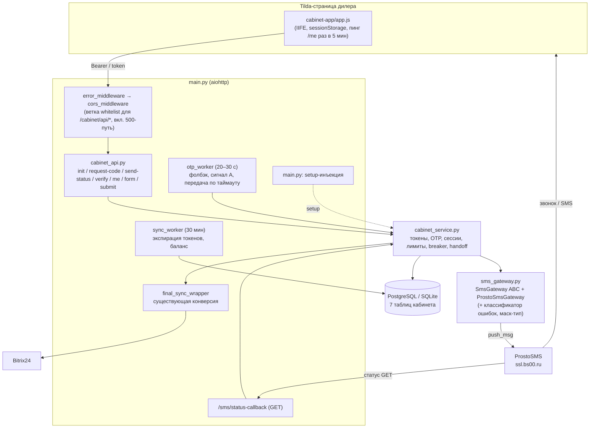
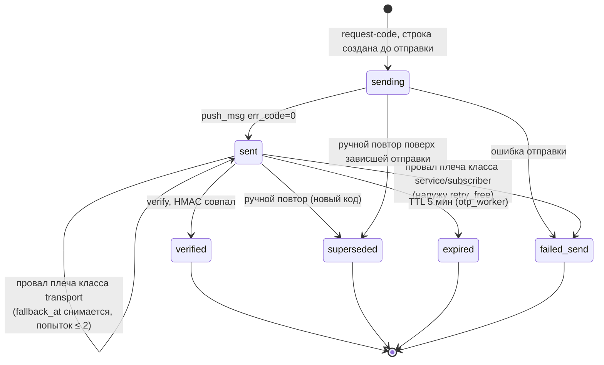
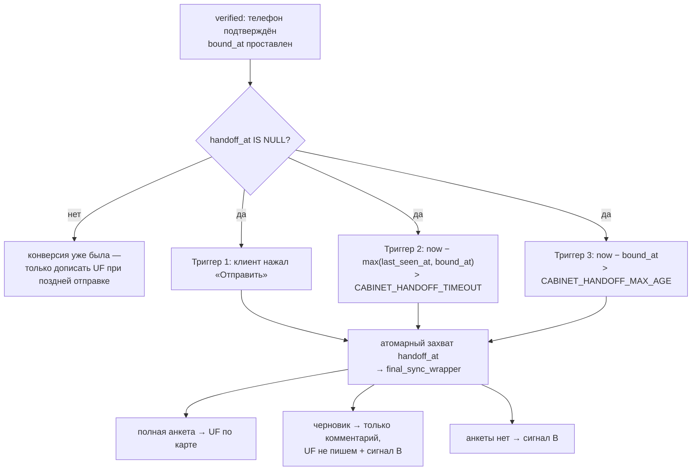

# feat: Клиентский личный кабинет — OTP-авторизация и анкета

## Summary

Реализация личного кабинета поверх существующего монолита: семь новых таблиц в `database.py` по конвенции репозитория (без Alembic), модуль `sms_gateway.py` с прямой интеграцией ProstoSMS (голос и SMS равноправно), auth- и form-API в новых модулях `cabinet_api.py`/`cabinet_service.py` с инъекцией зависимостей из `main.py`, отдельный короткоинтервальный `otp_worker`, фронт `cabinet-app/app.js` по образцу виджета, передача заявки в Bitrix через существующий путь конверсии по трём триггерам.

---

## Problem Frame

Дизайн-документ (see origin) зафиксировал WHAT: вход по индивидуальной ссылке с 4-значным кодом (TOFU-привязка номера), два канала доставки через ProstoSMS, анкета кредита/трейд-ина с черновиками и отправкой в UF-поля сделки. Этот план фиксирует HOW с учётом фактов, открывшихся при исследовании кода: репозиторий имеет собственную миграционную конвенцию (`init_db()` с идемпотентными `ALTER`, решение v1.34 в `AI_HANDOFF.md`), 30-минутная каденция `sync_worker` несовместима с 5-минутным TTL кода, `BITRIX_SMART_FIELDS_MAP` (`main.py:788-810`) уже пишет пересекающиеся UF-поля из пути агента, а все прикладные сервисы (`BitrixService`, алерты, `CACHED_DEALERS`) живут внутри `main.py`, импорт которого вызывает сайд-эффекты.

Отдельный пробел, закрытый на этом этапе: origin описывал только компенсирующий алерт дилеру и не описывал передачу заявки в CRM из кабинета. Ссылка выдаётся исключительно клиенту, не оставившему телефон в чате, — если телефон получен раньше, штатная конверсия уже отработала и ссылка не выдаётся. Значит, кабинет не дополняет конверсию, а является её альтернативным путём, и нужен не новый механизм отправки, а новый триггер для существующего.

---

## Requirements

План наследует R1–R33 из origin-документа; три требования изменены, восемь добавлены.

**Изменённые требования origin**

- R5 (новая редакция). Ответы для несуществующего, отозванного и истёкшего токена идентичны: один и тот же код ответа и тело (`link_expired`). Различить эти три состояния снаружи нельзя. Гарантии одинакового времени отклика нет.

  Расхождение с origin: origin требовал неразличимости валидного и несуществующего токена с правдоподобной эволюцией состояний. Требование недостижимо — детерминированная шкала не знает истории вызовов и расходится с реальными статус-кодами, а заглушка брендинга протекает при запросе без `Origin`. Защищать нечего: токен — 32 случайных байта, перебор физически невозможен. Отмена упрощает обработку несуществующего токена до одной дешёвой проверки без записи в БД и снимает потребность в троттлинге неаутентифицированной поверхности.

- R26 (новая редакция). Компенсирующие алерты дилеру разведены на два сигнала с разным смыслом:
  - **Сигнал A — «не подтвердил телефон».** Триггер: `code_requested` без `verified` в течение 15 минут; отменяется верификацией. Заявка в CRM по определению не передана (условие передачи — успешная верификация), и без алерта дилер о таком клиенте не узнает. Текст обязан явно называть отсутствие заявки: `⚠️ Личный кабинет: {имя} ({канал}), сделка {deal_id} ({модель}) — запросил код, но не подтвердил номер. Заявка в CRM не передана. Продолжите в чате вручную.`
  - **Сигнал B — «подтвердил, но не заполнил анкету».** Уходит вместе с передачей заявки по таймауту, не отдельным таймером. Тон информирующий: `ℹ️ Личный кабинет: {имя}, сделка {deal_id} — номер подтверждён, заявка передана в CRM, анкета не заполнена. {Черновик в комментарии сделки. | Данных анкеты нет.}`
  - При штатной отправке анкеты сигнал не нужен — заявка уходит обычным путём конверсии.

  Расхождение с origin: origin описывал один алерт по одному триггеру, потому что заявка из кабинета в CRM не передавалась вовсе.

- R28 (новая редакция). Голос и SMS — равноправные варианты доставки кода; клиент выбирает сам. Голос может быть предвыбран, но подаётся как один из двух, а не как основной канал с SMS в роли резерва. На экране выбора описывается, как поступит код по каждому варианту; на экране ввода кода выбранный способ напоминается постоянно, а не только в момент отправки. Для голоса предупреждение о входящем звонке обязательно по документации сервиса и остаётся видимым на экране ввода.

  Расхождение с origin: origin фиксировал голос каналом по умолчанию, SMS — альтернативой.

**Добавленные требования**

- R34. Правило «кабинет перезаписывает»: чат-путь продолжает писать UF-поля; после `cabinet_form.submitted_at` **по обновляемой сделке** пересекающиеся ключи исключаются из обновлений чат-пути в обеих точках применения карты. Проверка — по сделке, не по пользователю. Передача заявки по таймауту `submitted_at` не выставляет и фильтр не включает.
- R35. `pending_sync` получает потолок попыток: реплей инкрементирует `attempts` при любом неуспехе (включая молчаливый путь «не-200 или тело с ошибкой»), по достижении порога строка переводится в `status='fatal'` с однократным алертом. Записи кабинета ставятся в очередь в обход существующего 30-секундного дебаунса.
- R36. Защита на IP не строится: цепочка прокси dockhost недостоверна, вес несут лимиты по токену и номеру; IP пишется в аудит только как ненадёжный атрибут. Распространяется и на входящий колбэк статусов.
- R37. Валидация Bearer проверяет `expires_at` токена и сессии по времени, а не только поле статуса; фоновая экспирация — уборка, а не механизм контроля доступа.
- R38. Пустой справочник дилеров при старте даёт техалерт и повторные попытки загрузки; тихая деградация кабинета недопустима.
- R39. Заявка передаётся в CRM только после успешной верификации телефона. Клиент, получивший ссылку и не перешедший по ней либо не подтвердивший номер, в CRM не передаётся. Передача идёт существующим путём конверсии (`final_sync_wrapper`) — параллельный механизм не создаётся; стадия и статус вычисляются существующей логикой, новых значений не вводится.
- R40. Передача срабатывает по трём триггерам: явная отправка анкеты, таймаут бездействия `CABINET_HANDOFF_TIMEOUT` от последнего сигнала жизни, абсолютный потолок `CABINET_HANDOFF_MAX_AGE` от момента верификации. Захват задачи атомарный — заявка уходит ровно один раз при любом сочетании триггеров.
- R41. Незавершённая анкета при передаче по таймауту уходит только комментарием в таймлайн; в UF-поля она не пишется, чтобы неподтверждённые значения не попадали в поля, по которым строится расчёт.

**Трассировка origin-требований**

| Требования origin | Покрывающие юниты |
|---|---|
| R1–R6, R19–R22, R27 (авторизация, токены, коды, валидация номера) | U4 (+ U1 схема, U2 отправка) |
| R7, R8 (телефон → CRM, расхождение номеров) | U7 |
| R9, R28–R30 (шлюз, каналы, автофолбэк, ручной повтор) | U2, U3, U8 |
| R10, R26 (компенсирующие алерты A и B) | U3 (сигнал A), U10 (сигнал B) |
| R11 (лимиты, зачёт только принятых попыток) | U4, U2 |
| R12, R17 (отдельные таблицы, жизнь после финализации) | U1, U4, U5 |
| R13 (согласие до первой отправки) | U4 |
| R16 (изоляция от логов) | U9 |
| R24, R25 (черновики, qualification_payment) | U5, U7 |
| R31 (приём статусов) | U3 |
| R32, R33 (самопроверка канала, алерт с IP и резолвом) | U2, U3 |

---

## Key Technical Decisions

- **Без Alembic — миграционная конвенция репозитория.** Новые таблицы создаёт существующий `Base.metadata.create_all` в `init_db()` (`database.py:52-68`); частичные уникальные индексы добавляются идемпотентными DDL там же. (Расходится с рекомендацией origin, предлагавшего ввести Alembic; принято решение v1.34 из `AI_HANDOFF.md`; подтверждено владельцем.)
- **Инъекция зависимостей вместо импорта `main.py`.** `BitrixService`, `enqueue_failed_request`, `send_dealer_alert`, `TECH_ADMIN_ID`, `CACHED_DEALERS` живут в `main.py`, импорт которого даёт сайд-эффекты. Модули кабинета — строгие листья: `main.py` при старте вызывает `cabinet_service.setup(...)`, передавая вызываемые объекты (Bitrix-запрос, недебаунсимая постановка в очередь, запуск конверсии, алерт дилеру, техалерт, провайдер конфигурации дилеров). Обратных импортов нет; тесты подменяют зависимости тем же `setup`.
- **Передача заявки — новый триггер к существующей конверсии, не новый механизм.** `BitrixService.final_sync_wrapper` (`main.py:359`) уже делает ровно то, что нужно: ставит стадию `STAGE_QUALIFIED` (`BITRIX_STAGE_QUALIFIED` = `C9:UC_0SOJJA`, «Обогащение»), заполняет статус через `_map_type(scenario_type)` в поле `BITRIX_FIELD_TYPE` (= `UF_CRM_666D69C9EEE1B`) по результату квалификации, обновляет контакт подтверждённым телефоном, пишет данные квалификации и стенограмму. Кабинет вызывает её же со своим снапшотом контекста через инъекцию — ни стадий, ни значений статуса не добавляется.
- **Уход клиента определяется прекращением сигналов жизни, а не событием выгрузки страницы.** Событие выгрузки теряется при закрытии браузера, выгрузке фоновой вкладки, разряде батареи и обрыве связи, а на мобильных часто не доставляется вовсе. Прекращение пингов — надёжный и более широкий индикатор: покрывает закрытие окна, выгрузку вкладки и потерю связи одинаково. Сигналом жизни считается любой аутентифицированный вызов API кабинета — сохранение черновика, фоновый пинг `/me`, любой другой. Пинг идёт раз в 5 минут, поэтому таймаут 10 минут срабатывает через 10–15 минут после реального ухода.
- **Абсолютный потолок передачи обязателен.** Без него забытая открытая вкладка держит телефон клиента у нас произвольно долго, а получение телефона для передачи менеджеру и есть основная цель кабинета.
- **Комментарий с черновиком — ровно один.** Прежняя обязанность `sync_worker` по брошенному черновику (30 минут) отменена: передача по таймауту (10 минут) наступает раньше и несёт тот же комментарий вместе с сигналом B. Два комментария об одном и том же не создаются.
- **Единый классификатор ошибок отправки — один на breaker и на автофолбэк.** `sms_gateway` возвращает класс ошибки в `SendResult`; оба механизма читают его, своих таблиц кодов не заводят.

  | Класс | Коды | Circuit breaker | Автофолбэк |
  |---|---|---|---|
  | `transport` | сеть, таймаут, HTTP 5xx, 99, 699 | считает | снять `fallback_at`, разрешить повтор (потолок `fallback_attempts` = 2) |
  | `service` | 3, 602, 623, 624, 625, 626, 627, 628, 631, 645, 671, имя отправителя 607/608/620/621/632 | считает | `failed_send` + `retry_free` наружу, повторов нет, техалерт |
  | `subscriber` | 617, 618, 622 | **не считает** | `failed_send` + `retry_free` наружу, повторов нет |

  Класс `subscriber` исключён из breaker'а сознательно: без исключения один клиент пятью запросами на плохие номера останавливал бы отправку всем дилерам.
- **Circuit breaker: half-open вместо сброса по тишине.** По истечении окна охлаждения разрешается ровно одна пробная отправка: успех закрывает, неудача возвращает паузу. Сброс по тишине отвергнут — во время паузы отправок нет, значит нет и отказов, значит breaker открывался бы вслепую весь период аварии.
- **Отдельный `otp_worker` с интервалом 20–30 секунд.** Быстрые обязанности — страховочный автофолбэк, сигнал A, экспирация кодов, учёт breaker'а и **передача заявки по таймаутам** — живут в новом цикле; `sync_worker` с получасовой каденцией для них не годится. Тело цикла — импортируемая функция; в `main.py` тонкая обёртка с `CancelledError`, catch-all, бэкоффом и дедупом алертов. Медленные обязанности (экспирация токенов как уборка, баланс) остаются в `sync_worker`.
- **Прод-режим определяется явным флагом `ENVIRONMENT=production`, не эвристикой.** Эвристика по схеме `DATABASE_URL` ошибается в обе стороны: локальный PostgreSQL для отладки был бы принят за прод, а нестандартная прод-конфигурация — за разработку, и тогда `CABINET_HMAC_KEY` сгенерировался бы случайным — при каждом рестарте все выданные коды становились бы невалидными молча, без записи в лог. При `ENVIRONMENT=production` отсутствие ключа — фатальная ошибка старта.
- **Секреты авторизации: env-ключи без дефолтов.** `CABINET_HMAC_KEY` (только HMAC кодов); Bearer сессии — `secrets.token_urlsafe(32)`. Оба секрета и ключ ProstoSMS — под маскирующими обёртками.
- **Неразличимость сведена к трём нерабочим состояниям токена (R5).** Несуществующий, отозванный и истёкший токен дают один ответ `link_expired`. Детерминированная фиктивная шкала, заглушка брендинга из `Origin` и процессный token-bucket отменены целиком: несуществующий токен обрабатывается одной проверкой хеша без записи в БД. Агрегированный оконный счётчик аудита сохраняется для наблюдаемости.
- **Идентификация колбэка: `uuid4` и И-семантика, по одному `external_id` на плечо.** Сопоставление требует совпадения `external_id` **и** `id_sms`; SMS-плечо фолбэка получает собственный `sms_external_id`. Ограничение по IP как основной механизм отвергнуто (R36): колбэк идёт через балансировщик dockhost, то есть упирается в ту же недоверенную цепочку прокси. Статус доставки не даёт верификации ни при каких условиях, поэтому подделка не приносит атакующему ничего. Список адресов у поддержки запрашивается; при наличии и доверенной цепочке фильтр добавляется дополнительным слоем.
- **Анкета привязана к сделке, read-only после отправки.** Уникальность (user_id, deal_id); после `submitted_at` PUT и повторный submit → `already_submitted`. Read-only наступает только от `submitted_at` — передача заявки по таймауту его не выставляет, поэтому поздняя отправка анкеты остаётся возможной. Правка после отправки вынесена в отложенные работы.
- **Токен: перепривязка при склейке, отзыв при новой сделке или дилере.** Склейка дублей — техническая операция: токен сохраняется, обновляется только `deal_id`. Другая сделка или другой дилер — старый токен отзывается, выдаётся новый. Идемпотентность R19 действует в пределах одной сделки.
- **«Кабинет перезаписывает» вместо отключения ключей карты.** Обе точки (`main.py:537`, `main.py:885`) — сквозной проход `ai_payload`. Чат-путь сохраняется; фильтр включается только после сабмита по обновляемой сделке (R34).
- **Лимиты держатся на токене и номере (R36).** Производные от подсчёта строк `cabinet_otp` с зачтёнными отправками; кулдаун на токене; опрос `send-status` — 60/мин на токен; зачёт при `err_code=0`.
- **`pending_sync`: потолок попыток и недебаунсимый путь для кабинета (R35).** Существующий 30-секундный дебаунс (`main.py:185-188`) сохраняется для чат-пути, но записи кабинета ставятся мимо него: во время сбоя Bitrix чат-путь использует тот же метод для того же пользователя, и дебаунс проглотил бы единственную постановку.
- **Клиент ProstoSMS: транспорт без состояния, только `https://ssl.bs00.ru`, оборонительный парсинг.** Шлюз возвращает `SendResult` и не трогает БД. Базовый маскирующий тип секретов определяется в `sms_gateway.py` — U9 импортирует его, не создавая цикл.
- **Жизненный цикл OTP начинается со статуса `sending`.** Строка создаётся до диспетчеризации отправки; частичный уникальный индекс «одна запись в статусах `sending`/`sent` на токен» закрывает двойную отправку. Индекс создаётся одним DDL в обоих диалектах — SQLite поддерживает частичные уникальные индексы с 3.8.0.
- **Гонки решаются атомарными условными UPDATE, с явной обработкой провала захвата.** Автофолбэк: `UPDATE ... WHERE status='sent' AND fallback_at IS NULL AND expires_at > now`; при провале плеча поведение по классу ошибки. Передача заявки: `UPDATE ... WHERE handoff_at IS NULL` — кнопка и таймаут, сработавшие одновременно, дают одну конверсию.
- **Сессия действительна только при активном и не истёкшем токене (R37).** Валидация Bearer проверяет `expires_at` по времени: фоновая экспирация идёт раз в 30 минут, и проверка одного статуса давала бы до получаса работы по истёкшей ссылке.
- **Тестовая конвенция репозитория.** Логика кабинета — в импортируемых модулях; `main.py` несёт только проводку, пинящуюся source-grep-ассертами по образцу `tests/test_payload.py:143`.

---

## High-Level Technical Design

Компонентная схема (модули кабинета — листья; «setup» — инъекция зависимостей при старте):

Жизненный цикл записи `cabinet_otp`:

Триггеры передачи заявки (захват атомарный, конверсия ровно одна):

---

## Configuration

| Переменная | Назначение (дефолт) | Юнит |
|---|---|---|
| `ENVIRONMENT` | `production` включает обязательность секретов | U4 |
| `PROSTOSMS_API_KEY` | ключ API, обязателен для отправки | U2 |
| `PROSTOSMS_SENDER_NAME` | имя отправителя (предоставляет площадка) | U2 |
| `CABINET_HMAC_KEY` | HMAC кодов OTP; при `ENVIRONMENT=production` обязателен, старт падает | U4 |
| `CABINET_FALLBACK_TIMEOUT` | таймаут автофолбэка, с (45) | U3 |
| `CABINET_OTP_WORKER_INTERVAL` | каденция otp_worker, с (30) | U3 |
| `CABINET_BALANCE_THRESHOLD` | порог алерта баланса, ₽ (500) | U3 |
| `CABINET_BREAKER_THRESHOLD` | отказы классов transport+service для паузы (5 за 10 мин) | U3 |
| `CABINET_BREAKER_COOLDOWN` | окно охлаждения до пробной отправки, мин (5) | U3 |
| `CABINET_DEALER_DAILY_CAP` | суточный кап отправок на дилера (100) | U4 |
| `CABINET_HANDOFF_TIMEOUT` | бездействие до передачи заявки, с (600) | U10 |
| `CABINET_HANDOFF_MAX_AGE` | абсолютный потолок от верификации, с (3600) | U10 |
| `PENDING_SYNC_MAX_ATTEMPTS` | потолок реплея (10) | U6 |

Константы фронта (U8): интервал опроса `send-status` — 3–5 с; интервал пинга сессии через `/me` — 5 мин. Потолок повторов автофолбэка (`fallback_attempts` = 2) зафиксирован в коде.

---

## Implementation Units

### Фаза 1 — фундамент

### U1. Схема БД кабинета

- **Goal:** Семь таблиц кабинета и индексы, созданные по миграционной конвенции репозитория.
- **Requirements:** R12, R17, R19, R22, R40 (поля захвата).
- **Dependencies:** нет.
- **Files:** `database.py`, `tests/test_cabinet_models.py`.
- **Approach:** Модели `CabinetToken`, `CabinetOtp`, `CabinetSession`, `CabinetProfile`, `CabinetForm`, `Consent`, `CabinetEvent` — рядом с `User`/`PendingSync`. Правки к origin-схеме: `cabinet_form` — уникальность (user_id, deal_id); `cabinet_otp` — `external_id` (uuid4, unique), `sms_external_id` (uuid4, nullable, unique), `fallback_attempts` (default 0), статус `sending`; `cabinet_tokens` — `last_seen_at` (DateTime, nullable — последний сигнал жизни) и `handoff_at` (DateTime, nullable — атомарный захват передачи заявки). `init_db()` дополняется идемпотентными `CREATE UNIQUE INDEX ... WHERE` — **одинаковыми для PostgreSQL и SQLite**: один `active`-токен на user_id; одна запись в статусах `sending`/`sent` на token_id. Хелпер `ensure_single_active(...)` остаётся дружелюбной предпроверкой, боевую гарантию даёт индекс.
- **Patterns to follow:** `database.py:20-68`, `database.py:74-101`.
- **Test scenarios:**
  - Happy: `init_db()` на чистом SQLite создаёт таблицы и оба частичных индекса; повторный вызов идемпотентен.
  - Edge: второй `active`-токен того же user_id отклоняется **на уровне индекса**; дубли `external_id`/`sms_external_id` отклоняются.
  - Edge: вторая запись `cabinet_otp` в статусе `sending` при существующей `sending` отклоняется; то же при существующей `sent`.
  - Edge: две строки `cabinet_form` одного user_id с разными deal_id сосуществуют; с одним deal_id — конфликт.
- **Verification:** Тесты зелёные на SQLite; до фазы 2 — ручной прогон на дев-PostgreSQL: две конкурентные вставки `cabinet_otp` для одного токена дают ровно одну строку.

### U2. SMS-шлюз ProstoSMS

- **Goal:** Абстракция `SmsGateway`, клиент ProstoSMS и единый классификатор ошибок отправки.
- **Requirements:** R9, R11, R32, R33.
- **Dependencies:** нет (транспорт без БД).
- **Files:** новый `sms_gateway.py`, `tests/test_sms_gateway.py`, `main.py` (стартовая самопроверка).
- **Approach:** `SmsGateway` (ABC): `send_otp(phone, code, channel, external_id) -> SendResult`, `get_balance()`; роутер `get_sms_gateway()` по образцу `get_client` (`main.py:92-93`). Шлюз не пишет в БД. `SendResult` несёт статус, **класс ошибки** (единственный источник классификации для breaker'а и фолбэка), `retry_free`, `provider_msg_id`. POST на `https://ssl.bs00.ru/`, `format=json`, `priority=1`, `route=vc` для голоса; два шаблона (голосовой — без цифр вне кода; SMS — со сроком действия); значения ответа приводятся к строкам. Здесь же базовый маскирующий тип секретов. Таймауты — `aiohttp.ClientTimeout`. Самопроверка `get_balance()` при старте **не блокирует запуск бота**; коды 602/627 → алерт с исходящим IP и резолвом `ssl.bs00.ru`.
- **Patterns to follow:** `base_client.py` (ABC + флаги), `shadow_resolver.py`.
- **Test scenarios:**
  - Happy: ответ с `err_code:"0"` → `SendResult` ok; голосовой шаблон не содержит цифр, кроме кода.
  - Error по классам: 623 → `service`+`retry_free`; 627 → `service`, алерт конфигурации; 618 → `subscriber`+`retry_free`; таймаут → `transport` после одного ретрая.
  - Edge: `err_code` числом, `credits` строкой — парсинг не падает.
  - Covers AE14. Ошибка класса `service` не расходует лимит клиента.
  - Edge: недоступность ProstoSMS при старте не мешает `init_app` подняться.
  - Happy: `repr()` обёртки ключа даёт маску.
- **Verification:** Тесты зелёные; **проверочная отправка SMS и голосового кода на номера МТС, Мегафона, Билайна и Tele2 с замером фактической задержки доставки по каждой сети.**

### U3. Приём статусов и OTP-оркестрация

- **Goal:** Идемпотентный колбэк, автофолбэк с обработкой провала захвата, `otp_worker`, breaker с half-open, сигнал A.
- **Requirements:** R26 (сигнал A), R29, R30, R31, R32.
- **Dependencies:** U1, U2.
- **Files:** новый `cabinet_service.py` (логика + `setup()`), `main.py` (роут `/sms/status-callback`, запуск `otp_worker`, обязанности `sync_worker` — wiring-only), `tests/test_cabinet_otp_flow.py`.
- **Approach:** `cabinet_service.setup(bitrix_request, enqueue_nodebounce, run_conversion, dealer_alert, tech_alert, dealers_provider)` — единственный канал связи с `main.py`. Колбэк: GET (и POST) без аутентификации; сопоставление строго по паре `external_id`+`id_sms` (для SMS-плеча — `sms_external_id`), неизвестные игнорируются, `phone` из запроса не используется; значимые `state` — 1/2/16/34. Автофолбэк — одна функция с атомарным условным UPDATE из трёх мест; при провале плеча после захвата поведение по классу ошибки (`transport` → снять `fallback_at`, `fallback_attempts += 1`, потолок 2; `service`/`subscriber` → `failed_send` + `retry_free`). `otp_worker`: импортируемая функция (страховочный фолбэк, экспирация кодов, **сигнал A**, учёт breaker'а, передача заявки по таймаутам из U10); обёртка в `main.py` — `CancelledError` + catch-all с бэкоффом и дедупом алертов. Breaker: считает только `transport`+`service`, half-open после охлаждения; во время паузы `send-status` отдаёт `retry_free`. `sync_worker` дополняется экспирацией токенов и проверкой баланса; обязанность по брошенному черновику **не добавляется** — её роль перешла к передаче по таймауту (U10).
- **Test scenarios:**
  - Covers AE11. Статус «не доставлено» по голосу → SMS с тем же кодом и собственным `sms_external_id`, запись не `superseded`, счётчик клиента не тронут.
  - Covers AE12. Таймаут без статуса → одна SMS; поздний дубль статуса не даёт второй отправки.
  - Edge: захват выигран, SMS упала по таймауту (`transport`) → `fallback_at` снят, вторая попытка возможна, третья заблокирована потолком.
  - Edge: захват выигран, SMS отклонена по чёрному списку (`subscriber`) → `failed_send`, наружу `retry_free`, попытка не засчитана.
  - Edge: verify успел раньше фолбэка → досылки нет; код истёк → досылки нет.
  - Error: неизвестный `external_id` → 200 без изменений; верный `external_id` с чужим `id_sms` → без изменений, фолбэк по таймауту не подавлен; `state=45` → игнор с логом.
  - Error: пять отказов класса `subscriber` подряд **не открывают** breaker; пять отказов класса `transport` открывают.
  - Error: после паузы одна пробная отправка — успех закрывает breaker; неудача возвращает паузу.
  - Covers AE15. `get_balance` вернул 627 → алерт с IP и резолвом.
  - Happy: сигнал A уходит однократно через 15 минут; `verified` его отменяет.
- **Verification:** Тесты зелёные; ручной прогон колбэка curl-запросом меняет `delivery_state` ровно один раз.

### U6. Потолок попыток pending_sync и недебаунсимый путь для кабинета

- **Goal:** Мёртвая очередь вместо вечного ретрая и гарантированная постановка записей кабинета (R35).
- **Requirements:** R35.
- **Dependencies:** нет; в прод — раньше U5.
- **Files:** `database.py` (хелпер учёта неуспеха), `main.py` (реплей `main.py:2941-2998`, параметр обхода дебаунса в `enqueue_failed_request` `main.py:179-201` — wiring-only), `tests/test_pending_sync_ceiling.py`.
- **Approach:** Хелпер `record_sync_failure(task) -> outcome` в `database.py`: инкремент `attempts`, на пороге — `status='fatal'` + сигнал для однократного алерта. Вызов из реплея на **обоих** путях неуспеха: исключение и молчаливый (не-200 или тело с ошибкой). Строки `fatal` не удаляются. `enqueue_failed_request` получает флаг обхода дебаунса; `cabinet_service.setup(...)` получает именно эту вариацию.
- **Test scenarios:**
  - Happy: неуспешный реплей инкрементирует `attempts`; успешный — удаляет строку.
  - Edge: не-200/тело с ошибкой без исключения → тоже инкремент.
  - Edge: порог достигнут → `fatal`, алерт один раз; следующий цикл строку не трогает.
  - Edge: постановка от кабинета в пределах 30 с после чат-ошибки того же пользователя и метода **всё равно** попадает в очередь; чат-путь дебаунс сохраняет.
- **Verification:** Тесты зелёные; source-grep пинит вызов хелпера в реплее и передачу недебаунсимой постановки в `setup`.

### Фаза 2 — API и фронт

### U4. Auth API: токены, коды, сессии, лимиты

- **Goal:** Полный цикл авторизации `/cabinet/api/auth/*` с TOFU-привязкой, лимитами и правилами выдачи токена.
- **Requirements:** R1–R6, R13, R19–R22, R27, R36, R37, R38.
- **Dependencies:** U1, U2, U3.
- **Files:** новый `cabinet_api.py`, `cabinet_service.py` (расширяется), `main.py` (роуты, ветка CORS в `cors_middleware` и `error_middleware`, обработка пустого справочника дилеров), `tests/test_cabinet_auth.py`.
- **Approach:** Эндпоинты по контракту origin. `issue_cabinet_token(user_id, dealer_code, deal_id)`: активный токен той же связки «клиент + дилер + сделка» → тот же URL (R19); другая сделка или другой дилер → старый `revoked`, выдаётся новый. Секреты: `CABINET_HMAC_KEY` обязателен при `ENVIRONMENT=production`; Bearer — `token_urlsafe(32)`. Телефон: нормализация в E.164, только `+79xx`. Согласие: INSERT только при отсутствии записи по токену. Лимиты — производные от `cabinet_otp`; опрос `send-status` — 60/мин на токен. **Несуществующий, отозванный и истёкший токен → один ответ `link_expired`** (R5): одна проверка хеша, без записи в БД. Verify: константное сравнение HMAC; `superseded`/`expired` → `invalid_code`; попытки без активного кода инкрементируют счётчик; в блоке `request-code` отклоняется тем же `locked`. Успех → `bound_phone`, продление токена, сессия (40 мин скользящих, 12 ч абсолютных), `bound_at` — точка отсчёта для триггеров U10. **Любой аутентифицированный вызов API кабинета обновляет `last_seen_at`** — единый сигнал жизни. Валидация Bearer проверяет `expires_at` токена и сессии по времени (R37). CORS: ветка `path.startswith('/cabinet/api/')` — в OPTIONS-обработчике **до** wildcard-возврата (`main.py:2480-2489`), в основном пути, в `except HTTPException` (`main.py:2492-2494`) и в 500-пути `error_middleware` (`main.py:2475`). Whitelist Origin от `CACHED_DEALERS` на момент запроса; пустой справочник → техалерт и повторные попытки загрузки (R38).
- **Patterns to follow:** `main.py:3141-3177`, `main.py:2477-2497`, `spam_control` `main.py:1777-1807`.
- **Test scenarios:**
  - Covers AE1. Привязанный токен + чужой номер → `phone_mismatch`, отправки нет, счётчики целы.
  - Covers AE2. 4 неверных ввода + resend + пятый неверный → блок 30 мин; `request-code` в блоке → `locked`.
  - Covers AE3. Несуществующий, отозванный и истёкший токен дают идентичный `link_expired`; записи в БД нет.
  - Covers AE7. Повторная выдача при активном токене той же сделки → тот же URL; другая сделка или дилер → старый отозван, выдан новый.
  - Covers AE8/AE13. Два ручных кода → проходит только последний.
  - Edge: verify без активного кода → `invalid_code`, счётчик инкрементирован; известный номер → маска и `use_known`; казахстанский номер → `invalid_phone` до шлюза.
  - Edge (R37): токен с прошедшим `expires_at`, ещё не помеченный воркером → Bearer отклонён немедленно.
  - Edge: любой аутентифицированный вызов обновляет `last_seen_at`.
  - Edge: `ENVIRONMENT=production` без `CABINET_HMAC_KEY` → отказ старта с внятной ошибкой; вне прод-режима старт проходит.
  - Edge (R38): пустой `CACHED_DEALERS` → техалерт и повторная попытка загрузки.
  - Integration: preflight OPTIONS с дилерского origin получает echo, `Vary: Origin`, `Authorization`+`Content-Type`; чужой origin — без CORS; `/catalog/*` сохраняет `*`; 429/410/422 и искусственный 500 на `/cabinet/api/*` несут echo, не `*`.
- **Verification:** Тесты зелёные; source-grep пинит регистрацию роутов и обе middleware-ветки.

### U5. Анкета: черновики, сабмит, UF-маппинг

- **Goal:** Форма кредита/трейд-ина с автосохранением в Postgres и однократной отправкой в Bitrix.
- **Requirements:** R24, R25, R34, R35 (потребитель), R41.
- **Dependencies:** U1, U4, U6.
- **Files:** `cabinet_api.py`, `cabinet_service.py`, конфиг маппинга `cabinet_uf_map.json`, `tests/test_cabinet_form.py`.
- **Approach:** `GET /me` (профиль + черновик + статусы шагов; он же продлевает сессию при фоновом пинге), `PUT /form` (частичное обновление, только Postgres), `POST /form/submit` — тело содержит финальные значения, валидация «минимум одно поле любого блока», далее вызывается передача заявки U10 (триггер 1). Постановка в очередь при сбое идёт **недебаунсимым** путём. Несопоставленные поля — текстом в комментарий с экранированием BBCode и лимитом 500 символов. После `submitted_at`: PUT и повторный submit → `already_submitted`; read-only наступает **только** от `submitted_at`, передача по таймауту его не выставляет.
- **Patterns to follow:** `crm_mapping.py` (плоский модуль-карта), инъекция из U3.
- **Test scenarios:**
  - Happy: черновик сохраняется частями; submit собирает финальные значения из тела, UF уходят по карте, несопоставленное — в комментарий.
  - Edge: пустая форма → 422; поздний PUT после submit → `already_submitted`; повторный submit → `already_submitted`.
  - Edge: `qualification_payment` предзаполняет черновик и не перезаписывается сабмитом.
  - Error: Bitrix 5xx при сабмите → запись в `pending_sync` **даже если чат-путь того же пользователя ставил задачу секунду назад**.
  - Edge: `[`/`]` в свободном тексте экранируются.
- **Verification:** Тесты зелёные; ручной прогон на дев-SQLite: полный цикл draft → submit → повторный вход показывает read-only.

### U8. Фронт cabinet-app

- **Goal:** Самодостаточный `app.js`: экраны авторизации, равноправный выбор канала, анкета с автосейвом и видимым состоянием сохранения.
- **Requirements:** R1, R3, R28, R37 (пинг сессии).
- **Dependencies:** U4, U5.
- **Files:** новый `widget-custom/cabinet-app/app.js` (раздаётся существующим `add_static('/widget-custom/')`, `main.py:3244-3245`), инструкция `docs/CABINET_TILDA_SETUP.md`.
- **Approach:** IIFE по образцу `widget.js`: конфиг через `window.UNIFIEDBOT_URL`, монтирование в `#cabinet-root`. Токен: чтение фрагмента до инициализации счётчиков → копия в `sessionStorage` → `history.replaceState`; восстановление после 401/перезагрузки — из `sessionStorage`, инлайн re-OTP с сохранением локального состояния формы. `app.js` инжектирует `referrer`/`robots` meta. Экраны: телефон+согласие → **равноправный выбор канала** → ввод кода → кабинет.

  **Выбор канала (R28):** голос и SMS показаны как два равнозначных варианта (голос может быть предвыбран), у каждого — описание, как поступит код: для голоса «поступит входящий звонок с незнакомого номера, ответьте и прослушайте код», для SMS «код придёт сообщением». На экране ввода кода выбранный способ напоминается **постоянно** — для голоса предупреждение о звонке остаётся видимым всё время ожидания, иначе клиент не возьмёт трубку. Опрос `send-status` — 3–5 с, стоп на финальном состоянии или TTL.

  **Продление сессии** — фоновый вызов `/cabinet/api/me` раз в 5 минут, пока вкладка открыта; от автосейва не зависит. Он же служит сигналом жизни для триггера передачи заявки.

  **Отправленная анкета:** поля заблокированы, сверху статус «Отправлено, менеджер свяжется с вами» и ссылка вернуться в чат.

  **Состояние автосохранения видимо всегда** («сохраняется» / «сохранено» / «не сохранено — повторить»); при сбое, отличном от 401, показывается явное сообщение с кнопкой повтора.

  Инструкция Tilda: не размещать на странице лишние сторонние скрипты (same-origin читает `sessionStorage`).
- **Patterns to follow:** `widget-custom/widget.js` (IIFE, `window.*`-конфиг, инжект CSS строками).
- **Test scenarios:** `Test expectation: none — в репозитории нет JS-тестовой инфраструктуры; проверка ручным чек-листом:`
  - Вход по ссылке: `need_phone`, `bound`, `need_phone` с известным номером, `link_expired`.
  - Тексты для всех шести ошибок auth, каждый свой: `phone_mismatch`, `consent_required`, `invalid_phone`, `rate_limited` с обратным отсчётом, `invalid_code` с остатком попыток, `locked` с обратным отсчётом.
  - Состояния `send-status`: `sending`, `sent`, `fallback_sms`, `delivery_failed`, `retry_free` (повтор доступен сразу, попытка не засчитана).
  - Оба канала выбираются с экрана как равнозначные; описание способа видно до отправки, напоминание о выбранном способе — на экране ввода кода постоянно.
  - Голос с автофолбэком; ручной повтор SMS; кнопка «получить код звонком» после неудачи SMS.
  - Перезагрузка посреди анкеты; сессия жива при чтении карточки без правок 45 минут (пинг работает).
  - Видимое состояние автосохранения; сбой сети при автосейве даёт сообщение и повтор.
  - Повторный вход по привязанной ссылке; вид уже отправленной анкеты.

  Проверка вебвью не нужна — поведение установлено: MAX встроенного браузера не имеет и открывает ссылки во внешнем браузере устройства; Telegram открывает во встроенном, он работает стабильно и переживает переключение на входящий звонок с возвратом, поэтому голосовой канал в Telegram работоспособен.
- **Verification:** Чек-лист пройден на дев-стенде против реального API (тестовый режим ProstoSMS); раздача файла и meta-инжект пинятся source-grep-ассертом.

### Фаза 3 — изоляция, передача заявки, включение трафика

### U9. Изоляция логов и маскирование

- **Goal:** Значения кабинета не утекают в логирующий конвейер (R16) — до включения живого трафика.
- **Requirements:** R16, R4.
- **Dependencies:** U1, U2 (базовый маск-тип), U3, U4, U5; в прод — раньше U7.
- **Files:** `cabinet_service.py` (обёртки: телефон, код, токен, поля анкеты), `main.py` (подключение фильтра к хендлерам, маскирование алертов Global Error Middleware `main.py:2459-2475` — wiring-only), `tests/test_log_isolation.py`.
- **Approach:** Кабинетный код не вызывает `log_session` — собственный логгер `cabinet`, только event-типы и ID. **Фильтр маскирования вешается на хендлеры корневого логгера** (после `basicConfig`, `main.py:34`), а не на сам логгер: фильтр логгера не применяется к записям, всплывшим от дочерних, поэтому `aiohttp.access` иначе остался бы немаскированным — а именно там GET-колбэк несёт `phone` и `external_id` в строке запроса. Тот же фильтр применяется к тексту алертов error-middleware. Сам фильтр — в импортируемом модуле.
- **Test scenarios:**
  - Covers AE9. Искусственная ошибка хэндлера с телефоном и кодом в теле → алерт содержит маску телефона и не содержит код.
  - Integration: строка `aiohttp.access` для GET-колбэка — телефон замаскирован.
  - Happy: `repr()`/f-string обёрток дают маску; фильтр ловит телефон в произвольном сообщении.
  - Edge: легитимные маршруты (UF-поля, комментарий с черновиком) не маскируются.
- **Verification:** Тесты зелёные; grep по тестовому прогону логов не находит открытых номеров.

### U10. Передача заявки в Bitrix из кабинета

- **Goal:** Верифицированный клиент попадает в CRM тем же путём конверсии, что и при получении телефона в чате, по трём триггерам и ровно один раз.
- **Requirements:** R39, R40, R41, R26 (сигнал B).
- **Dependencies:** U1, U3 (цикл и инъекция), U4 (верификация, `last_seen_at`), U5 (анкета), U9.
- **Files:** `cabinet_service.py` (логика передачи и захвата), `main.py` (передача `run_conversion` в `setup` — wiring-only), `tests/test_cabinet_handoff.py`.
- **Approach:** Передача идёт **существующим путём**: `cabinet_service` получает через `setup(...)` вызываемый объект, который внутри `main.py` вызывает `BitrixService.final_sync_wrapper(user_id, context_snapshot)` — он уже ставит стадию `STAGE_QUALIFIED` («Обогащение»), заполняет статус через `_map_type(scenario_type)` в `BITRIX_FIELD_TYPE` по результату квалификации, обновляет контакт подтверждённым телефоном и пишет данные квалификации со стенограммой. Новых стадий и значений статуса не вводится. Снапшот контекста берётся из БД (`cabinet_profile` + `User`), не из `USER_CONTEXT` — кабинет живёт дольше сессии.

  Условие: `bound_at IS NOT NULL` (R39) — неверифицированный клиент не передаётся вовсе.

  Триггеры (R40): (1) явная отправка анкеты из U5; (2) `now − max(last_seen_at, bound_at) > CABINET_HANDOFF_TIMEOUT` — отсчёт от верификации, если черновика не было; (3) `now − bound_at > CABINET_HANDOFF_MAX_AGE` независимо от активности. Триггеры 2 и 3 проверяет `otp_worker`. Захват — атомарный `UPDATE ... SET handoff_at=now WHERE handoff_at IS NULL AND bound_at IS NOT NULL`: одновременное срабатывание кнопки и таймаута даёт одну конверсию.

  Полезная нагрузка: данные квалификации и диалога плюс подтверждённый телефон — как при штатной конверсии. При триггере 1 поля анкеты пишутся в UF по карте `cabinet_uf_map.json`. При триггерах 2 и 3 незавершённая анкета уходит **только комментарием в таймлайн** (R41), в UF не пишется, и вместе с конверсией отправляется **сигнал B** (текст — по R26, с указанием, есть ли черновик).

  Поздняя отправка: клиент нажимает «Отправить» после сработавшего таймаута — захват уже занят, повторная конверсия не запускается; выполняется только дозапись полей анкеты в UF и комментарий об уточнении. Стадия и статус не меняются — они уже верны. Идемпотентность обязательна: ни второй сделки, ни дублирующих комментариев.
- **Patterns to follow:** `BitrixService.final_sync_wrapper` (`main.py:359`), `crm_mapping.is_duplicate_callback`/`register_callback` (паттерн реестра идемпотентности), `send_dealer_alert` (`main.py:779-784`).
- **Test scenarios:**
  - Happy (триггер 1): submit → одна конверсия, стадия «Обогащение», статус по квалификации, поля анкеты в UF, сигнала B нет.
  - Happy (триггер 2): верификация → черновик → пинги прекратились → через таймаут одна конверсия, черновик только комментарием, UF анкеты пустые, сигнал B со ссылкой на комментарий.
  - Happy (триггер 2 без черновика): верификация → клиент ушёл, анкету не трогал → отсчёт от `bound_at`, конверсия, сигнал B «данных анкеты нет».
  - Happy (триггер 3): вкладка активна и пингует час → срабатывает абсолютный потолок, конверсия одна.
  - Edge (поздняя отправка): таймаут отработал → клиент нажал «Отправить» → второй конверсии нет, поля анкеты дописаны в UF, стадия и статус не изменились, комментарий не продублирован.
  - Edge (гонка): таймаут и кнопка срабатывают одновременно → ровно одна конверсия (атомарный захват).
  - Edge (R39): клиент запросил код и не подтвердил → конверсии нет ни по одному триггеру; уходит только сигнал A.
  - Integration (порядок сигналов): верификация → таймаут 10 минут → заявка ушла с сигналом B; **сигнал A не отправлен ни разу**.
  - Edge (R34): передача по таймауту не выставляет `submitted_at`, поэтому чат-путь на этой сделке не фильтруется.
- **Verification:** Тесты зелёные; source-grep пинит передачу `run_conversion` в `setup` и отсутствие параллельного пути конверсии в `cabinet_service`.

### U7. Интеграция с ботом

- **Goal:** Выдача ссылки, статусы кабинета в n8n, телефон в CRM, правило «кабинет перезаписывает», склейка сделок. Включает живой трафик кабинета.
- **Requirements:** R7, R8, R10, R25, R34.
- **Dependencies:** U1, U4, U5, U9, U10.
- **Files:** `main.py` (handoff `main.py:990-1069`, вторая сборка `main.py:1113`, ветка A, обе точки карты `main.py:537`/`main.py:885`, завершение deal hunt — wiring-only), `cabinet_service.py` (фильтр R34, перепривязка и переотправка), `tests/test_bot_integration.py`, минимальная правка промпта в NocoDB.
- **Approach:** При первом AI handoff (и в ветке A): `issue_cabinet_token`, копия желаемого платежа в `cabinet_profile.qualification_payment`, `cabinet_url` и `cabinet_status` в `qualification_context` в обеих точках сборки. Дилер без валидного https `Website_URL`: токен не выдаётся, лог + техалерт. После верификации: `save_user_phone()`, алерт дилеру, существующая ветка сбора контакта с пометкой источника «кабинет» (идемпотентно по сделке); расхождение с номером из чата — комментарий + алерт. Фильтр R34 — импортируемая функция `filter_cabinet_owned_fields(fields, deal_id)`, смотрит `submitted_at` анкеты **этой сделки**.

  **Завершение deal hunt** (склейка временной сделки с основной): токен сохраняется, обновляется только `deal_id`; подтверждённый номер входит в перечень переносимых полей. Перепривязка выполняется импортируемым хелпером, который:
  1. при коллизии уникальности `cabinet_form` применяет правило слияния — побеждает строка с `submitted_at`, при равенстве более поздний `updated_at`; проигравшая помечается вытесненной, `IntegrityError` посреди склейки не возникает;
  2. если по старой сделке **уже прошла передача заявки** (`handoff_at` проставлен) — переотправляет её результат на основную сделку: UF-нагрузку отправленной анкеты и комментарий с черновиком, переписывает `deal_id` в связанных строках `pending_sync`, повторную конверсию не запускает. Иначе значения остались бы на удалённой сделке, а фильтр R34 запретил бы чат-пути записать их на основную.
- **Patterns to follow:** `main.py:1018-1029`, `send_dealer_alert` (`main.py:779-784`).
- **Test scenarios:**
  - Happy: payload n8n содержит `cabinet_url` и корректный `cabinet_status` на каждом этапе.
  - Covers AE6. vCard с другим номером после привязки → `User.phone` не изменился, комментарий + алерт.
  - Edge: после `submitted_at` `ai_payload` с `tradein_make` по той же сделке → ключ отфильтрован; до сабмита — проходит; новая сделка со старой отправленной анкетой → ключи проходят.
  - Edge: дилер с `http://` в `Website_URL` → ссылка не выдаётся, техалерт.
  - Integration: сабмит на сделке A → склейка в B → B несёт UF-значения, строки очереди переписаны на B, чат-путь на B отфильтрован.
  - Integration: передача по таймауту на сделке A → склейка в B → комментарий с черновиком и телефон на B, второй конверсии нет.
  - Edge: склейка при уже существующей строке `cabinet_form` для основной сделки → побеждает строка с `submitted_at`, исключения нет.
- **Verification:** Тесты зелёные; source-grep пинит вызов фильтра в обеих точках карты.

---

## Scope Boundaries

Наследуются из origin: без прямой интеграции второго SMS-агрегатора (только абстракция), без загрузки файлов и фото, без self-service удаления ПДн.

### Deferred to Follow-Up Work

- **Страница кабинета на Tilda: вёрстка, дизайн и тексты.** Работа вне текущего плана, но её отсутствие блокирует приёмку, поэтому архитектурные ограничения фиксируются здесь:
  - Архитектура одностраничная: авторизация и кабинет живут на одной странице `/cabinet` со сменой экранов внутри (телефон и согласие → выбор канала → ввод кода → анкета). Разные страницы Tilda теряли бы токен из фрагмента URL и состояние формы при переходе.
  - На Tilda создаётся страница с одним блоком произвольного кода: контейнер `#cabinet-root` плюс подключение `app.js` с домена бота. Всё остальное рендерит скрипт; стили — внутри скрипта, не средствами Tilda.
  - Зависимость: полный состав полей анкеты определится после дизайна. Структура хранения от этого не зависит (значения хранятся гибко), поэтому фазу 1 не блокирует — но карта `cabinet_uf_map.json` и заведение UF-полей в Bitrix ждут дизайна.
- **Правка анкеты после отправки с версионированием в `cabinet_events`.** Юридического основания для неизменяемости больше нет (ПЭП отменена), а опечатку в VIN или доходе клиент сейчас исправить не может — только через менеджера.
- Мягкий IP-лимитер за конфиг-флагом — после диагностики заголовков на боевом контейнере.
- Фильтр колбэка по IP-адресам ProstoSMS как дополнительный слой — если поддержка даст список и цепочку прокси удастся сделать доверенной.
- Обновление `docs/ARCHITECTURE.md`/`docs/TECH_BREAKDOWN.md` и запись в `docs/CHANGELOG.md`.
- Повтор диктовки голосовым роботом (ответ поддержки сервиса).
- Захват learnings в `docs/solutions/`.

---

## Risks & Dependencies

| Риск / зависимость | Обработка |
|---|---|
| Ключ ProstoSMS и включение API-шлюза (внешний блокер) | Предусловие U2-verification; до него U2 тестируется на моках |
| Тексты юриста (согласие, сроки хранения) | Предусловие релиза, не разработки |
| Дизайн страницы Tilda — предусловие приёмки и заведения UF-полей | Зафиксирован отдельной отложенной работой с архитектурными ограничениями; фазу 1 не блокирует |
| Состояние лимитов и breaker'а живёт в процессе | Развёртывание однопроцессное — сейчас корректно. Переход на несколько реплик требует переноса состояния в БД или Redis, иначе лимиты и breaker молча перестанут работать |
| Фермерство токенов через дешёвые чаты → исчерпание капа дилера | Кап — потолок затрат, не детектор: алерт капа включает число уникальных токенов за сутки; breaker ловит всплески; ручной разбор по алерту |
| Сторонние скрипты на Tilda-странице читают `sessionStorage` | Украденный токен без OTP на привязанный номер бесполезен (TOFU); Bearer — остаточное окно 40 мин/12 ч; инструкция Tilda запрещает лишние скрипты |
| Подделка статусов на публичном колбэке | uuid4 + И-семантика `external_id`+`id_sms`; статус доставки не даёт верификации, поэтому подделка ничего не приносит; подделанное «не доставлено» ограничено одной SMS |
| GET-колбэк кладёт телефон и `external_id` в access-лог | Фильтр маскирования на хендлерах корневого логгера (U9, тест) |
| Сбой загрузки `CACHED_DEALERS` обесточивает кабинет | Техалерт и повторные попытки загрузки вместо тихой деградации (R38, U4) |
| Клиент ушёл, не подтвердив телефон — заявки нет по определению | Сигнал A прямо называет отсутствие заявки и отправляет менеджера в чат (R26) |
| Реальные значения `reporter`/`state` могут отличаться от документации | Парсер толерантен by design; первая тестовая отправка фиксирует фактические значения |
| Антифлуд оператора на одинаковый текст при фолбэке | Проверка на тестовых отправках; при срабатывании — вариация SMS-шаблона при неизменном коде |
| Тихая смена исходящего маршрута dockhost | Неблокирующая самопроверка `get_balance` при старте и в `sync_worker` + алерт с IP и резолвом |
| Глобальное изменение реплея `pending_sync` (U6) задевает существующие потоки | Порог консервативный, `fatal` хранится для ручного реплея; тесты на неизменность успешного пути и сохранение дебаунса для чат-пути |
| Фильтр R34 может задеть легитимные чат-записи | Строго условен по `submitted_at` обновляемой сделки; передача по таймауту его не выставляет; тесты трёх веток |

---

## Open Questions

**Deferred to implementation**

- Фактические значения `reporter`/`state` — снять первой тестовой отправкой (U3).
- Список исходных адресов колбэка у поддержки ProstoSMS — запросить; при получении оценить, можно ли сделать цепочку прокси доверенной.
- Кап одновременных сессий на токен: дефолт «последняя выигрывает», пересмотр при жалобах.
- Полный список UF-полей анкеты — ждёт дизайна страницы; карта `cabinet_uf_map.json` расширяется без кода.
- Требует ли ProstoSMS уникальный `external_id` на сообщение — подтверждается тестовой отправкой; схема с отдельным `sms_external_id` работает в обоих случаях.

---

## Sources & Research

- Origin: `docs/brainstorms/2026-07-29-client-cabinet-requirements.md` (R1–R33, AE1–AE15, схема БД, контракт API).
- Код: `main.py:359-446` (`final_sync_wrapper` — существующий путь конверсии), `main.py:464-471` (`_map_type` — вычисление статуса по квалификации), `crm_mapping.py` (стадии и реестр идемпотентности), `.env`: `BITRIX_FIELD_TYPE=UF_CRM_666D69C9EEE1B`, `BITRIX_STAGE_QUALIFIED=C9:UC_0SOJJA`; `main.py:2477-2497` (CORS), `main.py:2446-2475` (error middleware, 500-путь), `main.py:3219-3248` (startup/workers/static), `main.py:179-201`+`main.py:203-239`+`main.py:2941-2998` (дебаунс постановки, `_request`, реплей), `main.py:788-810`+`main.py:537`+`main.py:885` (карта UF и обе точки применения), `main.py:1018-1029`/`main.py:1113` (qualification_context), `main.py:34` (`basicConfig` — точка подключения фильтра), `database.py:52-68` (`init_db`, конвенция миграций), `AI_HANDOFF.md:283` (решение v1.34 «без Alembic»), `docs/CHANGELOG.md` v2.1.8 (грабли `request.json()`/`ClientTimeout`), `tests/test_payload.py:141-152` (source-grep-конвенция).
- ProstoSMS API (верифицировано 2026-07-31 по faq43/faq68 и публичному зеркалу sms-prosto.ru): параметры `push_msg`, конверт ответа, коды ошибок (основа классификатора), GET-колбэк, `get_profile.credits`; несостыковки документации — парсер оборонительный. Имя отправителя предоставляет площадка, отдельного согласования с операторами не требуется.
- Поведение вебвью установлено ручной проверкой: MAX открывает ссылки во внешнем браузере устройства; Telegram — во встроенном, стабильно, с возвратом после входящего звонка.
- Отсутствие REST-метода отправки SMS в Bitrix24 — зеркала `github.com/bitrix-tools/b24-rest-docs`, `github.com/bitrix24/b24restdocs`.
- Ничего специфичного о прокси-цепочке dockhost публично не документировано — основание R36.
