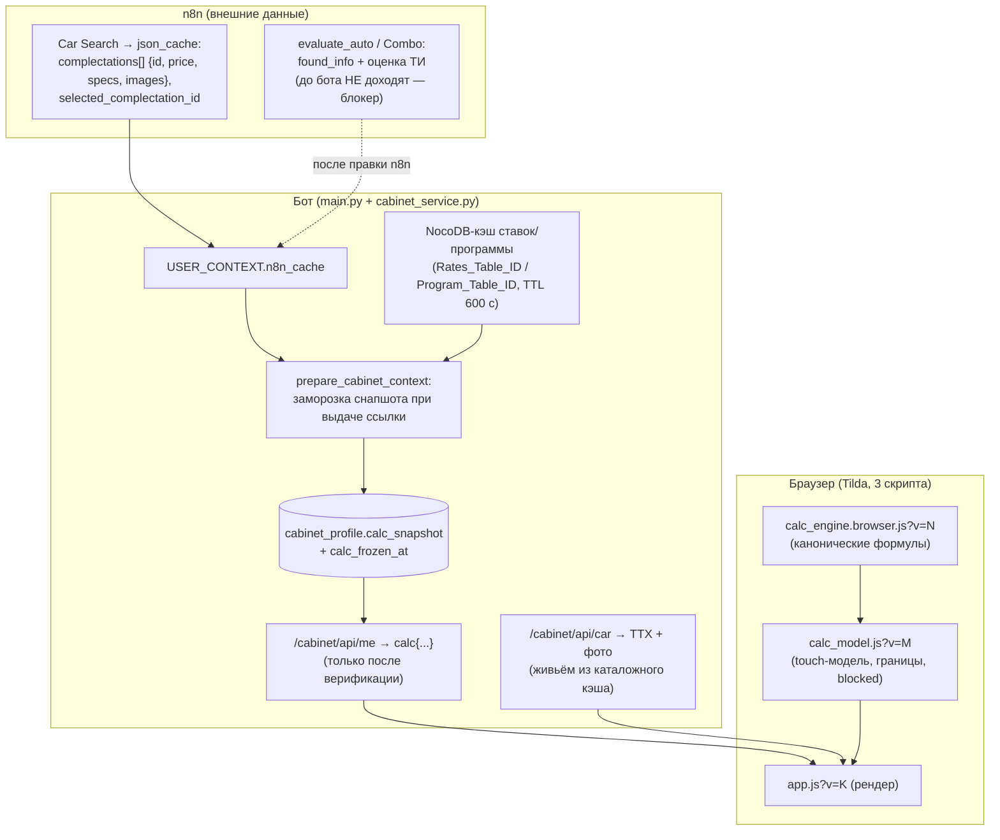
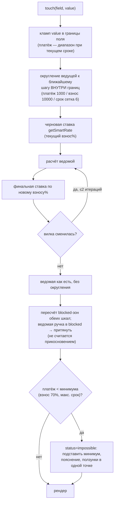

# feat: Кабинет — закрытие UF-карты, фронт по макету, кредитный калькулятор

## Summary

Доработка работающего кабинета (ветка `feat/client-cabinet`, U1–U10 исходного плана реализованы) по трём направлениям: закрытие карты UF-полей реальными кодами с перестройкой состава анкеты под дизайн; приведение фронта `widget-custom/cabinet-app/app.js` к утверждённому макету `docs/design/lk-source.html`; кредитный калькулятор, считающий в браузере на канонических формулах `calc_engine.js` из n8n-репозитория, с заморозкой входных данных в `cabinet_profile` при выдаче ссылки.

**Целевые репозитории:** основной — этот; юниты U2–U3 частично меняют папку n8n-репозитория `/Users/vitaln/Yandex.Disk.localized/ADC/Products/Landing/DEV/BOT/N8N/Alex_refactoring/` (далее «n8n-репо», пути от её корня). Папка n8n-репо не под git — см. Risks.

---

## Problem Frame

Исходный план собирал кабинет по чек-листу до появления дизайна: анкета — плоский черновик из 17 текстовых полей, карта UF наполовину из плейсхолдеров, калькулятора нет вообще. Теперь заведены UF-поля в Bitrix, утверждён макет и согласован калькулятор на странице. Истина — в коде, не в старом брейншторме: контракт API уже отклонился от него (send-status — GET с `X-Cabinet-Token`, свой набор `cabinet_status`, синхронная отправка кода, `retry_free`), и план опирается на фактический контракт.

Ключевые факты исследования, определившие форму плана:

- Позиция расчёта и цена **доезжают до бота** через `json_cache` от Car Search (бот хранит его как `n8n_cache`): `complectations[]` с `id`, ценами (`price.credit_price`), ТТХ и фото, плюс `user_request.selected_complectation_id`. В `runCalc` n8n отправляет именно `{id: Complectation id, price: credit_price}` — «позиция» это комплектация каталога, не VIN-единица стока.
- Оценка трейд-ина и `found_info` auto.ru до бота **не доходят вовсе** — живут только в контексте LLM и tool-ответе Combo. Это внешний блокер (см. Risks). Ответ auto.ru несёт и пробег (Александр получает его от клиента в чате, передаёт в запросе — он возвращается в ответе), и фото модели (`photos.main`), и `car_history`; госномер — только во входных параметрах запроса, в ответе его нет.
- `Rates_Table_ID` и `Program_Table_ID` уже приходят в конфиг дилера (`main.py:1248–1297`) — их сейчас потребляет только n8n.
- `calc_engine.js` пригоден для браузера как есть: n8n-диспетчер дописывается билд-скриптом, в файле его нет; `module.exports` под guard. Golden-тесты запускаются голым `node`.
- Находки ревью №9 (гард занятости) и №10 (лок автосейва) уже закрыты в `app.js`; фолбэк `?token=` очищен на фронте, но жив на сервере (`cabinet_api.py:85`).

---

## Requirements

**A — UF-карта и состав анкеты**

- R1. В `cabinet_uf_map.json` нет плейсхолдеров: каждый ключ действующего состава анкеты сопоставлен реальному UF-коду (таблица в U1). Поля, не вошедшие в дизайн (`income`, `work_experience`, `family_composition`, `tradein_damage`, `tradein_engine`, `tradein_vin`, `tradein_owners`-integer), выведены из `FORM_FIELDS` и карты; колонки в БД остаются.
- R2. Кабинет пишет канонические строки ровно в той формулировке, которую клиент видел на плитках, — не коды и не ID. Словари значений едины между `app.js` и сервером, единство запинено стражем.
- R3. `Руль` (UF_CRM_1785857507) и `Оценка трейд-ина` (UF_CRM_1785857524) пишутся из замороженных данных профиля, не из формы; `Доплата к взносу` (UF_CRM_1785857545) — из поля комбо-анкеты. Отсутствие значения — поле не пишется, отправка не падает.
- R4. Существующие поля (`credit_*`, `tradein_make/model/year/mileage/plate`) переиспользуются как есть по правилу «кабинет перезаписывает» (R34 исходного плана). Фильтр R34 не расширяется: новые коды `UF_CRM_1785…` — эксклюзив кабинета, чат-путь их не пишет. Новых стадий и статусов сделки не вводится.

**B — фронт по макету**

- R5. Вёрстка и стили — из `docs/design/lk-source.html`; галерейная обвязка (`.gallery*`, `.screen*`, `.gallery__note`) не переносится. Виджет универсальный: ни логотипа, ни цвета дилера, ни названия.
- R6. Мобильная версия (390px) — основной сценарий. Ввод кода переживает уход на входящий звонок и возврат (вебвью Telegram; MAX открывает внешний браузер) — ручной чек-лист.
- R7. Реализованы все состояния auth-контура макета и состояния бэка, которых в макете нет (`retry_free`, служебные `none`/`expired` send-status, `409 conflict`, `409 phone_mismatch`) — по решениям из раздела «Ревизия расхождений».
- R8. Серверный фолбэк `?token=` в send-status удалён; `X-Cabinet-Token` — единственный путь.
- R9. Состав анкеты по сценариям (направление D): credit — авто · условия кредита · семейное положение, образование, занятость; tradein — авто · «Ваш автомобиль» (read-only) · комментарий · уточните данные; combo — авто · условия кредита (взнос = оценка) · «Ваш автомобиль» · комментарий · уточните данные · анкетные данные. Блок «Ваш автомобиль» неизменяем (фон `--field`, без рамок): марка, модель, год, руль, пробег, госномер, фото; расхождения клиент сообщает комментарием. Фото — каталожный рендер модели в дефолтном цвете, не снимок машины клиента: обязательная подпись справочного характера; заглушка фото — редкий край, не сценарий по умолчанию. Тип ПТС — всегда вопрос клиенту, значение auto.ru не подставляется.
- R10. Read-only после отправки с датой из `submitted_at`; по-полевая валидация из `fields{}` ответа 422 мапится на группы плиток; сетевая ошибка сабмита — попап по макету (фрейм 15).

**C — калькулятор**

- R11. Расчёт выполняется в браузере, синхронно, при каждом движении ползунка, без обращений к сети. Формулы не переписываются: используются `calculatePMT`, `calculateMaxLoan`, `getSmartRate`, `round1k`, `round10k` канонического движка. Сценарные функции кабинету не нужны.
- R12. Браузерная сборка — второй выход `build_calc_engine_workflow.py`: копия без n8n-диспетчера в статику бота. Версионный маркер `CALC_ENGINE_VERSION` в теле канона и сборки; подключение с `?v=`; golden-тесты прогоняются на браузерной сборке; несовпадение версий движка и модели обнаруживается и в тестах, и в рантайме (см. KTD «Защита от дрейфа»).
- R13. Ставки и программа читаются ботом из NocoDB по `Rates_Table_ID`/`Program_Table_ID` дилера с кэшем 10 минут по образцу `DICT_STOCKS`. Токен NocoDB в браузер не попадает.
- R14. При каждой выдаче ссылки в `cabinet_profile` замораживается снапшот: `item_id`, `price`, `target_payment`, `rates`, `program`, `found_info`, `ti_valuation`, версия и время заморозки. Отдаётся в `/cabinet/api/me` только после верификации. Снапшот валидируется при заморозке (числа парсятся, матрица отсортирована, price > 0).
- R15. Карточка авто (ТТХ-чипы, фотогалерея) тянется живьём по `item_id` новым аутентифицированным эндпоинтом поверх каталожного кэша; URL фотографий не замораживаются.
- R16. Модель величин: «последнее прикосновение выигрывает»; ведущая величина округляется (платёж до 1 000, взнос до 10 000, срок к сетке шага 6) и неприкосновенна; ставка в два прохода — второй проход пересчитывает **ведомую** (≤2 итераций, берётся последняя); границы: взнос от `Min_Down_Payment_Pct` до 70% цены, срок от 12 до `Max_Term_Months`; недостижимая при текущем платеже часть шкалы визуально блокируется (blocked-зона макета), ручка в неё не заходит; ведомая ручка, оказавшаяся в blocked-зоне, притягивается к ближайшей достижимой точке без зачёта «прикосновения». Платёж ниже минимума (взнос 70%, максимальный срок) → подставить минимум, показать пояснение, ползунки в единственной точке (фрейм 10).
- R17. Комбо: взнос = оценка трейд-ина + «Доплата к взносу», read-only строка, ползунка взноса нет; доплата ограничена `price − оценка`; заём фиксирован, свободен только срок — платёж следует за ним, ввод платежа притягивается к ближайшему достижимому на сетке сроков. Расширение `calculateComboScenarios` (доплата) вносится в канон и покрывается golden-тестом.
- R18. Снапшота нет (ссылка выдана до выбора комплектации, tradein-сценарий) → блок калькулятора скрыт, `credit_*` — ручной ввод, анкета отправляема.
- R19. В CRM при отправке уходят финальные значения ползунков (`credit_term`, `credit_initial`, `credit_payment`; для комбо `credit_initial` = оценка + доплата) плюс `ti_valuation` и `combo_extra_down`. Маркер позиции расчёта (`item_id`, `frozen_at` снапшота) дописывается в комментарий таймлайна — UF-поле под него не заводится. Клиентские значения не доверенные — это предзаполнение лида, условия подтверждает менеджер.

**Сквозные**

- R20. Все новые сравнения времени — через `_utcnow()`/`_aware()`; тесты прогоняются и на `aware_db`.
- R21. Golden-тесты движка и тесты модели величин запускаются голым `node` (без npm-зависимостей) из pytest через subprocess; отсутствие node — красный тест с внятным сообщением, не тихий skip: иначе математика окажется непокрытой незаметно. Source-grep-ассерты остаются для вёрстки и проводки.
- R22. Порядок загрузки и версионирование трёх скриптов на Tilda-странице (`calc_engine.browser.js` → `calc_model.js` → `app.js`, каждый с `?v=`) зафиксированы в `docs/CABINET_TILDA_SETUP.md` и запинены стражами.

---

## Key Technical Decisions

- **Позиция расчёта — комплектация из `n8n_cache`, без угадывания.** Заморозка берёт `user_request.selected_complectation_id` из кэша и находит его в `complectations[]`; если выбранного нет, но комплектация в кэше ровно одна — берётся она, **только когда действующего снапшота ещё нет**; иначе снапшот не создаётся (R18). При существующем снапшоте с другим `item_id` перезаморозка выполняется только по явному `selected_complectation_id` — смена темы в чате не подменяет позицию молча. Угадывание по названию модели запрещено: в стоке под одну модель несколько машин с разной ценой. Гарантированная фиксация позиции, выбранной агентом в диалоге, требует правки n8n — внешний блокер, не обходится.
- **Снапшот — `Text` + JSON в `cabinet_profile`, конвенция репозитория.** Колонки `calc_snapshot` (Text, JSON: `schema_version`, `item_id`, `item_name`, `price`, `target_payment`, `rates`, `program`, `found_info`, `ti_valuation`) и `calc_frozen_at` (`DateTime(timezone=True)`). JSON-типов СУБД в проекте нет — как `steps_status`/`context_json`.
- **Снапшот обновляется при каждой выдаче ссылки и при сохранении свежего кэша.** Заморозка в `prepare_cabinet_context` видит кэш предыдущего хода (кэш сохраняется после ответа n8n), поэтому вторая точка перезаморозки — момент сохранения `json_cache` (`main.py:521–523`) при наличии active-токена: выбор комплектации попадает в снапшот тем же ходом, без лага. Неудачная заморозка (незаморозимый кэш, `price <= 0`) никогда не затирает существующий снапшот — замена только успешной заморозкой, пропуск логируется. Открытая вкладка живёт со старым снапшотом до перезагрузки — принято.
- **Разрешение противоречия «последнее прикосновение» vs «два прохода ставки»: ведущая неприкосновенна.** Второй проход `getSmartRate` пересчитывает ведомую величину, не ведущую: touch платежа → взнос (черновая ставка → взнос → финальная ставка по взносу% → взнос заново, ≤2 итераций, берётся последняя — детерминированный стоп осцилляции на границе вилки); touch взноса или срока → платёж. Ручка не «убегает» из-под пальца.
- **Максимум шкалы взноса и порог impossible — одна константа 70%.** Совпадает с макетом (взнос до 1 743 000 ₽ при цене 2 490 000 = 70%) и с логикой `impossible` движка. Округление ведущей — к ближайшему шагу **внутри** границ (кламп после округления), чтобы взнос не проваливался под `Min_Down_Payment_Pct` в чужую вилку ставки.
- **Модель величин — отдельный модуль `calc_model.js`, не инлайн в `app.js`.** Чистые функции без DOM: `initState(snapshot)`, `touch(state, field, value)` → новое состояние с границами, blocked-зонами и статусом. Загружается вторым скриптом, тестируется тем же Node-прогоном, что и движок. `app.js` только рендерит состояние.
- **Защита от дрейфа версий движка (двухуровневая).** (1) Константа `CALC_ENGINE_VERSION` в теле `calc_engine.js` — канон и браузерная сборка несут одно значение, билд-скрипт — единственный легальный путь обновления статики; pytest-страж сверяет маркер в статике с версией в `?v=` из `docs/CABINET_TILDA_SETUP.md`, а при локальном наличии папки n8n-репо дополнительно сравнивает нормализованное содержимое `lib_code` канона с браузерной копией: правка канона без билда и инкремента маркера (stale-but-consistent, когда статика и эталоны устарели вместе) даёт отдельную красную ошибку «канон правлен без билда». (2) Рантайм: `calc_model.js` объявляет `EXPECTED_CALC_ENGINE_VERSION`; при несовпадении с загруженным движком калькулятор деградирует в ручной ввод (R18) с ошибкой в консоль — сломанная математика не показывается. Golden-тесты гоняются на копии из статики бота, эталоны — `golden_cases.json`, который билд кладёт рядом.
- **Node-прогон без стека.** `tests/js/` с `run_golden.mjs` и тестами модели на `assert/strict`; pytest-обёртка запускает `node` subprocess'ом; отсутствие node — красный тест, не skip (golden-прогон — единственная защита математики и не должен сниматься молча). Никаких `package.json`, npm и фреймворков.
- **Карточка авто — серверный эндпоинт, не прямой доступ к NocoDB.** `GET /cabinet/api/car` (Bearer) читает `item_id` из снапшота профиля, ищет комплектацию в каталожном кэше `get_cars_from_nocodb_dynamic` по таблице дилера и отдаёт ТТХ + URL фото. Токен NocoDB не покидает сервер (урок `docs/solutions/security-issues/hardcoded-credentials-in-git-history.md`); принадлежность таблицы дилеру — по образцу `handle_catalog_colors` (`main.py:2629`).
- **Ставки/программа — тем же загрузчиком, что каталог, с проекцией полей.** `get_cars_from_nocodb_dynamic` универсален по table_id и уже несёт TTL-кэш 600 с и fail-safe на устаревший кэш. Матчинг программы воспроизводит ноду Get Program дословно: в кэше каталога находится строка выбранной комплектации, берётся её каталожный `Id`, выбирается первая строка программы, где `Model_Pattern` содержит этот `Id`. Нет строки — дефолты движка: `Max_Term_Months=84`, `Min_Down_Payment_Pct=20`; фолбэк `|| 10` действует только при пустом поле в найденной строке программы — зеркалится тернарник `calc_engine.js:49`, а не одно число. В снапшот попадает только именованный набор полей (rates: `Rate`, `Term_From`, `Term_To`, `Downpayment_From`, `Downpayment_To`; program: `Program_Name`, `Max_Term_Months`, `Min_Down_Payment_Pct`) — служебные колонки таблиц дилера в браузер не уезжают.
- **Bitrix-вызовы новых записей — только через существующий недебаунсимый путь.** Расширение `push_form_to_bitrix` (руль, оценка, доплата) не создаёт новых точек постановки в `pending_sync` (урок `docs/solutions/logic-errors/injected-callable-hidden-side-effect.md`, R35 исходного плана).
- **Повторный вход с привязанным номером проходит через выбор канала.** Макет (фрейм 2a-7) шлёт код сразу; требование равноправия каналов R28 исходного плана сильнее — выбор канала остаётся обязательным. Ссылка «Это не мой номер» не реализуется: смена номера при TOFU-привязке запрещена бэком (`phone_mismatch`).

---

## High-Level Technical Design

Поток данных калькулятора (заморозка при выдаче, расчёт в браузере):

Алгоритм прикосновения (модель величин, U7):

---

## Ревизия расхождений макета с кодом

Зафиксирована по состоянию на 2026-08-06 (макет 1577 строк, `app.js` 1065, бэк — фактический контракт). Полные инвентари — в отчёте исследования; здесь расхождения и решения. U-ссылки — юниты этого плана.

### Макет → код

| Состояние макета | Что в коде | Решение | Юнит |
|---|---|---|---|
| m1/1a: телефон + согласие + выбор канала на одном экране | Разбито на два экрана | Объединить по макету, канал равноправен (R28 сохраняется) | U6 |
| m2: «Звоним на номер +7 (912) 345-67-89» (полный номер) | Бэк отдаёт только маску; фронт маскирует даже свежевведённый | Полный номер показывать для только что введённого (он есть у фронта); для повторного входа — маска | U6 |
| m2: 4 ячейки кода, таймер отдельной строкой | Одно поле на 4 цифры, таймер на кнопке | Переверстать по макету (ячейки, строка таймера из `retry_after`) | U6 |
| m2: ссылка «Изменить номер» | Нет возврата к вводу телефона | Добавить до привязки номера; после привязки не показывается | U6 |
| 2a-1 link_expired | Есть, текст отличается | Текст из макета | U6 |
| 2a-2 неверный код + остаток попыток | Есть (`attempts_left` бэка) | Красные ячейки по макету | U6 |
| 2a-3 блокировка | Есть, живой отсчёт (богаче макета) | Оставить отсчёт, стили ячеек/кнопки из макета | U6 |
| 2a-4 лимит запросов — отдельный экран | Инлайн-ошибка | Отдельный экран, точный `retry_after` вместо статичных «30 минут» | U6 |
| 2a-5 код не отправлен | `retry_free`-статус нейтральным текстом | Error-стиль макета + кнопки «Повторить» / «Получить код в SMS»; семантика «попытка не засчитана» остаётся в тексте | U6 |
| 2a-6 автофолбэк голос→SMS | Есть; таймер не перезапускается | Перезапуск таймера повтора после фолбэка | U6 |
| 2a-7 повторный вход: код сразу, «Это не мой номер» | Через выбор канала; ссылки нет | Оставить выбор канала (KTD); ссылку не реализовывать — TOFU запрещает смену номера | U6 |
| 2a-8 скелетон загрузки | Спиннер | Скелетон по макету | U6 |
| 2b-9..12 ползунки, blocked-зоны, impossible, «Пересчитываем…» | Отсутствуют полностью; данных в API нет | Модель U7 + данные U5 + вёрстка U9; «Пересчитываем…» не нужен — расчёт синхронный, состояние 12 применяется только при инициализации | U5, U7, U9 |
| 2c-13 read-only с датой отправки | Баннер без даты; `submitted_at` в `/me` есть и не используется | Дата из `submitted_at`, стили `.readonly`/`.tile--ro` | U8 |
| 2c-14a/b валидация полей и групп плиток | Кнопка disabled молча; per-field `fields{}` из 422 выбрасывается | Подписи и обводки по макету; маппинг `fields{}` на группы | U6, U8 |
| 2c-15 попап сетевой ошибки сабмита | Инлайн-текст | Попап по макету (компонент lk-source.html:1540–1550); автосейв остаётся savebar'ом | U8 |
| 2c-16 индикатор черновика | Есть, тексты близки | Тексты из макета | U8 |
| Шапка авто: ТТХ-чипы + фотогалерея | Только `brand_model` строкой | Эндпоинт `/cabinet/api/car` (U5) + вёрстка (U8) | U5, U8 |
| Сценарные анкеты (плитки, разный состав блоков) | Единый плоский список 17 текстовых полей, `scenario_type` не используется | Перестройка состава полей (U1) + сценарный рендер (U8) | U1, U8 |
| Блок «Ваш автомобиль» + заглушка фото | Данных оценки в API нет; `tradein_*` — редактируемые поля | Read-only блок из `found_info` снапшота; до снятия блокера n8n блок не рендерится, анкета трейд-ина деградирует в ручной ввод `tradein_*` (текущее поведение) | U5, U8 |
| Комбо: read-only взнос «Зачёт … ₽» + «Доплата к взносу» | Данных и поля нет | `ti_valuation` из снапшота (блокер n8n), поле `combo_extra_down` (U1), модель комбо (U7) | U1, U5, U7, U9 |
| Экраны успеха с текстом по сценарию | Один общий текст | Тексты по `scenario_type` | U8 |

### Код → макет (состояния бэка, которых в макете нет)

| Состояние бэка | Решение |
|---|---|
| `retry_free` (request-code и send-status) | Фрейм 2a-5 как основа; текст «Попытка не засчитана — можно повторить сразу», кнопки повтора активны без кулдауна |
| send-status `none` | No-op (техсостояние до первой отправки) — как сейчас |
| send-status `expired` | Текст «Код устарел. Запросите новый» в стиле 2a-5 |
| 409 `conflict` (гонка формы) | Попап 2c-15 с «Повторить» (повторный PUT/submit) |
| 409 `phone_mismatch` | Инлайн-ошибка на экране телефона (достижимо только при рассинхроне вкладок) |
| 422 `empty_form` | Подпись у кнопки «Отправить» + подсветка групп по 14b |
| `need_phone` + `use_known` (известный номер из чата) | Существующая кнопка «Использовать номер …» сохраняется, стилизуется под плитку макета |
| 401 → инлайн re-OTP | Сохраняется как есть (макет не покрывает; поведение проверено) |

Закрыто до этого плана (проверено в коде): гард занятости кнопок запроса кода (`app.js:230,443–475`), in-flight-лок автосейва (`app.js:231–232,872–917`). Осталась серверная часть находки про `?token=` — R8, юнит U4.

---

## Implementation Units

Зависимости: U1, U2, U4, U5 независимы; U3 ← U2; U6 ← U4 (сверка перед правками фронта); U7 ← U2, U3, U5; U8 ← U1, U5, U6; U9 ← U7, U8; U10 ← U3, U6–U9. Блокер n8n (found_info/оценка) ограничивает только части U5/U8/U9, помеченные явно, — остальное от него не зависит.

### Фаза A — анкета и карта

### U1. Состав анкеты и закрытие UF-карты

- **Goal:** Анкета соответствует дизайну по составу полей; каждое поле доезжает до своего UF-кода каноническими строками.
- **Requirements:** R1–R4, R19 (поля), R20.
- **Dependencies:** нет.
- **Files:** `database.py`, `cabinet_service.py`, `cabinet_uf_map.json`, `tests/test_cabinet_form.py`, `tests/test_cabinet_models.py`.
- **Approach:** Идемпотентные `ALTER` в `init_db()` (паттерн `database.py:222–262`): новые String-колонки `cabinet_form.marital_status`, `education`, `owners_by_pts`, `pts_type`, `keys_count`, `client_comment` и Integer `combo_extra_down`. Новый состав `FORM_FIELDS` (порядок детерминирован): `credit_initial`, `credit_term`, `credit_payment`, `marital_status`, `education`, `employment`, `tradein_make`, `tradein_model`, `tradein_year`, `tradein_mileage`, `tradein_condition`, `owners_by_pts`, `pts_type`, `keys_count`, `client_comment`, `tradein_plate`, `combo_extra_down`; выведенные поля (R1) из `FORM_FIELDS`, `FORM_INT_FIELDS`, `FORM_STR_FIELDS` и карты удаляются (колонки остаются). Карта (новые и изменённые сопоставления; `credit_initial/term/payment` и `tradein_make/model/year/mileage/plate` сохраняют действующие реальные коды в `cabinet_uf_map.json` без изменений):

  | Ключ анкеты | UF-код | Источник значения |
  |---|---|---|
  | `marital_status` | UF_CRM_1785857378 | плитки (5) |
  | `education` | UF_CRM_1785858399 | плитки (6) |
  | `employment` | UF_CRM_1785858432 | плитки (7) |
  | `tradein_condition` | UF_CRM_1785858481 | плитки (5) |
  | `owners_by_pts` | UF_CRM_1785857412 | плитки «1/2/3/4+» |
  | `pts_type` | UF_CRM_1785857424 | плитки «Оригинал/Дубликат/Электронный» |
  | `keys_count` | UF_CRM_1785857440 | плитки «1/2/Более 2» |
  | `client_comment` | UF_CRM_1785857476 | textarea |
  | `combo_extra_down` | UF_CRM_1785857545 | поле комбо, число → строкой |
  | — `steering` | UF_CRM_1785857507 | профиль: `found_info.steering_wheel` |
  | — `ti_valuation` | UF_CRM_1785857524 | профиль: `ti_valuation` |

  Профильные значения (последние две строки) — отдельная константа-карта в `cabinet_service.py`, применяется в `push_form_to_bitrix` (`cabinet_service.py:1775`) после полей формы; отсутствие значения — код не пишется. Туда же — маркер позиции расчёта: `item_id` и `frozen_at` снапшота дописываются в комментарий таймлайна при сабмите (UF-поле под маркер не заводится). Канонические словари плиток — константы в `cabinet_service.py` (валидация значений на PUT/submit: не из словаря → 422 `validation`) и в `app.js` (рендер); значения — дословно из макета. Числовые границы прежние (`FORM_INT_MIN/MAX`).
- **Patterns to follow:** `database.py:222–262` (ALTER), `cabinet_service.py:1489–1511` (load_uf_map с кэшем по mtime), `cabinet_service.py:1799–1820` (uf_fields/unmapped).
- **Test scenarios:**
  - Happy: сабмит полной кредитной анкеты → `crm.deal.update` содержит ровно UF_CRM_1785857378/1785858399/1785858432 с каноническими строками плиток; ни одного плейсхолдера в payload.
  - Happy: сабмит трейд-ин анкеты → пять кодов трейд-ина + существующие `tradein_make…plate`; `client_comment` уходит в UF_CRM_1785857476, а не в комментарий таймлайна.
  - Happy: комбо с `combo_extra_down=150000` → UF_CRM_1785857545 = «150000»; профиль с `ti_valuation` и `found_info.steering_wheel` → UF_CRM_1785857524 и UF_CRM_1785857507 заполнены.
  - Edge: профиль без снапшота → steering/ti_valuation не пишутся, отправка проходит.
  - Happy: комментарий таймлайна при сабмите содержит `item_id` и `frozen_at` снапшота; снапшота нет → маркера нет, комментарий не ломается.
  - Edge: значение плитки не из словаря → 422 `validation` с ключом поля; `tradein_year=1899`/`combo_extra_down=-1` → `out_of_range`.
  - Edge (R4): после `submitted_at` чат-путь фильтруется по прежнему множеству кодов; новые коды 1785… в фильтр не входят (grep-тест множества `_cabinet_owned_codes`).
  - Edge: выведенные поля (`income` и др.) в PUT → 422 `unknown_field`.
  - Integration (aware_db): полный цикл draft → submit на aware-стороне.
  - Страж: каждая каноническая строка словарей присутствует и в `cabinet_service.py`, и в `app.js` (source-grep; реализуется здесь, сверяется повторно в U8).
- **Verification:** Тесты зелёные; в `cabinet_uf_map.json` нет строк с префиксом `UF_CRM_CABINET_`; fake-bitrix-payload содержит все 11 новых кодов в соответствующих сценариях.

### Фаза C — движок и данные

### U2. Канон движка: доплата в комбо и версионный маркер (n8n-репо)

- **Goal:** `calculateComboScenarios` учитывает доплату к взносу; движок несёт версию в теле файла.
- **Requirements:** R12 (маркер), R17 (канон).
- **Dependencies:** нет.
- **Files (n8n-репо):** `flow/lib/calc_engine.js`, `flow/lib/calc_engine.golden.test.mjs`.
- **Approach:** Константа `CALC_ENGINE_VERSION` в начале файла, в `module.exports` и в глобальной области (для браузера). Новый параметр `extraDown = 0` в `calculateComboScenarios`: эффективный взнос `tradeinValue + extraDown` в точках `calc_engine.js:147–148` и `:161/:175`; поведение без параметра неизменно (обратная совместимость с Code-нодой). Кламп: `extraDown` не выводит взнос за `price` (случай «кредит не требуется» — существующий `full_coverage`). Golden-тесты: новые кейсы с `extraDown` (0, типичный, доводящий до `full_coverage`), пересборка `golden_cases.json`; существующие эталоны не меняются.
- **Patterns to follow:** существующая структура golden-сетки (`calc_engine.golden.test.mjs:261–289`).
- **Test scenarios:**
  - Happy: комбо с `extraDown=200000` → взнос = оценка + 200 000, заём уменьшен, платёж пересчитан.
  - Edge: `extraDown=0` и параметр опущен → результаты бит-в-бит совпадают со старыми golden-эталонами.
  - Edge: оценка + доплата ≥ цены → `full_coverage`.
  - Happy: `CALC_ENGINE_VERSION` доступна и через `module.exports`, и в глобальной области.
- **Verification:** `node flow/lib/calc_engine.golden.test.mjs` зелёный; diff старых эталонов в `golden_cases.json` пуст.

### U3. Браузерная сборка и защита от дрейфа (n8n-репо + бот)

- **Goal:** Статика бота получает браузерную копию движка тем же билд-скриптом; дрейф версий обнаруживается тестами и рантаймом.
- **Requirements:** R12, R21, R22 (часть).
- **Dependencies:** U2.
- **Files (n8n-репо):** `flow/lib/build_calc_engine_workflow.py`. **Files (бот):** `widget-custom/cabinet-app/calc_engine.browser.js`, `widget-custom/cabinet-app/golden_cases.json`, `tests/js/run_golden.mjs`, `tests/test_js_suite.py`.
- **Approach:** Билд-скрипт получает второй выход: `lib_code` (уже без диспетчера, `build_calc_engine_workflow.py:21–28`) записывается в статику бота (путь — обязательный аргумент `--browser-out` без дефолта: дефолтный путь зашивал бы раскладку каталогов конкретной машины, а папка n8n-репо не под git), рядом — свежий `golden_cases.json`. Версия в имени не нужна — версионирует `?v=` (U10) и маркер в теле. Прогон golden в бот-репо: `tests/js/run_golden.mjs` подключает `calc_engine.browser.js` через `createRequire` (module-guard уже позволяет) и гоняет кейсы из `golden_cases.json`; `tests/test_js_suite.py` запускает его subprocess'ом `node`; отсутствие node — красный тест с внятным сообщением, не skip. Стражи: маркер `CALC_ENGINE_VERSION` в статике совпадает с версией в `golden_cases.json`; при локальном наличии папки n8n-репо дополнительно сравнивается нормализованное содержимое `lib_code` канона с браузерной копией — расхождение при равных маркерах даёт отдельную ошибку «канон правлен без билда» (сверка с каноном скипается только там, где папки физически нет).
- **Test scenarios:**
  - Happy: повторный запуск билд-скрипта идемпотентен (статика и `golden_cases.json` не меняются без правки канона).
  - Happy: golden-прогон на браузерной копии зелёный, включая кейсы `extraDown` из U2.
  - Edge: в браузерной копии нет подстроки `$input.all()` (диспетчер не просочился) — grep-тест.
  - Edge: node отсутствует → тест красный с внятным сообщением об отсутствии node.
  - Edge: рассинхрон версии статики и `golden_cases.json` → тест красный.
  - Edge: правка канона без инкремента маркера и без билда → контентный страж красный при равных маркерах (локально, при наличии папки n8n-репо).
- **Verification:** `pytest tests/test_js_suite.py` зелёный локально (node установлен); ручной запуск билд-скрипта из n8n-репо кладёт оба файла в статику бота.

### U4. Серверные хвосты auth-контура и контрольная сверка

- **Goal:** `?token=` удалён; таблица расхождений подтверждена актуальной до правок фронта.
- **Requirements:** R7 (артефакт), R8.
- **Dependencies:** нет (сверка — перед U6/U8/U9).
- **Files:** `cabinet_api.py`, `tests/test_cabinet_auth.py`, этот план (актуализация таблицы при находках).
- **Approach:** Убрать `request.query.get("token")` из `cabinet_api.py:85` и упоминание в докстринге; send-status принимает только `X-Cabinet-Token`. Контрольная сверка: прогнать таблицу «Ревизия расхождений» против текущего кода (ветка живёт — состояния могли сдвинуться), расхождения таблицы с реальностью поправить в плане до начала U6.
- **Test scenarios:**
  - Happy: send-status с заголовком → 200.
  - Edge: send-status только с `?token=` → 401/410 как для отсутствующего токена; токен из query не читается (grep-тест: `request.query.get("token")` в `cabinet_api.py` отсутствует).
  - Regression: остальные auth-тесты зелёные без правок.
- **Verification:** Тесты зелёные; в таблице ревизии нет строк, противоречащих коду.

### U5. Данные расчёта: NocoDB, снапшот, `/me`, карточка авто

- **Goal:** Страница получает всё для локального расчёта: замороженные входные данные после верификации и живую карточку авто.
- **Requirements:** R13–R15, R18 (серверная часть), R20.
- **Dependencies:** нет по коду; блокер n8n ограничивает только наполнение `found_info`/`ti_valuation` (структура и код готовы, значения появятся после снятия).
- **Files:** `database.py`, `cabinet_service.py`, `main.py` (wiring), `cabinet_api.py` (роут `/cabinet/api/car`), `tests/test_cabinet_calc_data.py`, `tests/test_payload.py` (стражи).
- **Approach:** Колонки `calc_snapshot`/`calc_frozen_at` (KTD). Заморозка — в двух точках: `prepare_cabinet_context` (`cabinet_service.py:2298`; `_attach_cabinet_context` (`main.py:1017`) дополнительно передаёт `n8n_cache` из `user_context`) и момент сохранения свежего `json_cache` (`main.py:521–523`) при наличии active-токена — выбор комплектации попадает в снапшот тем же ходом. Выбор позиции — по KTD (selected; «единственная» — только при пустом снапшоте); неудачная заморозка существующий снапшот не затирает. `price = complectations[].price.credit_price`; `target_payment` — существующий параметр `payment`. Ставки/программа: `get_cars_from_nocodb_dynamic(rates_table_id)` / `(program_table_id)` из `db_config` дилера (`main.py:1287–1297`); матчинг программы — по каталожному `Id` строки комплектации: первая строка программы, где `Model_Pattern` содержит этот `Id` (дословно нода Get Program, см. KTD); в снапшот — только проекция именованных полей rates/program (KTD), служебные колонки отбрасываются. Валидация и нормализация при заморозке: `Rate`/вилки приводятся к числам (запятая → точка), нечисло → строка выбрасывается, матрица сортируется по `Term_From`, `Downpayment_From`; `price <= 0` → заморозка пропускается с лог-предупреждением, существующий снапшот сохраняется. `found_info`/`ti_valuation` берутся из кэша, если n8n начнёт их класть (структурная готовность: ключи в снапшоте зарезервированы, отсутствуют — null); URL фото из `found_info` протокол-относительные (`//avatars.mds.yandex.net/...`) — нормализуются до `https:` на сервере, тем же решением, что относительные пути NocoDB. Время — `_utcnow()`, чтение — `_aware()`. `/cabinet/api/me`: новый ключ верхнего уровня `calc` (снапшот целиком + `frozen_at` ISO) — только после верификации, как весь `/me`; снапшота нет → `calc: null`. `POST /form/submit` принимает **опциональный** блок сверки снапшота `{item_id, price}`, по которому считал браузер: блока нет (старый фронт до U9) → проверка пропускается; блок есть и `item_id` **или** `price` отличаются от текущего снапшота профиля → существующий 409 `conflict` (фронт показывает попап «Повторить» и перечитывает `/me`) — защита от «химеры», когда `credit_*` посчитаны по одной машине, а `ti_valuation`/`steering` пишутся от другой. Сверка по содержанию, не по времени: перезаморозка идёт на каждом ходе с активным токеном, и проверка по `frozen_at` давала бы 409 любому клиенту, параллельно переписывающемуся с агентом. `GET /cabinet/api/car`: Bearer, `item_id` из снапшота, каталожная таблица из `db_config` дилера профиля, поиск по `Complectation id`; ответ — `{name, specs{engine, transmission, drive, acceleration, consumption, clearance?}, images[]}`; URL фото нормализуются на сервере по образцу `main.py:1256–1258` (не начинается с `http` → префикс `NOCODB_API_URL`), наружу уходят только абсолютные (`thumbnails` уже вырезаны); снапшота нет → 404 `no_snapshot`. Новых CORS-заголовков нет — существующая ветка `/cabinet/api/*` покрывает; preflight-тест дополняется новым роутом (урок `docs/solutions/integration-issues/cors-allow-headers-missing-custom-header.md`).
- **Patterns to follow:** `main.py:1361–1392` (загрузчик с TTL), `main.py:2629–2644` (whitelist-прокси), `cabinet_service.py:1594–1639` (get_me), конвенция Text+JSON.
- **Test scenarios:**
  - Happy: выдача ссылки при кэше с `selected_complectation_id` → снапшот с item_id/price/rates/program; `/me` после верификации отдаёт `calc` с теми же значениями.
  - Happy: повторная выдача после смены `selected_complectation_id` в кэше → снапшот перезаморожен, `frozen_at` обновлён.
  - Happy: сохранение свежего `json_cache` после ответа n8n перезамораживает снапшот тем же ходом, без следующего сообщения клиента.
  - Edge: пустой профиль: кэш без selected с одной комплектацией → она; несколько без selected → `calc_snapshot IS NULL`, ссылка выдана (выдача не ломается).
  - Edge: действующий снапшот + новый кэш с единственной, но другой комплектацией без selected → снапшот не изменён (фолбэк «единственная» только при пустом снапшоте).
  - Edge: действующий снапшот + незаморозимый кэш (несколько без selected, либо `price <= 0`) → снапшот прежний, `frozen_at` не сдвинут.
  - Edge: submit с `item_id`/`price`, отличными от текущего снапшота, → 409 `conflict`; совпадающими → проходит.
  - Edge: перезаморозка теми же данными между загрузкой страницы и сабмитом → сабмит проходит (сверка по содержанию, не по времени).
  - Edge: submit без блока сверки (старый фронт) → проверка пропускается, сабмит проходит.
  - Edge: `n8n_cache` отсутствует (tradein-сценарий) → снапшота нет; `/me` отдаёт `calc: null`.
  - Edge: `Rate: "16,5"` в NocoDB → в снапшоте 16.5; строка с нечисловой вилкой выброшена; матрица отсортирована.
  - Edge: пустая таблица ставок → снапшот с `rates: []` (движок дофолбэчит 16%) — страница работает.
  - Edge: строка ставок со служебной колонкой → колонка не попадает в снапшот (проекция полей).
  - Edge: до верификации `/me` недоступен (существующее поведение), `calc` не утекает.
  - Happy: `/cabinet/api/car` отдаёт ТТХ и URL фото по item_id; item пропал из каталога → 404 `not_found`; снапшота нет → 404 `no_snapshot`; без Bearer → 401.
  - Edge: вложение с относительным `path` в кэше → в ответе `/car` абсолютный URL; протокол-относительный URL фото в `found_info` → `https:`-URL в `/me`.
  - Integration (aware_db): заморозка и чтение `calc_frozen_at` на aware-стороне.
  - Страж: preflight OPTIONS на `/cabinet/api/car` несёт echo-Origin дилера.
- **Verification:** Тесты зелёные; ручной прогон на дев-SQLite: выдача ссылки → verify → `/me.calc` заполнен, `/car` отдаёт фото.

### Фаза B/C — фронт

### U6. Auth-контур по макету

- **Goal:** Все auth-состояния соответствуют макету; состояния бэка вне макета показаны по решениям ревизии.
- **Requirements:** R5–R7.
- **Dependencies:** U4 (сверка).
- **Files:** `widget-custom/cabinet-app/app.js`, `tests/test_cabinet_frontend.py`.
- **Approach:** Перенос вёрстки/стилей из `lk-source.html` (инжект CSS строками, как сейчас): объединённый экран телефон+согласие+канал, 4 ячейки кода, скелетон, «Изменить номер» (до привязки), отдельный экран лимита, error-стили, перезапуск таймера после фолбэка, полный номер для свежевведённого. Решения таблицы «Код → макет» (retry_free, expired, conflict-попап, phone_mismatch, empty_form). Существующие механизмы (гарды, поллинг, re-OTP, sessionStorage) не трогаются — правится представление.
- **Test scenarios:** source-grep-ассерты: ячейки кода (класс из макета), скелетон, «Изменить номер», тексты состояний retry_free/expired/link_expired из макета, отсутствие `?token=`. Поведение — ручной чек-лист (мобильный основной): все 8 фреймов 2a + retry_free + expired + 409-попап; ввод кода с уходом на входящий звонок и возвратом (Telegram-вебвью, внешний браузер MAX); 390px без горизонтального скролла.
- **Verification:** Чек-лист пройден на дев-стенде; grep-ассерты зелёные.

### U7. Модель величин `calc_model.js` + Node-тесты

- **Goal:** Чистая touch-модель трёх величин с границами, blocked-зонами, impossible и комбо — покрытая Node-тестами.
- **Requirements:** R11, R16–R18 (логика), R21.
- **Dependencies:** U2, U3 (движок и его версия), U5 (контракт `calc`).
- **Files:** `widget-custom/cabinet-app/calc_model.js`, `tests/js/calc_model.test.mjs`, `tests/test_js_suite.py` (расширение).
- **Approach:** Без DOM и сети: `initState(calc)` (target_payment есть → touch платежа этим значением; нет → стандартная инициализация: минимальный взнос, максимальный срок), `touch(state, field, value)` по алгоритму HTD. Границы: взнос `ceil10k(price·MinPct/100)`..`floor10k(price·0.70)` (`MinPct` зеркалит тернарник движка: без строки программы — 20), срок 12..`Max_Term_Months` по сетке 6; диапазон платежа выводится **при текущем сроке** и пересчитывается при touch срока — кламп ведущего платежа к этому диапазону гарантирует достижимость, тройка всегда удовлетворяет PMT. Blocked-зоны считаются от текущей ведущей. `impossible` — по R16. Комбо-режим: `down = ti_valuation + extraDown` фиксирован, свободен срок; `touch('extraDown')` пересчитывает от нового взноса; `touch('payment')` притягивает к ближайшему достижимому на сетке; `loan ≤ 0` → статус `no_credit_needed`. Ставку и «~»-текст отдаёт `getSmartRate` — показ как есть (юртекст «предварительный расчёт» — блокер юриста). `EXPECTED_CALC_ENGINE_VERSION` сверяется при инициализации; несовпадение → `status: engine_mismatch` (app.js деградирует по R18).
- **Test scenarios (Node, `assert/strict`):**
  - Happy: touch платежа → платёж неизменен (округлён до 1000), взнос пересчитан; touch срока → взнос; touch взноса → платёж; каждая — с матрицей, где смена взноса% меняет вилку (двухпроходность, ≤2 итераций, детерминированный результат).
  - Инвариант «ручка не убегает»: touch платежа значением X → `state.payment === round1k(clamp(X))`, где кламп — к диапазону платежа при текущем сроке; тройка (платёж, взнос, срок) удовлетворяет `calculatePMT` с точностью округления ведущей.
  - Edge: X в глобальных границах, но недостижим при текущем сроке → кламп к достижимой границе, тождество PMT сохранено.
  - Инвариант округления: touch туда-обратно к тому же значению → идентичное состояние.
  - Edge: округление у нижней границы взноса → кламп внутрь, взнос не проваливается под MinPct.
  - Edge: платёж ниже минимума → impossible, значения = единственная точка (взнос 70%, макс. срок), совпадает с расчётом движка.
  - Edge: смена срока увела ведомую ручку в blocked → притянута, флага «touched» нет.
  - Edge: пустая матрица → ставка 16%, статусы работают; «~»-вилка → текст ставки с «~».
  - Комбо: extraDown=0 / типичный / `оценка+extraDown ≥ price` → `no_credit_needed`; кламп extraDown потолком `price − оценка`; touch платежа притягивает к сетке сроков.
  - Golden-сверка: `PMT`/`maxLoan` модели совпадают с прогонами движка из `golden_cases.json` на пересекающихся точках.
  - Edge: `engine_mismatch` при подмене версии.
- **Verification:** `pytest tests/test_js_suite.py` зелёный; прогон детерминирован (без Date.now/random в модели).

### U8. Сценарные анкеты, карточка авто, «Ваш автомобиль»

- **Goal:** Три сценарные формы по направлению D с карточкой авто и read-only блоком оценки.
- **Requirements:** R5, R6, R9, R10.
- **Dependencies:** U1 (поля), U5 (данные), U6 (общая вёрстка).
- **Files:** `widget-custom/cabinet-app/app.js`, `tests/test_cabinet_frontend.py`.
- **Approach:** Рендер по `profile.scenario_type`: составы блоков из R9. Шапка авто — `/cabinet/api/car`: на время запроса — скелетон шапки по образцу фрейма 2a-8 (отдельное состояние, не совпадающее с «данных нет»); данных нет → шапка без чипов/фото, только название. Блок «Ваш автомобиль» — из `calc.found_info`, полный состав: марка, модель, год, руль, пробег, госномер, фото. Фото — каталожный рендер модели в дефолтном цвете, не снимок машины клиента: **обязательная подпись** «Фото модели. Изображение носит справочный характер» — требование вёрстки, не усмотрение исполнителя (клиент с синей машиной не должен увидеть белую и решить, что оценили не ту); заглушка `.own__empty` — редкий край при отсутствии фото. `found_info` нет (блокер n8n не снят) → блок не рендерится, поля `tradein_*` остаются ручным вводом. Плитки — скрытый нативный `input[type=radio]` + `label`, стилизованный плиткой макета (не ARIA-роли на div): клавиатура и скринридеры работают из коробки; словари канонические (страж единства с U1). `client_comment` — textarea. Валидация: `fields{}` из 422 → подсветка групп (14b), `empty_form` → подпись у кнопки. Попап сетевой ошибки сабмита; read-only с датой из `submitted_at`; тексты успеха по сценарию заданы: кредит — из макета без изменений; трейд-ин — «Специалисты дилерского центра вернутся к вам в ближайшее время с предварительными условиями трейд-ина.»; комбо — «Специалисты дилерского центра вернутся к вам в ближайшее время с предварительными условиями трейд-ина и информацией по кредиту.»; grep-тест закрепляет эти строки дословно. Черновики: плитки сохраняются тем же автосейвом.
- **Test scenarios:** source-grep: словари плиток совпадают с серверными (повтор стража U1), нативные radio-инпуты плиток, классы `.own`/`.own__empty`, подпись «носит справочный характер», скелетон шапки авто, три текста успеха (строки заданы в плане), использование `submitted_at`. Ручной чек-лист: три сценария на 390px; трейд-ин без found_info (деградация); фото недоступно; read-only после отправки с датой; валидация групп; попап сети с «Повторить»; черновик плиток переживает перезагрузку.
- **Verification:** Чек-лист пройден; grep-ассерты зелёные; сабмит каждой анкеты доводит поля до fake-bitrix в тестах U1.

### U9. Блок условий кредита: ползунки

- **Goal:** Вёрстка и поведение блока условий по макету, на модели U7.
- **Requirements:** R11, R16, R17, R19.
- **Dependencies:** U7, U8.
- **Files:** `widget-custom/cabinet-app/app.js`, `tests/test_cabinet_frontend.py`.
- **Approach:** Вёрстка блока — из мобильного фрейма макета (m4): платёж — редактируемое поле `money__input` (`inputmode="numeric"`; ввод числа = прикосновение к платежу в модели), срок и взнос — нативные `input[type=range]` (`.slider--tap`, 44px, клавиатура и скринридеры из коробки; кастомные div-ползунки отвергнуты — на тач конфликтуют с прокруткой). Blocked-зона рисуется фоновым градиентом трека с жёсткой границей цветов; «ручка не заходит» обеспечивается клампом значения в обработчике `input`, а не CSS. Рендер состояния модели: границы, blocked-зоны, статусы `impossible`/`no_credit_needed` — фреймы 10/11, пояснение обязательное («молча замереть нельзя»). Отдельных инпутов срока и взноса нет — их значения живут в ползунках; тройка уходит в черновик существующим автосейвом при каждом изменении (ведущая округлённая, ведомая как есть) и в submit; submit несёт блок сверки `{item_id, price}` снапшота, по которому считал браузер, — на 409 `conflict` фронт показывает попап «Повторить» и перечитывает `/me`. Комбо: read-only строка «Зачёт вашего автомобиля — N ₽» + примечание + поле «Доплата к взносу» (`combo_extra_down`). `calc: null` или `engine_mismatch` → блок скрыт, ручной ввод трёх полей (R18). После submit ползунки и поле платежа заморожены на отправленных значениях (`disabled`, read-only стиль макета).
- **Test scenarios:** source-grep: `money__input`, `input[type=range]`/`.slider--tap`, градиент blocked-зоны, `.money--warn`, обращение к `calc_model`, передача `{item_id, price}` снапшота в submit, отсутствие сетевых вызовов в обработчиках ползунков (нет `fetch` в touch-путях — grep по структуре), деградация при `calc:null`. Ручной чек-лист: фреймы 9–11 (blocked-зоны, impossible с пояснением); движение каждого ползунка меняет ведомую без сетевых запросов (вкладка Network пустая); туда-обратно даёт те же цифры; ввод платежа с мобильной цифровой клавиатуры; комбо с доплатой и `no_credit_needed`; 409 при устаревшем снапшоте → попап «Повторить»; черновик со значений ползунков; read-only после отправки.
- **Verification:** Чек-лист пройден; значения из ползунков доезжают до CRM-payload в тестах U1 (fake bitrix: `credit_*`, `ti_valuation`, `combo_extra_down`).

### U10. Tilda: три скрипта, порядок, версии

- **Goal:** Страница Tilda подключает три скрипта в правильном порядке с версионированием; документация и стражи закреплены.
- **Requirements:** R12 (подключение), R22.
- **Dependencies:** U3, U6–U9.
- **Files:** `docs/CABINET_TILDA_SETUP.md`, `tests/test_cabinet_frontend.py`.
- **Approach:** В блоке T123: `calc_engine.browser.js?v=<CALC_ENGINE_VERSION>` → `calc_model.js?v=<M>` → `app.js?v=<K>` (порядок тегов = порядок исполнения; движок определяет глобальные функции до модели, модель — до рендера). Версии — вручную инкрементируемые константы; правило обновления при деплое описывается в документе (CDN Tilda и браузеры иначе залипнут на старой версии). `app.js` стартует и без первых двух (деградация R18) — порядок важен для калькулятора, не для загрузки страницы. Стражи: документ содержит все три тега с `?v=`; версия движка в документе совпадает с маркером в статике (расширение стража U3).
- **Test scenarios:** grep-тесты по `docs/CABINET_TILDA_SETUP.md`: три тега, порядок (индексы вхождений), `?v=` у каждого; сквозной страж версии движка.
- **Verification:** Тесты зелёные; ручная проверка на дев-странице Tilda: калькулятор работает, при закомментированном движке — деградация в ручной ввод.

---

## Scope Boundaries

- Формулы движка не переписываются и не портируются — единственная содержательная правка канона: параметр доплаты (U2).
- Правки n8n-воркфлоу (передача found_info/оценки/фиксация позиции) — вне плана; внешний блокер с владельцем (Risks).
- Новых стадий и статусов сделки нет; брендинг виджета не вводится; `app.js` правится, не заменяется.
- npm, package.json, JS-фреймворки и сборщики не вводятся — только голый node для тестов.

### Deferred to Follow-Up Work

- Показ `car_history` из ответа auto.ru (ДТП, залог, работа в такси, штрафы) в блоке «Ваш автомобиль» — данные в ответе есть, в текущий скоуп не входят.
- Наблюдаемость кабинета (события `link_opened`/`code_requested`/…) и различимость `cabinet_status` для агента — остатки handoff, этим планом не решаются.
- Правка анкеты после отправки; мягкий IP-лимитер; фильтр колбэка по IP — перенесены из исходного плана.
- Обновление `docs/ARCHITECTURE.md`/`docs/TECH_BREAKDOWN.md`, `docs/CHANGELOG.md`, learnings в `docs/solutions/` — после реализации.

---

## Risks & Dependencies

Внешние блокеры — названы явно, с владельцем:

| Блокер | Кто снимает | Что блокирует |
|---|---|---|
| n8n не передаёт боту данные оценки. Пакет запроса владельцу — три пункта: (1) весь блок `found_info`; (2) сумма оценки трейд-ина; (3) входные параметры запроса к auto.ru, как минимум госномер — в ответе сервиса его нет, об этом легко забыть. Предпочтительный канал — дописать в `json_cache` (бот уже сохраняет его как `n8n_cache`, приёмная сторона готова); альтернатива через `ai_payload`/Final Response возможна, но потребует правки приёма в боте. Правка идёт в `flow/AI Agent v3.0.json` и `flow/TOOL_ AUTO.RU EVALUATION.json` — этих файлов план не касается (в отличие от `flow/lib/`, U2–U3) | владелец n8n-воркфлоу | Блок «Ваш автомобиль», read-only взнос комбо, `ti_valuation`/`steering` в CRM. Кредитный калькулятор работает и без этого (позиция — из `selected_complectation_id`) |
| Ключ ProstoSMS + живая проверка отправки по операторам | владелец проекта | Включение живого трафика (не эту работу) |
| Прогон на дев-PostgreSQL (aware-время, частичные индексы, конкурентные вставки) | владелец проекта | Релиз; новые aware-тесты снижают риск, но не заменяют прогон |
| Тексты юриста + формулировка «предварительный расчёт, ставки на дату выдачи ссылки» возле калькулятора | юрист | Релиз калькулятора: снапшот со ставками живёт до 30+ дней — это оферта-риск без дисклеймера |

Прочие риски:

| Риск | Обработка |
|---|---|
| Папка n8n-репо не под git — правки U2/U3 без версионирования | Изменения канона дублируются golden-эталонами и версионным маркером; рекомендация владельцу — включить папку в git (вне плана) |
| Снапшот отсутствует у части клиентов (ссылка до выбора комплектации) | Штатная деградация R18, не ошибка; доля отслеживается логом заморозки |
| Смена `selected_complectation_id` после выдачи — открытая вкладка со старым расчётом | Перезаморозка при каждой выдаче + данные перечитываются при загрузке страницы; принято как ограничение |
| Матрица ставок с дырами/пересечениями вилок | Валидация и сортировка при заморозке (U5); `getSmartRate` детерминирован на отсортированной матрице; фолбэк 16% штатный |
| CDN Tilda / браузерный кэш держит старые скрипты | `?v=` на всех трёх скриптах + рантайм-проверка версии движка (деградация вместо кривой математики) |
| Расхождение имён `rates_table_id`/`credit_table_id` в копиях n8n-воркфлоу | Бот читает `Rates_Table_ID` напрямую из конфига дилера — от имён в n8n не зависит; замечание передано владельцу n8n |
| Новые кросс-доменные вызовы (`/cabinet/api/car`) ломаются на preflight в реальном браузере | Новых заголовков нет; preflight-тест на новый роут + ручная проверка с домена Tilda (урок CORS) |

---

## Open Questions

**Deferred to implementation**

- Показ «~»-ставки (приблизительная вилка): показывается как отдаёт движок; формулировку дисклеймера даст юрист (блокер).
- Значение `?v=` для `calc_model.js`/`app.js` — ручной инкремент или дата — решается при первом деплое, стражи проверяют наличие, не формат.

---

## Sources & Research

- Ревизия расхождений: `docs/design/lk-source.html` (инвентарь фреймов), `widget-custom/cabinet-app/app.js`, `cabinet_api.py`, `cabinet_service.py` — полный отчёт в разделе «Ревизия расхождений» выше.
- Данные и паттерны бота: `main.py:1361–1392` (NocoDB-загрузчик с TTL), `main.py:1248–1297` (Rates/Program table id в конфиге дилера), `main.py:2609–2644` (прокси каталога), `main.py:1017–1034` (`_attach_cabinet_context`), `cabinet_service.py:2298` (`prepare_cabinet_context`), `cabinet_service.py:1594–1639` (`get_me`), `cabinet_service.py:1775–1829` (`push_form_to_bitrix`), `cabinet_service.py:2363–2387` (фильтр R34), `database.py:141–156`/`222–262` (CabinetProfile, ALTER-конвенция), `cabinet_uf_map.json`.
- n8n-репо: `flow/lib/calc_engine.js` (экспорты, guard :213–218, комбо-взнос :147–148, :161, :175), `flow/lib/build_calc_engine_workflow.py:21–28` (диспетчер дописывается, канон чист), `flow/lib/calc_engine.golden.test.mjs` (голый node, `createRequire`), `flow/lib/car_search_prepare.js:128,141–167,225–233` (items для runCalc, структура `json_cache`), `flow/TOOL_ Save to CRM.json` (колбэк без item_id/цен/оценки), `flow/TOOL_ AUTO.RU EVALUATION.json` (состав found_info).
- Конвенции реализации: `docs/CABINET_HANDOFF.md` (решения 1–12, отклонения контракта, остатки), `docs/reviews/2026-08-04-client-cabinet-review.md` (находки #9/#10 — закрыты, `?token=` — остался на сервере).
- Институциональные уроки: `docs/solutions/integration-issues/cors-allow-headers-missing-custom-header.md`, `docs/solutions/logic-errors/injected-callable-hidden-side-effect.md`, `docs/solutions/database-issues/naive-datetime-vs-timezone-aware-columns.md`, `docs/solutions/security-issues/hardcoded-credentials-in-git-history.md`.
- Анализ потоков калькулятора: 9 разрешённых вопросов (ведущая величина, порог 70%, округление у границ, снапшот-жизненный цикл) — решения зафиксированы в KTD.
