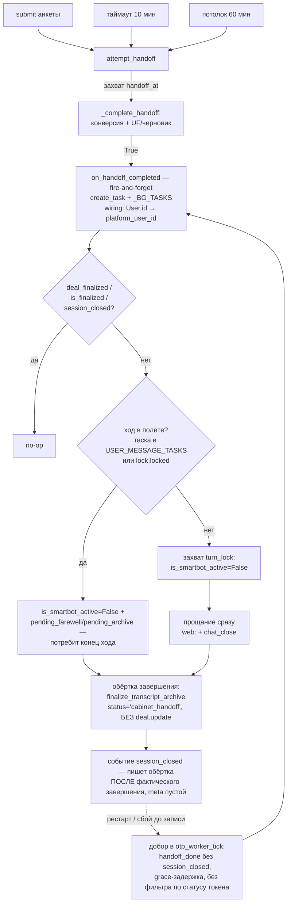
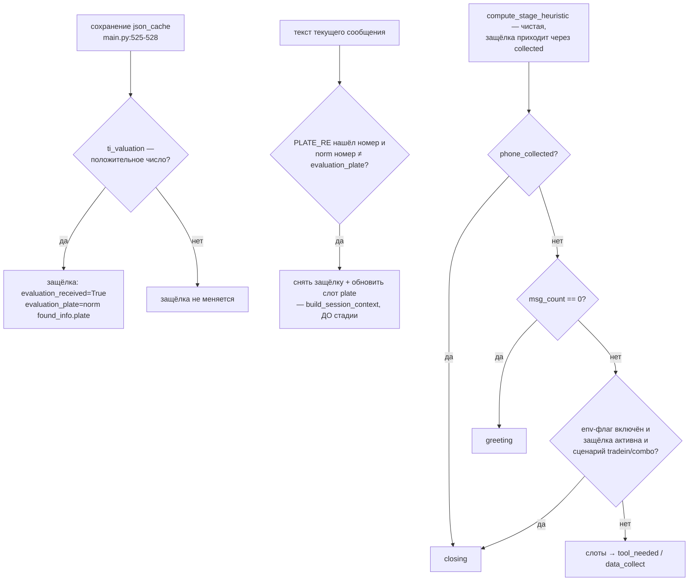

# feat: Завершение диалога при передаче заявки кабинета + учёт оценки в стадии

## Summary

Две правки Python-бота под новую диалоговую тактику Александра: (1) сессия бота завершается в момент фактической передачи заявки личного кабинета в CRM — общая точка всех трёх триггеров передачи в коде уже существует; (2) стадийная эвристика перестаёт выставлять `tool_needed` после полученной оценки — вводится персистентная защёлка «оценка получена», переводящая диалог в `closing`. Три контракта с n8n (тройка позиции на INIT-ходе, кабинетные поля каждого хода, поля ремайндера) сохраняются без изменений. Парный план стороны n8n: `docs/plans/2026-08-14-001-feat-cabinet-dialog-tactic-plan.md` их репозитория.

---

## Problem Frame

Кабинет — третий механизм добычи телефона: клиент подтверждает номер кодом сам, заявка уходит продавцу. Продуктовое требование владельца: как только клиентом занялся продавец, Александр замолкает — иначе клиент возвращается сверять цифры с ботом и подрывает продавца. Момент «занялся продавец» — не верификация номера (после неё клиент ещё заполняет анкету и может просить помощи в чате), а **передача заявки в CRM**. Сегодня отключение не реализовано вовсе: диалог продолжается при любом `cabinet_status`.

Вторая проблема: `compute_stage_heuristic` пересчитывает стадию каждый ход с нуля, и полученная оценка не влияет на результат — основной промпт-блок стадии `tool_needed` велит молча вызвать платный `evaluate_auto` заново. Промптовая страховка (черновик BLK_EVAL_REUSE на стороне n8n) не лечит: команда вызвать инструмент приходит из стадии.

---

## Установленные факты (по коду, срез 2026-08-14)

Всё в этом разделе прочитано в коде текущей ветки `feat/cabinet-calculator`; документация источником не является. Гипотезы вынесены в отдельный подраздел в конце.

### Ф1. Передача заявки в CRM: три триггера, одна точка

- Явный submit: `POST /cabinet/api/form/submit` → `cabinet_service.submit_form` (`cabinet_service.py:1814-1880`) → атомарный `submitted_at` → `on_form_submitted` → **`attempt_handoff(user_id, trigger="submit")`**.
- Таймаут бездействия: фоновый `otp_worker` (`main.py:3484-3494`, тик 30 с) → `otp_worker_tick` → `_check_handoff_timeouts` (`cabinet_service.py:487-521`): `now − max(last_seen_at, bound_at) > CABINET_HANDOFF_TIMEOUT` (дефолт **600 с**; `cabinet_service.py:2105-2106`) → тот же `attempt_handoff`.
- Абсолютный потолок: там же, `now − bound_at > CABINET_HANDOFF_MAX_AGE` (дефолт **3600 с**; `cabinet_service.py:2109-2110`).
- Общая точка: `attempt_handoff` → атомарный захват `CabinetToken.handoff_at` (`cabinet_service.py:2153-2164`) → `_complete_handoff` (`cabinet_service.py:2196-2278`): конверсия Bitrix (`_run_conversion` → `final_sync_wrapper`, wiring `main.py:3431-3442`), затем UF-пуш анкеты (submit) или черновик текстом в таймлайн + сигнал B дилеру (таймаут). Все три триггера работают и сходятся; завершение вешается на эту точку.
- Зависшие захваты добирает `_recover_stuck_handoffs` (`cabinet_service.py:524-573`): повтор через 600 с, потолок 24 ч. `_complete_handoff` вызывается из двух мест — из `attempt_handoff` и из recovery.

### Ф2. Признак «заявка передана» существует и отличим от cabinet_status

- Намерение — `CabinetToken.handoff_at` (захват); факт доведения — событие `CabinetEvent 'handoff_done'` (`cabinet_service.py:2258, 2277`); плюс гард-события `handoff_form_push` / `handoff_draft_comment` / `handoff_signal_b` через `_record_event_once` (`cabinet_service.py:2342-2366`).
- `get_cabinet_status` (`cabinet_service.py:2477-2490`) передачу **не видит**: путь «черновик по таймауту» не ставит `submitted_at`, статус остаётся `phone_confirmed`. Требование «внутренний признак, а не значение статуса» уже выполнено кодом — ничего выражать заново не нужно, отключение вешается на `handoff_done`-точку, контракт `cabinet_status` не трогается.

### Ф3. Существующие механизмы завершения диалога

- Функции `finalize_deal` в коде нет. Финализация от n8n приходит callback'ом `POST /n8n_callback` → `handle_n8n_callback` (`main.py:855-1019`): `ctx['deal_finalized']=True`, `is_smartbot_active=False`, флаги `pending_farewell`/`pending_archive` в контекст (`main.py:895-914`); Bitrix-обновление (STAGE_ID по статусу + UF) — фоном (`main.py:938-1012`). Есть аварийный мост при невыполненном `<function_calls>` в тексте (`main.py:548-609`).
- Прощание: при `pending_farewell` после ответа ИИ уходит «[Автоматическое уведомление]... Александр покинул чат...» — для web без «перейдите на сайт», для max/tg с ним (`main.py:673-695`). `pending_farewell` потребляется **только** внутри `send_smartbot_reply` — то есть только когда был ход к n8n.
- Стенограмма/архив: `finalize_transcript_archive` (`main.py:697-769`) — комментарий-остаток стенограммы в Bitrix, `ctx['is_finalized']=True`, для web — `web_client.send_close` (событие `{"type":"chat_close"}` в SSE-очередь, `web_client.py:52-54`; виджет обрабатывает — `widget-custom/widget.js:285`), архив в NocoDB, очистка `USER_CONTEXT`. Требует `status`/`report_text`/`deal_id`.
- TTL 48 ч: `sync_worker` «Логика Б» (`main.py:3126-3182`) — по `last_interaction_time`; переводит сделку в `STAGE_LOSE`, web-каналу прощание не шлёт (`supports_reminders()=False`, `web_client.py:66-67`), `send_close` не зовёт, `is_finalized` не ставит.
- Клиент пишет после закрытия: гейта по `is_finalized` во входящем обработчике **нет**. При живом `start_code` в контексте БД сообщение уходит в Dialogflow-воронку заново (`main.py:2168-2192`); фолбэк «выберите автомобиль на сайте» — только при отсутствии `start_code` (`main.py:2160-2166`). Полный сброс — только по новому диплинку (`main.py:2102-2157`).
- Ход «в полёте»: буфер `USER_MESSAGE_BUFFERS` + `delayed_sender` (3 с + 10 с; `main.py:1961-2098`), per-user `turn_lock` (`turn_locks.py:1-15`, захват `main.py:1995`). `delayed_sender` снимает себя из реестра тасок **до** захвата лока (`main.py:1991-1992`) и **не перепроверяет** `is_smartbot_active` после создания. `reminder_worker` шлёт ремайндер-ход к n8n **без** turn_lock (`main.py:2899`).

### Ф4. Телефон и стадия: риск ранней финализации не реализуется

- Обе точки пишут одно поле `User.phone` через `database.save_user_phone` (`database.py:382-400`) со стражем `chat_phone_guard` (OTP-номер не перезаписывается из чата; `cabinet_service.py:2421-2472`). Кабинет: `verify_code` → `_post_verify_hook` (`cabinet_service.py:2371-2416`). Чат-рефлекс: `delayed_sender` (`main.py:2002-2005`) — единственное место, где ставится `ctx['phone_collected']=True` на chat-пути.
- Стадия считает **только** `ctx['phone_collected']` (`payload_v2.py:72, 86-87`), `User.phone` на chat-ходах для слотов не читается. Кабинетная верификация `ctx['phone_collected']` не трогает → ранний `closing` (и финализация из closing-промпта) **не наступает**. Единственная точка, где `User.phone` конвертируется в `phone_collected`, — INIT-ход нового диалога (`main.py:1242-1244`); это новая сессия после сброса контекста.

### Ф5. Стадийная эвристика и слоты

- `compute_stage_heuristic` (`payload_v2.py:80-93`): `phone_collected → closing`; `msg_count==0 → greeting`; все слоты сценария → `tool_needed`; иначе `data_collect`. Слоты: credit — `payment`; tradein — `plate`+`mileage`; combo — `payment`+`plate`+`mileage` (`payload_v2.py:32-36`).
- **Слот `mileage` не пишется нигде в Python-коде** — только читается (`payload_v2.py:75-76`). Слот `plate` пишется только в Dialogflow-воронке до передачи ИИ (`main.py:2216-2225`), сырым текстом клиента. Следствие: бот-эвристика для tradein/combo фактически **никогда не возвращает `tool_needed`** — обязательный `mileage` вечно пуст. Наблюдаемое n8n-стороной «tool_needed на каждом ходе» рождается не в боте (см. Гипотезы).
- Сброс каталожного кэша: `should_refresh_cache` (`payload_v2.py:122-136`) — по TTL 10 мин или по **переходу** в `tool_needed`/`closing`.
- Оценка на стороне бота: `ctx['n8n_cache']` = `json_cache` из ответа n8n (`main.py:525-528`); `build_evaluation_carryover` (`payload_v2.py:155-179`) читает из него `found_info`/`ti_valuation`, шлёт на каждом ходе; нет данных — ключа нет вовсе.

### Ф6. Три контракта n8n

- Тройка позиции на INIT: `send_handoff_webhook` парсит `start_code` диплинка — `dealer_code = start_code[:2]`, `model_id = [2:4]`, `complectation_id = [4:6]` (`main.py:1184-1187`) — и кладёт в `qualification_context` (`main.py:1214-1218`). На chat-ходах — те же значения из `user_context` (`main.py:1101-1103`), куда они записаны при входе по диплинку (`main.py:2141-2146`). **Источник на нулевом ходе — парсинг диплинка, не эхо кэша**: `cached_json` на INIT физически отсутствует. Эхо `qualification_context` внутри `n8n_cache` — другой механизм с другим потребителем: из него `model_id` берёт заморозка снапшота калькулятора кабинета (`cabinet_service.py`, `_cache_model_id`), работает начиная с первого Car Search. Документация не противоречит фактам — она описывает второй путь; оба пути живут одновременно.
- Кабинетные поля: `_attach_cabinet_context` (`main.py:1047-1066`) вызывается в обоих payload-путях (chat `main.py:1129-1132`, INIT `main.py:1237-1238`); при исключении ключи не добавляются вовсе (`main.py:1065-1066`) — контракт «при сбое ключей нет» уже соблюдён.
- Ремайндер: `reminder_worker` (`main.py:2844-2912`) кладёт `ctx['last_bot_message']` и шлёт `__SYSTEM_REMINDER__` через тот же `send_chat_message_to_n8n` — `last_bot_message` (`main.py:1107`) и кабинетные поля приходят автоматически. Работает только при `is_smartbot_active=True` (`main.py:2855`) — после завершения сессии ремайндеры прекращаются без дополнительного кода.

### Гипотезы (не факты)

- Г1. `tool_needed` в трейд-ин сессиях выставляет стадийная логика стороны n8n (Stage Classifier v3-контура), поскольку бот-эвристика туда не попадает (Ф5). Проверяется только их стороной; для плана означает: правка бота даёт правильный **вход** `current_stage`, но их стадийная половина должна согласованно не перебивать его в `tool_needed` (их план, BLK_EVAL_REUSE).
- Г2. `found_info.plate` приходит нормализованным от auto.ru (верхний регистр, без пробелов). Проверить на стенде при реализации; нормализация в U4 делает вопрос некритичным.

---

## Requirements

Завершение диалога при передаче (задача 1):

- R1. При факте доведения передачи (`handoff_done`, любой из трёх триггеров) сессия бота завершается: `is_smartbot_active=False`, клиенту уходит прощание, стенограмма финализируется и выгружается в архив; `STAGE_ID` сделки этим путём не меняется (конверсию Bitrix кабинетная передача уже выполнила сама).
- R2. Ход «в полёте» завершается штатно; завершение сессии выполняется после него. После завершения ни один новый ход к n8n не уходит — включая уже созданный `delayed_sender` и ремайндеры.
- R3. Завершение идемпотентно и переживает рестарт процесса: повтор не задваивает прощание/архив; завершение, упавшее после `handoff_done`, добирается фоново.
- R4. Взаимный гейт с финализацией по n8n-callback, асимметричный: кабинетное завершение — no-op при предшествующей n8n-финализации (ни второго прощания, ни второго архива); обратный случай (callback после кабинетного завершения) допускается и может обновить STAGE — редкое и информативное событие, не фильтруется.
- R5. Прощание — общий текст штатного завершения по каналам: web — вариант без «перейдите на сайт» плюс событие `chat_close` в SSE-очередь; max/tg — существующий текст.
- R6. В окне «номер верифицирован, передача ещё не произошла» ремайндеры бота клиенту не уходят.
- R7. Сообщение клиента после завершения обрабатывается как сегодня (Dialogflow-воронка при живом `start_code`); поведение зафиксировано в плане, отдельный текст не вводится.

Учёт оценки в стадии (задача 2):

- R8. При полученной валидной оценке (сценарии tradein/combo) стадия — `closing`; `tool_needed`/`data_collect` повторно не выставляются, повторный сбор госномера/пробега ботом не инициируется.
- R9. Признак «оценка получена» — персистентная защёлка в контексте, не прямое чтение `n8n_cache`: переживает пересборку кэша и не зависит от того, вливает ли текущая версия воркфлоу `evaluation_carryover` обратно (без осцилляции стадий).
- R10. Госномер, нормализованно отличный от оценённого, снимает защёлку — повторная оценка не блокируется. Механизм — извлечение номера из ТЕКСТА текущего сообщения (`PLATE_RE`), не сравнение со слотом `plate`: слот после передачи ИИ не обновляется никогда (Ф5), и завязка на него делала бы требование недостижимым.
- R11. Кредит/сток/консультация не затронуты: без оценки поведение эвристики прежнее.
- R12. Взаимодействие со сбросом кэша: переход в `closing` по защёлке даёт не более одного сброса `cached_json`; правило `should_refresh_cache` не меняется.

Сохранность контрактов:

- R13. Тройка `dealer_code`/`model_id`/`complectation_id` в `qualification_context` INIT-хода сохраняется (источник — `start_code`).
- R14. `cabinet_url`/`cabinet_status` приходят на каждом ходе, включая нулевой; при сбое выдачи — отсутствие ключей, не пустые значения.
- R15. Ремайндер-ход (вне окна R6) несёт `last_bot_message`, `cabinet_url`, `cabinet_status`.

---

## Key Technical Decisions

- **Точка подвески завершения — успешный `_complete_handoff`, не захват `handoff_at`**: завершать диалог до фактического доведения конверсии нельзя (упавшая передача уходит в recovery-повтор). Хук вызывается по возврату True из `_complete_handoff` — это покрывает оба вызывающих пути (штатный и recovery).
- **Wiring-only**: кабинетная сторона получает новую инъекцию (колбэк «передача доведена») через существующий `cabinet_service.setup(...)` (`main.py:3458-3476`); вся сессионная механика — в main.py. Перевод идентификаторов: cabinet_service оперирует `User.id`, сессия — `platform_user_id`; конверсия id — в wiring.
- **Завершение — свой путь, переиспользующий строительные блоки finalize**: `is_smartbot_active=False` + прощание + `finalize_transcript_archive(status='cabinet_handoff')`, но **без** `crm.deal.update`/STAGE_ID — сделку уже обновила конверсия кабинета. Путь n8n-callback (со сменой STAGE) не подходит целиком именно из-за этого.
- **Хук завершения — fire-and-forget**: колбэк «передача доведена» запускается через `create_task` с сильной ссылкой (паттерн `_BG_TASKS`, `main.py:538-542`), а не await-ом из `_complete_handoff`. Причина: `_complete_handoff` await-ится прямо из HTTP-хендлера `submit_form` и из последовательных циклов `otp_worker` — честное ожидание `turn_lock` (занят ходом до ~420 с: таймаут n8n 120 с + LONG RETRY `sleep(180)` + повтор) подвешивало бы ответ сабмита клиенту и останавливало передачи остальных пользователей.
- **Две ветки доставки завершения**, развилка — ДО захвата лока, по `lock.locked()` или таске в `USER_MESSAGE_TASKS`: ход в полёте → `is_smartbot_active=False` + существующий паттерн `pending_farewell`/`pending_archive`, потребляемый концом хода; хода нет (типовой случай — таймаут-передача при молчащем чате) → захват `turn_lock`, `is_smartbot_active=False`, немедленное прощание + финализация. Ветка «нет хода» обязательна: `pending_*` без хода не потребляется никогда (Ф3). Захват лока в немедленной ветке закрывает щель `main.py:1991-1995` и гарантирует, что буферизованные сообщения либо уйдут ходом до завершения, либо не уйдут вовсе. Ремайндер-ход развилке невидим (идёт без лока и без таски, Ф3) — его закрывает гард на пути доставки (U3).
- **Гард идемпотентности — событие `session_closed`**, записываемое ТОЛЬКО после фактического завершения: единая обёртка завершения (вызов `finalize_transcript_archive` + прощание) пишет событие последним шагом в обеих ветках — в pending-ветке это делает та же обёртка, вызываемая концом хода после потребления флагов. Запись до фактической доставки недопустима: рестарт стёр бы in-memory `pending_*`, а добор, увидев `session_closed`, никогда бы не повторил — сессия осталась бы без прощания и архива. Событие пишется с ПУСТЫМ meta (триггер — только в лог): `_record_event_once` дедуплицирует по тройке token+type+meta, и trigger в meta пропускал бы второе завершение при повторе другим путём. Фоновый добор незакрытых (`handoff_done` есть, `session_closed` нет) — в `otp_worker_tick`, с grace-задержкой по образцу `HANDOFF_RECOVERY_DELAY_SECONDS` (окно фоновой финализации хода — не сигнал к повтору), с перечитыванием `is_finalized`/`deal_finalized` из БД-контекста перед повторным прощанием и БЕЗ фильтра по статусу токена (истёкший/отозванный после `handoff_done` токен не должен молча терять незакрытую сессию).
- **Взаимный no-op гейт**: кабинетное завершение — no-op при `ctx['deal_finalized']`/`ctx['is_finalized']`/уже погашенном `is_smartbot_active` с зафиксированным `session_closed`; финализация по callback первой — кабинетное завершение не дублирует её. Обратное окно (callback после кабинетного завершения) двигает STAGE поверх конверсии — принято как редкое и информативное (статус от Александра валиден); не фильтруем.
- **Текст прощания — общий** (решение владельца): существующие канальные варианты `main.py:677-686` как есть; `Final_Status` архива — новый `'cabinet_handoff'`, `report_text` — фиксированная строка с триггером передачи. Известное следствие: текст max/tg содержит «перейдите на сайт и отправьте повторный запрос» — для только что переданной заявки это может спровоцировать вторую заявку; фиксируется как продуктовый хвост (Scope Boundaries), не блокирует.
- **Защёлка оценки** — персистентные слоты контекста (`evaluation_received`, `evaluation_plate`), выставляемые в момент сохранения `json_cache` с валидной оценкой (рядом с `main.py:525-528`, логика — функцией в payload_v2). Правило стадии читает защёлку, не кэш (R9). Валидность: `ti_valuation` — положительное число; мусор/объект-ошибка защёлку не ставит. Разделение по чистоте: `compute_stage_heuristic` остаётся чистой функцией (защёлка прокидывается в `collected` через `_collected_data`, правило только читает); снятие защёлки — мутация контекста — живёт в `build_session_context`/`register_evaluation` (единственные места с ctx), до вычисления стадии.
- **Снятие защёлки — по госномеру из ТЕКСТА текущего сообщения**, не по слоту `plate`: слот пишется только в Dialogflow-воронке и после передачи ИИ не обновляется никогда (Ф5) — завязка на него делала бы R10 недостижимым, а клиента запирала со старой оценкой. Механизм: `PLATE_RE` (уже используется в `detect_flags.has_valid_plate`) извлекает номер из текущего сообщения; нормализованное несовпадение с `evaluation_plate` снимает защёлку и обновляет слот `plate` извлечённым значением. Нормализация: регистр, пробелы, кириллица/латиница-гомоглифы (в репо уже был урок про омоглифы — `docs/solutions/`). Смена пробега защёлку не снимает — принятое ограничение (слот `mileage` в боте мёртв, Ф5; пересчёт по новому пробегу — интентом через n8n).
- **U4 за выключенным флагом** — код и тесты пишутся, включение отдельное (условие в U4): правило стадии активируется env-флагом (дефолт выключен) и включается только синхронно с готовностью стадийной половины n8n.
- **Порядок приоритетов эвристики**: `phone_collected` → `msg_count==0` → защёлка оценки (`closing`) → слоты → `data_collect`. `REFRESH_STAGES` не меняется: единственный новый переход `data_collect→closing` случится один раз (защёлка не мигает), цена — один внеплановый Car Search на ходе после оценки; `found_info`/`ti_valuation` переживают пересборку через `evaluation_carryover` (контракт уже проверен живьём), а стадия от пересборки не зависит благодаря защёлке.
- **Подавление ремайндеров в кабинетном окне** — проверка в `reminder_worker`: активный токен с `bound_at` без `handoff_at` → пропуск пользователя (клиент заполняет анкету; «актуален ли вопрос» в этом окне — шум). Реализация — инъецированный предикат от cabinet_service, чтобы не тащить SQL кабинета в main.py.

---

## High-Level Technical Design

Завершение сессии при передаче:

Правило стадии после оценки (payload_v2):

---

## Implementation Units

### U1. Инъекция «передача доведена» и фоновый добор незакрытых сессий

- **Goal:** cabinet_service сигналит наружу факт доведения передачи; незакрытые после рестарта/сбоя сессии добираются фоново.
- **Requirements:** R1, R3.
- **Dependencies:** нет.
- **Files:** `cabinet_service.py`, `tests/test_cabinet_handoff.py`.
- **Approach:** новый параметр `setup(...)` — асинхронный колбэк `on_handoff_completed(user_id, trigger, deal_id, token_id)` (deal_id/token_id нужны U2 для финализации и записи события); вызов после успешного `_complete_handoff` в обоих путях (штатном и recovery), fire-and-forget — `create_task` с сильной ссылкой (паттерн `_BG_TASKS`), НЕ await: `_complete_handoff` await-ится из HTTP-хендлера submit и последовательных циклов воркера. Запись `session_closed` — экспортируемый хелпер cabinet_service (обёртка над `_record_event_once`), вызываемый обёрткой завершения U2 ПОСЛЕ фактического завершения; событие пишется с пустым meta (триггер — только в лог), иначе дедуп по тройке token+type+meta пропустит второе завершение при повторе другим путём. В `otp_worker_tick` — добор: токены с `handoff_at`, событием `handoff_done`, но без `session_closed` → повторный вызов колбэка (сам колбэк идемпотентен по гарду); добор с grace-задержкой (по образцу `HANDOFF_RECOVERY_DELAY_SECONDS`) и БЕЗ фильтра по статусу токена — истёкший/отозванный после передачи токен не должен молча терять незакрытую сессию. Сбой колбэка не роняет `_complete_handoff` (try/except + лог, паттерн `main.py:1065-1066`).
- **Patterns to follow:** инъекции `setup()` (`cabinet_service.py`, wiring `main.py:3458-3476`); `_record_event_once` (`cabinet_service.py:2342-2366`); добор — по образцу `_recover_stuck_handoffs` (`cabinet_service.py:524-573`).
- **Risk:** низкий на кабинетной стороне; главный — заглохший колбэк без добора (закрыто механизмом добора). В проде без выданных кабинет-токенов `attempt_handoff` не срабатывает — юнит там мёртв по построению.
- **Test scenarios:**
  - submit-передача → колбэк вызван ровно один раз с trigger="submit";
  - таймаут-передача (бэкдейт `last_seen_at`) → колбэк с trigger="timeout";
  - абсолютный потолок (бэкдейт `bound_at` при свежем `last_seen_at`) → колбэк с триггером потолка (имя триггера — по факту кода `_check_handoff_timeouts`);
  - `_complete_handoff` через recovery-путь → колбэк вызван;
  - повтор завершения разными путями (добор после timeout-передачи) → событие `session_closed` записано ровно один раз (пустой meta, дедуп работает);
  - токен сменил статус после `handoff_done` (истёк/отозван) → добор сессию НЕ теряет;
  - колбэк бросает исключение → `handoff_done` записан, передача не сломана; следующий тик добора вызывает колбэк повторно;
  - `session_closed` уже записан → добор не зовёт колбэк (нет второго вызова);
  - конверсия упала (Bitrix недоступен) → колбэк НЕ вызван до успешного повтора recovery.
- **Verification:** сюита `tests/test_cabinet_handoff.py` зелёная; на дев-стенде в `cabinet_events` после передачи — пара `handoff_done` + `session_closed`.
- **Rollback:** revert коммита юнита; новый параметр setup опционален (дефолт None → поведение до правки).

### U2. Завершение сессии бота по передаче кабинета (main.py)

- **Goal:** реализация самого завершения: флаг, прощание по каналам, финализация стенограммы/архива, обе ветки доставки, взаимный гейт с n8n-финализацией.
- **Requirements:** R1, R2 (часть «после хода»), R3 (DB-fallback контекста и доводимость — реализуются здесь), R4, R5, R7.
- **Dependencies:** U1.
- **Files:** `main.py`, `tests/test_bot_integration.py` (или новый `tests/test_cabinet_session_close.py`).
- **Approach:** обёртка завершения — обработчик колбэка U1: перевод `User.id → platform_user_id`; загрузка контекста из БД, если в памяти нет (`load_context_from_db` — к таймаут-передаче память может быть пуста); no-op гейт (`deal_finalized`/`is_finalized`/`session_closed`); развилка «ход в полёте» ДО захвата лока — таска в `USER_MESSAGE_TASKS` или `lock.locked()`: ход в полёте → `is_smartbot_active=False` + `pending_*`-путь (потребит конец хода); хода нет → захват `turn_lock`, `is_smartbot_active=False`, немедленное прощание (`get_client(...)`, для web дополнительно `send_close` — оба места-паттерна `main.py:731-733, 2559-2561`) → `finalize_transcript_archive` с `status='cabinet_handoff'`, `report_text` с триггером передачи, `deal_id`/`token_id` из колбэка U1 (в ctx `deal_id` может не быть — сделку создала конверсия). Событие `session_closed` — хелпером U1 строго ПОСЛЕ фактического завершения, в обеих ветках владелец записи — эта обёртка (в pending-ветке — её хвост, вызываемый концом хода после потребления флагов). Симметрия флагов: при `pending_*`-пути потребление обоих флагов проверить и в fallback-ветке `ai_resp=None` (`main.py:2040-2051` шлёт свой текст — прощание не должно задваиваться).
- **Execution note:** начать с интеграционного теста «submit → одна отправка прощания, один архив, is_smartbot_active=False» на фейковых клиентах каналов.
- **Patterns to follow:** блок прощания `main.py:673-695`; финализация `main.py:697-769`; канальные различия через `get_client`/`supports_reminders`.
- **Risk:** средний — это сессионная механика общего бота; ошибка в гейте задваивает прощание или, наоборот, глушит легитимную n8n-финализацию. Прод: путь не активируется без кабинетных передач (см. U1), но код общий — покрытие тестами обязательно.
- **Test scenarios:**
  - Covers сценарий приёмки n8n: передача при молчащем чате (хода нет) → прощание уходит немедленно, `is_smartbot_active=False`, архив в NocoDB со статусом `cabinet_handoff`, STAGE_ID сделки не менялся этим путём;
  - передача при ходе в полёте → ход завершился штатно (ответ Александра доставлен), прощание после него, порядок сообщений: ответ → прощание;
  - n8n-callback финализировал раньше → кабинетное завершение no-op (одно прощание, один архив);
  - кабинетное завершение раньше → повторное завершение (добор U1) no-op;
  - web-канал: прощание web-текстом (без «перейдите на сайт») + `chat_close` в очереди SSE;
  - клиент пишет после завершения при живом `start_code` → уходит в Dialogflow-воронку (фиксация R7, поведение не менялось);
  - контекста нет в памяти (имитация рестарта) → завершение работает от БД-контекста;
  - рестарт после установки `pending_*` (флаги потеряны) → добор U1 доводит прощание и архив ровно один раз;
  - submit при свободном локе → HTTP-ответ `/form/submit` возвращается сразу (завершение фоном, не блокирует хендлер).
- **Verification:** интеграционные тесты зелёные; на дев-стенде сценарий «верификация → молчание 10 мин» даёт прощание в чате и запись архива; повторных сообщений от Александра нет. Web-оговорка приёмки: при закрытой вкладке прощание/`chat_close` лягут в in-memory SSE-очередь без потребителя — недоставка для web-таймаут-сценария штатна (клиент в кабинете), проверять по стенограмме/архиву, не по факту доставки.
- **Rollback:** revert коммита; U1-колбэк перестаёт быть подключённым (setup с None) — поведение до правки.

### U3. Гарды путей к n8n после завершения (delayed_sender + reminder_worker)

- **Goal:** ни один уже созданный путь к n8n не доносит ход/ответ после завершения сессии: ни таймер отложенной отправки, ни ремайндер-ход.
- **Requirements:** R2 (часть «новые ходы не уходят, включая ремайндеры»).
- **Dependencies:** нет (усиливает U2; мержится независимо).
- **Files:** `main.py`, `tests/test_bot_integration.py`.
- **Approach:** два симметричных гарда. (1) `delayed_sender`: перед вызовом n8n — перепроверка `is_smartbot_active` (свежим чтением User) и `ctx['is_finalized']`; сработал гард → буфер не отправляется, лог. Закрывает щель `main.py:1991-1995` в связке с развилкой U2. (2) `reminder_worker`: ремайндер-ход идёт без `turn_lock` и без таски (Ф3) — развилка U2 его не видит; после возврата `ai_resp` перепроверять `is_smartbot_active` свежим чтением; сессия завершена → НЕ вызывать `send_smartbot_reply` и НЕ перезаписывать `context_json` (`main.py:2910` иначе затопчет `is_finalized` устаревшей копией, сломав no-op гейт R4).
- **Patterns to follow:** существующие проверки актуальности ответов по поколению экрана/сессии в кодовой базе.
- **Test scenarios:**
  - таймер создан до завершения, сработал после → запрос к n8n не уходит;
  - штатный ход без завершения → поведение не изменилось;
  - гонка «сообщение в буфер за миг до завершения» → либо ход ушёл до `is_smartbot_active=False` (штатно, прощание после), либо не ушёл вовсе — третьего нет;
  - ремайндер-ход в полёте, передача завершилась до возврата ответа → ответ ремайндера не доставлен, `context_json` финализированной сессии не перезаписан.
- **Verification:** тесты зелёные; на стенде сообщение, отправленное в секунду передачи, не порождает исполнение в n8n, и ремайндер, ушедший до передачи, не доставляет ответ после прощания.
- **Rollback:** revert коммита (точечные правки двух функций).

### U4. Правило оценки в стадийной эвристике (payload_v2)

- **Goal:** полученная валидная оценка переводит tradein/combo в `closing`; защёлка переживает пересборку кэша; новый госномер снимает её.
- **Requirements:** R8, R9, R10, R11, R12.
- **Dependencies:** нет.
- **Files:** `payload_v2.py`, `main.py` (одна строка wiring у `main.py:525-528`), `tests/test_payload.py`.
- **Approach:** функция `register_evaluation(ctx)` в payload_v2: читает `ctx['n8n_cache']`, при валидном `ti_valuation` (положительное число) ставит `ctx['evaluation_received']=True`, `ctx['evaluation_plate']=normalize_plate(found_info.plate)`; вызов — рядом с сохранением кэша в `send_smartbot_reply`. `normalize_plate`: верхний регистр, без пробелов, латиница→кириллица по таблице гомоглифов номерных букв. Снятие защёлки — в `build_session_context` (единственное место с ctx), ДО вычисления стадии: `PLATE_RE` извлекает номер из текста текущего сообщения; нормализованное несовпадение с `evaluation_plate` → защёлка снята, слот `plate` обновлён извлечённым значением. Слот `plate` в снятии не участвует (после передачи ИИ он не обновляется — Ф5). `compute_stage_heuristic` остаётся чистой: защёлка и флаг приходят через `collected` (`_collected_data`); правило между `greeting` и слотами: env-флаг включён и `request_type in ("tradein","combo")` и защёлка активна → `closing`. `found_info.plate` отсутствует → защёлка без привязки к номеру, любой валидный номер в тексте её снимает. `_REQUIRED_SLOTS` и `REFRESH_STAGES` не меняются.
- **Условие включения (не риск — гейт):** правило активируется env-флагом (имя вида `STAGE_EVAL_RULE`, дефолт ВЫКЛ). Юнит доводится до кода и зелёных тестов, но флаг не включается ни на стенде-проде, ни в деплое до отдельного решения — синхронно с готовностью стадийной половины n8n. Причина — Ф5: бот-эвристика для tradein/combo `tool_needed` не выдаёт никогда, источник повторных вызовов оценки — на стороне n8n (их переопределение стадии по инструментальным интентам); без их правки U4 в лучшем случае бесполезен, в худшем создаёт иллюзию решённой проблемы.
- **Technical design (направление, не спецификация):** защёлка — два ключа контекста рядом с существующими слотами U4-класса (`deal_finalized`-паттерн: персистентные, переживают рестарт через `context_json`).
- **Patterns to follow:** `payload_v2.py` — единственный владелец диалогового состояния; тесты — `tests/test_payload.py::TestStageHeuristic` (чистая стадийная функция без БД; мутации ctx — в тестах `build_session_context`).
- **Risk:** при включённом флаге — единственный юнит, меняющий поведение прод-диалогов (трейд-ин живёт в проде, `ti_valuation` уже ходит); с выключенным дефолтом деплой кода безопасен.
- **Test scenarios:**
  - tradein, защёлка активна, plate совпадает → `closing` при пустом `phone_collected`;
  - combo, защёлка активна → `closing`; credit с любым кэшем → правило не срабатывает;
  - `ti_valuation` = None / 0 / отрицательное / не число / `{}` → защёлка не ставится, стадия прежняя;
  - «а 123 вс 77» в тексте сообщения против «А123ВС77» в защёлке → нормализация даёт совпадение → защёлка держится, `closing`;
  - другой госномер в ТЕКСТЕ текущего сообщения → защёлка снята, слот `plate` обновлён извлечённым значением, стадия по слотам (повторная оценка не блокирована);
  - сообщение без номера при снятой защёлке → защёлка не восстанавливается сама (до новой валидной оценки);
  - env-флаг выключен (дефолт) → правило не срабатывает даже при активной защёлке — поведение эвристики прежнее;
  - пересборка кэша: `n8n_cache` заменён на версию без `ti_valuation` → защёлка держит `closing` (нет осцилляции);
  - `phone_collected=True` поверх защёлки → по-прежнему `closing` (приоритет 1 не изменился);
  - `msg_count==0` → `greeting` даже при защёлке;
  - смена сценария tradein→credit после оценки → правило не действует (скоуп по request_type);
  - `should_refresh_cache`: переход `data_collect→closing` по защёлке даёт сброс ровно один раз; следующие ходы в `closing` сброса не дают.
- **Verification:** `tests/test_payload.py` зелёный; на дев-стенде в payload вебхука (видно n8n-стороне) `current_stage=closing` на ходе, следующем за появлением оценки.
- **Rollback:** revert коммита — эвристика возвращается к текущему поведению; защёлочные ключи в старых контекстах безвредны (никем не читаются).

### U5. Подавление ремайндеров в кабинетном окне

- **Goal:** клиенту, заполняющему анкету (верифицирован, передача не произошла), ремайндеры не уходят.
- **Requirements:** R6.
- **Dependencies:** нет.
- **Files:** `main.py`, `cabinet_service.py` (предикат), тест в `tests/test_cabinet_handoff.py`.
- **Approach:** предикат в cabinet_service («у пользователя активный токен с `bound_at` и без `handoff_at`»), инъецированный или импортированный в `reminder_worker`; при истинности — `continue` по пользователю. После передачи ремайндеры и так не уходят (`is_smartbot_active=False`, Ф6).
- **Risk:** низкий; ошибка предиката в худшую сторону — лишний ремайндер (текущее поведение).
- **Test scenarios:**
  - bound-токен без handoff → пользователь пропущен ремайндер-воркером;
  - токен с handoff_at → обычная логика (но сессия уже закрыта U2);
  - токен не bound (ссылка выдана, номер не подтверждён) → ремайндер уходит, и его payload несёт `cabinet_url`/`cabinet_status` (Covers контракт R15 — ветвление напоминания n8n «удалось ли справиться в кабинете»).
- **Verification:** тест зелёный; на стенде в окне заполнения анкеты ремайндер не приходит.
- **Rollback:** revert коммита.

### U6. Документация и синхронизация с n8n-стороной

- **Goal:** зафиксировать новое поведение и фактические источники контрактов там, где будущие сессии это ищут.
- **Requirements:** R13-R15 (фиксация), плюс итоги задач 1-2.
- **Dependencies:** U1-U5.
- **Files:** `CABINET_CONTEXT.md` (§9 контракт, §18 остатки), `docs/N8N_HANDOFF_CABINET.md` (сигнал «после handoff_done исполнений нет», стадия после оценки).
- **Approach:** краткие правки по факту реализации; отдельно — явная фиксация двух путей пары «модель+комплектация» (Ф6), чтобы документация перестала расходиться с кодом.
- **Test expectation:** none — документационный юнит.
- **Verification:** разделы соответствуют реализованному коду (проверка при ревью).
- **Rollback:** revert коммита.

---

## Scope Boundaries

- Сторона n8n (Stage Classifier, промпт-блоки ST_*, BLK_EVAL_REUSE, ветвление ремайндера) — их план; здесь только бот.
- `cabinet_status` не расширяется и не меняется (просьба n8n-стороны); признак передачи остаётся внутренним (`handoff_at`/`handoff_done`).
- Прод не трогаем: проверка на дев-стенде; деплой — отдельное решение владельца (см. риск U4 — единственный юнит с немедленным прод-эффектом).

### Deferred to Follow-Up Work

- **Продуктовый вопрос владельцу (не техническое ограничение):** текст прощания max/tg «перейдите на сайт и отправьте повторный запрос» для клиента, только что отправившего заявку через кабинет, — приглашение отправить вторую. В этой работе остаётся общий текст (решение владельца); формулировка пересматривается отдельно, вместе с остальными текстами.
- Поведение «клиент пишет после завершения» (Dialogflow-воронка заново при живом `start_code`, возможен повторный вход в диалог с ИИ по той же сделке) — зафиксировано как есть (R7); специальный гейт/текст — отдельным решением.
- 48-часовой путь `sync_worker` не шлёт web-каналу ни прощание, ни `chat_close` — несимметрично с новым путём; починка вне скоупа.
- Смена пробега не снимает защёлку оценки (слот `mileage` в боте мёртв) — принятое ограничение; пересчёт по новому пробегу останется интентом через n8n.

---

## Открытые вопросы (стороне n8n)

- Г1 (обострённая формулировка после Ф5): не «не перебьёт ли их сторона closing», а **что именно у них выставляет `tool_needed` после успешной оценки** — по коду бота эта стадия для tradein/combo не рождается вовсе (слот `mileage` мёртв), источник повторных вызовов оценки на их стороне (переопределение стадии по инструментальным интентам). До их правки U4-флаг не включается (условие включения в U4). Плюс: подтвердить, что closing-промпт при `phone_collected=false` добывает телефон/ведёт в кабинет, а не финализирует сделку. Наблюдение Ф5 передаётся стороне n8n владельцем.

---

## Независимая приёмка

Сторона бота (дев-стенд):

- Сценарий А: диплинк → диалог → верификация в кабинете → молчание 10 мин (или сжатый `CABINET_HANDOFF_TIMEOUT`) → в чате прощание, в `cabinet_events` пара `handoff_done`+`session_closed`, в NocoDB архив `cabinet_handoff`, `is_smartbot_active=False`.
- Сценарий Б: то же с явным submit анкеты.
- Сценарий В: сообщение клиента в секунду передачи → ответ Александра (если ход успел) строго до прощания; исполнений после — нет.
- Сценарий Г (задача 2, стенд со ВКЛЮЧЁННЫМ env-флагом U4): трейд-ин до полученной оценки → в следующем исходящем вебхуке `current_stage=closing`; затем новый госномер В ТЕКСТЕ сообщения клиенту Александру (не подстановка в слот руками) → стадия уходит из `closing`, слот `plate` обновлён извлечённым значением — проверяется именно путь «номер извлечён из текста текущего сообщения».
- Проверка по фактическим данным, не по коду ветки (класс уроков репо): строки `cabinet_events`/`cabinet_tokens`/архива после сценария, содержимое исходящих вебхуков.

Сторона n8n (без доступа к боту):

- После передачи заявки исполнений по `session_id` больше нет — ни chat-ходов, ни `__SYSTEM_REMINDER__` (список executions по workflow за период).
- `current_stage=closing` во входящем вебхуке на ходе, следующем за ходом, где их Final Response вернул `ti_valuation`; и отсутствие возврата в `tool_needed` в той же сессии при неизменном госномере. Действует только после ВКЛЮЧЕНИЯ env-флага U4 (совместный шаг после готовности их стадийной половины); до этого стадии приходят по прежней эвристике.
- Контракты: тройка позиции в `qualification_context` INIT-хода; `cabinet_url`/`cabinet_status` в каждом ходе; поля ремайндера — в ремайндер-ходах до верификации (после верификации до передачи ремайндеров нет — это ожидаемое изменение, R6).

---

## Risks & Dependencies

- Гонки завершения — главный риск задачи 1; закрыты связкой «под turn_lock + гард `session_closed` + добор + no-op гейт» (U1-U3). Проверять по фактическим строкам таблиц после многоходовых сценариев, не по юнит-веткам.
- U4 деплоится с выключенным env-флагом — код в проде безопасен; включение флага гейтится готовностью n8n-стороны (условие включения в U4, Г1). Преждевременное включение при рассинхроне — в лучшем случае бесполезно (их сторона перебьёт стадию), в худшем создаёт иллюзию решённой проблемы повторных оценок.
- Новые проверки времени в доборе/предикатах — только aware-UTC и прогон на PostgreSQL (`TEST_DATABASE_URL`); в репо два урока о naive datetime.
- Bitrix-вызовов новые юниты не добавляют (конверсия и комментарии уже существуют в `_complete_handoff`); если при реализации появится новый вызов — только через кабинетную обёртку с `enqueue_on_failure=False` (урок `injected-callable-hidden-side-effect`).
- Зависимость приёмки от парного плана n8n: их BLK_EVAL_REUSE и стадийная половина; сроки согласованы вне этого плана.
