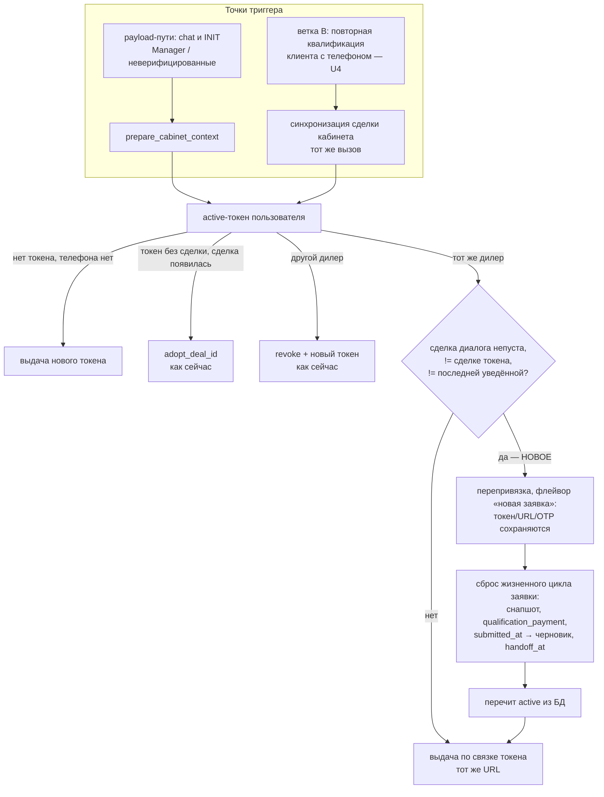

# fix: Кабинет следует за новой сделкой — перепривязка вместо гашения

## Summary

Повторная квалификация у того же дилера перестаёт открывать кабинет со старой сделкой: токен перепривязывается на сделку нового диалога с сохранением URL и OTP-верификации, но со сбросом жизненного цикла заявки (снимок, платёж квалификации, `submitted_at` анкеты, `handoff_at` передачи) — в отличие от склейки лидов, которая переносит всё как есть. Триггер стоит в двух точках: сборка payload (Manager/неверифицированные) и ветка B (вернувшиеся клиенты с подтверждённым телефоном — главная когорта). Деал-хант начинает обновлять `active_deal_id` с зеркальным гардом. Гашение токена отвергнуто: уносит верификацию и рвёт живой сеанс.

## Problem Frame

Приёмка: клиент прошёл квалификацию второй раз у того же дилера — Александр в чате говорит про новую машину и платёж 30 000, кабинет по ссылке открывается со старой машиной и платежом 25 000. Ни бот, ни клиент расхождения не видят; заявка уедет в CRM по старой сделке — менеджер получит не то.

Случай штатный, не узкий: **новая сделка возникает при каждом повторном проходе воронки** — повторный `start`-код сбрасывает контекст и `active_deal_id` (`main.py:2347-2360`), поиск существующей сделки ограничен стадией `C9:NEW` (`main.py:411-412`), куда квалифицированная сделка уже не попадает → всегда «Creating NEW Deal» (`main.py:433-434`). Чинить срочно: дефект ловит каждого вернувшегося клиента, и острее всего — верифицированных (их повторный проход идёт веткой B, см. ниже).

---

## Механика дефекта (по коду)

Новая сделка доезжает до `prepare_cabinet_context` как аргумент на обоих payload-путях (INIT: `main.py:1420-1423`; chat: `main.py:1312-1315`), но ветка «тот же дилер» игнорирует её by design: и профиль, и выдача идут по данным токена (`cabinet_service.py:3266-3271` — `issue_cabinet_token(user_id, active.dealer_code, active.deal_id)`), `same_bundle` сравнивает сделку токена саму с собой → всегда «тот же URL», старый токен живёт. Докстринг декларирует замысел «авторитетен токен, а не устаревший ctx» — он верен против устаревшего ctx (склейка), но не против легитимно новой сделки.

**Для верифицированных клиентов payload-пути вообще не выполняются** (находка ревью): при заполненном `User.phone` Smartbot-ветка A не активируется (`main.py:2660` — `not has_valid_phone`), повторный проход идёт веткой B без INIT и без n8n-ходов — `prepare_cabinet_context` не вызывается. Триггер только в prepare чинил бы Manager-режим и клиентов без телефона, оставив дефект ровно той когорте, которая кабинетом пользовалась.

Вторичные несвежести кабинета (устаревают независимо от сделки):

- **Снимок калькулятора**: гард `_select_cache_position` (`cabinet_service.py:2963-2986`) не перезамораживает существующий снапшот без явного `selected_complectation_id`; на INIT второй квалификации кэша нет вовсе → `/me` и `/car` отдают старую машину и цену.
- **Платёж анкеты**: `qualification_payment` — первичная копия навсегда (R25 требований кабинета, `cabinet_service.py:2735-2736`) при профиле «один на пользователя» → новый платёж туда не попадёт никогда.
- **Замысел заморозки** (для владельца): формулировки «навсегда» в коде нет — снапшоты живут «до перезаморозки (каждый ход с активным токеном)» (`cabinet_service.py:2752`), перезаморозка задумана «тем же ходом, без лага» (`refresh_calc_snapshot`). Сталость — следствие гардов против осцилляций, а не цель; сброс при смене заявки замыслу не противоречит.

Здесь и далее R19/R25 — сквозные требования кабинета из `docs/brainstorms/2026-07-29-client-cabinet-requirements.md` (та же нумерация в комментариях кода); R-иды этого плана — отдельные.

## Три рычага: оценка и рекомендация

- **Рычаг 1 — сделка в ключе поиска живого пропуска.** Поиск по (user, deal) не найдёт токен для новой сделки → выдача нового при живом старом. Ломает инвариант «один active-токен» (частичный уникальный индекс, `ensure_single_active`); старая ссылка остаётся живой и указывает на старую сделку (два кабинета одновременно); новый токен без верификации. **Отклонён.**
- **Рычаг 2 — текущая сделка из контекста в выдачу.** `same_bundle` станет ложным → штатный revoke + новый токен. Цена по коду: новый токен без `bound_at`/`bound_phone` (`cabinet_service.py:967-972`) → верифицированный клиент проходит OTP заново; живой сеанс рвётся немедленно — `validate_bearer` проверяет `token.status` на каждом запросе (`cabinet_service.py:1447-1449`) → 401 посреди анкеты; черновик остаётся под старой сделкой; все ранее отправленные ссылки умирают. Грабли инцидента 2026-08-12: «отзыв уносит bound_phone». **Отклонён как основной.**
- **Рычаг 3 — подключить существующую перепривязку. Рекомендован, с оговоркой о флейворе.** `rebind_cabinet_on_merge` (`cabinet_service.py:3482-3551`) сохраняет URL (`issue_deal_id` зафиксирован), верификацию (`bound_at`/`bound_phone` не трогаются), сливает анкету, переписывает `pending_sync`, переотправляет результат передачи. Механизм проверен в проде. Но склейка — перенос ТОЙ ЖЕ заявки на другую карточку; повторная квалификация — НОВАЯ заявка при той же идентичности. Перенос «как есть» заблокировал бы новую заявку: слитая отправленная анкета несёт `submitted_at` → 409 `already_submitted` на сабмите по новой сделке и включённый фильтр R34; `handoff_at` токена пережил бы смену заявки → таймаут-передачи (`cabinet_service.py:521`, фильтр `handoff_at IS NULL`) для новой анкеты мертвы (находки ревью). Поэтому у хелпера два флейвора — см. КТР-2.

## Прицельная проверка: живой сеанс

- **При гашении (рычаг 2)** — плохо: 401 на очередном автосохранении посреди анкеты; при повторном открытии старой ссылки — `410 link_expired`; черновик не возвращается; OTP заново.
- **При перепривязке (рычаг 3)** — сеанс не рвётся: токен остаётся `active`, `validate_bearer` проходит; `deal_id` анкеты читается из токена на каждом запросе (`save_form_draft`, `cabinet_service.py:1830-1832`) → очередное автосохранение ложится под новую сделку; сабмит уходит в новую сделку (`cabinet_service.py:1936`). Мера, которая всё же нужна (уточнение по находкам ревью): во флейворе «новая заявка» данные анкеты переносятся **черновиком** (сброс `submitted_at`) — иначе клиент, отправивший анкету по первой заявке, не сможет ни редактировать, ни отправить её по новой.

## Обратные крайние случаи (не сломать штатные смены сделки)

- **Дозаполнение пустой сделки** — не задето: adopt-ветка стоит ДО ветки «тот же дилер» и срабатывает только при пустом `token.deal_id` (`cabinet_service.py:3246-3247`); новый триггер требует НЕпустой и отличающейся сделки.
- **Склейка лидов — задета, чинится в U2.** Деал-хант перепривязывает токен на лендинг-оригинал, но НЕ обновляет `User.active_deal_id` и `ctx['deal_id']` (`main.py:1929-2004`) — они указывают на закрытый дубль, и триггер «сделка диалога ≠ сделка токена» перепривязал бы токен назад. U2 устраняет расхождение в источнике — с зеркальным гардом (обновлять только если текущее значение равно закрываемому дублю: охота длится до 2 часов, и безусловная перезапись перетёрла бы сделку свежей повторной квалификации — находка ревью). Остаточное окно гонки (конкурентный ход прочитал старый ctx до обновления) закрывается гардом от отката в триггере — КТР-3.

---

## High-Level Technical Design

Две точки триггера и ветвление `prepare_cabinet_context` после правки:

Флейворы общего хелпера перепривязки:

| Аспект | «Склейка» (есть, `rebind_cabinet_on_merge`) | «Новая заявка» (новый флейвор) |
|---|---|---|
| token.deal_id, URL, bound_* | переносится / сохраняются | так же |
| Анкета | слияние как есть (`submitted_at` сохраняется) | данные переносятся черновиком, `submitted_at` сброшен |
| `handoff_at` | сохраняется, результат переотправляется в новую карточку | сбрасывается; переотправки нет (старый результат чужой для новой заявки) |
| `pending_sync` | переписывается на новую карточку | НЕ переписывается (старая сделка жива, её хвосты — при ней) |
| Снапшот, `qualification_payment` | не трогаются | сброс; платёж := аргумент или NULL |

---

## Requirements

- R1. Повторная квалификация у того же дилера перепривязывает живой токен на новую сделку: URL прежний, OTP-верификация сохраняется, живой сеанс не рвётся.
- R2. Анкета следует за сделкой: данные ранее заполненной анкеты переносятся черновиком (`submitted_at` сброшен), редактирование и сабмит по новой сделке работают, сабмит уходит в новую сделку; фильтр R34 на новой сделке не активирован переносом.
- R3. Снимок калькулятора при смене заявки сбрасывается: кабинет показывает редактируемые поля до первой заморозки нового диалога; гарды перезаморозки не меняются.
- R4. `qualification_payment` при перепривязке := платёж текущей квалификации, а при его отсутствии — NULL (семантика «первичная по заявке», не «навсегда по пользователю»).
- R5. Жизненный цикл передачи привязан к заявке: `handoff_at` при перепривязке «новая заявка» сбрасывается — таймаут-каналы передачи оживают для новой анкеты; переотправка старого результата не выполняется.
- R6. Штатные смены сделки не задеты: дозаполнение пустой сделки — прежний adopt-путь; склейка — прежний флейвор целиком (перенос как есть, перепись `pending_sync`, переотправка); после склейки триггер не откатывает токен на закрытый дубль (зеркальный гард U2 + гард от отката в триггере).
- R7. Смена дилера, выдача без телефона, has_phone-ветки — поведение не меняется; публичное имя `rebind_cabinet_on_merge` и его вызов из деал-ханта сохраняются (grep-пин `tests/test_bot_integration.py:576`).
- R8. Триггер покрывает обе когорты: payload-пути (Manager, клиенты без телефона) И ветку B (вернувшийся клиент с подтверждённым телефоном — повторная квалификация без INIT).

---

## Key Technical Decisions

- КТР-1. Перепривязка, не гашение: сохранение TOFU-привязки и живого сеанса — решающие факторы (инцидент 2026-08-12); URL обязан пережить смену заявки — ссылки из ранних сообщений и гиперссылки в истории чата продолжают работать (R19 требований кабинета).
- КТР-2. Один хелпер, два флейвора (таблица в HTD): общая механика (token.deal_id + фиксация `issue_deal_id`, profile.deal_id, слияние анкеты) — в одном месте (урок formula-parity); различия «склейка против новой заявки» — параметры флейвора: судьба `submitted_at`, `handoff_at`, переотправки, переписи `pending_sync`, снапшота и платежа. Публичное имя и вызов склейки сохраняются (R7).
- КТР-3. Триггер: `deal_id`-кандидат непуст И `token.deal_id` непуст И различаются И кандидат != «последняя уведённая сделка» (гард от отката: при перепривязке запоминается сделка, С КОТОРОЙ токен увели — например поле на профиле/токене; кандидат, равный ей, не перепривязывает — закрывает окно гонки со склейкой, когда конкурентный ход несёт устаревший ctx). После перепривязки — **обязательный перечит `active` из БД** (по образцу adopt-ветки `cabinet_service.py:3248-3252`): без него штатная выдача сравнит устаревший `active.deal_id` с обновлённым токеном, `same_bundle` станет ложным и токен будет ОТОЗВАН — реализация молча выродится в отвергнутый рычаг 2.
- КТР-4. Снимок при перепривязке сбрасывается, не пересобирается: свежего кэша на момент перепривязки ещё нет; пустой снапшот — штатное состояние, первая заморозка нового диалога пройдёт существующим гардом `_select_cache_position` — при единственной комплектации кэша без явного selected; при нескольких снапшот остаётся пустым до выбора клиента (штатно по R3).
- КТР-5. `qualification_payment` при перепривязке перезаписывается платежом текущей квалификации, при пустом аргументе — сбрасывается в NULL (честная «первичная по заявке»; иначе платёж прошлой заявки предзаполнил бы анкету новой — исходный симптом приёмки). Известные читатели поля — предзаполнение анкеты (`cabinet_service.py:1783-1791`), `build_conversion_snapshot` (`2515-2516`), `_profile_payload` (`1073`) — для всех новая семантика корректна (платёж актуальной заявки).
- КТР-6. Деал-хант обновляет `active_deal_id`/`ctx['deal_id']` с зеркальным гардом (только если текущее значение равно закрываемому дублю или пусто) и в порядке «сначала active_deal_id/ctx, потом rebind токена» — U2.
- КТР-7. Вторая точка триггера — ветка B (U4): после `final_sync_wrapper`/появления новой сделки у клиента с телефоном вызывается та же синхронизация сделки кабинета, что и в prepare (общий вход), — без сборки n8n-payload.

---

## Implementation Units

### U1. Флейвор «новая заявка» и триггер в prepare_cabinet_context

- **Goal:** Живой токен того же дилера следует за новой сделкой диалога на payload-путях; жизненный цикл заявки сброшен.
- **Requirements:** R1-R5, R6 (adopt/склейка-части), R7.
- **Dependencies:** U2 (стационарная согласованность после склейки).
- **Files:** `cabinet_service.py` (общий хелпер из `rebind_cabinet_on_merge` ~3482-3551 с параметрами флейвора; триггер в ветке «тот же дилер» `prepare_cabinet_context` ~3266 с перечитом `active`; сброс снапшота/платежа/`submitted_at`/`handoff_at`; поле «последняя уведённая сделка»); `tests/test_cabinet_rebind.py` (новый).
- **Approach:** выделить общий хелпер (token.deal_id + `issue_deal_id`-фиксация, profile.deal_id, слияние анкеты) с флейвор-параметрами по таблице HTD; склейка вызывает флейвор «склейка» (поведение бит-в-бит прежнее, публичное имя сохранено — grep-пин), новый триггер — флейвор «новая заявка». Порядок в prepare: adopt-ветка без изменений → триггер (КТР-3, включая гард от отката) → перепривязка → перечит `active` → штатная выдача. Судьба старой отправленной анкеты: строка под старой сделкой остаётся в БД как исторические данные (архив CRM-заявки), под новую сделку переносится копия-черновик.
- **Patterns to follow:** `rebind_cabinet_on_merge` (слияние, гарды), `adopt_deal_id` (перечит active, `issue_deal_id`), характеризационные тесты склейки `tests/test_bot_integration.py:441-576` (обязаны остаться зелёными без правок).
- **Test scenarios:**
  - Сквозной сценарий приёмки: выдача со сделкой A (снапшот A, платёж 25000) → prepare со сделкой B, платёж 30000 → URL тот же, `token.deal_id == B`, `bound_*` нетронуты, снапшот пуст, `qualification_payment == 30000`.
  - Отправленная анкета A → перепривязка на B → `/me` показывает редактируемую анкету с перенесёнными данными, сабмит по B проходит (нет 409), строка A с `submitted_at` осталась в БД.
  - `handoff_at` был установлен → после перепривязки NULL; кандидат снова виден таймаут-передаче (`_check_handoff_timeouts` берёт его в выборку); переотправка результата НЕ вызвана.
  - Фильтр R34 на сделке B не активен после переноса черновиком.
  - `pending_sync`-строки старой сделки не переписаны на B.
  - Живой сеанс: верифицированный bearer до перепривязки → после неё `validate_bearer` проходит, `save_form_draft` пишет под B.
  - Идемпотентность: повторный prepare с той же B → no-op, URL тот же.
  - Гард от отката: после перепривязки A→B кандидат A (устаревший ctx) → no-op.
  - Перепривязка без payment → `qualification_payment` NULL.
  - Adopt не задет (пустая сделка токена → прежний путь); смена дилера не задета (revoke+reissue); пустой кандидат → no-op.
  - Характеризационные тесты склейки зелёные без правок (флейвор «склейка» бит-в-бит).
  - Сброшенный снапшот + новый кэш с единственной комплектацией без selected → первая заморозка проходит (прецедент `test_empty_profile_single_comp_without_selected_frozen`).
- **Verification:** тесты зелёные; на дев-стенде повторная квалификация (Manager-web или клиент без телефона) открывает кабинет с новой заявкой по прежней ссылке без повторного OTP.

### U2. Деал-хант: согласование active_deal_id и контекста с зеркальным гардом

- **Goal:** После склейки пользовательская запись и контекст указывают на оригинал; свежая повторная квалификация при поздней охоте не перетирается.
- **Requirements:** R6.
- **Dependencies:** нет (ставится первым).
- **Files:** `main.py` (`background_deal_hunt` ~1929-2004); тесты в `tests/test_cabinet_rebind.py` или существующем тесте охоты.
- **Approach:** в ветке «оригинал найден», ПЕРЕД `rebind_cabinet_on_merge`: обновить `User.active_deal_id = original_id` и `ctx['deal_id']` — только если текущее значение равно закрываемому `bot_deal_id` или пусто (зеркало токен-гарда `cabinet_service.py:3513`). Прецедент двойного проброса db+ctx — `main.py:2702-2703` (ветка A) и `1911-1912` (`check_and_link_deal`).
- **Test scenarios:**
  - Склейка: после охоты `active_deal_id == original_id`, `ctx['deal_id'] == original_id`, `token.deal_id == original_id`.
  - Охота финишировала ПОСЛЕ новой квалификации (active_deal_id уже указывает на новую сделку C) → гард: active_deal_id/ctx НЕ перезаписаны, токен-гард склейки тоже no-op (deal токена уже C).
  - Следующий prepare после штатной склейки → триггер U1 не срабатывает.
  - Охота без находки → ничего не меняется.
- **Verification:** тесты зелёные; сценарий «склейка → следующий ход» не трогает токен.

### U4. Триггер в ветке B — вернувшийся верифицированный клиент

- **Goal:** Повторная квалификация клиента с подтверждённым телефоном (без INIT и n8n-ходов) тоже перепривязывает кабинет.
- **Requirements:** R8, R1-R5 (той же механикой).
- **Dependencies:** U1 (общий вход синхронизации).
- **Files:** `main.py` (ветка B, окрестность завершения `final_sync_wrapper` ~2748 — вызов синхронизации сделки кабинета с новой сделкой и дилером); тесты в `tests/test_cabinet_rebind.py`.
- **Approach:** после появления новой сделки в ветке B вызвать тот же вход, что использует prepare (общий метод cabinet_service «синхронизировать сделку кабинета для user+dealer+deal»), fire-and-forget или await по образцу соседних вызовов ветки B; без сборки payload. Гарды U1 (пустая сделка → adopt, совпадение → no-op, откат → no-op) действуют те же.
- **Test scenarios:**
  - Клиент с `User.phone` заполнен, активный верифицированный токен со сделкой A → повторная квалификация веткой B создала сделку B → токен перепривязан на B (URL тот же, OTP не спрошен), снапшот/платёж/`submitted_at`/`handoff_at` сброшены по флейвору.
  - Ветка B без активного токена → вызов no-op (кабинет не создаётся: клиент с телефоном новый токен не получает — `prepare_cabinet_context:3240-3244` поведение сохранено).
  - Ветка B у Chat/Call-дилера — вызов тот же, штатный no-op при отсутствии токена.
- **Verification:** тесты зелёные; на дев-стенде сценарий «верифицированный клиент возвращается» открывает кабинет с новой заявкой.

### U3. Документация и операционная заметка

- **Goal:** Поведение «кабинет следует за заявкой» зафиксировано для владельца и поддержки.
- **Requirements:** R1-R8 (описательно).
- **Dependencies:** U1, U2, U4.
- **Files:** `docs/CABINET_HANDOFF.md` (§2/§4: два флейвора перепривязки, семантика `qualification_payment` «первичная по заявке» и её читатели, сброс `submitted_at`/`handoff_at`, зеркальный гард охоты; ожидаемое для поддержки: «после новой заявки кабинет обнулился — штатно»).
- **Test scenarios:** none — документация.
- **Verification:** поддержка по документу объясняет поведение; аналитика предупреждена о смене семантики `qualification_payment`.

---

## Порядок и оценка объёма

| Шаг | Объём |
|---|---|
| U2 деал-хант с гардом | S (~1-2 часа) |
| U1 флейворы хелпера + триггер + сбросы + тесты | M-L (~день: судьба анкеты и handoff_at добавили к исходной оценке) |
| U4 триггер ветки B + тесты | S (~1-2 часа) |
| U3 документация | S (минуты) |

Затрагивается: `cabinet_service.py`, `main.py` (точечно: охота + ветка B), новый тест-файл, `docs/CABINET_HANDOFF.md`. Не затрагивается: модель токенов/OTP, `cabinet_api.py`, n8n-контракты, виджет.

## Риски

- Триггер выполняется на каждом ходе payload-путей — при совпадении сделок это одно сравнение строк (str/int-расхождение проверено ревью: оба источника аргумента строковые — `User.active_deal_id` String, `ctx['deal_id']` пишется только через `str()`).
- Слияние черновиков «данные A поверх пустой B»: клиент увидит свои старые ответы в анкете новой заявки — приемлемо (данные в основном персональные), фиксируется в U3; альтернатива «чистая анкета» теряла бы данные клиента.
- Смена семантики `qualification_payment` — читатели перечислены в КТР-5, для всех корректна; предупредить аналитику через U3.
- Остаточное окно гонки склейки (конкурентный ход захватил старый ctx до обновления U2) закрыто гардом от отката (КТР-3); тест на этот сценарий — в U1.
- Флейвор «склейка» обязан остаться бит-в-бит: характеризационные тесты существуют (`tests/test_bot_integration.py:441-576`, включая grep-пин имени и вызова) — прогонять при каждом шаге рефакторинга хелпера.

## Scope Boundaries

### Deferred to Follow-Up Work

- Пересмотр «профиль на пользователя vs на заявку» целиком (scenario_type/brand_model обновляются штатно — не мешает).
- UX-уведомление в кабинете «данные обновлены по новой заявке» (объём вырос: теперь исчезает и «отправленность» анкеты — кандидат на ближайший следующий шаг).
- Перенос `pending_sync`-хвостов старой сделки по отдельному решению, если практика покажет потребность.

### Вне задачи

- Реализация (по договорённости — только план).
- Изменение модели TOFU/OTP, инварианта «один active-токен», n8n-воркфлоу.
- Поведение при смене дилера (штатный revoke+reissue).

## Sources

- Код: `cabinet_service.py:3215-3285` (prepare), `3266-3271` (точка дефекта), `3427-3479` (adopt, перечит active 3248-3252), `3482-3551` (rebind склейки, токен-гард 3513), `2963-2986` (`_select_cache_position`, условие единственной комплектации 2984), `2735-2736` (R25-гард), `1447-1449` (`validate_bearer`), `1830-1832`/`1936` (анкета по сделке токена), `1909-1910` (409 `already_submitted`), `3298-3322` (фильтр R34), `521`/`2218-2226` (таймаут-передачи по `handoff_at IS NULL`), `967-972` (новый токен без bound_*), `2515-2516`/`1073`/`1783-1791` (читатели `qualification_payment`); `main.py:2347-2360` (сброс при повторном start), `411-412`/`433-434` (`final_sync_wrapper`), `2660` (гейт ветки A по телефону), `1929-2004` (деал-хант), `2702-2703`/`1911-1912` (прецеденты двойного проброса deal_id), `1420-1423`/`1312-1315` (аргумент deal_id в prepare).
- Тесты-прецеденты: `tests/test_bot_integration.py:441-576` (характеризация склейки), `test_empty_profile_single_comp_without_selected_frozen` (первая заморозка пустого снапшота).
- Уроки: `docs/solutions/integration-issues/token-idempotency-verified-by-table-rows.md` (цена отзыва: bound_phone), `docs/solutions/logic-errors/formula-parity-without-scope-parity.md` (один хелпер — явные области двух флейворов).
