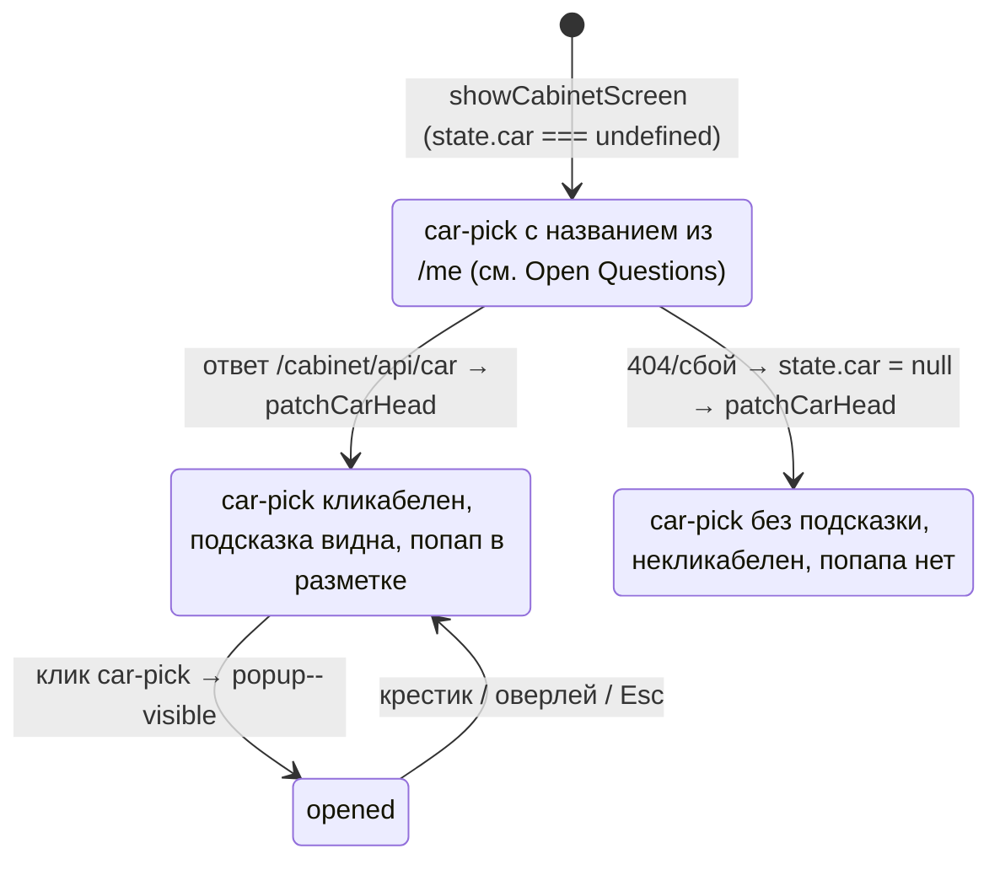

# feat: Кабинет по макету 2.0 — заголовок, попап «Данные об автомобиле», перекомпоновка «Ваш автомобиль»

## Summary

Привести экран кабинета в `widget-custom/cabinet-app/app.js` (ветка `feat/cabinet-calculator`) к макету `docs/design/lk-source_2.0.html`: заголовок страницы «Личный кабинет», вынос чипов ТТХ и фотогалереи в попап «Данные об автомобиле» с кнопкой-триггером `.car-pick` в шапке, перекомпоновка блока «Ваш автомобиль» на десктопе (фото 200×200 слева). Мобильный вид блока «Ваш автомобиль» не меняется; подпись `OWN_PHOTO_CAPTION` сохраняется.

Решения владельца продукта (не пересматриваются): при `state.car === null` — блок с названием авто без подсказки, некликабельный, попап не создаётся; мобильный вариант группы 6 макета (`own__photo--bleed` / `own__grid--tap`) не реализуется. Ни одно из четырёх изменений технически не заблокировано — план исполним.

---

## Текущее состояние (факты, раздел А)

Все ссылки — на `widget-custom/cabinet-app/app.js`, если не сказано иное.

### Шапка авто

- `currentCarName()` (строки 1459–1464): имя авто из `/me` — `profile.brand_model || calc.item_name` — доступно сразу, до ответа `/cabinet/api/car`.
- `carHeadHtml(carState, carName)` (1468–1515) — три состояния `state.car`:
  - `undefined` (запрос летит) → скелетон `.sk--title` + плашки (1469–1475);
  - `null`/falsy (данных нет) → только название `.h2`, либо пустая строка (1476–1478);
  - объект `{name, specs, images}` → название `.h2` + чипы из `CAR_SPEC_FIELDS` (1453–1456: `engine`, `transmission`, `drive`, `acceleration`, `consumption`) + галерея `.photo--desktop` со стрелками `#cab-car-prev`/`#cab-car-next` и тумбами `#cab-car-thumbs` (1492–1514).
- `wireCarHeadEvents()` (1518–1550): листание фото — стрелки и клик по тумбам, чистый DOM без сети; индекс `carPhotoIndex` сбрасывается при каждом вызове.
- `patchCarHead()` (1552–1557): перерисовывает контейнер `#cab-car-head` целиком и перевешивает события. Контейнер создаётся в `showCabinetScreen` (2187).
- `fetchCarCard()` (1561–1576): `GET /cabinet/api/car` с гардом поколения — `seqAtRequest = screenSeq`, `stale()` проверяет смену экрана и наличие `state.bearer` (1565–1566); успех → `state.car = data`, ошибка → `state.car = null`, оба через `patchCarHead()`. Страж: `tests/test_cabinet_frontend.py::TestRaceGuards::test_car_card_fetch_has_generation_guard` парсит тело функции.

### Блок «Ваш автомобиль»

- `FOUND_FACTS` (1580–1587): mark / model / year / steering_wheel (через `steeringLabel`) / mileage (форматтер) / plate.
- `renderOwnBlock(found)` (1589–1608): `.own` → `.own__photo` (фото либо `.own__empty`) → подпись `OWN_PHOTO_CAPTION` (константа 1424, вывод 1602, инлайн-паддинг `8px 16px 0`) → `.own__grid` с фактами. Подпись лежит **внутри `.own` между фото и сеткой** — при переходе на flex-строку это станет третьей колонкой, если не обернуть.
- `ownOrTradeinFieldsHtml` (1610–1622): при `found` — `renderOwnBlock`, иначе ручные поля `tradein_*`.
- CSS `.own` (252–264): блок без паддинга, `overflow:hidden`, фото на всю ширину `aspect-ratio:3/2`; медиа-блок (335–337) задаёт `.own{flex-direction:column}` — сегодня это no-op, т.к. `.own` не flex (страховка, положенная на вырост).

### Экран кабинета

- `showCabinetScreen()` (2180–2266): разметка (2199–2211) — `.cab-screen.container` → баннер → `#cab-content` (класс `.readonly` при `submitted`) → внутри него `#cab-car-head`, `divider`, форма `#cab-form` → вне его savebar, ошибки, кнопка отправки. Значит **шапка авто сейчас внутри `#cab-content` и тускнеет (`opacity:.55`, CSS 269) после отправки анкеты**.
- Заголовка «Личный кабинет» на экране кабинета нет; литерал есть только на авторизационной стороне (629, 673, 1104) — её не трогаем.
- Сценарные заголовки «Подбор кредита» / «Оценка вашего автомобиля» уже рендерятся в форме (2065–2069) — совпадают с макетом 2.0.
- `setScreen(html)` (552) заменяет `root.innerHTML` целиком; `screenSeq` (550) растёт на каждой смене.

### Существующие попапы

- `showConflictPopup`/`closeConflictPopup` (1290–1320) и `showFormNetworkErrorPopup` (2379–2406): создают div `#cab-popup` с классами `popup popup--visible` и **монтируют его в `document.body`** (1311, 2397) — осознанно, чтобы пережить `setScreen` (комментарий 1287–1289).
- CSS попапа (174–181) заскоплен селекторами `#cabinet-root .popup{...}` — к узлу в `document.body` не применяется (подтверждено измерением, см. раздел «Проверка гипотезы»).

---

## Разрыв с макетом 2.0 (раздел Б)

### Классы макета, отсутствующие в CSS app.js — добавить

Ссылки — на строки CSS `docs/design/lk-source_2.0.html`.

| Группа | Классы | Макет |
|---|---|---|
| Шапка раздела | `.page-head`, `.page-title`, `.page-title--mobile` | 293–295 |
| Кнопка авто | `.car-pick`, `.car-pick--row`, `.car-pick__body`, `.car-pick__name`, `.car-pick__hint`, `.car-pick__chevron`, `:hover` | 296–305 |
| Иконка авто | `.car-icon`, `.car-icon__body`, `.car-icon__roof`, `.car-icon__wheel(--l/--r)` | 306–312 |
| Широкий попап | `.popup--wide .popup__dialog`, `.popup__head`, `.popup__subtitle`, `.popup__close`, `:hover` | 327–333 |
| Шторка | `.popup--sheet .popup__dialog`, `.popup__grabber` | 335–337 |
| Типографика | `.h3` | 81 |
| «Ваш автомобиль» | новые правила `.own` (flex-строка, gap 28, padding 20), `.own__photo` 200×200 со скруглением | 254–256, 265 |

Не переносим: `.popup--inline`, `.demo-frame*`, `.own__img*` (демо-заглушки макета), `.own__photo--bleed` и `.own__grid--tap` (группа 6 — решение владельца), `.thumbs--scroll` (используется только в демо-фрейме 3a; в реальном мобильном вьюпорте макета тумбы — сетка `width:100%`, как уже сделано в app.js).

### Переопределения в media-блоке (`max-width:600px`) — чтобы десктоп не протёк в мобильный

- `.own`: вернуть мобильную геометрию — колонка, `gap:0`, `padding:0` (новый десктопный `padding:20px` и `gap:28px` иначе изменят мобильный вид); существующее правило 335 (`flex-direction:column`) начнёт реально работать, когда `.own` станет flex.
- `.own__photo`: `width:100%`, `height:auto`, `aspect-ratio:3/2`, `border-radius:0` (десктопные 200×200 и скругление — только desktop). Правило 336 уже есть, добавить сброс `border-radius`.
- Обёртка фото+подписи (см. KTD-4): на мобильном не должна менять поток — ширина 100%, без собственных отступов.
- `.page-head`: макет на мобильном не использует flex-строку — заголовок отдельной строкой (`.page-title--mobile`, 24px), кнопка `.car-pick--row` на всю ширину с шевроном (`441–453`). Переключение размеров/раскладки — в media.
- `.car-pick`: мобильный вариант `--row`-подобный (100% ширины, `margin-top:20px`, `min-height:44px`); шеврон `›` показывается только на мобильном (в десктопной разметке макета его нет — 768–777).
- Попап: правила шторки (`.popup__dialog` прижат к низу, `border-radius:16px 16px 0 0`, `max-height:88%`, паддинги 20/28) и показ `.popup__grabber` — только в media; на десктопе — центрированный `--wide` диалог 720px и скрытый граббер.
- Ограничение: **новые правила добавлять только в конец существующего media-блока** — страж `test_mobile_media_query_overrides_present` читает 2500 символов от начала `@media`; сейчас блок 1783 символа, маркер `slider-head--tap` на позиции 1667. Вставка перед существующими правилами вытолкнет маркеры из окна.

---

## Проверка гипотезы: стили попапов не применяются (раздел В)

**Гипотеза подтвердилась — измерением, не чтением кода.** Метод: страница-обвязка, повторяющая встраивание Tilda (`#cabinet-root` + `window.UNIFIEDBOT_URL` + `app.js` как есть), в браузере создан узел, дословно повторяющий `showConflictPopup` (те же классы/разметка/точка монтирования `document.body`), и контрольный узел-близнец внутри `#cabinet-root`. Computed-стили (Chrome 150):

| Свойство | Попап в `document.body` (как в коде) | Тот же узел внутри `#cabinet-root` |
|---|---|---|
| `.popup` position | `static` | `fixed`, `inset:0`, `z-index:100` |
| `.popup__overlay` | `static`, фона нет | `absolute`, `rgba(17,17,17,.18)` |
| `.popup__dialog` | `static`, ширина = вся страница (1813px), без фона/паддинга/скругления | `relative`, 400px, белый фон, `padding:28px`, скругление 8px |

Визуально: попап конфликта сегодня рендерится голым текстом в потоке внизу страницы, без оверлея и карточки (скриншоты приложены к ответу сессии: `v-popup-body-unstyled.jpg` — как в коде, `v-popup-root-styled.jpg` — контрольный узел со стилями).

Варианты починки (НЕ чинить в этой задаче):

1. **Монтировать `#cab-popup` внутрь `#cabinet-root`.** Плюс: скоупинг работает без правок CSS. Минус: `setScreen` затирает `root.innerHTML` — попап не переживёт смену экрана (ради чего его и вынесли в body); закрытие при реавторизации, возможно, приемлемо, но это изменение поведения.
2. **Расширить скоуп CSS: продублировать правила попапа без префикса `#cabinet-root`.** Плюс: mount не меняется. Минус: глобальные классы `.popup` на чужой (Tilda) странице — риск конфликта стилей в обе стороны, ровно то, от чего скоупинг защищает.
3. **Оставить mount в body, но добавить правила по id: `#cab-popup.popup{...}` и `#cab-popup .popup__*{...}`.** Плюс: id уникален — утечки на страницу Tilda нет, жизненный цикл не меняется, дифф минимален. Минус: небольшое дублирование popup-правил в CSS-массиве.

Рекомендация: вариант 3. Отдельная маленькая задача после этой.

---

## Requirements

Приведение к макету:

- R1. На экране кабинета — шапка раздела `.page-head`: заголовок «Личный кабинет» слева (макет 766–778).
- R2. Чипы ТТХ и фотогалерея убраны из потока экрана; доступны в попапе «Данные об автомобиле» (`popup--wide`, макет 1599–1631), на мобильном — шторка снизу (эталон — группа 3a, 462–520). Триггер — кнопка `.car-pick` в шапке справа: иконка авто, название, подсказка «Выбранный автомобиль — смотреть данные».
- R3. Блок «Ваш автомобиль» на десктопе: фото 200×200 слева внутри карточки, факты справа (макет CSS 254–265, разметка 903–917). Мобильный вид — пиксель в пиксель как сейчас.
- R4. Подпись `OWN_PHOTO_CAPTION` сохраняется дословно и остаётся видимой в обоих вьюпортах.

Краевые случаи (решения владельца):

- R5. `state.car === null`: блок с названием авто, без подсказки, некликабельный, попап не создаётся.
- R6. Группа 6 макета (`own__photo--bleed` / `own__grid--tap`) не реализуется.

Ограждения:

- R7. Не затронуты: калькулятор U9 (`CalcModel`, `CALC_MANAGED_KEYS`, `wireCreditControls`, `patchCreditBlockDom`, безсетевой блок 1885–2003), канонические строки плиток, гард поколения `fetchCarCard`, режим `submitted`/`.readonly`, экраны авторизации и кода.
- R8. `tests/test_cabinet_frontend.py` зелёный; новые правила — только в конец media-блока (окно 2500 символов).

---

## Key Technical Decisions

- **Попап «Данные об автомобиле» — статический узел в разметке экрана кабинета (внутри `#cabinet-root`), показ/скрытие классом `popup--visible`** — паттерн самого макета (1682–1703). Это обходит подтверждённую проблему скоупинга (раздел В): узел внутри root получает стили. Жизненный цикл привязан к экрану (гибнет вместе с `setScreen`) — для контентного попапа это корректно, в отличие от попапов ошибок.
- **Одна разметка попапа на оба вьюпорта; шторка — через media-блок.** В макете десктопный `#popup-car` и мобильный `#popup-car-sheet` — два узла с разными классами; у нас один узел, sheet-правила и граббер включаются в `@media (max-width:600px)`. Это устоявшийся паттерн app.js («одна разметка, переключение в media», строки 118–120, 301–314) и урок `docs/solutions/frontend-issues/mockup-media-query-transfer.md`.
- **Кнопка `.car-pick` рендерится из `currentCarName()` сразу** (имя приходит с `/me` до ответа `/car`); подсказка и кликабельность зависят от `state.car` (см. Open Questions про состояние загрузки). `patchCarHead()` остаётся единственным владельцем контейнера `#cab-car-head` и по приходе данных перерисовывает и кнопку, и содержимое попапа (урок `error-render-overwrites-sibling-elements.md`: функция владеет всей своей областью).
- **Подпись фото: обернуть `own__photo` + подпись в колонку-обёртку (например `.own__media`), сетка фактов — второй флекс-элемент.** На десктопе подпись встаёт под фото 200×200, на мобильном обёртка нейтральна (100% ширины, без отступов) — порядок потока фото → подпись → факты не меняется, мобильный вид остаётся прежним. Подпись остаётся внутри `.own`, литерал `class="own"` сохраняется (страж).
- **Листание фото переезжает в попап вместе с галереей без изменения логики** — `wireCarHeadEvents` вешается на те же id (`#cab-car-prev`/`#cab-car-next`/`#cab-car-thumbs`), которые теперь живут в разметке попапа; сеть не появляется (страж «ровно один fetch»).
- **Инвариант против гонки «патч затирает открытый попап»: узел попапа живёт внутри `#cab-car-head`.** `patchCarHead` срабатывает ровно один раз за жизнь экрана (`undefined` → объект/`null`), а до прихода данных кнопка некликабельна — открытый попап не может попасть под патч by construction. Слушатели пересоздаются вместе с узлами — дублей от повторного `wireCarHeadEvents` (вызовы 2214 и 1556) нет. Этот инвариант ломать нельзя: попап-сиблинг вне `#cab-car-head` потребовал бы отдельного владельца рендера. Разметочно: `.page-head` держит `.page-title` слева и контейнер `#cab-car-head` справа (второй flex-элемент); вопрос 4 решает положение всего `.page-head` — вместе с `#cab-car-head` — относительно `#cab-content`. Инвариант держится на неявном свойстве «`applyMeResponse` всегда перестраивает экран целиком через `setScreen`» — «мягкое» обновление `/me` без `setScreen`, если появится в будущем, сломает его молча.
- **Сброс карточки при смене позиции**: `applyMeResponse` (2157) не сбрасывает `state.car`, а `fetchCarCard` вызывается только при `undefined` (2216). После 409-retry или перепривязки сделки (план 2026-08-21-002) `/me` может принести новый `calc.item_id` — кнопка покажет новое имя, а попап — чипы/фото старой машины. Решение: при изменении `calc.item_id` в `applyMeResponse` сбрасывать `state.car` в `undefined`; прежний `item_id` читать из `state.me` ДО перезаписи новым ответом (первая строка функции, 2158), иначе сравнение всегда «равно» и сброс не сработает. Гонки двух in-flight `/car` при этом нет: `applyMeResponse` всегда идёт через `setScreen` → `screenSeq` растёт → `stale()` отбросит старый ответ.
- **Поведение попапа**: закрытие крестиком, кликом по оверлею и Escape (паттерн макета 1684–1703). Escape-листенер на `document` вешается только в момент открытия попапа (не в `wireCarHeadEvents`), снимается при закрытии и самоудаляется при срабатывании, если узел попапа уже не в DOM (смена экрана: `setScreen` document-подписки не чистит; проверка `isConnected` или захват `screenSeq` — паттерн `stale()`). Фокус: на `.popup__close` при открытии, возврат на `.car-pick` при закрытии; полноценный focus-trap — вне объёма задачи. Прокрутка Tilda-страницы под попапом/шторкой не блокируется (как у попапов ошибок и в макете); фоновый скролл на iOS — известное ограничение, «улучшать» не надо. Существующие попапы ошибок (без Escape/оверлея) не трогаем.
- **Никаких новых запросов и полей**: попап показывает те же `CAR_SPEC_FIELDS` и `images`, что и текущая шапка. Вопрос «Клиренса» — открытый (см. Open Questions), по умолчанию чип не рендерится, т.к. поля нет в ответе API (подтверждено живым ответом). `cursor:pointer` на фото «Ваш автомобиль» (макет 256) не переносим — клик по фото относится к исключённой группе 6.
- **Новые CSS-правила добавляются пакетами вместе со своими юнитами** (а не одним «CSS-фундаментом»): каждый шаг остаётся смотрибельным и откатываемым; мобильные переопределения — строго в конец media-блока.

---

## High-Level Technical Design

Состояния шапки (заголовок всегда виден; управляет только правой частью):



Новая структура экрана кабинета (директивный эскиз, не спецификация):

```text
.cab-screen.container
├── баннер успеха (submitted)
├── .page-head                          ← НОВОЕ: шапка раздела
│   ├── .page-title «Личный кабинет»
│   └── #cab-car-head                   ← владелец — patchCarHead
│       ├── кнопка .car-pick (или div-вариант при null)
│       └── .popup.popup--wide (скрыт)  ← чипы + галерея; по KTD живёт внутри #cab-car-head
├── #cab-content (.readonly при submitted)
│   ├── hr.divider
│   └── form#cab-form (сценарные блоки, U9-калькулятор — без изменений)
└── savebar / ошибки / кнопка «Отправить»
```

Эскиз показывает рекомендуемый вариант вопроса 4 («вынести»); при варианте «внутрь» весь `.page-head` встаёт первым элементом `#cab-content`.

---

## Implementation Units

Каждый юнит — рабочее состояние кабинета, можно смотреть в браузере и коммитить отдельно.

### U1. Заголовок страницы «Личный кабинет»

- **Goal:** Шапка раздела `.page-head` с `.page-title` на экране кабинета (R1).
- **Files:** `widget-custom/cabinet-app/app.js` (CSS-массив: `.page-head`, `.page-title`, `.page-title--mobile`; мобильные правила — в конец media-блока; разметка в `showCabinetScreen`/`carHeadHtml`).
- **Approach:** Заголовок добавляется над текущей шапкой авто; сама шапка (чипы+галерея) пока не трогается. Где проходит граница `#cab-content` для новой шапки — по решению владельца (Open Questions, вопрос 4); до решения — внутри, как сейчас.
- **Test scenarios:** десктоп ≥1000px — заголовок 26px слева; мобильный 390px — 24px отдельной строкой; после submit — поведение согласно решению вопроса 4; экраны авторизации/кода не изменились (там свой `h1`).
- **Verification:** визуально на 1200px и 390px; `pytest tests/test_cabinet_frontend.py -q` зелёный.

### U2. Попап «Данные об автомобиле» + кнопка `.car-pick`; переезд чипов и галереи

- **Goal:** Чипы и галерея уходят из потока в попап; в шапке — кнопка с названием и подсказкой (R2, R5).
- **Dependencies:** U1.
- **Files:** `widget-custom/cabinet-app/app.js` (`carHeadHtml`, `wireCarHeadEvents`, `patchCarHead`, `showCabinetScreen`; CSS: `car-pick*`, `car-icon*`, `.h3`, `popup--wide`/`__head`/`__subtitle`/`__close`, sheet-правила и граббер в конец media-блока); `tests/test_cabinet_frontend.py` (новые грепы по образцу существующих — опционально).
- **Approach:** Три состояния `state.car` переносятся на кнопку: объект → кликабельная с подсказкой + узел попапа; `null` → div-вариант без подсказки, попап не рендерится; `undefined` → по решению вопроса 3. `patchCarHead` по-прежнему патчит только `#cab-car-head` (кнопка и попап — внутри него). Открытие/закрытие — крестик, клик по оверлею, Escape; клик-листенеры кнопки/крестика/оверлея вешаются в `wireCarHeadEvents`, Escape-листенер на `document` — только в момент открытия (см. KTD «Поведение попапа»). Скелетон шапки: класс `sk--title` должен остаться в употреблении либо страж обновляется осознанно.
- **Test scenarios:** открытие кнопкой, закрытие крестиком/оверлеем/Esc (после закрытия Escape-листенер снят — повторный Esc ничего не делает); листание фото стрелками и тумбами внутри попапа; одна фотография — без стрелок/тумб; `images` пуст — попап без блока фото; все `specs` пустые — попап без чипов; пустые данные целиком — дефолты вопроса 5; `state.car === null` — кнопка без подсказки, клик ничего не делает; 401-реавторизация при открытом попапе — после re-OTP экран рендерится с закрытым попапом; 409-retry с новым `calc.item_id` — кнопка и попап показывают новую машину (сброс `state.car`); после submit (`.readonly`) — поведение кнопки согласно вопросу 4; мобильная шторка 390px — прижата к низу, граббер виден, контент скроллится, страница под шторкой не блокируется.
- **Verification:** сценарии выше вручную на 1200px/390px; стражи зелёные (`один fetch`, `cab-car-head`, U9-маркеры нетронуты).

### U3. Перекомпоновка «Ваш автомобиль» на десктопе

- **Goal:** Фото 200×200 слева внутри карточки, факты справа; мобильный вид пиксель в пиксель прежний (R3, R4).
- **Dependencies:** независим от U1/U2 (можно делать параллельно), но коммитится отдельно.
- **Files:** `widget-custom/cabinet-app/app.js` (`renderOwnBlock`; CSS `.own`/`.own__photo`/обёртка; мобильные сбросы в конец media-блока).
- **Approach:** По KTD-4: обёртка фото+подписи, flex-строка на десктопе (gap 28, padding 20 — макет 254–255), мобильные переопределения возвращают текущую геометрию (колонка, padding 0, фото 100% 3:2 без скругления). Литералы `class="own"`, `own__empty` и подпись — дословно сохранены.
- **Test scenarios:** десктоп: фото 200×200 со скруглением, подпись под фото, факты в две колонки справа, вариант без фото (`own__empty` 200×200); мобильный: скриншот до/после — пиксельное совпадение (фото на всю ширину, подпись между фото и фактами, сетка 2 колонки); сценарий без `found_info` (ручные `tradein_*` поля) не изменился.
- **Verification:** скриншот-сравнение мобильного вида до/после правки; замер computed-ширин в браузере, не грепами (урок `css-width-verify-in-browser.md`); стражи `TestU8OwnBlock` зелёные.

---

## Риски и запретные зоны (раздел Д)

- **Калькулятор U9** — единственный путь записи кредитных полей (`CalcModel` → `mirrorCalcStateToFormValues`, делегированный листенер пропускает `CALC_MANAGED_KEYS`, 2227–2235). План не трогает `buildFormBlocksHtml` ниже шапки и безсетевой блок 1885–2003; риск — только случайные правки соседних строк CSS-массива. Стражи: маркеры U9, «нет fetch в обработчиках».
- **Канонические строки плиток** — дословно совпадают с `cabinet_service.FORM_TILE_FIELDS` (страж `TestU8TileDictionariesUnity`). План формулировок не касается.
- **Гард поколения `fetchCarCard`** — страж парсит тело функции до следующей функции 2-пробельного отступа; правки внутри `fetchCarCard` не планируются, `patchCarHead` меняется без переноса гарда.
- **`submitted`/`.readonly`** — шапка сейчас внутри `#cab-content` и тускнеет после отправки; новая шапка и кнопка попапа зависят от решения вопроса 4. Менять семантику `.readonly` нельзя.
- **Экраны авторизации и кода** — не трогаются; их «Личный кабинет» — отдельные литералы (629, 673, 1104), совпадение текста с новым `.page-title` не должно провоцировать «дедупликацию».
- **Страж media-окна 2500 символов** — вставка новых правил в начало/середину media-блока вытолкнет `slider-head--tap` (позиция 1667 из 1783 на момент замера) за окно. Только конец блока. И не писать точный литерал `@media (max-width:600px)` в комментариях выше media-блока — страж берёт первое вхождение строки в исходнике (существующие комментарии на 120 и 318 аккуратно обходятся без него).
- **Литерал `class="own"`** — страж требует точную строку: утилитарные отступы на этот элемент не вешать (инлайн-стиль или обёртка).
- **Скелетон шапки** — если новая шапка перестанет использовать `sk--title` в разметке, страж формально останется зелёным за счёт CSS-строки; решить осознанно: сохранить скелетон-состояние или обновить тест.
- **`.readonly` не блокирует клики и дим-ит попап** — это только `opacity:.55` (disabled живёт на инпутах): кнопка `.car-pick` под `.readonly` останется кликабельной, но будет выглядеть выключенной, а открытый попап, живущий внутри `#cab-car-head`, отрисуется полупрозрачным целиком — `opacity` наследуется поддеревом и создаёт стекинг-контекст, `position:fixed`/`z-index` это не лечат. Сильный аргумент к выносу шапки (вопрос 4).
- **`position:fixed` внутри Tilda** — попап теперь первый стилизованный fixed-элемент внутри `#cabinet-root` на чужой странице (существующий `#cab-popup` рендерился без стилей). Проверить на стенде два режима отказа: `z-index:100` перекрывает элементы Tilda; у предков `#cabinet-root` нет `transform`/`filter`/`will-change` (анимации появления зеро-блоков) — иначе fixed позиционируется от предка, а не от вьюпорта, и попап/шторка поедут со скроллом. Фолбэк на случай провала — mount в `document.body` с правилами по id (вариант 3 раздела «Проверка гипотезы»).
- **Деплой на Tilda** — после правок `app.js` инкремент `?v=` в сниппете страницы (`docs/CABINET_TILDA_SETUP.md`), иначе CDN отдаст старую версию; ngrok-стенд перехватывает `<script src>` interstitial-страницей (известное ограничение).

---

## Тесты (раздел Е)

Переезд чипов и галереи сам по себе **не ломает ни одного существующего стража**: в `tests/test_cabinet_frontend.py` нет ассертов на положение чипов/галереи в потоке (грепы `chip`/`thumb`/`photo` в тестах отсутствуют, кроме подписи фото). Затрагиваются и должны остаться зелёными:

- `TestU8CarHead` — `cab-car-head`, `sk--title`, `/cabinet/api/car`, `fetchCarCard`: id контейнера и вызов сохраняются; про `sk--title` — см. риск про скелетон.
- `TestU8OwnBlock` — `class="own"`, `own__empty`, подпись дословно: сохраняются по KTD-4.
- `TestRaceGuards` — тело `fetchCarCard` не меняется.
- `TestDesktopResponsiveLayout` — media-окно 2500 символов: новые правила в конец блока.
- `TestNgrokDevHeader` — «ровно один `fetch(`»: новых запросов нет.
- `TestU9CalcBlock`, `TestCabinetManualStandCleanup`, `TestU8TileDictionariesUnity`, `TestSteeringCanonUnity` — зоны не затрагиваются.
- `TestU6StatusStates::test_conflict_popup_present` (273–277) — литералы `cab-popup`/`popup--visible` остаются.

Новые стражи (в юнитах U1–U2, по образцу существующих source-grep): наличие `page-head`/`page-title`, `car-pick` с подсказкой дословно, `popup--wide` в разметке экрана. Прогон: `pytest tests/test_cabinet_frontend.py -q` (SQLite) — вся правка фронтовая, PostgreSQL-прогона не требует.

---

## Open Questions (раздел Ж — решения владельца продукта)

1. **Чип «Клиренс» (макет 1616).** Факт: живой ответ `GET /cabinet/api/car` (дев-стенд, дилер 99, HAVAL DARGO Premium) — HTTP 200, `specs` содержит ровно пять ключей `engine/transmission/drive/acceleration/consumption`; клиренса нет. Это белый список бэка (`cabinet_service.py:3188–3194`), а не пустая колонка. Варианты: (а) попап показывает 5 чипов без клиренса — фронтовая задача ничего не ждёт; (б) отдельная задача бэка: добавить поле в белый список + проверить наличие колонки в NocoDB-каталоге дилеров. Что выбираем?
2. **Утилитарные отступы `mt-10/12/14/18` макета.** В app.js системы утилит нет — отступы инлайновые. Переносить систему классов или продолжать инлайн-стилем? (Инлайн — нулевой риск для стражей-литералов; система — чище, но трогает много строк разметки.)
3. **Кнопка `.car-pick` в момент загрузки (`state.car === undefined`).** Название уже известно из `/me`. Показывать сразу кнопку без подсказки (подсказка и клик появляются по приходе данных) — или сохранять текущий скелетон шапки? Рекомендация: кнопка без подсказки — быстрее и без прыжка вёрстки; но это меняет текущее поведение (скелетон).
4. **Граница `#cab-content` для новой шапки.** Сейчас шапка авто внутри `#cab-content` и после отправки тускнеет (`opacity:.55`; кликабельность при этом сохраняется — `.readonly` не блокирует события). Куда поместить `.page-head` вместе с `#cab-car-head` (кнопка + попап): внутрь или вынести над `#cab-content`? Технический факт для решения: при варианте «внутрь» полупрозрачным станет не только заголовок с кнопкой, но и сам открытый попап — `opacity` наследуется всем поддеревом и создаёт стекинг-контекст, так что полноценный просмотр данных авто после отправки возможен только при выносе (либо придётся блокировать клик по кнопке при `submitted`). Рекомендация: вынести целиком; но это изменение видимого поведения — решение за вами.
5. **Пустые данные.** Дефолты плана, подтвердить: имя авто пустое и данных нет (`state.car === null`, `currentCarName()` пуст) — кнопка-блок не рендерится вовсе (сейчас рендерится пустая строка); `state.car` — объект, но ни одного чипа и ни одного фото — кнопка ведёт себя как при `null` (без подсказки, попап не создаётся), чтобы не открывать попап из одного заголовка.

---

## Итог: что разошлось с планом (приписано после реализации, 2026-08-27)

План выше оставлен как есть — это свидетельство того, что думали ДО работы. Реализация
(коммиты `bf04803`…`0e122d2`, разбор в `docs/handoff/2026-08-26-cabinet-mockup-2-0-handoff.md`)
разошлась с ним в следующем:

- Вопрос 1 (клиренс): выбран вариант (б) — белый список бэка расширен, чип шестой;
  разведка подтвердила поле `clearance` в каталоге (26/26, значения уже с «мм»).
- Вопрос 2 (утилиты `mt-*`): не переносить, инлайн-стиль — как и предполагалось.
- Вопрос 3 (кнопка при `state.car === undefined`): принята рекомендация — скелетона
  шапки больше нет; страж `sk--title` стал зелёным вхолостую (хвост в handoff).
- Вопрос 4 (граница `#cab-content`): рекомендация «вынести шапку» ОТКЛОНЕНА владельцем.
  Шапка внутри `#cab-content`, бледнеет после отправки; риск полупрозрачного попапа снят
  иначе — в submitted кнопка явно некликабельна, а открытый попап при переходе
  в submitted принудительно закрывается с возвратом фокуса (краевой случай, которого
  в плане не было).
- Раздел «Проверка гипотезы» (попапы ошибок): рекомендация «чинить отдельной задачей»
  отменена владельцем — починка сделана в этой же работе (U4, вариант 3 плана:
  mount в body + параллельные селекторы по id).
- U3 после приёмки дорабатывался дважды сверх плана: U3b — фото не 200×200 (квадрат
  макета 2.0 резал горизонтальные рендеры auto.ru 1050×650), а 356×200 (16:9), обе
  подписи переехали внутрь серой карточки зоной; U3c — порядок мобильного блока
  приведён к десктопному (подпись фото вниз). Требование плана «мобильный вид пиксель
  в пиксель» в части зоны подписей снято владельцем; для фото и сетки фактов оно
  соблюдено (замеры в handoff).
- Новые source-grep-стражи на `page-head`/`car-pick`/`popup--wide`, упомянутые в U1/U2
  как опция, не добавлялись.
