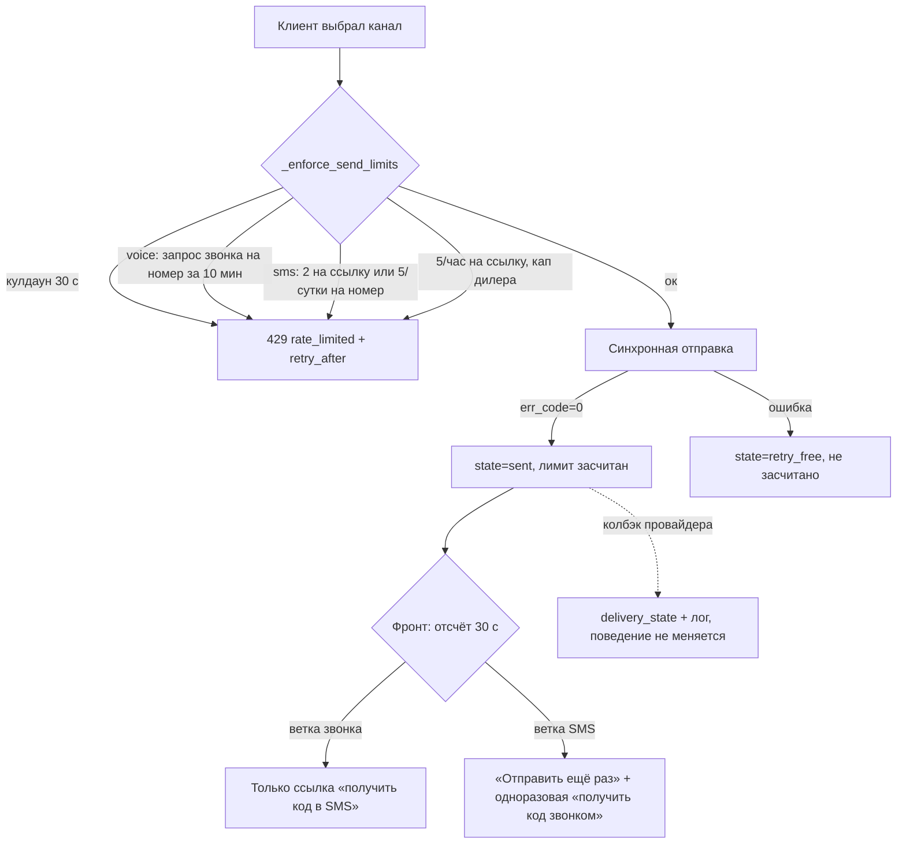

# feat: Реальная отправка кода подтверждения через ProstoSMS

## Резюме

Перевод OTP-потока кабинета на боевые правила провайдера: автоотправка SMS снимается полностью (и по таймауту, и по статусу), появляются лимиты по номеру телефона, тексты приводятся к зарегистрированным шаблонам, проверка перестаёт наказывать за ввод погашенного или истёкшего кода, фронт перестаёт обещать то, что провайдер не выполняет. Push-статусы остаются записью-фактом без влияния на поведение.

Все открытые вопросы закрыты решениями владельца продукта от 2026-08-27 (см. «Закрытые вопросы»); реализация разблокирована.

Основание — живые проверки провайдера из прод-контейнера (постановка 2026-08-27): статусы доставки недостоверны, повторный запрос звонка на номер в 5-минутном окне молча подменяется на SMS, досылки при недозвоне нет.

---

## Установленные факты о текущем коде

Факты, на которых держится план. Особо — блок 6, которого не было в диагностике.

**Одновременные коды (блок 6):**

- Предыдущая запись гасится при новой отправке: `request_code` переводит все `sending`/`sent` записи токена в `superseded` перед созданием новой (`cabinet_service.py:1240-1246`).
- Проверка сверяется только с последним кодом: `verify_code` выбирает единственную запись `status='sent'` с максимальным `id` (`cabinet_service.py:1357-1361`) и сравнивает HMAC только с ней. Ввод погашенного кода даёт `invalid_code` и инкремент счётчика неверных попыток (`cabinet_service.py:1405-1415`). Сценарий «услышал код в звонке, запросил SMS, ввёл первый» сегодня = ошибка и минус попытка.
- Единственность действующего кода закреплена схемой: частичный уникальный индекс `uq_cabinet_otp_inflight_token` — одна запись `sending`/`sent` на токен (`database.py:282-289`). На него же опирается защита от гонки двойной отправки: параллельный insert даёт `IntegrityError` → 429 (`cabinet_service.py:1255-1260`).
- Счётчик неверных попыток уже висит на ссылке, не на коде: `CabinetToken.failed_attempts` / `attempts_window_start` (`database.py:81-83`), окно и блокировка — `cabinet_service.py:1036-1060`, сброс при успехе — `cabinet_service.py:1374-1375`. Решение владельца здесь совпадает с кодом, правок не требует.

**Автофолбэк (блок 1):**

- Точек вызова `trigger_sms_fallback` (`cabinet_service.py:328-420`) в проде фактически две, а не три: колбэк «не доставлено» (`cabinet_service.py:469-471`) и страховочный таймаут `_run_safety_fallbacks` в тике воркера (`cabinet_service.py:593-622`, вызов обязанности — `cabinet_service.py:710`). Третья — «ручной запрос» — заявлена только в докстринге (`cabinet_service.py:332-333`), из прод-кода не вызывается, используется лишь тестами.
- `CABINET_FALLBACK_TIMEOUT` читается в `_fallback_timeout_seconds()` (`cabinet_service.py:187-188`, дефолт 45 с), единственный потребитель — страховочный таймаут.
- `recover_code_from_hmac` (`cabinet_service.py:234-242`, перебор 10^4 по HMAC) имеет единственного прод-потребителя — `trigger_sms_fallback` (`cabinet_service.py:369`). После снятия автофолбэка остаётся без потребителей.
- На фолбэк завязаны: состояние `fallback_sms` контракта send-status (`cabinet_service.py:1329-1330`), колонки `sms_external_id`, `fallback_at`, `fallback_attempts` (`database.py:106,114,115`), событие `fallback_sms` (`cabinet_service.py:383-386`), суммирование фолбэков в суточном капе дилера (`cabinet_service.py:1168-1179`), константа `FALLBACK_MAX_ATTEMPTS` (`cabinet_service.py:67`), различение плеч в колбэке (`cabinet_service.py:436-453`). Колонка `sms_msg_id` (`database.py:111`) — двойного назначения и НЕ фолбэк-хвост: её же пишет первичная SMS-отправка (`cabinet_service.py:1271`), и по ней колбэк матчит SMS-записи (`cabinet_service.py:450`).

**Лимиты (блок 4):**

- Сейчас: кулдаун 60 с на токен (`REQUEST_CODE_COOLDOWN`, `cabinet_service.py:795`), 5 принятых отправок в час на токен без разбивки по каналам (`cabinet_service.py:796,1158-1166`), суточный кап дилера 100 (`cabinet_service.py:1114-1115,1168-1185`). Всё проверяется в `_enforce_send_limits` (`cabinet_service.py:1143-1185`). Засчитываются только принятые отправки; неуспех бесплатен — `retry_free` (`cabinet_service.py:1277-1287`).
- Лимитов по номеру телефона нет ни одного. Но данные уже есть: каждая отправка пишет `CabinetOtp.phone` (E.164, `database.py:104`), `channel` (`database.py:108`), `sent_at` (`database.py:117`) — независимо от TOFU-привязки. Индекса по `phone` нет.
- TOFU: `bound_phone` заполняется только при успешной верификации (`cabinet_service.py:1369-1371`); до неё ссылка может отправлять на разные номера (`cabinet_service.py:1212-1218`).

**Тексты и запрос (блоки 2-3):**

- Развилка текстов по каналам уже существует: `build_otp_text(code, channel)` (`sms_gateway.py:144-147`), шаблоны `VOICE_TEXT_TEMPLATE` (`sms_gateway.py:33`) и `SMS_TEXT_TEMPLATE` (`sms_gateway.py:35`). Оба не совпадают с боевыми шаблонами провайдера.
- `sender_name` подставляется в запрос безусловно для обоих каналов (`sms_gateway.py:181,195`). `check_secrets` (`cabinet_service.py:817-825`) проверяет только `CABINET_HMAC_KEY` — ни `PROSTOSMS_SENDER_NAME`, ни `PROSTOSMS_API_KEY` там нет.
- Ошибки 602/627 (IP-ограничение) уже учтены: `CONFIG_ALERT_CODES` (`sms_gateway.py:50-52`), техалерт с исходящим IP (`sms_gateway.py:343-350`), стартовая самопроверка (`sms_gateway.py:353-368`). 632 классифицирован как `service` (`sms_gateway.py:46`).

**Колбэк (блок 7):**

- Роуты GET/POST `/sms/status-callback` (`main.py:3881-3882`) → `process_status_callback` (`cabinet_service.py:427-472`): матчит запись, пишет `otp.delivery_state` (`cabinet_service.py:465-466`), при «не доставлено» на голосовом плече зовёт фолбэк (`cabinet_service.py:469-471`). Событий `CabinetEvent` не пишет, метрик нет. Кроме фолбэка `delivery_state` читают только состояние `delivery_failed` в send-status (`cabinet_service.py:1331-1336`) и выборка страховочного таймаута (`cabinet_service.py:611-612`).

**Фронт (блок 5):**

- `app.js` — 2860 строк, IIFE. Полинг send-status раз в 4 с (`widget-custom/cabinet-app/app.js:53`), фронт читает единственное поле `state`; различает `none, sending, sent, fallback_sms, delivery_failed, retry_free, expired` (`widget-custom/cabinet-app/app.js:1287-1294`).
- Фолбэк-экран «Звонок не прошёл — отправили код в SMS» — `handleFallbackSms` (`widget-custom/cabinet-app/app.js:1166-1182`), вызывается из полинга (`widget-custom/cabinet-app/app.js:1287-1289`).
- После отсчёта `renderResendReady` (`widget-custom/cabinet-app/app.js:1254-1267`) рендерит две безусловные многоразовые ссылки: «Получить код ещё раз» (в голосовой ветке это повторный звонок) и смену канала.
- Пауза: фронт берёт `retry_after` из ответа бэка, констант­а `RESEND_COOLDOWN_S = 60` — только фолбэк-значение (`widget-custom/cabinet-app/app.js:56,953`).
- Подсказка ожидания звонка (`widget-custom/cabinet-app/app.js:1196-1199`) не говорит, что робот произносит только цифры.

---

## Требования

**Отправка и каналы:**

- R1. Автоотправка SMS отсутствует: ни по таймауту, ни по статусу доставки. SMS уходит только по явному действию клиента.
- R2. `sender_name` в запрос к провайдеру не передаётся.
- R3. Текст SMS посимвольно равен зарегистрированному шаблону `%d — код для входа в кабинет. Никому не сообщайте.` (длинное тире U+2014, пробелы и точка значимы). Текст звонка — только цифры кода (текст, который бот передаёт провайдеру). **Факт 12.10.2026 (живая проверка v3.4.2):** робот говорит «проверочный шифр», затем цифры кода — не «только цифры».

**Лимиты:**

- R4. Запрос звонка на один номер — не более одного за 10 минут. Считаются все запросы звонка, включая непринятые провайдером: по ответу поддержки непринятый запрос тоже взводит 5-минутный триггер подмены (решение O1).
- R5. SMS на одну ссылку — не более двух за сутки (решение O2); SMS на один номер — не более пяти в сутки.
- R6. Пауза до появления ссылки на SMS — 30 секунд (сейчас 60).
- R7. Лимиты по номеру действуют и до TOFU-привязки номера к ссылке.

**Коды:**

- R8. Живой код один, как сейчас: новая отправка гасит прежний. Но проверка различает мёртвые коды: ввод погашенного даёт отдельную ошибку «код больше не действует — введите код из последнего сообщения», ввод истёкшего — «код устарел — запросите новый»; обе не увеличивают счётчик неверных попыток. Несовпадение ни с одной записью — прежний `invalid_code` с инкрементом счётчика на ссылке.

**Статусы:**

- R9. Push-колбэк принимается, статус фиксируется (поле записи + лог), на поведение не влияет.

**Фронт:**

- R10. Подсказка ожидания звонка соответствует роботу: он произносит только цифры кода. **Факт 12.10.2026 (живая проверка v3.4.2):** робот говорит «проверочный шифр», затем цифры кода — не «только цифры». Подсказку поправить в следующем выпуске.
- R11. Промежуточный экран «звонок не прошёл — отправили код в SMS» отсутствует.
- R12. В ветке звонка «позвонить ещё раз» не существует нигде: ни после отсчёта, ни в ветках ошибок (`retry_free`, `expired`) — везде только ссылка «получить код в SMS» (решение O5).
- R13. В SMS-ветке ссылка «получить код звонком» одноразовая в пределах сессии страницы.

---

## Ключевые технические решения

- **Лимиты по номеру — запросами к `cabinet_otp`, без новой таблицы.** Номер, канал и время уже пишутся в каждую строку независимо от привязки (`database.py:104,108,117`); нужен только индекс по `(phone, channel, sent_at)`. Подсчёт в БД переживает рестарт и мультиреплики — в отличие от нынешних in-memory лимитеров (известный остаток однопроцессности). TOFU-механика не меняется.
- **Лимит «5 в час на ссылку» остаётся.** Он не избыточен: до TOFU-привязки одна ссылка может запрашивать коды на разные номера — лимиты по номеру её не ограничивают. После введения канальных лимитов он становится страховкой от перебора номеров, а не рабочим ограничением.
- **Единственность живого кода и гашение `superseded` не трогаются.** Сценарий «услышал код в звонке, запросил SMS, вводит первый» решается не мультикодом, а в ветке неуспеха `verify_code`: сверка HMAC введённого кода с погашенными и истёкшими записями токена и отдельные коды ошибок без сжигания попытки. Уникальный индекс `uq_cabinet_otp_inflight_token`, защита от гонки двойной отправки и `request_code` остаются как есть (решение владельца: исходное требование «все неистёкшие коды действительны» отменено — правка задевала бы индекс и делала заметнее гоночное окно). Риск оракула принят: погашенный и истёкший коды ценности не имеют.
- **Текст звонка — только цифры — согласован с шаблоном `%d`.** Если провайдер всё же молча подменит звонок на SMS (два запроса звонка в 5-минутном окне обойти его триггер нельзя гарантированно), текст «только цифры» уложится в зарегистрированный шаблон `%d` и SMS не будет отбита по шаблонной проверке.
- **Шаблон SMS защищён посимвольным тестом.** Канонический текст — константа с явным `—` в исходнике и тест, сравнивающий рендер с эталоном через `repr`/поюникодное совпадение: случайная замена тире или пробела роняет тест, а не боевую отправку.
- **`delivery_state` остаётся записью-фактом.** Колбэк продолжает писать поле и строку лога; поведенческих потребителей после снятия фолбэка и состояния `delivery_failed` у него нет.
- **Неуспех отправки бесплатен для всех лимитов, кроме голосового.** Не принятая провайдером попытка (err_code ≠ 0) не засчитывается в SMS-лимиты и лимиты ссылки/дилера (`retry_free`). Исключение — лимит звонка: он считает все запросы звонка, включая непринятые, потому что по ответу поддержки провайдера непринятый запрос тоже взводит 5-минутный триггер подмены (решения O1/O5). Расхождение с общим правилом `_enforce_send_limits` «считаем только принятые» — намеренное.
- **Время — только aware-UTC.** Все новые сравнения и посевы в тестах — через `_utcnow()`/`_aware()`; два задокументированных урока про naive-время на PostgreSQL (`docs/solutions/database-issues/`) бьют ровно по лимитным окнам.

---

## Устройство после изменения

Контракт send-status сжимается: `fallback_sms` и `delivery_failed` уходят (второе — решение O3). Остаются `none | sending | sent | retry_free | expired`.

Живой код один (новая отправка гасит прежний). Ввод погашенного или истёкшего кода даёт отдельную подсказку («введите код из последнего сообщения» / «запросите новый») без сжигания попытки.

---

## Implementation Units

### U1. Снятие автоотправки SMS (бэкенд)

- **Goal:** ни одна SMS не уходит без явного действия клиента; весь фолбэк-механизм и его хвосты удалены.
- **Requirements:** R1, R9 (частично).
- **Dependencies:** нет — идёт первым, расчищает поле для U4-U6.
- **Files:** `cabinet_service.py`, `database.py`, `cabinet_api.py`, `tests/test_cabinet_otp_flow.py`, `tests/test_cabinet_auth.py`, `tests/test_cabinet_models.py`.
- **Approach:**
  - Удалить `trigger_sms_fallback` (`cabinet_service.py:328-420`) вместе с ретраями SMS-плеча и `FALLBACK_MAX_ATTEMPTS` (`cabinet_service.py:67`).
  - Удалить `_run_safety_fallbacks` (`cabinet_service.py:593-622`) и обязанность `fallbacks` из `otp_worker_tick` (`cabinet_service.py:710`). Воркер и остальные обязанности (экспирация, handoff) не трогаются; `CABINET_OTP_WORKER_INTERVAL` остаётся.
  - Удалить ветку вызова фолбэка из `process_status_callback` (`cabinet_service.py:469-471`); приём колбэка, матчинг по `external_id` и запись `delivery_state` остаются (см. U1-примечание про колонки).
  - Удалить `recover_code_from_hmac` (`cabinet_service.py:234-242`) и комментарий-обоснование (`cabinet_service.py:221-224`) — потребителей не остаётся. `check_secrets` не трогается: обязательность `CABINET_HMAC_KEY` держится на хешах кодов и токенов, не на восстановлении.
  - Удалить `_fallback_timeout_seconds` (`cabinet_service.py:187-188`); `CABINET_FALLBACK_TIMEOUT` убрать из окружения прод-контейнера (код её больше не читает).
  - send-status: убрать состояния `fallback_sms` (`cabinet_service.py:1329-1330`) и `delivery_failed` (`cabinet_service.py:1331-1336`) (решение O3); поправить докстринг контракта (`cabinet_api.py:13-14`).
  - Кап дилера: убрать суммирование `fallback_at` (`cabinet_service.py:1168-1179`), считать только принятые отправки.
  - Схема: удалить из модели колонки `sms_external_id`, `fallback_at`, `fallback_attempts` (`database.py:106,114,115`) — решение O4; миграция не нужна, таблиц кабинета в прод-базе ещё нет. `sms_msg_id` (`database.py:111`) и `delivery_state` (`database.py:112`) остаются: `sms_msg_id` пишет первичная SMS-отправка (`cabinet_service.py:1271`), и по ней матчится колбэк SMS-записи (`cabinet_service.py:450`) — без неё R9 для SMS невыполнимо. Матчинг колбэка упрощается до одного плеча на запись: `external_id` + сверка `id_sms` с `msg_id` (голос) или `sms_msg_id` (SMS) (`cabinet_service.py:436-453`). Комментарий про событие `fallback_sms` в `database.py:234` привести в соответствие. Индекс `ix_cabinet_otp_status_sent` (`database.py:97-98`) остаётся — им пользуется экспирация.
- **Test scenarios:**
  - Колбэк «не доставлено» по голосовому плечу не порождает SMS-отправку и не меняет состояние send-status (шлюз-фейк фиксирует отсутствие второго вызова).
  - Тик воркера при просроченном по времени голосовом коде без доставки не отправляет ничего; код доживает до `expired` штатно.
  - send-status никогда не возвращает `fallback_sms`/`delivery_failed`; переписать `test_send_status_states` (`tests/test_cabinet_auth.py:543`).
  - Колбэк с неизвестным `external_id` и с незначимым state по-прежнему тихо игнорируется (сохранить `tests/test_cabinet_otp_flow.py:262,293`).
  - Кап дилера считает только принятые отправки (переписать `tests/test_cabinet_auth.py:393`).
  - Удаляемые наборы: фолбэк-ядро и breaker-фолбэк `tests/test_cabinet_otp_flow.py:121,160,184,243,274,312-380` (частично), ретраи по undelivered `:490,:524,:544`, состав обязанностей `:559`.
- **Verification:** grep по репо не находит `trigger_sms_fallback`, `recover_code_from_hmac`, `CABINET_FALLBACK_TIMEOUT`, `fallback_sms` (вне CHANGELOG/старых планов); полный python-набор зелёный.
- **Оценка:** средний. ~200 строк удаления/правки в `cabinet_service.py`, ~14 тестов удалить/переписать.

### U2. Отказ от sender_name

- **Goal:** `sender_name` не передаётся; имя отправителя определяет провайдер по зарегистрированному `info4u.pro`.
- **Requirements:** R2.
- **Dependencies:** нет.
- **Files:** `sms_gateway.py`, `tests/test_sms_gateway.py`.
- **Approach:** удалить чтение `PROSTOSMS_SENDER_NAME` (`sms_gateway.py:181`) и подстановку в параметры (`sms_gateway.py:195`). Переменную удалить из окружения прод-контейнера — код её не читает, `check_secrets` её не проверяет и не заметит (`cabinet_service.py:817-825`). Классификацию ошибок 607/608/620/621/632 (`sms_gateway.py:44-47`) оставить: явной передачи имени больше нет, но провайдер может вернуть их по другим причинам. Докстринг шлюза, утверждающий «sender_name обязателен для push_msg» (`sms_gateway.py:171-172`), привести в соответствие.
- **Test scenarios:** запрос к провайдеру не содержит ключа `sender_name` ни для voice, ни для sms (переписать `tests/test_sms_gateway.py:106,137`).
- **Verification:** grep не находит `PROSTOSMS_SENDER_NAME` в коде; набор шлюза зелёный; до включения трафика — живой прогон владельцем из прод-контейнера (одна SMS + один звонок без `sender_name`). Если провайдер отказывает в отправке без имени отправителя — эскалация в поддержку провайдера до мержа U2.
- **Оценка:** маленький. ~10 строк, 2 теста.

### U3. Тексты по шаблонам провайдера

- **Goal:** SMS-текст посимвольно равен боевому шаблону, голосовой — только цифры кода; случайная правка шаблона ловится тестом.
- **Requirements:** R3.
- **Dependencies:** нет.
- **Files:** `sms_gateway.py`, `tests/test_sms_gateway.py`.
- **Approach:**
  - `SMS_TEXT_TEMPLATE` (`sms_gateway.py:35`) → `"{code} — код для входа в кабинет. Никому не сообщайте."` — тире записать escape-последовательностью `—` в исходнике, чтобы визуально неотличимая замена символа была видна в диффе. Комментарий рядом: текст зарегистрирован у провайдера, менять только вместе с перерегистрацией шаблона.
  - `VOICE_TEXT_TEMPLATE` (`sms_gateway.py:33`) → только `"{code}"`. Развилка `build_otp_text` (`sms_gateway.py:144-147`) уже существует и не меняется.
  - Упоминание TTL из SMS уходит (шаблон его не содержит); TTL-логика кода не меняется.
- **Test scenarios:**
  - Рендер SMS для кода 1234 равен эталону посимвольно: сравнение полной строки с литералом, содержащим явный `—`; отдельная проверка, что в тексте нет дефиса/короткого тире вместо длинного.
  - Рендер voice для кода 1234 — строго `"1234"`, ни одного нецифрового символа.
  - Удалить/переписать `test_sms_template_mentions_ttl` (`tests/test_sms_gateway.py:152`), `test_voice_uses_route_vc_and_no_digits_outside_code` (`tests/test_sms_gateway.py:141`), `test_templates_helper` (`tests/test_sms_gateway.py:157`).
- **Verification:** набор шлюза зелёный; ручная сверка эталонной строки с личным кабинетом провайдера — владельцем продукта.
- **Оценка:** маленький. ~15 строк, ~5 тестов.

### U4. Вежливая проверка мёртвых кодов

Исходное требование «все неистёкшие коды действительны» отменено владельцем: сценарий узкий, а правка задевала уникальный индекс с защитой от двойной отправки. Вместо этого — различение мёртвых кодов в ветке неуспеха проверки.

- **Goal:** клиент, вводящий погашенный или истёкший код, получает понятную подсказку и не теряет попытку; живой код по-прежнему один.
- **Requirements:** R8.
- **Dependencies:** нет.
- **Files:** `cabinet_service.py`, `cabinet_api.py`, `tests/test_cabinet_otp_flow.py`, `tests/test_cabinet_auth.py`.
- **Approach:**
  - Индекс `uq_cabinet_otp_inflight_token`, гашение `superseded` в `request_code` (`cabinet_service.py:1240-1246`), выборка «последняя `sent`» в `verify_code` (`cabinet_service.py:1357-1361`) и `send_status` — НЕ трогаются.
  - Ветка неуспеха `verify_code` (`cabinet_service.py:1405-1415`): при несовпадении с активным кодом сверить HMAC введённого с записями токена в статусах `superseded`, `verified` и `expired` (плюс `sent` с `expires_at <= now`, ещё не переведённые воркером), ограничив выборку последними сутками. Совпадение с погашенной/использованной записью → ошибка `code_superseded` («код больше не действует — введите код из последнего сообщения»); с истёкшей → `code_expired` («код устарел — запросите новый»); обе без инкремента счётчика. Несовпадение ни с чем → прежний `invalid_code` с инкрементом.
  - Блокировка после 5 неверных (`cabinet_service.py:1036-1060`) не меняется; при активной блокировке ответ прежний — сверка мёртвых кодов не выполняется и блокировку не обходит.
  - Новые коды ошибок задокументировать в контракте (`cabinet_api.py:13-14` или докстринг verify-хендлера); отображение на фронте — U6.
- **Test scenarios:**
  - Звонок, затем запрос SMS (старый код погашен), ввод первого кода — `code_superseded`, счётчик не увеличен, сессия не создана.
  - Код истёк (по `expires_at` или переведён воркером в `expired`), ввод — `code_expired`, счётчик не увеличен.
  - Ввод уже использованного (`verified`) кода после входа — `code_superseded`, не вторая сессия.
  - Произвольный неверный код — `invalid_code`, счётчик +1 (как сейчас).
  - Пять неверных → блокировка; во время блокировки ввод погашенного кода даёт ответ блокировки, не `code_superseded`.
  - Прогон ветки на `aware_db` (сравнение `expires_at` с aware-временем).
- **Verification:** полный python-набор зелёный на SQLite и на `aware_db`-фикстуре.
- **Оценка:** маленький-средний. ~40-60 строк в одной функции + контракт; ~4-5 новых тестов, ~2 переписать.

### U5. Лимиты по номеру и по ссылке

- **Goal:** звонок не повторяется на номер, SMS ограничены и по ссылке, и по номеру; пауза 30 секунд.
- **Requirements:** R4, R5, R6, R7.
- **Dependencies:** U1 (кап дилера уже упрощён). Окна лимитов закрыты решениями O1 (10 минут) и O2 (сутки).
- **Files:** `cabinet_service.py`, `database.py`, `tests/test_cabinet_auth.py`.
- **Approach:**
  - `REQUEST_CODE_COOLDOWN` 60 → 30 (`cabinet_service.py:795`). Значение уходит фронту как `retry_after` (`cabinet_service.py:1156,1260,1275`) — фронт подхватывает автоматически (`widget-custom/cabinet-app/app.js:953`); фолбэк-константу фронта правит U6.
  - В `_enforce_send_limits` (`cabinet_service.py:1143-1185`) добавить три проверки по `cabinet_otp`:
    - voice: количество запросов звонка на `phone` за последние 10 минут ≥ 1 → `rate_limited`. Считаются ВСЕ записи с `channel='voice'`, включая непринятые (`sent_at IS NULL`) — по ответу поддержки провайдера непринятый запрос тоже взводит триггер подмены. Для непринятых записей `sent_at` пуст: момент запроса брать из created-времени записи (гипотеза: отдельной created-колонки у `CabinetOtp` нет — проверить; при отсутствии либо добавить, либо вычислять как `expires_at − OTP_TTL`);
    - sms по ссылке: количество принятых SMS (`sent_at IS NOT NULL`) на `token_id` за сутки ≥ 2 → `rate_limited`;
    - sms по номеру: количество принятых SMS на `phone` за 24 ч ≥ 5 → `rate_limited`.
  - SMS-лимиты считают только принятые отправки (общее правило «неуспех бесплатен»); голосовой — все запросы. Расхождение намеренное, решение O1.
  - Порядок проверок: кулдаун → канальные лимиты → 5/час на токен → кап дилера; первый сработавший определяет ответ. Для всех лимитов отдавать честный `retry_after` — остаток окна, посчитанный от самой старой учтённой записи в окне: иначе фронтовый дефолт 3600 с обещает «повторите через час» при суточном окне, и клиент возвращается в 429 по кругу. В ответ `rate_limited` добавить признак источника лимита (номер | ссылка | дилер) — фронту для раздельных формулировок.
  - Новый индекс `(phone, channel, sent_at)` на `cabinet_otp` в `database.py` — под выборки по номеру; выборка «SMS на ссылку» ходит по существующему индексу `token_id` (`database.py:102`).
  - Лимит 5/час на токен (`cabinet_service.py:1158-1166`) остаётся без изменений (см. KTD: страховка перебора номеров до TOFU).
  - Все сравнения времени — через `_utcnow()`/`_aware()`; окна считать от aware-значений (уроки `docs/solutions/database-issues/`).
- **Test scenarios:**
  - Второй запрос звонка на тот же номер в 10-минутном окне — 429 `rate_limited`, отправки нет; в том числе когда первый запрос не был принят провайдером (`sent_at IS NULL`); с другого токена на тот же номер — тоже 429 (лимит по номеру, до TOFU-привязки). Спустя 10 минут — звонок проходит.
  - Третья SMS на одну ссылку за сутки — 429; при этом SMS на другой токен с тем же номером проходит, пока не упёрлась в 5/сутки.
  - Шестая SMS на номер за сутки (с разных токенов) — 429; спустя 24 ч от первой — проходит.
  - Неуспешная отправка SMS не съедает SMS-лимиты (`retry_free`); неуспешный запрос звонка лимит звонка съедает.
  - Кулдаун: повторный запрос через 29 с — 429 с `retry_after`; через 31 с — проходит (переписать `tests/test_cabinet_auth.py:350`).
  - Пограничное: voice-лимит не блокирует SMS на тот же номер и наоборот.
  - Канальные 429 несут корректный `retry_after` (остаток окна) и признак источника лимита.
  - Прогон лимитных тестов на `aware_db`.
- **Verification:** полный набор зелёный; EXPLAIN-просмотр (вручную при PostgreSQL-прогоне), что выборки ходят по новому индексу.
- **Оценка:** средний. ~60-80 строк логики + индекс; ~10 новых тестов, ~3 переписать.

### U6. Фронт: ветки каналов и подсказки

- **Goal:** фронт обещает ровно то, что произойдёт: подсказка про цифры, никакого фолбэк-экрана, никакого повторного звонка, одноразовая смена на звонок, пауза 30 секунд.
- **Requirements:** R10, R11, R12, R13, R6 (фронтовая половина).
- **Dependencies:** U1 (состояния контракта), U4 (коды ошибок проверки), U5 (`retry_after` = 30, признак источника лимита).
- **Files:** `widget-custom/cabinet-app/app.js`, `tests/test_cabinet_frontend.py`.
- **Approach:**
  - Подсказка ожидания звонка (`widget-custom/cabinet-app/app.js:1196-1199`): робот продиктует только цифры кода — без обещания «сообщения». **Факт 12.10.2026 (живая проверка v3.4.2):** робот говорит «проверочный шифр», затем цифры кода — не «только цифры».
  - Удалить `handleFallbackSms` (`widget-custom/cabinet-app/app.js:1166-1182`) и ветку полинга `fallback_sms` (`widget-custom/cabinet-app/app.js:1287-1289`); ветку `delivery_failed` — решение O3.
  - `renderResendReady` (`widget-custom/cabinet-app/app.js:1254-1267`) сделать канало-зависимой: ветка звонка — только ссылка «Получить код в SMS» (без `#cab-resend`); SMS-ветка — «Отправить SMS ещё раз» + «Получить код звонком». Ссылка на звонок гейтится флагом `voiceUsed` в `state`, который взводится по факту любого запроса звонка независимо от исхода (решение O5: непринятый запрос тоже взводит провайдерский триггер подмены), а не только по клику на саму ссылку (сессия страницы; перезагрузка сбрасывает — бэкендный лимит U5 страхует).
  - `renderSendFailureArea` (`widget-custom/cabinet-app/app.js:1132-1162`): в ветке звонка кнопки «Повторить» нет ни при `retry_free`, ни при `expired` — только ссылка «Получить код в SMS» (решение O5: гипотеза о безопасном повторе не подтвердилась — по ответу поддержки даже непринятый запрос взводит 5-минутный триггер, и повтор молча пришёл бы как SMS при экране, обещающем звонок). В SMS-ветке «Повторить» остаётся; ссылка «Получить код звонком» здесь гейтится тем же `voiceUsed`. Рендер строить на хелперах `changePhoneLinkHtml()`/`wireChangePhoneLink()`, не перезаписывая контейнер целиком (урок `docs/solutions/frontend-issues/error-render-overwrites-sibling-elements.md`).
  - `rate_limited` по доотправке/смене канала с открытого экрана ввода кода не заменяет экран целиком: инлайн-предупреждение над полем, ранее полученный код остаётся вводимым до истечения TTL — лимит отбивает запрос до гашения прежнего кода, код жив, а сегодняшний полноэкранный `showRateLimitScreen` уничтожил бы ввод.
  - Экран лимита: крупные `retry_after` форматировать («завтра», «через N ч») вместо буквальных секунд; при лимите по номеру — отдельная формулировка, что ограничение привязано к номеру телефона и не зависит от новизны ссылки (иначе свежая ссылка выглядит сломанной).
  - Новые ошибки проверки из U4: `code_superseded` → «Этот код больше не действует — введите код из последнего сообщения», `code_expired` → «Код устарел — запросите новый код»; рендер в существующей области ошибок ввода, поле ввода сохраняется, попытки не тратятся.
  - `RESEND_COOLDOWN_S` 60 → 30 (`widget-custom/cabinet-app/app.js:56`) — фолбэк на случай отсутствия `retry_after`.
  - Полинг send-status остаётся как есть (после снятия фолбэка асинхронный переход один — `expired`); упрощение полинга — вне скоупа.
  - CORS не меняется (заголовки и эндпоинты прежние), но при любой правке контракта держать в уме whitelist `cabinet_cors_headers` и preflight-тест (урок `docs/solutions/integration-issues/cors-allow-headers-missing-custom-header.md`).
- **Test scenarios** (grep-ассерты по образцу существующих в `tests/test_cabinet_frontend.py`):
  - В исходнике нет текста «Звонок не прошёл» и обработчика `fallback_sms` (переписать `tests/test_cabinet_frontend.py:259`).
  - Ветка звонка после отсчёта не содержит `#cab-resend`; присутствует только ссылка смены на SMS (переписать `:249,:172`).
  - Флаг `voiceUsed` взводится по факту запроса звонка (независимо от исхода) и гейтит ссылку «Получить код звонком» в обоих местах рендера (`renderResendReady`, `renderSendFailureArea`).
  - В ветке звонка нет кнопки «Повторить» ни при `retry_free`, ни при `expired` — только ссылка на SMS.
  - `rate_limited` с экрана ввода не уничтожает поле ввода кода (инлайн-рендер, а не полноэкранная замена).
  - Тексты ошибок `code_superseded`/`code_expired` присутствуют и рендерятся без потери поля ввода.
  - Подсказка содержит формулировку про цифры кода (переписать `:71` при задевании).
  - `RESEND_COOLDOWN_S = 30`.
  - Сохранить живучесть ссылки «Изменить номер» при ререндере области ошибки (`tests/test_cabinet_frontend.py:184`).
  - Ручной чек-лист (JS-инфраструктуры нет): обе ветки каналов до ввода кода на дев-стенде с `CABINET_OTP_DEV_LOG=1`; принудительный прогон веток ошибок — после подключения реального провайдера сами они возникать перестанут.
- **Verification:** grep-набор фронта зелёный; ручной чек-лист пройден на дев-стенде.
- **Оценка:** средний. ~100-120 строк правок в `app.js`; ~8 grep-тестов переписать, ~5 добавить.

### U7. Интеграционная проводка и сквозной прогон

- **Goal:** стык «сервис — реальный шлюз» проверен собранной проводкой, а не только фейками; весь набор зелёный.
- **Requirements:** сквозная проверка R1-R9.
- **Dependencies:** U1-U6.
- **Files:** `tests/test_cabinet_otp_flow.py` (или новый `tests/test_cabinet_wiring.py`), `docs/CABINET_HANDOFF.md`.
- **Approach:**
  - Тест боевой проводки по уроку `docs/solutions/logic-errors/injected-callable-hidden-side-effect.md`: `cabinet_service.setup(...)` с реальным `ProstoSmsGateway`, направленным на недоступный адрес — убедиться, что путь отправки один, ошибок стыка нет, `retry_free` отдаётся, SMS-лимиты не съедены (голосовой запрос при этом засчитан — R4 считает все запросы) и второй отправки никто не делает. Предварительно проверить, что transport-ошибка шлюза возвращается результатом, а не исключением (иначе запись зависнет в `sending`).
  - Сверить source-grep-ассерты проводки `main.py` (обязанности `otp_worker`) с новым составом обязанностей.
  - Обновить разделы `docs/CABINET_HANDOFF.md`, описывающие автофолбэк и восстановление кода (карта решений №3, остаток про рестарт между `fallback_at` и отправкой — оба уходят вместе с механизмом).
- **Test scenarios:** описаны в Approach (один интеграционный тест + ревизия ассертов).
- **Verification:** полный python-набор + JS-прогоны `tests/test_js_suite.py` зелёные; grep по репо не находит следов снятых механизмов.
- **Оценка:** маленький. 1-2 теста, правка документа.

---

## Границы скоупа

- Реальных отправок в разработке нет: каждая стоит денег, дев-стенд вне разрешённой подсети (обращения вернут 627). Живые прогоны — только владелец продукта из прод-контейнера. Разработка идёт на тестовых фейках (`FakeGateway` в `tests/conftest.py`) и `DevLogGateway` (`sms_gateway.py:275-303`).
- Опрос `get_msg_report` не делается (решение владельца).
- Breaker, кап дилера (кроме упрощения в U1), TOFU-привязка, механика верификации сессий — не меняются.

### Отложено в следующие работы

- Упрощение/снятие полинга send-status: после снятия фолбэка он почти не нужен, но его демонтаж — отдельная фронтовая работа.
- События наблюдаемости `link_opened` / `code_requested` / `session_expired` из комментария `database.py:234` — известный остаток хендоффа, сюда не тянем. Для колбэка — решение O6: поле `delivery_state` + строка лога, событие `CabinetEvent` не заводим.
- Прогон всего набора на дев-PostgreSQL — известный прод-блокер, не часть этой задачи, но новые лимитные окна делают его обязательным до включения трафика.

---

## Риски и зависимости

- **Провайдерский 5-минутный триггер неуправляем с нашей стороны.** Любые два запроса звонка на номер в 5 минут — независимо от принятости первого (подтверждено поддержкой провайдера) — молчаливая подмена второго на SMS. Закрывается бэкенд-лимитом «один запрос звонка на номер за 10 минут» (R4): UI-ограничения фронта (R12, R13) — вторичны, лимит держит и прямые вызовы API.
- **Подсказки по мёртвым кодам — осознанный оракул.** Ответы `code_superseded`/`code_expired` подтверждают перебирающему, что код был верным, но погашенный и истёкший коды ценности не имеют; счётчик и блокировка на ссылке работают как раньше. Принято владельцем.
- **Клиент с недошедшим звонком теряет ранний сигнал.** После снятия `delivery_failed` он ждёт отсчёт 30 с и жмёт «получить код в SMS» — деградация осознанная, статусам верить нельзя (измерено дважды, решение O3).
- **Целевая блокировка чужого номера через непривязанные ссылки** (любая ссылка до TOFU шлёт на произвольный номер и тратит его лимиты): дополнительных мер сейчас не вводим — 10-минутное окно звонка сокращает последствия до 10 минут, лимит «5 в час на ссылку» и кап дилера остаются; вернёмся к вопросу при реальных злоупотреблениях (решение владельца 2026-08-27).
- **Миграции схемы не требуются.** Прод работает на PostgreSQL (кабинет — доработка живого бота, база существует и остаётся прежней), но таблиц с префиксом `cabinet` в прод-базе нет — проверено запросом из прод-контейнера: кабинет на прод не выкатывался, его схема создастся с нуля при первом запуске. Удаление колонок и правки индексов миграционных шагов не требуют. **Порядок выката: коммит `63646c8` уходит на прод раньше любого изменения схемы в проде** (ограничение из контекста проекта).
- **Тесты зелёные на SQLite ≠ работоспособность на PostgreSQL** — два урока про naive-время; все новые окна лимитов писать и проверять на `aware_db`.

---

## Закрытые вопросы — решения владельца продукта (2026-08-27)

Открытых вопросов не осталось; реализация разблокирована. Решения вшиты в требования и юниты, здесь — след для истории.

- O1. Окно лимита звонка — **10 минут** (не сутки): лимит существует только против 5-минутного триггера подмены; сутки защиты не добавляют, но запирают номер. Считаются **все запросы звонка, включая непринятые** (`sent_at IS NULL`) — по ответу поддержки провайдера подмена срабатывает независимо от принятости предыдущего запроса. Остальные лимиты считают только принятые отправки.
- O2. Окно «SMS на ссылку ≤ 2» — **за сутки**.
- O3. `delivery_failed` — **убрать** из контракта send-status и из фронта; исчезновение раннего сигнала приемлемо, статусам верить нельзя.
- O4. Мёртвые колонки (`fallback_at`, `fallback_attempts`, `sms_external_id`) — **удалить**; `sms_msg_id` живая, остаётся. Миграция не требуется (таблиц кабинета в прод-базе нет).
- O5. «Повторить» после неуспешной отправки звонка — **убрать**: гипотеза не подтвердилась, по ответу поддержки непринятый запрос тоже взводит триггер. `voiceUsed` взводится по факту запроса, не по успеху.
- O6. Push-статусы — **поле `delivery_state` + строка лога**; событие `CabinetEvent` не заводить.
- O7. Лимит «5 в час на ссылку» — **оставить без изменений**.
- O8 (было R8). «Все неистёкшие коды действительны» — **отменено**; вместо этого вежливая проверка мёртвых кодов (U4): `code_superseded`/`code_expired` без сжигания попытки, счётчик и индекс не трогаются. Риск оракула принят: мёртвые коды ценности не имеют.
- O9. Целевая блокировка чужого номера — **дополнительных мер не вводим**; 10-минутное окно сокращает последствия, вернёмся при реальных злоупотреблениях.
- Примечание о прод-базе: **прод уже на PostgreSQL** (кабинет — доработка живого бота), таблиц `cabinet*` в прод-базе нет (проверено запросом из прод-контейнера) — схема создастся с нуля, миграции не нужны. **Выкат коммита `63646c8` на прод предшествует любому изменению схемы в проде.**

---

## Объём по тестам (блок 8, сводка)

| Набор | Сейчас | Удалить/переписать | Добавить |
|---|---|---|---|
| `tests/test_cabinet_otp_flow.py` | 27 | ~14 (фолбэк-ядро, breaker-фолбэк, undelivered-ретраи, обязанности воркера) | ~4-5 (вежливая проверка мёртвых кодов) |
| `tests/test_sms_gateway.py` | 31 | ~5 (тексты, sender_name) | ~3 (посимвольный шаблон) |
| `tests/test_cabinet_auth.py` | 39 | ~5 (кулдаун, send-status, кап дилера) | ~10 (лимиты по номеру/ссылке) |
| `tests/test_cabinet_frontend.py` | 82 | ~8 (фолбэк-текст, ссылки повтора, подсказка, пауза) | ~5 (одноразовость смены канала) |
| `tests/test_cabinet_models.py` | 11 | ~1-2 (тесты удаляемой колонки `sms_external_id`) | — |
| Интеграционная проводка | — | — | 1-2 |

Итого порядка 30 переписать и 25 добавить; JS-наборы калькулятора (`tests/test_js_suite.py`, `tests/js/`) не затрагиваются.
