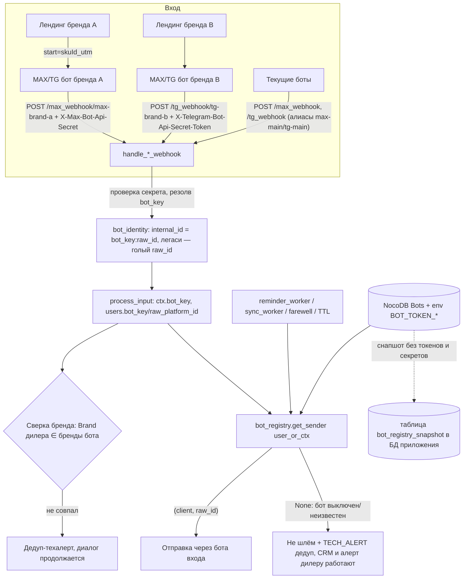

# feat: Мультибот MAX/Telegram с привязкой к брендам

> **СТАТУС: DONE (2026-09-25).** Многоботность на проде работает полностью
> (образ multy-v3.3.3, U1–U9 + U9a Webhook_Base + фикс allowlist /catalog —
> план 2026-09-25-001). Проверено вживую на проде: боты max-geely/tg-geely и
> max-haval/tg-haval отвечают на канонических URL, секреты enforced (TG —
> через Cloudflare Worker), карточка дилеру 01 — от бота бренда Haval,
> лендинги Geely/Belgee/Haval целиком (каталог, оснащение, контакты, цвета),
> `/bot-links` отдаёт 4 ботов, миграция users прошла (без max-main/tg-main).
> Осталось вне кода: ссылки Tilda Haval, удаление старых имён токенов через
> сутки, merge ветки в main — см. docs/SESSION_HANDOFF.md «Состояние на
> 2026-09-25». Актуальное состояние ботов/таблицы Bots — там же.

## Summary

Одно приложение обслуживает несколько ботов MAX и Telegram (по паре на бренд, 5–8 брендов): реестр ботов в NocoDB с токенами в env, отдельный webhook-URL на бота с проверкой секрета, бот фиксируется в сессии и БД и используется для всех исходящих (включая воркеры), бренд дилера сверяется со списком брендов бота (один бот может обслуживать несколько брендов) с дедуплицированным техалертом. Текущие боты продолжают работать без остановки на всех этапах (R7).

## Problem Frame

Сейчас клиент на канал ровно один: `max_client`/`tg_client` создаются из единственных `MAX_BOT_TOKEN`/`TG_BOT_TOKEN` (main.py:97–98), выбор — только по каналу `get_client(channel)` (main.py:101–102), вебхуки принимаются на единые `/max_webhook` и `/tg_webhook` без признака бота-получателя (main.py:4141–4142, обработчики main.py:3228, 3816). Если создать нового бота и поменять ссылку на лендинге, события нового бота либо не дойдут, либо ответы уйдут через старого бота (диагностика сессии 2026-09-15). Владелец принял решения R1–R7 (зафиксированы в Requirements); план проектирует под них.

Код не изменился с момента диагностики: HEAD `feat/cabinet-calculator` = 40ca973, файлы побайтно совпадают с прод-образом `vitaln/unified-bot:multy-v3.2.2`.

Работа ведётся в ветке `feat/multibot-brand-routing` (создана 2026-09-16 от 40ca973, Фаза 0).

---

## Результаты исследования (И1–И5)

### И1. NocoDB Dealers: поле Brand (не было на 2026-09-15, добавлено владельцем 2026-09-16)

Фактические поля таблицы Dealers (`muruk10ipof33m5`, 15 строк, выгрузка 2026-09-15): `Dealer_Code`, `Dealer_name`, `Dealer_id`, `Dealer_status`, `Max_Group_ID`, `Telegram_Group_ID`, `Business_Connection_ID`, `Communication_Type*`, `Sourse base id`, `Stock_*`, `Program_Table_ID`, `Rates_Table_ID`, `Prompt_Teg`, `Prompt_Ver`, `Policy`, `Agreement`, `Website_URL`, `UTC_Offset`, `Reminder_Image` и адресные поля. Ничего, из чего бренд выводится однозначно, нет (`Dealer_name` — «Автомир Самара», «TANK Дилер Test» — отображаемые строки, не ключи). Поля `Telegram_Group_ID`, `Dealer_status`, `Business_Connection_ID` кодом не читаются (grep по main.py/cabinet_service.py пуст; код читает поля в main.py:1668–1739).

**Обновление 2026-09-16**: владелец добавил и заполнил поле `Brand`. Фактические значения (15 дилеров, пустых нет, латиница, без пробелов и кириллицы): Belgee (код 03), Changan (12), Chery (04, 06, 07, 08), GAC (11), Geely (02, 09), Haval (99, 01), Solaris (13), Tank (98, 10), Tenet (05). Все значения с заглавной буквы — отображаемый стиль, не lowercase-ключи: сверка выполняется регистронезависимо (strip+lower с обеих сторон при загрузке), данные менять не требуется; по существу — сверка по нормализованным ключам, не по отображаемым названиям (learning: docs/solutions/logic-errors/formula-parity-without-scope-parity.md). Поле-список брендов — также в новой таблице Bots (В3: поле в Dealers таблицу Bots не заменяет).

### И2. MAX Bot API (официальная документация dev.max.ru)

- **Идентификатор бота-получателя в теле — ЧАСТИЧНО есть (уточнено дев-стендом 2026-09-17)**: в `message_created` поле `message.recipient.user_id` несёт ID бота-получателя (подтверждено: 230964832 = max-main, 391459141 = max-haval — сверено с `sender.user_id` в ответах API самих ботов); в `bot_started` блока recipient НЕТ (только `chat_id` и `user`) — поэтому Р1/R1 «URL на бота» остаётся обязательным: первый вход клиента различим только адресом. Формулировка пост-мортема habr.com/ru/articles/1060586 относится к классу bot_started. Полные схемы вариантов — не установлено (открытого OpenAPI нет).
- **Deep link** `https://max.ru/<botName>?start=<payload>`: лимит **128 символов**, при превышении payload не передаётся; приходит в поле `payload` апдейта `bot_started` (https://dev.max.ru/docs/chatbots/bots-coding/prepare). Допустимые символы — не установлено (документация задаёт только длину).
- **Секрет вебхука есть**: POST /subscriptions принимает `secret` (5–256 символов, только `A-Z a-z 0-9` и дефис), MAX присылает его в заголовке `X-Max-Bot-Api-Secret` каждого запроса (https://dev.max.ru/docs-api/methods/POST/subscriptions). URL — только HTTPS:443, ответ — 200 за 30 секунд, **автоотписка через 8 часов без успешных ответов**.
- **Повторный POST /subscriptions не заменяет, а добавляет подписку** (поведение из пост-мортема, лимит числа подписок — не установлено): перед регистрацией нужно читать GET /subscriptions и удалять лишние через DELETE /subscriptions.
- Проверка по IP-диапазонам MAX — не установлено. Один URL для нескольких ботов — явно не запрещён и не разрешён.
- Дополнительно (вторичный источник nbmit.ru, не верифицирован первоисточником): с 19.07.2026 продакшн-трафик якобы переведён на `platform-api2.max.ru`. Код берёт базовый URL из env `MAX_API_URL` (max_client.py:13) — перед выкатом проверить фактическое значение на проде.

### И3. Глобальность user_id MAX между ботами — ЗАКРЫТ (2026-09-17): глобальный

Живая проверка на дев-стенде: `sender.user_id` владельца одинаков в тестовых `max-main` и `max-haval` (123754089) → `user_id` MAX глобален между ботами. Изоляция R4 работает: внутренние ID различны (голый легаси «123754089» vs `max-haval:123754089`), два независимых контекста. Для легаси-коллизий — оценка не меняется (R20). Документация области действия по-прежнему не задаёт (https://dev.max.ru/docs-api/objects/User).

### И4. TG-вебхук локального токена: не зарегистрирован

`getWebhookInfo` по `TG_BOT_TOKEN` из локального `.env` (2026-09-15): `url` **пустой**, `pending_update_count: 0`, ошибок нет — у этого токена вебхук сейчас не установлен (это дев-окружение; прод-значение и его вебхук из локальной машины не установлены — нужен прод-env). `secret_token` через API не раскрывается в принципе (поля нет в WebhookInfo — core.telegram.org/bots/api#webhookinfo); код заголовок `X-Telegram-Bot-Api-Secret-Token` не проверяет (grep по main.py — проверки нет), значит секрет либо не задан, либо не используется. Спецификация secret_token: 1–256 символов, `A-Z a-z 0-9 _ -` (core.telegram.org/bots/api#setwebhook).

### И5. Захардкоженный MAX-токен в activate_webhook.py

- Файл в `.gitignore` (строка 8), git его **не отслеживает**, в истории (включая запушенную) не был ни разу: `git log --all --follow` по файлу пуст, pickaxe по первым символам токена пуст.
- Токен **совпадает** с текущим `MAX_BOT_TOKEN` из `.env` (первые 4 символа: `f9LH`) — это токен ТЕСТОВОГО бота: по факту владельца (2026-09-17) в локальном дев-`.env` `MAX_BOT_TOKEN`/`TG_BOT_TOKEN` — тестовые боты, боевые токены живут только в env контейнера Dockhost и локально недоступны.
- **Но**: `.dockerignore` файл не исключает, и он присутствует в прод-образе `multy-v3.2.2` (проверено извлечением из образа) — живой токен в открытом виде уезжает в каждый образ. Устранение — в U7 (удалить файл, добавить в `.dockerignore`).

---

## Requirements

Решения владельца (в постановке задачи — Р1–Р7, нумерация совпадает):

- R1. Бот для ответа = бот, в которого пришло событие; входящий бот определяется по URL вебхука, сохраняется в сессии и БД, используется всеми последующими отправками, включая воркеры.
- R2. Связки «бот → бренд» и «дилер → бренд» — в NocoDB; бренд дилера используется для сверки с брендом бота, не для выбора бота.
- R3. Сверка: бренд дилера должен входить в список брендов бота (В2). Несовпадение не прерывает диалог: ответы через бота входа + дедуплицированный техалерт с дилером, кодом, ботом, брендом дилера и списком брендов бота.
- R4. Идентичность клиента = (бот, platform_user_id); один человек в ботах двух брендов — две независимые сессии и две сделки.
- R5. Алерты дилерам и техалерты — как сейчас, через служебный MAX-бот (текущий `MAX_BOT_TOKEN`); брендовых ботов в группы не добавляем.
- R6. Web-виджет вне скоупа, поведение не меняется.
- R7. Переход без простоя: текущие боты и адреса `/max_webhook`, `/tg_webhook` работают до отдельного решения; текущие боты — первые записи реестра.

Уточнения владельца (подтверждены 2026-09-15):

- R8. Токены — в env по переменной на бота; реестр в NocoDB без секретов. Секрет вебхука — только необратимое производное от токена (HMAC), не сам токен и не его часть; учесть ограничения символов/длины Telegram (1–256, `A-Za-z0-9_-`) и MAX (5–256, `A-Za-z0-9-`).
- R9. Бот есть в NocoDB, env-переменной нет → бот неактивен + техалерт при старте.
- R10. Полный список мест (файл:строка), где `platform_user_id` используется как ID мессенджера (см. «Инвентаризация» ниже); сборка/разборка составного ID — одна функция, всё остальное через неё, с тестами.
- R11. Явно зафиксировать статус текущих ботов (bot_key, бренд, формат ID) и судьбу возможной коллизии MAX-id = TG-id у старых записей.
- R12. Поле бота в БД и в сессии заводится в любом случае — составной ID не единственный источник информации о боте.
- R13. Недоступность NocoDB ≠ «ботов нет». Порядок на старте: NocoDB доступна → загрузка из неё; недоступна → последний успешно сохранённый снапшот реестра из БД приложения (Д3); снапшота нет → минимальный реестр легаси-ботов из env.
- R14. Отправка боту вне реестра/выключенному: не отправляем, техалерт с дедупликацией (не на каждое сообщение), в алерте дилер/сделка для связи менеджера с клиентом; заявка не теряется — сделка Bitrix и алерт дилеру отрабатывают как обычно.

Вводные и решения владельца 2026-09-16:

- R15. Один бот может обслуживать несколько брендов (В2): у бота — список брендов, сверка R3 — по вхождению. Легаси-боты `max-main` и `tg-main` обслуживают бренды `geely` и `belgee` (соответствуют фактическим значениям Geely/Belgee из И1, сверка регистронезависимая).
- R16. Пустой `Brand` у дилера → сверка пропускается + дедуп-алерт «бренд не заполнен» раз в сутки на дилера (ответ 1).
- R17. Ротации MAX-токена не будет (Д4: репозиторий Docker Hub приватный — В4); отложенная мера с условием пересмотра — в Рисках (ответ 3).
- R18. Проверка секрета на легаси-адресах включается после перерегистрации легаси-ботов скриптом U7. Порядок обязателен: сначала регистрация секрета на стороне MAX/TG и подтверждение, затем включение проверки на сервере; флаг — `secret_enforced` в снапшот-таблице БД приложения (решение Фазы 0.3: не в NocoDB), выставляет только скрипт (ответ 4).
- R19. Колонка `Bot_Key` в архиве NocoDB — добавить и заполнять на всех путях архивации (ответ 5; детали в U5 и «Зависимостях вне репо»).
- R20. OTP-лимиты по телефону — общие для всех сессий человека (ответ 6). Легаси-коллизия MAX-id = TG-id фиксируется как есть, не чинится (ответ 7).

---

## Key Technical Decisions

- **KTD-1. Реестр ботов — таблица NocoDB `Bots`, токены — в env.** Поля: `Bot_Key` (стабильный ключ, строго `[a-z0-9-]` — валидация при загрузке реестра, запись с иными символами становится неактивной + техалерт: bot_key входит в session_id, который n8n подставляет в SQL склейкой строк без экранирования), `Channel` (`max`/`telegram`), `Brands` (список брендов бота: SingleLineText со значениями через запятую, например `geely,belgee` — читается NocoDB API как обычная строка и парсится сплитом со strip+lower; multi-select отвергнут: API отдаёт ту же строку с запятыми, но набор опций пришлось бы править в UI при каждом новом бренде), `Token_Env` (имя env-переменной, например `BOT_TOKEN_MAX_TANK`), `Active` (checkbox), `Environment` (`prod`/`dev`/`all` — Фаза 0.2: NocoDB общий для дев и прода, установлено по hardcoded id таблицы Dealers `muruk10ipof33m5` в main.py:89, который отдаёт данные и с дев-хоста; реестр читает записи своего окружения плюс `all`, окружение приложения задаёт новая env-переменная `BOT_ENV` ∈ {`prod`,`dev`} БЕЗ значения по умолчанию: переменная не задана или содержит иное значение → реестр загружает только записи `all` + один дедуп-техалерт «BOT_ENV не задан», приложение работает (правка владельца 2026-09-16); фильтр нужен, иначе прод после U1 слал бы R9-техалерты о дев-ботах без env-переменных, а дев подхватывал бы прод-ботов), `Title`/`Link` (справочно). Поля `Secret_Enforced` в NocoDB НЕТ — источник истины перенесён в БД приложения (Фаза 0.3, см. KTD-2/KTD-9): правка в NocoDB-UI не может отключить проверку секрета, флаг переживает недоступность NocoDB, единственный писатель — скрипт U7, рядом с intent-хэшем. Таблица Bots (`ma0nf1e807qb9e0`) создана и заполнена 2026-09-16: max-main/tg-main (`geely,belgee`, env=all), max-haval/tg-haval (`haval`, env=dev). Токены не попадают в NocoDB и в логи; маскирование расширяется в U1 — текущий `_TOKEN_KV_RE` в log_masking.py производный секрет и заголовки `X-Max-Bot-Api-Secret`/`X-Telegram-Bot-Api-Secret-Token` не покрывает. env — тот же механизм, что у текущих `MAX_BOT_TOKEN`/`TG_BOT_TOKEN`. NocoDB выбран, потому что связки «бот→бренд» и «дилер→бренд» уже ведутся там (R2) и владелец правит их без деплоя; env для токенов — потому что это единственное место секретов сегодня (learning: docs/solutions/security-issues/hardcoded-credentials-in-git-history.md).
- **KTD-2. Загрузка и кэш реестра — по образцу `CACHED_DEALERS`** (main.py:1656–1742, TTL-обновление, watchdog по образцу `ensure_dealers_loaded` main.py:4122): глобальный `CACHED_BOTS: {bot_key: BotEntry}` + инстансы клиентов. После каждой успешной загрузки — снапшот метаданных (bot_key, channel, brands, имя env-переменной, active, secret_enforced — БЕЗ токенов и БЕЗ секретов) в таблицу `bot_registry_snapshot` БД приложения (Д3: PostgreSQL на проде, SQLite на дев тем же механизмом; файл в `data/` и постоянный том НЕ используются — каталог отсутствует в прод-образе, `data/` в `.dockerignore`, и файл не пережил бы redeploy). Запись снапшота — одной транзакцией (атомарность). Порядок на старте — R13; недоступность самой БД отдельного пути не требует: без БД приложение не стартует в принципе (`init_db()` main.py:4130 выполняется раньше загрузки реестра). Запись с отсутствующей env-переменной → `active=False` + стартовый техалерт (R9). В той же снапшот-таблице — блок подтверждённой регистрации на бота: intent-хэш секрета, `secret_enforced`, `confirmed_url`, время подтверждения; эти колонки пишет ТОЛЬКО скрипт U7, синхронизация NocoDB→снапшот их не перетирает (upsert по bot_key обновляет только реестровые поля). Блок нужен идемпотентности регистрации (KTD-9) и гейту проверки секрета (R18).
- **KTD-3. Секрет вебхука — производный: `HMAC_SHA256(key=token, msg="webhook-secret:"+bot_key)` в hex (64 символа).** Hex-алфавит `[0-9a-f]` удовлетворяет и Telegram (`A-Za-z0-9_-`), и MAX (`A-Za-z0-9-`, без подчёркивания); необратим, отдельных секретов не заводим (R8). Проверка — `hmac.compare_digest` заголовка `X-Telegram-Bot-Api-Secret-Token` / `X-Max-Bot-Api-Secret`. Легаси-адреса без секрета работают как сейчас до перерегистрации легаси-ботов скриптом U7; включение проверки — строго после регистрации секрета на стороне платформ и подтверждения (флаг `secret_enforced` в снапшот-таблице БД, не в NocoDB — Фаза 0.3; пишет только скрипт U7 — R18). Ротация токенов не планируется (Д4, R17); правило на будущее: ротация меняет производный секрет и обязана заканчиваться прогоном `register_webhooks --apply`, иначе события бота дропаются тихо и бессрочно.
- **KTD-4. URL на бота: `/max_webhook/{bot_key}`, `/tg_webhook/{bot_key}`.** Легаси `/max_webhook` и `/tg_webhook` — алиасы первых записей реестра `max-main`/`tg-main` (R7). Неизвестный `bot_key` или неверный секрет → при полном реестре (NocoDB/снапшот) ответ 200 с дропом + WARN-лог + дедуп-техалерт, различающий причину: «неизвестный bot_key» (чужой/старый трафик) vs «неверный секрет известного бота» (почти наверняка своя рассинхронизация — `--apply` не прогнан или прогнан частично). Событие бота с `Active=✗` — НЕ дроп (Д1): обрабатывается полным пайплайном (сделка, CRM, алерт дилеру), блокируется только отправка клиенту (`get_sender` → None, KTD-6) + дедуп-техалерт. При деградированном реестре (env-минимум без снапшота, R13) неизвестный `bot_key` получает 503 — платформы ретраят (MAX до 8 часов, Telegram около суток). Честная оговорка (Д2): фильтр свежести MAX (main.py:3239–3242, дроп апдейтов старше 60 секунд) не трогаем, поэтому MAX-ретраи, пришедшие позже 60 секунд после исходного события, будут отброшены фильтром — 503-ветка полноценно спасает только Telegram (зафиксировано в Рисках). Дроп «не нашего» события — до любого кода, способного кинуть исключение, иначе `error_middleware` (main.py:3105) ответит 500 и чужие события будут ретраиться.
- **KTD-5. Идентичность (R4): составной внутренний ID только для новых ботов.** `internal_id = f"{bot_key}:{raw_id}"` для всех ботов, кроме легаси (`max-main`, `tg-main`, `web`) — у легаси внутренний ID остаётся голым `raw_id`, существующие записи не переименовываются, миграция данных нулевая. Уникальность `users.platform_user_id` не меняется (составные ID уникальны по построению — `bot_key` уникален, внутри бота `raw_id` уникален). Дополнительно (R12): колонки `users.bot_key` и `users.raw_platform_id` — бот и «чистый» ID мессенджера хранятся явно, ID не единственный источник. Сборка/разборка — только модуль `bot_identity` (одна пара функций build/parse + `raw_id_for_send()`), всё остальное через него (R10); там же `df_session_id()` — санитизированный ID для ресурсных имён Dialogflow (составной ID с `:` уходит в GCP-пути main.py:1934, 1942 — поведение двоеточия там не установлено). `get_or_create_user` расширяется полями `bot_key`/`raw_platform_id`/`channel` и дозаполняет их у существующих строк с NULL; `save_user_phone` (database.py:453, 463) обязан передавать все три — сегодня он создаёт пользователя с дефолтным `channel='max'`, а TG-контакт из кнопки обрабатывается до `process_input` (main.py:3862 раньше main.py:3905), т.е. «контакт как первое событие» породил бы TG-запись с MAX-идентичностью. Альтернатива — композитная уникальность `(bot_key, platform_user_id)` — отвергнута: потребовала бы согласованной правки ~45 выборок по `platform_user_id` (инвентаризация ниже) и ключей `USER_CONTEXT` разом, с риском тихого смешения контекстов при единственном пропущенном месте.
- **KTD-6. Отправка: `bot_registry.get_sender(user|ctx) -> (client, raw_id) | None` вместо `get_client(channel)`.** Резолв: `ctx['bot_key']`/`users.bot_key` → клиент из реестра; записи без `bot_key` (старые) → сначала попытка распарсить составной `platform_user_id` через `bot_identity` (самовосстановление для строк с потерянным `bot_key`), затем легаси-маппинг по `channel` (тот же словарь, что main.py:102). `None` (бот неизвестен/выключен) → не отправляем, WARN-строка `TECH_ALERT` в лог + дедуп-техалерт по ключу `bot_key` (R14); CRM-путь и алерт дилеру не зависят от этой отправки и выполняются как обычно. `get_client(channel)` остаётся только для `web` и как внутренний легаси-фолбэк.
- **KTD-7. Сверка бренда — в точке активации диплинка** (main.py:2599–2654, после резолва дилера по префиксу): нормализованный `Brand` дилера НЕ входит в список брендов бота (R15, strip+lower с обеих сторон) → WARN-лог + дедуп-техалерт (ключ `dealer_code+bot_key`, кулдаун 1 час, механизм по образцу `_alert_dedup` в otp_worker main.py:4090–4101 и Р12 sms-watchdog из коммита b074c15 — второй параллельный механизм не заводим). Пустой `Brand` у дилера — сверка пропускается + дедуп-алерт «бренд дилера не заполнен» раз в сутки (R16). Каждый техалерт — парная греп-строка в логе до отправки (learning: docs/solutions/logic-errors/log-result-only-on-confirmed-result.md).
- **KTD-8. Алерты (R5) не трогаем:** все `max_client.send_alert_to_group` (main.py:1110, 1119, 1374, 3129, 3581, 3623, 3810, 4023) остаются на служебном клиенте с env `MAX_BOT_TOKEN`; служебный бот = легаси `max-main`.
- **KTD-9. Регистрация вебхуков — `scripts/register_webhooks.py`** (замена activate_webhook.py): читает реестр (NocoDB/снапшот) и env, токенов не принимает аргументами и не печатает; расхождения печатаются и требуют флага `--apply`, молчаливого «снести всё» нет (learning: docs/solutions/integration-issues/token-idempotency-verified-by-table-rows.md). Идемпотентность — по фактическому состоянию для URL и по intent-состоянию для секрета: секрет снаружи ненаблюдаем (Telegram не возвращает secret_token — И4; содержимое GET /subscriptions MAX по секрету не установлено), поэтому в снапшот-таблице хранится хэш последнего подтверждённо применённого секрета, и изменяющий вызов выполняется всякий раз, когда ожидаемый секрет не подтверждён (первый прогон, смена токена). Порядок для MAX — сначала `POST` новой подписки, затем `DELETE` лишних (частичный отказ не оставляет бота без подписок; если дев-стенд покажет лимит «одна подписка на бота» — компенсационный ре-POST старой при отказе); любой отказ — ненулевой exit-код + строка «состояние бота X неконсистентно, повторите --apply». После подтверждённой регистрации скрипт пишет intent-хэш, `confirmed_url` и `secret_enforced` в снапшот-таблицу одной транзакцией (единственный писатель секретных колонок — R18); включение проверки — отдельный явный шаг `--enforce <bot_key>` после живой проверки (двухшаговый порядок R18), снятие — `--unenforce`; запуск по-ботно через `--bot <key>` или по всем. Ожидаемый URL строится от новой env-переменной `PUBLIC_BASE_URL` (прод — публичный хост приложения на Dockhost, тот же, куда n8n шлёт callback; дев — актуальный ngrok-URL; Фаза 0.10); скрипт печатает окружение (`BOT_ENV`, `PUBLIC_BASE_URL`, список bot_key) и при `--apply` требует `--confirm-env=<хост>`. Владелец запускает по одной команде на прогон. Дополнительно — read-only сторож подписок MAX: при старте приложения и периодически (по образцу dealers_watchdog) сверять `GET /subscriptions` с ожидаемым URL, при расхождении — дедуп-техалерт; починка только руками через `--apply` (закрывает тихую 8-часовую автоотписку). Сторож сверяет ТОЛЬКО ботов с непустым `confirmed_url` — по легаси-ботам до U7 записей нет, ложных алертов в промежутке «U1 выкачен, U7 не выполнен» не будет (Фаза 0.10).

---

## High-Level Technical Design

Направляющая схема, не спецификация реализации.

Статус текущих ботов после U3 (R11): `max-main` (бренды `geely,belgee`, формат ID — голый `user_id` MAX), `tg-main` (бренды `geely,belgee`, голый TG-id), `web` (вне скоупа, голый `session_id`). Существующая теоретическая коллизия «MAX-id численно равен TG-id» у легаси-записей: строка `users` принадлежит тому каналу, чьё значение в `channel`; второй мессенджер и сегодня перезаписывал бы её — поведение фиксируется как есть (R20), новые боты коллизий не имеют по построению (KTD-5).

---

## Инвентаризация: где platform_user_id — это ID мессенджера

Категория А — «сырой ID уходит наружу» (после U3/U4 все эти места обязаны получать `raw_id` через `bot_identity`/`get_sender`):

| Место | файл:строка | Что меняется |
|---|---|---|
| Отправка ответа ИИ (`send_smartbot_reply` → `reliable_send`) | main.py:648, 793–801 | клиент+raw из `get_sender(ctx)` |
| Отправка при закрытии кабинетной сессии | main.py:1043 | то же |
| Системные сообщения/антиспам/ошибки дилера/фолбэк | main.py:2304, 2353, 2606, 2662, 2812, 2886 | то же |
| Склейка сообщений `delayed_sender` | main.py:2450, 2511 (клиент с 2511 переиспользуют ветки 2519, 2542, 2570 — при замене учесть все три) | то же |
| Финализация smartbot (`_send_client`) | main.py:2829 | то же |
| Typing MAX/TG | main.py:2319, 2411, 2977 | то же |
| int-приведения ID/chat_id | main.py:2314, 2407, 2972, 3899; max_client.py:23 | только `raw_id`/`chat_id` из вебхука; main.py:3899 — `int(raw_id)` и правится в U3, не в U4: на составном ID это необработанный ValueError → 500 → ретраи Telegram, диалог нового TG-бота мёртв целиком |
| Удаление клавиатуры | main.py:3326 (MAX), 3903 (TG) | клиент бота сессии |
| Пересоздание контекста при активации диплинка | main.py:2621–2626 | в новый dict-литерал добавить `'bot_key'` (как `'channel': channel`) — иначе первое событие каждой сессии остаётся без бота в ctx/context_json; тест в U3 |
| Прямые вызовы TG API (`answerCallbackQuery`, `deleteMessage`) | main.py:3917, 3929 | перенести в методы `TelegramBotClient`, клиент бота сессии |
| Ремайндеры | main.py:3514 (+3429–3466 AI-ремайндер через send_smartbot_reply) | `get_sender(u)`/`get_sender(ctx)` |
| Farewell TTL 48ч | main.py:3698–3699 | то же |
| Контакт из кнопки TG (`save_user_phone` по `user_id`) | main.py:3862 | внутренний ID строится до вызова — менять не надо, фиксируется тестом |

Категория Б — непрозрачный ключ БД/контекста (составной ID проходит без изменений): выборки/апдейты `User.platform_user_id` — main.py:410, 460, 472, 572, 605, 701, 739, 949, 1091, 1206, 1250, 1316, 1337, 1505, 2007, 2021, 2137, 2182, 2357, 2433, 2507, 2515, 2566, 2614, 2867, 2934, 2951, 3034; database.py:388, 392, 399, 463, 466, 474; cabinet_service.py:2158, 2262, 2523, 2642, 2716, 2772, 3235, 3512, 3567; scripts/issue_cabinet_link.py:147, 149, 214; ключи `USER_CONTEXT` и `save_context_to_db`/`load_context_from_db` (main.py:1995–2029).

Категория В — уходит во внешние системы как непрозрачная строка (работает с составным ID, но требует подтверждения принимающей стороны): `user_id`/`session_id` в n8n-пейлоадах и архиве NocoDB — main.py:932, 1475, 1599, 2467, 3065, 3671–3672, 3716–3717; лог-метка `user_id` в BitrixService — main.py:2130, 2134, 2149, 2156; выгрузка логов n8n по session_id — main.py:2053–2055 (подставляется в query-строку без urlencode — при смене разделителя выбирать только URL-safe символ); Dialogflow — `session_id = f"user_{max_user_id}"` (main.py:2384) уходит в ресурсные имена GCP (main.py:1934, 1942, сброс main.py:2651), для новых ботов — `df_session_id()` из `bot_identity` (KTD-5). Разделитель `:` подтверждён n8n-агентом как безопасный (отчёт 2026-09-16, «Зависимости вне репо»); колонки `session_id`/`user_id` архивной таблицы NocoDB — текстовые (живая выгрузка 2026-09-16: значения-строки), `:` и `-` принимают.

---

## Implementation Units

### U1. Модуль bot_identity + bot_registry и таблица Bots

- **Goal:** реестр ботов с клиентами, секретами и фолбэк-кэшем; единая функция составного ID. Поведение приложения не меняется (маршрутизация пока старая).
- **Requirements:** R1 (фундамент), R8, R9, R12, R13.
- **Dependencies:** нет.
- **Files:** новые `bot_identity.py`, `bot_registry.py`; правки `main.py` (загрузка реестра рядом с `load_data_from_nocodb`, watchdog по образцу main.py:4122), `database.py` (таблица `bot_registry_snapshot` через существующий metadata/ensure_schema-путь — Д3), `log_masking.py` (производный секрет и заголовки `X-Max-Bot-Api-Secret`/`X-Telegram-Bot-Api-Secret-Token` — текущий `_TOKEN_KV_RE` их не покрывает); NocoDB: таблица `Bots` (вне кода); тесты `tests/test_bot_identity.py`, `tests/test_bot_registry.py`.
- **Approach:** `BotEntry(bot_key, channel, brands, token, active, secret_enforced, is_legacy)`; клиенты создаются из реестра (классы max_client.py/telegram_client.py уже принимают токен конструктором); легаси-записи `max-main`/`tg-main` (бренды `geely,belgee` — R15) собираются из `MAX_BOT_TOKEN`/`TG_BOT_TOKEN` даже при пустой NocoDB (R13); производный секрет per KTD-3, токен и секрет в рантайме — через обёртку типа `Secret` (образец — sms_gateway.py), в логи не попадают; валидация `bot_key` строго `[a-z0-9-]` (нарушение → `active=False` + техалерт); `Brands` парсится сплитом по запятой + strip+lower; снапшот — в таблицу `bot_registry_snapshot` одной транзакцией (KTD-2, Д3); фильтр окружения `Environment` ∈ {`BOT_ENV`, `all`}, `BOT_ENV` без дефолта — не задан/невалиден → только `all` + один техалерт (Фаза 0.2, правка владельца); секретные колонки снапшота при синхронизации не перетираются; сторож подписок MAX при старте, только для ботов с `confirmed_url` (KTD-9).
- **Test scenarios:**
  - build/parse составного ID: `("max-tank", "12345") → "max-tank:12345"` и обратно; легаси-ключи дают голый ID; parse голого ID → `(None, raw)`; ID с двоеточием в raw не ломает parse (split с maxsplit=1); `df_session_id()` без `:` и в лимите длины session id Dialogflow ES.
  - Секрет: hex 64 символа, детерминирован по (token, bot_key), различен для разных ботов, не содержит подстрок токена.
  - Реестр: запись без env-переменной → `active=False` + вызов техалерт-хука один раз (R9); `bot_key` с недопустимыми символами (`Max_Tank`, `max tank`, кириллица) → `active=False` + техалерт; `Brands` «Geely, Belgee» → `{'geely','belgee'}`; недоступная NocoDB + снапшот в БД → реестр из снапшота; ни NocoDB, ни снапшота → минимальный реестр из env; в снапшот-таблице нет ни токенов, ни секретов (только хэш подтверждённого секрета); прерванная запись снапшота не оставляет частичного состояния (транзакция); фильтр окружений: `BOT_ENV=prod` не видит записи `dev` и наоборот, `all` видна обоим; `BOT_ENV` не задан или мусорное значение → загружены только `all` и ровно один техалерт «BOT_ENV не задан»; повторная синхронизация NocoDB→снапшот не перетирает intent-хэш/`secret_enforced`/`confirmed_url`.
  - Маскирование: производный секрет и значения обоих платформенных заголовков не появляются в логах (включая WARN при несовпадении секрета — сценарий U3).
  - Боевая проводка: setup реестра с 2+ ботами на канал возвращает разные клиенты с разными токенами (learning: docs/solutions/logic-errors/injected-callable-hidden-side-effect.md — минимум один тест без моков клиентов).
- **Verification:** тесты зелёные; приложение стартует с текущим env без NocoDB-таблицы Bots (легаси-реестр из env), поведение прода не изменилось.
- **Откат:** модуль не подключён к маршрутизации — обычный revert коммита.

### U2. Миграция БД: bot_key и raw_platform_id

- **Goal:** колонки `users.bot_key`, `users.raw_platform_id` + бэкфилл легаси-записей; уникальность `platform_user_id` не меняется.
- **Requirements:** R1, R11, R12.
- **Dependencies:** U1 (имена легаси-ключей).
- **Files:** `database.py` (модель User database.py:35–41, ensure_schema-механизм database.py:263–268); тесты `tests/test_migration_botkey.py`.
- **Approach:** аддитивные nullable-колонки; бэкфилл `bot_key = 'max-main'|'tg-main'|'web'` по `channel`, `raw_platform_id = platform_user_id` (у легаси ID голые). Бэкфилл живёт внутри `init_db()` сразу после блока ALTER (database.py:341–351) и выполняется на каждом старте с предикатом `WHERE bot_key IS NULL` **и** «`platform_user_id` не содержит разделителя» — окно «строки, созданные между деплоями U2 и U3, остались без bot_key» закрывается следующим стартом, а аномальная составная строка без `bot_key` не портится легаси-значениями. Порядок «схема → код» обеспечен архитектурно: `init_db()` выполняется до роутов и воркеров (main.py:4130, 4162). Проброс `channel` через `save_user_phone → get_or_create_user` (database.py:453, 463 — сегодня дефолт `channel='max'`) — часть юнита. PostgreSQL (прод) и SQLite (дев) — оба через существующий ensure_schema-путь; прогон на PostgreSQL обязателен, не только SQLite (learning: docs/solutions/database-issues/naive-datetime-vs-timezone-aware-columns.md — класс разрывов «зелёно на SQLite, падает на PG»); на PostgreSQL сессии ALTER выставлять `lock_timeout`, чтобы зависший `idle in transaction` соседа не превратил metadata-ALTER в блокировку users.
- **Риски/откат:** колонки аддитивные — откат кода не требует отката схемы; при необходимости `DROP COLUMN`. Бэкфилл идемпотентен и повторяется каждый старт.
- **Test scenarios:** апгрейд легаси-схемы без колонок → колонки появились (диалект-зависимый тест по образцу tests/test_legacy_schema_upgrade из a32f0b4); бэкфилл по трём каналам; повторный запуск ничего не меняет; строка с `bot_key=NULL`, созданная после первого прогона, получает `bot_key` на следующем старте; аномальная составная строка (`max-tank:123`, `bot_key=NULL`) бэкфиллом не трогается; бэкфилл не перезаписывает `raw_platform_id` у строк с заполненным `bot_key`; `channel` вне {max, telegram, web} → `bot_key` остаётся NULL (легальное состояние, уходит в легаси-фолбэк KTD-6); вставка «старой моделью» без новых колонок после миграции проходит (симуляция отката); «контакт как первое событие» TG создаёт пользователя с корректным `channel`; новая запись с `bot_key='max-tank'` и составным `platform_user_id` сосуществует с легаси-строкой того же `raw_platform_id`.
- **Verification:** миграция прогнана на дев-SQLite и на локальном PostgreSQL через `TEST_DATABASE_URL` (механизм tests/conftest.py:90–119, гард «только localhost»; Фаза 0.11); версия прод-PostgreSQL — 16.8 (Debian 16.8-1.pgdg120+1, подтверждено владельцем 2026-09-16), локально — образ `postgres:16.8`; все существующие строки получили bot_key.

### U3. Приём: URL на бота, секреты, фиксация бота в сессии

- **Goal:** `/max_webhook/{bot_key}` и `/tg_webhook/{bot_key}` с проверкой секретов; `bot_key` в ctx и users на каждом событии; составной ID для новых ботов.
- **Requirements:** R1, R7, R8, частично R14 (неизвестный bot_key).
- **Dependencies:** U1, U2.
- **Files:** `main.py` — роуты (main.py:4141–4142), `handle_max_webhook` (main.py:3228–3357), `handle_tg_webhook` (main.py:3816–3906), `process_input` (сигнатура main.py:2253, установка ctx main.py:2262), `get_or_create_user` (database.py:385); тесты `tests/test_webhook_bot_routing.py`.
- **Approach:** роут отдаёт `bot_key` из match_info; легаси-адреса вызывают те же обработчики с `max-main`/`tg-main` (R7). Проверка секрета: заголовок сверяется c производным секретом записи реестра (`hmac.compare_digest`); на легаси-адресах проверка включается только при взведённом `secret_enforced` из снапшот-таблицы БД (не NocoDB — Фаза 0.3; ставит только скрипт U7 шагом `--enforce` после подтверждённой регистрации и живой проверки — R18), до того — текущее поведение. Внутренний ID строится в обработчике через `bot_identity` ДО `process_input`; `ctx['bot_key']` ставится всегда (как `ctx['channel']` main.py:2262), `users.bot_key`/`raw_platform_id` — в `get_or_create_user` (+дозаполнение NULL, KTD-5), проброс из `save_user_phone` (database.py:463). `ctx['chat_id']` для TG — из `raw_id` (main.py:3899) — блокер выката юнита, см. таблицу категории А. Внутренний рекурсивный вызов `process_input` (main.py:2816) — в чек-лист переноса контракта наряду с вызовами из обработчиков (main.py:3352, 3905, 3965). Неизвестный bot_key/неверный секрет → по KTD-4 (200-дроп при полном реестре, 503 при деградированном); событие бота с `Active=✗` — полный пайплайн без отправки клиенту (Д1). При пересоздании контекста на активации кода `bot_key` включается в новый dict-литерал (main.py:2621–2626, строка в таблице категории А).
- **Test scenarios:**
  - событие на `/max_webhook/max-tank` с верным секретом → `process_input` c channel=max, ctx.bot_key=max-tank, составной platform_user_id; users-строка с bot_key/raw_platform_id.
  - легаси `/max_webhook` без заголовка → работает как сегодня, bot_key=max-main, голый ID (регресс-паритет).
  - неверный секрет нового бота → 200, `process_input` не вызван, WARN в логе, техалерт-хук с дедупликацией (два подряд события → один алерт).
  - неизвестный bot_key → 200 + дроп; TG callback_query на новом боте → верные `chat_id`/`message_id` для удаления клавиатуры.
  - deeplink `bot_started`/`/start` на новом боте: payload `99XXYYZZ_модель` → start_code найден, дилер определён (паритет с main.py:2599–2654).
  - контакт как первое событие на новом TG-боте (`save_user_phone` до `process_input`) → users-строка с корректными `channel`/`bot_key`/`raw_platform_id`.
  - деградированный реестр (env-минимум, снапшота нет) + событие неизвестного `bot_key` → 503, не 200-дроп.
  - после активации диплинка ctx и context_json содержат `bot_key` (пересоздание контекста main.py:2621–2626).
  - событие бота с `Active=✗` → `process_input` выполнен, отправки клиенту нет, дедуп-техалерт (Д1).
  - `secret_enforced` взведён, событие без заголовка секрета → дроп с алертом причины «неверный/отсутствующий секрет».
- **Verification:** дев-стенд: тестовый второй бот TG (создать при выполнении) подписан на `/tg_webhook/<key>` — диалог проходит; старый бот параллельно работает на легаси-адресе.
- **Откат:** revert; легаси-адреса не менялись, новые роуты просто исчезают.

### U4. Отправка через бота сессии

- **Goal:** все исходящие клиенту — через `get_sender`; прямые TG-вызовы — через клиента.
- **Requirements:** R1, R10, R14.
- **Dependencies:** U1–U3.
- **Files:** `main.py` — все точки категории А из Инвентаризации; `telegram_client.py` — новые методы `answer_callback`, `delete_message`; тесты `tests/test_sender_resolution.py`.
- **Approach:** механическая замена по таблице категории А; `get_sender` возвращает `(client, raw_id)` — вызовы `send_message(user_id=...)` получают `raw_id`. Ветка `None` (KTD-6): сообщение клиенту не отправлено, но `background_crm_update`, сделка и алерт дилеру идут своим чередом (R14 — заявка не теряется); в дедуп-техалерте — `dealer_code` и `deal_id` из ctx, чтобы менеджер связался с клиентом сам.
- **Execution note:** до замены — характеризационный тест на текущую отправку (легаси-путь), чтобы паритет был доказан, а не предположен.
- **Test scenarios:**
  - легаси-пользователь (bot_key=max-main, голый ID) → отправка тем же клиентом и ID, что до правки (паритет).
  - пользователь max-tank → клиент max-tank, `send_message` получает голый raw_id (не составной).
  - бот выключен/удалён из реестра → send-точки не зовут API, WARN `TECH_ALERT` + один алерт на серию, CRM-обновление выполнено.
  - typing и удаление клавиатуры на новом TG-боте → нужный токен в URL запроса; `answerCallbackQuery`/`deleteMessage` больше не читают `TG_BOT_TOKEN` напрямую (grep-тест: в main.py не осталось `api.telegram.org/bot{os.getenv`).
  - `[SPLIT]`/farewell в `send_smartbot_reply` — весь путь на клиенте бота сессии.
- **Verification:** дев-стенд: полный диалог (deeplink → кнопки → телефон → ответ ИИ) на новом и на старом боте параллельно; ответы приходят от того бота, куда писал клиент.
- **Откат:** revert коммита юнита; U3 продолжает работать (приём фиксирует бота, отправка временно снова по каналу — деградация только для новых ботов).

### U5. Воркеры и фоновые задачи

- **Goal:** ремайндеры, farewell, TTL-закрытие и добор очередей отвечают через бота сессии; политика для записей без бота и выключенных ботов.
- **Requirements:** R1, R14.
- **Dependencies:** U4.
- **Files:** `main.py` — `reminder_worker` (main.py:3364–3535), `sync_worker`/Логика Б (main.py:3628–3815), `replay_pending_sync` (main.py:3536); тесты `tests/test_workers_botkey.py`.
- **Approach:** воркеры уже итерируют `users` и читают ctx — резолв через `get_sender(u/ctx)`; запись без `bot_key` → легаси-маппинг по `channel` (то же, что U4); бот выключен → отправка пропускается, WARN + дедуп-алерт; маркер в ctx — проверяемый, не терминальный: хранит `bot_key`+timestamp, каждый цикл сначала резолвит `get_sender`, и если бот снова активен — маркер снимается, рассылка возобновляется. Архив NocoDB (R19): во все четыре точки сборки `archive_payload` (main.py:925–935, 3049–3068, 3671–3681, 3716–3721) добавляется поле `Bot_Key` из ctx/`users.bot_key` (learning: docs/solutions/logic-errors/ai-fields-only-on-ai-payload-paths.md — заполнять на всех путях записи, не только основном); `upsert_dialogue_archive` (main.py:2070) передаёт его как есть; момент записи — каждый upsert архива (бэкап 30 мин, финализация, TTL-закрытие). `replay_pending_sync`, `otp_worker`, `dealers_watchdog` не пишут клиенту (Bitrix/SMS/NocoDB) — не затронуты, фиксируется тестом-констатацией.
- **Test scenarios:** ремайндер пользователю max-tank уходит клиентом max-tank; farewell TTL 48ч — тем же; легаси-запись без bot_key — прежним клиентом по каналу (паритет); выключенный бот → пропуск + маркер + один алерт, повторный цикл не алертит; бот включён обратно → маркер снят, ремайндер уходит; все четыре пути сборки archive_payload пишут `Bot_Key` (легаси — `max-main`/`tg-main`, новые — свой ключ); `supports_reminders` учитывается как сейчас (main.py:3383).
- **Verification:** дев-стенд с укороченными интервалами: ремайндер и farewell приходят от правильного бота.
- **Откат:** revert юнита; воркеры вернутся к каналу — деградация только для новых ботов.

### U6. Сверка бренда и поле Brand

- **Goal:** R3 — сверка «бренд дилера ↔ бренд бота» с дедуп-техалертом; поле `Brand` в Dealers.
- **Requirements:** R2, R3.
- **Dependencies:** U3 (bot_key в ctx); поле `Brand` в Dealers уже создано и заполнено владельцем (И1, 2026-09-16).
- **Files:** `main.py` — чтение `Brand` в `load_data_from_nocodb` (main.py:1708–1739), сверка в точке активации кода (main.py:2599–2654); тесты `tests/test_brand_check.py`.
- **Approach:** KTD-7. Текст алерта: `⚠️ Несоответствие бренда: дилер {Dealer_name} (код {code}), бот {bot_key} (бренд {bot_brand}), бренд дилера {dealer_brand}` + `deal_id`/ссылка при наличии. Дедуп — общий механизм с R14-алертами (один словарь ключ→ts, кулдаун), парная строка `TECH_ALERT` в лог до отправки, фиксация «алерт отправлен» только по подтверждённой доставке (bool от `send_alert_to_group`).
- **Test scenarios:** бренд дилера входит в список брендов бота (дилер «Geely» в боте `geely,belgee`) → тишина, включая различие регистра; не входит (дилер «Tank» в том же боте) → диалог продолжается (ответ уходит), алерт один на пару (dealer, bot) в час; пустой Brand у дилера → сверки нет, алерт «не заполнен» раз в сутки (R16); web-канал — сверка не выполняется (R6); алерт не отправился (API вернул None) → повторная попытка на следующем событии (состояние не зафиксировано).
- **Verification:** дев-стенд: диплинк дилера бренда A в бота бренда B → диалог живой + один алерт в тех-чат.
- **Откат:** revert; сверка — изолированная вставка.

### U7. Регистрация вебхуков и вывод activate_webhook.py из оборота

- **Goal:** идемпотентный `scripts/register_webhooks.py` для всех ботов реестра; устранение живого токена из рабочего дерева и образа.
- **Requirements:** R8, R9; И5.
- **Dependencies:** U1 (реестр), U3 (URL и секреты).
- **Files:** новый `scripts/register_webhooks.py`; удалить `activate_webhook.py` (файл вне git — удаление руками владельца, команда в чек-листе); `.dockerignore` (+`activate_webhook.py`); тесты `tests/test_register_webhooks.py` (моки HTTP).
- **Approach:** KTD-9. Режимы: `--check` (по умолчанию — только показать фактическое/ожидаемое состояние по каждому боту, включая «URL совпадает, секрет не подтверждён») и `--apply`. Telegram: `getWebhookInfo` → `setWebhook(url, secret_token)` при расхождении URL ИЛИ неподтверждённом intent-хэше секрета (сам секрет из API ненаблюдаем — И4); MAX: `POST (url, secret, update_types=["message_created","bot_started","message_callback"])` (паритет с activate_webhook.py:21), затем `DELETE` подписок с другими URL; любой отказ — ненулевой exit-код и строка «состояние бота X неконсистентно, повторите --apply». После подтверждения — запись intent-хэша и `confirmed_url` в снапшот-таблицу; включение проверки — отдельный шаг `--enforce <bot_key>` после живой проверки, снятие — `--unenforce` (единственный писатель секретных колонок — R18). Легаси-боты перерегистрируются на канонические URL с bot_key (`/max_webhook/max-main`, `/tg_webhook/tg-main`); голые алиасы продолжают принимать хвост событий до фактической перерегистрации (R7) и остаются путём отката. Единый источник конфига с ботом — тот же `bot_registry` (learning: token-idempotency — никаких собственных дефолтов у скрипта). Вывод — без токенов и без секретов (маскирование). Ротация токенов не планируется (Д4, R17); если когда-либо выполняется — порядок: сменить env → перезапуск → `--apply`.
- **Test scenarios:** URL и intent-хэш секрета совпадают → `--apply` не делает ни одного изменяющего вызова (два прогона подряд); URL совпадает, но секрет не подтверждён → изменяющий вызов обязателен (слепота к секрету закрыта); расхождение URL → показано в `--check`, исправлено в `--apply`, второй прогон чист; MAX: две старые подписки → POST новой, затем DELETE обеих старых; MAX: POST прошёл/DELETE упал (и наоборот) → ненулевой exit-код + сообщение о неконсистентном состоянии, повторный `--apply` чинит; `secret_enforced` включается только явным `--enforce` после подтверждённого применения; `--apply` без `--confirm-env=<хост>` отказывается работать; env-переменной нет → бот пропущен с пометкой (не падение); токен и секрет не появляются в stdout/логах (маскирование).
- **Verification:** владелец на дев-стенде: `--check` → `--apply` → повторный `--check` без расхождений; `getWebhookInfo`/`GET /subscriptions` руками подтверждают состояние.
- **Откат:** скрипт ничего не делает без `--apply`; откат регистрации — повторный запуск со старым реестром.

### U8. Пилот второго бренда и проверка user_id MAX

- **Goal:** сквозная проверка на дев-стенде + закрытие И3; финальный чек-лист подключения бренда.
- **Requirements:** все; И3.
- **Dependencies:** U1–U7.
- **Files:** `docs/` — чек-лист (раздел ниже переносится в постоянную доку по решению владельца); код не меняется.
- **Approach:** пилот — бренд Haval (Фаза 0.7): боты `max-haval`/`tg-haval` (записи в Bots с `Environment=dev` созданы 2026-09-16, токены в дев-`.env` присутствуют — длины 84/46), дилер пилота на дев-стенде — код 99 (тестовый дилер дева — подтверждено владельцем 2026-09-16); дилер 01 — тестовый дилер прода, используется для прод-проверки после выката (см. Прод-операции); прогнать чек-лист целиком на дев-стенде. Изоляция пилота: NocoDB и Bitrix общие с продом (дев-`.env` указывает на боевой портал b24-mxici0.bitrix24.ru; архив — общая таблица) — сделки пилота создаются под тестовым дилером 99. Локальные `MAX_BOT_TOKEN`/`TG_BOT_TOKEN` — ТЕСТОВЫЕ боты (факт владельца 2026-09-17): `max-main`/`tg-main` на деве = тестовые боты, алерты с дев-стенда уходят через тестового служебного MAX-бота, боевые боты дев не затрагивает. n8n на деве — тестовый контур (`.env`: `N8N_WEBHOOK_URL` → `/webhook/ai-handoff-v3-test`, shadow → `/webhook/ai-resolver-shadow-test`; finalize возвращается через «TOOL: Save to CRM_test» → ngrok → дев). Дилер 98 не используется и не работает (факт владельца) — в сценариях не участвует, все сценарии U8 — на дилере 99. Проверка И3: один человек пишет двум MAX-ботам, сравнить `user_id` в логах вебхуков; результат зафиксировать в плане/handoff (влияет только на оценку легаси-коллизий, не на архитектуру).
- **Test scenarios:** (сценарии стенда, не pytest; все — на дилере 99) параллельные диалоги в двух ботах одного человека → две строки `users`, два контекста, две сделки Bitrix (R4), один контакт по телефону (main.py:338–342 — ожидаемо); ремайндер/farewell от правильных ботов; алерты дилеру — от служебного бота (R5); полный цикл INIT → ответ ИИ → `/n8n_callback` на составном ID (user_id вернулся байт-в-байт, финализация и CRM отработали, архив с `Bot_Key`); сверка бренда — диплинк кода 99 (haval) в тестового `max-main` (`geely,belgee`) → диалог живой + один техалерт, повтор в течение часа не дублируется; Dialogflow-ход на новом боте (`df_session_id` принят GCP без ошибок).
- **Verification:** чек-лист пройден без ручных вмешательств в БД.
- **Итог (2026-09-22):** прогон выполнен владельцем на дилере 99. Ремайндеры/farewell — от правильных ботов; `/n8n_callback` на составном ID байт-в-байт; архив с `Bot_Key`; сверка бренда — один техалерт с дедупом. С5 закрыт владельцем. Блокер С4 (двойной алерт менеджеру + «Личный кабинет…» дилеру) — НЕ регрессия мультибота: легаси таймаут-передача кабинета (600с) по вечному rebind-токену на финализированной сессии (прецедент 2026-09-10 в той же дев-БД); закрыт гейтом `_finalized_elsewhere`/`_retire_finalized_elsewhere` в `_check_handoff_timeouts` (cabinet_service.py, коммит feeb854, 4 теста). Попутно закрыта дыра `/catalog`/`/catalog-colors` (чтение ЛЮБОЙ таблицы серверным токеном): allowlist таблиц + whitelist 7 публичных полей дилеров с нормализацией имён (main.py, коммит 1109cfb, 16 тестов); `widget.js` эндпоинтом не пользуется — формат ответа не изменён. Имя колонки `Сonsumption` в NocoDB — кириллическая «С» (U+0421), совпадает с написанием на сайте; не переименовывать без синхронизации обеих сторон (правок не вносилось).

### U9. Уникальные Bot_Keys по окружениям, алерты дилерам ботом бренда, /bot-links (решения владельца 2026-09-22/23)

- **Goal:** уйти от коллизии «одни ключи max-main/tg-main на два окружения»; алерты дилерам — строго от MAX-бота бренда дилера; публичный справочник ссылок ботов для лендингов; режим снятия вебхуков.
- **Requirements:** решения владельца 2026-09-22 («Дополнение», заменяет пп. а/д) и 2026-09-23 (правило дилер-алертов, /bot-links, `Сonsumption`).
- **Dependencies:** U1–U8. **Реализовано:** коммит a3a717d.
- **Files:** bot_identity.py, bot_registry.py, database.py, main.py, scripts/register_webhooks.py, tests/test_u9_dealer_alerts.py (+ обновления 6 файлов тестов).
- **Схема ключей:** прод — `max-geely`/`tg-geely` (geely,belgee) и `max-haval`/`tg-haval` (haval); дев — `max-test`/`tg-test` (Brands `*` — «все марки», сверка бренда молчит). Все шесть — легаси-ключи с ГОЛЫМИ ID (`bot_identity.LEGACY_BOT_KEYS`); составные ID — только у ботов, добавленных после. Исторические `max-main`/`tg-main` — алиасы (`bot_registry.resolve_alias`): работают в ctx старых сессий, в users до миграции и в URL старых подписок.
- **Env-переменные:** новые имена (`MAX_BOT_TOKEN_GEELY`/`TG_BOT_TOKEN_GEELY` на проде, `MAX_BOT_TOKEN_TEST`/`TG_BOT_TOKEN_TEST` на деве) с фолбэком на дообменные `MAX_BOT_TOKEN`/`TG_BOT_TOKEN` (`LEGACY_BOTS_BY_ENV`, кортежи имён) — параллельное добавление, боты не молчат ни на одном шаге переименования. `MAX_BOT_TOKEN_HAVAL`/`TG_BOT_TOKEN_HAVAL` — новые боевые боты Haval (создаёт владелец).
- **Миграция users:** ID не меняются (нулевая миграция); шаг 2d в `init_db` — идемпотентный `UPDATE users SET bot_key=<ключ окружения> WHERE bot_key='max-main'|'tg-main'` на каждом старте, ТОЛЬКО при заданном BOT_ENV (угадывать окружение нельзя; без BOT_ENV прикрывает alias-резолв).
- **Алерты дилерам (правило 2026-09-23):** `_send_dealer_group_alert` — только MAX-бот бренда дилера (`bot_registry.find_brand_bot`, `*` — универсал, детерминизм сортировкой); фолбэка на бота чужого бренда НЕТ («отправлять дилеру Haval от бота Geely недопустимо»). Нет бота бренда или отказ API → дедуп-техалерт админам (дилер, бренд, бот, сделка, причина; ключ `dealer-alert-fail:{код}:{бот}`), заявка и CRM-путь не теряются (R14). Фолбэк-группа поддержки (нет Max_Group_ID) — через служебного бота.
- **Служебный бот техалертов:** `service_alert_client()` — `ALERT_BOT_KEY` (env) → легаси-ключ окружения → глобальный `max_client`. Все точки алертов админам (`TECH_ADMIN_ID`, fatal-группа, отчёты) переведены на него.
- **/bot-links:** GET-эндпоинт для сайта — ТОЛЬКО `brand`/`channel`/`link` активных ботов с заполненной `Link` (колонка в Bots создана); `Token_Env`/`Environment`/секретный блок наружу не выходят.
- **--deregister:** `register_webhooks.py --deregister <bot_key> --confirm-env=<хост>` — TG `deleteWebhook` / MAX `DELETE` ВСЕХ подписок токена + очистка секретного блока снапшота; отказ по историческим алиасам (тот же токен — снятие убило бы действующего бота; старые URL снимаются обычным `--apply`).
- **BOT_ENV страховка:** не задан → реестр Environment=all + env-минимум dev-пары на фолбэк-именах переменных + громкий техалерт `bot-env-missing` (не «тихий пустой реестр»).
- **Verification:** 18 новых тестов; SQLite 924 passed / 4 skipped; PostgreSQL 16.8 928 passed. Порядок перехода без простоя Geely — `docs/handoff/2026-09-23-multibot-prod-release-runbook.md`. **Дев-перенастройка и живая проверка U9 выполнены 2026-09-24/25** (снятие дев-Haval, `*_TEST`-переменные, 6 записей Bots, миграция users, перерегистрация + enforce test-пары, диплинк 99, /catalog-гейт, лендинг haval-demo-new; детали и уроки — SESSION_HANDOFF).

---

## Смежные системы (R4)

- **Bitrix:** контакт дедуплицируется по телефону (`crm.contact.list filter PHONE`, main.py:338–342), сделка создаётся всегда новая (main.py:377–380). Две сессии одного человека в двух брендах → один контакт, две сделки — целевое поведение R4, склейки сделок нет. Деал-хант (`background_deal_hunt`, main.py:2158) ищет по коду дилера — у разных брендов коды разные, пересечений нет. Изменений не требуется.
- **Архив NocoDB:** ключ `sess_{user}_{start_code}` (main.py:3672, upsert main.py:2070). Для новых ботов `user` = составной ID → ключ различает ботов автоматически; отдельное поле «бот» в ключе не требуется. Колонка `Bot_Key` добавляется в архив (справочно, не для ключа) и заполняется на всех путях сборки payload — реализация в U5 (R19).
- **Кабинет:** токены кабинета привязаны к `users.id` (int PK, cabinet_service.py:916–953), уникальность `platform_user_id` не меняется (KTD-5) — ничего не ломается. Две сессии одного человека = два `users.id` = два независимых кабинетных токена; ссылка кабинета строится от сайта дилера (cabinet_service.py:934–936) — бренд-корректна по построению. OTP-лимиты считаются по `phone+channel` (database.py:114–116, cabinet_service.py:1115–1142): два кабинета одного человека делят лимиты телефона — это анти-абьюз по назначению, двум последовательным сессиям не мешает; одновременная выдача OTP в двух брендах упрётся в лимит — принято владельцем (R20: лимиты общие).
- **Pending-очереди/`replay_pending_sync`** (main.py:3536): содержат Bitrix-вызовы, клиенту не пишут — не затронуты. **`otp_worker`** (main.py:4084) — SMS/voice, не затронут. **`dealers_watchdog`** (main.py:4122) — расширяется на реестр ботов (U1), поведение для дилеров не меняется.

---

## Прод-операции (Фаза 0.8–0.10)

> **U9 (2026-09-23):** актуальная последовательность выката на прод — включая
> переименования env-переменных, целевые 6 записей Bots, поэтапную
> перерегистрацию `tg-geely`/`max-geely` и откат — в
> `docs/handoff/2026-09-23-multibot-prod-release-runbook.md`. Разделы ниже
> сохранены как справка по механике команд; имена ботов в них — дообменные
> (`max-main`/`tg-main` → теперь `max-geely`/`tg-geely`, алиасы работают).

### Запуск register_webhooks.py на проде
Скрипту нужны боевые токены (env Dockhost), боевая БД (снапшот-таблица) и NocoDB — запуск с ноутбука недопустим (возьмёт дев-токены и дев-БД). Способ подтверждён владельцем (2026-09-16): веб-терминал (консоль контейнера) Dockhost, открывается через браузер. Требования к командам: строго однострочные, без heredoc и многострочных вставок, токены вручную не вводятся (env уже в контейнере). Перед запуском владелец добавляет в прод-env `BOT_ENV=prod` и `PUBLIC_BASE_URL=https://obut-5oaj-5i2u.gw-1a.dockhost.net` (значение подтверждено владельцем 2026-09-16). Команды по одной: 1) открыть консоль контейнера; 2) `python scripts/register_webhooks.py --check`; 3) сверить вывод: `BOT_ENV=prod`, `PUBLIC_BASE_URL`, список bot_key; 4) `python scripts/register_webhooks.py --apply --confirm-env=<хост из вывода>`; 5) повторный `--check` — расхождений нет.

### Переключение легаси-ботов (U7; MAX и TG — не одновременно)
Сначала Telegram (наблюдаемость выше: `getWebhookInfo` показывает URL, очередь и последнюю ошибку), затем MAX.

Telegram (`tg-main`): 1) `--check`; 2) `--apply --bot tg-main --confirm-env=…` — `setWebhook` на `<PUBLIC_BASE_URL>/tg_webhook/tg-main` с производным secret_token + запись intent-хэша/`confirmed_url`; 3) проверка: живое сообщение боту → ответ пришёл, в логе события идут через `/tg_webhook/tg-main`, `getWebhookInfo` показывает новый URL, `pending_update_count` не растёт, `last_error_message` пуст; 4) `--enforce tg-main`; 5) повторное живое сообщение — в логе нет WARN о секрете. Признак успеха: шаги 3 и 5 чистые. Быстрый откат: `--unenforce tg-main`, затем `--apply` со старым голым URL `/tg_webhook` (алиас работает всегда — R7).

MAX (`max-main`): те же шаги через `POST /subscriptions` на `<PUBLIC_BASE_URL>/max_webhook/max-main` + `DELETE` старой подписки на голый URL; проверка — `GET /subscriptions` (одна подписка, новый URL) + живое сообщение сразу после переключения (фильтр свежести 60 сек, Д2). Откат: `POST` подписки на голый `/max_webhook` + `DELETE` новой + `--unenforce max-main`.

Прод-проверка после переключения обоих легаси-ботов: диплинк тестового дилера прода (код 01, Haval) в `max-main` и `tg-main` → диалог отвечает, сделка создана, алерт пришёл в тестовую группу дилера 01.

---

## Чек-лист подключения нового бренда (для владельца)

1. Создать ботов бренда в MAX и Telegram (BotFather / MasterBot), получить токены.
2. Добавить env-переменные `BOT_TOKEN_MAX_<BRAND>`, `BOT_TOKEN_TG_<BRAND>` в конфиг контейнера (Dockhost), перезапустить приложение.
3. Внести две записи в NocoDB `Bots` (bot_key строго `[a-z0-9-]`, channel, Brands через запятую, Token_Env, Environment=`prod`, Active=✓).
4. Проставить `Brand` дилерам бренда в NocoDB Dealers.
5. Запустить `python scripts/register_webhooks.py --check`, затем `--apply`, затем повторный `--check` (расхождений нет).
6. Поменять ссылки на кнопках лендингов Tilda на новых ботов (payload не меняется: `skuId_globalModelUtm`, для MAX — ≤128 символов с учётом utm).
7. Проверка: диплинк с лендинга → диалог в новом боте, ответ от него же; сделка в Bitrix; алерт дилеру от служебного бота; `TECH_ALERT`-строк о несоответствии бренда в логе нет.
8. Ротация токенов не планируется (Д4); если всё же выполняется: обновить env → перезапуск → `register_webhooks.py --apply` (производный секрет меняется вместе с токеном; без прогона события бота будут тихо отбрасываться).

---

## Зависимости вне репо

- **n8n — отчёт n8n-агента получен 2026-09-16, блокировка U3 снята:** 1) n8n не обращается к API MAX/Telegram нигде (0 нод, 0 credentials по всем 43 воркфлоу) — клиенту пишет только Python; 2) `user_id` вида `tg-geely:123456789` проходит прод-контур без изменений (только копирование, string на границах саб-воркфлоу, приведений к числу и разбора по разделителям нет, памяти агента с sessionKey нет) — разделитель `:` подтверждён, формат не меняем; 3) `session_id` `sess_<internal_id>_<code>` переживает единственного потребителя Get Session Logs (SQL `LIKE` трактует `:`/`-` как литералы); 4) callback один, зашит в ноде «TOOL: Save to CRM / HTTP Request» — все боты в одном экземпляре приложения, правок n8n не требуется; 5) байт-в-байт возврат `user_id` (критичен: все выборки по нему — main.py:1186, 1206, 1250) подтверждён конфигурацией, не снимком тела запроса — живая проверка остаётся в U8 (сценарий `/n8n_callback` на составном ID).
- **Tilda-лендинги:** смена ссылки кнопки на бота бренда (вне репо); формат payload не меняется.
- **NocoDB:** поле `Brand` в Dealers создано и заполнено (И1, 2026-09-16). Руками владельца остаются: таблица `Bots` (поля — KTD-1) до U1; колонка `Bot_Key` в таблице архива диалогов — инструкция: в NocoDB открыть таблицу архива (id `mnivr6uyf5ckzru`, та, куда пишутся стенограммы), добавить поле с именем ровно `Bot_Key`, тип SingleLineText, — до выката U5; заполняет её код при каждой архивации (R19). Колонки `session_id`/`user_id` архива — текстовые, `:`/`-` принимают (проверено живой выгрузкой 2026-09-16).
- **MAX/TG:** создание ботов; для MAX перед выкатом проверить актуальный базовый URL API на проде (`MAX_API_URL`, max_client.py:13; см. И2 про platform-api2).

---

## Риски

- **Токен в выпущенных прод-образах** (`activate_webhook.py`, И5) — риск ПОНИЖЕН (факт владельца 2026-09-17): захардкоженный токен совпадает с локальным дев-`MAX_BOT_TOKEN`, а это ТЕСТОВЫЙ бот — боевые токены в образы не попадали (живут только в env Dockhost). Гигиена остаётся в U7: удаление файла из рабочего дерева + `activate_webhook.py` в `.dockerignore`. Ротация тестового токена — по желанию владельца, не обязательна.
- **Автоотписка MAX через 8 часов ошибок** (И2): любой долгий даунтайм приложения снимает подписки всех MAX-ботов молча. Смягчение: read-only сторож подписок при старте и периодически (KTD-9) + `--check` U7 после инцидентов.
- **Ретраи MAX старше 60 секунд теряются** (Д2): фильтр свежести (main.py:3239–3242) не трогаем, поэтому при деградированном реестре 503-ветка возвращает MAX-события только в первые ~60 секунд; более поздние ретраи дропаются фильтром. Для Telegram ограничения нет. Принято владельцем.
- **Дев-стенд и боевые боты** — риск СНЯТ (факт владельца 2026-09-17): локальные `MAX_BOT_TOKEN`/`TG_BOT_TOKEN` — тестовые боты, дев-стенд не может писать через боевых ботов; боевые токены существуют только в env Dockhost.
- **Известные внешние проблемы n8n-контура** (вне скоупа плана, из отчёта n8n-агента 2026-09-16): Get Session Logs (API) — публичный GET без авторизации, параметр подставляется в SQL без экранирования; `/n8n_callback` принимается без аутентификации. В юниты не входят; частично смягчаются валидацией `bot_key` строго `[a-z0-9-]` (KTD-1).
- **Пропущенная точка отправки** (сырой ID в API чужого бота): смягчение — таблица категории А как чек-лист ревью U4 + grep-тесты на прямые `os.getenv("TG_BOT_TOKEN")`/`get_client(` вне разрешённых мест.
- **Недоступность NocoDB на старте** — закрыта KTD-2 (снапшот/env-минимум), но снапшот на новом хосте пуст: первый деплой на чистый хост при лежащей NocoDB поднимет только легаси-ботов — осознанная деградация (R13).
- **`user_id` MAX может оказаться bot-scoped** (И3 не установлено): на архитектуру не влияет (ID и так скоупится ботом), но если он ГЛОБАЛЕН — легаси-строка пользователя и его же строка в новом MAX-боте будут разными записями (это и есть R4, принято владельцем).
- **Двойная доставка при накопленных подписках MAX** (И2): исторические подписки (ngrok-эпоха activate_webhook.py:9) могли остаться; первый `--check` U7 покажет и вычистит.
- **Откат ниже U3 после появления пользователей новых ботов**: воркеры старого кода отправят составной `platform_user_id` как сырой ID, а общий try оборачивает весь проход (main.py:3369) — одна ошибка прерывает цикл и для легаси-пользователей. Правило отката: перед откатом ниже U3 деактивировать новых ботов (`Active=✗`) и дождаться завершения их активных диалогов либо принять деградацию их ремайндеров.

---

## Наблюдения дев-стенда и открытые вопросы (2026-09-17)

Наблюдения U7-прогона (не регрессии — поведение идентично 40ca973, правок не вносилось):

- **TG: голый `/start` молчит** — легаси by design (main.py, ветка «/start без payload — всегда игнорируем», сообщение удаляется ботом): клиент, нажавший «Start» без диплинка, ответа не получает. Диалог начинается только с диплинка или обычного текста (текст → фолбэк «выберите автомобиль на сайте»). Покрыто repro-тестами (реальные тела апдейтов из панели ngrok).
- **MAX: «Старт» без диплинка у клиента с историей** — `bot_started` без payload → `start ` → Dialogflow `00_Start_Lead_Request` → повторная карточка последней обсуждавшейся модели из сохранённого контекста (наблюдалось трижды: 13:26/13:28/13:29); у нового пользователя — фолбэк. На проде вернувшийся через поиск клиент увидит то же.
- **U6-сверка при возврате без диплинка не срабатывает** — подтверждено кодом: `_brand_check` вызывается только в ветке активации кода (main.py:2730, внутри `if match:` по CODE_REGEX); без нового диплинка активации нет. By design (KTD-7 — «в точке активации кода»).

Решения владельца (2026-09-17):

1. Кросс-проверка `message.recipient.user_id` ↔ бот маршрута на MAX-приёме — НЕ делаем. **Deferred** (отложено на будущее; при реализации — дедуп-алерт по образцу KTD-7, не блокировка приёма).
2. «Старт без диплинка» — делаем сейчас отдельным юнитом **U7a** (единое поведение MAX/TG: фолбэк для нового/закрытого, повтор карточки для незакрытой заявки; отдельный коммит, независимый откат).
3. `answer_callback`/`delete_message` без проверки HTTP-статуса — не чинить, отложенная задача (handoff).

---

## Sources & Research

- Диагностика маршрутизации — сессия 2026-09-15 (этот чат), код HEAD 40ca973 = образ multy-v3.2.2.
- MAX Bot API: https://dev.max.ru/docs-api/objects/Update, https://dev.max.ru/docs/chatbots/bots-coding/prepare, https://dev.max.ru/docs-api/methods/POST/subscriptions, https://dev.max.ru/docs-api/methods/GET/subscriptions, https://dev.max.ru/docs-api/methods/DELETE/subscriptions, https://dev.max.ru/docs-api/objects/User; пост-мортем мультиботности: https://habr.com/ru/articles/1060586/; про platform-api2: https://nbmit.ru/blog/dev/max-bot-api-migration-platform-api2-july-2026 (не верифицирован первоисточником).
- Telegram Bot API: https://core.telegram.org/bots/api#setwebhook, https://core.telegram.org/bots/api#webhookinfo.
- Learnings: docs/solutions/database-issues/naive-datetime-vs-timezone-aware-columns.md, docs/solutions/database-issues/naive-datetime-written-as-local-timezone.md, docs/solutions/logic-errors/formula-parity-without-scope-parity.md, docs/solutions/integration-issues/token-idempotency-verified-by-table-rows.md, docs/solutions/logic-errors/log-result-only-on-confirmed-result.md, docs/solutions/logic-errors/injected-callable-hidden-side-effect.md, docs/solutions/security-issues/hardcoded-credentials-in-git-history.md, docs/solutions/logic-errors/ai-fields-only-on-ai-payload-paths.md.
- NocoDB Dealers — живые выгрузки полей 2026-09-15 и значений `Brand` 2026-09-16; поля архивной таблицы (`mnivr6uyf5ckzru`) — выгрузка 2026-09-16; getWebhookInfo дев-токена TG — 2026-09-15.
- Отчёт n8n-агента 2026-09-16: 43 воркфлоу, callback-URL «TOOL: Save to CRM», типы границ саб-воркфлоу; вводные и решения владельца В1–В4/Д1–Д4 и ответы на вопросы 1–7 — 2026-09-16.
