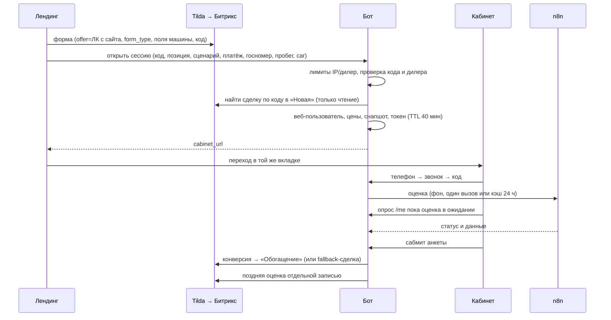
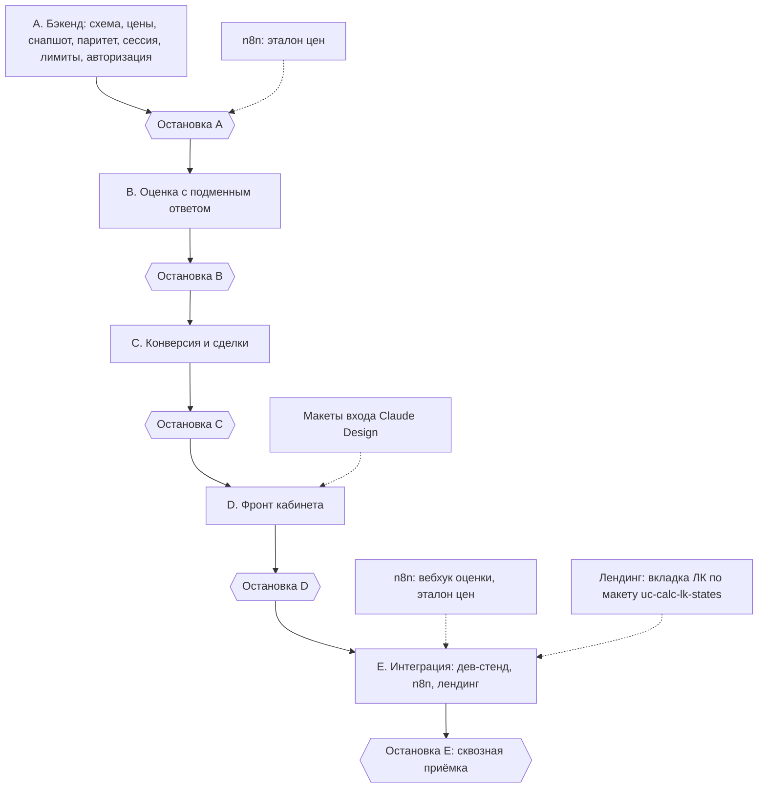

# feat: вход в личный кабинет с сайта без Александра

## Summary

Бот получает публичный эндпоинт «открыть сессию»: по коду формы Tilda он запоминает сделку, создаёт веб-пользователя, сам считает цены и снапшот по каталогу NocoDB и выдаёт токен кабинета v3. Кабинет в веб-сессии авторизует только звонком, после входа один раз оценивает трейд-ин через вебхук n8n и показывает кадры 8a–8h макета v4. Конверсия пишет всё в сделку Tilda, а если её нет — в свою сделку в воронке 9 «Обогащение»; склейки для веб-сессий нет. Работа идёт пятью блоками с остановкой и ручной проверкой на дев-стенде после каждого; лендинг и n8n — отдельными разделами для агентов CE landing и CE n8n. Ничего не деплоится.

---

## Problem Frame

Кабинет сейчас открывается только по ссылке Александра: токен, снапшот, оценка и конверсия рассчитаны на диалог и `n8n_cache` (see origin: docs/brainstorms/2026-09-29-cabinet-web-entry-requirements.md, «Problem Frame»). Диагностика ветки нашла, что в веб-потоке станут штатными дефекты: комбо без скидки за трейд-ин, несуществующая колонка минимального взноса, два взноса в комбо без оценки, фронт не видит обновления снапшота, F5 на экране звонка сбрасывает ввод телефона.

---

## Requirements

План реализует все требования origin-документа R1–R62. Трассировка по блокам:

| Блок | Требования origin |
|---|---|
| A. Бэкенд без лендинга и n8n | R11–R22, R23–R25, R42–R45, R48, R49, R53, R55, R62 (приём полей) |
| B. Оценка (бэкенд) | R26–R28, R56, R58 (причина), R59 (клиент), R39–R41 (контракт) |
| C. Конверсия и Битрикс | R32–R38, R54, R57, R58, R60, R61 |
| D. Фронт кабинета | R22, R23, R24, R28–R31, R50, R55, R57 (показ) |
| E. Интеграция и дев-стенд | R16, R46, R47, R1–R10, R51, R52 (лендинг), R39–R41 (n8n) |

Дополнительные требования плана (из анализа потоков, решения владельца 2026-09-30):

- R63. Веб-токен до привязки номера живёт 40 минут; по истечении кабинет показывает 8f.
- R64. Повторное «открыть сессию» с тем же кодом и тем же nonce возвращает тот же адрес без нового пользователя и без расхода лимита IP — и до, и после привязки номера. Повтор с тем же кодом, но другим nonce, адрес не отдаёт; такие попытки считаются в отдельном лимите по IP.
- R65. Состояние оценки и 24-часовой кэш «госномер + дилер» хранятся в БД; оценка в ожидании, пережившая рестарт или таймаут, переходит в 8e без нового вызова вебхука. Кэшируются только ответы Auto.ru; сбои на нашей стороне (неверный секрет, неимпортированный вебхук, сеть) не кэшируются.
- R66. Для веб-сессий нет фонового добора сделки Tilda, охоты за дублем и склейки: конверсия ищет сделку по коду в «Новая», а при её отсутствии создаёт свою — это финальное состояние (решение владельца 2026-09-30).
- R67. Поздняя оценка пишется в сделку отдельной однократной записью: UF оценки, данные авто, строка R58 при неуспехе и пометка «расчёт в анкете — без зачёта», если анкета ушла раньше оценки.
- R69. Кнопка «вернуться на сайт» на 8f ведёт на страницу лендинга, с которой открыта сессия (проверенную по whitelist `Website_URL`), запасной вариант — корень `Website_URL` дилера.
- R70. При веб-авторизации дилер получает алерт «телефон подтверждён», как для клиентов Александра: имя «Клиент», номер сделки — только если сделка уже известна, источник — «личный кабинет с сайта».
- R71. Записи об открытиях сессий старше 48 ч удаляются; госномер и данные авто в кэше оценок обезличиваются через 30 дней.
- R68. На дев-стенде подменный ответ вебхука по тестовому госномеру позволяет проверить кадры 8b–8e без n8n; подмена работает только при `BOT_ENV=dev` и `ENVIRONMENT` ≠ `production`, проверка — в коде при каждом вызове.

---

## Key Technical Decisions

- **Эндпоинт «открыть сессию» живёт под префиксом `/cabinet/api/`.** Существующий `cors_middleware` уже отдаёт preflight и echo-whitelist по `Website_URL` для этого префикса (`main.py:3421-3499`, `cabinet_service.py:1530-1566`) — R49 выполняется без нового CORS-кода.
- **Признак веб-входа — колонка `entry_source` у `cabinet_tokens`.** Лимиты, канал и TTL проверяются по токену (`cabinet_service.py:1136-1226`), поэтому признак рядом с ними; `users.channel="web"` не отличает веб-вход от чата на сайте.
- **Новые колонки и таблицы — через `init_db` и `SCHEMA_COLUMN_UPGRADES`.** Alembic в репозитории нет; время — `TIMESTAMP WITH TIME ZONE` и aware-значения (`database.py:307-341`, урок `docs/solutions/database-issues/naive-datetime-vs-timezone-aware-columns.md`).
- **Цены считает один модуль бота, для обоих входов.** `credit_price` и `combo_price` по R17 от «Price old» за вычетом скидок из строки каталога, найденной по паре (Model id, Complectation id); «Price new» в расчётах не участвует. Снапшот получает обе цены, `/me` отдаёт обе, `calc_model.js` берёт цену по режиму. Цена Александра тоже переходит на расчёт бота (R19).
- **Снапшот веб-сессии собирается из каталога, а не из `n8n_cache`.** Переиспользуются `_find_catalog_row`, `_load_dealer_table`, `_normalize_rates`, `_match_program`; общая запись снапшота выносится в хелпер. Результат оценки вливается в снапшот, не трогая `item_id` и `price`, чтобы не ломать сверку `_verify_calc_check` при сабмите.
- **Токен выпускает тот же `issue_cabinet_token` с тем же `CABINET_HMAC_KEY`.** Отдельного механизма выдачи нет (урок `docs/solutions/integration-issues/token-idempotency-verified-by-table-rows.md`); веб-токен без сделки получает `deal_id=NULL`; сделку в сессию дописывает конверсия (найденная по коду или созданная ботом).
- **Путь страницы кабинета — из env бота.** `_cabinet_base_url` перестаёт хардкодить `/cabinet`; дев-бот получает `/cabinet_dev`, прод — `/cabinet` по умолчанию (R16).
- **Лимит по IP берёт адрес только от доверенного прокси.** Разбор `X-Forwarded-For` включается переменной со списком доверенных адресов прокси; без неё используется `request.remote`. Проверка поведения за прокси dockhost — до включения лимита на бою.
- **Повторный звонок в веб-сессии: 2 звонка за 10 минут, второй не раньше 5 минут 15 секунд.** Запас 15 с покрывает сетевую задержку до ProstoSMS, чтобы второй звонок не попал в окно подмены на SMS. Лимит считается и по номеру, и по токену, поэтому «Изменить номер» не обходит 8g. Действителен только последний код (`code_superseded`). Серверное время следующего звонка отдаётся фронту, чтобы F5 не сбрасывал таймер. **Заменено 2026-10-11** (план `docs/plans/2026-10-11-001-feat-web-entry-recall-45s-plan.md`): повтор через 45 с, повтор внутри 5 минут провайдер шлёт SMS — принято; после второго звонка — время следующего звонка вместо ссылки.
- **Оценка — отдельная таблица `cabinet_valuations`.** Ключ кэша — дилер + нормализованный госномер; запись создаётся в статусе «ожидание» до вызова вебхука, по завершении вызова результат раздаётся всем ожидающим токенам с тем же дилером и госномером — слияние в снапшот и запись в сделку однократно по каждому токену. Пробег в ключ не входит; предзаполнение 8c/8e берёт пробег текущей сессии. Критерий «один вызов за 24 ч» относится только к ответам Auto.ru; наши сбои не кэшируются.
- **Вызов вебхука — фоновой задачей после `verify_code`, одна попытка, таймаут 60 с (исполнение n8n длилось до 40 с).** Заголовок `X-Cabinet-Eval-Secret`; URL и секрет — env `N8N_CABINET_EVAL_URL_TEST` / `N8N_CABINET_EVAL_SECRET_TEST` на деве (`BOT_ENV=dev`) и `…_PROD` на бою (`BOT_ENV=prod`). Точка запуска — `_post_verify_hook` (`cabinet_service.py:2751`); HTTP-клиент передаётся через `cabinet_service.setup(...)`, чтобы тесты подменяли его в фикстуре `deps`.
- **Фон держится в существующем `otp_worker` новыми обязанностями `_duty`.** Перевод просроченной оценки в 8e, повтор неуспешной передачи веб-сессии и очистка данных (R71); добора сделки и охоты для веб-сессий нет. Задачи в памяти для веб-потока не используются.
- **Фронт узнаёт об оценке опросом `/me`.** В ответ `/me` добавляется явный блок `valuation {status, reason}`; опрос раз в 3–5 с только пока статус «ожидание» и после сабмита до терминального статуса, с потолком ~2 минуты и немедленным запросом на `visibilitychange`. После потолка или трёх неудачных запросов подряд кабинет показывает 8e только на клиенте, сабмит доступен.
- **Конверсия веб-сессии идёт существующим путём `final_sync_wrapper` с веб-ветками.** Ветки отключают прощание, стенограмму и архив, меняют текст алерта, создают fallback-сделку в воронке 9 («Новая», сразу переводом в «Обогащение», R34) с полями о машине, «Тип лида 1» и полями блока `form`; заголовок «Сделка #ID» ставится обновлением после создания. Fallback-сделка создаётся через `_cabinet_bitrix_request` (без постановки в `pending_sync`): пустой ответ `crm.deal.add` — неуспех передачи, `active_deal_id` не пишется, передача повторяется следующим тиком воркера; «Сделка #None» невозможна (урок `docs/solutions/logic-errors/injected-callable-hidden-side-effect.md`).
- **Сделки веб-сессий не склеиваются.** Сделка бота в воронке 9 после перевода в «Обогащение» — финальное состояние; поздняя сделка Tilda без телефона остаётся в «Новая» и уходит в архив через 12 ч. Охота `background_deal_hunt` запускается только из чатовой передачи (`main.py:3265, 3341`), кабинетная конверсия её не запускает — правка не нужна; для клиентов Александра охота и склейка не меняются.
- **Поля о машине для сделки бота — из строки каталога по паре.** Модель, модификация, комплектация, цены и SKU берутся из строки каталога; поле «Вход в ЛК» — из колонки «Link» каталога, а при её отсутствии — из `form.LINK`, только относительный путь или https-адрес на домене `Website_URL` этого дилера, иначе поле не пишется.
- **Один точечный запрос строки каталога по паре.** Новый загрузчик ищет строку фильтром NocoDB по (Model id, Complectation id), передаётся через `cabinet_service.setup(...)` и используется снапшотом веб-сессии, ценой Александра и скриптом паритета; сетевой сбой или HTTP ≠ 200 — исключение, которое эндпоинт переводит в `cabinet_unavailable`, а `unknown_position` — только при успешном ответе без строки.
- **Nonce лендинга защищает повтор.** Лендинг создаёт случайный nonce (не меньше 128 бит) на каждую отправку формы; бот хранит его хеш рядом с кодом и отдаёт прежний адрес только при совпадении.
- **Правило имени и контакта общее для всех путей.** `update_contact` не пишет «Клиент» поверх непустого имени и не перезаписывает контакт с другим подтверждённым телефоном — в привязке, охоте и конверсии, для обоих входов.
- **Подмена ответа вебхука закрыта по умолчанию.** Работает только при положительном `BOT_ENV=dev` и `ENVIRONMENT` ≠ `production`, по образцу `_dev_otp_log_enabled` (`sms_gateway.py:302-306`); при флаге в любом другом окружении — игнор и техалерт на старте.
- **Паритет цен — скрипт сверки с эталонной выгрузкой n8n.** Скрипт бота считает цены по каталогу и сравнивает с JSON, который отдаёт агент CE n8n из живых нод Car Search и Combo Calculator; расхождение — ненулевой код выхода. По `combo_price` паритет ждёт правки ноды Combo Calculator (она считает от «Price new»).

---

## High-Level Technical Design

### Поток веб-входа

### Жизненный цикл оценки

```mermaid
stateDiagram-v2
  [*] --> none: кредит
  [*] --> pending: трейд-ин/комбо после verify (нет кэша)
  [*] --> cached: есть результат за 24 ч
  cached --> success
  cached --> found_no_price
  cached --> not_found
  cached --> failed
  pending --> success: SUCCESS + цена (8b; без found_info — 8b с полями 8c)
  pending --> found_no_price: SUCCESS без цены (8d)
  pending --> not_found: NOT_FOUND / INVALID_DATA (8c)
  pending --> failed: IN_PROGRESS / NO_REGION / 400 / 502 / 401-403 / таймаут / сбой / рестарт (8e)
```

Сбои на нашей стороне ведут в `failed` для текущей сессии, но в кэш на 24 ч не записываются (R65).

### Порядок блоков

---

## Implementation Units

### Блок A. Бэкенд без лендинга и n8n

### U1. Схема данных веб-входа

**Goal:** добавить хранение признака веб-входа, данных сессии с лендинга, лимитов открытий и оценок.

**Requirements:** R11, R42, R43, R56, R62, R63, R64, R65, R69, R71

**Dependencies:** —

**Files:**
- Modify: `database.py`
- Test: `tests/test_cabinet_models.py`, `tests/test_init_db_postgres.py`

**Approach:**
- `cabinet_tokens.entry_source` (строка, по умолчанию «chat»).
- `cabinet_profile`: код формы, хеш nonce, адрес страницы лендинга для 8f, сценарий лендинга, госномер, пробег, запасное значение «Link» из `form.LINK`, блок `form` (`web_form`) — всё, что нужно для повтора, fallback-сделки и оценки.
- Новая таблица открытий веб-сессий (IP, дилер, время) для лимитов R42–R43.
- Новая таблица `cabinet_valuations`: дилер, нормализованный госномер, статус, причина, `found_info`, вилка цены, `request_id`, время начала и окончания, признак «наш сбой» (не кэшировать), ссылка на токен.
- Частичный уникальный индекс «одна оценка в ожидании на дилер + госномер».
- Все новые колонки — в `SCHEMA_COLUMN_UPGRADES`, индексы — в `SCHEMA_PARTIAL_UNIQUE_INDEXES`.

**Patterns to follow:** `calc_frozen_at` в `SCHEMA_COLUMN_UPGRADES` (`database.py:340`); `uq_cabinet_otp_inflight_token` (`database.py:353`).

**Test scenarios:**
- Happy path: `init_db` на пустой SQLite создаёт новые таблицы и колонки; самопроверка `_schema_missing` проходит.
- Edge case: `init_db` на базе без новых колонок (копия дев-схемы) добавляет их без потери строк.
- Edge case: вторая оценка «в ожидании» с тем же дилером и госномером нарушает уникальный индекс; завершённая — нет.
- Integration: тот же набор на PostgreSQL при заданном `TEST_DATABASE_URL`.

**Verification:** дев-база стартует без ручных ALTER; существующие тесты моделей зелёные.

---

### U2. Модуль цен и минимальный взнос

**Goal:** бот сам считает `credit_price` и `combo_price` по строке каталога и читает правильную колонку минимального взноса.

**Requirements:** R17, R20, R21

**Dependencies:** —

**Files:**
- Modify: `cabinet_service.py` (новый модуль цен внутри или отдельным файлом рядом)
- Modify: `widget-custom/cabinet-app/calc_model.js`
- Test: `tests/test_web_entry_pricing.py`, `tests/test_cabinet_calc_data.py`, `tests/js/calc_model.test.mjs`

**Approach:**
- `credit_price = round10k(Price old) − round10k(Cash in hook) − round10k(Credit bonus)`; `combo_price = credit_price − round10k(Trade-in bonus)`; округление «половина вверх», как `Math.round`; «Price new» в расчётах не участвует.
- Пустые или нечисловые бонусы — 0; нечисловая базовая цена — позиция недоступна для расчёта (ошибка сессии `cabinet_unavailable`).
- `CALC_PROGRAM_FIELDS` и `_match_program` читают `Min_Down_Payment` (проценты); нет колонки, пустое значение или нет таблицы программ — 20 % и техалерт (не чаще раза в сутки на дилера). Для общего с n8n движка `calc_engine.browser.js` снапшот дублирует значение в прежний ключ, чтобы движок не менялся.

**Patterns to follow:** `_calc_num` (`cabinet_service.py`); `formula-parity-without-scope-parity.md` — идентичность позиции только по паре.

**Test scenarios:**
- Happy path: строка каталога с «Price old» 2 149 000, «Cash in hook» 100 000, «Credit bonus» 50 000 даёт ожидаемый `credit_price`.
- Happy path: `combo_price` = `credit_price` минус округлённый «Trade-in bonus»; «Price new» на результат не влияет.
- Edge case: значения ровно на половине десятка тысяч округляются вверх; строки с пробелами («2 149 000») разбираются.
- Edge case: отсутствующий бонус считается нулём; отрицательный результат — позиция недоступна.
- Edge case: программа с `Min_Down_Payment` задаёт минимальный взнос; колонки нет, значение пустое или таблицы нет — 20 % и один техалерт.
- JS: `calc_model` в режиме комбо считает от `combo_price`, в кредите — от `credit_price`.

**Verification:** тесты цен и калькулятора зелёные, golden-кейсы движка не менялись.

---

### U3. Снапшот из каталога для обоих входов

**Goal:** снапшот веб-сессии собирается ботом из каталога; снапшот Александра берёт цены из того же модуля.

**Requirements:** R18, R19, R20, R22

**Dependencies:** U1, U2

**Files:**
- Modify: `cabinet_service.py` (`_freeze_calc_snapshot`, `refresh_calc_snapshot`, `prepare_cabinet_context`, `CALC_PAYLOAD_KEYS`, `get_me`, `setup`)
- Modify: `main.py` (точечный загрузчик строки каталога, проводка в `setup_cabinet_service`)
- Test: `tests/test_cabinet_calc_data.py`, `tests/test_web_entry_snapshot.py`

**Approach:**
- Новый загрузчик строки каталога по паре (фильтр NocoDB), проводится через `cabinet_service.setup(...)` из `main.py`; сбой сети или HTTP ≠ 200 — исключение.
- Новый путь заморозки из строки каталога по паре: позиция, обе цены, ставки, программа, желаемый платёж; схема снапшота повышается до версии 3 с полем `combo_price`.
- Путь Александра: позиция по-прежнему из `n8n_cache`, цены — из модуля U2 по строке, найденной точечным запросом той же пары; если строки нет — прежний `credit_price` и техалерт, однократно по пользователю и позиции.
- Слияние оценки в снапшот обновляет только `found_info` и `ti_valuation`.
- `/me` отдаёт `combo_price`, блок `valuation` и признак веб-входа.
- Перезаморозка по ходу чата не затирает снапшот веб-токена.

**Patterns to follow:** запись снапшота `cabinet_service.py:3252-3266`; сбой NocoDB не затирает существующий снапшот.

**Test scenarios:**
- Happy path: веб-заморозка по паре (Model id, Complectation id) даёт снапшот с обеими ценами, ставками и программой.
- Edge case: коллизия Complectation id между моделями — берётся строка своей модели (Covers формула-паритет урока).
- Edge case: NocoDB недоступна или отвечает не 200 — снапшот не создаётся, сессия отвечает `cabinet_unavailable`; успешный ответ без строки — `unknown_position`.
- Edge case: позиция за пределами первых 100 строк каталога находится точечным запросом.
- Integration: снапшот Александра после обновления `json_cache` содержит `combo_price` из модуля U2.
- Integration: слияние оценки не меняет `item_id` и `price`; сабмит с блоком `calc` после слияния не получает 409.

**Verification:** `/me` на дев-стенде отдаёт обе цены и блок оценки.

---

### U4. Скрипт паритета цен

**Goal:** повторяемая сверка цен бота с эталоном n8n.

**Requirements:** R48

**Dependencies:** U2; эталонная выгрузка от CE n8n (N2)

**Files:**
- Create: `scripts/check_price_parity.py`
- Test: `tests/test_price_parity_script.py`

**Approach:**
- Вход: код дилера и файл эталона n8n (позиция → `credit_price`, `combo_price`); строки каталога читаются тем же точечным загрузчиком по паре, что в U3.
- Выход: таблица расхождений и ненулевой код при любом расхождении или позиции без эталона.
- Скрипт только читает; гард от боевой БД не нужен, запись отсутствует.

**Patterns to follow:** `scripts/issue_cabinet_link.py` (загрузка `.env`, гарды, печать итога).

**Test scenarios:**
- Happy path: совпадающие эталон и каталог — код 0.
- Error path: расхождение на 10 000 ₽ по одной позиции — код ≠ 0, позиция в отчёте.
- Edge case: позиция каталога без эталона — отчёт и код ≠ 0.

**Verification:** прогон по тестовому дилеру даёт ноль расхождений (при наличии эталона N2).

---

### U5. Эндпоинт «открыть сессию»

**Goal:** публичный POST под `/cabinet/api/`, который открывает веб-сессию и возвращает полный адрес кабинета.

**Requirements:** R11–R16, R42–R44, R49, R53, R62, R63, R64, R69, R71

**Dependencies:** U1, U3

**Files:**
- Modify: `cabinet_api.py`, `cabinet_service.py`, `payload_v2.py` (строгий режим проверки номера)
- Test: `tests/test_web_entry_open.py`

**Approach:**
- Разбор и проверка полей контракта; госномер — строгий канон R14 на базе `normalize_plate_input` без fail-open; пробег — целое 0…1 000 000.
- `dealer_code` равен префиксу кода (R53); позиция ищется точечным запросом по паре; сбой NocoDB — `cabinet_unavailable`.
- Лимиты: 5 открытий в час с IP (IP от доверенного прокси), 100 в сутки на дилера из env (0 — выключатель веб-входа для всех дилеров, включая повторы), отдельный лимит по IP на повторы с неверным nonce; техалерт не чаще раза в сутки на лимит и дилера.
- Повтор: тот же код и тот же nonce — тот же адрес, до и после привязки номера, без нового пользователя и без расхода лимита; тот же код с другим nonce — `invalid_input`.
- Сделка ищется по коду в «Новая» только чтением; запоминается, если дилер сделки совпадает; стадия и контакт не меняются.
- Веб-пользователь: имя «Клиент», канал `web`, собственный `platform_user_id` с префиксом веб-входа.
- Адрес страницы лендинга для 8f берётся из Origin/Referer и сохраняется, только если проходит whitelist `Website_URL`; иначе — корень `Website_URL`.
- «Link» из `form.LINK` сохраняется только как запасной и только если это относительный путь или https-адрес на домене `Website_URL` дилера. Блока `car` в контракте нет.
- Блок `form` (R62): проверяются только типы и размер — объект «строка → строка», не больше 80 ключей, ключ до 64 символов, значение до 2 000, весь блок до 16 КБ; иначе `invalid_input` с полем `form`. Блок сохраняется в профиле сессии как есть (новая колонка `CabinetProfile.web_form`, JSON-текст) и обезличивается вместе с остальными данными веб-входа (`web_entry_cleanup`). Повтор с тем же кодом и nonce блок не перезаписывает.
- Токен — `issue_cabinet_token`, `entry_source=web`, TTL до привязки 40 минут; адрес — хост `Website_URL` дилера + путь из env.

**Execution note:** начать с падающего HTTP-теста контракта через `TestClient` с боевыми middleware.

**Patterns to follow:** `handle_request_code` (`cabinet_api.py:74`); HTTP-тесты `tests/test_cabinet_auth.py:64-82`.

**Test scenarios:**
- Happy path: валидный кредит — 200, `cabinet_url` с путём из env и `#t=`; в БД один веб-пользователь, один токен `web`.
- Happy path: сделка Tilda найдена — `deal_id` запомнен, вызовов `crm.deal.update` и `crm.contact.update` нет (Covers AE12).
- Edge case: повтор с тем же кодом и nonce — тот же адрес, счётчик IP не вырос; то же после привязки номера.
- Error path: тот же код с другим nonce — `invalid_input`, адрес не отдан, счётчик повторов по IP вырос; превышение — `rate_limited`.
- Edge case: сделка найдена, но дилер другой — сессия без сделки.
- Error path: `a123bc77` проходит как `А123ВС77`; `А123ВС00`, `АБ123В77` — `invalid_plate` (Covers AE3).
- Error path: `dealer_code` не совпадает с префиксом кода — `invalid_input`.
- Error path: пара позиции не найдена при успешном ответе NocoDB — `unknown_position`; NocoDB недоступна — `cabinet_unavailable`; дилер без https-сайта — `cabinet_unavailable`.
- Error path: пробег 1 000 001 или отрицательный — `invalid_input` с полем `mileage`; 1 000 000 и 0 — приняты.
- Error path: шестое открытие за час с одного IP — `rate_limited` с `limit_source=ip`, техалерт один раз (Covers AE10).
- Edge case: `X-Forwarded-For` учитывается только от доверенного прокси.
- Edge case: «Link» `https://evil.example/x` не сохраняется; `/price?...` и https-адрес на домене дилера — сохраняются.
- Edge case: Referer чужого домена — адрес возврата равен корню `Website_URL`.
- Happy path: блок `form` с полями формы, UTM и cookies сохраняется в профиле без изменений.
- Error path: `form` не объект, значение не строка (число, объект, `null`), 81 ключ, значение длиннее 2 000 символов, блок больше 16 КБ — `invalid_input` с полем `form`, сессия не открыта.
- Edge case: повтор с тем же кодом и nonce и другим блоком `form` — сохранённый блок не меняется.
- Integration: обезличивание веб-данных стирает `web_form`.
- Integration: OPTIONS с Origin дилера — echo и `Vary: Origin`; чужой Origin — без CORS-заголовков.
- Edge case: веб-токен без привязки старше 40 минут — `auth/init` отвечает `link_expired`.

**Verification:** `curl`-вызов на дев-стенде возвращает адрес, по которому кабинет открывается.

---

### U6. Авторизация веб-сессии

**Goal:** только звонок, повторный звонок через 5 минут 15 секунд, смена номера без обхода лимитов, восстановление экрана звонка после F5 для всех, алерт дилеру о подтверждении для веб-входа.

**Requirements:** R23, R24, R25, R45, R55, R70

**Dependencies:** U1

**Files:**
- Modify: `cabinet_service.py` (`request_code`, `_enforce_send_limits`, `auth_init`, `send_status`, `_post_verify_hook`, `PHONE_CONFIRMED_ALERT_TEMPLATE`)
- Test: `tests/test_cabinet_auth.py`, `tests/test_web_entry_auth.py`

**Approach:**
- Для веб-токена канал SMS отклоняется до проверки лимитов.
- Голосовое окно для веб-токена: не больше 2 звонков за 10 минут и по номеру, и по токену; второй не раньше 5 минут 15 секунд после первого; для остальных токенов — прежнее окно.
- Смена номера до привязки разрешена; счётчик по токену не сбрасывается.
- `auth_init` возвращает живую отправку: маску номера, время следующего звонка, остаток звонков, признак веб-входа и адрес возврата на сайт.
- Алерт «телефон подтверждён» формируется в `_post_verify_hook` по шаблону `PHONE_CONFIRMED_ALERT_TEMPLATE` (`cabinet_service.py:2697`). Для веб-входа — отдельный вариант текста: имя «Клиент», номер сделки только если сделка известна (иначе фраза без сделки), источник «личный кабинет с сайта»; однократность — прежним событием `phone_confirmed_alert`.
- R25 не блокирует: повтор через 5:15 вне окна подмены; сокращение интервала — опционально, после подтверждения поддержки ProstoSMS.

**Patterns to follow:** существующие проверки окна `cabinet_service.py:1159-1172`; тесты границ `test_voice_window_*`; алерты `test_u9_dealer_alerts.py`.

**Test scenarios:**
- Error path: веб-токен запрашивает SMS — отказ, отправки нет; токен Александра — SMS как сейчас (Covers AE5).
- Edge case: второй звонок через 5:14 — 429 с честным `retry_after`; через 5:15 — принят (Covers AE15).
- Edge case: третий звонок в 10-минутном окне — 429; через 10 минут — принят.
- Edge case: после двух звонков клиент меняет номер — третий звонок на новый номер тоже 429 (лимит по токену).
- Happy path: `auth_init` после запроса звонка возвращает маску, время следующего звонка и остаток (Covers AE4).
- Edge case: код первого звонка после второго звонка — `code_superseded`.
- Happy path: веб-авторизация со сделкой Tilda — алерт «✅ Личный кабинет: Клиент, сделка 52673 — телефон подтверждён: … Источник: личный кабинет с сайта.».
- Happy path: веб-авторизация без известной сделки — алерт без номера сделки и без «—», источник «личный кабинет с сайта».
- Регресс: алерт клиента Александра не меняется; повторная авторизация не шлёт второй алерт.
- Integration: варианты границ на `aware_db`.

**Verification:** на дев-стенде с `CABINET_OTP_DEV_LOG=1` лимиты, окна и алерты ведут себя по сценариям.

---

### Остановка A — чек-лист на дев-стенде

- [ ] `init_db` на копии дев-БД прошёл, самопроверка схемы зелёная.
- [ ] `scripts/check_price_parity.py` по тестовому дилеру даёт ноль расхождений (если эталон N2 ещё не готов — отметить как ожидание).
- [ ] Вызов «открыть сессию» `curl`-ом с Origin тестового сайта возвращает адрес `/cabinet_dev#t=…`; повтор с тем же кодом — тот же адрес.
- [ ] Шестой вызов за час — `rate_limited`, техалерт один.
- [ ] Сделка Tilda с тем же кодом осталась в «Новая», контакт не изменён.
- [ ] `/me` после авторизации отдаёт `credit_price`, `combo_price`, блок `valuation`.
- [ ] SMS для веб-токена отклонён; второй звонок раньше 5:15 отклонён; смена номера не даёт третьего звонка; `auth_init` возвращает живую отправку.
- [ ] Алерт дилеру при веб-авторизации: со сделкой Tilda — с номером сделки; без сделки — без номера; источник «личный кабинет с сайта».
- [ ] Повтор «открыть сессию» с чужим nonce адрес не отдаёт.
- [ ] Все тесты зелёные на SQLite и на PostgreSQL.

---

### Блок B. Оценка трейд-ина (бэкенд)

### U7. Вызов вебхука оценки и кэш

**Goal:** одна оценка после авторизации, кэш 24 ч, устойчивость к рестарту, подменный ответ на деве.

**Requirements:** R26, R27, R28, R40, R56, R59, R65, R68, R71

**Dependencies:** U1, U3, U6

**Files:**
- Modify: `cabinet_service.py` (`_post_verify_hook`, `otp_worker_tick`, `setup`, `get_me`)
- Create: `valuation_client.py`
- Modify: `main.py` (проводка клиента в `setup_cabinet_service`, стартовая проверка флага)
- Test: `tests/test_web_entry_valuation.py`, `tests/conftest.py` (фейк клиента оценки)

**Approach:**
- После успешного `verify_code` для трейд-ина и комбо: поиск в кэше по дилеру и госномеру за 24 ч; есть — результат сразу; иначе запись «ожидание» и фоновый вызов.
- Клиент: POST на URL вебхука из env, заголовок `X-Cabinet-Eval-Secret` с секретом из env, таймаут 60 с, одна попытка. 401/403, 400 `BAD_REQUEST`, 502 `ERROR`, другие 5xx, таймаут и сеть — `failed` без записи в кэш.
- Разбор ответа в статусы 8b / 8c / 8d / 8e по таблице контракта; сбои на нашей стороне (401, 404, сеть) — `failed` без записи в кэш.
- Обязанность воркера: «ожидание» старше порога → `failed` с причиной «таймаут».
- Результат пишется в таблицу и раздаётся всем ожидающим токенам с тем же дилером и госномером: слияние в снапшот каждого токена независимо от его статуса.
- Обязанность воркера (R71): удаление записей об открытиях старше 48 ч и обезличивание госномера и данных авто в `cabinet_valuations` старше 30 дней.
- Подменный ответ: env-флаг задаёт статус по тестовому госномеру; включается только при `BOT_ENV=dev` и `ENVIRONMENT` ≠ `production`, проверка при каждом вызове; иначе игнор и техалерт на старте.

**Patterns to follow:** `shadow_resolver.py` (короткий таймаут, fire-and-forget); `_dev_otp_log_enabled` (`sms_gateway.py:302-306`); обязанности `_duty` в `otp_worker_tick`.

**Test scenarios:**
- Happy path: `SUCCESS` с ценой — статус `success`, снапшот с `found_info` и `ti_valuation` (Covers AE7 на бэкенде).
- Happy path: `SUCCESS` без `found_info` с ценой — `success`, `ti_valuation` в снапшоте, `found_info` null (частый штатный случай).
- Error path: HTTP 400 `BAD_REQUEST`, 502 `ERROR`, 401 и 403 — `failed` с причиной, в кэш не идут.
- Happy path: `SUCCESS` с `found_info` без цены — `found_no_price`.
- Edge case: `NOT_FOUND`, `INVALID_DATA` — `not_found`; `IN_PROGRESS`, `NO_REGION` — `failed`, повторного вызова нет (Covers AE6 на бэкенде).
- Edge case: тот же госномер у того же дилера через 2 ч — вебхук не вызывается (Covers AE14); через 25 ч — вызывается.
- Edge case: две сессии с одним ключом одновременно — один вызов; у обеих снапшот обновлён, статус терминальный.
- Happy path: воркер удаляет открытие старше 48 ч и обезличивает оценку старше 30 дней; более свежие записи не трогаются.
- Error path: 401 или сеть — `failed` в сессии, кэш пуст, следующая сессия вызывает вебхук.
- Error path: запись «ожидание» старше порога после «рестарта» — воркер переводит в `failed`.
- Edge case: подменный флаг при `BOT_ENV=prod` или `ENVIRONMENT=production` — игнорируется, реальный клиент, техалерт.
- Integration: оценка не запускается для кредита и до авторизации.

**Verification:** на дев-стенде с подменным флагом тестовые госномера дают все статусы в `/me`.

---

### Остановка B — чек-лист на дев-стенде

- [ ] Подменный флаг включён на деве; с `ENVIRONMENT=production` в тестовом запуске он игнорируется и приходит техалерт.
- [ ] Для каждого тестового госномера после авторизации `/me` проходит «ожидание» → нужный статус.
- [ ] Повторный вход с тем же госномером в течение 24 ч не делает второго вызова (по логу клиента).
- [ ] Остановка бота во время «ожидания» и старт — статус `failed`, вызовов больше нет.
- [ ] Все тесты зелёные.

---

### Блок C. Конверсия и сделки

### U10. Конверсия веб-сессии и fallback-сделка

**Goal:** веб-конверсия без диалоговых действий и без охоты; fallback-сделка в воронке 9 «Обогащение» с полями о машине из каталога.

**Requirements:** R32–R38, R54, R60, R61, R66

**Dependencies:** U3, U5

**Files:**
- Modify: `main.py` (`final_sync_wrapper`, `create_deal_with_contact`, `update_contact`, `close_cabinet_session`, `send_alert_to_max_group`, `_cabinet_run_conversion`)
- Create: `cabinet_web_deal_map.json` (таблица соответствий интеграции Tilda)
- Modify: `cabinet_service.py` (`build_conversion_snapshot`, `_complete_handoff`, `otp_worker_tick`)
- Test: `tests/test_web_entry_conversion.py`, `tests/test_cabinet_handoff.py`, `tests/test_cabinet_session_close.py`

**Approach:**
- Снимок конверсии веб-сессии несёт признак веб-входа, дилера сессии и ключи, которые читает `final_sync_wrapper` (`start_code` = код, `model`, `payment`, `plate`), и строку каталога позиции.
- Выбор сделки: запомненная при открытии → поиск по коду в «Новая» (`main.py:681-685`) → fallback-сделка.
- Найденная сделка: стадия «Обогащение» по существующей логике; «Тип лида 1» не трогается.
- Fallback-сделка создаётся через `_cabinet_bitrix_request`: воронка 9, стадия «Новая» (`C9:NEW`), затем бот сразу переводит её в «Обогащение» отдельным `crm.deal.update` (R34 — роботы обеих стадий, как у сделки Tilda); «Тип лида 1» = «ЛК с сайта», «Тип обращения» конверсии, поля о машине по таблице ниже; заголовок «Сделка #ID» обновлением после создания.
- Поля из блока `form` (R61): бот раскладывает сохранённый блок по таблице соответствий интеграции Tilda из одного конфиг-файла `cabinet_web_deal_map.json` («переменная Tilda → код поля Битрикса», в том числе стандартные `UTM_*`; см. origin, Dependencies, «Поля сделки Tilda»). Порядок: сначала блок, затем поверх — значения бота (поля о машине из каталога, код, «Тип лида 1», «Тип обращения», платёж, срок, первый взнос, стоимость авто, госномер и пробег — из кабинета) и «ip пользователя» — IP клиента от доверенного прокси. Ключи блока вне таблицы не пишутся. Если сделка Tilda найдена, блок не используется. Cookies: в строковые поля — значение с «;» на конце, «CT_sessionId_num» — целое без «;». «SB Трейдин Оценка autoru» не пишется.
- Пустой ответ `crm.deal.add` — неуспех передачи: `active_deal_id` не пишется, заголовок не обновляется, `_complete_handoff` не отмечает передачу, воркер повторяет её следующим тиком.
- Кабинетная конверсия охоту не запускает (точки запуска только в чатовой передаче `main.py:3265, 3341`); сделка Tilda, появившаяся после fallback-сделки, не трогается.
- Алерт о передаче уходит в группу дилера сессии без «свяжитесь в MAX».
- Закрытие сессии для веб-входа не шлёт прощание, не пишет «Итоги AI-диалога» и не архивирует стенограмму.
- `update_contact`: «Клиент» не затирает непустое имя; контакт с другим подтверждённым телефоном не перезаписывается — для всех путей.
- Авторизация без сабмита и таймаута ничего не пишет в сделку (кроме алерта дилеру, R70).

Источники полей о машине для fallback-сделки:

| Поле сделки | Код UF | Источник |
|---|---|---|
| Модель | `UF_CRM_65B0A4605FA7C` | каталог «Model» |
| Модификация | `UF_CRM_65B0A4606E9CA` | каталог «Model Modification» |
| Комплектация 1 | `UF_CRM_65B0A46077BCD` | каталог «Complectation» |
| Цена_прайс; Цена_прайс_ | `UF_CRM_67E4E4691A18E`; `UF_CRM_1745996090` | каталог «Price old» |
| Цена_скидка | `UF_CRM_67E4E4692881A` | каталог «Price new» |
| Вход в ЛК | `UF_CRM_1708662321` | каталог «Link»; если пусто — проверенное `form.LINK` (U5), иначе не пишется |
| Код комплектации (не подтверждено) | `UF_CRM_66068DB231026` | каталог «ID» / «SKU» / «VIN» |
| Чат ID (стр); Чат ID (url) | `UF_CRM_1731438093`; `UF_CRM_I2CRM_CHAT` | код из запроса (проверен R52–R53) |
| Тип лида 1 | `UF_CRM_65D5BD2A777E5` | константа «ЛК с сайта» |
| Прочие поля формы Tilda, UTM, cookies | по `cabinet_web_deal_map.json` | блок `form` из запроса (U5) |
| ip пользователя | `UF_CRM_1764493358` | IP клиента от доверенного прокси |

**Patterns to follow:** `_cabinet_bitrix_request` (`main.py:4505`, `enqueue_on_failure=False`); гейты `_cabinet_close_gate`; логирование состава записи строкой `CABINET_UF_PUSH`.

**Test scenarios:**
- Happy path: сабмит при найденной сделке — стадия «Обогащение», «Тип обращения» = «Анкета комбо», «Тип лида 1» без изменений (Covers AE11, AE12).
- Happy path: сделка Tilda появилась до сабмита — конверсия находит её по коду, своей сделки не создаёт.
- Happy path: сделки нет — `crm.deal.add` в воронке 9 «Новая» с полями о машине из каталога, затем `crm.deal.update` в «Обогащение» с заголовком «Сделка #ID» (Covers AE8, AE11).
- Edge case: cookies в блоке без «;» — в «CT_sessionId», «Ya_id», «Envybox код» с «;», в «CT_sessionId_num» — целое; нечисловой `_ct_session_id` — «CT_sessionId_num» не пишется.
- Edge case: в каталоге «Link» пуст, в `form.LINK` проверенный путь — поле «Вход в ЛК» из запроса; в запросе чужой домен — поле не пишется.
- Happy path: сделки нет, в блоке `form` — `BRAND`, `DEALER`, `FORMID`, `WEBSITE`, `LETTER_TITLE`, `messenger`, UTM и cookies — в `crm.deal.add` они лежат в полях по таблице соответствий.
- Edge case: в блоке `MODEL`, `PRICE_OL`, `FORM_TYPE`, `OFFER`, `MONTHLY_PAYMENT`, `sku-wa` с другими значениями — в сделке значения бота (каталог, кабинет, код, конверсия).
- Edge case: ключ блока вне таблицы соответствий — в сделку не пишется; пустой блок — сделка как сейчас.
- Edge case: «ip пользователя» — IP клиента от доверенного прокси, значение `x-real-ip` из блока игнорируется.
- Edge case: сделка Tilda найдена — ни одно поле блока в неё не пишется.
- Edge case: битый или отсутствующий `cabinet_web_deal_map.json` — сделка создаётся без полей блока, техалерт.
- Error path: Битрикс недоступен при `crm.deal.add` — в `pending_sync` ни одной записи `crm.deal.add`, `active_deal_id` пуст, следующий тик воркера повторяет передачу; заголовка «Сделка #None» нет.
- Edge case: веб-конверсия не запускает охоту; сделка Tilda, появившаяся после fallback-сделки, — ни одного вызова Битрикса по ней.
- Регресс: чатовая передача клиента Александра без сделки Tilda — охота запускается, как сейчас.
- Edge case: контакт «Иван Петров» — имя не меняется; контакт с другим подтверждённым телефоном — не перезаписывается (Covers AE9).
- Edge case: веб-сессия без авторизации — ни одного вызова Битрикса.
- Integration: закрытие веб-сессии — нет сообщения в мессенджер, нет комментария «Итоги AI-диалога».
- Integration: алерт о передаче веб-сессии в группу дилера по дилеру сессии, текст без MAX.
- Регресс: конверсия клиента Александра не меняет поведение, кроме правила имени.

**Verification:** на тестовом портале сделки веб-входа выглядят как сделки Tilda той же позиции.

---

### U12. Поздняя оценка и причина неуспеха в сделке

**Goal:** однократная запись оценки в сделку после передачи и строка причины при неуспехе.

**Requirements:** R57, R58, R67

**Dependencies:** U7, U10

**Files:**
- Modify: `cabinet_service.py` (`push_form_to_bitrix`, новый путь записи поздней оценки)
- Test: `tests/test_web_entry_valuation.py`, `tests/test_web_entry_conversion.py`

**Approach:**
- Отдельный путь нужен, потому что существующая переотправка `_resend_handoff_result` при таймауте без сабмита шлёт только текст черновика без UF оценки, а её однократность привязана к поводам склейки и дозаполнения сделки.
- Оценка пришла до передачи — уходит вместе с анкетой в конверсии.
- Оценка пришла после передачи — отдельная запись: UF оценки (`UF_CRM_1785857524`), поля авто через существующую карту трейд-ин полей, комментарий; одно событие на токен и сделку, в том числе для всех токенов, получивших общий результат (U7).
- Анкета ушла раньше оценки в комбо — в комментарий добавляется «расчёт в анкете — без зачёта».
- Любой неуспех — строка «Оценка не получена: <причина>» в комментарий сделки.

**Patterns to follow:** `_record_event_once`; `filter_cabinet_owned_fields` и `build_ai_tradein_fields` (урок `ai-fields-only-on-ai-payload-paths.md`).

**Test scenarios:**
- Happy path: оценка после сабмита — один `crm.deal.update` с UF оценки и один комментарий (Covers AE13).
- Edge case: повторный приход того же результата — второй записи нет.
- Edge case: сабмит в 8a комбо, затем оценка — комментарий содержит пометку «без зачёта».
- Error path: `NOT_FOUND` после передачи — строка «Оценка не получена: авто не найдено».
- Integration: таймаут кабинета без сабмита и поздняя оценка — оценка всё равно в сделке, в которую ушла конверсия.

**Verification:** на тестовом портале поздняя оценка видна в сделке одной записью.

---

### Остановка C — чек-лист на дев-стенде (тестовый портал Битрикс)

- [ ] Сделка Tilda найдена: после авторизации — «Новая»; после сабмита — «Обогащение», «Тип лида 1» = «ЛК с сайта», «Тип обращения» = «Анкета …».
- [ ] Сделка Tilda не найдена: fallback-сделка в воронке 9 — создана в «Новая», сразу переведена в «Обогащение», заголовок «Сделка #ID», поля о машине совпадают со сделкой Tilda той же позиции.
- [ ] Сделка Tilda, созданная после сделки бота, осталась в «Новая» нетронутой; охота не запускалась.
- [ ] Клиент Александра в чате без сделки Tilda — охота и склейка работают как раньше.
- [ ] Битрикс недоступен при создании сделки бота — сделки «Сделка #None» нет, передача повторена после восстановления.
- [ ] Поля о машине в сделке бота совпадают с каталогом; «Вход в ЛК» с чужого домена не записан.
- [ ] Контакт с настоящим именем не переименован в «Клиент».
- [ ] Нет «Заявка из MAX», «покинул чат», «Итоги AI-диалога».
- [ ] Поздняя оценка и строка «Оценка не получена: …» в комментарии.
- [ ] Алерт в группе дилера без упоминания MAX.

---

### Блок D. Фронт кабинета

### U8. Экраны авторизации и сессии для веб-входа

**Goal:** веб-сессия видит только звонок, повторный звонок через 5 минут, экраны 8f и 8g; F5 на экране звонка восстанавливает его для всех.

**Requirements:** R23, R24, R50, R55, R63, R69

**Dependencies:** U5, U6; макеты экранов входа без SMS и с повторным звонком от Claude Design

**Files:**
- Modify: `widget-custom/cabinet-app/app.js`
- Test: `tests/test_cabinet_frontend.py`

**Approach:**
- Признак веб-входа из `auth/init` скрывает плитку SMS и ссылки «Получить код в SMS».
- Экран звонка восстанавливается при загрузке по данным `auth/init`; таймер «Позвонить повторно через …» считается от серверного времени (макет 8h, значение 5 минут).
- Все состояния «недействительно / истекло / нет токена» в веб-сессии ведут на 8f с кнопкой на сохранённую страницу лендинга (R69); исчерпанный лимит — 8g.
- На экране звонка веб-сессии есть «Изменить номер».
- При смене экрана (8f, 8g, звонок после F5) фокус переходит на заголовок; изменения таймера повторного звонка на границах объявляются через `aria-live=polite`.
- Тексты про чат и ассистента для веб-входа не выводятся; клиенты Александра видят прежние экраны.
- `?v=` скриптов увеличивается.

**Patterns to follow:** `showCodeScreen`, `startResendCooldown`, `renderResendReady` (`app.js:1381-1470`); уроки `docs/solutions/frontend-issues/*`.

**Test scenarios:**
- Source-grep: ветка веб-входа не рендерит плитку SMS.
- Source-grep: восстановление экрана звонка использует время следующего звонка из ответа сервера.
- Ручной чек-лист (Остановка C) покрывает F5, 8f, 8g.

**Verification:** экраны совпадают с макетами v4 и доработанными макетами входа.

---

### U9. Калькулятор, оценка и опрос в кабинете

**Goal:** комбо с одним взносом во всех состояниях, кадры 8a–8e, применение оценки без перезагрузки.

**Requirements:** R22, R28–R31, R57

**Dependencies:** U3, U7, U8

**Files:**
- Modify: `widget-custom/cabinet-app/app.js`, `widget-custom/cabinet-app/calc_model.js`
- Test: `tests/js/calc_model.test.mjs`, `tests/test_cabinet_frontend.py`

**Approach:**
- Строка «Зачёт вашего автомобиля» во всех состояниях комбо со статусом «оцениваем… / после осмотра / не получен»; кредит от доплаты по `combo_price`; доплата, платёж и срок доступны сразу.
- При приходе оценки расчёт пересчитывается с зачётом; платёж клиента сохраняется и прижимается к новым границам; `aria-live` объявляет смену.
- Платёж с лендинга прижимается к границам кабинета без статуса «невозможно» (только веб-вход).
- 8c и 8e — редактируемые текстовые поля (марка, модель, год, руль, пробег, госномер; пробег и госномер предзаполнены); 8d — карточка и «Оценка — после осмотра»; `SUCCESS` без `found_info` — сумма и пояснение как в 8b плюс редактируемые поля марки, модели, года и руля, как в 8c.
- Опрос `/me` раз в 3–5 с пока `valuation.status` = «ожидание» и после сабмита до терминального статуса, потолок ~2 минуты, немедленный запрос на `visibilitychange`; ответ применяется через `applyMeResponse`.
- После потолка опроса или трёх неудачных запросов `/me` подряд — 8e только на клиенте; одиночная сетевая ошибка молча повторяется; сабмит доступен.
- `applyMeResponse` не затирает поля 8c/8e, которые клиент уже менял; под полями — подпись, что оценка повторно не запрашивается.
- После сабмита поздняя оценка показывается только для чтения.

**Patterns to follow:** `calcModelComboState`, `calcModelInitState` (`calc_model.js:287-399`); `renderOwnBlock`, `comboDownRowHtml` (`app.js:2124, 2572`).

**Test scenarios:**
- JS: комбо без оценки — один взнос, кредит от доплаты по `combo_price`.
- JS: приход оценки сохраняет платёж 25 000 или прижимает его к новой границе (Covers AE7).
- JS: платёж с лендинга ниже минимума — равен минимуму, статус не «невозможно» (Covers AE2).
- JS: `IN_PROGRESS` → строка зачёта «не получен», один взнос (Covers AE6).
- Source-grep: опрос останавливается на терминальном статусе, на потолке и после трёх неудач подряд, после чего показывается 8e.
- Source-grep: применение ответа `/me` пропускает поля авто, помеченные как изменённые клиентом.

**Verification:** все состояния 8a–8e воспроизводятся на дев-стенде подменными госномерами.

---

### Остановка D — чек-лист на дев-стенде

- [ ] Кабинет по адресу из «открыть сессию»: нет SMS, есть звонок.
- [ ] F5 на экране звонка — тот же экран и таймер; повторный звонок доступен через 5 минут; после второго — 8g.
- [ ] Закрытие вкладки и повторное открытие адреса без bearer — 8f; кнопка ведёт на страницу лендинга, с которой открыта сессия.
- [ ] «Изменить номер» на экране звонка работает, лимит звонков не обходится.
- [ ] Отключение сети во время «оцениваем…» — через три неудачных опроса 8e на клиенте, сабмит доступен.
- [ ] Правки полей в 8c/8e не сбрасываются во время опроса.
- [ ] Комбо: 8a с «оцениваем…», затем 8b с пересчётом; платёж не прыгает.
- [ ] Трейд-ин: 8c, 8d, 8e по тестовым госномерам.
- [ ] Сабмит в 8a проходит; после прихода оценки она видна только для чтения.
- [ ] Клиент Александра (ссылка скриптом) видит прежние экраны, SMS доступна.
- [ ] Проверка в мобильной ширине 390 px.

---

### Блок E. Интеграция и дев-стенд

### U13a. Настройки дилера для лендинга

**Goal:** лендинг задаёт только код дилера (скрытое поле `dealer_id`), остальное получает у бота (решение владельца 2026-10-01).

**Files:** Modify `main.py` (кэш дилеров: блок `landing`), `cabinet_service.py` (`dealer_settings`), `cabinet_api.py` (маршрут). Test: `tests/test_dealer_settings.py`.

**Approach:** `GET /cabinet/api/dealer/{dealer_code}` — ответ из кэша дилеров бота без NocoDB, `Cache-Control: public, max-age=300`, CORS как у `/cabinet/api`. Whitelist: `dealer` — 7 публичных полей карточки `/catalog`; `tables` — `catalog`, `features`, `rates` (только `table_id`); `form_values` — `brand` ← Brand, `dealer` ← Dealer_name, `website` ← Website_URL, `letter_title`, `form_type` (новые колонки Dealers). Не отдаются colors, stock, programs, base_id, documents; пустая колонка — ключа нет. Ошибки `invalid_input`, `unknown_dealer`, `dealers_unavailable`. Подробности — `docs/handoff/2026-09-30-dealer-settings-endpoint-proposal.md`, работа лендинга L8.

**Test scenarios:** формат кода; неизвестный дилер; справочник не загружен; нет внутренних полей, в том числе новой колонки; пустые колонки; CORS свой и чужой Origin; `Cache-Control`.

---

### U13. Дев-стенд и документация кабинета

**Goal:** дев-бот, страница `/cabinet_dev` и тестовый лендинг работают вместе; документация обновлена.

**Requirements:** R16, R46, R47

**Dependencies:** U5, U8, U9; L-блок лендинга; N1

**Files:**
- Modify: `docs/CABINET_TILDA_SETUP.md`, `CABINET_CONTEXT.md`, `docs/N8N_ARCHITECTURE.md` (пометка об устаревшей формуле комбо)

**Approach:**
- env дев-бота: путь `/cabinet_dev`, URL и секрет дев-вебхука оценки, лимиты, доверенный прокси, подменный флаг.
- `Website_URL` тестового дилера указывает на `demo.autodc.org`, чтобы CORS и адрес кабинета совпадали; учесть задержку перечитывания справочника дилеров.
- Tilda-страница `/cabinet_dev` грузит скрипты дев-бота с новым `?v=`.
- Переключение с подменного ответа на настоящий вебхук n8n после импорта N1.

**Patterns to follow:** `docs/handoff/2026-09-28-cabinet-v3-redesign-handoff.md` (запуск стенда, ngrok, `?v=`).

**Test scenarios:** Test expectation: none -- конфигурация и документация.

**Verification:** Остановка E пройдена.

---

### Остановка E — сквозная приёмка

- [ ] **До включения Битрикса на стенде** (решение владельца 2026-10-02): на дев-БД нет незавершённых передач и задач в очереди досылки, кроме созданных в самой проверке. Проверка на `data/max_database_v2.db` — обе выборки пустые:
  - `select id, method, user_id, created_at from pending_sync;`
  - `select t.id, t.user_id from cabinet_tokens t where t.status='active' and (t.bound_at is not null and t.handoff_at is null or t.handoff_at is not null and not exists (select 1 from cabinet_events e where e.token_id=t.id and e.event_type='handoff_done'));`

  Непустые строки старых тестов — не включать Битрикс: показать владельцу и закрыть без передачи (токен `revoked` + события `handoff_skipped`, `session_closed`), задачи очереди — удалить по его решению.
- [ ] Тестовый лендинг `demo.autodc.org/page154296216` берёт каталог и открывает сессию у дев-бота.
- [ ] Перед стартом лендинг запускает `python3 tools/check-live.py` — все блоки `ok` (записка лендинга 2026-10-02).
- [ ] Кредит, трейд-ин, комбо проходят от «Далее» до сделки на тестовом портале. Лендинг передаёт `lead_code` и время каждой отправки; агент бота сверяет сделки по «Чат ID» (скрипт только чтения): воронка 9, «Тип лида 1» = «ЛК с сайта», «Тип обращения» по сценарию, «Форма» = `form2472574461`, «Марка», «Дилер», «Сайт_источник», «Тема письма» из настроек дилера, данные машины; по каждому коду одна сделка.
- [ ] Трейд-ин и комбо: в сделке Tilda сразу после формы заполнены «Trade-in - номер» и «Trade-in - пробег» (скрытые `CAR_NUMBER`, `mileage` формы Tilda); после передачи заявки бот пишет их же в сделку, правка клиента в кабинете — поверх (решение 2026-10-03).
- [ ] «Вход в ЛК» в сделке — с `&`, без `&amp;` (после замены в каталогах NocoDB).
- [ ] Возврат «Назад» без bfcache создаёт новую попытку с новым кодом и вторую сделку Tilda — принято владельцем; такие коды в сверке не считаются дублем.
- [ ] Настоящий вебхук n8n: без секрета — отказ до вызова Auto.ru; с секретом — статусы доходят до кабинета.
- [ ] Сбой бота или лимит — лендинг показывает «кабинет открыть не удалось» с переходом на «В чате» / «По телефону».
- [ ] Паритет цен по тестовому и одному боевому дилеру — ноль расхождений.
- [ ] Ничего не выкачено на бой.

---

## Лендинг: контракт и работы для агента CE landing

**Папка:** `Tilda/Landing_2.0/docs/tilda-blocks/Ver_4_dev` (вне репозитория бота). **Макет:** `docs/design/uc-calc-lk-states.html` (готов).

**Контракт «открыть сессию»:** `POST {UNIFIEDBOT_URL}/cabinet/api/web/open`, JSON, CORS по whitelist `Website_URL`.

| Поле | Обязательно | Значение |
|---|---|---|
| `dealer_code` | да | 2 символа, равен префиксу `lead_code` |
| `lead_code` | да | тот же код, что в `sku-wa` формы Tilda; хвост 4 случайные буквы |
| `nonce` | да | случайная строка не меньше 128 бит, новая на каждую отправку формы; при повторе — та же |
| `model_id`, `complectation_id` | да | «Model id», «Complectation id» из `window.ucQuiz.selectedCar` |
| `scenario` | да | `credit` / `tradein` / `combo` |
| `desired_payment` | для `credit`, `combo` | целое, ₽/мес |
| `plate` | для `tradein`, `combo` | госномер после маски |
| `mileage` | для `tradein`, `combo` | целое 0…1 000 000; больше — `invalid_input` |
| `form` | да | все поля формы Tilda как есть, включая `FORMID` — id своей формы Tilda (по нему робот «Обогащения» выбирает адресатов письма) и `LINK` — запасной «Вход в ЛК» (имена переменных Tilda: `MODEL`, `BRAND`, `DEALER`, `FORMID`, `WEBSITE`, `LETTER_TITLE`, `messenger`, `color-select`, `BONUS`, `QUANTITY`, `SKU`, `LINK`, `sku-wa`, `OFFER`, `FORM_TYPE` и т. д. — те же значения, что уходят в форму) + `utm_source`, `utm_medium`, `utm_campaign`, `utm_content`, `utm_term` из адреса страницы + cookies `_ct_session_id`, `_ym_uid`, `WhiteCallback_visit`. Только строки; нет значения — ключ не передаётся; до 80 ключей, значение до 2 000 символов, блок до 16 КБ |

Ответ 200: `{cabinet_url}`. Повтор с тем же `lead_code` и `nonce` возвращает тот же адрес (и после привязки номера); с другим `nonce` — `invalid_input`. Ошибки: `invalid_input` (+ поля), `invalid_plate`, `unknown_dealer`, `unknown_position`, `rate_limited` (+ `limit_source`), `cabinet_unavailable`. На любую ошибку, сетевой сбой или отсутствие ответа — сообщение «кабинет открыть не удалось, попробуйте ещё раз или получите расчёт другим способом» с переключением на «В чате» / «По телефону».

**Работы:**
- L1. Третья вкладка «В личном кабинете» первой; `calcOffer` получает третье значение во всех 4 местах; классы `uc-calc-*`; таб-бар на мобильном — как в `uc-calc-lk-mockup.html`.
- L2. Сценарий, шкала платежа и поля трейд-ина:
  - границы шкалы от «Price new»: минимум — взнос 90 % и 36 мес, максимум — взнос 30 % и 36 мес (решение владельца 2026-10-04; было 10 % и 12 мес); ставка — `Rate` строки `[brand]_Credit_Rates` с минимальным `Downpayment_From`;
  - шаг 5 000 ₽; минимум округляется вверх, максимум вниз до кратного 5 000; по умолчанию 30 000 ₽ с прижатием к границам;
  - ручной ввод платежа при уходе из поля приводится к ближайшему кратному 5 000 в пределах шкалы;
  - плитка «В КРЕДИТ» показывает минимум шкалы выбранной машины («Платеж от N ₽»);
  - госномер: поле не принимает недопустимые буквы, латиница-двойник заменяется на кириллицу; ошибка — только для неполного номера и только после ухода из поля, текст «Номер указан с ошибкой. Проверьте буквы, цифры и код региона.»;
  - пробег: только цифры, максимум 1 000 000 км.
- L3. «Далее» при пустом пробеге или неверном номере «неактивна на вид» (не `disabled`, но `aria-disabled=true`), с подсказкой, связанной через `aria-describedby`: на десктопе по наведению и по фокусу с клавиатуры, на мобайле по нажатию. После нажатия до ответа бота блокируются кнопка и вкладки; индикатор — только спиннер в кнопке.
- L4. Форма Tilda: `offer` = «ЛК с сайта», `form_type` = «В кредит» / «В трейдин» / «Комбо», код с хвостом из 4 букв; новый `nonce` на отправку хранится только в памяти страницы, не в `sessionStorage`; `fetch` «открыть сессию» с `referrerPolicy: 'no-referrer-when-downgrade'` (полный адрес страницы в Referer — кнопка возврата R69); затем «открыть сессию» с ожиданием ответа не дольше 15 с; при повторе — тот же код и `nonce`, форма второй раз не отправляется; переход в той же вкладке.
- L4a. Возврат на страницу кнопкой «Назад» (событие `pageshow` с `persisted`) разблокирует кнопку и вкладки; повторное «Далее» использует тот же код и `nonce`.
- L5. Сообщение об ошибке открытия кабинета по R9 — по макету `docs/design/uc-calc-lk-states.html`; показывается при любой ошибке бота, сетевом сбое и по истечении 15 с без ответа; фокус переходит на текст ошибки.
- L6. Тестовая страница `page154296216` берёт каталог и сессию у дев-бота.
- L7. Блок `form` в «открыть сессию»: те же поля и значения, что уходят в форму Tilda (в том числе `FORMID` — id своей формы Tilda, как его передаёт сама форма; блок `car` больше не передаётся), плюс UTM из адреса страницы и cookies `_ct_session_id`, `_ym_uid`, `WhiteCallback_visit` (сырые значения cookie). Проверить на demo и на боевом лендинге, что эти cookies читаются из JS (`document.cookie`, не HttpOnly), и записать результат; если cookie недоступна — ключ не передаётся.

---

## n8n: контракт и работы для агента CE n8n

**Вебхук оценки:** `POST` на `/webhook/cabinet-tradein-eval-test` (дев) и `/webhook/cabinet-tradein-eval` (бой, пока не активен), заголовок `X-Cabinet-Eval-Secret` (свой секрет для дева и боя). Без секрета или с неверным — 403 до вызова Auto.ru. Пустой `plate` или `mileage` не целое > 0 — 400 `BAD_REQUEST` до Auto.ru; сбой сабфлоу — 502 `ERROR`. Ответ до ~40 с, бот ждёт 60 с.

| Запрос | Ответ |
|---|---|
| `plate` — нормализованный госномер (кириллица, без пробелов) | `status`: `SUCCESS` / `IN_PROGRESS` / `NOT_FOUND` / `INVALID_DATA` / `NO_REGION` |
| `mileage` — км | `tradein_price_from`, `tradein_price_to` — ₽ |
| `request_id` — для логов | `found_info` — при `SUCCESS` (может быть без цены) |

Регион фиксирован — Москва (213). Ответ синхронный в пределах ~32 с.

**Работы:**
- N1. Вебхук-обёртка Webhook → Execute Workflow «TOOL: AUTO.RU EVALUATION» → ответ, с проверкой секрета; дев и бой; владелец импортирует и активирует.
- N2. Эталонная выгрузка цен: для заданного дилера — `credit_price` и `combo_price` по всем активным позициям из живых нод Car Search и Combo Calculator, JSON для `scripts/check_price_parity.py`. Нода Combo Calculator считает комбо от «Price new» — её нужно исправить на формулу R17 (от «Price old» за вычетом всех скидок); до правки паритет по `combo_price` не сойдётся.
- N3. Подтверждено агентом n8n: `SUCCESS` без `found_info` — частый штатный случай (13 из 22); `SUCCESS` с `found_info` без цены возможен по коду, в истории не встречался (остаётся 8d).
- N4. Отдельная задача (параллельно, до выкладки веб-входа): чтение `Min_Down_Payment` в n8n.

---

## Scope Boundaries

- Всё из «Scope Boundaries» origin: капча, повторный вход по ссылке, SMS и «менеджер перезвонит» в веб-потоке, повторная оценка, регионы кроме Москвы, нестандартные номера, склейка двух сделок Tilda, диалог Александра кроме цены, F5 и правила имени, выкладка v3 на бой.
- Деплой, сборка образа, регистрация вебхуков на бою — вне плана.

### Deferred to Follow-Up Work

- Зависание дев-стенда при старте (остановка B, 2026-09-30): один из запусков `main.py` остановился после «Loaded 15 dealers» и не дошёл до «Running on» за 2 минуты; следующий запуск поднялся за 10 с. Код до веб-входа (загрузка промптов / реестр ботов); не разбиралось.
- Остановка процесса стенда: `main.py` после SIGTERM не завершается (потоки aiosqlite), нужен `kill -9`; шаблон `pkill` — по «-u main.py».
- Вынос общей формулы адреса кабинета (`issue_cabinet_token` / `get_active_cabinet_url`) в один хелпер (`docs/residual-review-findings/2026-08-19-cabinet-link-clickable.md`).
- Пагинация загрузки каталога NocoDB сверх 100 строк для всех потребителей (`main.py:2085`); в U5 поиск позиции защищён точечным запросом по паре.
- Урок в `docs/solutions/` после реализации (`/ce-compound`).
- Тестовый контейнер бота на Dockhost вместо локального стенда с туннелем ngrok (решение владельца 2026-10-04: постоянный адрес и тот же прокси, что на бою; на ngrok free страница-предупреждение перехватывает `<script>` кабинета, 2026-10-03). Оценка объёма — около 1 рабочего дня на первичную настройку:
  - контейнер приложения из того же образа, что и бой, с дев-env (`BOT_ENV=dev`, `ENVIRONMENT` не production, дев-боты, подменная оценка и `CABINET_OTP_DEV_LOG` — по необходимости) — 1–2 ч;
  - своя БД: отдельный PostgreSQL на Dockhost (как на бою) или SQLite на томе; перенос дев-данных не нужен — 1 ч;
  - постоянный адрес `…gw-1a.dockhost.net` вместо ngrok: перерегистрация вебхуков дев-ботов `max-test`/`tg-test` (`PUBLIC_BASE_URL`), `UNIFIEDBOT_URL` на `/cabinet_dev` и в тестовом лендинге (владелец, агент лендинга), адрес колбэка в `[TEST] Save to CRM` (сторона n8n) — 1–2 ч;
  - заодно проверяется IP за прокси Dockhost и `CABINET_TRUSTED_PROXIES` до боя;
  - цена: каждая проверка правки — сборка и пуш образа (5–10 мин) вместо мгновенного перезапуска локально; логи и код звонка — через консоль Dockhost. Локальный стенд остаётся для быстрых итераций.
- Отдельный проект Tilda для страниц кабинета (`/cabinet`, `/cabinet_dev`) без Яндекс Метрики и статистики Tilda (решение владельца 2026-10-03): в Tilda аналитика включается на весь проект, отключить для одной страницы нельзя. Сейчас на странице кабинета грузятся `tag.js` (≈290 КБ), `tag_phono.js` (≈55 КБ) и статистика Tilda — это и лишний вес, и нарушение раздела 3 `docs/CABINET_TILDA_SETUP.md` (сторонние скрипты рядом с токеном сессии). Условие: домен страницы кабинета обязан совпадать с `Website_URL` дилера (CORS-whitelist API кабинета) — отдельный проект на том же домене или расширение whitelist по решению владельца.
- Calc Engine n8n (`flow/lib/calc_engine.js`, копия `widget-custom/cabinet-app/calc_engine.browser.js`): в кредитных сценариях срок = `Max_Term_Months` программы без округления до кратного 12 (кабинет — шаг 12, максимум вниз до кратного). Сейчас во всех программах 84 — расхождения нет; не трогаем (решение владельца 2026-10-02).
- Переход образа бота на Python 3.11 (решение владельца 2026-10-06): на старте 3.4.0 `FutureWarning` google.api_core о прекращении поддержки Python 3.10. Образ — `python:3.10-slim`, локальные тесты идут на 3.11. Сменить базу `Dockerfile` на `python:3.11-slim`, пересобрать, полный pytest в контейнере образа, выкат отдельным релизом (без функциональных изменений).

### Шаги релиза после выката (решение владельца 2026-10-03)

- **Первым — какой IP бот видит за прокси Dockhost** (от него зависят лимит «открыть сессию» с одного IP и строка `N8N_CALLBACK_AUTH … ip=`). Проверка: одно «открыть сессию» с известного внешнего адреса → в логе бота `aiohttp.access` первая колонка и `ip=` у строки колбэка n8n.
  - Видно реальный адрес клиента — ничего не делать.
  - Видно адрес прокси Dockhost и есть `X-Forwarded-For` — прописать адрес прокси в `CABINET_TRUSTED_PROXIES` (через запятую) и перезапустить.
  - Видно адрес прокси, а `X-Forwarded-For` нет — все клиенты делят один IP: сразу ослабить лимит `CABINET_WEB_IP_HOURLY_LIMIT` (например, 1000) и перезапустить; суточный лимит дилера остаётся защитой; решение о заголовке — с Dockhost.
- **Замена вебхука Битрикса.** На бою 3.3.3 адрес входящего вебхука с токеном (`…/rest/<id>/<токен>/…`) мог попасть в лог текстом исключения aiohttp при обрыве соединения по таймауту (`main.py` 3.3.3: строки 513, 4051, 1210, 999, 1568, 1641). Маскирование — в этом релизе (`log_masking.mask_secrets`). После выката владелец выпускает новый вебхук в портале и меняет `BITRIX_WEBHOOK_URL` на бою и на деве; старый отзывается.
- **Каналы бот ↔ n8n (план n8n 2026-10-03, `docs/handoff/2026-10-03-n8n-webhook-auth-bot-plan.md` в репозитории n8n).** Env бота — дев, затем бой (значения секретов — от стороны n8n, `~/.config/autodc/n8n-channel-secrets`, в репозиторий и логи — никогда):
  | Переменная | Бой | Дев |
  |---|---|---|
  | `N8N_WEBHOOK_SECRET` | секрет боя | секрет дева |
  | `N8N_CALLBACK_SECRET` | секрет боя | секрет дева |
  | `N8N_CALLBACK_AUTH_MODE` | `soft` (позже `strict` по команде) | `soft` |
  | `N8N_SESSION_LOGS_URL` | `https://mgak-wacd-ospe.gw-1a.dockhost.net/webhook/get-session-logs` | пусто или тестовый вебхук, если заведут |

  Без `N8N_SESSION_LOGS_URL` бот логи сессии не запрашивает (раньше адрес боевого воркфлоу был зашит в код и дев-бот тоже ходил в бой). Без `N8N_CALLBACK_AUTH_MODE` — режим `soft`. После выката сообщить стороне n8n время (UTC) — от него сутки наблюдения `N8N_CALLBACK_AUTH result=…` перед `strict`.
- **Очистка архива диалогов.** Повторить сканирование архива NocoDB (таблица `mnivr6uyf5ckzru`, все текстовые поля, шаблон `/rest/<id>/<токен>/`) и очистить найденные вхождения. Скан 2026-10-03 (только чтение): 804 записи с 2026-04-30 по 2026-10-02 — вхождений 0. Журналы бота на Dockhost (stdout) сканом не покрыты.

---

## System-Wide Impact

- **Клиенты Александра:** меняются цена снапшота (U3), минимальный взнос (U2), восстановление экрана звонка (U6, U8) и правило имени и контакта (U10). Регрессионные тесты существующих путей обязательны.
- **Битрикс:** новые записи — fallback-сделка в воронке 9, поздняя оценка, строка причины; автоматизации портала на стадии «Обогащение» сработают и для веб-сделок.
- **Схема БД:** новые таблицы и колонки через `init_db`; на бою — только при будущей выкладке с бэкапом.
- **Нагрузка:** воркер получает одну новую обязанность (просроченная оценка); опрос `/me` — только пока оценка в ожидании.

---

## Risks & Dependencies

| Риск | Смягчение |
|---|---|
| Макеты экранов входа кабинета (без SMS, повторный звонок) не готовы | Блоки A, B, C от них не зависят; U8 в блоке D ждёт макеты. Макет лендинга готов: `docs/design/uc-calc-lk-states.html` |
| Вебхук n8n не импортирован | Блоки A–D на подменном ответе; E ждёт N1 |
| Подмена повторного звонка на SMS у ProstoSMS | Интервал 5 мин 15 с — вне окна подмены; опционально сократить до ~60 с, если поддержка подтвердит отключение подмены (R25, не блокирует) |
| Поздняя сделка Tilda без телефона дублирует клиента в отчётах | Принятый риск владельца: сделка уходит в архив через 12 ч |
| Эталон цен n8n не готов | Остановка A отмечает паритет как ожидание; E требует ноль расхождений |
| `X-Forwarded-For` за dockhost не приходит или подделывается | Доверие только списку прокси; проверка до включения лимита на бою |
| `ENVIRONMENT=production` не выставлен на бою | Подменный флаг требует положительного `BOT_ENV=dev`; проверить переменные прода при выкладке |
| Паритет `combo_price` с n8n не сходится до правки ноды Combo Calculator | Остановка A отмечает паритет как ожидание эталона и правки n8n |
| Поле `SKU` в сделке не подтверждено | Проверка тестовой отправкой формы в Остановке D |
| Воронка 9 «Обогащение» запускает автоматизации портала | Проверка на тестовом портале в Остановке D |

---

## Open Questions

### Deferred to Implementation

- Точные имена колонок, таблиц и хелперов.
- Порог перевода зависшей оценки в `failed` (таймаут вебхука плюс запас).
- Заполняет ли бот в fallback-сделке «Марка» и «Дилер» из каталога и справочника.

---

## Sources & Research

- Origin: `docs/brainstorms/2026-09-29-cabinet-web-entry-requirements.md`.
- Макеты: `docs/design/lk-source-v4.html` (8a–8h).
- Код: `cabinet_service.py` (выдача токена `:864`, лимиты `:1136-1226`, снапшот `:3166-3273`, CORS `:1530-1566`, пост-верификация `:2751`, воркер `:638`); `cabinet_api.py:155-165`; `main.py` (CORS `:3421-3499`, конверсия `:644-767`, охота `:2429` (только для клиентов Александра), воркер `:4537`); `database.py:307-466`; `sms_gateway.py:302-306`; `widget-custom/cabinet-app/app.js`, `calc_model.js`.
- Тесты-образцы: `tests/conftest.py` (`deps`, `FakeGateway`, `FakeBitrix`, `aware_db`), `tests/test_cabinet_auth.py:64-82`.
- Уроки: `docs/solutions/integration-issues/token-idempotency-verified-by-table-rows.md`, `docs/solutions/logic-errors/formula-parity-without-scope-parity.md`, `docs/solutions/logic-errors/injected-callable-hidden-side-effect.md`, `docs/solutions/logic-errors/ai-fields-only-on-ai-payload-paths.md`, `docs/solutions/integration-issues/cors-allow-headers-missing-custom-header.md`, `docs/solutions/database-issues/naive-datetime-vs-timezone-aware-columns.md`, `docs/handoff/2026-09-28-cabinet-v3-redesign-handoff.md`.
- ProstoSMS: `docs/plans/2026-08-27-001-feat-prostosms-real-send-plan.md` (подмена повторного звонка на SMS).
- Лендинг: `Tilda/Landing_2.0/docs/tilda-blocks/Ver_4_dev/u3-card-sliders.html:1303-1309`, `u6-gallery.html:1491-1493` (вне репозитория бота).
