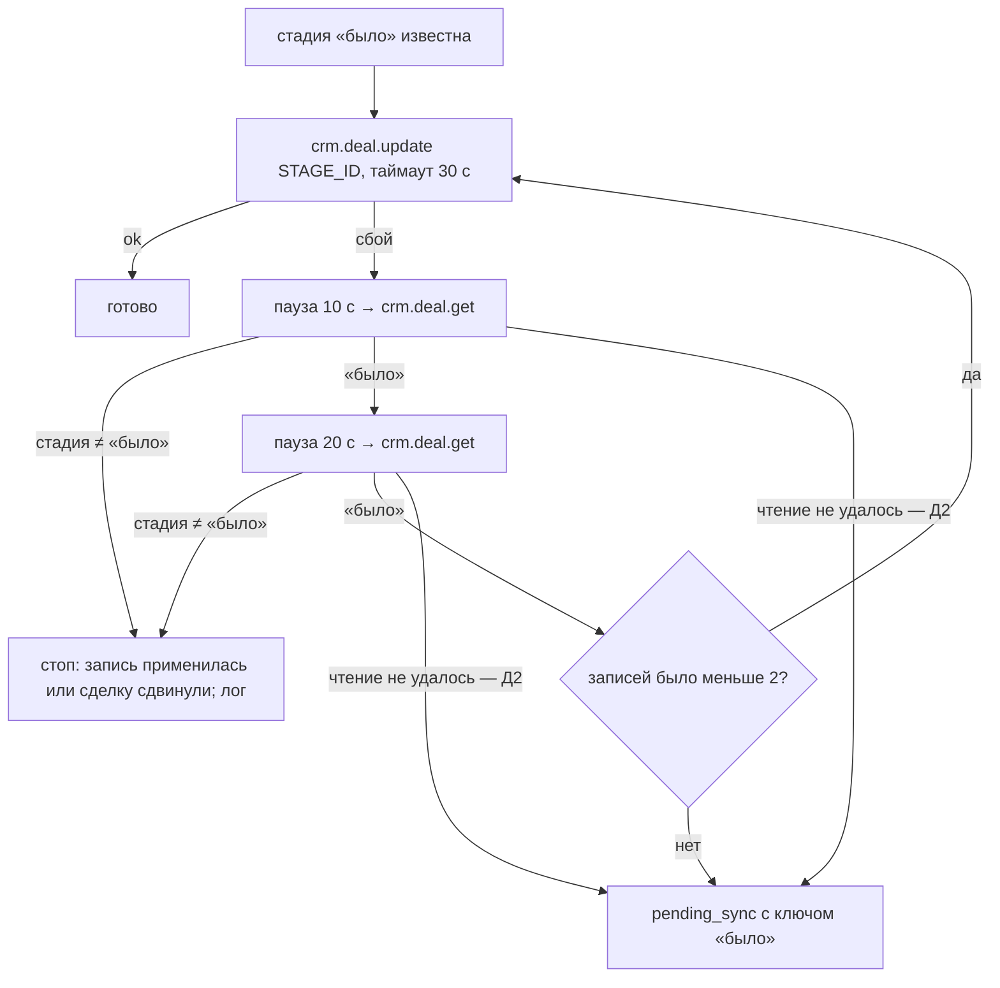

# fix: повторная отправка заявки дилеру — ретрай смены стадии «Обогащение»

**Ветка:** `feat/cabinet-web-entry` (включение в v3.4.2 решает владелец). Код в этом плане не меняется.

## Сводка

Сделки 53859 и 53893 ушли дилеру дважды. Причина подтверждена по коду и логу боя.

1. Смена стадии на «Обогащение» (`C9:UC_0SOJJA`) — отдельный последний `crm.deal.update`.
2. Битрикс выполняет роботов стадии внутри этого запроса: «Обогащение» → «Отправлено», письма дилеру. Обычно это 8,1–8,4 с.
3. Таймаут клиента — 10 с на попытку. Когда Битрикс отвечал чуть дольше, клиент получал таймаут, хотя запись уже применилась.
4. Обёртка ретраев повторяла тот же запрос. Сделка возвращалась из «Отправлено» в «Обогащение», и роботы отправляли письма второй раз.

Предлагаемое исправление — «условная смена стадии»: повторять запись, только если сделка всё ещё на той стадии, с которой бот начинал. То же правило — для досылки из `pending_sync`. Плюс отдельный, более длинный таймаут для смены стадии и понятная строка в логе.

Повторный старт по той же ссылке (53861) — отдельный вопрос поведения, решает владелец.

---

## Постановка

**Факты (лог боя `0f56811e-3141-4aaf-93ec-8951434f43b8 (10).log` от владельца, 11.10 17:12 – 12.10 06:07 UTC; в репозиторий не входит — в нём телефоны клиентов):**

| Сделка | Запись полей | Смена стадии (2-й update) | Итог |
|---|---|---|---|
| 53859 | 17:34:50,499 → 50,913 (0,4 с) | 17:34:50,928 → таймаут, строка ретрая 17:35:01,857 (≈10,9 с) → 2-я попытка ≈17:35:02,9 → True 17:35:09,393 (≈6,5 с) | 2 цикла, письма ×2 |
| 53893 | 05:10:06,557 → 07,032 (0,5 с) | 05:10:07,061 → таймаут, строка ретрая 05:10:17,864 (≈10,8 с) → 2-я попытка ≈05:10:18,9 → True 05:10:25,825 (≈7,0 с) | 2 цикла, письма ×2 |
| 53869 | 18:41:19,115 → 19,452 | 18:41:19,468 → True 18:41:27,855 (8,4 с) | норма |
| 53881 | 01:15:29,107 → 29,481 | 01:15:29,509 → True 01:15:37,573 (8,1 с) | норма |

- В логе ровно две строки `[Bitrix Retry]` — обе на этот запрос задвоенных сделок.
- Запись только полей занимает 0,3–0,5 с, смена стадии — 8+ с. Разница — синхронные роботы стадии.
- Переход «Новая → Квалификация» при старте чата (17:33:42) занял 0,48 с: у «Квалификации» синхронных роботов, видимо, нет.
- История в Битриксе (скриншоты владельца) совпадает: «Отправлено → Обогащение» в ту же минуту, что и 2-я попытка.
- 53821 в лог не попала (15:59 МСК). Картина в Битриксе та же. Причина та же — **гипотеза**, логом не подтверждена.

**Гипотеза владельца подтверждена**, с уточнением: вторая попытка тоже выполняла роботов (6,5–7 с), отсюда второй комплект писем.

---

## Ответы на вопросы

### 1. Что отправляет второй `crm.deal.update` финальной синхронизации

- `main.py:906` — `target_stage = cls.STAGE_QUALIFIED` (при отказе — `C9:LOSE`).
- `main.py:929` — первый update: только поля (`update_deal_data(..., None)`), стадии в нём нет. В логе: «Updating Deal … with fields» без `STAGE_ID`.
- `main.py:976–978` → `set_stage_after_fields` (`main.py:780–800`) — второй update: `{"id": deal, "fields": {"STAGE_ID": STAGE_QUALIFIED}}`, без полей. Эта функция поля не логирует — поэтому в логе виден только «Starting request».
- `STAGE_QUALIFIED` = `C9:UC_0SOJJA` = «Обогащение» (`.env` дева и таблица стадий `docs/brainstorms/2026-09-29-cabinet-web-entry-requirements.md`, проверено в Битриксе 29.09). На бою env, по ранбукам, тот же — не сверял.

### 2. Обёртка ретраев

- `main.py:580–623` — `BitrixService._request`. Попыток 3, паузы `BITRIX_RETRY_DELAYS = (0, 1, 3)` (`main.py:412`).
- Таймаут на попытку `BITRIX_TIMEOUT = ClientTimeout(total=10, connect=3)` (`main.py:411`).
- Ретраится любое исключение и любой ответ не 200 или с `error` в теле (`main.py:613–619`). Таймаут, сетевой сбой, 5xx и ошибка API обрабатываются одинаково. Поэтому идемпотентность по смыслу (стадия) не учитывается.
- **Почему текст ошибки пустой:** таймаут aiohttp — `asyncio.TimeoutError`, его `str()` пустой. Строка `main.py:619` пишет `{e}` без типа и без длительности.
- После трёх неудач (`enqueue_on_failure=True`) запрос уходит в `pending_sync` (`main.py:620–623`), и досылка повторит его позже — тот же риск, только отложенный.

### 3. Все места, где бот меняет `STAGE_ID`

**С тем же риском** (есть повтор: ретраи `_request` и/или досылка `pending_sync`; целевая стадия — «Обогащение» с роботами):

| # | Место | Стадия | Повтор |
|---|---|---|---|
| Р1 | Финальная синхронизация чата → `set_stage_after_fields` (`main.py:976`, `780–800`) | `STAGE_QUALIFIED` / `C9:LOSE` | 3 попытки `_request`; при неудаче — `pending_sync` |
| Р2 | Охота за сделкой Тильды → `set_stage_after_fields` (`main.py:2986`) | `STAGE_QUALIFIED` / `C9:UC_CKY0IR` / `STAGE_SUCCESS` / `C9:LOSE` | то же |
| Р3 | Кабинет и веб-вход: передача заявки → `_set_handoff_stage` (`cabinet_service.py:2906–2925`) → `_bitrix_call_or_enqueue` (`cabinet_service.py:2393`) → `main._cabinet_bitrix_request` (`main.py:5020`) → `_request` | `STAGE_QUALIFIED` | 3 попытки; при неудаче — `pending_sync` (недебаунсимо). Гард-событие `handoff_stage` защищает только от повторного вызова, не от ретрая внутри |
| Р4 | Досылка `pending_sync` (`main.py` около 4530–4575) | любая из поставленных в очередь | реплей «как есть», без проверки текущей стадии; каждые 30 мин до потолка попыток |
| Р5 | Старт чата по коду → `update_deal_data(..., STAGE_SUCCESS)` (`main.py:2890`) | «Квалификация» `C9:PREPAYMENT_INVOICE` | 3 попытки (запрос быстрый — риск мал); но при неудаче — `pending_sync`, и поздний реплей может вернуть ушедшую дальше сделку в «Квалификацию» |

**Без повтора** — одна попытка; задвоения нет, но сбой молча теряет стадию (вне этого плана):
- «Silent stage update» `update_deal_stage_direct` (`main.py:1933–1946`) — «AI Обработка», «ОЖИДАНИЕ»;
- колбэк n8n и аварийный мост — прямой `post` (`main.py:1233`, `1853`). От ретраев Save-to-CRM защищает реестр дедупа (`crm_mapping.py`);
- закрытие по таймауту 48 ч → `LOSE` (`main.py` около 4730).

**Повтор есть, риск низкий:** `close_as_duplicate` / `move_to_manual` (`main.py:1026–1037`). Это собственная сделка бота в общей воронке («NO КОНТАКТЫ» → `LOSE` / «ОЖИДАНИЕ»); роботов с письмами там, по коду, нет — **не проверено в Битриксе**.

### 4. Стадии воронки C9

| Название | Код | Источник |
|---|---|---|
| Новая | `C9:NEW` | литерал в коде |
| Квалификация | `C9:PREPAYMENT_INVOICE` | `BITRIX_STAGE_SUCCESS`; таблица стадий (Битрикс, 29.09) |
| AI Обработка | `C9:UC_CKY0IR` | литерал |
| Обогащение | `C9:UC_0SOJJA` | `BITRIX_STAGE_QUALIFIED`; `crm_mapping.py` visit/call |
| ОЖИДАНИЕ | `C9:UC_HW8Q2H` | `crm_mapping.py` working |
| Нет номера | `C9:UC_MDA6RZ` | `crm_mapping.py` in_progress |
| Сделка не але / отказ | `C9:LOSE`, `C9:APOLOGY` | `crm_mapping.py` |
| **Отправлено** | **в коде нет** — ставит робот | открытый вопрос (не нужен для рекомендуемого варианта) |

### 5. 53861: повторный старт по той же ссылке

**Как устроено (факты, лог 17:36):**
1. Старт с кодом сбрасывает сессию: `context_json='{}'`, `active_deal_id=None` (`main.py:3398–3407`).
2. `check_and_link_deal` ищет сделку по коду **только в `C9:NEW`** (`main.py:2859–2864`). 53859 уже в «Отправлено» — не найдена.
3. Финальная синхронизация: `active_deal_id` пуст, повторный поиск в `C9:NEW` пуст (`main.py:911–914`) → «Creating NEW Deal» → 53861 в общей воронке («NO КОНТАКТЫ»). Менеджерам ушла вторая карточка в MAX (17:36:44).
4. Запущена охота на 2 часа (8 × 15 мин). Сделка с кодом так и не появится в «Новая» → `move_to_manual` → 53861 в «ОЖИДАНИЕ» саппорта.

**Два взгляда:**
- *Ожидаемо.* Поиск только в «Новая» выбран сознательно: код живёт в «Новая» ~12 ч, поиск по всем стадиям повышает риск привязаться к чужой или старой сделке. Повторный разговор — новые данные, и пусть менеджер разберётся.
- *Дыра.* Тот же клиент, тот же код, через 1,5 мин после финала. В итоге у клиента две сделки, у менеджеров две карточки, а саппорт через 2 часа получает «ОЖИДАНИЕ» на ручную склейку. Новые данные из второго разговора в исходную сделку не попадают.

Варианты — в разделе «Решения» (Р-53861).

---

## Требования

- R1. Ложный таймаут смены стадии не должен приводить к повторной отправке дилеру (Р1–Р3).
- R2. Досылка из `pending_sync` не должна возвращать сделку назад, если та уже ушла со стадии, с которой бот начинал (Р4, Р5).
- R3. Настоящий сбой (запись не применилась) по-прежнему повторяется и досылается.
- R4. Строка ретрая содержит тип исключения и длительность попытки; смена стадии логирует сделку, стадию «было/ставим» и решение после сбоя.
- R5. Путь веб-входа и кабинета, порядок «поля → стадия последней» и путь чата — без изменения поведения в штатном случае.

---

## Решения владельца (2026-10-12)

1. U1–U4 входят в v3.4.2.
2. Повторный старт (53861) — вариант 1: оставить как есть, новая сделка. U5 не делается.
3. Смена стадии — вариант А (условная смена), таймаут 30 с только для записи стадии, лог ретраев с типом ошибки и длительностью.
   Условие: клиент не ждёт эти 30 с на экране — проверено по коду, см. «Где идёт смена стадии».
4. Код и порядок стадии «Отправлено» не нужны (вариант В не выбран).
5. По уже ушедшим двойным письмам (53821, 53859, 53893) ничего не делается.
6. Существующий тест `test_chat_fields_failed_stage_goes_to_queue_bypassing_debounce`: ожидаемое тело задачи очереди дополнено ключом «было» (решение владельца в ходе реализации; смысл теста не изменился).

**Дополнения владельца:**
- **Д1.** Гонка «проверка раньше, чем Битрикс закончил» — защита паузами и двойным чтением (ниже).
- **Д2.** Проверочное чтение не удалось — запись вслепую не повторяется; задача в `pending_sync` с ключом «было».
- **Д3.** Старые задачи очереди без ключа — проверка перед сменой образа (шаг ранбука v3.4.2).
- **Д4.** Лог боя с телефонами в репозиторий не входит (`docs/logs/` в `.gitignore`).

### Где идёт смена стадии (условие по таймауту)

| Место | Где выполняется | Клиент ждёт? |
|---|---|---|
| Финальная синхронизация чата | `process_input` после отправки ответа (`main.py` «8. CRM и AI Handoff» после «Бот успешно ответил»), сам `process_input` — фоновая задача вебхука | нет: последнее сообщение уже показано. В редком случае сбоя на время проверки (до ~2 мин) позже ставится отметка `is_finalized` и сигнал закрытия веб-чата `chat_close` (поле ввода блокируется позже) |
| Охота за сделкой Тильды | `asyncio.create_task(background_deal_hunt(...))` | нет |
| Кабинет и веб-вход | `attempt_handoff(background=HANDOFF_IN_BACKGROUND=True)` → `_spawn_handoff`; таймаут и подбор зависших — воркер | нет: ответ на сабмит уходит сразу после захвата |
| Досылка `pending_sync` | `sync_worker` раз в 30 мин | нет |
| «Новая → Квалификация» при старте | `asyncio.create_task(check_and_link_deal(...))`; таймаут здесь прежний (10 с) — запрос с полями, роботов нет | нет |

### Д1: защита от гонки «проверили раньше, чем Битрикс закончил»

- После сбоя записи — пауза 10 с, чтение; если стадия всё ещё «было» — пауза 20 с, второе чтение. Повтор записи — только если «было» в обоих чтениях.
- Отсчёт: первая попытка ждёт до 30 с, значит повтор возможен не раньше чем через ~60 с после начала первой записи. Штатно Битрикс применяет стадию и прогоняет роботов за 8–11 с (лог боя), запас ×5–7.
- Записей стадии на вызов — не больше двух; дальше — очередь с «было», досылка проверит стадию ещё раз через ≤ 30 мин.
- **Остаточный риск:** если Битрикс держит первую запись невидимой для чтения дольше ~60 с и всё-таки применяет её после нашего повтора — повтор даст дубль. Закрыть полностью нельзя: клиент не может узнать исход запроса, который Битрикс ещё выполняет. Срабатывает только при аномально медленном Битриксе (×5 к худшему наблюдённому). Видно в логе: строка «после сбоя стадия всё ещё «было»», за ней «повтор прошёл».
- Почему не «никогда не повторять сразу, только очередь»: настоящий сбой (запись не дошла) задерживал бы письмо дилеру до 30 мин; решение владельца — повтор при подтверждённом «было».

## Решения

### Смена стадии при сбое

| Вариант | Плюсы | Минусы |
|---|---|---|
| **А. Условная смена (рекомендую).** Перед записью бот знает стадию «было». После сбоя попытки — одно чтение `crm.deal.get`: стадия всё ещё «было» → повтор; иначе (уже целевая, «Отправлено» или её сдвинул менеджер) → стоп, считать выполненным, записать в лог | Закрывает и ретраи, и досылку. Не нужен порядок стадий и код «Отправлено». Ручной сдвиг менеджером тоже не перетирается. В штатном случае — ни одного лишнего запроса | +1 чтение при сбое. Кабинету нужно одно чтение «было» перед записью (+0,2–0,3 с на передачу) |
| Б. Не ретраить смену стадии по таймауту | Просто | Настоящий таймаут (запись не применилась) теряет стадию до досылки, а досылка без проверки — тот же риск |
| В. «Стадия только вперёд» по порядку воронки | Защищает от любых откатов | Нужен полный порядок C9 и код «Отправлено». Блокирует законные переходы (например, из «ОЖИДАНИЯ» в «Обогащение», когда телефон получен позже). Каждая новая стадия в Битриксе — правка кода |
| Г. Только длинный таймаут | Одна строка | Реже, но не никогда: при медленном Битриксе повтор возможен снова |

**Дополнение к А:** отдельный таймаут смены стадии — 30 с вместо 10 (штатно 8 с, запас ×3,5). Ложных таймаутов станет меньше, а значит и лишних чтений. Новых env нет — константа рядом с `BITRIX_TIMEOUT`.

**Досылка (Р4, Р5):** при постановке в очередь в тело задачи кладётся служебный ключ «ожидаемая стадия было». Реплей:
1. читает сделку;
2. если стадия не «было» — снимает задачу как неактуальную (лог);
3. если «было» — отправляет без служебного ключа.

Старые задачи без ключа (уже лежащие в очереди на бою) идут прежним путём. Без миграции БД.

### Р-53861: повторный старт

| Вариант | Что будет | Минусы |
|---|---|---|
| 1. Оставить как есть | Новая сделка + вторая карточка + «ОЖИДАНИЕ» через 2 ч | Ручная работа саппорта, двойные карточки |
| 2. Искать по коду во всех стадиях C9 за ограниченный срок (например, 7 дней) и привязывать. Поля и стенограмма пишутся в найденную сделку, стадия не меняется, второе письмо дилеру не уходит, карточка в MAX помечена «повторное обращение» | Одна сделка, данные не теряются | Нужен флаг «сделка уже передана» в финальной синхронизации (иначе она поставит «Обогащение» и роботы отправят ещё раз). Небольшой риск совпадения кодов при широком поиске |
| 3. Окно повторного старта: тот же код ≤ N часов после финала → сообщение «заявка уже передана, менеджер свяжется», новую воронку не запускать | Просто, без новых сделок | Новые данные клиента (другой платёж, другая машина) теряются |

Рекомендация: 2 со сроком поиска 7 дней. Решает владелец; объём — отдельный юнит (U5), можно вынести из v3.4.2.

---

## Ключевые технические решения

- **Одна функция условной смены стадии в `BitrixService`.** Её используют Р1/Р2 (`set_stage_after_fields`) и Р3 (кабинет — через новую инъекцию в `cabinet_service.setup`, как сейчас `bitrix_request`). Обёртка `_request` для остальных методов не меняется.
- **«Было» берётся из уже прочитанной сделки.** Финальная синхронизация читает сделку в начале (`main.py:910`), охота — из результата поиска. Кабинету — одно чтение перед записью.
- **Решение после сбоя — по чтению, а не по типу ошибки.** Таймаут, 5xx и обрыв обрабатываются одинаково: «применилось ли» показывает только текущая стадия.
- **Строка ретрая `_request` — с `type(e).__name__` и длительностью** для всех методов, не только для стадии (R4).

---

## Высокоуровневая схема (условная смена стадии)

Реплей задачи с ключом «было»: чтение → стадия = «было» → отправка без ключа; иначе — задача снимается.

---

## Юниты

### U1. Лог ретраев Битрикса

**Цель:** в строке ретрая видны тип исключения и длительность попытки (R4).
**Файлы:** `main.py` (`BitrixService._request`), `tests/test_bitrix_timeouts.py`.
**Подход:** засекать время попытки; в `[Bitrix Retry]` писать `type(e).__name__`, текст (если есть) и секунды. Остальное поведение не меняется.
**Тест-сценарии:**
- зависший Битрикс → строка ретрая содержит `TimeoutError` и длительность ≈ таймауту;
- ответ 500 → строка с `API Error (Status 500)`.

**Проверка:** существующие тесты таймаутов зелёные без правки ожиданий.

### U2. Условная смена стадии в `BitrixService`

**Цель:** R1, R3, R4 для Р1 и Р2.
**Зависимости:** U1.
**Файлы:** `main.py` (`set_stage_after_fields`, `final_sync_wrapper`, `background_deal_hunt`, новая константа таймаута стадии), `tests/test_stage_after_fields.py`, новый `tests/test_stage_guarded_retry.py`.
**Подход:**
- новая функция смены стадии с параметром «было» — схема выше;
- `set_stage_after_fields` получает «было» от вызывающего: финальная синхронизация — `deal_data['STAGE_ID']`, охота — стадия найденной сделки;
- при `fields_ok=False` поведение прежнее (сразу в очередь), но с ключом «было»;
- лог: сделка, «было → ставим», исход («ok», «повтор», «применилось — стоп», «сдвинута — стоп», «в очередь»).

**Образцы:** порядок вызовов и фейковый Битрикс — `tests/test_stage_after_fields.py`; зависание — фикстура `hung_bitrix` в `tests/test_bitrix_timeouts.py`.
**Тест-сценарии:**
- *Главный (воспроизведение 53859):* первая попытка — таймаут, но фейк «применяет» запись и сдвигает сделку в «Отправлено» → чтение видит «Отправлено» → второй `crm.deal.update` со стадией не отправляется, очереди нет.
- Таймаут, запись не применилась (чтение = «было») → повтор → ok; ровно 2 записи стадии.
- Таймаут, применилось, робот ещё не сдвинул (чтение = «Обогащение») → стоп.
- Два сбоя подряд, стадия «было» → задача в `pending_sync` с ключом «было» (записей не больше двух).
- Д2: проверочное чтение после сбоя упало → записи вслепую нет, задача в `pending_sync` с ключом «было».
- Д1: запись применяется с задержкой — первое проверочное чтение видит «было», второе уже «Отправлено» → повтора нет.
- Сделку сдвинул менеджер между попытками → бот её не возвращает.
- Штатный путь: одна запись, ни одного `crm.deal.get` сверх нынешних.
- Регресс: стадия — последняя запись после полей; отказ → `C9:LOSE`; охота без телефона.

**Проверка:** тесты U2 падают на текущем коде (главный сценарий) и проходят после правки.

### U3. Кабинет и веб-вход: та же функция для стадии передачи

**Цель:** R1, R5 для Р3.
**Зависимости:** U2.
**Файлы:** `cabinet_service.py` (`setup`, `_set_handoff_stage`), `main.py` (`setup_cabinet_service`), `tests/test_stage_after_fields.py` (кабинетный раздел), `tests/test_web_entry_conversion.py`.
**Подход:**
- в `cabinet_service.setup` — инъекция функции условной смены стадии;
- `_set_handoff_stage` читает «было» одним `crm.deal.get` и вызывает её;
- гард-событие `handoff_stage` и порядок «поля → стадия» сохраняются;
- при `fields_ok=False` — очередь с ключом «было».

**Тест-сценарии:**
- сабмит анкеты: таймаут смены стадии, применилось → нет второй записи стадии;
- веб-вход: конверсия → стадия последней, один раз;
- повтор подбора зависших захватов → стадию не шлёт (гард);
- Битрикс выключен (дев) → без вызовов, без ошибок.

**Проверка:** весь кабинетный и веб-вход набор pytest зелёный без правки ожиданий, кроме новых сценариев.

### U4. Досылка `pending_sync` с проверкой «было»

**Цель:** R2 для Р4 и Р5.
**Зависимости:** U2.
**Файлы:** `main.py` (`enqueue_failed_request` — пропуск ключа, реплей), `tests/test_pending_sync_reads.py`, `tests/test_pending_sync_ceiling.py`.
**Подход:**
- в задаче с `STAGE_ID` и ключом «было» реплей сначала читает сделку: стадия ≠ «было» → задача удаляется с логом «неактуальна»; иначе — отправка без служебного ключа;
- задачи без ключа — прежний путь;
- порядок «стадия ждёт недошедших полей своей сделки» сохраняется;
- Р5: старт чата ставит в очередь «Квалификацию» с «было» = `C9:NEW`.

**Тест-сценарии:**
- задача «Обогащение» с «было» = «Квалификация», сделка уже «Отправлено» → не отправлена, удалена;
- то же, сделка в «Квалификации» → отправлена, служебного ключа в теле запроса нет;
- старая задача без ключа → отправлена как раньше;
- чтение упало → задача остаётся, счётчик попыток растёт (потолок и fatal-алерт как раньше);
- стадия ждёт полей своей сделки → не обгоняет.

**Проверка:** тесты очереди зелёные.

### U5. (отменён решением владельца 2026-10-12 — вариант 1) Повторный старт по коду ушедшей сделки

**Цель:** вариант 2 из «Р-53861». Выполняется, только если владелец его выберет.
**Файлы:** `main.py` (`check_and_link_deal`, `find_deal_data_by_code`, `final_sync_wrapper`, карточка MAX), новый `tests/test_restart_after_handoff.py`.
**Подход:**
- если в `C9:NEW` пусто — поиск по коду в C9 за срок владельца;
- найденная сделка привязывается с флагом «уже передана»;
- финальная синхронизация по флагу пишет поля и стенограмму, стадию не меняет, карточка помечена «повторное обращение»;
- охота не запускается.

**Тест-сценарии:**
- повторный старт через 2 мин после финала → новая сделка не создаётся, стадия не меняется, второй комментарий-стенограмма в той же сделке;
- код старше срока → прежнее поведение;
- сделка в `LOSE` → по решению владельца (открытый вопрос).

---

## Влияние на систему

- **Штатный путь:** без лишних запросов (Р1/Р2), кабинет — +1 чтение на передачу.
- **Медленный Битрикс:** смена стадии может ждать до 30 с — это фоновая задача, клиент не ждёт.
- **Новых env и миграций нет.** Служебный ключ — внутри JSON задачи очереди.
- **Регресс:** путь Александра, веб-вход, кабинет, n8n-колбэк (не затронут), охота.
- **Не трогаем:** n8n, лендинг, Dockhost, Tilda, роботов Битрикса.

## Влияние на выпуск v3.4.2 (решение: входит)

- U1–U4 входят в v3.4.2.
- **К ранбуку добавляется:** шаг Д3 — проверка старых задач `pending_sync` со сменой стадии перед сменой образа (ранбук в `docs/plans/2026-10-11-001-feat-web-entry-recall-45s-plan.md`). Новых env и миграций нет. Откат — `multy-v3.4.1`, как сейчас.
- **Живая проверка:** воспроизвести медленный Битрикс на бою нельзя.
  - Проверяем, что штатная передача по-прежнему даёт одно письмо: веб-вход из таблицы v3.4.2 уже доводит сделку до «Отправлено» — сверить, что писем по одному.
  - Неделю после выпуска искать в логе строки ретрая смены стадии и их исход.
- **U5** не делается (вариант 1).

---

## Открытые вопросы владельцу

Закрыты решениями 2026-10-12 (выше). Новых нет; при Д3 — решение по найденным задачам, если они будут.

## Факты и гипотезы

- **Факты:** код (файл:строка выше), четыре замера в логе, две строки ретрая, история стадий в Битриксе по скриншотам.
- **Гипотезы:**
  - 53821 — та же причина (вне лога);
  - на бою `BITRIX_STAGE_QUALIFIED` = `C9:UC_0SOJJA` (по дев-env и ранбукам);
  - у «Квалификации» и у стадий общей воронки нет синхронных роботов с письмами (по длительности запросов, в Битриксе не проверял).
