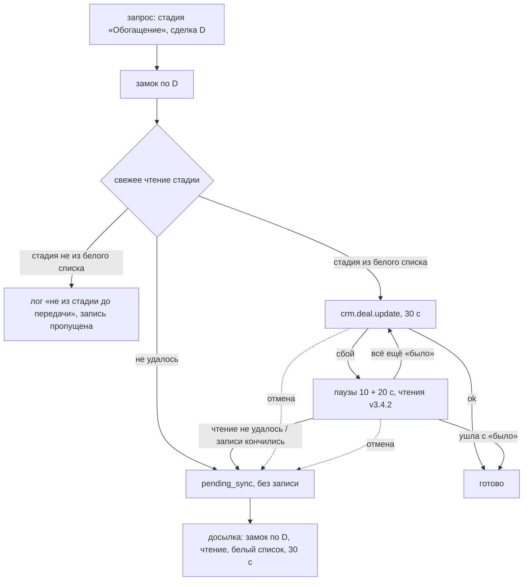
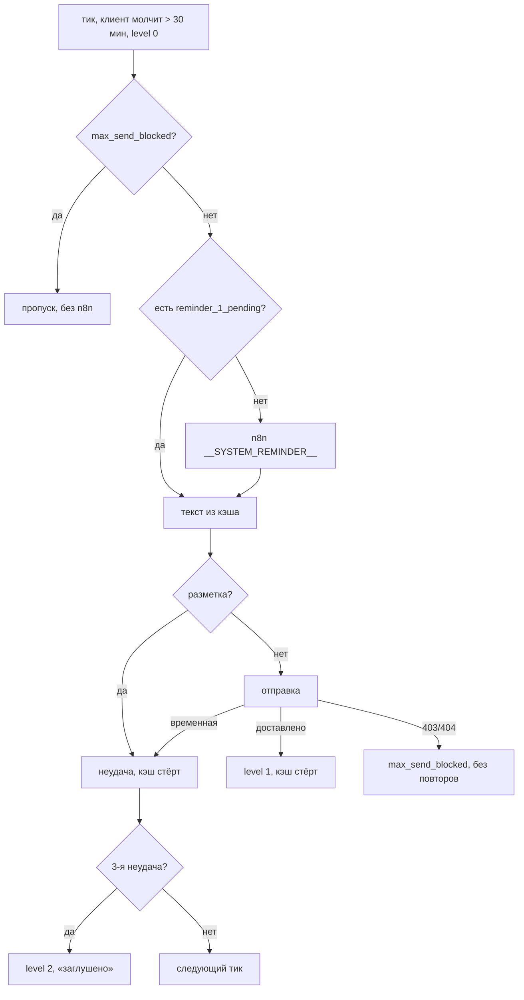

# v3.4.3 — три исправления

**Метки:** **[код]** — проверено по коду (файл:строка на `2a5b55d`); **[лог]** — лог боя 11.10 17:12 – 12.10 06:07 UTC
(у агента локально, вне репозитория, в git не попадает); **[владелец]** — со слов владельца; **[гипотеза]** — не проверено.

---

## Решения владельца (2026-10-12)

- **В1.** Белый список источников «Обогащения» дополнен `C9:LOSE` и `C9:APOLOGY`: бот сам закрывает сделку в LOSE после 48 ч молчания; вернувшийся клиент с контактом — живой лид, дилер должен получить письмо. Двойные письма возникают из «Отправлено», а не из отказа. `UC_3NL90C` (ручная обработка) — не добавлять.
  **Итоговый список:** `C9:NEW`, `C9:PREPAYMENT_INVOICE`, `C9:UC_CKY0IR`, `C9:UC_HW8Q2H`, `C9:UC_MDA6RZ`, `C9:LOSE`, `C9:APOLOGY`.
  Где в тексте ниже сказано, что LOSE/APOLOGY вне списка, — действует это решение.
- **В2.** Первый звонок веб-входа и звонок из чата: «Поступит входящий звонок с незнакомого номера. Ответьте на звонок — робот продиктует цифры кода.»; после повтора: «Новый код придёт звонком или в SMS. Если позвонят — робот продиктует цифры кода.». Макеты `docs/design/*.html` не правим. Комментарий `sms_gateway.py:31` — на факт («проверочный шифр» + цифры).
- **В3.** Колбэк n8n (`visit`/`call`) и аварийный мост — в правиле: одно чтение стадии перед записью; не из списка → стадия не пишется, поля пишутся.
- **В4.** Вариант А — свежее чтение перед каждой записью «Обогащения»; ожидание `test_happy_path_chat_no_extra_reads` — одно чтение (прямое следствие).
- **В5.** Цена исполнения n8n — вопрос передан CE n8n отдельно, на план не влияет.
- **В6.** На бою одна реплика бота — замки внутри процесса достаточны. При увеличении числа реплик замки KTD-A2/A3 перестают защищать — нужен замок в БД (записать в `CLAUDE.md` и передачу выпуска).

---

## Summary

- **A. Двойные письма дилеру.** Бот больше никогда не пишет «Обогащение» в сделку, которая уже ушла дальше:
  - «Обогащение» пишется только из белого списка стадий до передачи;
  - стадия сверяется свежим чтением под замком на сделку;
  - финальная синхронизация пользователя идёт по одной;
  - отмена во время пауз ставит стадию в очередь с «было».
- **B. Текст про робота.** «робот продиктует только цифры кода, без слов» → «робот продиктует цифры кода.». Затронуты экран звонка из чата и оба текста веб-входа; новая сборка `app.js` даёт новую строку для Tilda.
- **C. Напоминания при закрытом диалоге MAX.**
  - Окончательные ошибки MAX (403 `chat.denied`, 404) останавливают напоминания клиенту до его следующего сообщения.
  - У повторов первого напоминания — потолок; текст не генерируется заново.
  - Текст со служебной разметкой не отправляется.

Миграций БД и новых env нет (решения ниже). Код n8n не меняется: что относится к зоне CE n8n — в разделе «Передача CE n8n».

---

## Problem Frame

**A.** v3.4.2 закрыл повтор записи «Обогащения» после ложного таймаута. Ревью v3.4.2 нашло пути, где бот всё ещё может вернуть сделку из «Отправлено» в «Обогащение» и робот стадии снова разошлёт письма дилеру: P2.1, P2.2, P2.3, P2.6. Цель владельца: сделка на «Отправлено» или дальше **никогда** не возвращается ботом в «Обогащение».

**B.** Живая проверка 12.10 **[владелец]**: робот звонка говорит «проверочный шифр», затем 4 цифры. Текст экрана «только цифры кода, без слов» неверен.

**C.** Клиент MAX приостановил диалог. «[Reminder 1 - AI]» каждый тик генерирует новый текст через n8n, трижды получает 403 и повторяется на следующем тике.

---

## Requirements

- R1. «Обогащение» (`BITRIX_STAGE_QUALIFIED` = `C9:UC_0SOJJA`) бот пишет, только если текущая стадия сделки — в белом списке стадий до передачи (KTD-A1). Это касается всех путей записи «Обогащения» с повтором и очередью: финальная синхронизация, охота, передача кабинета и веб-входа, досылка `pending_sync`. Колбэк n8n и аварийный мост — по ответу на вопрос В3.
- R2. Стадию бот сверяет непосредственно перед записью, под замком на сделку. Чтение не удалось — вслепую не пишет: задача уходит в очередь, и досылка применит то же правило.
- R3. Две финальные синхронизации одного пользователя не идут одновременно: вторая ждёт первую.
- R4. Отмена задачи (рестарт бота) во время записи стадии или пауз после сбоя → задача в `pending_sync` с «было».
- R5. Досылка задачи со сменой стадии идёт с таймаутом стадии (30 с) и без ключа «было» (P2.4).
- R6. Текст экрана звонка — «робот продиктует цифры кода.» во всех местах (KTD-B1). Новая сборка кабинета, новая строка `app.js?v=` для Tilda.
- R7. Окончательная ошибка MAX при отправке клиенту: без повторов внутри отправки, пометка в контексте, напоминания клиенту прекращаются. Пометка снимается, когда клиент снова пишет или нажимает старт.
- R8. Первое напоминание — не больше 3 тиков на доставку. Текст генерируется один раз и переиспользуется при повторе.
- R9. Текст напоминания со служебной разметкой (`**`, строка `---`, `#`-заголовок) не отправляется; попытка считается неудачной.
- R10. Регресс: путь Александра, веб-вход, кабинет, условная смена стадии v3.4.2. Тесты на каждый новый сценарий падают на v3.4.2.

---

## Часть A. Двойные письма — факты

### A.1. Откуда бот пишет «Обогащение» [код]

| # | Путь | Где | «Было» сейчас | Повтор/очередь |
|---|---|---|---|---|
| 1 | Финальная синхронизация чата | `main.py:1005` (цель), `:1031` («было» = `deal_data['STAGE_ID']`, прочитано в начале), `:1079` → `set_stage_after_fields` | чтение в начале синхронизации, за 1–2 с до записи | `set_stage_guarded` (`main.py:834`) |
| 2 | Охота за сделкой Тильды | `main.py:3057` (цель при телефоне), `:3008` (только `C9:NEW`), `:3090` | `C9:NEW`, только что прочитано | то же |
| 3 | Передача кабинета и веб-входа | `cabinet_service.py:2915-2946` (`_set_handoff_stage`), стадия = `STAGE_QUALIFIED` (`main.py:5192`) | одно чтение перед записью (`:2934`); чтение не удалось → без «было» | то же; при `fields_ok=False` — очередь |
| 4 | Досылка `pending_sync` | `main.py:4651-4672` | с ключом — чтение и сравнение; без ключа — запись вслепую | задача остаётся, `attempts++` |
| 5 | Колбэк n8n `visit`/`call` | `main.py:1881`, `:1915` (`STAGE_ID` = `crm_mapping.resolve_stage` → `C9:UC_0SOJJA`) | не читается | дедуп `(deal, status)` (`main.py:1873`) |
| 6 | Аварийный мост | `main.py:1303-1310` | не читается | — |

Остальные записи стадии бота — не «Обогащение», в часть A не входят:
- `C9:LOSE` при отказе (`main.py:1005`, `:3055`);
- `C9:UC_CKY0IR` (`:3059`, `:3859`);
- `C9:UC_HW8Q2H` (`:3389`, `:3440`);
- `C9:PREPAYMENT_INVOICE` (`:2991`);
- создание `UC_WGXF0B` / `C9:NEW`;
- аварийный перевод в ручную обработку `UC_3NL90C` (`main.py:1137`).

### A.2. Из каких стадий бот законно ставит «Обогащение» [код]

| Стадия | Код | Как сделка туда попадает (бот) |
|---|---|---|
| Новая | `C9:NEW` | сделка Тильды; сделка веб-входа (`main.py:528`) |
| Квалификация | `C9:PREPAYMENT_INVOICE` (`BITRIX_STAGE_SUCCESS`) | старт чата «Новая → Квалификация» (`main.py:2991`); охота без телефона (`:3061`) |
| AI Обработка | `C9:UC_CKY0IR` | активация ИИ (`main.py:3859`); охота при активном ИИ (`:3059`) |
| ОЖИДАНИЕ | `C9:UC_HW8Q2H` | барьер Р4 (`crm_mapping.py:12`, `main.py:3389`, `:3440`) — клиент потом даёт телефон |
| Нет номера | `C9:UC_MDA6RZ` | колбэк `in_progress` (`crm_mapping.py:15`) |

Списка владельца хватает для всех путей бота **[код]**. Код «Отправлено» не нужен: белый список задаёт, *откуда* можно, а не *куда* нельзя.

Вне списка — значит, бот «Обогащение» не пишет:
- «Отправлено» и всё после;
- само «Обогащение» (P3 «было = цель» закрывается этим же правилом);
- `C9:LOSE`, `C9:APOLOGY`;
- `UC_3NL90C` (ручная обработка);
- стадии других воронок.

Вопрос В1 — что делать с вернувшимся клиентом, чья сделка в `LOSE`.

### A.3. Где правило ломается сегодня [код]

- **P2.1.** Вторая финальная синхронизация того же пользователя читает «было» в начале (`main.py:1011`). Если первая уже довела сделку до «Отправлено», вторая прочитает «Отправлено» и запишет «Обогащение». Если обе прочитали «Квалификацию» до записи первой, вторая пишет по устаревшему «было». Условная смена v3.4.2 проверяет «было» только *после сбоя*, перед первой записью — нет (`main.py:850-853`).
- **P2.6.** Сделка по `active_deal_id` уже на «Отправлено» → повторная финализация пишет «Обогащение» (`main.py:1009-1011`, `:1079`).
- **P2.3.** «Было» неизвестно — чтение кабинета не удалось (`cabinet_service.py:2934`) → одна запись вслепую; при сбое задача без ключа → досылка вслепую (`main.py:4656`).
- **P2.2.** Перезапуск во время пауз 10 + 20 с (`main.py:861-862`) или во время записи. `CancelledError` не ловится, задача в очередь не встаёт. В кабинете гард `handoff_stage` уже записан (`cabinet_service.py:2926`) — подбор стадию не повторит.
  - Остановка контейнера: `web.run_app` (`main.py:5339`) по SIGTERM отменяет оставшиеся задачи; Python — PID 1 (`Dockerfile:20`, exec-форма).
  - **[гипотеза]** `CancelledError` дойдёт до корутины до SIGKILL — проверить тестом и на стенде.
- **P2.4.** Задача без ключа досылается с таймаутом 10 с (`main.py:4674-4675`), даже если в ней `STAGE_ID`.

### A.4. P3 — что берём [код]

| P3 | Решение | Почему |
|---|---|---|
| «Было» совпадает с целевой стадией | закрывается R1 | «Обогащение» не в списке |
| Задача стадии из кабинета при `fields_ok=False` без ключа | закрывается R2 | досылка применяет белый список и без ключа |
| `_request` с `attempts > 3` → `IndexError` (`main.py:621`) | **берём** — задержка по `min(attempt, len)` | одна строка, без смены поведения |
| Не хватает тестов: отмена в паузе, склейка с ключом «было» | **берём** | U4 / U3 |
| Запасной номер веб-входа без ограничения возраста | на потом | меняет UX после F5, нужен отдельный разговор |
| Долгий проход досылки при массовом сбое | на потом | — |
| Часы клиента и сервера, округление ЧЧ:ММ, 8g после 429 | на потом | фронт, не часть этого выпуска |
| P2.5 — передачи кабинета внутри тика `otp_worker` | на потом | замок R3 может удлинить тик, если чат финализируется в ту же секунду (раздел рисков) |

---

## Часть B. Текст про робота — факты [код]

| Где | Строка | Сейчас | Становится |
|---|---|---|---|
| `widget-custom/cabinet-app/app.js:1720-1724` | веб-вход после повтора (`webRecall`) | Новый код придёт звонком или в SMS. Если позвонят — робот продиктует только цифры кода, без слов. | Новый код придёт звонком или в SMS. Если позвонят — робот продиктует цифры кода. |
| `widget-custom/cabinet-app/app.js:1725-1729` | звонок: **чат** и **первый звонок веб-входа** (общая ветка `isVoice`) | Поступит входящий звонок с незнакомого номера. Ответьте на звонок — робот продиктует только цифры кода, без слов. | Поступит входящий звонок с незнакомого номера. Ответьте на звонок — робот продиктует цифры кода. (В2) |
| `tests/test_cabinet_frontend.py:335-339` | проверка исходника | `"робот продиктует только цифры кода" in src` | новая фраза; старой нет |
| `tests/test_cabinet_frontend.py:1120` | проверка напоминания | `"робот продиктует только цифры кода, без слов." in reminder` | `"робот продиктует цифры кода." in reminder` |
| `sms_gateway.py:31` | комментарий | «робот произносит только цифры кода, текст не зачитывается» | факт: робот провайдера говорит «проверочный шифр», затем цифры; бот передаёт только код (`VOICE_TEXT_TEMPLATE = "{code}"`, `:34`) |
| `widget-custom/cabinet-app/Production/app.js` (+ `.br`, `.gz`, `manifest.json`) | сборка | `?v=9aff5a1ea2` | новая версия после `npm run build:cabinet` |

Не меняются:
- `app.js:1130` («Продиктует робот»);
- `app.js:1217` («Код подтверждения продиктует робот во входящем звонке.»);
- тесты к ним (`test_cabinet_frontend.py:136`, `:1087`) — там нет «только цифры».

Макеты `docs/design/lk-source-v3.html`, `lk-source-v4.html` и `lk-source*.html` — архив дизайна, не экраны: не трогаем (В2).

---

## Часть C. Цикл напоминаний — факты

### C.1. Где живёт первое напоминание и его повтор [код]

- `reminder_worker` (`main.py:4397`): проход раз в 60 с (`:4403`) по всем `is_smartbot_active` (`:4407`).
- Первое напоминание (`main.py:4452-4505`) срабатывает, если с последнего сообщения клиента прошло больше 30 мин и `reminder_level == 0`. Каждый проход:
  - вызывает n8n с `__SYSTEM_REMINDER__` (`:4464-4466`);
  - отправляет ответ через `send_smartbot_reply` (`:4494`) — там 3 попытки с паузой 1 с (`reliable_send`, `main.py:1394-1401`).
- Не доставлено → лог «retry на следующем тике» (`:4502-4504`), `reminder_level` остаётся 0 → на следующем проходе всё сначала.
- **Своего потолка у повторов нет.** Цикл останавливают только:
  - тихие часы 21:00–09:00 по времени дилера (`:4433-4436`);
  - 48 ч с последнего сообщения клиента (`:4447-4448`); дальше сессию закрывает `sync_worker`;
  - сообщение клиента: сброс `reminder_level` (`main.py:3233-3234`);
  - кабинетное окно (`:4421-4425`).
- Второе напоминание (`:4507-4568`) при отказе MAX глушится навсегда: `reminder_level = 2` (`:4553`).

### C.2. Текст генерируется заново на каждом тике [код + лог]

Каждый проход — новый вызов n8n (`main.py:4464`). Ответ n8n не кэшируется (`send_chat_message_to_n8n`, `main.py:2148-2263`, до 2 попыток по 120 с). В логе тексты меняются от тика к тику **[лог]**. Строки «📡 ОТПРАВКА В MAX» — `print` (`max_client.py:73`), в логе Dockhost они выходят пачкой с задержкой буфера, поэтому идут подряд.

**Расход на одного такого клиента [лог + расчёт]:**
- проход ≈ 65 с: 60 с сна, ~1–2 с n8n, 3 × POST в MAX с паузами по 1 с;
- в логе 44 прохода за 17:13–17:59 UTC, то есть до 21:00 МСК, затем тихие часы; с 06:00 UTC (09:00 МСК) — снова;
- ≈ **55 вызовов n8n в час, ≈ 660 в сутки** (12 часов вне тихих часов) и ≈ 2 000 запросов в MAX в сутки;
- потолок — 48 ч с последнего сообщения клиента, это до двух дневных окон: **≈ 1 300 вызовов n8n на клиента**.
- Каждый вызов n8n — минимум один вызов модели ИИ-агента. Сколько вызовов модели внутри одного исполнения и сколько это в деньгах — зона CE n8n (В5).
- Побочно **[код]**: `reminder_worker` проходит клиентов по одному, так что каждый такой клиент задерживает проход для остальных на ~5 с.

### C.3. Как бот различает ошибки MAX [код]

Никак:
- `MaxBotClient.send_message` на любой не-200 и на любое исключение пишет `MAX_API_ERROR … status=… body=…` и возвращает `None` (`max_client.py:79-98`);
- `reliable_send` повторяет 3 раза при любой ошибке (`main.py:1394-1401`).

Обработки «окончательных» ошибок нет:
- 403 `chat.denied` / `error.dialog.suspended` **[лог]** обрабатывается как временная;
- что MAX отвечает, если бот заблокирован или пользователь удалён (ожидаемо 403/404 с другими `code`), — **[гипотеза]**, в логе только `dialog.suspended`.

Есть похожая пометка для другого случая — бот сессии неактивен в реестре, `bot_send_blocked`, снимается автоматически (`main.py:4371-4394`). Это образец для R7.

### C.4. Сколько клиентов в цикле [лог]

В логе 11.10 17:12 – 12.10 06:07 — один клиент: `user=16266646`, 153 строки `MAX_API_ERROR … status=403`, 51 «retry на следующем тике». Посчитать на бою — только чтением:

1. **Лог Dockhost за сутки** (основной способ): поиск `MAX_API_ERROR send_message` → число различных `user=` со `status=403` или `status=404`. И поиск `Доставка не подтверждена` — сколько раз.
2. **База бота** (точечно, одна строка; веб-консоль `nocodb-postgres`, только чтение) — кандидаты, у которых первое напоминание просрочено, но не ушло:
   `psql -U $POSTGRES_USER -d max_bot_db -c "SELECT count(*) FROM users WHERE is_smartbot_active AND context_json::jsonb->>'reminder_level' = '0' AND extract(epoch from now()) - (context_json::jsonb->>'client_last_message_time')::float BETWEEN 1800 AND 172800;"`
   - В число попадают и законно ждущие: тихие часы, кабинетное окно. Поэтому это верхняя граница, а пересечение с п. 1 — точный ответ.
   - Колонки — `database.py:38-61`; `context_json` — текст с JSON.
   - NocoDB не нужна.

### C.5. Текст со служебной разметкой (12.10 06:55 UTC) [код + гипотеза]

- Бот шлёт в n8n только триггер `__SYSTEM_REMINDER__` и `last_bot_message` (`main.py:4456-4466`).
- Инструкция перефразирования живёт в промпте агента n8n (`docs/N8N_ARCHITECTURE.md:91`). В коде бота текстов «Если клиенту выдана ссылка…» нет **[код]**.
- **Источник — ответ модели n8n**, бот передаёт его как есть. Перед отправкой бот:
  - вырезает `<function_calls>` (`main.py:1279-1359`);
  - добавляет подпись «Александр» (`:1364`);
  - подставляет ссылку кабинета (`:1369-1372`).
- Проверки на разметку нет. MAX получает `format: html`, поэтому `**…**` и `---` клиент видит буквально.
- Строки 06:55 в логе у агента нет (лог кончается в 06:07). Пример — со слов владельца **[владелец]**.
- **[гипотеза]** Каждый `__SYSTEM_REMINDER__` попадает в память диалога n8n, и при сотнях повторов модель начинает выдавать куски своей инструкции. Проверить может только CE n8n по исполнениям этой сессии.

---

## Key Technical Decisions

- **KTD-A1. Белый список источников, а не запрет «Отправлено».** «Обогащение» пишется только из `C9:NEW`, `C9:PREPAYMENT_INVOICE`, `C9:UC_CKY0IR`, `C9:UC_HW8Q2H`, `C9:UC_MDA6RZ`.
  - Список — одна константа рядом с `STAGE_EXPECT_KEY`.
  - Код «Отправлено» не нужен; новые стадии после передачи защищены автоматически.
  - Цена: если владелец добавит в воронку новую стадию *до* передачи, её нужно дописать в список. Иначе сделка из неё не уйдёт в «Обогащение», а в логе появится строка «не из стадии до передачи».
- **KTD-A2. Свежее чтение под замком на сделку перед каждой записью «Обогащения» (рекомендация; В4 — вариант).**
  - `set_stage_guarded` для цели «Обогащение» берёт `asyncio.Lock` по `deal_id`. Под замком он читает стадию (`_read_stage_once`), сверяет с белым списком и только потом пишет.
  - Паузы и проверочные чтения после сбоя (v3.4.2) остаются под тем же замком.
  - Переданное вызывающим «было» становится подсказкой для лога; решает свежее чтение.
  - Закрывает P2.1, P2.3 и P2.6 одним механизмом во всех путях 1–4, включая гонку чата с кабинетом на одной сделке.
  - Цена: +1 `crm.deal.get` (~0,3 с) на каждую передачу, в фоне. Меняет ожидание теста v3.4.2 `test_happy_path_chat_no_extra_reads` (`tests/test_stage_guarded_retry.py:215`), поэтому нужно решение владельца (В4).
  - Альтернатива без лишнего чтения — в «Alternatives».
- **KTD-A3. Замок финальной синхронизации на пользователя.** `final_sync_wrapper` целиком под `asyncio.Lock` по `platform_user_id`: вторая синхронизация ждёт первую, а не пропускается.
  - Ждёт, потому что вторая может нести новые данные (телефон). Её поля уйдут, а стадию отсечёт KTD-A2.
  - Это защита в глубину для P2.1, о которой просил владелец; заодно поля одной сделки не пишутся вперемешку.
  - Конверсия кабинета (`main.py:5143`) идёт через тот же замок.
- **KTD-A4. Отмена = очередь с «было».** В `set_stage_guarded` `CancelledError` ловится после начала первой записи: задача ставится в `pending_sync` с «было» под `asyncio.shield`, затем исключение пробрасывается дальше. Досылка прочитает стадию: запись применилась → стадию не пишет.
  - Остаточный риск: SIGKILL или OOM — корутина не получает отмены (раздел рисков).
- **KTD-A5. Досылка применяет белый список.** Задача с `STAGE_ID` = «Обогащение» — всегда чтение перед отправкой, с ключом или без. Стадия не в списке → стадия не досылается, остальные поля уходят, пустая задача снимается (как U4 v3.4.2).
  - Таймаут — стадии (30 с), если в задаче есть `STAGE_ID` (P2.4).
  - Досылка берёт тот же замок на сделку.
- **KTD-B1. Текст.** «робот продиктует цифры кода.» — с точкой, без «только» и «без слов». Префиксы фраз не меняются (В2 — подтвердить для первого звонка веб-входа).
- **KTD-C1. Ошибки MAX: окончательные и временные.**
  - Окончательные для клиента: 403 и 404. Сейчас в логе — 403 `chat.denied` / `error.dialog.suspended`.
  - Временные: 429, 5xx, сеть и таймаут.
  - 400 — ошибка содержимого: повтор того же текста бессмыслен, но клиента не помечаем.
  - Клиент MAX отдаёт причину без общего изменяемого состояния: экземпляр клиента общий для всех пользователей. Форма (возврат пары или отдельный метод) решается при реализации.
- **KTD-C2. Пометка `max_send_blocked` в контексте клиента.** Ставится при окончательной ошибке в любой отправке клиенту. Что она делает:
  - напоминания 1 и 2 клиента пропускаются **до** вызова n8n;
  - `reliable_send` при окончательной ошибке не повторяет.
  - Снимается там же, где сбрасывается `reminder_level`: сообщение клиента (`main.py:3233`) и старт (`bot_started`).
  - Срок жизни — сессия; через 48 ч её закрывает `sync_worker`.
  - Образец — `bot_send_blocked` (`main.py:4371`).
- **KTD-C3. Потолок и кэш текста первого напоминания.**
  - Сгенерированный текст хранится в контексте (`reminder_1_pending`: текст, время) и переиспользуется на следующих тиках без вызова n8n.
  - После 3 неудачных тиков `reminder_level = 2` с логом «заглушено» — как у второго напоминания.
  - Кэш стирается при доставке и при сбросе `reminder_level`.
- **KTD-C4. Защита от разметки — только в пути напоминания.**
  - Перед отправкой: текст с `**`, строкой из `---`, строкой с `#` в начале или длиннее 600 символов не отправляется. В лог — WARNING с причиной; попытка засчитывается в потолок (KTD-C3), кэш стирается.
  - Ответы на сообщения клиента не трогаем: там разметку мог бы поставить сам сценарий n8n, а ложное срабатывание оставит клиента без ответа.
  - Корень проблемы — в промпте n8n (CE n8n).

---

## High-Level Technical Design

Запись «Обогащения» после правки:

Напоминание 1 после правки:

---

## Implementation Units

### U1. Белый список и свежее чтение под замком на сделку

**Goal:** «Обогащение» пишется только из стадий до передачи, по свежему чтению.
**Requirements:** R1, R2.
**Dependencies:** решение В4 (вариант KTD-A2 или альтернатива).
**Files:**
- `main.py`: константы рядом с `STAGE_EXPECT_KEY` (`:425`), `set_stage_guarded` (`:834`), замки по сделке;
- `tests/test_stage_whitelist.py` (новый);
- `tests/test_stage_guarded_retry.py` — только ожидание `test_happy_path_chat_no_extra_reads`, после решения В4.

**Approach:**
- Правило действует, только когда цель — `STAGE_QUALIFIED`. Остальные цели — прежний путь v3.4.2.
- Замок — словарь `deal_id → asyncio.Lock` в `BitrixService`, без очистки: сделок за сутки сотни.
- Строки лога:
  - `[Bitrix Stage] deal=… <стадия> → <цель>: не из стадии до передачи — запись пропущена`;
  - `…: чтение перед записью не удалось — в очередь`.
- Передача кабинета (`cabinet_service.py:2934`) уже читает перед записью. Её чтение остаётся «было» для очереди при `fields_ok=False`; решающее чтение — в `set_stage_guarded`. Итого 2 чтения на передачу кабинета (В4).

**Execution note:** сначала тесты, на v3.4.2 они должны падать.

**Patterns to follow:**
- FakeBitrix из `tests/test_stage_guarded_retry.py` (HTTP-фейк). Сделать робота стадии: запись «Обогащения» переводит сделку в условное «Отправлено» (`C9:UC_TEST_SENT`).

**Test scenarios:**
- P2.6: сделка на `C9:UC_TEST_SENT`, финальная синхронизация чата → поля записаны, записи `STAGE_ID` нет, в логе строка «не из стадии до передачи». На v3.4.2 запись есть.
- Устаревшее «было»: вызывающий передал `C9:PREPAYMENT_INVOICE`, в Битриксе уже `C9:UC_TEST_SENT` → записи нет.
- Источники белого списка (параметризованно, 5 стадий) → одна запись «Обогащения».
- «Было» = «Обогащение» → записи нет (P3).
- `C9:LOSE` → записи нет (до ответа на В1).
- Чтение перед записью упало → записи нет, задача в `pending_sync`. На v3.4.2 одна запись вслепую.
- Передача кабинета на сделке `C9:UC_TEST_SENT` → записи нет, гард `handoff_stage` записан, в логе причина.
- Гонка на одной сделке: две параллельные записи (чат и кабинет) → одна запись «Обогащения», вторая видит «Отправлено».
- Цель `C9:LOSE` / `C9:UC_CKY0IR` → прежний путь, лишнего чтения нет (регресс).
- Тесты v3.4.2 (`test_stage_guarded_retry.py`, `test_stage_after_fields.py`, `test_web_entry_conversion.py`) — зелёные. Ожидания не меняются, кроме теста из В4.

**Verification:** сценарии зелёные; полный pytest зелёный на SQLite и PostgreSQL.

### U2. Замок финальной синхронизации на пользователя

**Goal:** две финальные синхронизации одного пользователя не идут одновременно.
**Requirements:** R3.
**Dependencies:** U1.
**Files:** `main.py` (`final_sync_wrapper`, `:972`); `tests/test_stage_whitelist.py`.
**Approach:** `asyncio.Lock` по `platform_user_id` на всё тело. Ожидание пишется в лог (`[BG] Final Sync ждёт предыдущую …`). Ветка A (`main.py:3827`, `skip_stage=True`) и конверсия кабинета (`:5143`) идут через тот же замок; вложенных вызовов нет **[код]**.
**Test scenarios:**
- P2.1: две `final_sync_wrapper` подряд без ожидания, фейк держит запись стадии 2 с и затем переводит в «Отправлено» → одна запись «Обогащения». Вторая синхронизация начинается после первой, поля записаны дважды. На v3.4.2 — две записи стадии.
- Разные пользователи → синхронизации идут параллельно (замок не общий).
- Исключение внутри первой → замок освобождён, вторая проходит.

**Verification:** сценарии зелёные.

### U3. Досылка: белый список и таймаут стадии

**Goal:** досылка не возвращает сделку в «Обогащение» ни с ключом, ни без.
**Requirements:** R1, R2, R5.
**Dependencies:** U1.
**Files:** `main.py` (блок условной досылки, `:4651-4675`); `tests/test_stage_guarded_retry.py` (новые тесты рядом с тестами досылки v3.4.2).
**Approach:**
- Задача с `STAGE_ID` = «Обогащение» — всегда чтение и белый список, затем прежнее сравнение с ключом.
- Таймаут — стадии, если в полях есть `STAGE_ID`.
- Замок на сделку — тот же, что в U1.

**Test scenarios:**
- Старая задача без ключа, сделка на `C9:UC_TEST_SENT` → стадия не досылается, задача снята, строка лога. На v3.4.2 — отправка вслепую.
- Задача без ключа, сделка на `C9:NEW` → отправлена.
- Задача без ключа со `STAGE_ID` → таймаут 30 с (проверка через захват `ClientTimeout`). На v3.4.2 — 10 с.
- Чтение упало → задача остаётся, `attempts++` (как v3.4.2).
- Склейка (`rebind_cabinet_on_merge` переписывает задачи на основную сделку) с ключом «было» → после переписывания досылка читает основную сделку (P3, тест-пробел).
- Задача с ключом, стадия = «было» из белого списка → отправлена (регресс v3.4.2).

**Verification:** сценарии зелёные; тесты досылки v3.4.2 без правки ожиданий.

### U4. Отмена во время записи стадии → очередь

**Goal:** рестарт бота не теряет стадию.
**Requirements:** R4.
**Dependencies:** U1.
**Files:** `main.py` (`set_stage_guarded`, `_request`); `tests/test_stage_whitelist.py`.
**Approach:**
- После начала первой записи `CancelledError` → `asyncio.shield(_enqueue_stage(params, expect))` → исключение дальше.
- Задача несёт «было» = свежее чтение из U1.
- Заодно P3: задержка ретрая `BITRIX_RETRY_DELAYS[min(attempt, len) - 1]`.

**Test scenarios:**
- Отмена в паузе 10 с → задача в `pending_sync` с «было», `CancelledError` проброшен. На v3.4.2 задачи нет.
- Отмена во время записи (фейк висит) → то же.
- Отмена до первой записи (во время свежего чтения) → задачи нет. Запись не начиналась, стадию повторит вызывающий путь или подбор.
- Кабинет: отмена после гарда `handoff_stage` → задача в очереди; досылка ставит стадию.
- `_request(attempts=5)` → без `IndexError`, 5 попыток.

**Verification:** сценарии зелёные. На стенде (Битрикс выключен) — остановка процесса по SIGTERM во время паузы: в логе строка постановки в очередь (проверка гипотезы A.3).

### U5. Текст про робота и сборка кабинета

**Goal:** экран звонка говорит правду о роботе.
**Requirements:** R6.
**Dependencies:** ответ на В2 (формулировка первого звонка веб-входа).
**Files:**
- `widget-custom/cabinet-app/app.js` (`:1720-1729`);
- `widget-custom/cabinet-app/Production/app.js`, `.br`, `.gz`, `manifest.json` — сборка;
- `tests/test_cabinet_frontend.py` (`:335-339`, `:1120`);
- `sms_gateway.py:31` (комментарий).

**Approach:**
- Замена хвоста фразы в двух ветках; `npm run build:cabinet`, `npm run check:cabinet`.
- Новая версия `app.js?v=` — в передачу выпуска и ранбук.
- Правка ожиданий двух тестов — прямое следствие решения владельца о тексте (не чат-логика).

**Test scenarios:**
- Веб-вход после повтора: напоминание содержит «Если позвонят — робот продиктует цифры кода.».
- Первый звонок веб-входа и звонок из чата: «Ответьте на звонок — робот продиктует цифры кода.».
- Во всём `app.js` и `Production/app.js` нет подстрок «без слов» и «только цифры кода».
- Сборка актуальна (существующий тест устаревшей сборки).

**Verification:** pytest зелёный; `npm run check:cabinet` чистый.

### U6. Ошибки MAX: окончательные — без повторов и с пометкой

**Goal:** закрытый диалог MAX не повторяется ни внутри отправки, ни в напоминаниях.
**Requirements:** R7.
**Files:**
- `max_client.py` (`send_message`);
- `main.py` (`reliable_send` `:1394`, `send_smartbot_reply`, `reminder_worker` `:4397`, сброс `:3233`, `bot_started` `:4283`);
- `tests/test_max_send_blocked.py` (новый).

**Approach:**
- По KTD-C1/KTD-C2.
- Пометка `max_send_blocked = {since, status, code}` пишется в `context_json` (переживает рестарт) и в `USER_CONTEXT`.
- Строки лога:
  - `[MAX] Диалог клиента закрыт (403 chat.denied) — повторы и напоминания остановлены`;
  - `[MAX] Клиент снова пишет — пометка снята`.
- Telegram и веб-канал не меняются; их «бот заблокирован» — на потом.

**Patterns to follow:** `bot_send_blocked` и `_worker_resolve_sender` (`main.py:4371-4394`); тесты воркера — `tests/test_cabinet_session_close.py:338`.

**Test scenarios:**
- 403 `chat.denied` → одна попытка (не 3), `send_smartbot_reply` → False, пометка в контексте. На v3.4.2 — 3 попытки, пометки нет.
- 404 → то же.
- 500 / таймаут → 3 попытки, пометки нет (регресс).
- 400 → без повторов, без пометки.
- Тик напоминания у помеченного клиента → n8n не вызывается, MAX не вызывается.
- Второе напоминание у помеченного клиента → не отправляется.
- Сообщение клиента → пометка снята, `reminder_level` = 0; через 30 мин напоминание идёт снова.
- `bot_started` того же клиента → пометка снята.
- Ответ на сообщение клиента при 403 (диалог закрыт сразу после его сообщения) → пометка ставится, ход не падает.

**Verification:** сценарии зелёные.

### U7. Первое напоминание: потолок, кэш текста, защита от разметки

**Goal:** один клиент не порождает сотни вызовов n8n, служебный текст не уходит клиенту.
**Requirements:** R8, R9.
**Dependencies:** U6.
**Files:** `main.py` (`reminder_worker`, `:4452-4505`); `tests/test_max_send_blocked.py`.
**Approach:**
- По KTD-C3/KTD-C4. Счётчик неудач `reminder_1_failures` — в контексте.
- Строки лога:
  - `[Reminder 1 - AI] Текст из кэша (попытка N/3)`;
  - `[Reminder 1 - AI] Текст со служебной разметкой (<причина>) — не отправлен`;
  - `[Reminder 1 - AI] 3 неудачи — напоминание заглушено`.

**Test scenarios:**
- Временная ошибка на тике 1 → тик 2 отправляет текст из кэша, n8n вызван один раз.
- Три временные неудачи → `reminder_level = 2`, тик 4 ничего не делает. На v3.4.2 — бесконечно.
- Текст с `**…**` / строкой `---` / `# ` / длиной > 600 → не отправлен, неудача засчитана, кэш стёрт, следующий тик вызывает n8n заново.
- Обычный текст с одним `*` или тире «—» → отправлен (нет ложного срабатывания).
- Доставка → `reminder_level = 1`, кэш и счётчик стёрты (регресс).
- Сообщение клиента между тиками → кэш и счётчик стёрты.
- Тихие часы и 48 ч — прежние (регресс).

**Verification:** сценарии зелёные; полный pytest зелёный на обеих БД.

### U8. Выпуск v3.4.3: передача, ранбук, живая проверка

**Goal:** выпуск по образцу v3.4.2.
**Dependencies:** U1–U7, команды владельца.
**Files:** `docs/handoff/<дата>-release-v3.4.3-handoff.md` (новый); `CLAUDE.md`.
**Approach:** ранбук ниже. Тег, образ и выкат — только по команде владельца.
**Test expectation:** none — документы.

---

## Ранбук v3.4.3 (черновик, по одному шагу, по команде)

`P=https://obut-5oaj-5i2u.gw-1a.dockhost.net`

**Подготовка (агент бота)**
1. pytest зелёный на SQLite и PostgreSQL; `npm run check:cabinet` чистый.
2. Тег `v3.4.3`; образ `vitaln/unified-bot:multy-v3.4.3` (`linux/amd64`, из `git archive v3.4.3`), push.
3. В образе — новый `Production/manifest.json` с версией `app.js` из передачи.

**Бэкап (владелец, `nocodb-postgres`)**
4. `psql -U $POSTGRES_USER -d max_bot_db -c '\dt public.cabinet*'` — таблицы на месте.
5. `pg_dump -U $POSTGRES_USER -d max_bot_db -F c -f /var/lib/postgresql/data/backups/backup_bot_pre_v343_<ГГГГММДД>.dump`.
6. `ls -l /var/lib/postgresql/data/backups/` — новый файл больше нуля.
7. `pg_restore -l …pre_v343….dump | grep -E 'TABLE public (users|cabinet_tokens|pending_sync) '` — три строки.
7а. Задачи очереди со сменой стадии (команда шага 7а v3.4.2). Ожидание:
- только 7 известных строк `fatal` (21.06–01.08, `UC_3NL90C`);
- новые `pending` — стоп, вывод агенту. После v3.4.3 досылка применит к ним белый список, но решение — за владельцем.

7б. Клиенты в цикле напоминаний — запрос C.4 п. 2 и поиск в логе Dockhost (C.4 п. 1). Записать число до выката.

**Смена образа (владелец)**
8. Образ → `multy-v3.4.3`. Env не меняются, миграций нет. Рестарт.
9. Лог старта: без `Traceback`, справочник дилеров загружен, ProstoSMS ok.

**Проверки**
10. `curl -s $P/cabinet/api/dealer/01 | python3 -c "import sys,json;print(*json.load(sys.stdin)['cabinet_assets'],sep='\n')"` — у `app.js` новая версия.
11. `curl -s -o /dev/null -H 'Accept-Encoding: br' -w '%{http_code} %header{content-encoding} %header{cache-control}\n' "$P/widget-custom/cabinet-app/Production/app.js?v=<новая>"` — `200 br public, max-age=31536000, immutable`.
12. `curl -s "$P/widget-custom/cabinet-app/Production/app.js?v=<новая>" | grep -c 'без слов'` — `0`.

**Tilda (владелец)**
13. T123 на `demo.autodc.org/cabinet`: `Production/app.js?v=9aff5a1ea2` → новая версия. `calc_engine`/`calc_model` не трогать.
14. «Просмотр кода» — у `app.js` новая версия.

**Живая проверка (минимальная, ≈ 5 мин, 1 звонок ~1,80 ₽)**
15. Лендинг 01 → «В личном кабинете» → номер владельца → «Получить код». На экране: «Ответьте на звонок — робот продиктует цифры кода.». Код не вводить: сделка не создаётся.
16. Через сутки — лог Dockhost:
- `Диалог клиента закрыт` — сколько клиентов помечено;
- `Доставка не подтверждена` — не больше 3 подряд на клиента;
- `не из стадии до передачи` — каждую такую сделку сверить в Битриксе: стадия не откатилась, письмо одно.

**Откат:** образ `multy-v3.4.2`, страница — `app.js?v=9aff5a1ea2`. Пометки `max_send_blocked` и кэш напоминания в `context_json` старый код игнорирует **[код: ключи читаются только новым кодом]**.

---

## Alternatives Considered

- **KTD-A2 без лишнего чтения** (вариант Б в В4). Белый список проверяется по уже известному «было», свежее чтение — только если «было» неизвестно или замок на сделку был занят.
  - Плюс: v3.4.2-тест «ни одного лишнего чтения» не меняется.
  - Минус: остаётся окно между чтением «было» в начале финальной синхронизации и записью (1–2 с, `main.py:1011` → `:1079`). Конкурирующая передача кабинета на той же сделке, не пересёкшаяся по замку, пройдёт по устаревшему «было».
  - Редко, но цель владельца — «никогда».
- **Не ждать, а пропускать вторую финальную синхронизацию.** Минус: теряются новые данные второй (телефон, поля).
- **Запись намерения в очередь до пауз** (вместо KTD-A4). Закрывает и SIGKILL, но досылка может взять задачу во время пауз и записать стадию параллельно. Нужен ключ «не раньше» в JSON задачи — сложнее, а выигрыш только против SIGKILL.
- **Чинить разметку только в n8n.** Правильный корень, но бот остаётся без защиты от любого будущего сбоя промпта. Минимальный фильтр в боте дешёвый.

---

## Risks

| Риск | Что делаем |
|---|---|
| Новая стадия до передачи в воронке не попала в белый список — сделки из неё не уходят в «Обогащение» | строка лога «не из стадии до передачи» в недельной сверке; список — одна константа |
| SIGKILL / OOM во время записи стадии — стадия теряется (как в v3.4.2) | остаточный риск; Dockhost шлёт SIGTERM перед остановкой, отмена ловится (U4) |
| Бот в нескольких экземплярах — замки только в процессе | сейчас один контейнер **[владелец, подтвердить]**; при масштабировании нужен замок в БД |
| Замок пользователя удлиняет конверсию кабинета внутри тика `otp_worker`, пока идёт финальная синхронизация чата того же клиента | редкое совпадение, до ~1 мин задержки тика; P2.5 — на потом |
| MAX отвечает 403 и на временные ограничения | **[гипотеза]**: в логе 403 только с `dialog.suspended`; в первую неделю записывать в лог `code` каждого 403/404 и сверять |
| Фильтр разметки режет нормальный текст | только путь напоминания; порог — `**`, `---`, `#` в начале строки, > 600 символов; одиночные `*` и «—» проходят (тест) |

---

## Передача CE n8n (только описание, бот туда не пишет)

- Промпт ветки `__SYSTEM_REMINDER__` (`docs/N8N_ARCHITECTURE.md:91`): 12.10 06:55 UTC модель вернула служебную разметку из инструкции («**Если клиенту выдана ссылка на личный кабинет…**», «---», «**Если это обычная ситуация…**») **[владелец]**.
- **[гипотеза]** Повторы `__SYSTEM_REMINDER__` (у `sess_16266646_031611BY` — сотни за сутки) копятся в памяти диалога агента. Проверить по исполнениям этой сессии: попадают ли ходы-напоминания в память и с какого номера появляется разметка.
- Расход: сколько вызовов модели делает одно исполнение `__SYSTEM_REMINDER__` и цена — для оценки потерь по части C (≈ 660 исполнений в сутки на такого клиента).
- После v3.4.3 бот перестанет звать n8n для клиентов с закрытым диалогом MAX и будет переиспользовать текст при повторе.

---

## Open Questions (владельцу)

- **В1.** Клиент вернулся по той же ссылке, его сделка в `C9:LOSE` / `C9:APOLOGY` (или `UC_3NL90C`, ручная обработка). Сейчас бот пишет «Обогащение» — сделка оживает, дилер получает письмо. По белому списку — не пишет: поля обновятся, письма не будет. **Рекомендация:** не оживлять, как в списке; если нужно — добавить `C9:LOSE` в список отдельным решением.
- **В2.** Первый звонок веб-входа и звонок из чата: «Поступит входящий звонок с незнакомого номера. Ответьте на звонок — робот продиктует цифры кода.» — так? Ваша формулировка «Если позвонят — …» в плане оставлена только для текста после повтора, где код может прийти и в SMS. Макеты `docs/design/*.html` не правим — верно?
- **В3.** Колбэк n8n и аварийный мост тоже пишут «Обогащение» (`visit`/`call`, `main.py:1881`, `:1303`): без чтения и без повтора. Если сделка к этому моменту уже на «Отправлено» (например, передана кабинетом), письма уйдут повторно. **Рекомендация:** включить в правило — одно чтение перед записью; при «не из списка» стадия не пишется, поля пишутся. В v3.4.2 эти места были вне объёма по вашему решению — нужно подтверждение.
- **В4.** Свежее чтение перед каждой записью «Обогащения» (KTD-A2): +1 `crm.deal.get` на передачу (~0,3 с, в фоне, клиент не ждёт). Тест v3.4.2 `test_happy_path_chat_no_extra_reads` меняет ожидание: одно чтение вместо нуля. У кабинета будет 2 чтения вместо одного. **Рекомендация:** вариант А (свежее чтение). Б — без лишнего чтения, с остаточным окном 1–2 с (раздел «Alternatives»).
- **В5.** Цена одного исполнения агента n8n — для оценки потерь по части C. Это вопрос к CE n8n; от ответа план не зависит.
- **В6.** Бот на бою — один контейнер? Замки KTD-A2/A3 — внутри процесса.

---

## Scope Boundaries

- Код n8n, лендинг, Dockhost, Tilda — не трогаем. Строку Tilda меняет владелец по ранбуку.
- `C9:LOSE` при отказе из «Отправлено» — правило части A касается только «Обогащения».
- Telegram и веб-канал: «бот заблокирован» — не в этом выпуске.

### Deferred to Follow-Up Work

- P2.5: передачи кабинета внутри тика `otp_worker`.
- P3: возраст запасного номера веб-входа, долгий проход досылки, часы клиента и сервера / ЧЧ:ММ / 8g после 429.
- Замок в БД — если бот станет многоэкземплярным.
- Вторая финальная синхронизация повторно шлёт алерт менеджерам (замок U2 делает их последовательными, но не единичными) — отдельное решение.

---

## Sources

- `docs/handoff/2026-10-11-release-v3.4.2-handoff.md` — ревью (раздел 6), живая проверка (раздел 7).
- `docs/plans/2026-10-12-001-fix-bitrix-stage-retry-duplicate-send-plan.md` — условная смена стадии v3.4.2, таблица стадий C9.
- `docs/plans/2026-10-11-001-feat-web-entry-recall-45s-plan.md` — ранбук v3.4.2 (образец), тексты экрана звонка.
- Лог боя 11.10–12.10 (вне репозитория): `user=16266646`, 403 `chat.denied`.
