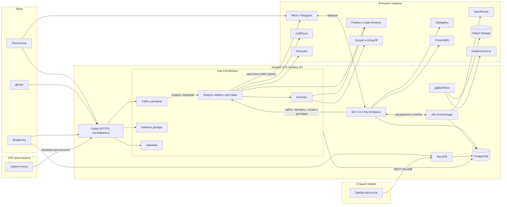
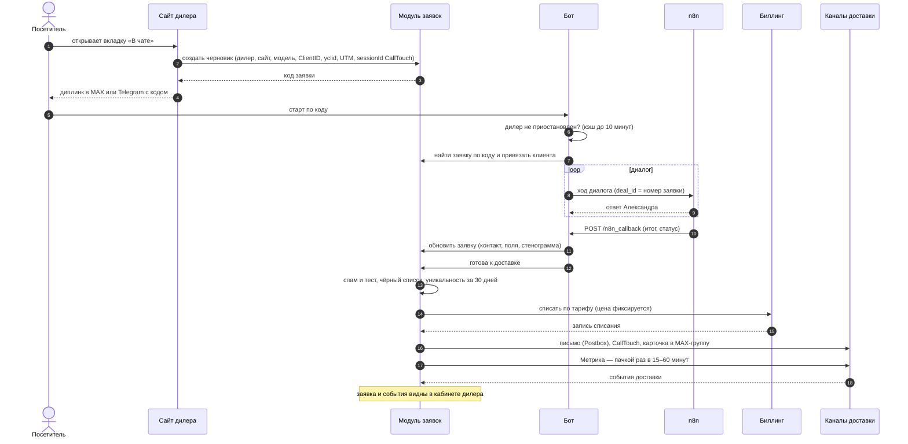
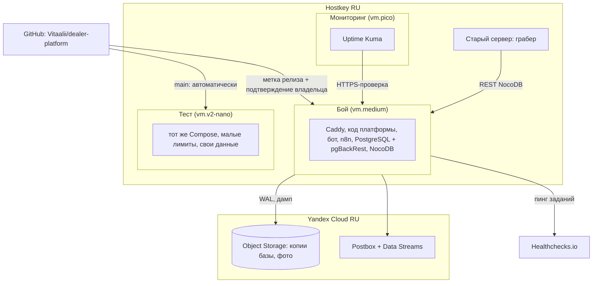
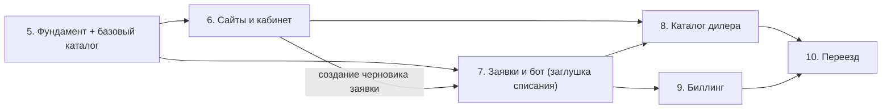

# Архитектура платформы дилеров — v1

Версия 1, 2026-10-16. Задача PDL-26 (план — PDL-25, одобрен Координатором по плану этапа 4
`docs/coordination/plans/2026-10-16-этап-4-архитектура.md`). Срез источников — `main` на коммите `228f7bc`.

Документ ничего не решает сам. Он собирает в одну картину требования, решения владельца и отчёты разведки.
Всё, чего нет в источниках, вынесено в раздел 10 «Открытые вопросы владельцу». Документ вступает в силу,
когда его одобрит владелец (план этапа 4, критерий 5).

---

## 0. Кратко (15–20 минут)

### Что строим

Платформа даёт дилеру лендинг на общем шаблоне, кабинет с заявками и предоплаченный баланс с оплатой за
каждую заявку (REQ:15). Строится параллельно со старой системой UnifiedBot. Старая система не трогается
(REQ:28–35). Битрикса в новой системе нет: хранение заявок, письмо дилеру, CallTouch и Метрику делает код
платформы (REQ:33).

### Из чего состоит (раздел 1)

Все сервисы живут на одном боевом VPS у Hostkey в России (REQ:161, DEC:96). Каждый сервис — отдельный контейнер
Docker Compose (REQ:166):

- **Caddy** — раздаёт сайты дилеров и сам выпускает для них сертификаты, но только для поддоменов из базы
  (REQ:167);
- **код платформы** — сайты, кабинет дилера, админка, модуль заявок и доставки, биллинг;
- **бот** — перенос версии 3.4.4 без слоя Битрикса (REQ:168);
- **n8n** — свой экземпляр, в нём ИИ-агент Александр (REQ:169);
- **PostgreSQL** — единственный источник истины (DEC:17);
- **NocoDB** — окно владельца в базу для просмотра и ручной правки (DEC:17).

Вне VPS:

- копии базы и фото каталога — в Yandex Object Storage (DEC:20, DEC:48);
- письма — через Yandex Cloud Postbox (DEC:37);
- проверка доступности — Uptime Kuma на отдельном маленьком VPS (DEC:50);
- проверка бэкапов — Healthchecks.io (DEC:50);
- грабер каталогов остаётся на старом сервере (DEC:19).

### Главные решения (уже приняты владельцем)

| Тема | Решение | Источник |
|---|---|---|
| Хранилище | Вариант Б: одна PostgreSQL. NocoDB подключена к ней; деньги и заявки в NocoDB только на чтение | DEC:17 |
| Чтение каталога | Бот и n8n читают PostgreSQL напрямую, без NocoDB на пути | DEC:23 |
| Каталоги | Разовую копию выгружает CE старой системы. При переезде марки грабер переключается на новую базу | DEC:19, DEC:24; R-хран §6 |
| Кто создаёт заявку | Сайт платформы, ещё до диалога. Бот находит заявку по коду; охота за дублями не нужна | DEC:84 |
| Когда доставлять | Когда бот передал итог с телефоном и проверки модуля заявок пройдены | DEC:83 |
| Каналы доставки | Письмо: все адреса в «Кому», через Postbox. Плюс CallTouch по API, Метрика через OAuth платформы, карточка в MAX-группу — через модуль заявок | DEC:61, 62, 71, 82 |
| Почта | Postbox, поддомен `notify.<домен>`. Счета и акты — только в кабинете | DEC:37–39 |
| Бэкапы | pgBackRest (потеря до ~1 минуты) + ежедневный дамп + еженедельное пробное восстановление. Копии — только в РФ | DEC:47, 48, 51 |
| Календарь апелляций | Kuzyak — основной источник, isDayOff — для сверки, плюс своя копия. Срок — 3 рабочих дня по Москве, день доставки не считается | DEC:97–100 |
| Бюджет на серверы | ориентир ~3 000 ₽ в месяц | DEC:94 |

### Как идёт заявка (раздел 3)

1. Сайт создаёт черновик заявки с метками визита.
2. Бот находит черновик по коду и ведёт диалог вместе с n8n.
3. Бот передаёт итог с телефоном и сигнал «готова к доставке».
4. Модуль заявок по порядку:
   - отсеивает спам, тест и чёрный список;
   - проверяет уникальность за 30 дней;
   - списывает деньги;
   - доставляет: письмо, CallTouch, Метрика, MAX-группа.
5. Дилер видит заявку в кабинете (REQ:92–99).

Каждое событие доставки сохраняется — из них собирается экран «Состояние доставки».

### Что ещё не решено (раздел 10, 13 вопросов)

Самые срочные (нужны до плана этапа 5):

- **В1.** Вариант серверов: 2 000, 2 830 или 4 990 ₽. Рекомендация — 2 830 ₽.
- **В4.** На чём писать код платформы.
- **В12.** Как собирать и выкатывать без CI.
- **В3.** NocoDB на тесте: постоянно или временно.

К этапу 6:

- **В2.** DNS у дилеров: A-запись или CNAME.
- **В5.** Как отдаётся страница сайта.

Позже:

- **В8.** Тексты диалогов уходят в зарубежные ИИ-сервисы — вопрос по 152-ФЗ.
- **В9.** Сроки хранения персональных данных; кто оператор ПД.
- **В10.** Насколько баланс может уйти в минус.
- **В11.** Порядок этапов 6–9.

### Порядок этапов (раздел 9, предложение)

Нумерация из REQ:211–216 остаётся, но с двумя уточнениями:

- базовый каталог марок появляется уже на этапе 5, потому что он нужен сайтам и боту раньше этапа 8;
- модуль заявок на этапе 7 работает со списанием-заглушкой, а настоящее списание включается на этапе 9.

---

## 0.1. Как читать

**Сокращения источников:**

- **REQ** — `docs/REQUIREMENTS.md`;
- **DEC** — `docs/coordination/decisions.md`;
- **R-хран** — `docs/research/2026-10-16-storage.md`;
- **R-почта** — `docs/research/2026-10-16-mail-and-backups.md`;
- **R-бот** — `docs/research/2026-10-16-bot-n8n-migration.md`;
- **R-доставка** — `docs/research/2026-10-16-lead-delivery-metrika-calltouch.md`;
- **R-календ** — `docs/research/2026-10-16-production-calendar.md`;
- **R-сервер** — `docs/research/2026-10-16-server-sizing.md`;
- **СТАР** — `docs/context/2026-10-13-legacy-system-notes.md`.

Запись «REQ:96» означает строку 96 файла на срезе `228f7bc`. «R-бот §7.2» — раздел отчёта.

**Пометки** (по образцу DEC:8–9):

- **решено** — владелец сказал явно (DEC или REQ);
- **предложение REQ** — пункт REQ с пометкой «предложение». REQ:9 говорит, что такие пункты окончательно
  утверждаются в документе архитектуры, поэтому они собраны в разделе 11;
- **рекомендация** — так советует отчёт разведки или этот документ, но владелец этого не решал;
- **открыто** — нужен ответ владельца, номер вопроса «В…» ведёт в раздел 10;
- **[предположение]** — не проверено.

**Словарь:**

| Слово | Что значит здесь |
|---|---|
| Заявка | запись модуля заявок платформы; заменяет «сделку» Битрикса |
| Черновик заявки | заявка, которую сайт создал до диалога (DEC:84). У неё ещё нет итога и телефона, её не тарифицируют (R-бот §9.1) |
| Код заявки | код из диплинка: первые 2 символа — дилер, 3–4 — модель, 5–6 — комплектация (R-бот §1, `bot/main.py:3639–3688`) |
| Кабинет дилера | веб-кабинет маркетолога дилера (REQ:44) |
| ЛК клиента | «личный кабинет клиента» в боте: анкета, подтверждение телефона звонком (REQ:45, REQ:90). Это **не** кабинет дилера |
| Модуль заявок | часть кода платформы: создание, проверки, списание, доставка |
| Бой / тест | боевой и тестовый контуры (REQ:174) |

---

## 1. Состав системы и связи

### 1.1. Части системы

| Часть | Что делает | Где работает | Источник |
|---|---|---|---|
| Caddy | HTTPS, раздача сайтов дилеров, кабинета и админки. Сертификаты — только для поддоменов из базы | бой, тест | REQ:167; R-сервер §1 |
| Сайты дилеров | общий шаблон, данные дилера из базы | код платформы | REQ:52, REQ:62 |
| Кабинет дилера | контент, Hero, модели и скидки, заявки, баланс, аналитика, почты | код платформы | REQ:147–157 |
| Админка владельца | дилеры, модерация, пресеты, тарифы, чёрный список, апелляции, балансы, доставка. Админка минимальная, ручную правку каталогов и справочников делает NocoDB | код платформы | REQ:147–157; DEC:17 |
| Модуль заявок и доставки | создание заявки, проверки, уникальность, списание, доставка, события доставки | код платформы | REQ:86–105 |
| Биллинг | баланс, счета, акты, тарифы, уведомления, приостановка, апелляции, календарь | код платформы | REQ:107–141 |
| Бот | диалоги в MAX и Telegram, воронка Dialogflow, ЛК клиента | отдельный контейнер | REQ:168; R-бот |
| n8n | ИИ-агент Александр и его инструменты | отдельный контейнер | REQ:169; R-бот §5 |
| PostgreSQL | база платформы, база бота, служебные базы n8n и NocoDB | отдельный контейнер | DEC:17; R-сервер §1, §8 п. 3 |
| pgBackRest | непрерывный архив базы в Object Storage | рядом с PostgreSQL | DEC:47–48 |
| NocoDB | интерфейс владельца поверх PostgreSQL | отдельный контейнер, лимит памяти | DEC:17, DEC:22; R-сервер §8 п. 2 |

На чём писать код платформы и сколько в нём сервисов — **открыто**, вопрос В4.

### 1.2. Внешние сервисы

| Сервис | Зачем | Кто обращается | Источник |
|---|---|---|---|
| MAX, Telegram | мессенджеры ботов | бот (вебхуки `/max_webhook`, `/tg_webhook`) | R-бот §4 |
| OpenRouter | ИИ-модели Александра | n8n | R-бот §5.1; R-сервер §1 |
| Dialogflow (Google) | воронка до ИИ | бот | R-бот §2.4 |
| Auto.ru API | оценка трейд-ина | n8n (воркфлоу оценки); ключ тот же, что в старой системе | R-бот §5.1; СТАР:68 |
| ProstoSMS | подтверждение телефона звонком в ЛК клиента | бот | R-бот §4; REQ:173 |
| Yandex Cloud Postbox | письма | код платформы | DEC:37 |
| Yandex Data Streams | события доставки писем Postbox | код платформы читает | R-доставка §4, §9 п. 4 (рекомендация) |
| CallTouch API | передача заявки дилеру | код платформы | DEC:61; R-доставка §3 |
| API Яндекс Метрики | проверка доступа, цель, офлайн-конверсии | код платформы | DEC:62, DEC:70; R-доставка §2 |
| Yandex Object Storage | копии базы, фото каталога | pgBackRest, код платформы, бот и n8n (ссылки на фото) | DEC:20, DEC:48 |
| Kuzyak Calendar API, isDayOff | производственный календарь | код платформы, раз в сутки или реже | DEC:98; R-календ «Рекомендация» |
| Healthchecks.io | сигналы о бэкапах и диске | задания по расписанию | DEC:50 |
| Uptime Kuma | внешняя проверка сайтов | со своего VPS | DEC:50 |
| Банк | автозачисление (банк не выбран) | код платформы, подключение заменяемое | REQ:115; REQ:224 |
| Грабер каталогов | пишет каталоги марок через REST NocoDB | со старого сервера | DEC:19; R-хран §3 |

### 1.3. Схема компонентов

### 1.4. Связи текстом

Схема выше — не единственный носитель фактов. Ниже то же самое таблицей.

| Кто | Куда | Как | Авторизация | Источник |
|---|---|---|---|---|
| Посетитель, дилер, владелец | Caddy | HTTPS | кабинет дилера — почта и пароль (REQ:44); вход в админку не описан, решается в плане этапа 6 | REQ:44, REQ:167 |
| Сайт | модуль заявок | внутренний вызов: создать черновик с метками визита | внутри платформы | DEC:84; R-доставка §5 |
| MAX, Telegram | бот | вебхуки на адрес нового VPS | токены ботов из окружения | R-бот §4 |
| Бот | n8n | HTTP-вебхук `ai-handoff-v3` и другие | заголовок `X-N8N-Secret` (общий секрет) | R-бот §6.1 |
| n8n | бот | `POST /n8n_callback` | заголовок `X-N8N-Callback-Secret`; режим strict — рекомендация этого документа (в старом коде по умолчанию soft) | R-бот §6.2 |
| Бот | модуль заявок | создать, найти по коду, обновить, сменить статус, «готова к доставке» | транспорт (внутренний вызов или HTTP внутри VPS) — **открыто**, В4 | R-бот §2.1, §8.2 п. 1 |
| Бот, n8n, код платформы | PostgreSQL | SQL | отдельные роли базы | DEC:23; R-хран §6 п. 2 |
| NocoDB | PostgreSQL | внешний источник | своя роль: запись только в схемы `catalog` и `content`, в `platform_ro` — только `SELECT` | R-хран §4Б, §6 п. 1 (рекомендация) |
| Грабер | NocoDB | REST NocoDB по сети со старого сервера | токен новой системы на старом сервере; как открыть доступ — **открыто**, В7 | DEC:19; R-хран §5 |
| Модуль заявок | Postbox | HTTP API, совместимый с AWS SES | ключ из окружения [предположение: вид ключа уточняет план этапа 5] | DEC:37; R-почта §2.3 |
| Модуль заявок | CallTouch | `register` с id сайта дилера, токен не нужен | токен дилера — только для проверки подключения | R-доставка §3.1–3.2 |
| Модуль заявок | Метрика | загрузка офлайн-конверсий пачками | OAuth-токен служебного логина платформы с 2FA | DEC:62, DEC:70; R-доставка §2.1 |
| Модуль заявок | MAX-группа дилера | карточка заявки после проверок | токен бота марки. Кто шлёт технически (модуль сам или через бота) — решается в плане этапа 7 | DEC:82 |
| Биллинг | Kuzyak, isDayOff | открытый GET без ключа | — | R-календ §3–4 |
| pgBackRest | Object Storage | S3 | ключи из окружения; копии шифруются на нашей стороне | R-почта «Рекомендация», «Бэкапы» п. 1 |
| Задания по расписанию | Healthchecks.io | HTTP-пинг | адрес проверки | DEC:50; R-почта §6.2 |
| Uptime Kuma | сайты | HTTPS-проверка со своего VPS | — | DEC:50 |

---

## 2. Хранилище

### 2.1. Что решено

| Решение | Источник |
|---|---|
| Вариант Б: PostgreSQL — источник истины. NocoDB подключена к ней как интерфейс просмотра и ручной правки. Админка минимальная. Деньги и заявки в NocoDB — только чтение | DEC:17 |
| Бот и n8n читают каталог из PostgreSQL напрямую. NocoDB не на критическом пути (урок падения 06.10) | DEC:23 |
| Каталоги правят грабер (данные из прайсов) и владелец вручную (видимость и фото) | DEC:18 |
| Цвета, склад, программы, ставки сейчас заполняют отдельные скрипты; скоро всё это будет делать грабер | DEC:21 |
| Фото каталога лежат в S3 Yandex Cloud, в базе только ссылки | DEC:20 |
| Лицензия NocoDB устраивает: ею пользуется только владелец | DEC:22 |
| Общую колонку `Active` оставить: её читает грабер | DEC:25 |
| Разовую копию каталогов выгружает CE старой системы, бережным чтением | DEC:24 |
| Проверка «грабер + NocoDB поверх внешней PostgreSQL» — на тестовом стенде этапа 5. Запасной вариант — таблицы грабера во внутренней базе NocoDB | DEC:26 |
| Деньги и заявки — в транзакционной базе | REQ:170 |

### 2.2. Схемы PostgreSQL и доступ NocoDB

Разделение данных на схемы — **рекомендация** R-хран §4Б и §6 п. 1. Имена схем условные. Смысл разделения:
в бесплатной NocoDB права задаются только на весь источник, а не на отдельную таблицу. Поэтому запрет на правку
держит сама база — схемами и правами ролей (R-хран §4Б).

| Схема (условно) | Что лежит | В NocoDB | Кто пишет | Источник |
|---|---|---|---|---|
| `catalog` | каталоги марок, оснащение, цвета, склад, кредитные программы и ставки, служебные таблицы грабера (8 таблиц) | **правка** | грабер, владелец | R-хран §1.2, §3, §4Б; DEC:18, DEC:21 |
| `content` | промпт-блоки бота, `Prompt_Blocks`, `Intents`, `Intent_Block_Map`, реестр ботов (без токенов, только имена переменных) | **правка** | владелец, скрипты промптов | R-хран §4Б |
| `platform_ro` | заявки и события доставки, отклонённые заявки, движения денег, балансы, счета, акты, тарифы, чёрные списки, дилеры, сайты, контент, Hero, настройки дилера по комплектациям | **только чтение** | только код платформы (кабинет, админка, модуль заявок, биллинг) | R-хран §4Б; DEC:17; REQ:117 |
| закрытые схемы | учётные записи (хэши паролей), сессии, OTP, токены кабинета, согласия, данные ЛК клиента в боте (`bot/database.py:114–348`), архив диалогов | **не подключать** | код платформы, бот | R-хран §4Б |
| отдельные базы | служебная база NocoDB, служебная база n8n | не подключать | сами сервисы | R-хран §4Б; R-сервер §8 п. 3 |

Таблицы бота (`users`, `cabinet_*`, `consents` и другие, `bot/database.py:38–348`) появляются в новой базе
пустыми: сессии не переносятся (REQ:32; R-хран §1.3). Таблица `pending_sync` не переносится, она уходит вместе
с очередью досылки в Битрикс (R-бот §4).

### 2.3. Основные таблицы по смыслу

Это перечень без полей: точную схему таблиц проектируют планы этапов.

| Группа | Таблицы (по смыслу) | Источник требований |
|---|---|---|
| Дилеры и сайты | дилер (марка, регион, статус), сайт (поддомен, состояние запуска), контент сайта, Hero (выбор пресета, тексты, история версий), UTM-правила, почты для заявок и уведомлений, настройки аналитики (номер счётчика Метрики, id сайта и `mod_id` CallTouch) | REQ:39–74, REQ:105, REQ:157 |
| Марки | пресеты Hero, оформление марки (шрифты, цвета кнопок), ссылки ботов | REQ:66–67; R-бот §7.2 (C) |
| Каталог | каталог марки (база) + **таблица настроек дилера по комплектациям** (видимость, скидки) вместо колонок `Active_N` | REQ:80–82; DEC:25 |
| Заявки | заявка, история заявки (вместо ленты сделки Битрикса), события доставки, отклонённые заявки, апелляции | REQ:86–105; R-бот §2.1 |
| Деньги | движения (пополнение, списание, возврат, корректировка) — неизменяемые записи; счета, акты, оферта и её принятие, тарифы и переопределения | REQ:111–123 |
| Чёрные списки | общий (владелец) и дилерский | REQ:95 |
| Календарь | нерабочие дни на текущий и следующий год, ручные переносы | DEC:98, DEC:100 |
| Архив диалогов | стенограммы, хранятся 1 месяц | DEC:81 |

### 2.4. Каталоги: как попадают в новую систему

1. **Для разработки.** CE старой системы делает разовую выгрузку из боевой NocoDB (DEC:24). Фото переносятся
   отдельно, файлами в S3; ссылки меняются (R-хран §5, путь 1; DEC:20).
2. **В день переезда марки.** Свежая копия плюс смена файла окружения грабера этой марки на новую NocoDB
   (R-хран §5, путь 4, — рекомендация). Грабер не умеет писать в две базы сразу (R-хран §3). Поэтому
   переключать его можно только вместе с переездом марки.
3. **Требования грабера к новой базе:** все 8 таблиц с той же схемой и побайтно теми же именами колонок, включая
   `Сonsumption` с кириллической «С», и с вариантами SingleSelect. Читает не больше 1000 записей за запрос
   (R-хран §3, со слов CE грабера). В PostgreSQL придётся держать колонки с такими именами (R-хран §4Б, минусы).
4. **Проверка на стенде этапа 5** (DEC:26). Нужно проверить:
   - NocoDB поверх внешней PostgreSQL;
   - копию грабера, которая пишет строку по кнопке;
   - SingleSelect, вложения-фото, ошибки колонок.

   Если проверка не пройдёт — запасной вариант: таблицы грабера во внутренней базе NocoDB, остальное как в
   варианте Б. Итоговую цену тогда собирает код платформы (R-хран §6 п. 4).

### 2.5. Что учесть при переносе

- Бот сейчас читает каталог и дилеров одним запросом с `limit 100` (R-хран §2). На 50–100 дилерах это граница.
  При переходе на SQL ограничение надо убрать.
- Ссылки на фото сейчас собираются из адреса NocoDB, зашитого в код n8n и бота (R-хран §2). В новой системе ссылки
  ведут на S3 (DEC:20).
- NocoDB документация требует Redis для кэша (`NC_CACHE_REDIS_URL`), а в старой системе его нет (R-сервер §3).
  Нужен ли он, проверяется на стенде этапа 5.

---

## 3. Модуль заявок и доставка

### 3.1. Каналы и тарификация

| Канал | Телефон | Тарификация | Доставка | Источник |
|---|---|---|---|---|
| Чат с Александром («В чате») | от клиента в диалоге | по тарифу | письмо, CallTouch, Метрика, MAX-группа | REQ:90; DEC:82 |
| ЛК клиента («В личном кабинете») | подтверждён звонком | по тарифу, как чат | то же | REQ:90 |
| Форма «По телефону» | не подтверждён | бесплатно, в уникальности не учитывается | письмо (тем же порядком, с другим текстом), CallTouch, Метрика | REQ:90, REQ:96; DEC:64 |
| Будущие типы (одобрение кредита, бронирование) | — | своя стоимость | — | REQ:90 |

### 3.2. Жизненный цикл заявки

Статусы ниже — рабочие названия из R-бот §7.1 и §9.1. Точный список задаёт план этапа 7.

| Статус | Когда | Тарифицируется | Источник |
|---|---|---|---|
| черновик | сайт создал заявку при открытии чата или ЛК, до диалога | нет | DEC:84; R-бот §9.1 |
| в работе | бот нашёл заявку по коду и привязал клиента | нет | R-бот §7.1 п. 2 |
| готова к доставке | бот передал итог с телефоном | — (начинаются проверки) | DEC:83 |
| отклонена | спам или тест; номер из чёрного списка | нет | REQ:94–95, REQ:101 |
| доставлена | проверки пройдены, деньги списаны, доставка запущена | да (кроме «По телефону» и неуникальных) | REQ:96–99 |
| закрыта: отказ / по таймауту | клиент отказался; диалог брошен на 48 ч | нет | R-бот §7.1 п. 3, п. 7 |
| апелляция → возврат | дилер оспорил в срок, владелец одобрил | возврат отдельной записью | REQ:103 |

Порядок обработки после сигнала «готова к доставке» задан требованиями (REQ:92–99):

1. Спам и тест не доставляются и не тарифицируются.
2. Номер из чёрного списка (общего или дилерского) не доставляется и не тарифицируется.
3. Уникальность: тарифицируется уникальная заявка в рамках дилера за 30 дней. Ключ — нормализованный
   телефон.
4. Списание по тарифу (раздел 6).
5. Доставка: письмо, CallTouch, Метрика, карточка в MAX-группу.
6. Заявка появляется в кабинете дилера с контактами.

Модуль заявок сам защищает заявку от двойной записи. Бот работает в одной реплике и держит замки внутри
процесса, на них полагаться нельзя (R-бот §8.3 — рекомендация, способ [предположение: замок в базе]).

### 3.3. Схема: заявка из чата

Источники шагов:

- шаги 1–4 — DEC:84; R-доставка §5 и §9 п. 5;
- шаги 5–7 — R-бот §7.1 п. 2 и §7.2 (A); DEC:85;
- шаги 8–10 — R-бот §6;
- шаги 11–12 — R-бот §7.1 п. 3–4 и §9.3 п. 2, 4; DEC:83;
- шаги 13–15 — REQ:92–97;
- шаги 16–18 — DEC:61, 62, 71, 82; R-доставка §7, §9.

Заявка «По телефону» идёт короче. Форма сайта сразу передаёт телефон, бота в этом пути нет. Когда такая заявка
становится «готовой к доставке» — **открыто**, В6. Списания нет (REQ:90). Доставка — как у
остальных (DEC:64).

### 3.4. Что сайт кладёт в заявку

| Поле | Откуда на странице | Зачем | Источник |
|---|---|---|---|
| ClientID Метрики | `ym(..., 'getClientID')` или cookie `_ym_uid` | офлайн-конверсия | DEC:65; R-доставка §5 |
| yclid | параметр адреса | конверсия по объявлению Директа | DEC:65; R-доставка §5 |
| UTM | параметры адреса | источник | R-доставка §5 |
| sessionId CallTouch | `window.ct(...)` или cookie `_ct_session_id` | источник заявки в CallTouch | R-доставка §5; R-бот §3.2 |
| адрес страницы | `location.href` | `requestUrl` в CallTouch | R-доставка §5 |
| дилер, сайт, модель, комплектация | шаблон | код заявки и письмо | R-бот §1 |

Как хранить эти поля (рекомендация R-доставка §5):

- пустой ClientID, yclid или sessionId — это «нет значения», а не ошибка, и доставку письма он не блокирует;
- значения хранятся без «;» на конце.

Если клиент пришёл в мессенджер не с сайта, в Метрику такая заявка не попадёт — так решено (DEC:72).

### 3.5. Доставка по каналам

| Канал | Как | Важные ограничения | Источник |
|---|---|---|---|
| Письмо | Postbox, `SendEmail`, все адреса дилера в «Кому» одним письмом | Postbox берёт плату за каждого получателя. Квоты нового облака — 200 писем в сутки и 1 в секунду, их надо поднять до запуска. Адрес с постоянными отказами попадает в стоп-лист на срок до 14 дней | DEC:71; R-доставка §4 |
| CallTouch | сервер шлёт `register` на `…/requests/{site_id}/register/` после списания. Поля: `phoneNumber`, `fio`, `subject`, `requestUrl`, `sessionId`, `requestNumber` = номер заявки | Ответ 200 ещё не значит успех — нужно читать тело ответа. Не больше 5 запросов в секунду, плюс суточные баллы. Повтор — только после ошибки | DEC:61; R-доставка §3, §9 п. 2 |
| Метрика | своя цель типа `action`, офлайн-конверсии CSV по ClientId или Yclid, пачкой раз в 15–60 минут. Цену конверсии на старте не передаём | Окно привязки — 21 день. В отчётах конверсия появляется через 3–24 часа. На логин платформы — 5 000 запросов в сутки на всех дилеров. Метод загрузки помечен Deprecated — перепроверить перед этапом 7 | DEC:62, DEC:65, DEC:67; R-доставка §2.4, §9 п. 1 |
| MAX-группа дилера | карточка заявки, только после проверок модуля | — | DEC:82 |

Как не задвоить:

- источник офлайн-конверсий — только платформа. Дилер при подключении отключает передачу заявок из CallTouch в
  Метрику (DEC:68);
- автоотслеживание форм CallTouch на сайтах платформы выключено (DEC:69);
- каждая заявка уходит в каждый канал один раз; номер загрузки и `requestId` хранятся у заявки (R-доставка §9 —
  рекомендация).

### 3.6. Экран «Состояние доставки»

Экран — из REQ:157. Он показывает список событий по каждой заявке. Набор событий — рекомендация R-доставка §7:

- письмо: принято (MessageId), доставлено, отказ, задержка или жалоба — по каждому адресу (события Postbox через
  Data Streams; они могут прийти повторно, дубли отсекаются по `eventId`);
- CallTouch: отправлено (`requestId`), ошибка с кодом, лимит (429), «без сессии»;
- Метрика: нет идентификатора — не отправляется; в очереди → загружено → обработано или ошибка привязки;
  старше 21 дня — не отправляется;
- подключение: доступ к Метрике пропал или понижен, токен CallTouch не работает (ежедневная проверка).

### 3.7. Подключение дилера к доставке

| Шаг | Кто | Источник |
|---|---|---|
| Почты для заявок — в кабинете. При переезде их один раз переносят из роботов Битрикса | дилер (при переезде — перенос) | REQ:105 |
| Номер счётчика Метрики; доступ служебному логину платформы с уровнем «Редактирование» | дилер, вручную в Метрике | DEC:62, DEC:70; R-доставка §2.1 |
| Проверка доступа: `my_grant`, `perm = edit` — при подключении и раз в сутки | платформа | R-доставка §2.2 (рекомендация) |
| Создание цели «Заявка с платформы» | платформа | R-доставка §2.3 |
| id сайта, токен и `mod_id` CallTouch; включить «Передачу данных по API» | дилер, вручную | DEC:61; R-доставка §3.2, §6 |
| Проверка id сайта и токена запросом журнала заявок | платформа | R-доставка §3.2 |
| Отключить передачу заявок CallTouch → Метрика | дилер, по подсказке в кабинете | DEC:68 |

Токен CallTouch для отправки заявок не нужен (R-доставка §3.1). В DEC:61 он назван среди данных от дилера, и это
не противоречие: токен нужен только для проверки подключения.

### 3.8. Апелляция

Как устроена (REQ:103; DEC:99):

- дилер оспаривает заявку в течение 3 рабочих дней от доставки;
- день доставки не считается, срок истекает в конце 3-го рабочего дня по московскому времени;
- решает владелец;
- одобренная апелляция добавляет запись возврата за конкретную заявку, списание не стирается.

Календарь — раздел 6.4.

---

## 4. Перенос бота и n8n

### 4.1. Бот: убрать, заменить, оставить

| Что | Решение | Источник |
|---|---|---|
| Слой Битрикса: `BitrixService` (`main.py:565–1237`), 10 прямых запросов к вебхуку, ~10 мест кабинета через инъекцию | **заменить** вызовами модуля заявок | R-бот §2.1; REQ:34 |
| Охота за сделкой сайта (2 часа) и склейка дублей | **убрать**: сайт создаёт заявку сам | DEC:84; R-бот §9.3 п. 3 |
| Очередь досылки `pending_sync` | **убрать**, если модуль заявок пишет в ту же базу [предположение R-бот §2.1]. Если модуль будет отдельным сервисом — нужна своя очередь (связано с В4) | R-бот §2.1 |
| Стадии сделки и правило «сначала поля, потом стадия» | **заменить** статусами заявки и одним сигналом «готова к доставке» | DEC:83; R-бот §9.3 п. 4 |
| Поля `deal_id` и `active_deal_id` | **оставить** имена полей, класть в них номер заявки платформы | R-бот §2.3, §9.3 п. 5 |
| 6 точек чтения NocoDB + запись архива диалогов | **заменить** на SQL к PostgreSQL | DEC:23; R-бот §4 |
| Прокси каталога для сайта `/catalog`, `/catalog-colors` | **убрать** из бота [предположение R-бот §4: новый шаблон не ходит к боту за каталогом] | R-бот §4 |
| Tiledesk | **убрать** | DEC:80 |
| Envybox | **убрать** | DEC:63 |
| Заголовки ngrok в CORS | **убрать** | R-бот §4 |
| Dialogflow | **оставить**. Ключ — только из окружения, с самопроверкой при старте | R-бот §2.4; СТАР:43–53 |
| Логика Александра, ЛК клиента, ProstoSMS, MAX и Telegram | **оставить**, значения окружения — новые | REQ:34; R-бот §4 |
| Маскировка вебхука Битрикса в логах | **заменить** маскировкой ключей платформы | R-бот §2.1 |

### 4.2. API модуля заявок для бота

Пять операций (R-бот §8.2 п. 1 и §7.1):

1. создать заявку — нужна там, где сайт её не создал, например при веб-входе;
2. найти по коду;
3. обновить данные;
4. сменить статус;
5. «готова к доставке».

Поля, которые бот пишет сейчас, перечислены в R-бот §3. Это итоги ИИ, анкета ЛК, трейд-ин, UTM, cookie CallTouch и
Метрики. Они — источник для схемы заявки на этапе 7.

Модуль сам решает: спам и тест, чёрный список, уникальность, списание, доставку. Бот передаёт канал, телефон и
признак подтверждения телефона (R-бот §7.1).

### 4.3. Контракт бот ↔ n8n

Рекомендация R-бот §9.3 п. 1–2: формат вызовов оставить, поменять только значения.

- `deal_id` — номер заявки платформы.
- `data_routing` — ссылки на таблицы PostgreSQL вместо id NocoDB [предположение R-бот §6.3: достаточно кода
  дилера].
- Адреса и секреты — новые (REQ:169).
- Колбэк `/n8n_callback` остаётся у бота, и бот пишет в модуль заявок. Тогда в заявку пишет один участник, а
  правила статусов (`crm_mapping.py`) остаются в одном месте (R-бот §9.2).
- Контракт нужно описать заново в одном месте, с тестом (REQ:190; R-бот §6.3).

### 4.4. Состояние оплаты дилера в боте

| Точка | Что делает | Источник |
|---|---|---|
| A. Новая сессия по коду | приостановленному дилеру новая сессия не открывается. Начатая заявка доводится | REQ:141; R-бот §7.2 |
| B. Открытие ЛК с сайта | отказ с понятной ошибкой | R-бот §7.2 |
| C. Вкладки сайта | признак «только по телефону» хранится в настройках дилера и показывается сайтом | REQ:136; R-бот §7.2 (зависит от В5) |
| D. Кэш дилеров бота | поле состояния оплаты; обновление раз в 10 минут допустимо | DEC:85 |

### 4.5. n8n

| Что | Решение | Источник |
|---|---|---|
| Экземпляр | свой, на VPS платформы; копия воркфлоу; новые ключи и адреса | REQ:169 |
| 15 узлов NocoDB в 6 воркфлоу | перевести на PostgreSQL. Плюс генераторы, которые строят эти узлы | DEC:23; R-бот §5.1 |
| Адрес старой NocoDB для фото (`MY_NOCO_DOMAIN`) | заменить на S3 | DEC:20; R-бот §5.1 |
| `TOOL_ Save to CRM` — адрес старого бота зашит в файле | адрес нового бота брать из окружения n8n [предположение R-бот §6.3] | R-бот §5.1 |
| Ключ Auto.ru | тот же ключ, но в credentials n8n, не в заголовке узла | СТАР:68; R-бот §5.1 |
| `AI Agent v2.0 MAX`, `AI Resolver (shadow)` | переносить только как файлы | DEC:87–88 |
| Правки [TEST] `effa014` и `f2de42d` | внести в перенос на этапе 7. Выгрузка у владельца | DEC:86 |
| Тестовый контур | свои данные, не те же таблицы, что у боя | R-бот §5.2; REQ:174 |
| Вебхуки без авторизации | в новой системе всем вебхукам — Header Auth (рекомендация) | R-бот §5.1 |
| История запусков | 3 дня, как сейчас | R-сервер §8 п. 3 |

### 4.6. Порядок переноса (рекомендация R-бот §8.2)

1. Схема модуля заявок и его API.
2. Бот без Битрикса «вхолостую» на новом VPS: код уже работает с пустым `BITRIX_WEBHOOK_URL`.
3. Окружение бота: PostgreSQL, новые ключи, вебхуки тестовых ботов.
4. n8n: импорт, credentials, узлы NocoDB → PostgreSQL, адрес колбэка.
5. Слой Битрикса → модуль заявок, по точкам R-бот §7.1, с тестами на каждую.
6. Удаление охоты, склейки, `pending_sync`, Tiledesk, Envybox.
7. Состояние оплаты — с заглушкой «всегда оплачен» до этапа 9.

**Риски** (R-бот §8.3):

- можно пропустить один из прямых запросов к Битриксу — защита: сверка `grep` до и после;
- 25 из 64 файлов тестов завязаны на Битрикс;
- бот работает одной репликой.

Регистрация вебхуков ботов на новый адрес — по задаче владельца, потому что скрипт пишет во внешние сервисы
(R-бот §4).

---

## 5. Сайты, кабинет дилера, админка

### 5.1. Сайт

Сайт — запись в базе на общем шаблоне. Запуск идёт через модерацию владельца, дальше дилер ведёт контент сам
(REQ:52).

| Что | Как | Источник |
|---|---|---|
| Шаблон | один код страницы на всех: блоки U1–U7, шапка, Hero, подвал и попапы — из данных дилера. Вкладки «В чате», «В личном кабинете», «По телефону» | REQ:62 |
| Что заменяет Tilda | своя логика выбора Hero по UTM (вместо T809), заявка — сразу в модуль (вместо формы и вебхука в Битрикс), настройки — из базы (вместо ручных правок), публикация платформой (вместо вставки блоков), своя проверка опубликованных страниц (вместо `check-live.py`) | СТАР:120–131 |
| Hero | только пресеты: свой набор по марке, 1–2 на модель, готовит владелец. Оформление марки задаёт владелец. Дилер правит заголовок и подзаголовок — с ограничением длины, предпросмотром, историей и откатом | REQ:64–69 |
| UTM-правила | «любой параметр = значение → пресет» плюс «не задано». Задаёт дилер | REQ:70 |
| Контент | только поля, состав блоков фиксирован. Политику и согласие дилер ведёт текстом и сам за них отвечает | REQ:72 |
| Аналитика на странице | скрипты Метрики и CallTouch с номерами из настроек дилера. Автоотслеживание форм CallTouch выключено | DEC:69; R-доставка §5 |
| Ключ Яндекс.Карт | свой ключ платформы: ключи старой системы не используются | СТАР:113; `CLAUDE.md:36` |
| Как страница отдаётся | **открыто**, В5 (рендер платформой на каждый запрос или публикация статики) | REQ:62 |

### 5.2. Запуск по поддомену

Порядок по REQ:56–60:

1. Дилер указывает имя поддомена.
2. Платформа выдаёт инструкцию по DNS.
3. Платформа проверяет, что запись видна.
4. Caddy выпускает сертификат — только для поддомена из базы (REQ:167).
5. Владелец модерирует запуск.
6. Дилер получает письмо «сайт доступен».

Лимиты Let's Encrypt (50 сертификатов на зарегистрированный домен в неделю, 300 заказов за 3 часа на аккаунт)
для ~100 доменов дилеров не мешают (R-сервер §3).

Какую запись создаёт дилер, A на IP (REQ:57) или CNAME на имя платформы, — **открыто**, В2.

### 5.3. Каталог дилера

| Что | Как | Источник |
|---|---|---|
| Видимость моделей и комплектаций | таблица настроек дилера по комплектациям (вместо `Active_N` и `Catalog_Active_Field`). Общая колонка `Active` остаётся | REQ:80–82; DEC:25 |
| Скидки | по нынешним категориям каталога (бонусы наличными, кредит, трейд-ин). Итоговая цена пересчитывается сама | REQ:81 |
| Одна цена для трёх потребителей | лендинг, снапшот ЛК клиента в боте, Car Search и Combo Calculator в n8n читают одно и то же. Цена считается в одном месте — в базе платформы | REQ:83; R-хран §4Б, плюсы |
| Проверка паритета цен | аналог `check_price_parity.py` | REQ:83 |
| Модерация | нет: дилер решает сам. За цену в рекламе отвечает дилер | REQ:78, REQ:84 |

### 5.4. Экраны

Перечень — предложение REQ:145–157 (утверждение — раздел 11). Дополнения из исследований отмечены источником.

| Кабинет дилера | Админка владельца |
|---|---|
| Вход по почте и паролю, сброс пароля (REQ:149) | Дилеры: создание, марка, регион, статус (REQ:149) |
| Сайты: список, статус, запрос поддомена с инструкцией по DNS (REQ:150) | Модерация запусков (REQ:150) |
| Контент (REQ:151) | Пресеты Hero по моделям (REQ:151) |
| Hero: пресет, тексты, UTM-правила, предпросмотр, история (REQ:152) | Тарифы и переопределения (REQ:152) |
| Модели и скидки по комплектациям (REQ:153) | Чёрный список (REQ:153) |
| Заявки: список с контактами, апелляция, свой чёрный список (REQ:154) | Апелляции: решение и возврат (REQ:154) |
| Баланс: история, счёт на сумму, акты; принятие оферты (REQ:113, REQ:155) | Балансы, ручная корректировка, поступления; ручная отметка оплаты до выбора банка (REQ:115, REQ:155) |
| Аналитика: Метрика и CallTouch, проверка, подсказка про цель Метрики (REQ:156; R-доставка §6, §9 п. 3) | Отклонённые заявки (REQ:156) |
| Почты для заявок и уведомлений (REQ:157) | Состояние доставки (REQ:157; R-доставка §7) |
| — | Ручной ввод переносов календаря по напоминанию (DEC:100) |

Правку каталогов, фото, промптов и справочников владелец делает в NocoDB, а не в админке (DEC:17). Способ входа
владельца в админку источниками не задан — его определяет план этапа 6.

---

## 6. Биллинг — контур

Здесь только контур, без таблиц. Детали — план этапа 9.

### 6.1. Деньги

| Что | Как | Источник |
|---|---|---|
| Получатель | ИП, без НДС | REQ:113 |
| Оферта | дилер принимает её в кабинете; дата и версия сохраняются | REQ:113 |
| Баланс | сумма неизменяемых движений: пополнение, списание, возврат, корректировка | REQ:117 |
| Счёт | дилер вводит сумму и скачивает готовый счёт; нумерация своя | REQ:114 |
| Зачисление | вручную владельцем в админке, пока банк не выбран; дальше — по данным банка через заменяемое подключение. Платёж связывается со счётом по номеру в назначении | REQ:115; REQ:224 |
| Акт | раз в месяц, на сумму фактически списанных заявок | REQ:116 |
| Документы | только в кабинете; письмом — уведомление со ссылкой, без вложения | DEC:39 |

### 6.2. Тарифы

- Сейчас — плата за заявку, одна цена по умолчанию. Цену задаёт владелец до запуска биллинга (REQ:121, REQ:223).
- Переопределения цены: по марке, региону, каналу, дилеру, типу заявки. Приоритет: дилер → канал → регион →
  марка → по умолчанию (REQ:122, предложение).
- Цена фиксируется в момент списания (REQ:123, предложение).
- Возможен переход на абонентскую плату плюс плату за заявку (REQ:121). Модель движений денег это допускает:
  абонентская плата — ещё один вид списания [предположение].

### 6.3. Уведомления и приостановка

Уведомления уходят на все почты, куда приходят заявки (REQ:125–130):

- ежедневно, пока баланс ниже 5 000 ₽;
- при переходе баланса в ноль;
- за сутки до выключения сайта;
- за 5, 3 и 1 сутки до снятия сайта с публикации.

| Состояние | Что происходит | Кто реагирует |
|---|---|---|
| Баланс ≤ 0, дни 1–7 | сайт открыт, работает только «По телефону» | сайт (точка C), бот (точки A, B) |
| Дни 8–14 | переадресация на основной сайт дилера | Caddy или код сайта [предположение — решает план этапа 6/9] |
| С 15-го дня | сайт снят с публикации | то же |
| Пополнение | сначала гасит долг; если баланс > 0, всё включается автоматически, без модерации | биллинг |

Источник таблицы — REQ:134–141. Заявка, начатая до обнуления баланса, доводится полностью (REQ:141). Сколько может
накопиться минуса и как списывается такая заявка — **открыто**, В10.

### 6.4. Производственный календарь

Решения (DEC:97–100):

- календарь только федеральный;
- основной источник — Kuzyak, isDayOff — для сверки;
- своя копия на текущий и следующий год;
- если сервисы не обновились — владелец вносит переносы вручную через админку раз в год, по напоминанию.

Рекомендации R-календ («Рекомендация»):

- срок считать только по своей таблице;
- расхождение двух источников — уведомление владельцу, копия при этом не меняется;
- напоминание, если к 1 ноября нет данных на следующий год.

Пример: заявка доставлена 30.12.2026 → срок апелляции до конца 13.01.2027 (R-календ, вывод п. 5; правило — DEC:99).

---

## 7. Инфраструктура

### 7.1. Серверы

Вариант серверов не выбран — **открыто**, В1. Ниже — рекомендуемый вариант R-сервер §8 п. 1:

| Сервер | Тариф (рекомендация) | Что на нём | Источник |
|---|---|---|---|
| Бой | vm.medium: 6 ядер, 12 ГБ, 160 ГБ SSD; 1 510 ₽; автобэкап Hostkey (бета) | весь стек раздела 1.1 | R-сервер §3, §6 |
| Тест | vm.v2-nano: 2 ядра, 4 ГБ, 60 ГБ NVMe; 830 ₽ | тот же стек с малыми лимитами; NocoDB — по В3 | R-сервер §4 |
| Мониторинг | vm.pico; 490 ₽ | Uptime Kuma | DEC:50 |
| **Итого** | **2 830 ₽ в месяц** без скидки, НДС не подтверждён | | R-сервер §6 |

### 7.2. Схема развёртывания

Связи схемы текстом:

- GitHub → тест автоматически, GitHub → бой по метке релиза с подтверждением владельца (REQ:166). Как именно
  тест узнаёт о новом коммите — **открыто**, В12.
- Бой → Object Storage: копии базы (DEC:47–48), фото (DEC:20).
- Бой → Postbox (DEC:37); бой → Healthchecks (DEC:50).
- Uptime Kuma → бой (DEC:50).
- Старый сервер → NocoDB боя (DEC:19; В7).

### 7.3. Docker Compose и лимиты

Развёртывание через Docker Compose — предложение REQ:166, утверждается в разделе 11. Лимиты памяти на бою —
рекомендация R-сервер §3, §8 п. 2:

| Сервис | Лимит |
|---|---|
| Caddy | 256 МиБ |
| PostgreSQL + pgBackRest | 2 ГиБ (`shared_buffers` 512 МиБ) |
| NocoDB | 2 ГиБ, `--max-old-space-size=1536` |
| Redis для NocoDB | 128 МиБ, если понадобится |
| n8n | 3 ГиБ, `--max-old-space-size=2304`, `N8N_CONCURRENCY_PRODUCTION_LIMIT=20` |
| Бот | 1 ГиБ |
| Код платформы | 1,5 ГиБ суммарно (уточнится после В4) |
| **Сумма** | **~9,9 ГиБ** + ~1,5 ГиБ системе |

У каждого сервиса — `restart: unless-stopped`.

Настройки n8n (R-сервер §8 п. 3):

- двоичные данные хранятся на диске;
- история запусков — 72 часа, а лимит её числа поднят до ~60 000;
- база n8n — отдельная база в общем PostgreSQL.

### 7.4. Выкатка

Требование (REQ:166):

- тест обновляется из `main` автоматически;
- бой — по метке релиза с ручным подтверждением владельца;
- ручные команды на сервере — только для первичной настройки, их выполняет владелец по одной (REQ:166, REQ:183;
  `CLAUDE.md:13`).

Обязательные правила по уроку инцидента 12–13.10 (СТАР:43–53):

- образы собираются без ключей, ключи берутся только из окружения сервера;
- после каждой выкатки — живой старт по коду в MAX и Telegram и проверка лога;
- каждый сервис при старте сам проверяет ключи и подаёт сигнал, если ключ не загрузился.

Где собираются образы и как тест узнаёт о новом коммите — **открыто**, В12. От ответа зависит переход к фазе B
автономии: для неё нужен CI (`docs/coordination/AUTONOMY.md:64–69`).

### 7.5. Бэкапы и мониторинг

| Слой | Что | Источник |
|---|---|---|
| 1 | pgBackRest: непрерывный архив журнала в Yandex Object Storage, потеря до ~1 минуты | DEC:47–48 |
| 2 | ежедневный дамп в то же хранилище | DEC:47 |
| 3 | автобэкап Hostkey — запасной слой (бета, один снимок на том же узле) | DEC:49 |
| Проверка | еженедельное автоматическое пробное восстановление с контрольными запросами | DEC:47; R-почта §6.1 |
| Где копии | только РФ | DEC:51 |

Параметры по рекомендации R-почта («Рекомендация», «Бэкапы»):

- `archive_timeout` ~60 с;
- полная копия раз в неделю, разностная — раз в сутки;
- хранение 30 дней;
- шифрование на нашей стороне.

Мониторинг (DEC:50; рекомендация R-почта «Мониторинг»):

- Uptime Kuma на отдельном VPS проверяет, отвечают ли сайты;
- Healthchecks.io получает сигналы «бэкап прошёл», «журнал архивируется», «пробное восстановление прошло»,
  «диск занят меньше 80 %»;
- оповещения уходят в Telegram и на почту средствами самого Healthchecks, а не через наш сервис писем.

### 7.6. Почта

Решения:

- сервис — Postbox, код отправки со сменяемым сервисом: API Postbox совместим с AWS SES (DEC:37);
- поддомен отправки — `notify.<домен>` (DEC:38);
- входящая почта не нужна (DEC:35);
- свой почтовый сервер невозможен: у Hostkey закрыты исходящие порты 25, 465, 587, 2525 (DEC:36).

Рекомендации:

- DNS: SPF, DKIM, DMARC `p=none` с отчётами; через 2–4 недели — `quarantine` (R-почта «Рекомендация» п. 4);
- подключить Postmaster Mail.ru и Google;
- до запуска поднять квоты Postbox: 200 писем в сутки и 1 письмо в секунду — это мало (R-доставка §4).

Отчёт R-почта советовал основным сервисом Unisender Go, но владелец выбрал Postbox (DEC:37). Документ следует
решению. Сравнить с Unisender Go и Resend нужно при росте объёма (DEC:37).

### 7.7. Контуры и боты

| Что | Как | Источник |
|---|---|---|
| Контуры | боевой и тестовый вместо ngrok-стенда | REQ:174 |
| Боты на разработке | нынешние тестовые. Для старой системы заводится новая пара тестовых | REQ:172 |
| Боты при переезде | переключаются нынешние боевые, по марке, все дилеры марки разом | REQ:172; порядок переезда — REQ:228 |
| ProstoSMS | IP нового VPS — в разрешённые; делает владелец | REQ:173; R-бот §4 |

### 7.8. Когда расширяться

Сигналы (рекомендация R-сервер §7):

- память боя держится выше 9 ГБ неделю;
- контейнер убит по памяти при обычной работе;
- запуски n8n стоят в очереди;
- диск занят больше чем на 70 %;
- CPU выше 4 из 6 ядер в пик.

Замер — через 6 месяцев. У vm.medium нет следующей ступени, поэтому рост означает переезд на новый сервер (R-сервер
§6). Смену IP у дилеров снимает CNAME (В2).

### 7.9. Что делает владелец руками

Источники: R-почта «Что владельцу сделать руками»; R-сервер §9; DEC:70; REQ:173.

- заказать серверы (после В1) и задать вопросы поддержке Hostkey: НДС, скидка, автобэкап на medium,
  переход medium → v2-medium;
- зарегистрировать Yandex Cloud (Postbox, Object Storage), подтвердить домен, поднять квоты;
- внести DNS-записи почты; подключить Postmaster;
- завести Healthchecks.io и Telegram-бота для оповещений;
- завести служебный аккаунт Яндекса с 2FA для Метрики;
- добавить IP нового VPS в разрешённые у ProstoSMS;
- выполнить команды первичной настройки на сервере, по одной;
- положить ключи в окружение или менеджер секретов.

---

## 8. Безопасность и персональные данные

### 8.1. Секреты

| Правило | Источник |
|---|---|
| Секреты — только в переменных окружения или менеджере секретов. В репозитории — только `.env.example` без значений | `CLAUDE.md:33–35` |
| Ключи старой системы в новой не используются. Исключение — ключ Auto.ru: его нельзя перевыпустить, он переносится в хранилище ключей n8n | `CLAUDE.md:36`; СТАР:68 |
| gitleaks перед каждым коммитом | `CLAUDE.md:37` |
| Образы без ключей; самопроверка ключей при старте | СТАР:49–53 |
| В production бот не стартует без `CABINET_HMAC_KEY` (запасной ключ — только для дева) | R-бот §4 |
| Логин платформы в Метрике — отдельный аккаунт с 2FA. Его токен даёт полный доступ к счётчикам дилеров, поэтому хранится только в секретах | DEC:70; R-доставка §8 |
| Все вебхуки n8n — с авторизацией (R-бот §5.1 предлагает это для теневого резолвера); колбэк бота — режим strict (рекомендация этого документа) | R-бот §5.1, §6.2 |
| Роль базы для NocoDB не может менять деньги и заявки — запрет держит база, а не настройка интерфейса | R-хран §4Б |

### 8.2. Где лежат персональные данные клиентов

| Где | Что | Кто видит | Источник |
|---|---|---|---|
| Заявки (`platform_ro`) | имя, телефон, поля анкеты, стенограмма | дилер — свои заявки в кабинете; владелец — в админке и NocoDB (только чтение) | REQ:99; DEC:17 |
| Отклонённые заявки | то же | владелец | REQ:101 |
| ЛК клиента в боте | профиль, анкета, согласия, OTP | бот; в NocoDB не подключается | R-хран §4Б; `bot/database.py:114–348` |
| Архив диалогов | стенограммы | владелец; хранится 1 месяц | DEC:81 |
| История n8n | тексты диалогов | владелец; 3 дня | R-сервер §8 п. 3 |
| Письма дилеру | контакты клиента | почты дилера; проходят через Postbox (заявлено соответствие 152-ФЗ) | R-почта §2.3 |
| CallTouch, Метрика | телефон и имя (CallTouch); ClientID (Метрика) | кабинеты дилера | R-доставка §3.1, §2.4 |
| Копии базы | всё перечисленное | — ; только в РФ | DEC:51 |
| OpenRouter, Dialogflow | тексты диалогов, в которых бывают телефоны | внешние сервисы [предположение: серверы вне РФ] | R-бот §5.1, §2.4 — **открыто**, В8 |

### 8.3. 152-ФЗ и сроки хранения

Решено:

- копии с персональными данными — только в РФ (DEC:51);
- архив диалогов хранится 1 месяц (DEC:81);
- серверы только в РФ (DEC:96).

Открыто (В8, В9):

- передача текстов диалогов в OpenRouter и Dialogflow;
- сроки хранения заявок и их контактов, отклонённых заявок, данных ЛК клиента, событий доставки, логов;
- кто оператор персональных данных — ИП владельца или дилер. Тексты политики ведёт дилер (REQ:72), а данные
  хранит платформа.

Это вопросы к юристу. Документ их не решает.

---

## 9. Порядок этапов 5–10 (предложение)

Нумерация — из REQ:211–216. Предложение отвечает на два противоречия:

- **каталог.** Он нужен сайтам (этап 6) и боту с n8n (этап 7: читают PostgreSQL, DEC:23) раньше этапа 8. R-хран
  §6 п. 2 называет этапы 7–8;
- **списание.** Модулю заявок оно нужно уже на этапе 7 (REQ:97), а биллинг — этап 9.

Выбор порядка — **открыто**, В11.

| Этап | Что входит (предложение) | Зависит от | Источник |
|---|---|---|---|
| 5. Фундамент | серверы, Compose, Caddy, PostgreSQL со схемами раздела 2.2, pgBackRest и дамп, мониторинг, Postbox и DNS почты, бой и тест, выкатка. NocoDB поверх PostgreSQL. **Схема каталога марок и загрузка разовой копии.** Стенд «грабер + NocoDB» | В1, В3, В4, В12 | REQ:211; DEC:24, DEC:26 |
| 6. Сайты и кабинет | шаблон, Hero и UTM, контент, запуск по поддомену, кабинет, админка. Каталог — **базовый каталог марки** (общая `Active`), без настроек дилера | 5; В2, В5 | REQ:212 |
| 7. Заявки и бот | модуль заявок со **списанием-заглушкой** (запись по тарифу 0 или «всегда оплачен»), доставка по всем каналам, состояние доставки, перенос бота и n8n | 5; сайт из 6 (создание черновика) | REQ:213; R-бот §8.2 п. 7 |
| 8. Каталог дилера | таблица настроек дилера, скидки, одна цена для трёх потребителей, проверка паритета | 6, 7 | REQ:214 |
| 9. Биллинг | баланс, счета, акты, оферта, тарифы, **реальное списание вместо заглушки**, уведомления, приостановка (точки A–D бота), апелляции, календарь | 7 | REQ:215 |
| 10. Переезд | пилотный дилер, затем остальные по марке; переключение грабера марки; заморозка старого экземпляра | 5–9 | REQ:216; REQ:228; R-хран §5 путь 4 |

Что можно делать параллельно [предположение — зависит от числа исполнителей]:

- этапы 6 и 7 после этапа 5: разные папки (`landing/`, `dealer-cabinet/` против `bot/`, `n8n/`, `leads/`). Общий
  только контракт «сайт создаёт черновик заявки», его надо описать в начале этапа 7 (REQ:190);
- этапы 8 и 9.

---

## 10. Открытые вопросы владельцу

У каждого вопроса — варианты, рекомендация и этап, к которому нужен ответ. Рекомендация — мнение Разведчика, не
решение.

### В1. Серверы: какой вариант

- **Источник:** REQ:161, REQ:165; R-сервер §6, §9 вопросы 1, 2, 5; DEC:49, DEC:94.
- **Варианты:**
  - минимум — бой и тест на одном vm.medium + мониторинг, 2 000 ₽;
  - рекомендуемый — бой vm.medium + тест vm.v2-nano + мониторинг, 2 830 ₽;
  - с запасом — 4 990 ₽, вне бюджета.
- **Противоречие:** REQ:161, 165 говорят «новый VPS», в единственном числе, «на тарифе с автобэкапом». Отчёт
  предлагает три сервера; отдельный VPS мониторинга уже решён (DEC:50).
- **Рекомендация:** 2 830 ₽. Тест изолирован от боя, всё в бюджете, у боя есть автобэкап. До заказа задать
  поддержке Hostkey вопросы R-сервер §9 п. 2.
- **Когда нужен ответ:** до плана этапа 5.

### В2. DNS у дилеров: A-запись или CNAME

- **Источник:** REQ:57; R-сервер §7, §9 вопрос 4.
- **Варианты:**
  - A-запись на IP — как в требованиях. При смене сервера правку делают все ~100 дилеров;
  - CNAME на имя платформы — смена IP не касается дилеров.
- **Рекомендация:** CNAME. Дилер делает поддомен, а для поддомена CNAME обычно допустим [предположение]. A-запись —
  запасной путь, если DNS-провайдер дилера не позволяет CNAME. Ответ меняет текст REQ:57 — правит владелец.
- **Когда:** к плану этапа 6.

### В3. NocoDB на тесте

- **Источник:** R-сервер §4, §9 вопрос 3.
- **Варианты:**
  - только на время проверки грабера — тесту хватает vm.v2-nano;
  - постоянно — нужен vm.mini (+280 ₽).
- **Рекомендация:** только на время проверки.
- **Когда:** до плана этапа 5.

### В4. На чём писать код платформы и сколько в нём сервисов

- **Источник:** ни REQ, ни DEC стек не задают. Бот написан на Python и aiohttp (R-сервер §1). Транспорт бот ↔
  модуль заявок не решён (R-бот §2.1).
- **Варианты:**
  - **а)** Python, один сервис платформы (модуль заявок, кабинет, админка, биллинг, выдача сайтов — модулями
    внутри); бот — отдельный контейнер, вызывает модуль по HTTP внутри VPS;
  - **б)** то же, но модуль заявок и биллинг — отдельный сервис от сайтов и кабинета;
  - **в)** другой язык (например, TypeScript) для платформы, бот остаётся на Python.
- **Плюсы и минусы:**
  - «а» — один язык с ботом, меньше контейнеров и памяти (на код платформы закладывается 1,5 ГиБ, R-сервер §3),
    проще выкатка. Минус: ошибка в одном модуле роняет весь сервис платформы;
  - «б» — изоляция денег от сайтов, но больше контрактов и памяти;
  - «в» — удобнее для интерфейсов кабинета, но два языка на одного исполнителя.
- **Рекомендация:** «а» [мнение Разведчика]. Очередь досылки бота уходит, потому что модуль пишет в ту же
  PostgreSQL в одной транзакции (R-бот §2.1).
- **Когда:** до плана этапа 5: от ответа зависят Compose и лимиты.

### В5. Как отдаётся страница сайта

- **Источник:** REQ:62; R-бот §7.2 (точка C — предположение).
- **Варианты:**
  - **а)** платформа собирает страницу на каждый запрос из базы, с коротким кэшем;
  - **б)** при каждой правке дилера публикуется статическая страница, а данные о каталоге и состоянии оплаты
    подгружаются с API платформы.
- **Плюсы и минусы:**
  - «а» — состояние оплаты, Hero по UTM и цены всегда свежие, нет шага публикации. Минус: страница зависит от
    работы кода платформы;
  - «б» — страница живёт даже при сбое кода, но нужна публикация и согласование данных.
- **Рекомендация:** «а». Приостановка по дням (REQ:136–138) и одна цена (REQ:78) проще, когда источник один.
- **Когда:** к плану этапа 6.

### В6. Как переходит заявка «По телефону»

- **Источник:** REQ:90, DEC:64. Бота в этом пути нет.
- **Варианты:**
  - заявка «готова к доставке» сразу после отправки формы;
  - сначала нужна какая-то проверка (например, чёрный список — он и так в модуле).
- **Рекомендация:** готова сразу; проверки модуля применяются как обычно.
- **Когда:** к плану этапа 7.

### В7. Как грабер на старом сервере пишет в новую NocoDB

- **Источник:** DEC:19; R-хран §5. Касается старой системы.
- **Варианты:**
  - NocoDB открыта наружу по HTTPS для всех с токеном;
  - доступ только с IP старого сервера плюс отдельный токен;
  - туннель между серверами.
- **Рекомендация:** доступ только с IP старого сервера плюс отдельный токен новой системы. Править окружение
  грабера — задача CE старой системы по решению владельца (DEC:19).
- **Когда:** к стенду этапа 5 (на тестовой копии) и к этапу 10 (бой).

### В8. Тексты диалогов в зарубежных ИИ-сервисах и 152-ФЗ

- **Источник:** R-бот §5.1 (OpenRouter), §2.4 (Dialogflow); DEC:51 говорит только о копиях базы.
- **Варианты:**
  - оставить как есть;
  - маскировать телефоны до отправки;
  - сменить модель или провайдера на российские.
- **Рекомендация:** вопрос юристу. До ответа документ фиксирует текущее состояние и ничего не меняет.
- **Когда:** до переезда (этап 10).

### В9. Сроки хранения и оператор персональных данных

- **Источник:** DEC:81 (архив — 1 месяц); REQ:101 (отклонённые — «предложение»); REQ:72.
- **Что открыто:**
  - сколько хранить заявки и контакты, отклонённые заявки, данные ЛК клиента, события доставки, логи;
  - кто оператор ПД — ИП владельца или дилер.
- **Рекомендация:** юрист определяет оператора. Сроки задаёт владелец, документ их не предлагает.
- **Когда:** к плану этапа 7 (заявки), окончательно — до этапа 10.

### В10. Баланс в минус

- **Источник:** REQ:139 («пополнение гасит долг») и REQ:141 («заявка, начатая до обнуления, доводится»). Значит,
  минус возможен.
- **Что открыто:** предел минуса и как списывается такая заявка.
- **Варианты:**
  - списывать в минус без предела, долг гасит пополнение;
  - предел (например, стоимость N заявок), сверх него — не списывать.
- **Рекомендация:** списывать в минус без предела. Таких заявок мало: только диалоги, начатые до обнуления.
- **Когда:** к плану этапа 9.

### В11. Порядок этапов 6–9

- **Источник:** REQ:211–216; раздел 9.
- **Варианты:**
  - как в разделе 9: базовый каталог на этапе 5, заглушка списания на этапе 7;
  - этап 8 перед 6;
  - биллинг перед заявками.
- **Рекомендация:** вариант раздела 9 — нумерация REQ сохраняется.
- **Когда:** до плана этапа 5.

### В12. Сборка образов и выкатка без CI

- **Источник:** REQ:166; `docs/coordination/AUTONOMY.md:60–69` (фаза A — пока нет CI); СТАР:49–50 (образы с
  секретами в реестр отправляет только владелец).
- **Варианты:**
  - **а)** GitHub Actions собирает образы без секретов; тест забирает новые образы сам; бой — по метке;
  - **б)** тест по таймеру забирает `main` и собирает на месте;
  - **в)** всё вручную владельцем.
- **Рекомендация:** «а». Это же даёт CI для фазы B. Нужен ли платный тариф GitHub — проверить в плане этапа 5
  [не проверено].
- **Когда:** до плана этапа 5.

### В13. Вопросы, открытые ещё в REQ

- **Источник:** REQ:223, REQ:224, REQ:228.
- **Что открыто:**
  - цена заявки по умолчанию — к этапу 9;
  - банк для автозачисления — к этапу 9;
  - порядок переезда марок — к этапу 10.
- Переходят как есть.

### Оставлено планам этапов (технические детали, не решения владельца)

Эти пункты источники не задают. Решает план соответствующего этапа, внутри одобренного плана этапа.

- Формат номера заявки. Требование одно: помещается в поля `deal_id` бота (R-бот §2.3).
- Кто технически шлёт карточку в MAX-группу — модуль сам или через бота (DEC:82).
- Вход владельца в админку (REQ:43).
- Точный список статусов заявки (раздел 3.2).
- Переадресация и снятие с публикации — силами Caddy или кода сайта (раздел 6.3).
- Нужен ли Redis для NocoDB (раздел 2.5).
- Актуальный метод загрузки офлайн-конверсий Метрики (R-доставка §2.4).

---

## 11. Предложения REQ, которые документ выносит на утверждение

REQ:9: пункты с пометкой «предложение» окончательно утверждаются в документе архитектуры. Одобрение этого документа
владельцем утверждает строки ниже, кроме тех, где стоит «→ В…».

| Пункт REQ | Что предлагает документ | Основание |
|---|---|---|
| REQ:48 — регион у дилера отдельным полем | принять: регион нужен в переопределениях цены | REQ:122 |
| REQ:82 — каталог марки + таблица настроек дилера | принять; общая колонка `Active` остаётся | DEC:25; R-хран §4Б |
| REQ:101 — отклонённые заявки хранятся для разбора | принять; срок хранения → В9 | REQ:94–95 |
| REQ:122 — приоритет дилер → канал → регион → марка → по умолчанию | принять как есть | — |
| REQ:123 — цена фиксируется при списании | принять: следует из неизменяемых движений | REQ:117 |
| REQ:141 — бот не открывает новые сессии приостановленному дилеру | принять; проверка только при старте по коду, задержка до 10 минут | R-бот §7.2 (A, D); DEC:85 |
| REQ:145 — перечень экранов | принять как основу с дополнениями раздела 5.4 | R-доставка §6–7; DEC:100 |
| REQ:166 — Docker Compose | принять, с лимитами памяти раздела 7.3 | R-сервер §8 п. 2 |
| REQ:167 — Caddy | принять: выпуск сертификатов только для поддоменов из базы | R-сервер §3 (D8, D9) |
| REQ:176–181 — бэкап | уже решено, детали — раздел 7.5 | DEC:47–51 |
| REQ:189 — папки монорепозитория | уже действует | `CLAUDE.md:6–14` |

---

## 12. Источники

Репозиторий, срез `228f7bc`:

- `docs/REQUIREMENTS.md`;
- `docs/coordination/decisions.md`;
- `docs/coordination/AUTONOMY.md`;
- `docs/coordination/plans/2026-10-16-этап-4-архитектура.md`;
- `docs/context/2026-10-13-legacy-system-notes.md`;
- `CLAUDE.md`;
- отчёты разведки:
  - `docs/research/2026-10-16-storage.md` (PDL-14);
  - `docs/research/2026-10-16-mail-and-backups.md` (PDL-16);
  - `docs/research/2026-10-16-bot-n8n-migration.md` (PDL-18);
  - `docs/research/2026-10-16-lead-delivery-metrika-calltouch.md` (PDL-20);
  - `docs/research/2026-10-16-production-calendar.md` (PDL-22);
  - `docs/research/2026-10-16-server-sizing.md` (PDL-24);
- план документа — комментарий Разведчика в PDL-25 (16.10.2026, 11:51 UTC).

Внешние страницы в этом документе заново не открывались. Внешние ссылки — в разделах «Источники» отчётов выше.
Ссылки на код снимков (`bot/…`, `n8n/…`) приведены по отчётам и заново не проверялись, кроме выборочной сверки
(см. handoff PDL-26).
