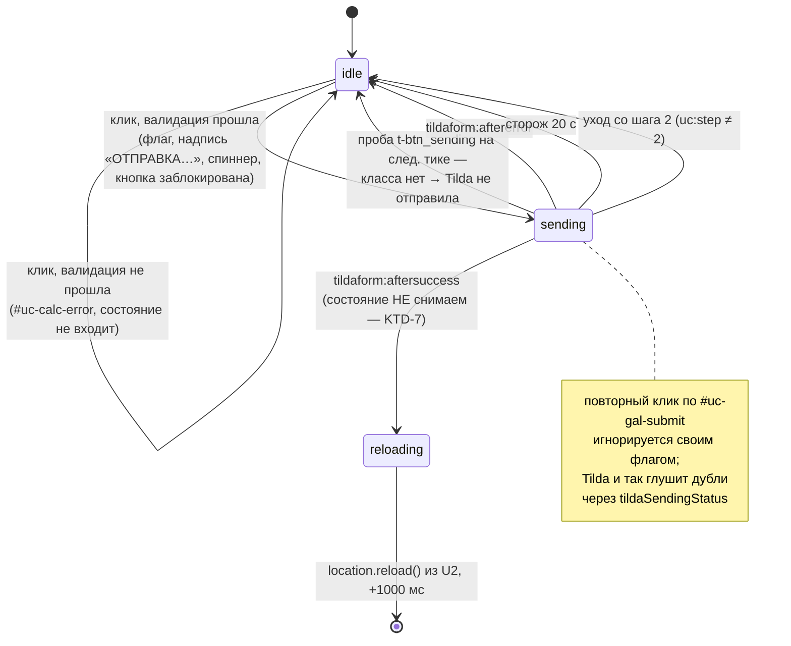

# feat: Валидация телефона и индикация отправки формы «По телефону»

## Summary

Вкладка «По телефону» на шаге 2 квиза получает две вещи: живую маску ввода `+7 (912) 345-67-89` с валидацией российского мобильного номера перед отправкой, и видимое состояние «отправляем» на кнопке `#uc-gal-submit`, которое живёт от клика до перезагрузки страницы.

Обе правки — накладка поверх нативного сабмита Tilda, а не его замена. Всё изменение локализовано в `docs/tilda-blocks/Ver_3_ong/u6-gallery.html`.

---

## Problem Frame

**Поле телефона не защищено.** `u6-gallery.html:663` — это голый `<input type="tel">` с плейсхолдером `+7 (___) ___-__-__`. Маски нет: плейсхолдер лишь рисует ожидаемый формат, а поле принимает буквы, спецсимволы и произвольное число цифр. Единственный обработчик, который его трогает (`u6-gallery.html:1030`), только снимает подсветку ошибки.

**Проверка перед отправкой — только на пустоту.** `u6-gallery.html:1042-1051`: `if (!name || !phone)`. Значения `1111` и `asdf` уходят в CRM как валидные заявки.

**После клика «ОТПРАВИТЬ» интерфейс молчит 3–4 секунды.** Пользователь не понимает, сработал ли клик, и жмёт повторно.

### Из чего складываются эти 3–4 секунды

Разобрано по распакованному `tilda-forms-1.0.min.js` и по разметке живой страницы:

1. Наш обработчик (`u6-gallery.html:1094-1099`) синхронно кликает по скрытой нативной `.t-submit`.
2. Tilda синхронно: проверяет `btn.tildaSendingStatus` (если `>= 1` — клик **игнорируется**, это её встроенная защита от дублей), вешает на кнопку класс `t-btn_sending`, ставит `tildaSendingStatus = "1"`, прогоняет свою валидацию и запускает XHR на `forms.tildaapi.com`.
3. XHR ретранслируется в **два** приёмника (`formservices[]` ×2 в разметке формы) — это и есть основная задержка, ~2–3 с.
4. По ответу Tilda снимает `t-btn_sending`, ставит `tildaSendingStatus = "0"` и бросает `tildaform:aftersuccess` (или `tildaform:aftererror`).
5. `mySuccessFunction` в U2 (`u2-unifiedbot-script.html:246-248`) для пути «По телефону» (`waSend === false`, `isMaxOverlayActive` не выставлен) добавляет **собственные** `setTimeout(location.reload, 1000)`.

То есть примерно секунда из ощущаемой задержки — **наша**, а не Tilda.

### Три надёжные точки перехвата

| Момент | Сигнал |
|--------|--------|
| Старт отправки | наш собственный обработчик клика, до `$submitBtn.click()` |
| Запрос реально ушёл | после синхронного возврата из `$submitBtn.click()` на `.t-submit` **остался** класс `t-btn_sending` |
| Tilda не стала отправлять | класса `t-btn_sending` нет — её валидация отсеяла форму, события при этом не бросается |
| Конец — успех | `tildaform:aftersuccess` (уже используется в U2) |
| Конец — ошибка | `tildaform:aftererror` |

Последняя строка важна: Tilda не бросает событие, когда её собственная валидация не пропустила форму. Единственный доступный признак — класс на кнопке.

### Что уже есть в проекте из индикации

- Shimmer-скелетоны `#uc-skeleton` (U3) и `uf-shimmer` (U4) — это язык «данные грузятся», не подходит для кнопки.
- `#max-transition-cover` (U2, `u2-unifiedbot-script.html:216-222`) — белая полноэкранная заглушка «Переходим в MAX…». Но она появляется **уже после** того же 2–3-секундного раунд-трипа, то есть немую паузу не закрывает.

Готового паттерна «кнопка в состоянии отправки» в проекте нет — его надо завести, и сделать это в существующей палитре шага 2 (`#51565C`).

---

## Requirements

| ID | Требование |
|----|-----------|
| R1 | В `#uc-calc-phone` невозможно ввести ничего, кроме цифр; поле само форматирует их в `+7 (912) 345-67-89` по мере ввода |
| R2 | Вставка из буфера в любом виде (`8 (912) 345-67-89`, `+79123456789`, `9123456789`) нормализуется в тот же формат |
| R3 | Перед отправкой номер проверяется на полноту, на мобильный код `9xx` и на «мусорность»; правила — в KTD-2 |
| R4 | Непрошедший проверку номер не отправляет форму: показывается `#uc-calc-error` с конкретным текстом и подсветка `.uc-calc-input--error` на поле |
| R5 | С момента клика «ОТПРАВИТЬ» кнопка показывает состояние отправки (спиннер + текст) и не принимает повторных кликов |
| R6 | На успешной отправке состояние **не** снимается — страница перезагружается сама, а мигание кнопки за секунду до этого выглядит как сбой |
| R7 | На любом отказе (Tilda не стала отправлять / `aftererror` / запрос завис) состояние снимается, кнопка снова кликабельна, показывается сообщение об ошибке |
| R8 | Вкладка «В чате» не затрагивается — её поведение остаётся байт-в-байт прежним |

Область изменений: только `u6-gallery.html`. U2, U3, U4, U7 и нативная форма Tilda не трогаются.

---

## Key Technical Decisions

### KTD-1. Маска пишется вручную; библиотеки нет и не будет

На живой странице нет ни одной маск-библиотеки — проверено по списку `<script>`: jQuery 1.10.2, Swiper 11.2.10, `widget.js` и набор `tilda-*`. `tilda-phone-mask` тоже **не загружается**, и не загрузится: поля `name="phone"` и `name="name"` в нативной форме — это `type="hidden"` (подтверждено разметкой живой страницы), а маску Tilda вешает только на видимые `t-input` с `data-tilda-mask`.

Подключать внешнюю библиотеку ради одного поля — против курса проекта на PageSpeed (два раунда оптимизации, каждый скрипт на счету). Маска пишется руками на jQuery, ~60 строк.

**Следствие, важное для валидации:** раз наши поля скрытые и без `js-tilda-rule`, собственная проверка телефона у Tilda по ним **не отрабатывает вообще**. Конфликта двух валидаций не будет, но и бесплатной защиты нет — вся проверка наша.

### KTD-2. Что именно считается невалидным номером

Подтверждено пользователем 2026-09-14. Проверка идёт по 10 национальным цифрам (после нормализации ведущей `7`/`8`).

| ID | Правило | Отсекает | Сообщение |
|----|---------|----------|-----------|
| V1 | Ровно 10 национальных цифр | `+7 (912) 345-67` | «Введите номер полностью» |
| V2 | Первая национальная цифра — `9` | `+7 (495) 123-45-67`, `+7 (812) …` | «Укажите мобильный номер, начинается с +7 9…» |
| V3 | Не все 10 цифр одинаковые — `/^(\d)\1{9}$/` | `9999999999` | «Проверьте правильность номера» |
| V4 | Нет серии из 6+ одинаковых цифр подряд — `/(\d)\1{5,}/` | `9001111111`, `9990000000` | «Проверьте правильность номера» |
| V5 | Весь номер целиком не является строгой возрастающей или убывающей последовательностью с шагом 1 | `9876543210` | «Проверьте правильность номера» |

Порядок проверок — V1 → V2 → V3–V5, первое сработавшее правило и даёт текст ошибки. Стационарные коды (`495`, `812`, `343`) отсекаются намеренно: менеджер перезванивает, но канал подтверждения — мобильный.

**Честная оценка силы правил.** V2 делает V5 почти вырожденным: возрастающая десятизначная последовательность, начинающаяся с `9`, невозможна, так что V5 ловит ровно один номер — `9876543210`. Реальную работу делает V4. Правило V5 оставлено как дешёвая страховка на случай, если V2 когда-нибудь ослабят до «любой российский код».

**Почему V5 применяется только к номеру целиком, а не к абонентской части.** Если проверять последовательность в 7 цифрах после кода, то `+7 (912) 345-67-89` попадёт под отсев — `3456789` строго возрастает. А это совершенно обычный номер. Проверка только по всей длине — единственный безопасный вариант.

Чёрный список конкретных тестовых номеров пользователь сознательно не выбрал: он требует ручного ведения и стареет.

**Прецедент.** У Tilda в её собственном валидаторе (`tilda-forms-1.0.min.js`, ветка `case "phone"`) есть похожая эвристика: она отсекает цифровую строку, у которой на индексе 1 начинается серия `000`, `111` (кроме номеров на `9`), `222` (кроме `5`), `333`, `444`, `5555` (кроме `0`), `666` (кроме `0`), `8888` (кроме `4`). При этом длину она не проверяет вообще. Наш набор строже и не зависит от того, что Tilda решит поменять в своём минифицированном коде.

### KTD-3. Нецифровые символы фильтруются форматтером, а не блокировкой клавиш

Форматтер на каждом `input` перечитывает поле, выбрасывает всё нецифровое и перерисовывает значение. Введённая буква живёт ноль кадров — визуально она просто не вводится, как и требует R1.

Альтернатива — блокировка на `keypress`/`keydown` по коду клавиши — отвергнута: она ломает вставку из буфера, IME и Android-клавиатуры, где события клавиш недостоверны. Один путь вместо двух, и он же обслуживает автозаполнение.

Форматтер вешается на `input` **и** на `change` — второе закрывает автозаполнение браузера по `autocomplete="tel"`, которое в части браузеров `input` не бросает.

### KTD-4. Спиннер — это CSS-псевдоэлемент, а не вложенный `<span>`

`updateCalcBtnText()` (`u6-gallery.html:726-729`) пишет в кнопку через `.text(text)`, что стирает всех детей. Любой вложенный элемент спиннера будет снесён первым же переключением вкладки. Псевдоэлемент `::before` на классе `.uc-quiz-btn-next--sending` от `.text()` не зависит.

Второе следствие: пока идёт отправка, `updateCalcBtnText()` не должен трогать надпись. Функция получает ранний выход по флагу состояния.

### KTD-5. Никакой явной ширины у кнопки

U6 сознательно **не** переведён на `border-box` (см. CLAUDE.md — его вёрстка настраивалась под `content-box`, который навязывает `tilda-grid-3.0.min.css`). У `#uc-gallery-custom .uc-quiz-btn-next` сейчас `padding: 13px 32px` без ширины, поэтому проблемы нет. Если добавить `width` или `min-width`, чтобы кнопка не «дёргалась» при смене надписи, под `content-box` к ней прибавятся 64px паддинга — ровно тот баг, из-за которого «ДАЛЕЕ →» уезжала за экран на мобильном.

Вместо фиксации ширины — короткая надпись: «ОТПРАВИТЬ» → «ОТПРАВКА…», та же длина в символах. Прирост даёт только глиф спиннера (~12px + отступ), и кнопка растёт влево, потому что `.uc-calc-nav` — это `space-between`.

### KTD-6. Анимация спиннера — только `transform: rotate`

Совпадает с решениями PageSpeed R5 и R8 в этом проекте: shimmer переведён на `transform: translateX`, прогресс-бар на `transform: scaleX` — ради композитинга на GPU без релейаута. Вращение кольца через `transform: rotate` попадает в тот же класс.

### KTD-7. На успехе состояние не снимается

Tilda снимает `t-btn_sending` со своей кнопки и бросает `aftersuccess`, а U2 перезагружает страницу ещё через секунду. Если восстановить нашу кнопку на `aftersuccess`, пользователь увидит на секунду живую кликабельную «ОТПРАВИТЬ» — и решит, что отправка сорвалась. Состояние снимается только по ветке отказа.

### KTD-8. Сторожевой таймер обязателен

В коде Tilda у XHR не выставлен `timeout`. Если запрос повиснет, ни `aftersuccess`, ни `aftererror` не придут никогда, и кнопка останется в «отправке» до перезагрузки вручную. Сторож на 20 с возвращает кнопку и показывает ошибку. Он же страхует KTD-9, если проба класса когда-нибудь перестанет работать.

### KTD-9. Факт старта запроса определяется по классу `t-btn_sending` на следующем тике

Tilda не бросает события, когда её валидация не пропустила форму. Проба: после `$submitBtn.click()` поставить `setTimeout(check, 0)` и посмотреть, висит ли на `.t-submit` класс `t-btn_sending`. Если висит — XHR в полёте. Если нет — Tilda не отправила, состояние надо снять немедленно.

Следующий тик, а не строго синхронно, — на случай, если в будущей версии между валидацией и `xhr.send()` появится микрозадача. Ложного срабатывания «уже успело завершиться» быть не может: ответ XHR — это макрозадача, которая по определению не опередит `setTimeout(0)`.

**Эта ветка достижима на практике.** Валидация Tilda проверяет чекбокс согласия (`js-tilda-rule` на `input[name="Checkbox"]`), а наш `syncCalcAgreements()` (`u6-gallery.html:760-767`) переносит в него состояние визуального чекбокса. Снятое согласие → Tilda блокирует сабмит → сейчас это молчаливый no-op. После правки пользователь увидит причину.

Риск версионной зависимости признан и ограничен: если Tilda переименует класс, худший сценарий — пользователь ждёт 20 секунд до сторожа вместо мгновенной ошибки. Отправка при этом не ломается.

---

## High-Level Technical Design

### Конвейер маски

Канонический носитель состояния — 10 национальных цифр. Разметка формата каждый раз строится заново, а не правится по месту.

```
                   ┌─ 'input' ──┐
  ввод / вставка ──┤            ├──► читаем value + selectionStart
  автозаполнение ──┴─ 'change' ─┘              │
                                               ▼
                        [1] digitsBeforeCaret = сколько цифр слева от каретки
                                               │
                                               ▼
                        [2] digits = value.replace(/\D/g, '')
                            если digits[0] ∈ {7,8} и length > 10 → отбросить
                            обрезать до 10
                                               │
                                               ▼
                        [3] формат: '' | '+7 (9' | '+7 (912' | '+7 (912) 345-67-89'
                            (частичный шаблон по числу введённых цифр)
                                               │
                                               ▼
                        [4] el.value = formatted
                            setSelectionRange(позиция после N-й цифры)
```

Пустое поле остаётся пустым — префикс `+7 (` не подставляется, чтобы плейсхолдер `+7 (___) ___-__-__` оставался видимым и продолжал объяснять формат.

### Машина состояний отправки



---

## Implementation Units

### U1. Маска ввода телефона

**Goal.** `#uc-calc-phone` принимает только цифры и форматирует их в `+7 (912) 345-67-89` по мере ввода.

**Requirements.** R1, R2.

**Dependencies.** нет.

**Files.**
- `docs/tilda-blocks/Ver_3_ong/u6-gallery.html` — блок `<script>`, рядом с обработчиками calc-секции (~строка 1030)

**Approach.**
Приватные функции внутри существующей IIFE U6, рядом с `initCalcState` / `updateCalcBtnText`:

- `ucPhoneDigits(value)` → строка из ≤10 национальных цифр. Выбрасывает нецифровое; если получилось >10 символов и первый `7` или `8` — отбрасывает его; режет хвост до 10.
- `ucPhoneFormat(digits)` → отображаемая строка. Пустая на пустом входе; дальше наращивается по шаблону: `+7 (9`, `+7 (912`, `+7 (912) 3`, `+7 (912) 345-6`, `+7 (912) 345-67-8`, `+7 (912) 345-67-89`.
- `ucPhoneApply(el)` → шаги [1]–[4] конвейера выше.

Делегированные обработчики по образцу существующих в файле:

```
$(document).on('input change', '#uc-calc-phone', …)   // форматирование
$(document).on('keydown',      '#uc-calc-phone', …)   // Backspace через разделитель
```

Обработчик `keydown` решает классический баг «backspace залипает»: если символ слева от каретки — не цифра, каретка сначала перескакивает влево через разделители, и только потом отрабатывает штатное удаление. Без этого удаление `)` в `+7 (912) 345` не меняет набор цифр, перерисовка выдаёт ту же строку, и каретка отпрыгивает вперёд.

Где доступен `beforeinput` с `inputType === 'deleteContentBackward'`, предпочесть его; `keydown` оставить запасным путём для старых движков.

Существующий обработчик сброса ошибки (`u6-gallery.html:1030`) не трогается — он снимает классы и с новым форматтером уживается. Присваивание `el.value` изнутри обработчика `input` повторного `input` не порождает, рекурсии не будет.

`type="tel"` в разметке сохраняется — он даёт цифровую клавиатуру на мобильном. Атрибут `maxlength` не добавляется: он подрался бы с форматтером, ограничение на 10 цифр держит сам `ucPhoneDigits`.

**Patterns to follow.** Делегирование через `$(document).on(...)` — как все обработчики calc-секции. `var`, а не `let`/`const` (CLAUDE.md: Tilda склеивает блоки в один контекст).

**Test scenarios** (ручные — автотестов в проекте нет, см. «Verification Strategy»):
- Посимвольный ввод `9123456789` → в поле `+7 (912) 345-67-89`, каретка в конце.
- Ввод буквы `й`, `q`, символов `-`, `(`, пробела → в поле ничего не появляется.
- Вставка `8 (912) 345-67-89` → `+7 (912) 345-67-89`.
- Вставка `+79123456789` → `+7 (912) 345-67-89`.
- Вставка `9123456789` → `+7 (912) 345-67-89`.
- Вставка `+7 912 345 67 89 доб. 12` → `+7 (912) 345-67-89` (хвост отброшен по лимиту в 10 цифр).
- Ввод 12 цифр подряд → в поле ровно 10 национальных, лишние игнорируются.
- Backspace из конца полного номера 18 раз → поле пустеет без застреваний.
- Backspace, когда каретка стоит сразу после `)` → удаляется цифра `2` из `912`, а не разделитель.
- Каретка ставится в середину `+7 (912) 345-67-89`, вводится цифра → она попадает в позицию каретки, номер перестроен, каретка после вставленной цифры.
- Поле очищено полностью → значение пустое, виден плейсхолдер `+7 (___) ___-__-__`.
- Автозаполнение браузером (`autocomplete="tel"`) → значение отформатировано.
- Android Chrome, ввод с экранной клавиатуры, включая удаление → поведение то же, что на десктопе.

**Verification.** В поле физически невозможно оставить символ, отличный от `+`, `(`, `)`, пробела, `-` и цифры; любая последовательность действий приводит поле либо к пустоте, либо к корректному префиксу формата.

---

### U2. Валидация номера перед отправкой

**Goal.** Обработчик `#uc-gal-submit` проверяет номер по V1–V5 и не отправляет форму, если проверка не прошла.

**Requirements.** R3, R4.

**Dependencies.** U1 (валидация читает нормализованное значение).

**Files.**
- `docs/tilda-blocks/Ver_3_ong/u6-gallery.html` — новая функция + правка блока проверки в обработчике клика (`u6-gallery.html:1042-1051`)

**Approach.**
Функция `ucPhoneValidate(value)` возвращает `null` при успехе либо строку с текстом ошибки. Правила и их порядок — таблица в KTD-2. Функция чистая, без обращений к DOM: её тексты подставляет вызывающий код.

Блок в обработчике клика расширяется:

```
  пусто имя или телефон  → существующий текст «Пожалуйста, заполните имя и телефон»
  иначе ucPhoneValidate  → при ошибке: подсветить #uc-calc-phone,
                           написать текст в #uc-calc-error, return
```

`return` — до `syncCalcAgreements()` и до любого касания полей нативной формы, ровно как сейчас.

Подсветка поля и показ `#uc-calc-error` используют существующий механизм: класс `.uc-calc-input--error` (`u6-gallery.html:469`) и блок `#uc-calc-error` (`u6-gallery.html:511-517`). Сброс ошибки при вводе уже работает (`u6-gallery.html:1030-1035`) и на новые тексты распространяется сам.

**Patterns to follow.** Ранний `return` из обработчика без побочных эффектов — как в текущей проверке на пустоту. Ни одного нового DOM-узла: и подсветка, и текст ошибки уже есть.

**Test scenarios:**
- Пустое имя, валидный телефон → «Пожалуйста, заполните имя и телефон», подсвечено поле имени, форма не ушла.
- Валидное имя, пустой телефон → тот же текст, подсвечен телефон.
- `+7 (912) 345-67` (9 цифр) → «Введите номер полностью», форма не ушла.
- `+7 (495) 123-45-67` → «Укажите мобильный номер…», форма не ушла.
- `+7 (812) 555-35-35` → та же ошибка (стационарный отсекается намеренно).
- `+7 (999) 999-99-99` → «Проверьте правильность номера» (V3).
- `+7 (900) 111-11-11` → «Проверьте правильность номера» (V4, серия из 7 единиц).
- `+7 (999) 000-00-00` → V4.
- `+7 (987) 654-32-10` → «Проверьте правильность номера» (V5, убывающая последовательность).
- `+7 (912) 345-67-89` → ошибок нет, форма уходит. Проверяет, что V5 **не** срабатывает на возрастающей абонентской части.
- `+7 (912) 333-45-67` → ошибок нет (3 одинаковые подряд — норма, порог V4 равен 6).
- `+7 (900) 000-12-34` → ошибок нет (5 нулей подряд, порог не достигнут). Осознанная граница правила.
- После показа любой ошибки — ввод одной цифры → `#uc-calc-error` скрывается, подсветка снимается.
- Вкладка «В чате», пустые имя и телефон → форма уходит без единой проверки (R8).

**Verification.** Ни одно значение из списка выше не доходит до `$submitBtn.click()`; валидный номер доходит; поведение вкладки «В чате» не изменилось.

---

### U3. Состояние отправки на кнопке

**Goal.** С клика и до перезагрузки страницы `#uc-gal-submit` показывает отправку и не принимает повторных кликов; на любом отказе состояние снимается.

**Requirements.** R5, R6, R7, R8.

**Dependencies.** U2 (в состояние входим только после успешной валидации).

**Files.**
- `docs/tilda-blocks/Ver_3_ong/u6-gallery.html` — новые CSS-правила в `<style>` (рядом с `#uc-gallery-custom .uc-quiz-btn-next`, ~строка 194) и логика состояния в `<script>`

**Approach.**

*CSS.* Класс `.uc-quiz-btn-next--sending`, заскоупленный под `#uc-gallery-custom` — обязательное требование CLAUDE.md об именах классов, общих на всю страницу:

- `::before` — кольцо 12×12, `border: 2px solid rgba(255,255,255,.35)` с `border-top-color: #fff`, `border-radius: 50%`, `display: inline-block`, `vertical-align: -1px`, `margin-right: 8px`, `animation: uc-btn-spin .7s linear infinite`.
- `@keyframes uc-btn-spin` — `transform: rotate(0deg)` → `rotate(360deg)` (KTD-6).
- `cursor: default`; ховер зафиксирован на `#51565C`, чтобы кнопка не подсвечивалась под курсором во время отправки.
- Прозрачность не трогаем: приглушённая кнопка читается как «сломана», а не как «работает».
- Ширина и `min-width` не задаются (KTD-5).

*Логика.* Модульная переменная `var _submitting = false;` рядом с `calcOffer` / `calcMessenger`.

- `ucSetSending(on)` — переключает флаг, класс, надпись (`ОТПРАВКА…` / результат `updateCalcBtnText()`), `prop('disabled', on)` на `#uc-gal-submit`, и заводит либо снимает сторожевой таймер. Порядок внутри важен: при выходе из состояния флаг `_submitting` сбрасывается **до** вызова `updateCalcBtnText()`, иначе тот упрётся в свой ранний `return` и надпись останется «ОТПРАВКА…».
- `updateCalcBtnText()` получает ранний `return`, пока `_submitting` — иначе переключение вкладки затрёт надпись (KTD-4).
- Обработчик `#uc-gal-submit` в самом начале: `if (_submitting) return;`.
- После `$submitBtn.click()` — `setTimeout`, в котором проверяется `$submitBtn.hasClass('t-btn_sending')` (KTD-9). Класса нет → `ucSetSending(false)` и текст в `#uc-calc-error`: «Не удалось отправить заявку. Проверьте согласие на обработку данных и попробуйте ещё раз.»
- Слушатель `tildaform:aftererror` на `document` с проверкой `$(e.target).closest('.uc-tildaform').length` — ровно тот же приём, что задокументирован в `docs/solutions/integration-issues/tilda-aftersuccess-event-target-mismatch.md` (событие прилетает на `<form>`, не на обёртку). Снимает состояние, пишет «Не удалось отправить заявку. Попробуйте ещё раз.»
- Сторож на 20 000 мс с тем же текстом (KTD-8).
- `aftersuccess` **не** слушаем (KTD-7).
- В слушателе `uc:step` (`u6-gallery.html:1119`) при любом шаге — сброс состояния, рядом с существующим сбросом `calcOffer` на «В чате». Закрывает сценарий «отправил → НАЗАД → вперёд», при котором кнопка иначе осталась бы заблокированной.

Вкладка «В чате» в состояние не входит вообще: `ucSetSending(true)` вызывается только в ветке `calcOffer === 'По телефону'`.

**Patterns to follow.** `docs/solutions/integration-issues/tilda-aftersuccess-event-target-mismatch.md` — подписка на события формы Tilda через `closest()`. Скоупинг CSS под корень блока — как `#uc-gallery-custom .uc-quiz-btn-next` (`u6-gallery.html:194`). `transform`-анимации — как PageSpeed R5/R8.

**Test scenarios:**
- «По телефону», валидные данные, клик → надпись «ОТПРАВКА…», спиннер крутится, кнопка не реагирует на клики.
- То же, ждать до конца → страница перезагружается, состояние ни разу не мигнуло в «ОТПРАВИТЬ» (R6).
- Пять кликов подряд по кнопке → ровно одна заявка в CRM.
- Невалидный номер → состояние **не** включается, видна только ошибка, кнопка сразу кликабельна.
- Снять галочку согласия, отправить → состояние включилось и сразу снялось, `#uc-calc-error` объясняет причину, кнопка кликабельна (ветка KTD-9).
- Отправка при отключённой сети (DevTools → Offline) → приходит `aftererror`, состояние снято, показан текст ошибки, повторная отправка возможна.
- Отправка с искусственной задержкой ответа >20 с (DevTools throttling или блокировка `forms.tildaapi.com`) → в 20 с срабатывает сторож, кнопка возвращается.
- Отправка → «← НАЗАД» → «ДАЛЕЕ →» обратно на шаг 2 → кнопка в обычном состоянии, не заблокирована.
- Во время отправки переключить вкладку на «В чате» → надпись не подменяется на «ДАЛЕЕ →» (KTD-4).
- Вкладка «В чате», отправка на десктопе → поведение прежнее, состояние не включается, виджет открывается через ~200 мс (R8).
- Вкладка «В чате» на мобильном, MAX и Telegram → поведение прежнее (R8).
- Мобильный 375px: кнопка со спиннером и «ОТПРАВКА…» не наезжает на «← НАЗАД» и не выходит за край (KTD-5).

**Verification.** Кнопка ни в одном сценарии не остаётся заблокированной навсегда; повторные клики не создают вторую заявку; вкладка «В чате» не изменилась.

---

### U4. Выкладка в Tilda и проверка на живой странице

**Goal.** Изменённый блок стоит на dev-странице, и рабочая копия сходится с живой.

**Requirements.** все.

**Dependencies.** U1, U2, U3.

**Files.**
- `docs/tilda-blocks/Ver_3_ong/u6-gallery.html` — источник для ручной вставки в T123

**Approach.**
Сборки в проекте нет — блок вставляется руками в редактор T123, поэтому рабочая копия и живая страница расходятся молча. После вставки прогнать сверку из CLAUDE.md:

```bash
curl -sSL "https://demo.autodc.org/page154296216.html?cb=$(date +%s)" -o /tmp/live.html
```
и далее скрипт построчного сравнения с `Ver_3_ong/`.

Расхождения только в комментариях тоже считаются расхождением — перед выводами прочитать недостающие строки.

Сценарии U1–U3 прогоняются на живой dev-странице, а не только локально. Локальная проверка обязательна, но недостаточна: CLAUDE.md отдельно предупреждает, что `tilda-grid-3.0.min.css` навязывает `* { box-sizing: content-box }`, которого в голом браузере нет. При локальном прогоне вёрстки кнопки этот стиль надо инжектить вручную, иначе баг переполнения не воспроизведётся.

**Test expectation: none** — юнит выкладочный, собственного поведения не несёт. Проверка — прогон сценариев U1–U3 на живой странице.

**Verification.** Скрипт сверки показывает `ok` для `u6-gallery.html`; сценарии U1–U3 проходят на `https://demo.autodc.org/page154296216.html` на десктопе и на мобильном.

---

## Verification Strategy

Автотестов в проекте нет и инфраструктуры для них тоже: блоки — это HTML-файлы, которые вставляются в редактор Tilda вручную, без сборки. Все сценарии выше — ручные браузерные проверки. Это осознанное ограничение проекта, а не пробел плана.

Минимальная матрица прогона: Chrome десктоп, Safari iOS, Chrome Android. Мобильный обязателен живьём — в `docs/solutions/developer-experience/mobile-viewport-not-emulatable-in-browser-harness.md` уже зафиксировано, что эмуляция вьюпорта в харнессе на этом проекте недостоверна.

Отдельно проверить, что заявки долетают до CRM: отправить один валидный номер и убедиться, что запись появилась. Валидация стоит перед `$submitBtn.click()`, так что ошибка в ней проявится как тихая потеря заявок.

---

## Risks & Dependencies

| Риск | Последствие | Смягчение |
|------|-------------|-----------|
| Tilda переименует `t-btn_sending` в новой версии `tilda-forms-1.0.min.js` | Проба KTD-9 перестаёт различать «не отправилось» | Сторож на 20 с закрывает сценарий; отправка не ломается, деградирует только скорость реакции на отказ |
| Каретка в маске ведёт себя иначе на iOS Safari / Android Chrome | Ввод «прыгает», поле раздражает | Сценарии U1 прогоняются на живых устройствах; конвейер строит строку заново, а не правит по месту — это самый предсказуемый вариант |
| Правило V2 (только `9xx`) отсекает клиента со стационарным номером | Потерянная заявка | Решение подтверждено 2026-09-14; текст ошибки прямо называет причину, чтобы человек ввёл мобильный |
| Порог V4 в 6 одинаковых цифр отсекает реальный номер | Потерянная заявка | Вероятность крайне мала; текст ошибки мягкий («Проверьте правильность номера»), порог меняется одной константой |
| Ручная вставка в Tilda расходится с рабочей копией | Живая страница ведёт себя не как файл | U4 требует прогона скрипта сверки |

Внешних зависимостей нет: ни новых библиотек, ни изменений в бэкенде, ни правок в других блоках.

---

## Scope Boundaries

**Не входит:**
- Валидация поля имени (`#uc-calc-name`) — остаётся проверкой на пустоту.
- Нативная форма Tilda и её скрытые поля.
- Вкладка «В чате» — R8 требует байт-в-байт прежнего поведения.
- Международные номера. Поле обслуживает российский дилерский лендинг.

### Deferred to Follow-Up Work

- **Индикация отправки на вкладке «В чате» — проблема подтверждена, в объём не входит.** Решение подтверждено пользователем 2026-09-14 повторно, уже после разбора фактов ниже: первоначальный выбор делался на некорректной посылке (см. «Поправка»), факты были уточнены и вынесены на пересмотр, объём оставлен прежним.

  Проверено по коду 2026-09-14:
  - `messenger === 'web'` (дефолт на десктопе) — **паузы нет**. Открытие виджета планируется на +200 мс и, что существенно, **до** `$submitBtn.click()` (`u6-gallery.html:1077-1096`). Интерфейс отвечает раньше, чем Tilda начинает отправку.
  - `messenger === 'MAX'` / `'Telegram'` — **пауза есть, те же 2–3 с**. В обработчике клика для этих веток не происходит ничего видимого; первое, что видит пользователь, приходит из `mySuccessFunction`, то есть по `tildaform:aftersuccess`, уже после полного раунд-трипа.
  - Обе ветки мессенджеров достижимы **и на десктопе**: на мобильном скрывается только карточка «На сайте» (`#uc-ms-site`), карточки MAX и Telegram видимы всегда. Это сценарий «выбран мессенджер», а не мобильный сценарий.

  **Поправка к более раннему выводу.** В первой редакции этого пункта `#max-transition-cover` фигурировал как несостоявшийся индикатор ожидания. Это неверно: заглушка добавляется в DOM непосредственно перед `window.location.href = maxUrl` и снимается через 1500 мс, уступая место bottom-sheet-фолбэку, если приложение не открылось (`u2-unifiedbot-script.html:211-238`). Это накрытие перехода и страховка на несработавший автопереход — момент **окончания** паузы, а не её смягчение. Сравнение с индикатором отправки было некорректным, и выбор объёма делался в том числе на этой посылке.

  **Перенос U3 туда не бесплатный.** Включение состояния — одна строка, а вот выход из него у мессенджерных веток устроен иначе, чем у «По телефону». Там нет перезагрузки, на которую опирается KTD-7: `mySuccessFunction` уводит в приложение, а если пользователь вернётся в браузер, слушатель `visibilitychange` в U2 снимает оверлеи и оставляет живую страницу — с кнопкой, застрявшей в «ОТПРАВКЕ», пока не сработает сторож. То есть ветке нужен свой выход из состояния, завязанный на возврат в браузер. Это отдельная проработка, а не копирование.
- **Секунда задержки перед перезагрузкой в U2.** `setTimeout(location.reload, 1000)` в `u2-unifiedbot-script.html:247` — это ~25% ощущаемого ожидания на пути «По телефону». Задержка, вероятно, стоит там ради мессенджерных веток; почему именно 1000 мс — по коду не восстанавливается. Требует отдельной проверки, а не правки мимоходом.
- **Чёрный список известных тестовых номеров.** Отклонён при выборе правил: требует ручного ведения. Можно вернуться, если в CRM пойдёт конкретный повторяющийся мусор.

---

## Open Questions

- **Текст ошибки для нестационарного кода.** В плане стоит «Укажите мобильный номер, начинается с +7 9…». Формулировка неканонична для проекта; финальная редактура — на выкладке.
- **Порог V4.** Шесть одинаковых цифр подряд — оценка, а не измерение. Если в CRM накопится статистика по отсеянным номерам, порог стоит перепроверить.
- **Стоит ли расширять V5 до «последовательность в 7 абонентских цифрах».** Сейчас нет и не будет без явного решения: такое правило отсекает совершенно обычный `+7 (912) 345-67-89` (см. KTD-2).

---

## Sources & Research

- `docs/tilda-blocks/Ver_3_ong/u6-gallery.html` — разметка поля (663), CSS ошибки и инпута (455-517), кнопка `.uc-quiz-btn-next` (194-206), `updateCalcBtnText` (726-729), `syncCalcAgreements` (760-767), обработчик сабмита (1038-1100), слушатель `uc:step` (1119-1161)
- `docs/tilda-blocks/Ver_3_ong/u2-unifiedbot-script.html` — `mySuccessFunction` и перезагрузка (193-249), подписка на `aftersuccess` (301-315)
- `docs/solutions/integration-issues/tilda-aftersuccess-event-target-mismatch.md` — приём с `closest()` для событий формы Tilda
- `docs/solutions/developer-experience/mobile-viewport-not-emulatable-in-browser-harness.md` — почему мобильные сценарии проверяются на устройстве
- `CLAUDE.md` — ловушка `content-box`, правило скоупинга общих имён классов, решения PageSpeed R5/R8, процедура сверки с живой страницей
- `https://static.tildacdn.com/js/tilda-forms-1.0.min.js` (распакован из gzip) — `tildaSendingStatus`, класс `t-btn_sending`, порядок «валидация → XHR → событие», события `tildaform:aftersuccess` / `tildaform:aftererror`, собственная эвристика Tilda по мусорным номерам в ветке `case "phone"`
- `https://demo.autodc.org/page154296216.html` — разметка блока `.uc-tildaform`: `data-formactiontype="2"`, два `formservices[]`, скрытые `input[name="phone"]` и `input[name="name"]`, отсутствие `tilda-phone-mask` в списке скриптов
