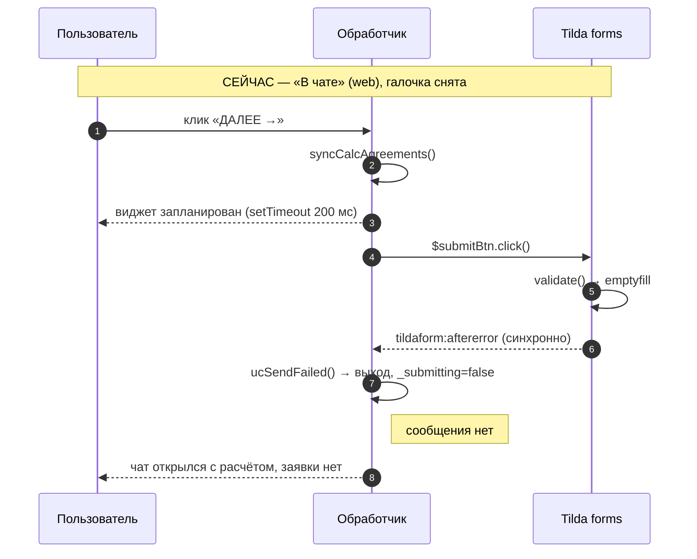
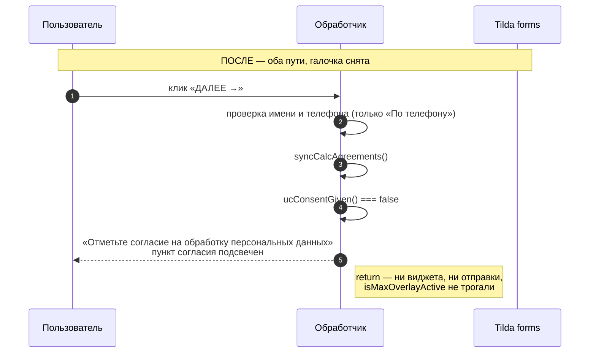

# fix: Единая проверка согласия на обработку данных для путей «По телефону» и «В чате»

> **Реализовано 2026-09-18.** Выполнены единицы U1, U2, U3; U4 — ручной шаг
> в редакторе Tilda, выполняется пользователем.
>
> Отступления от плана и то, чего он не предусмотрел, — в разделе
> [«Итог реализации»](#итог-реализации) в конце документа.

> **Обозначения.** В этом документе `U1`–`U4` — это **единицы реализации плана**,
> а блоки Tilda называются словом: «блок U6», «блок U2». Совпадение букв
> с именами блоков проекта случайно и здесь не значимо.

## Summary

Согласие на обработку персональных данных сегодня **нигде не проверяется нашим кодом**. Оба симптома — следствие этого, а не двух разных багов.

Исследование дало три факта, которые меняют постановку задачи:

1. **Чекбокс согласия не является обязательным полем Tilda.** У него нет атрибута `data-tilda-req`. Отправку при снятой галочке блокирует не «обязательность», а побочный эффект: это **единственное** валидируемое поле формы, и когда оно снято, Tilda считает форму целиком пустой. Защита случайная. Любое второе поле с классом `js-tilda-rule`, добавленное в форму, молча снимет её на обоих путях.
2. **Комментарий в коде утверждает обратное тому, что делает Tilda.** Строки 1402–1409 блока U6 говорят, что Tilda не бросает событий при отказе своей валидации. Она бросает — `tildaform:aftererror`, синхронно. Из-за этого точное сообщение про согласие (строки 1419–1420) **недостижимо**: общий обработчик успевает погасить состояние отправки раньше. Пользователь видит «Не удалось отправить заявку. Попробуйте ещё раз.» — ровно то, на что он жалуется.
3. **Тестовый харнесс повторяет ту же ошибку.** Заглушка режима `blocked` в `docs/testing/phone-validation-harness/` не бросает `aftererror`, поэтому гонка, убивающая точное сообщение, в тестах не воспроизводится, и тест «blocked: названа причина» проходит зелёным. Дефект прошёл проверку именно поэтому.

План ставит одну явную проверку согласия в собственном коде до всех ветвлений, удаляет рудимент, построенный на неверной посылке, и чинит заглушку харнесса, чтобы она изображала настоящую Tilda.

---

## Проблема

### Симптом 1 — «По телефону»: правильный отказ, неправильная причина

Отправка действительно блокируется, но сообщение звучит как сбой сети. Цепочка (`docs/tilda-blocks/Ver_3_ong/u6-gallery.html`):

| Шаг | Где | Что происходит |
|-----|-----|----------------|
| 1 | `:1349` | `syncCalcAgreements()` переносит снятую галочку в настоящий чекбокс Tilda |
| 2 | `:1393` | `ucSetSending(true)` → `_submitting = true`, кнопка «ОТПРАВКА…» |
| 3 | `:1397` | `$submitBtn.click()` — вход в обработчик Tilda |
| 4 | Tilda | `validate()` → ни одно `js-tilda-rule`-поле не заполнено → `[{obj:"none", type:["emptyfill"]}]` |
| 5 | Tilda | `showErrors()` в самом конце делает `t_triggerEvent(form, "tildaform:aftererror")` — **синхронный `dispatchEvent`** |
| 6 | `:1433` | наш слушатель ловит событие и зовёт `ucSendFailed('Не удалось отправить заявку. Попробуйте ещё раз.')` → `_submitting = false` |
| 7 | `:1416` | управление возвращается сюда, `_submitting` **уже false** → блок с точным сообщением не выполняется |

Точное сообщение на строках 1419–1420 не показывается никогда. Общий текст побеждает всегда, потому что приходит раньше.

### Симптом 2 — «В чате» (веб): защиты нет вовсе, и молча

Открытие виджета (`:1373–1388`) стоит **до** отправки (`:1397`) и ничем не обусловлено, кроме `messenger === 'web'`. Проверки согласия в этой ветке нет ни в каком виде.

Что при этом происходит с заявкой (вопрос 4 из постановки) — **заявка не создаётся**. Отправка блокируется тем же `emptyfill`, что и на телефонном пути. То есть:

- человек видит чат с настоящим расчётом цены, не дав согласия;
- заявки в системе нет — лид теряется молча;
- сообщения об ошибке **нет никакого**: `ucSetSending` на этом пути не вызывается (`:1393` — только для «По телефону»), значит `_submitting === false`, и `ucSendFailed` выходит по первой же строке (`:801`);
- `window.isMaxOverlayActive` выставлен в `true` на `:1377` и уже не сбрасывается — перезагрузка страницы после следующей успешной отправки отключена навсегда (см. `:1439–1450`).

Ветки Telegram и MAX этим не затронуты: мессенджер там открывает `mySuccessFunction` блока U2 (`u2-unifiedbot-script.html:197–239`), то есть только после успешной отправки. Эта задача касается ровно варианта `web`.

### Почему обе жалобы — одна проблема

Ни один из путей не проверяет согласие сам. Разное поведение — это разные побочные эффекты одного и того же: телефонный путь случайно упирается в чужую валидацию, чатовый до неё просто не доходит вовремя.

---

## Как это работает сегодня — подтверждение по коду

Всё проверено по исходникам, а не по предположению. Живая страница `demo.autodc.org/page154296216.html` на момент исследования совпадает с рабочей копией `Ver_3_ong/` (расхождение только в трёх строках комментария к цвету кнопки).

**Разметка формы** (живая страница, блок формы `form2472574461`):

```html
<input type="checkbox" name="Checkbox" value="yes" class="t-checkbox js-tilda-rule" checked>
```

Проверено в браузере на живой странице:

```json
{"ruleFields": 1, "req": null, "checked": true}
```

Одно валидируемое поле на всю форму, `data-tilda-req` отсутствует. Остальные поля (`name`, `phone`, `offer`, `sku-wa`, …) — обычные `hidden` без класса `js-tilda-rule`.

**`tilda-forms-1.0.min.js`, `window.tildaForm.validate`** — обязательность включает только атрибут:

```js
var d = !!parseInt(u.getAttribute("data-tilda-req") || 0, 10);
…
if (d && (E || F && !A)) v.type.push("req");
…
return a && !n.length && o.length && (n = [{obj:"none", type:["emptyfill"]}]), n
```

`d === false` → ошибки «поле обязательно» не будет. Снятый чекбокс роняет форму в ветку `emptyfill` — «форма пустая».

**`window.tildaForm.showErrors`** — событие бросается всегда, когда есть ошибки:

```js
return t_forms__scrollToInputWithError(e[0]), t_forms__showFormErrorsContainers(o),
       t_triggerEvent(o, "tildaform:aftererror"), !0
```

`t_triggerEvent` — обычный `dispatchEvent`, без отложки. Отсюда синхронность.

**`t_forms__initBtnClick`** — порядок внутри клика по `.t-submit`:

```js
t_addClass(o,"t-btn_sending"), o.tildaSendingStatus="1",
window.tildaForm.hideErrors(n),
i = window.tildaForm.validate(n),
window.tildaForm.showErrors(n,i)
  ? (t_removeClass(o,"t-btn_sending"), o.tildaSendingStatus="0")   // отказ, отправки нет
  : …window.tildaForm.send(n,o,u,c)                                 // отправка
```

Из этого следует и то, что `tildaform:aftererror` — **событие с двумя разными смыслами**: отказ валидации (синхронно, до запроса) и настоящий сбой отправки (асинхронно, из колбэка XHR — строки around `56899`, `61684`, `63138`, `64412` в том же файле, где текст ошибки берётся из статуса HTTP). Единый общий текст на оба случая и есть причина неточной формулировки.

### Сегодня и после





---

## Requirements

| ID | Требование | Источник |
|----|-----------|----------|
| R1 | Снятая галочка согласия блокирует путь «В чате» так же, как «По телефону»: виджет не открывается | постановка |
| R2 | Проверка согласия живёт в нашем коде и не опирается на поведение валидации Tilda | постановка, подтверждено п. 1 Summary |
| R3 | Отказ из-за согласия называет причину: «Отметьте согласие на обработку персональных данных» | постановка |
| R4 | Текст «Не удалось отправить заявку. Попробуйте ещё раз.» остаётся только за настоящими сбоями отправки (сеть, сервер) | постановка |
| R5 | Оба пути показывают отказ одинаково по смыслу и по стилю — тем же механизмом, что ошибки имени и телефона | постановка |
| R6 | Рудимент на `t-btn_sending` (`:1402–1423`) удалён полностью | решение пользователя, 2026-09-18 |
| R7 | Чекбокс дополнительно помечен обязательным в редакторе Tilda как дешёвая подстраховка | решение пользователя, 2026-09-18 |
| R8 | Заглушка харнесса изображает настоящее поведение Tilda при отказе валидации | следствие п. 3 Summary |

---

## Key Technical Decisions

### KTD-1. Проверка стоит до всех ветвлений, сразу после `syncCalcAgreements()`

Место — `u6-gallery.html:1349`, сразу за синхронизацией и **до** присваивания `waSend`/`waMessenger`, до заполнения полей формы, до ветки виджета (`:1373`) и до `ucSetSending` (`:1393`).

Так один `return` закрывает оба пути разом, и `window.isMaxOverlayActive` не успевает испортиться. Любое место ниже требовало бы двух проверок и оставляло бы шанс на рассинхрон — ровно ту болезнь, которую чиним.

Проверка имени и телефона остаётся **выше** согласия: поля расположены над галочкой, и сообщение должно идти в порядке чтения формы.

### KTD-2. Источник истины — визуальные пункты согласия, не чекбокс Tilda

Проверяем `#uc-calc-agreements .uc-calc-agr-item` на класс `uc-agr-checked` — то, с чем взаимодействовал человек. `syncCalcAgreements()` вызывается строкой выше, поэтому настоящий чекбокс Tilda к моменту проверки уже отражает то же состояние; читать его отдельно незачем.

Проверяются **все** отрисованные пункты, а не первый: `renderCalcAgreements` (`:811`) идёт циклом по всем группам `t-input-group_cb`. Сегодня группа одна, но привязываться к этому нельзя — именно такая привязка («единственное валидируемое поле») и создала исходный баг.

### KTD-3. Ноль отрисованных пунктов — это отказ, а не разрешение

Если `#uc-calc-agreements` пуст, согласия не было показано, значит и получено оно быть не могло. Отправлять персональные данные в этом состоянии нельзя, но и писать «отметьте согласие» бессмысленно — отмечать нечего.

Поведение: попытаться перерисовать (`renderCalcAgreements()`), перепроверить; если пунктов по-прежнему нет — отказать с отдельным текстом «Форма ещё загружается — попробуйте ещё раз через пару секунд».

Достижимо это состояние на практике: `renderCalcAgreements` выходит по `return` на `:809`, если форма ещё не в DOM, и повторяется только один раз через секунду (`:1469–1473`).

### KTD-4. Ошибки валидации и ошибки отправки — два разных механизма

Разделение уже существует в коде, план его достраивает и делает правилом:

| Класс отказа | Механизм | Почему так |
|--------------|----------|-----------|
| Валидация (имя, телефон, согласие, форма не готова) | прямая запись в `#uc-calc-error` + `.show()`, как на `:1338` и `:1344` | работает на обоих путях независимо от `_submitting`; ничего не отправлялось — гасить нечего |
| Сбой отправки (сеть, сервер, сторож 20 с) | `ucSendFailed()` | обязан снять состояние «ОТПРАВКА…», поэтому и завязан на `_submitting` |

Это же и ответ на R5: согласие пойдёт по той же дорожке, что имя и телефон, — один вид сообщения, одно место на экране, один стиль подсветки.

### KTD-5. Общий текст `aftererror` остаётся, но теперь он правдив

После постановки нашей проверки отказ валидации Tilda становится недостижимым: единственное её валидируемое поле — чекбокс, а мы уже убедились, что он отмечен. Значит `tildaform:aftererror` дальше приходит только на настоящий сбой, и текст «Не удалось отправить заявку. Попробуйте ещё раз.» на `:1435` становится точным — менять его не нужно (R4).

Оговорка вынесена в Риски: это верно ровно до тех пор, пока в форме не появится второе поле `js-tilda-rule`.

### KTD-6. Пометка чекбокса обязательным в Tilda — подстраховка, а не защита

Делается вручную в редакторе (единица U4). Сама по себе она не закрывает ни R1 (виджет всё равно откроется), ни R3 (текст останется чужим). Её ценность в другом: она убирает зависимость от случайности «единственного валидируемого поля» на стороне Tilda, если наш код когда-нибудь обойдут.

---

## Implementation Units

Все изменения кода — в одном файле: `docs/tilda-blocks/Ver_3_ong/u6-gallery.html`.

### U1. Проверка согласия перед отправкой на обоих путях

**Goal:** снятая галочка одинаково останавливает и «По телефону», и «В чате», с точным сообщением.

**Requirements:** R1, R2, R3, R5

**Dependencies:** нет

**Files:**
- `docs/tilda-blocks/Ver_3_ong/u6-gallery.html` — изменить

**Approach:**

Добавить рядом с `syncCalcAgreements` (около `:842`) две функции:

- `ucConsentGiven()` — `true`, только если все `#uc-calc-agreements .uc-calc-agr-item` несут `uc-agr-checked`; при нулевом количестве пунктов возвращает признак «не готово», отличимый от «не отмечено» (KTD-3).
- `ucShowCalcError(message, $target)` — единая точка показа ошибки валидации: текст в `#uc-calc-error`, `.show()`, подсветка переданного элемента. Переиспользовать её и в существующих проверках имени и телефона (`:1336–1338`, `:1343–1344`), чтобы три места не разъезжались (R5).

В обработчике `#uc-gal-submit` сразу после `syncCalcAgreements()` (`:1349`):

```text
если согласие не отмечено:
    подсветить пункты без галочки классом uc-calc-agr-item--error
    показать «Отметьте согласие на обработку персональных данных»
    return
если пунктов согласия нет вовсе:
    renderCalcAgreements(); перепроверить
    если по-прежнему нет — показать «Форма ещё загружается — попробуйте
    ещё раз через пару секунд» и return
```

`renderCalcAgreements()` вызывается **только** в ветке «пунктов нет» — там терять нечего. В ветке, где пункты есть, перерисовывать нельзя: функция восстанавливает состояние из настоящего чекбокса Tilda (`:817`) и в общем случае затрёт выбор пользователя.

Добавить стиль ошибки рядом с `.uc-calc-input--error` (`:500`), в той же манере: `#uc-gallery-custom .uc-calc-agr-item--error .uc-calc-agr-check { border-color: #d00; }`. Правило скоупится под `#uc-gallery-custom` — правило про склейку CSS блоков из `CLAUDE.md`.

**Patterns to follow:** проверка имени и телефона на `:1332–1347` — тот же порядок «пометить поле → текст в `#uc-calc-error` → `return`»; стиль `.uc-calc-input--error` на `:500`.

**Test scenarios** (харнесс `docs/testing/phone-validation-harness/`, после U3):
- «По телефону», имя и телефон валидны, галочка снята → текст ошибки содержит «согласие»; `t-submit` **не** кликался; кнопка не ушла в «ОТПРАВКА…»
- «В чате» + «На сайте», галочка снята → `window.WIDGET_OPENED === null`; `window.isMaxOverlayActive` не выставлен в `true`; текст ошибки тот же, что на телефонном пути
- «В чате», галочка снята, затем отмечена, повторный клик → виджет открылся, отправка пошла
- «По телефону», имя пустое и галочка снята → показано сообщение про имя и телефон (порядок проверок из KTD-1), поле имени подсвечено
- Галочка отмечена на обоих путях → поведение не изменилось относительно текущего (регрессия)
- `#uc-calc-agreements` очищен принудительно, форма в DOM → после перерисовки проверка проходит и отправка идёт
- `#uc-calc-agreements` очищен, `.t-input-group_cb` удалён из формы → сообщение «Форма ещё загружается…», отправки нет

**Verification:** на харнессе оба пути отказывают с текстом про согласие и ничего не отправляют; при отмеченной галочке оба пути работают как раньше.

---

### U2. Снятие ошибки согласия при взаимодействии

**Goal:** подсветка и текст исчезают, как только человек отмечает галочку или уходит с этого состояния, — как уже сделано для имени и телефона.

**Requirements:** R5

**Dependencies:** U1

**Files:**
- `docs/tilda-blocks/Ver_3_ong/u6-gallery.html` — изменить

**Approach:**

Три места:

1. Обработчик клика по пункту согласия (`:826–829`) — снимать `uc-calc-agr-item--error` с этого пункта и прятать `#uc-calc-error`, если ошибочных элементов на экране не осталось. Зеркало правила `:1315–1320` для полей ввода.
2. Переключение «В чате» / «По телефону» (`:1080–1081`) — там уже гасятся ошибка и подсветка полей; добавить снятие класса с пунктов согласия.
3. Начало обработки клика по «ДАЛЕЕ →» (`:1329–1330`) — там же, где сбрасываются `uc-calc-input--error`, сбрасывать и класс ошибки согласия.

Важно: снимается **только класс ошибки**. Само состояние галочки не трогается — перерисовка `renderCalcAgreements()` сбросила бы выбор пользователя.

**Patterns to follow:** `:1315–1320` (сброс ошибки при вводе), `:1080–1081` (сброс при смене вкладки).

**Test scenarios:**
- Отказ по согласию → клик по пункту согласия → подсветка снята, `#uc-calc-error` скрыт
- Отказ по согласию → переключение на другую вкладку метода → ошибка и подсветка сняты
- Отказ по имени и по согласию одновременно → клик по пункту согласия снимает только его подсветку, `#uc-calc-error` остаётся видимым, пока подсвечено поле имени
- Отказ по согласию → отметить галочку → повторный клик «ДАЛЕЕ →» → отправка идёт, ошибок нет

**Verification:** ни одно сообщение об ошибке не остаётся на экране после того, как причина устранена.

---

### U3. Удаление рудимента на `t-btn_sending` и исправление неверного комментария

**Goal:** убрать код, построенный на ложной посылке, и не оставить в файле утверждения, противоречащего поведению Tilda.

**Requirements:** R6

**Dependencies:** нет (можно делать параллельно с U1; тест-сценарии U1 прогоняются после U3 — они опираются на исправленную заглушку)

**Files:**
- `docs/tilda-blocks/Ver_3_ong/u6-gallery.html` — изменить
- `docs/testing/phone-validation-harness/build_harness.py` — изменить
- `docs/testing/phone-validation-harness/tests.js` — изменить

**Approach:**

1. Удалить блок `u6-gallery.html:1402–1423` целиком — комментарий и `setTimeout`-проверку `t-btn_sending`. Точное сообщение внутри него (`:1419–1420`) переезжает в U1 в исправленном виде, отдельного смысла как «вторая линия» не имеет.
2. Обновить заглушку Tilda в `build_harness.py` (`:88–110`): режим `blocked` должен изображать настоящее поведение — поставить `t-btn_sending`, снять его синхронно и **синхронно** бросить `tildaform:aftererror` на `<form>`. Текущая заглушка («класс не вешаем, события нет») описывает Tilda, которой не существует, и именно она пропустила этот дефект.
3. Привести к новой правде тесты `tests.js:164–170`: проверки `blocked: включилось сразу` и `blocked: снято на следующем тике` относились к удалённому механизму. После U1 путь «валидация Tilda отказала» становится недостижимым — сценарий переформулируется как «после нашей проверки Tilda отказать уже не может», либо удаляется вместе с режимом. Решение принимается при реализации, по фактическому состоянию тестов.

**Execution note:** сначала исправить заглушку (шаг 2) и убедиться, что существующий тест `blocked: названа причина` **падает** — это и есть воспроизведение дефекта в тестах. Только потом ставить проверку из U1 и возвращать набор в зелёное.

**Patterns to follow:** README харнесса `docs/testing/phone-validation-harness/README.md` — таблицу режимов `TILDA_MODE` обновить вместе с заглушкой.

**Test scenarios:**
- До правки U1, с исправленной заглушкой: `blocked: названа причина` падает (сообщение общее, не про согласие) — воспроизведение
- После U1: в форму передаётся отмеченное согласие → режим `blocked` недостижим штатным путём
- Режим `error` (сбой сервера) → показывается общий текст «Не удалось отправить заявку. Попробуйте ещё раз.» (R4 не сломан)
- Режим `hang` → сторож на 20 с по-прежнему срабатывает и показывает общий текст
- Режим `ok` → отправка, `RELOADED === true` на телефонном пути

**Verification:** в `u6-gallery.html` не осталось упоминаний `t-btn_sending`; `runAll()` в харнессе зелёный; README описывает режимы так, как они работают.

---

### U4. Пометить чекбокс согласия обязательным в редакторе Tilda (ручное действие)

**Goal:** дешёвая подстраховка на стороне Tilda, независимая от нашего кода.

**Requirements:** R7

**Dependencies:** нет. Выполняется вручную пользователем, не кодом.

**Files:** нет — изменение в редакторе Tilda, страница `page154296216`

**Approach — инструкция:**

1. Открыть страницу `page154296216` в редакторе Tilda.
2. Найти блок с формой, в котором лежит наша форма `.uc-tildaform` (в опубликованном HTML это `<form id="form2472574461">`, поле с `data-field-name="Checkbox"`, `data-input-lid="1781513598109"`).
3. В настройках полей формы выбрать поле типа «Чекбокс» (`Checkbox`) и включить у него **«Обязательное поле»** (Required).
4. Опубликовать страницу.

**Что именно должно появиться в разметке после публикации** — на этом и проверяется, что включили то самое:

```html
<input type="checkbox" name="Checkbox" value="yes" data-tilda-req="1" class="t-checkbox js-tilda-rule" checked>
```

Ключ — атрибут `data-tilda-req="1"` у инпута. Без него Tilda обязательность не проверяет (см. разбор `validate` выше). Если после публикации атрибута нет, значит включён не тот переключатель.

Проверить можно так:

```bash
curl -sSL "https://demo.autodc.org/page154296216.html?cb=$(date +%s)" \
  | grep -o '<input[^>]*name="Checkbox"[^>]*>'
```

**Ожидаемый побочный эффект:** при снятой галочке Tilda начнёт показывать **свою** ошибку под полем и в `.js-errorbox-all`. На живой странице форма скрыта, так что пользователю это не видно, но текст `js-rule-error-req` в этой форме сейчас заполнен строкой «Выберите Комплектацию и нажмите ДАЛЕЕ» — она к согласию отношения не имеет. Если Tilda где-то её покажет, текст стоит поправить там же в редакторе.

**Test scenarios:** после публикации — `grep` выше показывает `data-tilda-req="1"`; сценарии U1 на живой странице по-прежнему дают наше сообщение, а не тильдовское (наша проверка стоит раньше и до Tilda дело не доходит).

**Verification:** атрибут присутствует в опубликованном HTML; поведение обоих путей не изменилось относительно результатов U1.

---

## Scope Boundaries

**Не входит в задачу:**

- **Правка веток Telegram и MAX** (`u2-unifiedbot-script.html:197–239`). Менять там нечего: мессенджер открывается из `mySuccessFunction`, то есть только после успешной отправки, и снятая галочка его не пропустит. Проверка из U1 стоит до ветвления по мессенджеру, поэтому распространяется и на них — но как следствие места вставки, а не как отдельная работа. Выигрыш для этих веток один: вместо сегодняшней тишины пользователь получит то же сообщение про согласие.
- Редизайн блока согласий: вид пункта, текст ссылок, вёрстка. Добавляется только класс состояния ошибки.
- Текст общего сообщения о сбое (`:1435`) — по KTD-5 он остаётся и становится точным.
- Сторож на 20 секунд (`UC_SEND_WATCH`, `:746`, `:789–791`) — к согласию отношения не имеет.

**Отложено:**

- `window.isMaxOverlayActive` никогда не сбрасывается обратно в `false` — известный долг, описанный в комментарии `:1439–1450`. Этот план лишь перестаёт выставлять флаг при отказе; сам механизм сброса — отдельная задача.
- Единый текст ошибок для `js-rule-error-*` в форме Tilda (сейчас `js-rule-error-req` содержит «Выберите Комплектацию и нажмите ДАЛЕЕ»).

---

## Риски

| Риск | Вероятность | Следствие | Что делаем |
|------|-------------|-----------|------------|
| В форму когда-нибудь добавят второе поле `js-tilda-rule` | средняя | KTD-5 перестаёт держаться: отказ валидации Tilda снова достижим и снова покажет общий текст | Наша проверка (U1) продолжает работать и закрывает согласие. Для остальных полей — при добавлении сразу заводить свою проверку рядом с именем и телефоном |
| Правка вставляется в Tilda руками, рабочая копия и живая страница разъезжаются | высокая (так устроен деплой) | Фикс «сделан», но не работает | После вставки прогнать сверку из `CLAUDE.md` (curl + построчное сравнение) и убедиться, что U6 совпадает |
| Заглушка харнесса снова разойдётся с настоящей Tilda | средняя | Следующий дефект того же класса опять пройдёт тесты | U3 фиксирует в README, что режимы заглушки сверены с `tilda-forms-1.0.min.js`, и указывает, с какими функциями |
| Tilda обновит `tilda-forms-1.0.min.js` и изменит момент `aftererror` | низкая | Наша проверка не зависит от этого — она стоит **до** Tilda | Ничего; в этом и смысл KTD-2 |

---

## Верификация на живой странице

Автоматических тестов в проекте нет — есть харнесс `docs/testing/phone-validation-harness/`, собираемый из настоящего блока. После вставки блока в Tilda пройти вручную:

1. Шаг 2, «По телефону», имя и телефон заполнены, галочка снята → «Отметьте согласие на обработку персональных данных», пункт согласия подсвечен, кнопка не уходит в «ОТПРАВКА…».
2. Отметить галочку → сообщение и подсветка исчезли до нажатия кнопки.
3. Шаг 2, «В чате» → «На сайте», галочка снята → то же сообщение, **виджет не открылся**.
4. Отметить галочку, нажать ещё раз → виджет открылся, расчёт пришёл.
5. «По телефону» с отмеченной галочкой → заявка ушла, страница перезагрузилась через секунду.
6. После пункта 3 (отказ) выполнить пункт 5 в той же сессии → перезагрузка происходит, то есть `isMaxOverlayActive` не был испорчен отказом.
7. Сверка живой страницы с `Ver_3_ong/` по процедуре из `CLAUDE.md` — расхождений по U6 нет.

---

## Sources & Research

- `docs/tilda-blocks/Ver_3_ong/u6-gallery.html` — обработчик `#uc-gal-submit` (`:1323–1424`), `ucSetSending` / `ucSendFailed` (`:778–804`), `renderCalcAgreements` / `syncCalcAgreements` (`:806–842`), слушатели `tildaform:*` (`:1433–1456`)
- `docs/tilda-blocks/Ver_3_ong/u2-unifiedbot-script.html:193–249` — `mySuccessFunction`, маршрутизация мессенджеров, `isMaxOverlayActive`
- `https://static.tildacdn.com/js/tilda-forms-1.0.min.js` — `t_forms__initBtnClick`, `window.tildaForm.validate`, `window.tildaForm.showErrors`, `t_triggerEvent`
- Живая страница `https://demo.autodc.org/page154296216.html` — разметка формы `form2472574461`, состояние `data-tilda-req` проверено в браузере
- `docs/testing/phone-validation-harness/` — заглушка Tilda и набор тестов; режим `blocked` расходится с настоящим поведением
- `docs/solutions/integration-issues/tilda-aftersuccess-event-target-mismatch.md` — почему слушатели `tildaform:*` используют `closest('.uc-tildaform')`
- `docs/plans/2026-09-14-001-feat-phone-validation-submit-indicator-plan.md` — план, которым в код пришли `ucSetSending`, сторож и удаляемая теперь эвристика

---

## Итог реализации

Реализовано 2026-09-18. Проверка согласия стоит в обработчике `#uc-gal-submit` и одинаково закрывает оба пути; текст отказа называет причину; рудимент на `t-btn_sending` убран; заглушка харнесса приведена к настоящему поведению Tilda.

**Как проверено.** Сначала исправлена заглушка — и дефект воспроизвёлся в тестах: `FAIL blocked: названа причина | Не удалось отправить заявку. Попробуйте ещё раз.` После фикса — 62 проверки, 0 провалов, включая прежний набор по телефону и новые сценарии согласия (на обоих путях `сабмитов=0`, `widget=null`, причина названа, порядок «имя важнее согласия» соблюдён, обе ветки пустого контейнера отрабатывают).

### Отступления от плана

**1. Проверка стоит ДО `syncCalcAgreements()`, а не после.**

План (KTD-1) помещал её сразу за синхронизацией. На реализации выяснилось, что этот порядок ломает ветку восстановления из KTD-3: при пустом контейнере согласий `syncCalcAgreements()` успевает записать в настоящий чекбокс Tilda состояние «не отмечено» (визуальных пунктов-то нет), затем `renderCalcAgreements()` читает состояние уже из этого чекбокса и отрисовывает пункт снятым. Пользователь получал бы «Отметьте согласие» на ровном месте, ничего не снимая.

Правильный порядок вытекает из направления данных: проверка **читает** визуальные пункты, синхронизация **пишет** из них в форму Tilda. Читать надо до записи. Побочная польза — отказ больше не трогает форму Tilda и не оставляет её в состоянии «согласие отозвано».

**2. `t-btn_sending` остался в файле — в комментарии.**

План требовал, чтобы упоминаний не осталось вовсе. Вместо этого на месте удалённого блока стоит комментарий, объясняющий, почему эвристика не могла работать. Причина отступления: исходный дефект породил именно неверный комментарий, и пустое место на его месте ничем не мешает восстановить ту же конструкцию заново. Сам код удалён полностью, как и требовалось.

**3. Добавлена `ucHideErrorIfClean()`, планом не предусмотренная.**

План описывал снятие ошибки согласия как «убрать класс и спрятать `#uc-calc-error`, если ошибочных элементов не осталось», но не заметил, что проверка «не осталось» теперь охватывает два разных семейства классов — `.uc-calc-input--error` у полей и `.uc-calc-agr-item--error` у пунктов согласия. Прежний код на строке 1315 считал только поля. Без общего помощника отметка галочки гасила бы сообщение, всё ещё относящееся к незаполненному имени. `ucHideErrorIfClean()` — одна точка на оба семейства, вызывается из обработчика ввода и из клика по пункту согласия.

### Прочее, чего план не предусмотрел

- **`ucConsentState()` вместо булевой `ucConsentGiven()`.** Три исхода (`ok` / `unchecked` / `empty`) вместо двух: «не отмечено» и «нечего отмечать» требуют разных сообщений, булевым значением их не развести.
- **Версия у `tests.js` в харнессе.** Браузер отдавал закешированный файл, и прогон показывал результаты предыдущей редакции тестов — правки молча не доезжали. Теперь `build_harness.py` подставляет `?v=<mtime>`.
- **Прогрессивный вывод проверок в `#log`.** Во вкладке без фокуса Chrome душит таймеры до 1 с, прогон растягивается на минуты, и возвращаемое значение `runAll()` дождаться не удаётся. Результаты читаются прямо со страницы; описано в README харнесса.

### Извлечённый урок

`docs/solutions/integration-issues/tilda-required-field-needs-data-tilda-req.md` — про то, что обязательность поля у Tilda включает только атрибут `data-tilda-req`, а видимая блокировка отправки может быть побочным эффектом единственного `js-tilda-rule`-поля в форме.
