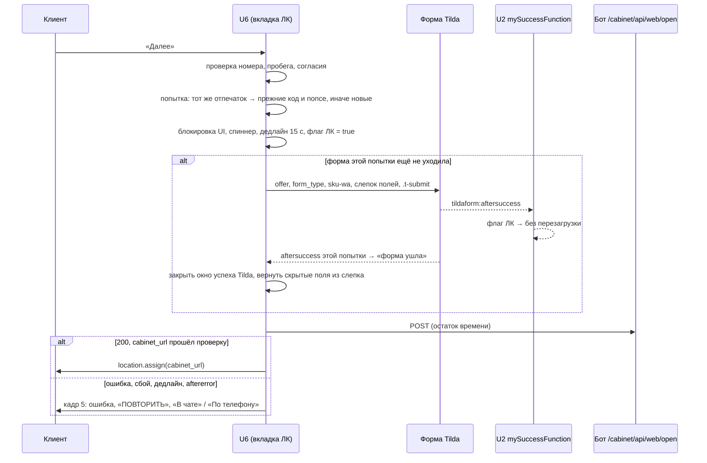
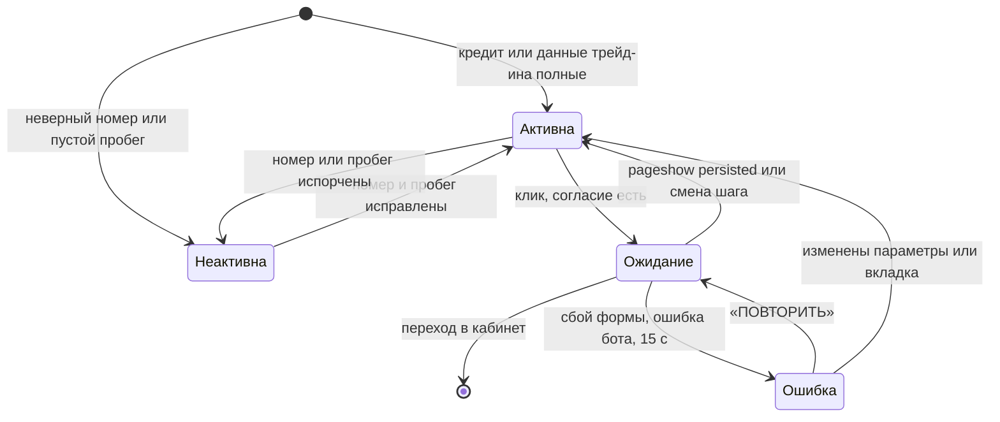
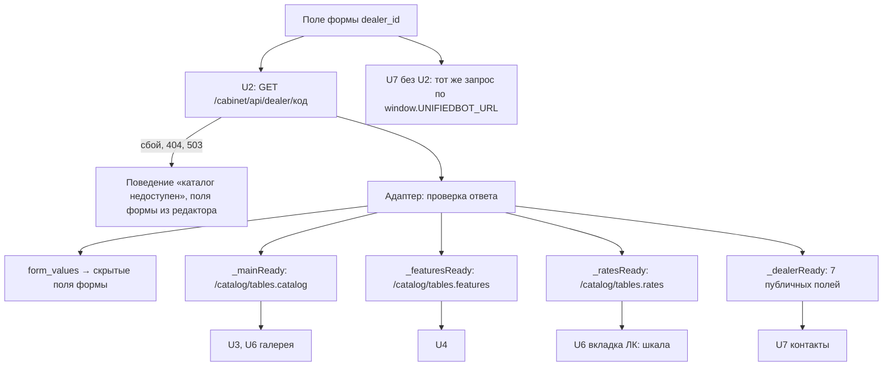

# feat: вкладка «В личном кабинете» на шаге 2 и настройки дилера из бота

**Рабочая папка:** `docs/tilda-blocks/Ver_4_dev/`. **Тестовая страница:** `https://demo.autodc.org/page154296216`. Боевые страницы не трогаются; вставка в Tilda — только по команде владельца.

**Источники (репозиторий бота `unifiedbot_dev_cabinet_2_0`, ветка `feat/cabinet-web-entry`, только чтение; пути от его корня):**
- бриф: `docs/handoff/landing-brief.md` (работы L1–L7; L8 — настройки дилера, придёт отдельно);
- предложение по настройкам дилера: `docs/handoff/2026-09-30-dealer-settings-endpoint-proposal.md`;
- требования: `docs/brainstorms/2026-09-29-cabinet-web-entry-requirements.md` (R1–R10, R51–R53, R62, Contracts, Dependencies «Поля сделки Tilda»);
- план бота: `docs/plans/2026-09-30-001-feat-cabinet-web-entry-plan.md`, раздел «Лендинг: контракт и работы для агента CE landing»;
- макеты: `docs/design/uc-calc-lk-states.html` (состояния 1а–6), `docs/design/lk-source-v4.html`; исходный макет вкладки здесь — `docs/designs/uc-calc-lk-mockup.html`.

---

## Summary

На шаге 2 появляется первая вкладка «В личном кабинете». Клиент выбирает сценарий, желаемый платёж и для трейд-ина госномер с пробегом. По «Далее» лендинг отправляет форму Tilda, после её успеха вызывает у бота «открыть сессию» и переходит по `cabinet_url` в той же вкладке. Параллельно идут два подготовительных шага: тестовая страница целиком переходит на дев-бот, а id таблиц и значения формы лендинг получает от бота по коду `dealer_id` вместо констант в U2.

---

## Problem Frame

Сейчас в кабинет попадают только по ссылке из диалога с ботом. Клиенту лендинга, который хочет сразу считать кредит, остаются чат или «перезвоните». Бот строит веб-вход (эндпоинт «открыть сессию», кабинет без SMS). Лендинг — второй конец этого контракта: он собирает сценарий и параметры, создаёт сделку Tilda с источником «ЛК с сайта» и передаёт боту код, `nonce` и блок полей формы для запасной сделки.

Попутно владелец решил навести порядок с настройками дилера. Единственный источник — таблица Dealers в NocoDB, на сайте задаётся только код в скрытом поле `dealer_id`. Сейчас id таблиц зашиты константами в U2 и U7, а id таблицы ставок, который нужен шкале, лендинг узнать не может: публичная карточка дилера его вырезает.

---

## Requirements

**Подготовка: тестовый стенд и настройки**
- R1. Тестовая страница берёт каталог, оснащение, дилера и «открыть сессию» у дев-бота (бриф L6; требования R46). Фото галереи идут по полным адресам хранилища из каталога и от бота не зависят.
- R2. Значения, которые различаются между тестом и боем (адрес бота, путь кабинета, имена ботов Telegram/MAX, цвет кнопки), собраны в одном месте в начале U2 с пометкой «ТЕСТ / БОЙ» и боевыми значениями в комментарии рядом; стартовые значения — как на живой тестовой странице (решение владельца).
- R3. Код дилера читается только из скрытого поля формы `dealer_id`; константы `DEALER_CODE`, `TABLE_MAIN`, `TABLE_FEATURES`, `TABLE_DEALERS` удалены отовсюду в `Ver_4_dev` (решение владельца).
- R4. Лендинг при загрузке один раз запрашивает `GET {адрес бота}/cabinet/api/dealer/{dealer_code}` и строит на ответе всё, что раньше читал по константам: каталог, оснащение, ставки, карточку дилера (решение владельца; окончательный контракт — L8).
- R5. Значения `form_values` из ответа (`brand`, `dealer`, `website`, `letter_title`, `form_type`) при загрузке вписываются в одноимённые скрытые поля формы Tilda вместо значений из редактора; `form_type` — значение по умолчанию, во вкладке ЛК его заменяет значение по сценарию.
- R6. Если настройки не пришли, лендинг ведёт себя как сейчас при недоступном каталоге; поля формы остаются со значениями из редактора.
- R7. Время до первого фото после перехода на настройки замедляется не больше чем на 300 мс; иначе работа останавливается и цифры показываются владельцу.

**Вкладка и ввод**
- R8. «В личном кабинете» — первая вкладка; третье состояние вкладки не попадает в ветки «В чате» и «По телефону» (L1; требования R1).
- R9. Классы вкладки — `uc-calc-*`; на мобильном таб-бар прокручивается по горизонтали с затуханием у края (L1; требования R10; кадр 6).
- R10. Сценарий: кредит, трейд-ин, кредит + трейд-ин; для кредита и комбо — шкала и поле платежа, для трейд-ина и комбо — госномер и пробег (требования R2).
- R11. Границы шкалы — от «Price new»: минимум при взносе 90 % и 36 мес, максимум при взносе 10 % и 12 мес; ставка — `Rate` строки таблицы ставок дилера с минимальным `Downpayment_From`, при сбое 16 % (L2; требования R4–R5; решение владельца).
- R12. Шаг 5 000 ₽: минимум округляется вверх, максимум вниз; по умолчанию 30 000 ₽ с прижатием к границам; ручной ввод при уходе из поля приводится к ближайшему кратному 5 000 в пределах шкалы; плитка «В КРЕДИТ» показывает «Платеж от N ₽» (L2; требования R3).
- R13. Госномер: недопустимые буквы не вводятся, латинские двойники заменяются кириллицей; ошибка «Номер указан с ошибкой. Проверьте буквы, цифры и код региона.» — только для неполного номера и только после ухода из поля (L2; требования R14, AE3).
- R14. Пробег: только цифры, не больше 1 000 000 км (L2; требования R15).

**Кнопка и ожидание**
- R15. При неверном номере или пустом пробеге «Далее» неактивна на вид: не `disabled`, а `aria-disabled="true"`; причина — в подсказке, связанной через `aria-describedby`: на десктопе по наведению и фокусу, на мобильном по нажатию (L3; требования R6).
- R16. Согласие проверяется как сейчас, до любой отправки.
- R17. После нажатия до ответа бота заблокированы кнопка, вкладки, поля, способ покупки, согласие и «Назад»; индикатор — только спиннер в кнопке (L3; требования R51; кадр 4). Окно успеха Tilda в ветке ЛК не показывается.

**Отправка и сессия**
- R18. По «Далее» уходит та же форма Tilda с `offer` = «ЛК с сайта», `form_type` = «В кредит» / «В трейдин» / «Комбо» и кодом с хвостом из 4 букв в `sku-wa` (L4; требования R7, R52).
- R19. «Открыть сессию» вызывается только после успеха формы; для ветки ЛК перезагрузка страницы после успеха формы отключена (решение владельца).
- R20. Тело запроса — по контракту брифа: `dealer_code`, `lead_code`, `nonce`, `model_id`, `complectation_id` (пара из `window.ucQuiz.selectedCar`), `scenario`, `desired_payment`, `plate`, `mileage`, `form` (требования R8, R62).
- R21. Блок `form`: все поля формы Tilda с теми же значениями, включая `FORMID` — id своей формы, плюс `utm_*` из адреса страницы и сырые cookie `_ct_session_id`, `_ym_uid`, `WhiteCallback_visit`; только строки, пустые ключи не передаются, служебные поля Tilda (`tildaspec-*`, `form-spec-comments`) не передаются, лимиты контракта соблюдены (L7).
- R22. Успех — переход по `cabinet_url` в той же вкладке, только если адрес — https, хост страницы и путь кабинета из блока «ТЕСТ / БОЙ» (требования R51).
- R23. Общий лимит ожидания — 15 с с момента нажатия «Далее» (решение владельца).
- R24. Попытка — это набор параметров (пара позиции, сценарий, платёж, номер, пробег); она живёт только в памяти страницы. Без изменений повтор использует тот же код и `nonce` и не отправляет форму второй раз; при изменении — новый код, новый `nonce` и новая отправка формы (L4; решения владельца).
- R25. Возврат кнопкой «Назад» браузера (`pageshow` с `persisted`) снимает блокировку; повторное «Далее» — тот же код и `nonce` (L4a).

**Ошибка**
- R26. Сбой формы, любая ошибка бота, сетевой сбой или истечение 15 с дают один экран ошибки по кадру 5: «Не удалось открыть личный кабинет. Попробуйте ещё раз или получите расчёт другим способом», переходы на «В чате» / «По телефону», кнопка «ПОВТОРИТЬ»; данные не сбрасываются; фокус переходит на текст ошибки (L5; требования R9).
- R27. «Повторить» после успешной формы вызывает только бота с тем же кодом и `nonce` (решение владельца).

**Проверки на живых страницах**
- R28. Записан результат проверки, что три cookie читаются из JS (`document.cookie`, не HttpOnly) на demo и на боевом лендинге (L7).
- R29. На согласованной тестовой отправке поле «Форма» сделки Tilda в Битриксе совпадает с `form.FORMID` (L7).
- R30. В чек-листе выкладки на бой есть пункт: заменить значения блока «ТЕСТ / БОЙ» на боевые (решение владельца).

---

## Key Technical Decisions

**Стенд и настройки**
- **Блок «ТЕСТ / БОЙ» — единственное место адреса бота.** `window.UNIFIEDBOT_URL` выставляется из него; все блоки, включая запасной путь U7, читают адрес только оттуда. На странице Кабинета, где U2 нет, `window.UNIFIEDBOT_URL` уже задаёт блок `#cabinet-root`.
- **`widget.js` грузится из того же адреса бота.** Для адреса ngrok — через `fetch` с заголовком `ngrok-skip-browser-warning` и вставкой текста в `<script>`: тег `<script src>` заголовок не шлёт и получил бы HTML-заглушку ngrok (так `widget.js` уже грузит аватар). Для боевого адреса — обычный `<script src>`, созданный из константы. Виджет и так ждёт `openTDWidget` циклом (`u6-gallery.html:1500-1509`).
- **Заголовок `ngrok-skip-browser-warning` — только для адреса ngrok.** Признак выводится из адреса бота; боевой бот заголовок в CORS `/cabinet/api/*` может не разрешать.
- **Защита от ngrok на боевом домене.** Если адрес бота — ngrok, а хост страницы не из списка тестовых (`demo.autodc.org`), U2 не делает запросов к боту, пишет ошибку конфигурации и ведёт себя как при недоступном каталоге: забытая замена «ТЕСТ → БОЙ» не уведёт данные клиентов на временный туннель.
- **Настройки дилера — один промис, из которого строятся прежние.** U2 выставляет `window._dealerConfigReady`, а из него — `_mainReady`, `_featuresReady`, `_dealerReady` в прежней форме и новый `_ratesReady`; U3, U4 и U7 интерфейс не меняют. Разбор ответа — одна функция-адаптер, чтобы окончательный контракт L8 правился в одном месте.
- **Адаптер проверяет ответ.** id таблиц принимаются только по шаблону `^[a-z0-9]{10,20}$`; `form_values` — только строки и только для пяти известных имён; карточка дилера — 7 публичных полей в именах `/catalog` (`Dealer_Code`, `Dealer_location`…), которые уже ждёт U7. Остальное игнорируется.
- **`form_values` пишутся в форму сразу после ответа**, до `initCards`: U3 и U6 берут значения формы из DOM, поэтому позже писать нельзя. Исходные значения редактора запоминаются, чтобы вернуть их при отказе настроек.

**Вкладка**
- **Логика вкладки живёт в U6.** Вкладки, согласие и кнопка «Далее» уже там; отдельный блок потребовал бы кросс-блочного контракта на каждое состояние кнопки.
- **Состояние вкладки — одна переменная `calcOffer` с тремя значениями.** Для ЛК это внутренний маркер, а в поле `offer` уходит «ЛК с сайта». Точки правки: разбор клика по вкладке (`u6-gallery.html:1142`), `updateCalcBtnText` (`:775`), ветки обработчика `#uc-gal-submit` (`:1408`, `:1474`, `:1486`, `:1515`), сброс при входе на шаг (`:1622-1629`), обработчик resize (`:1655`).
- **До подключения отправки ЛК «Далее» во вкладке ЛК ничего не отправляет.** Ранний выход с предупреждением в консоли стоит с U3 до U7, иначе старая ветка создала бы мусорную сделку в рабочем Битриксе.
- **Вёрстка — по макету состояний, со сбросом `box-sizing` под корнем новой панели.** U6 живёт под `content-box` и так остаётся (CLAUDE.md); значения макета рассчитаны под `border-box`.
- **Ставка до U2 — 16 %.** U5–U8 не ждут настроек: `_ratesReady` отсутствует или `null` → запасная ставка; реальные ставки подключаются в U2 (решение владельца).

**Отправка**
- **Флаг ветки ЛК в U2 выставляется на каждом клике.** U2 объявляет глобальный флаг рядом с `waSend`; обработчик `#uc-gal-submit` присваивает его вместе с `waSend`/`waMessenger`: `true` в ветке ЛК, `false` во всех остальных. `mySuccessFunction` (`u2-unifiedbot-script.html:226-282`) при флаге выходит до перезагрузки и мессенджеров. Иначе флаг залипнет, как `window.isMaxOverlayActive`, и «По телефону» после ЛК повиснет в «ОТПРАВКА…».
- **Скрытые поля формы снимаются до отправки и восстанавливаются после успеха.** Tilda в обработчике успеха очищает поля, включая скрытые (`docs/solutions/integration-issues/tilda-aftersuccess-event-target-mismatch.md`); раньше это скрывала перезагрузка. Слепок всех именованных полей делается до клика по `.t-submit` и хранится в попытке; код дилера, блок `form` и повтор читают только его; после `aftersuccess` в ветке ЛК скрытые поля (`dealer_id`, `Model`, `SKU`, `Price_*`, `modification`, `complectation`, `Link`, `form_values`) возвращаются в форму, чтобы «В чате» / «По телефону» и U3 работали дальше.
- **Окно успеха Tilda в ветке ЛК закрывается.** Для формы t678 Tilda показывает «Данные успешно отправлены» с блокировкой прокрутки независимо от `mySuccessFunction`; по `aftersuccess` в ветке ЛК окно убирается и классы `t-body_scroll-locked` / `t-body_success-popup-showed` снимаются тем же способом, что обработчик `visibilitychange` в U2.
- **`FORMID` берётся из DOM.** Атрибут `id` у `<form>` внутри `.uc-tildaform` (сейчас `form2472574461` = `form` + recid `rec2472574461`) — ровно то, что Tilda шлёт в Битрикс; запасной путь — `form` + цифры из `id` родительского `.t-rec`.
- **Код ЛК строится в U6 и не трогает глобальный `skuId`.** `dealer_id` + «Model id» + «Complectation id» + 4 случайные буквы A–Z из `crypto.getRandomValues`; вкладки «В чате» / «По телефону» работают с `skuId` из U3. Код, не проходящий `^\d{6}[A-Z]{4}$`, до отправки даёт экран ошибки и предупреждение в консоли.
- **Попытка — только в памяти страницы.** Переменная внутри IIFE U6: отпечаток, код, `nonce`, слепок полей, признак «форма ушла». bfcache сохраняет её при «Назад»; после перезагрузки попытка начинается заново (решение владельца). `nonce` — 16 случайных байт в base64url.
- **Исход формы привязан к попытке.** Перед кликом по `.t-submit` запоминается код попытки, чья форма в полёте; поздний `aftersuccess` / `aftererror` меняет только эту попытку. Пока у `.t-submit` класс `t-btn_sending` (Tilda глушит повторные клики), новая отправка формы не запускается — «Далее» показывает экран ошибки.
- **Один дедлайн на весь поток.** Таймер 15 с стартует по клику и охватывает XHR Tilda и запрос к боту; запрос к боту получает остаток времени через `AbortController`.
- **`cabinet_url` проверяется перед переходом.** Разбор через `URL`: протокол `https:`, хост равен хосту страницы, путь — путь кабинета из «ТЕСТ / БОЙ» (`/cabinet_dev` / `/cabinet`); иначе экран ошибки.

---

## High-Level Technical Design

### Поток «Далее» во вкладке ЛК

### Состояния кнопки во вкладке ЛК

### Настройки дилера

---

## Инвентаризация: код дилера и id таблиц в `Ver_4_dev`

Список для шага U2. На 2026-09-30 `Ver_4_dev` байт-в-байт совпадает с `Ver_3_ong`.

| Где | Что сейчас | Что станет |
|---|---|---|
| `u2-unifiedbot-script.html:12` | комментарий «Рядом… TABLE_MAIN, TABLE_DEALERS, DEALER_CODE» | ссылка на блок «ТЕСТ / БОЙ» и поле `dealer_id` |
| `u2-unifiedbot-script.html:81-98` | `const TABLE_MAIN`, `TABLE_FEATURES`, `TABLE_DEALERS`, `DEALER_CODE` | удалить |
| `u2-unifiedbot-script.html:136-147, 188, 198` | `loadCarData(TABLE_MAIN)` → `/catalog/{TABLE_MAIN}` | `tables.catalog` из настроек |
| `u2-unifiedbot-script.html:151-154` | `_featuresReady` ← `/catalog/{TABLE_FEATURES}` | `tables.features` из настроек |
| `u2-unifiedbot-script.html:156-176` | `_dealerReady` ← `/catalog/{TABLE_DEALERS}` + поиск по `DEALER_CODE` | `dealer` из настроек |
| `u3-card-sliders.html:1311` | читает `dealer_id` из формы для `skuId` | без изменений (поле — источник) |
| `u4-accordion.html:223-252, 317, 620-621` | потребитель `_featuresReady`, id не знает | без изменений |
| `u7-contacts.html:309-316` | `var TABLE_DEALERS` (запасной путь) | удалить |
| `u7-contacts.html:376-448` | запасной путь без U2: `dealer_id` → `/catalog/{TABLE_DEALERS}` | `GET /cabinet/api/dealer/{код}` по `window.UNIFIEDBOT_URL` |
| `u7-contacts.html:633` | потребитель `_dealerReady` | без изменений |
| `u6-gallery.html` | код дилера и таблицы не использует | новый потребитель `dealer_id` и `_ratesReady` |
| `u1-screen-chrome.html` | не использует | не затрагивается |
| Tilda, форма `.uc-tildaform` | скрытые поля `dealer_id` = `99`, `brand`, `dealer`, `website`, `letter_title`, `form_type` | `dealer_id` — единственная настройка; остальные пять перезаписываются из `form_values` |
| `CLAUDE.md` | разделы «Where the dealer code and table id actually live», «Per-site settings», «U4: TABLE_FEATURES…» | переписать |

Адрес бота (для R1): `u2-unifiedbot-script.html:44-45` (`UNIFIEDBOT_URL` и `widget.js`); читают `u3-card-sliders.html:1361`, `u4-accordion.html:269`, `u6-gallery.html:936`, `u7-contacts.html:413`, а также `widget.js`.

---

## Implementation Units

### Фаза 1. Подготовка стенда

### U1. Блок «ТЕСТ / БОЙ» в U2 и переход тестовой страницы на дев-бот

- **Goal:** `Ver_4_dev/u2` совпадает с живой тестовой страницей по ботам и цвету, все значения «тест/бой» собраны в одном месте, страница работает с дев-ботом.
- **Requirements:** R1, R2, R30
- **Dependencies:** нет
- **Files:** modify `docs/tilda-blocks/Ver_4_dev/u2-unifiedbot-script.html`
- **Approach:**
  - в начале блока — секция «ТЕСТ / БОЙ»: адрес бота (дев: `https://sporophoric-devorah-remonstrative.ngrok-free.dev`, бой: `https://obut-5oaj-5i2u.gw-1a.dockhost.net`), путь кабинета (`/cabinet_dev` / `/cabinet`), список тестовых хостов (`demo.autodc.org`), имена ботов Telegram (`TestmesssBot` / `vashassistentbot`) и MAX (`id781424127394_1_bot` / `id781424127394_bot`), цвет кнопки (тест `#6ACEC3`, hover `#5BB0A7`; бой `#2D5467`, hover `#3C728D`); боевое значение — в комментарии рядом;
  - цвет остаётся CSS-свойствами в `<style>`, JS-значения — в `<script>`; секции ссылаются друг на друга комментарием, как требует CLAUDE.md;
  - `widget.js` и заголовок ngrok — по KTD «Стенд и настройки»; защита от ngrok на боевом домене.
- **Patterns to follow:** комментарии «НАСТРОЙКИ САЙТА» в `u2-unifiedbot-script.html:3-26, 81-84`; загрузка аватара через `fetch` в `widget.js` (`setImageSrc`).
- **Test scenarios:**
  - Happy path: при адресе дев-бота каталог, оснащение и контакты загружаются с ngrok-хоста (вкладка Network); фото — из хранилища.
  - Integration: «В чате» → «На сайте» открывает виджет, чей `BOT_URL` — дев-бот.
  - Integration: Telegram/MAX на мобильном ведут на `TestmesssBot` / `id781424127394_1_bot`.
  - Error path: дев-бот выключен — скелетон уходит, страница ведёт себя как при недоступном каталоге, без необработанных исключений.
  - Edge case: `widget.js` с ngrok исполняется как скрипт (`typeof window.openTDWidget === 'function'`).
  - Edge case: адрес ngrok на хосте не из списка тестовых — ни одного запроса к боту, ошибка конфигурации в консоли.
- **Verification:** сверка живой страницы с `Ver_4_dev` скриптом из CLAUDE.md после вставки U2 показывает расхождения только в U7; ОСТАНОВКА 1 пройдена.

### U2. Настройки дилера из бота

- **Goal:** id таблиц, карточка дилера и значения формы приходят от бота по коду из формы; констант в блоках нет.
- **Requirements:** R3, R4, R5, R6, R7
- **Dependencies:** U1; эндпоинт `GET /cabinet/api/dealer/{dealer_code}` работает на дев-боте (владелец сообщит) — **до этого юнит не начинается**
- **Files:** modify `docs/tilda-blocks/Ver_4_dev/u2-unifiedbot-script.html`, `docs/tilda-blocks/Ver_4_dev/u7-contacts.html`; test `docs/testing/dealer-ready-order.html` (новый сценарий), `docs/testing/dealer-source-check.js` (расширить)
- **Approach:**
  - U2 читает `dealer_id` из `.uc-tildaform` и делает один запрос настроек; адаптер по KTD превращает ответ в `{ tables: { catalog, features, rates }, dealer: {…}, formValues: {…} }` или `null`;
  - `form_values` пишутся в форму сразу после ответа, до `initGallery` / `initCards`;
  - каталог, оснащение и ставки грузятся через `/catalog/{id}` параллельно после настроек; `_dealerReady` отдаёт карточку в прежней форме;
  - `null`, пустой `dealer_id` или ответ 404/422/503 — ветка «каталог недоступен» из `init()` (`u2-unifiedbot-script.html:189-196`): скелетон скрыт, `uc:ready`, `_mainReady` разрешён, остальные промисы — `null`, поля формы — из редактора;
  - U7 в запасном пути (страница без U2) делает тот же запрос по `window.UNIFIEDBOT_URL` и берёт карточку; заголовок ngrok — по тому же признаку адреса.
- **Execution note:** до правки замерить время до первого фото на холодном кэше (5 прогонов) методом из `docs/solutions/developer-experience/gallery-slowness-is-bootstrap-and-backend-not-block-code.md`; после правки — так же. Медиана хуже больше чем на 300 мс — остановиться и показать цифры владельцу.
- **Patterns to follow:** промис `_featuresReady` с `catch → null` (`u2-unifiedbot-script.html:152-154`); отложенная инициализация U7 (`docs/solutions/integration-issues/jquery-ready-order-duplicate-init.md`).
- **Test scenarios:**
  - Happy path: `dealer_id` = `99` → один запрос настроек, затем по одному запросу каталога, оснащения, ставок; шаг 1, попап оснащения и контакты работают как до правки.
  - Happy path: `brand`, `dealer`, `website`, `letter_title`, `form_type` в форме равны `form_values` ответа.
  - Error path: настройки падают, 404 или 503 — поведение «каталог недоступен», поля формы из редактора, U4 «Нет данных об оснащении», U7 — текст вместо карты.
  - Edge case: `dealer_id` пуст или отсутствует — то же, плюс предупреждение в консоли.
  - Edge case: id таблицы не по шаблону или `form_values` с нестроковым значением — значение игнорируется.
  - Integration: страница без U2 — U7 получает карточку своим запросом; на странице с U2 к настройкам ровно один запрос, U7 своего не делает.
  - Integration: вкладка ЛК после U2 считает шкалу по реальной ставке дилера, а не по 16 %.
- **Verification:** поиск по `Ver_4_dev` не находит `TABLE_` и `DEALER_CODE`, кроме комментариев-ссылок; замер до/после записан; ОСТАНОВКА 2 пройдена.

### Фаза 2. Вкладка ЛК без отправки

### U3. Каркас вкладки и третье состояние `calcOffer`

- **Goal:** вкладка «В личном кабинете» стоит первой и открыта по умолчанию, вкладки «В чате» и «По телефону» ведут себя как раньше.
- **Requirements:** R8, R9
- **Dependencies:** нет
- **Files:** modify `docs/tilda-blocks/Ver_4_dev/u6-gallery.html`; test `docs/testing/lk-tab-harness/tests.js`
- **Approach:**
  - разметка панели и таб-бара — по `uc-calc-lk-states.html`, классы с префиксом `uc-calc-`, правила скоуплены под `#uc-gallery-custom`; родовые имена макета (`.tab`, `.panel`, `.row`, `.field`, `.range`, `.plate`, `.note`, `.btn`, `.input`, `.hint`) не переносить;
  - сброс `border-box` — только под корнем новой панели;
  - мобильный таб-бар: вместо `flex: 1` (`u6-gallery.html:571`) — прокрутка с `nowrap` и затуханием у края, переключаемым при прокрутке, как фейды `.uc-specs-scroll-wrap`;
  - все точки `calcOffer` из KTD переводятся на три значения; вход на шаг 2 открывает вкладку ЛК; поля `name`/`phone` формы Tilda на ЛК отключены, как на «В чате»;
  - `form_type` запоминается при инициализации и возвращается перед отправкой из «В чате» / «По телефону»;
  - «Далее» во вкладке ЛК — ранний выход без отправки до U7.
- **Patterns to follow:** `.uc-calc-tabbar` / `.uc-calc-method-btn` (`u6-gallery.html:360-402`); правило именования из CLAUDE.md «CSS class names are page-global».
- **Test scenarios:**
  - Happy path: вход на шаг 2 — активна «В личном кабинете», видна её панель.
  - Happy path: «По телефону» — кнопка «ОТПРАВИТЬ», телефонная валидация как раньше; «В чате» — «ДАЛЕЕ →», мессенджеры как раньше.
  - Edge case: ЛК → «В чате» → отправка — `offer` = «В чате», `form_type` исходный, `sku-wa` = `skuId`.
  - Edge case: «Далее» во вкладке ЛК — форма не отправлена, предупреждение в консоли.
  - Edge case: выход на шаг 1 и возврат — снова активна ЛК; resize на ЛК не трогает вкладку и мессенджеры.
  - Integration: с `*{box-sizing:content-box}` в харнессе поля и кнопки панели не выходят за контейнер на 390 px и 1000 px.
- **Verification:** телефонный харнесс, собранный из `Ver_4_dev`, зелёный; таб-бар на 390 px прокручивается.

### U4. Харнесс вкладки ЛК

- **Goal:** сценарии вкладки проверяются на настоящем коде U6 без Tilda и бота.
- **Requirements:** поддерживает R8–R27
- **Dependencies:** U3
- **Files:** create `docs/testing/lk-tab-harness/build_harness.py`, `docs/testing/lk-tab-harness/tests.js`, `docs/testing/lk-tab-harness/README.md`
- **Approach:** сборщик дословно извлекает `<style>`, разметку calc-секции и `<script>` из `Ver_4_dev/u6-gallery.html`, как `docs/testing/phone-validation-harness/build_harness.py`; добавляет `*{box-sizing:content-box}`; заглушку `.uc-tildaform` с полями живой формы (`id="form2472574461"`), которая по команде даёт `aftersuccess` (с очисткой полей и показом окна успеха, как Tilda), `aftererror` или молчание и ставит `t-btn_sending` на время «отправки»; заглушки `window.ucQuiz.selectedCar`, `_ratesReady`, `fetch` к `/cabinet/api/web/open` с режимами 200 / 422 / 429 / 503 / сетевой сбой / зависание; синтетический `pageshow` с `persisted`; заглушку `location.assign`.
- **Patterns to follow:** `docs/testing/phone-validation-harness/` (вывод в `#log`, `window.LAST`, `runAll()`).
- **Test expectation:** none -- инфраструктура проверок; сценарии добавляют U3, U5–U8.
- **Verification:** `runAll()` выполняет сценарии U3 и выводит итог `N ok, M fail`.

### U5. Сценарий, шкала платежа, госномер и пробег

- **Goal:** ввод во вкладке ЛК работает по L2 и кадрам 1а–3б.
- **Requirements:** R10, R11, R12, R13, R14
- **Dependencies:** U3, U4; U2 — мягкая (до U2 ставка 16 %)
- **Files:** modify `docs/tilda-blocks/Ver_4_dev/u6-gallery.html`; test `docs/testing/lk-tab-harness/tests.js`
- **Approach:**
  - сценарий — три плитки; кредит показывает блок платежа, трейд-ин — блок авто, комбо — оба;
  - границы — аннуитет: минимум `PMT(0,1 × цена, ставка, 36)`, максимум `PMT(0,9 × цена, ставка, 12)`; ставка из `_ratesReady`: строка с минимальным `Downpayment_From` (при равенстве — меньший `Term_From`), `Rate` в процентах; нет таблицы, пусто или нечисло — 16 %;
  - шкала строится сразу с доступной ставкой и пересчитывается при позднем приходе ставок и при каждом входе на шаг 2; уже выбранный платёж прижимается к новым границам, а не сбрасывается;
  - позиция без «Price new»: плитки «В КРЕДИТ» и «КРЕДИТ + ТРЕЙД-ИН» скрыты, выбран трейд-ин, пустой шкалы нет;
  - ползунок и поле синхронны; заливка дорожки — CSS-свойство, которое выставляет JS; шаг ползунка с клавиатуры — 5 000, `aria-valuetext` — сумма в рублях;
  - сценарий, номер и пробег сохраняются между входами на шаг;
  - госномер — группа `role="group"` с подписью «Госномер» из двух полей: основная часть по позициям (буква, три цифры, две буквы) с фильтром и заменой двойников, регион — 2–3 цифры; автопереход в регион после 6 символов; ошибка связана с полем через `aria-describedby` и `aria-invalid`; итог — без пробелов, кириллица;
  - пробег — цифры с разделителем тысяч, ввод сверх 1 000 000 не принимается; у полей платежа и пробега — подписи;
  - формулы и маски — чистые функции внутри IIFE.
- **Execution note:** сценарии чистых функций (границы, округление, маска) писать в харнессе до разметки.
- **Patterns to follow:** маска телефона (`u6-gallery.html:1181-1342`); формула `calculatePMT` кабинета (`widget-custom/cabinet-app/calc_engine.browser.js:17-21` в репозитории бота).
- **Test scenarios:**
  - Happy path: цена 2 029 000, ставка 16 % → шкала 10 000…165 000, по умолчанию 30 000, плитка «Платеж от 10 000 ₽» (кадр 1а).
  - Edge case: минимум 38 450 → шкала от 40 000, платёж 40 000 в поле и на ползунке (кадр 1б; AE1); максимум ниже 30 000 — платёж у правой границы.
  - Edge case: ручной ввод 32 400 → 30 000; 7 000 при минимуме 10 000 → 10 000; сверх максимума → максимум.
  - Edge case: две строки ставок с одинаковым минимальным `Downpayment_From` → берётся строка с меньшим `Term_From`.
  - Error path: `_ratesReady` нет или `null` → 16 %; строка без числового `Rate` пропускается.
  - Edge case: ставки пришли после показа шкалы → границы пересчитаны, платёж прижат.
  - Edge case: позиция без «Price new» → только трейд-ин, шкалы нет.
  - Happy path: ввод `a123bc77` → `А123ВС` и `77`, итог `А123ВС77` (AE3).
  - Edge case: `Б`, `Д`, `Z` и цифра на месте буквы не вводятся; вставка `а 123 вс 777` → `А123ВС777`.
  - Edge case: уход из поля с `А12` → текст ошибки и `aria-invalid="true"`; уход из пустого поля — без ошибки; ввод до полного номера убирает ошибку.
  - Edge case: пробег `1 000 000` принимается, цифра сверх лимита не вводится; нецифровые символы отбрасываются.
  - Integration: смена комплектации на шаге 1 и возврат — новые границы, платёж прижат к ним.
- **Verification:** сценарии U5 в харнессе зелёные; на тестовой странице шкала совпадает с расчётом для самой дешёвой, средней и самой дорогой позиции каталога.

### U6. Неактивная «Далее» и подсказка

- **Goal:** кнопка сообщает, почему нельзя продолжить, не будучи `disabled`.
- **Requirements:** R15, R16
- **Dependencies:** U5
- **Files:** modify `docs/tilda-blocks/Ver_4_dev/u6-gallery.html`; test `docs/testing/lk-tab-harness/tests.js`
- **Approach:**
  - условие неактивности — только на вкладке ЛК при трейд-ине и комбо: номер неполон или пробег пуст; причина номера важнее причины пробега;
  - подсказки по макету: «Исправьте гос. номер, чтобы продолжить», «Укажите пробег, чтобы продолжить» (черновые тексты макета);
  - десктоп: подсказка по `:hover` и `:focus-visible`; мобильный: по нажатию на неактивную кнопку; подсказка скрывается при нажатии вне кнопки, прокрутке, смене вкладки и активации кнопки, а при смене причины перерисовывается; клик по неактивной кнопке ничего не отправляет;
  - нетронутый пустой пробег не подсвечивается красным;
  - согласие — проверка по клику через `ucConsentState()` до любой ветки.
- **Patterns to follow:** порядок проверок в обработчике `#uc-gal-submit` (`u6-gallery.html:1398-1471`).
- **Test scenarios:**
  - Happy path: кредит — кнопка активна без дополнительных полей.
  - Happy path: трейд-ин с полным номером и пробегом — активна; очистка пробега — `aria-disabled="true"`, `aria-describedby` указывает на подсказку пробега.
  - Edge case: неполный номер и пустой пробег — подсказка про номер; номер исправлен — подсказка про пробег.
  - Edge case: на мобильной ширине нажатие по неактивной кнопке показывает подсказку; нажатие вне или прокрутка — скрывают; форма не отправлена.
  - Error path: активная кнопка без согласия — ошибка согласия, отправки нет.
  - Edge case: переключение на «В чате» снимает `aria-disabled` и подсказку.
- **Verification:** сценарии в харнессе зелёные; фокус с клавиатуры на кнопку показывает подсказку.

### Фаза 3. Отправка и сессия

### U7. Отправка формы, «открыть сессию» и переход

- **Goal:** «Далее» во вкладке ЛК создаёт сделку Tilda, открывает сессию и переводит клиента в кабинет.
- **Requirements:** R17–R25
- **Dependencies:** U2, U6; эндпоинт `/cabinet/api/web/open` на дев-боте
- **Files:** modify `docs/tilda-blocks/Ver_4_dev/u6-gallery.html`, `docs/tilda-blocks/Ver_4_dev/u2-unifiedbot-script.html`; test `docs/testing/lk-tab-harness/tests.js`
- **Approach:**
  - ветка ЛК в обработчике `#uc-gal-submit` идёт после согласия и завершается раньше веток виджета, `ucSetSending` и телефонного сабмита; заменяет ранний выход из U3;
  - флаг ЛК, `waSend`, `waMessenger` присваиваются в каждой ветке по KTD;
  - блокировка: кнопка со спиннером, `aria-busy="true"` и скрытым текстом «Открываем личный кабинет»; вкладки, поля, плитки сценария, согласие, «Назад» — `aria-disabled` и недоступны для клика; фокус остаётся на кнопке; телефонный `ucSetSending` и его сторож 20 с не используются;
  - попытка: отпечаток сравнивается с текущим; совпал — прежние код и `nonce`, иначе новые и признак «форма ушла» сброшен; если `.t-submit` ещё в `t-btn_sending` — экран ошибки без новой отправки;
  - форма, если ещё не уходила: `offer` = «ЛК с сайта», `form_type` по сценарию, `sku-wa` = код, `messenger` = пусто, слепок полей в попытку, запоминание кода «формы в полёте», клик по `.t-submit`; исход — `tildaform:aftersuccess` / `aftererror` с `closest('.uc-tildaform')`, применяемый только к попытке «в полёте»;
  - после `aftersuccess` в ветке ЛК: закрыть окно успеха Tilda и снять блокировку прокрутки, вернуть скрытые поля из слепка;
  - блок `form` из слепка: все именованные поля кроме `formservices[]`, `tildaspec-*`, `form-spec-comments`, отключённых и пустых; чекбокс — только отмеченный; `FORMID`; `utm_source` … `utm_term` из `location.search`; три cookie из `document.cookie` без декодирования; значения — строки; ключ длиннее 64 или значение длиннее 2 000 отбрасывается с предупреждением; итоговая проверка 80 ключей и 16 КБ;
  - запрос: `POST {адрес бота}/cabinet/api/web/open`, JSON, `dealer_code` из слепка `dealer_id`, пара позиции строками, `desired_payment` только для `credit`/`combo`, `plate` и `mileage` только для `tradein`/`combo`;
  - 200 и `cabinet_url` прошёл проверку → `location.assign`; блокировка не снимается до ухода со страницы; токен в консоль не пишется;
  - `pageshow` с `persisted` снимает блокировку, возвращает текст кнопки и фокус на «ДАЛЕЕ →»; смена шага снимает её так же, как сейчас `_submitting`.
- **Execution note:** сначала сценарии харнесса на заглушках формы и `fetch`, затем код.
- **Technical design:** попытка — `{ fp, lead_code, nonce, snapshot, form_sent }` в переменной IIFE; отпечаток — склейка `model_id | complectation_id | scenario | desired_payment | plate | mileage`, где неприменимые к сценарию поля пусты. Направляющий набросок, не спецификация.
- **Patterns to follow:** слушатели `tildaform:*` в U6 (`u6-gallery.html:1554-1577`); снятие окон Tilda в обработчике `visibilitychange` (`u2-unifiedbot-script.html:354-374`); ветка веб-виджета как пример раннего выхода (`u6-gallery.html:1495-1510`).
- **Test scenarios:**
  - Happy path: кредит, 30 000 → форма с `offer` = «ЛК с сайта», `form_type` = «В кредит», `sku-wa` вида `991411QPXK`; после `aftersuccess` один POST с `scenario: "credit"`, `desired_payment: 30000`, без `plate`/`mileage`; `location.assign` с `cabinet_url`.
  - Happy path: комбо → `form_type` = «Комбо», в теле `desired_payment`, `plate` `А123ВС77`, `mileage` целым; трейд-ин → «В трейдин», без `desired_payment`.
  - Happy path: блок `form` содержит `FORMID` = `form2472574461`, `Model`, `modification`, `complectation`, `SKU`, `Link`, `Price_ac`, `Price_ol`, `brand`, `dealer`, `dealer_id`, `website`, `letter_title`, `sku-wa`, `offer`, `form_type`, `Checkbox`; нет `name`, `phone`, `formservices[]`, пустых значений; все значения — строки.
  - Edge case: `?utm_source=ya&utm_term=` → `utm_source` есть, `utm_term` нет; cookie `_ym_uid=123` → `"123"`, отсутствующая не передаётся; значение в 2 001 символ отброшено.
  - Integration: после `aftersuccess` (заглушка очищает поля) скрытые поля формы снова заполнены; окна успеха нет; прокрутка не заблокирована.
  - Integration: `mySuccessFunction` при флаге ЛК не перезагружает страницу и не открывает мессенджеры.
  - Integration: ЛК (форма ушла, бот 503) → «По телефону» из плашки → отправка → флаг `false`, страница перезагружается через 1 с, `Model` и `dealer_id` в отправке заполнены.
  - Edge case: форма ушла, бот 503 → «ПОВТОРИТЬ» → второго сабмита нет, POST с тем же `lead_code` и `nonce`.
  - Edge case: после ошибки изменён платёж → новый код и `nonce`, форма уходит снова; в блоке `form` нет `tildaspec-*`.
  - Edge case: форма молчит 15 с → плашка; смена платежа и «Далее», пока `t-btn_sending` → плашка без новой отправки; поздний `aftersuccess` первой попытки не меняет вторую.
  - Edge case: `pageshow` с `persisted` → разблокировано, фокус на кнопке; «Далее» → тот же код и `nonce`, формы нет.
  - Error path: код не проходит `^\d{6}[A-Z]{4}$` → экран ошибки, ни формы, ни запроса.
  - Error path: `cabinet_url` на чужом хосте, с другим путём или по `http:` → экран ошибки, перехода нет.
  - Error path: адрес бота на ngrok → заголовок `ngrok-skip-browser-warning` есть; на боевом адресе — нет.
- **Verification:** сценарии харнесса зелёные; на ОСТАНОВКЕ 4 с запущенным дев-ботом «Далее» открывает `https://demo.autodc.org/cabinet_dev#t=…`.

### U8. Экран ошибки открытия кабинета

- **Goal:** любой сбой даёт кадр 5 с повтором и переходом на другие вкладки.
- **Requirements:** R23, R26, R27
- **Dependencies:** U7
- **Files:** modify `docs/tilda-blocks/Ver_4_dev/u6-gallery.html`; test `docs/testing/lk-tab-harness/tests.js`
- **Approach:**
  - одна плашка на все причины: `aftererror` формы, форма ещё отправляется, код не прошёл проверку, HTTP не 200, `cabinet_url` не прошёл проверку, сетевой сбой, дедлайн 15 с;
  - плашка стоит в панели над навигацией; при показе страница прокручивается к ней; фокус — на текст ошибки (`tabindex="-1"`), без `role="alert"`, чтобы не было двойного анонса;
  - основная кнопка — «↻ ПОВТОРИТЬ»; кнопки-вкладки «В чате» / «По телефону» внутри плашки — обычные кнопки, переключают вкладку существующим обработчиком;
  - данные не сбрасываются; изменение параметров или вкладки убирает плашку и возвращает «ДАЛЕЕ →».
- **Patterns to follow:** разделение ошибок валидации и отправки в U6 (CLAUDE.md «Validation errors and send failures are two different wires»).
- **Test scenarios:**
  - Error path: бот отвечает 422, 404, 429 (`limit_source: ip` и `dealer`), 403, 503 → одна и та же плашка; всё разблокировано (AE10).
  - Error path: `aftererror` формы → плашка, запроса к боту нет.
  - Error path: форма молчит 15 с → плашка; затем `aftersuccess` → «ПОВТОРИТЬ» шлёт только бота.
  - Error path: бот молчит → через 15 с от клика запрос прерван, плашка.
  - Happy path: «ПОВТОРИТЬ» после 503 → 200 → переход.
  - Happy path: «В чате» в плашке → активна вкладка «В чате», плашка скрыта.
  - Edge case: после показа плашки фокус на тексте ошибки, плашка в зоне видимости.
- **Verification:** сценарии в харнессе зелёные; на тестовой странице выключенный дев-бот даёт плашку не позже 15 с.

### Фаза 4. Проверки на живых страницах и документы

### U9. Cookie, `FORMID`, документация и чек-лист выкладки

- **Goal:** результаты живых проверок записаны, документация проекта отражает новую схему, есть чек-лист выкладки на бой.
- **Requirements:** R28, R29, R30
- **Dependencies:** U7 (для `FORMID`); проверка cookie может идти раньше
- **Files:** create `docs/solutions/integration-issues/cabinet-web-entry-cookies-and-formid.md`; modify `CLAUDE.md`
- **Approach:**
  - cookie: в браузере на `page154296216` и на боевом лендинге (адрес — у владельца) прочитать `document.cookie` и записать, какие из трёх cookie видны; только чтение, без отправки форм;
  - `FORMID`: на тестовой отправке, согласованной с владельцем, сравнить `form.FORMID` из тела запроса с полем «Форма» сделки Tilda в Битриксе (смотрит владелец);
  - CLAUDE.md: таблица блоков (U6 — вкладка ЛК), раздел о настройках дилера вместо разделов о `DEALER_CODE` и `TABLE_*`, блок «ТЕСТ / БОЙ», контракт с ботом, флаг ЛК в `mySuccessFunction`, восстановление полей после успеха формы, состояние расхождения с живой страницей;
  - чек-лист выкладки на бой — в CLAUDE.md, раздел Deployment.
- **Test expectation:** none -- проверки и документация без изменения поведения.
- **Verification:** документ результатов содержит дату, страницу и видимость каждой cookie; CLAUDE.md не упоминает удалённые константы как действующие.

---

## Порядок работ

Фаза 1 (U1) и Фаза 2 (U3–U6) идут сейчас; U2 — когда владелец сообщит, что эндпоинт настроек работает на дев-боте; Фаза 3 (U7–U8) — после U2; U9 — после U7.

---

## Контрольные остановки

Каждая остановка: агент описывает по шагам, какой блок вставить на какую страницу; владелец публикует сам и проверяет по чек-листу. Остановки 1, 2 и 4 требуют запущенного дев-стенда (ngrok) — перед ними агент напоминает о запуске. Тестовые отправки формы уходят в рабочий портал Битрикс24 — только по согласованию.

### ОСТАНОВКА 1 — после U1 (вставить U2)
- [ ] Каталог, оснащение и контакты грузятся с ngrok-хоста дев-бота; фото — из хранилища.
- [ ] `widget.js` загружен с дев-бота и исполнен; «В чате» → «На сайте» открывает виджет.
- [ ] Ссылки Telegram/MAX на мобильном — тестовые боты; цвет «ДАЛЕЕ →» — `#6ACEC3`.
- [ ] Сверка живой страницы с `Ver_4_dev` показывает расхождение только в U7.

### ОСТАНОВКА 2 — после U2 (вставить U2 и U7)
- [ ] В Network один запрос `/cabinet/api/dealer/99`, затем запросы каталога, оснащения, ставок по id из ответа.
- [ ] Скрытые поля формы `brand`, `dealer`, `website`, `letter_title`, `form_type` — из ответа.
- [ ] Шаг 1, попап оснащения, контакты с картой работают как на ОСТАНОВКЕ 1.
- [ ] Медиана времени до первого фото хуже не больше чем на 300 мс.

### ОСТАНОВКА 3 — после U3, U5, U6 (вставить U6)
- [ ] Шаг 2 открывается на «В личном кабинете»; на 390 px таб-бар прокручивается, видно затухание.
- [ ] Шкала для самой дешёвой, средней и самой дорогой позиции совпадает с расчётом при 16 %; плитка «Платеж от N ₽».
- [ ] Ручной ввод платежа округляется при уходе из поля.
- [ ] Маска номера: `a123bc77` → `А123ВС77`; `Б` не вводится; ошибка неполного номера после ухода из поля.
- [ ] Пробег: разделитель тысяч, 1 000 000 максимум.
- [ ] Неактивная «Далее» с подсказкой: наведение и Tab на десктопе, нажатие на мобильном.
- [ ] «Далее» во вкладке ЛК не создаёт сделку.
- [ ] «В чате» и «По телефону» отправляются как раньше, `form_type` у них исходный (по согласованию одна тестовая отправка).

### ОСТАНОВКА 4 — после U7, U8 (вставить U2 и U6 вместе)
- [ ] Кредит, трейд-ин, комбо: сделка Tilda с «Тип лида 1» = «ЛК с сайта» и нужным «Тип обращения»; переход на `https://demo.autodc.org/cabinet_dev#t=…`.
- [ ] Окно «Данные успешно отправлены» не появляется; страница не перезагружается.
- [ ] Тело запроса в Network: поля контракта, блок `form` с `FORMID`, UTM, доступными cookie; нет `car`, нет `tildaspec-*`.
- [ ] «Назад» из кабинета → кнопки разблокированы; «Далее» → тот же `lead_code` и `nonce`, формы нет, бот возвращает тот же адрес.
- [ ] Изменение платежа после «Назад» → новый код, новая сделка Tilda с заполненными полями о машине.
- [ ] Выключенный дев-бот → плашка ошибки не позже 15 с; «По телефону» из плашки отправляет заявку и перезагружает страницу; «ПОВТОРИТЬ» после включения бота → переход.

### ОСТАНОВКА 5 — после U9
- [ ] Записан результат по трём cookie на demo и боевом лендинге.
- [ ] «Форма» сделки Tilda в Битриксе = `form.FORMID` из запроса.
- [ ] CLAUDE.md и чек-лист выкладки обновлены.

---

## Чек-лист выкладки на бой (заготовка для U9)

- [ ] Бот на бою отдаёт `/cabinet/api/dealer/{код}` и `/cabinet/api/web/open`; `Website_URL` боевого дилера в whitelist.
- [ ] В блоке «ТЕСТ / БОЙ» U2: адрес бота, путь кабинета, имена ботов Telegram/MAX и цвет кнопки заменены на боевые.
- [ ] Поле `dealer_id` формы на боевой странице — код боевого дилера.
- [ ] U2 и U6 вставлены вместе: U6 без нового U2 получил бы перезагрузку после успеха формы посреди открытия сессии.
- [ ] U7 на странице Кабинета — только после того, как бот на бою отдаёт настройки.
- [ ] Сверка живой страницы с рабочей копией после вставки.

---

## Scope Boundaries

- Репозиторий бота не меняется: эндпоинты, контракт настроек, CORS и лимиты — работа агента бота.
- Боевые страницы и страница Кабинета не трогаются; код U7 в `Ver_4_dev` меняется, но на страницу Кабинета вставляется только по чек-листу выкладки.
- Нестандартные номера (мото, прицепы, транзит) не поддерживаются — требования бота их исключают.
- Кабинет, его авторизация и оценка трейд-ина — вне лендинга.

### Deferred to Follow-Up Work
- Перенос акцента `#51565C` в настройки сайта — ждёт проверки контраста (CLAUDE.md).
- Перевод телефонного харнесса на `Ver_4_dev` как постоянный источник.
- Кэш заголовков у `/catalog` (PageSpeed R4) — на стороне бота.

---

## Risks & Dependencies

| Риск | Смягчение |
|---|---|
| Окончательный контракт настроек (L8) отличается от предварительного | адаптер изолирует формат ответа; правка в одном месте |
| Запрос настроек добавляет сетевой шаг перед каталогом | замер до/после; порог 300 мс — стоп и цифры владельцу |
| Дев-стенд выключен — тестовая страница целиком не работает | принято владельцем; перед остановками 1, 2, 4 — напоминание о запуске |
| Вставка U6 без U2 ломает поток ЛК перезагрузкой | чек-лист выкладки требует вставки вместе |
| Страница не попадает в bfcache при «Назад» (Метрика, вытеснение) | тогда страница грузится заново и попытка начинается с нуля — новая сделка Tilda; принято вместе с решением хранить попытку в памяти |
| Двухзначные «Model id» / «Complectation id» — допущение контракта | все 26 позиций сейчас двузначные; проверка формата кода до отправки |
| Тестовые отправки создают сделки в рабочем Битриксе | только по согласованию; у дилера 99 письма уходят на тестовый адрес |
| `t_forms__clearForm` снимает галочку согласия после успеха | `syncCalcAgreements()` перед каждой отправкой; сценарий второй отправки в харнессе |

---

## Open Questions

### Resolve Before Implementation
- Эндпоинт настроек дилера на дев-боте (агент бота, владелец сообщит) — блокирует U2.
- Адрес боевого лендинга для проверки cookie (владелец) — нужен U9.

### Deferred to Implementation
- Время жизни `nonce` и кода на стороне бота — агент бота допишет в бриф; сверить с поведением «ПОВТОРИТЬ» до ОСТАНОВКИ 4.
- Точное правило кода региона (допустимые 2–3 цифры, «00») — сверить со строгим каноном `payload_v2.py` бота при реализации U5.
- Тексты подсказок и ошибки в макете помечены как черновики — финальные согласовать до ОСТАНОВКИ 3.

---

## Sources & Research

- Живая тестовая страница (2026-09-29): форма `id="form2472574461"` в `rec2472574461`, `data-success-callback="t678_onSuccess"`, поля формы, тестовые боты и цвет в U2, расхождение U7 на 64 строки.
- Каталог `/catalog/mywf0f16ptn25gk`: 26 активных строк, «Price new» у всех, ставок нет, `Pics[].url` — полные адреса хранилища.
- Бот: allowlist `/catalog` включает все `* table id`-колонки Dealers (`main.py:93-150`), публичная карточка дилера отдаёт только 7 полей.
- Кабинет: токен из `#t=` (`widget-custom/cabinet-app/app.js:25-35`), запасная ставка 16 % (`calc_engine.browser.js:29-47`).
- Doc-review 2026-09-30 (coherence, feasibility, design-lens, security-lens, scope-guardian, adversarial): очистка полей и окно успеха Tilda без перезагрузки, залипание флага ЛК, привязка позднего успеха к попытке, служебные поля `tildaspec-*`, загрузка `widget.js` через ngrok, проверка `cabinet_url`.
- `docs/solutions/integration-issues/tilda-aftersuccess-event-target-mismatch.md` — `closest()` и очистка полей Tilda.
- `docs/solutions/integration-issues/tilda-required-field-needs-data-tilda-req.md` — согласие проверяется кодом.
- `docs/solutions/integration-issues/jquery-ready-order-duplicate-init.md` — порядок инициализации U2/U7.
- `docs/solutions/developer-experience/gallery-slowness-is-bootstrap-and-backend-not-block-code.md` — метод замера для U2.
- `docs/solutions/developer-experience/mobile-viewport-not-emulatable-in-browser-harness.md` — мобильные проверки на реальном устройстве.
