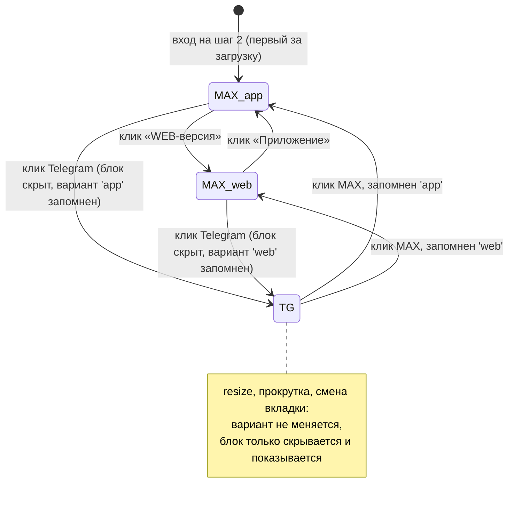

# feat: на телефоне — выбор, где открыть MAX

## Summary

На ширине ≤ 480 px во вкладке «В чате» под карточками мессенджеров появляется блок «Где открыть MAX» с двумя кнопками: «Приложение / на телефоне» и «WEB-версия / в браузере». Блок виден, только пока выбрана карточка MAX. «Приложение» ведёт на `https://max.ru/<бот>?start=…`, как сейчас. «WEB-версия» ведёт на `https://web.max.ru/<бот>?start=…`, как сейчас на компьютере. Запасная кнопка «Открыть в MAX» получает тот же адрес.

Меняется только **U6**. U2 уже выбирает хост по глобальной переменной `ucMsgMobile`. U6 начинает писать в неё выбор посетителя, а не только признак ширины. В исходнике U2 поправим лишь комментарий; сборка U2 от этого не меняется, и перевставлять его не нужно. На компьютере всё остаётся как есть.

Макет: `docs/designs/uc-calc-mobile-390.html`. Файл пока не в git — его закоммитим вместе с планом.

---

## Problem Frame

Сейчас на телефоне MAX всегда открывается через `max.ru`, а эта страница передаёт посетителя в приложение. Если приложения нет или оно не открывается, посетитель застревает. Владелец хочет дать выбор: открыть веб-клиент `web.max.ru` в браузере.

Как устроено сейчас (проверено по коду):
- `u6-gallery.html`, `initCalcState()`:
  - шире 480 px — `calcMessenger = 'web'`, видна и выбрана «На сайте»;
  - до 480 px — «На сайте» скрыта, `'web'` превращается в `'MAX'`, а выбор MAX или Telegram сохраняется.
- `initCalcState()` вызывается в трёх случаях:
  - при каждом входе на шаг 2 (из слушателя `uc:step`, затем ещё раз через `ucShowCalcTab('chat')`);
  - при каждом показе вкладки «В чате»;
  - при каждом `resize`, если открыта «В чате» (с задержкой 200 мс).
- `calcMessenger` между входами на шаг 2 **не сбрасывается**: на телефоне Telegram, выбранный в прошлый раз, остаётся выбранным. На компьютере он каждый раз сбрасывается на «На сайте».
- При клике «Далее» вне ветки ЛК U6 пишет `window.ucMsgMobile = $(window).width() <= CALC_DESKTOP`.
- `u2-unifiedbot-script.html`: `mySuccessFunction` → `ucMaxUrl(bots.max, payload, ucMsgMobile)`. Если через 1,5 с страница всё ещё видна, `showMaxOverlay(maxUrl)` показывает кнопку «📱 Открыть в MAX» с тем же адресом.

---

## Requirements

- R1. Ширина ≤ 480 px (условие `$(window).width() <= CALC_DESKTOP`, как у «На сайте»), выбрана карточка MAX: под карточками виден блок «Где открыть MAX» с двумя кнопками. Вид, тексты, иконки и отступы — по макету.
- R2. Выбрана карточка Telegram — блока нет. На ширине > 480 px блока нет никогда.
- R3. «Приложение» → `https://max.ru/<бот>?start=<код>`, «WEB-версия» → `https://web.max.ru/<бот>?start=<код>`. Start-параметр и путь в обоих случаях одинаковые.
- R4. Запасная кнопка «Открыть в MAX» (`showMaxOverlay`) ведёт на тот же адрес, что и переход.
- R5. При входе на шаг 2 на телефоне по умолчанию выбраны MAX и «Приложение». Поведение при повторном входе — в вопросе 2.
- R6. Компьютер (> 480 px) не меняется: «На сайте» по умолчанию, MAX → `web.max.ru`. Telegram не меняется нигде.
- R7. Таб-бар на 390 px по-прежнему прокручивается по горизонтали, без вертикальной прокрутки. Блок не расширяет панель и не даёт горизонтальной прокрутки страницы.
- R8. Кнопки удобны для пальца (не ниже 44 px), доступны с клавиатуры, читалка экрана объявляет выбранный вариант.

---

## Key Technical Decisions

- **Передача выбора в U2 — через ту же переменную `ucMsgMobile`.** Её смысл расширяется до «открывать MAX через `max.ru`». U6 при клике «Далее» пишет:
  - ширина > 480 → `false` (как сейчас);
  - ширина ≤ 480 → `calcMaxMode === 'app'`.

  Это переменная JS, а не поле формы, поэтому она переживает очистку формы Tilda так же, как `waMessenger`. `ucMaxUrl` и `showMaxOverlay` уже берут хост из неё, так что R3 и R4 выполняются без правки кода U2.
  - Почему не новая переменная (например, `ucMaxApp`): это правка кода U2 и перевставка U2 на трёх боевых страницах, где его опубликовали только что. Кроме того, U6 и U2 пришлось бы вставлять строго в паре.
  - Цена решения: имя `ucMsgMobile` теперь неточное. Поправим комментарий в исходнике U2 и описание в CLAUDE.md. Сборка U2 после этого побайтно та же — проверит `check:prod`.
- **Состояние варианта — новая переменная в U6** `calcMaxMode = 'app' | 'web'`, рядом с `calcMessenger`. Начальное значение — `'app'`.
- **Блок показывает и прячет JS, а не медиазапрос.** Условие то же, что у «На сайте»: `$(window).width()` против `CALC_DESKTOP`, плюс выбрана карточка MAX. Медиазапрос `max-width: 480px` считает ширину вместе с полосой прокрутки и на границе разошёлся бы с JS. Тогда блок показывался бы, а адрес выбирался бы по другому правилу.
- **`initCalcState()` прячет и показывает блок, но не сбрасывает `calcMaxMode`.** Мобильные браузеры шлют `resize` при скрытии адресной строки во время прокрутки. Если бы `initCalcState` сбрасывал вариант, выбор «WEB-версия» терялся бы от простой прокрутки. Сбрасывать вариант можно только при входе на шаг 2, если владелец так решит (вопрос 2).
- **Разметка — кнопки `<button type="button" role="radio" aria-checked>` в `role="radiogroup"`**, подписанной заголовком «Где открыть MAX» (`aria-labelledby`). Так уже сделан выбор способа покупки во вкладке ЛК (`.uc-calc-buy`). Иконки 📱 и 🌐 скрыты от читалки (`aria-hidden`).
- **Стили — под корнем `#uc-gallery-custom`, с собственными именами** (`uc-calc-maxmode…`), ни `.where`, ни `.mode` из макета. Имена классов общие на всю страницу, а `max-open-btn` и `max-overlay-backdrop` уже заняты U2.
- **`box-sizing: border-box` — только на новых элементах.** Tilda навязывает `content-box`, а U6 целиком не сбрасывает. Значения макета (`min-height: 52px`, `padding: 10px`, `flex: 1`) написаны под `border-box`. Без локального сброса кнопка вырастет до 72 px в высоту.

---

## High-Level Technical Design

Состояние и переходы блока на телефоне (≤ 480 px). На компьютере блок всегда скрыт, `ucMsgMobile = false`.



Как адрес доходит до перехода (направление, не спецификация):

```text
U6 «Далее» (вкладка «В чате»):
  waMessenger = calcMessenger
  ucMsgMobile = ширина <= 480 ? (calcMaxMode == 'app') : false
     ↓ форма Tilda (поля очищаются, глобальные переменные остаются)
U2 mySuccessFunction → ucMaxUrl(bot, payload, ucMsgMobile)
     → location.href = адрес; через 1,5 с, если страница видна → showMaxOverlay(тот же адрес)
```

---

## Implementation Units

### U1. Блок «Где открыть MAX» в U6: разметка, стили, состояние

**Goal:** блок под карточками мессенджеров, переключение вариантов, показ только при MAX на ≤ 480 px.

**Requirements:** R1, R2, R5, R7, R8.

**Dependencies:** нет.

**Files:**
- Modify: `docs/tilda-blocks/Ver_4_dev/u6-gallery.html` — разметка в `#uc-calc-chat-section` после `#uc-messenger-list`, CSS рядом со стилями `.uc-messenger-*`, состояние рядом с `calcMessenger`, `initCalcState`, обработчиками `#uc-ms-max` / `#uc-ms-tg`.
- Test: `docs/testing/lk-tab-harness/tests.js`.

**Approach:**
- Разметка — по макету: заголовок «Где открыть MAX», две кнопки, в каждой иконка, название и подпись. По умолчанию блок скрыт.
- Одна функция приводит вид блока к состоянию:
  - блок виден, если ширина ≤ 480 и `calcMessenger === 'MAX'`;
  - активный класс и `aria-checked` стоят на кнопке `calcMaxMode`.

  Её вызывают `initCalcState` (обе ветки), клики по карточкам MAX и Telegram и клики по вариантам. Клик по «На сайте» на компьютере обойдётся без неё: блок там и так скрыт, но вызов безвреден.
- Стили по макету: отступ сверху 12 px, внутренний отступ 12 px, фон `#fafafa`, рамка 0,5 px `#f0f0f0`, скругление 10 px. Кнопки: `flex: 1`, `min-height: 52px`, скругление 8 px; активная — рамка `#111` и `box-shadow: inset 0 0 0 1.5px #111`, как у карточек мессенджеров. Видимая рамка фокуса — через `:focus-visible`.
- Текст в кнопках переносится. Нельзя ставить `white-space: nowrap`: на 320 px он распёр бы панель.

**Patterns to follow:**
- `.uc-calc-buy` и `ucLkSetScenario` — `role="radio"`, `aria-checked`, активный класс;
- `.uc-messenger-card--active` — рамка без сдвига раскладки;
- `#uc-ms-site` в `initCalcState` — показ и скрытие по ширине из JS.

**Test scenarios:**
- Happy path: 390 px, вход на шаг 2 → видна «В чате», выбран MAX, блок виден, «Приложение» активна (`aria-checked="true"`), «WEB-версия» — нет.
- Happy path: 390 px, клик «WEB-версия» → активна «WEB-версия», `calcMaxMode === 'web'`; клик «Приложение» → обратно.
- Edge: 390 px, клик Telegram → блок скрыт. Клик MAX → блок снова виден, вариант тот же, что до Telegram (по предложению в вопросе 1).
- Edge: 390 px, «WEB-версия», затем `resize` без смены ширины (эмуляция скрытия адресной строки) → вариант остаётся «WEB-версия».
- Edge: 390 px, «WEB-версия» → ширина 800 (поворот) → блок скрыт, видна и выбрана «На сайте». Обратно 390 → MAX выбран, блок виден, вариант «WEB-версия».
- Edge: 390 px, «WEB-версия» → вкладка ЛК → снова «В чате» → вариант «WEB-версия».
- Edge: повторный вход на шаг 2 (шаг 1 → шаг 2) — по решению вопроса 2. Предложение: вариант сохраняется.
- Edge: 1000 и 768 px — блока нет ни при одной выбранной карточке, включая MAX.
- Раскладка: 390 и 320 px — `scrollWidth` панели и страницы не больше `clientWidth`; таб-бар по-прежнему `overflow-x: auto`, `overflow-y: hidden`, вертикальной прокрутки нет (тест плавной прокрутки в `test:harness` остаётся зелёным).
- Доступность: кнопки — `button` с `role="radio"`; группа подписана заголовком; высота каждой кнопки ≥ 44 px (по макету 52 px); Tab доходит до обеих, Enter и пробел переключают.

**Verification:** тесты в `lk-tab-harness` зелёные на 1000, 768 и 390 px; кадр 390 px совпадает с макетом на глаз.

---

### U2. Выбор передаётся в U2 при «Далее»

**Goal:** вариант посетителя определяет адрес перехода и запасной кнопки.

**Requirements:** R3, R4, R6.

**Dependencies:** U1.

**Files:**
- Modify: `docs/tilda-blocks/Ver_4_dev/u6-gallery.html` — присваивание `window.ucMsgMobile` в обработчике `#uc-gal-submit`.
- Modify: `docs/tilda-blocks/Ver_4_dev/u2-unifiedbot-script.html` — **только комментарии** у `ucMsgMobile` и `ucMaxUrl`: новый смысл «открывать через `max.ru`».
- Test: `docs/testing/lk-tab-harness/tests.js`, `docs/testing/dealer-settings-harness/run.py`.

**Approach:**
- `ucMsgMobile` по-прежнему пишется на каждом клике «Далее» вне ветки ЛК, по тем же причинам, что и сейчас: иначе значение залипает.
- Telegram значение не читает.
- После правки комментариев: `npm run build:prod`, затем проверка, что `Production/u2-unifiedbot-script.html` и `Production-test/u2-unifiedbot-script.html` не изменились.

**Test scenarios:**
- Covers R3. 390 px, MAX + «Приложение» → «Далее» → `ucMsgMobile === true`, `waMessenger === 'MAX'`.
- Covers R3. 390 px, MAX + «WEB-версия» → «Далее» → `ucMsgMobile === false`.
- Covers R6. 1000 px, MAX → «Далее» → `ucMsgMobile === false` (как сейчас).
- Covers R3/R4, интеграция U6 → U2 в `dealer-settings-harness` (живой U2 из сборки, переход перехватывается через Navigation API, как в существующем разделе «адрес MAX»):
  - «Приложение» → первый переход `https://max.ru/<бот>?start=<код>_<utm>`, и `#max-open-btn` с тем же адресом;
  - «WEB-версия» → `https://web.max.ru/…` и тот же `#max-open-btn`;
  - start-параметр в обоих случаях побайтно равен.
- Covers R6. Telegram на 390 px → `tg://resolve…`, затем `https://t.me/…`, как сейчас.
- Регрессия: старый тест ««Далее» на «В чате» (MAX): ucMsgMobile = ширина <= 480» меняет формулировку — на 390 px при «Приложении» `true`, при «WEB-версии» `false`.

**Verification:** `npm run test:harness` зелёный; `check:prod` показывает, что сборки U2 не изменились.

---

### U3. Проверки, скриншоты, документация

**Goal:** доказать, что компьютер и остальные состояния не задеты, и описать новое поведение.

**Requirements:** R6, R7.

**Dependencies:** U1, U2.

**Files:**
- Modify: `tools/visual-check.py` — кадры 390 px: «В чате» + MAX + «Приложение» (вход по умолчанию), «WEB-версия», Telegram.
- Modify: `CLAUDE.md` — `ucMsgMobile` (новый смысл), раздел о ботах (адрес MAX на телефоне по выбору), строка U6 в таблице блоков.
- Modify: `docs/handoff/2026-10-06-release-lk-tab.md` — новый раздел: что вставлять и что проверить руками.
- Modify: `docs/plans/2026-10-08-003-feat-max-open-mode-mobile-plan.md` — раздел расхождений в конце, если они будут.
- Add: `docs/designs/uc-calc-mobile-390.html` — макет владельца в git.

**Approach:**
- Скриншоты 390 и 1280 px — в scratchpad, для отчёта. В `lk-states-shots.py` не добавляем: это кадры вкладки ЛК.
- `test:visual`: дев-стенд выключен, поэтому прогон тем же обходом через данные боевого бота.
  - Исходники против сборки — без расхождений.
  - Новая сборка против прежней: кадры 1000 px совпадают полностью; на 390 px меняется только кадр «В чате».
- `test:swiper`: сборка U2 не меняется, поэтому прогон не обязателен. Всё равно запустим один раз в конце, раз владелец его назвал.

**Test expectation:** сам юнит поведения не добавляет; проверки перечислены в U1 и U2.

**Verification:**
- `check:prod` зелёный;
- `test:harness` зелёный;
- `test:visual` без непредвиденных расхождений;
- `test:swiper` 48/48;
- размеры сборок напечатаны.

---

## Размеры сборок

| Блок | Сейчас (`Production/`) | После (оценка) | Лимит |
|---|---|---|---|
| U6 | 64 735 Б | ≈ 66–67 КБ (+разметка ≈ 0,6 КБ, CSS ≈ 1 КБ, JS ≈ 0,4 КБ) | 100 000 Б |
| U2 | 15 173 Б | без изменений (меняются только комментарии) | 100 000 Б |
| U1, U3, U4, U7 | — | не меняются | — |

---

## Что вставлять (после реализации и вашей проверки)

| Страница | Блоки | Откуда |
|---|---|---|
| haval-demo-new, offer.geely-radar.ru, sale.belgee-radar.ru | **только U6** | `Production/` |
| page154296216 | U1 + U2 + U6 одной публикацией (это уже ожидающая перевставка; U6 берётся новый) | `Production-test/` |

U2 на боевых страницах трогать не нужно: из 11af3fd он уже читает `ucMsgMobile`. Новый U6 работает с ним в паре. Старый U6 (7aa9937) с этим U2 тоже работает — так что порядок публикации не важен.

---

## Risks & Dependencies

- **`web.max.ru` в мобильном браузере не проверен.** Владелец проверил его на компьютере. Как веб-клиент ведёт себя на телефоне, неизвестно: может перебросить на `max.ru` или в магазин приложений, может потребовать вход. Это ручная проверка после публикации, до неё вариант «WEB-версия» — непроверенный путь.
- **Текст запасной кнопки.** Если переход на `web.max.ru` в той же вкладке занял больше 1,5 с, всплывает лист «📱 Открыть в MAX — Для перехода в приложение MAX нажмите на кнопку». Для WEB-версии слово «приложение» неточно. На компьютере это происходит уже сейчас. Поправить текст можно только правкой U2 и его перевставкой (вопрос 3).
- **Подмена в харнессах.** Тест `dealer-settings-harness` гоняет живой U2 из сборки. Новый тест связки U6 → U2 должен выставлять `ucMsgMobile` через U6 (клик «Далее»), а не присваивать его руками — иначе он не проверит связку.

---

## Open Questions — владельцу

1. **MAX → Telegram → MAX.** Предлагаю: при возврате на MAX выбран тот вариант, который стоял до Telegram (пока страница не перезагружена). Блок при Telegram просто скрыт. Альтернатива — каждый раз заново «Приложение».
2. **Повторный вход на шаг 2** (вернулся на шаг 1, сменил комплектацию, снова «Далее»). Сейчас на телефоне выбранный мессенджер при этом сохраняется, хотя вкладка «В чате» открывается заново. Предлагаю так же сохранять и вариант («WEB-версия» остаётся). Довод: тот, кто выбрал WEB-версию, потому что приложения нет, не должен снова попасть на приложение. «MAX и Приложение по умолчанию» — при первом входе за загрузку страницы. Альтернатива — сбрасывать MAX и «Приложение» на каждом входе. Тогда сбрасывать и Telegram на MAX? Сейчас он не сбрасывается.
3. **Текст запасной кнопки для WEB-версии** («Для перехода в приложение MAX…»). Предлагаю пока не трогать: лист появляется, только если переход медленный, и на компьютере так уже сейчас. Если нужен отдельный текст для WEB-версии — это правка U2 и перевставка U2 на трёх боевых страницах. Можно отложить.
4. **Иконки 📱 и 🌐 — эмодзи, как в макете.** На Android и iOS они выглядят по-разному, но так же устроены вкладки (🤖, 🔑, 👨‍💼). Оставляем эмодзи?

---

## Scope Boundaries

- Компьютер (> 480 px), Telegram, «На сайте», вкладки ЛК и «По телефону» — без изменений.
- Порог 480 px и правило «планшет и телефон в альбомной ориентации получают `web.max.ru`» — без изменений (решение владельца из плана 2026-10-08-001).
- Ссылки MAX вне лендинга (кабинет, сообщения бота) не трогаем.

### Deferred to Follow-Up Work

- Отдельный текст запасной кнопки для WEB-версии — правка U2 (вопрос 3).
- `aria-pressed` или `role="radio"` для самих карточек мессенджеров: сейчас это простые кнопки без объявленного состояния. Блок «Где открыть MAX» делаем доступным, карточки — отдельной задачей, если нужно.

---

## Ручные проверки после публикации (на телефоне)

1. `check-live` по каждой странице — U6 `ok`.
2. Шаг 2 на телефоне: «В чате», выбран MAX, виден блок, активно «Приложение».
3. «Приложение» → «Далее» (без реальной заявки не проверить — делает владелец) → открывается приложение MAX, бот получает код.
4. «WEB-версия» → «Далее» → в браузере открывается `web.max.ru/<бот>?start=…`, бот получает код. Отдельно отметьте, требует ли веб-клиент вход и не перебрасывает ли в приложение.
5. Telegram → блока нет, переход как раньше.
6. Поворот телефона: в альбомной ориентации блока нет, видна «На сайте»; обратно — выбор сохранился.

---

## Расхождения с планом (дописано после реализации, 2026-10-08)

Решения владельца по открытым вопросам: 1 — при возврате на MAX вариант до Telegram; 2 — вариант сохраняется между входами на шаг 2, «MAX + Приложение» только при первом входе за загрузку; 3 — текст запасного окна не трогаем, отложено до следующей перевставки U2; 4 — эмодзи оставляем. Реализовано так.

- **Связка U6 → U2 проверяется в `dealer-settings-harness` вставкой боевого U6 в страницу с боевым U2** (`harness_prod.html`): вариант выбирается кликом в U6, «Далее» — тоже в U6, затем `mySuccessFunction`; в форму добавлены чекбокс согласия и кнопка Tilda (в этой странице их не было). План называл файл, но не способ.
- **Поворот через 480 px в `lk-tab-harness` эмулируется подменой `$(window).width()`** и событием `resize` — так же, как ширину читает U6. Настоящее изменение окна в харнессе не делается: страница харнесса без стилей Tilda.
- **Горизонтальная прокрутка страницы проверена не в харнессе, а на живой haval-demo-new** с подменённым U6: страница харнесса сама шире 390 px. В харнессе осталась проверка, что блок помещается в панель. Живая страница: 390 и 320 px — `scrollWidth` равен `clientWidth`; таб-бар `overflow-x: auto`, `overflow-y: hidden`, `scrollHeight` = `clientHeight`.
- **На 320 px «WEB-версия» переносится по дефису** (кнопки 122 × 67 px). Макет нарисован на 390 px, где переноса нет; оставлено как есть.
- **Скриншоты 390 и 1280 px сняты на живой haval-demo-new, старый U6 (7aa9937) против нового:** на 1280 px все четыре кадра вкладки «В чате» (по умолчанию, MAX, MAX + WEB, Telegram) совпадают побайтно; на 390 px совпадает кадр Telegram, остальные отличаются только блоком. Баннер cookies на кадрах скрыт — он перекрывал блок и давал ложную разницу.
- **`test:visual` получил два кадра** — `step2-chat-web` и `step2-chat-tg` (22 кадра вместо 18); прогон тем же обходом через данные боевого бота (дев-стенд выключен).
- **CLAUDE.md:** кроме `ucMsgMobile` и раздела о ботах, поправлена строка U6 в таблице блоков.
- **Клавиатура:** Tab и Enter / пробел, без стрелок внутри группы — как у выбора способа покупки (`.uc-calc-buy`).
