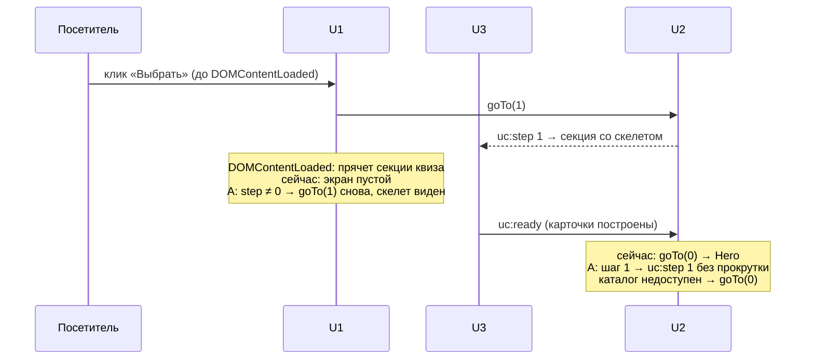

# fix: клик по кнопке Hero до готовности страницы

## Summary

Если нажать «Выбрать автомобиль» на Hero до `uc:ready`, посетитель на 2,5–5,4 с попадает на шаг 1, а затем страница сама возвращает его на Hero. Если клик пришёлся раньше `DOMContentLoaded`, всё это время он видит **пустую страницу с одним подвалом**.

Рекомендация — вариант A: клик сразу открывает шаг 1 со скелетом карточек, а когда каталог готов, шаг 1 достраивается на месте. Меняются U1 и U2, по желанию ещё U7 (контакты). Сборки остаются в пределах нескольких сотен байт от нынешних.

---

## Problem Frame

### Замер (настоящий Chrome, живые страницы, кэш выключен, 2026-10-08)

Таймлайн без клика, время в мс от начала навигации. «Окно» — от появления кнопки до `uc:ready`.

| Страница | Ширина | Сеть | Кнопка видна | DOMContentLoaded | Настройки дилера | Swiper | `uc:ready` | Окно |
|---|---|---|---|---|---|---|---|---|
| haval-demo-new | 1280 | быстрая | 1574 | 1855 | 3091 | 1736 | 4350 | **2,8 с** |
| haval-demo-new | 1280 | Slow 4G | 2566 | 3627 | 5200 | 5391 | 6622 | **4,1 с** |
| haval-demo-new | 390 | быстрая | 1613 | 1860 | 3169 | 1706 | 4484 | **2,9 с** |
| haval-demo-new | 390 | Slow 4G | 2575 | 3544 | 5092 | 5441 | 6541 | **4,0 с** |
| offer.geely-radar.ru | 1280 | быстрая | 1896 | 2115 | 3397 | 2012 | 5020 | **3,1 с** |
| offer.geely-radar.ru | 1280 | Slow 4G | 2594 | 3645 | 5303 | 7936 | 7944 | **5,4 с** |
| offer.geely-radar.ru | 390 | быстрая | 1856 | 2098 | 3462 | 1891 | 4444 | **2,6 с** |
| offer.geely-radar.ru | 390 | Slow 4G | 2586 | 3635 | 5300 | 7869 | 7880 | **5,3 с** |
| sale.belgee-radar.ru | 1280 | быстрая | 1628 | 1869 | 3125 | 1684 | 4505 | **2,9 с** |
| sale.belgee-radar.ru | 1280 | Slow 4G | 2578 | 3646 | 5285 | 7642 | 7652 | **5,1 с** |
| sale.belgee-radar.ru | 390 | быстрая | 1575 | 1853 | 3121 | 1631 | 4079 | **2,5 с** |
| sale.belgee-radar.ru | 390 | Slow 4G | 2592 | 3608 | 5228 | 7550 | 7556 | **5,0 с** |

Slow 4G — профиль DevTools: задержка 562,5 мс, приём 1,44 Мбит/с. На Slow 4G у Geely и Belgee `uc:ready` ждёт Swiper: он приходит на 7,5–7,9 с. Окно длинное даже на быстрой сети, потому что настройки дилера и каталог запрашиваются только после `DOMContentLoaded` и последовательно.

Наши блоки U1–U7 определяются за 5–40 мс после появления кнопки. `ucQuiz` к моменту клика есть всегда, поэтому «мёртвого» клика нет.

### Что происходит по шагам (замер событий `uc:step` со стеком вызова)

1. **Клик по кнопке.** U1 перехватывает его в фазе перехвата и вызывает `ucQuiz.goTo(1)`. Приходит событие `uc:step 1`, его источник — обработчик клика U1. Hero скрыт, на `<html>` появляется класс `uc-screen-quiz`, U3 показывает свою секцию со скелетом.
2. **Если клик был раньше `DOMContentLoaded`**, обработчик готовности U1 затем прячет все секции квиза: это начальная настройка «скрыть до первого шага». Итог — `ucQuiz.step = 1`, Hero скрыт, шаг 1 скрыт, видна только пустая страница с подвалом. Замер:
   - через 300 мс после клика: скелет есть — 4 из 4, если клик после `DOMContentLoaded`; 0 из 3, если до;
   - на Slow 4G при клике до `DOMContentLoaded` скелет успевает мелькнуть и пропадает.
3. **`uc:ready`.** U2 на это событие **безусловно** вызывает `goTo(0)`: в стеке `goTo ← обработчик uc:ready (once) ← selectComplectation ← initCards`. Приходит `uc:step 0`, U1 показывает Hero и прокручивает к началу страницы.

Воспроизведено в 15 прогонах из 16 (haval и Geely; 1280 и 390 px; быстрая сеть и Slow 4G; клик сразу и через 1 с). В шестнадцатом касание не дошло до кнопки — причина ниже, в «Попутно найдено».

### Что ещё попадает в окно

На первом экране до `uc:ready` есть только такие ссылки:

| Элемент | Где | Что происходит в окне |
|---|---|---|
| «Выбрать автомобиль» (`#filter`) | Hero, все три страницы | Возврат на Hero (см. выше) |
| «КОНТАКТЫ» (`#!contacts`) | шапка, 1280 px | Окно контактов открывается, а на `uc:ready` **закрывается само**: U7 закрывает его на любом `uc:step`. Замерено на всех трёх страницах |
| Телефон (`tel:`) | шапка | Не затронут |
| Логотип (ссылка на страницу) | шапка Haval | Перезагрузка, не затронут |
| «Политика» / «Согласие» (`#popup:…`) | подвал Geely и Belgee | Поп-ап Tilda открывается и не закрывается на `uc:step` — не затронуты. После раннего клика по Hero подвал — единственное, что видно на экране |

Свайпа моделей и кнопок шага 1 в окне нет: до `uc:ready` вместо карточек скелет. Кнопок «Назад» и «Далее» в скелете нет. На 390 px «КОНТАКТЫ» в шапке не видна.

### Попутно найдено (вне этой задачи)

На **haval-demo-new на 390 px** плашка «Мы используем cookies» (T887, `rec2434366401`, прямоугольник x 180–380, высота 57 px) лежит поверх правой половины кнопки «Выбрать автомобиль». Касание по центру кнопки попадает в плашку — и в окне, и после готовности страницы. Проверено при высоте экрана 700, 800 и 844 px. Пока плашку не закрыли, кнопка срабатывает только касанием левее центра. Возможно, это часть жалобы «особенно на мобильном». На Geely и Belgee центр кнопки свободен. Это настройка блока Tilda, а не код лендинга (вопрос 4).

---

## Requirements

- R1. Клик по кнопке Hero в любой момент до `uc:ready` ведёт на шаг 1 и **оставляет** посетителя там после `uc:ready`.
- R2. До готовности на шаге 1 виден скелет карточек, а не пустая страница — и при клике до `DOMContentLoaded` тоже.
- R3. Когда каталог готов, карточки появляются на месте скелета, без лишней прокрутки и без мигания Hero.
- R4. Без клика всё как сейчас: стартовый экран — Hero, `test:swiper` зелёный.
- R5. Каталог недоступен — по решению вопроса 2. Предложение: штатное «каталог недоступен», посетитель возвращается на Hero, как сейчас.
- R6. Статичный режим Swiper (оба адреса недоступны, `uc:ready` до 6 с) ведёт себя как R1–R3.
- R7. Если принят вопрос 3: окно контактов, открытое в окне, не закрывается само на `uc:ready`.

---

## Варианты

| | A — помнить клик, шаг 1 со скелетом, достроить на месте | B — на `uc:ready` не сбрасывать на Hero | C — блокировать кнопку до готовности |
|---|---|---|---|
| Быстрая сеть (окно 2,5–3,1 с) | Сразу шаг 1 со скелетом, через 1–3 с карточки на месте | Клик после `DOMContentLoaded` — как A. Клик до него — пустая страница до `uc:ready`, затем карточки | 2,5–3 с кнопка не нажимается (или крутится индикатор); потом нужно нажать ещё раз |
| Slow 4G (окно 4–5,4 с) | Скелет 4–5 с, потом карточки | До `DOMContentLoaded` пустая страница ~1 с, потом скелет | До 5,4 с ожидания на Hero |
| Каталог недоступен | Вопрос 2: возврат на Hero (как сейчас) или шаг 1 с сообщением | То же | Кнопка разблокируется, клик ведёт на пустой шаг 1 — как сейчас после готовности |
| Swiper статичный | Скелет до 6 с, потом статичные карточки | То же | Ожидание до 6 с |
| Что меняется | U2 (`uc:ready` не сбрасывает шаг) + U1 (обработчик готовности не прячет открытый шаг) | Только U2 | U1: состояние кнопки нативного Zero Block, разное на трёх сайтах; индикатор надо рисовать поверх чужой вёрстки |
| Минусы | Два блока вместо одного | Не лечит пустую страницу при раннем клике, а на мобильном ранний клик — основной случай | Хуже ощущение скорости; хрупкая стилизация чужой кнопки; лишний клик |

**Рекомендация — A.** Это B плюс правка U1, которая убирает пустую страницу. По объёму они почти равны, а A закрывает и R1, и R2. C решает симптом ценой ожидания и второго клика.

---

## Key Technical Decisions

- **U2: `uc:ready` восстанавливает текущий шаг, а не всегда Hero.**
  - Если посетитель ещё на шаге 0 или каталог недоступен (решение вопроса 2), то `goTo(0)`, как сейчас.
  - Иначе U2 заново отправляет `uc:step` с текущим шагом **без прокрутки** (`scroll: false`). U3 при этом обновит размеры Swiper моделей и затенения краёв, U1 подтвердит экран.

  Признак «каталог недоступен» выставляет `catalogUnavailable()` до отправки `uc:ready`.
- **U1: обработчик готовности не прячет секцию открытого шага.**
  - Как сейчас, прячет все секции квиза.
  - Если `ucQuiz.step` уже не 0, U1 повторяет `goTo(step)` с прокруткой (посетитель сам нажал кнопку). Это исправляет и вторую проблему раннего клика: U3 прокрутил к своей секции, пока выше ещё стояли остальные секции, и позиция оказалась неверной (замер: `scrollY` 601 на Haval и 3003 на Geely при высоте после прятания ~800).
- **Порядок не важен.** Если `uc:ready` пришёл раньше `DOMContentLoaded` (на практике не бывает: настройки запрашиваются после него), обе правки дают тот же итог: текущий шаг заново.
- **Без новых глобальных переменных.** Состояние — уже существующие `ucQuiz.step` и `ucQuiz.userNavigated`. Признак «каталог недоступен» — локальная переменная внутри U2.
- **U7 (если принят вопрос 3) закрывает окно контактов только при настоящей смене шага.** U7 запоминает последний шаг и пропускает `uc:step` с тем же номером. Повторная отправка шага на `uc:ready` тогда окно не закрывает. Без этой правки A сохраняет нынешнее поведение: контакты, открытые в окне, закроются.

---

## High-Level Technical Design

---

## Implementation Units

### U1. U2: `uc:ready` не возвращает на Hero ушедшего посетителя

**Goal:** после `uc:ready` посетитель остаётся на том шаге, куда ушёл.

**Requirements:** R1, R3, R4, R5, R6.

**Dependencies:** нет.

**Files:**
- Modify: `docs/tilda-blocks/Ver_4_dev/u2-unifiedbot-script.html` — обработчик `uc:ready` в `init()` и `catalogUnavailable()`.
- Test: `tools/hero-early-click-check.py` (новый, см. U4).

**Approach:**
- `catalogUnavailable()` выставляет признак сбоя до отправки `uc:ready`.
- Обработчик `uc:ready`:
  - шаг 0 или сбой (по вопросу 2) → `goTo(0)`;
  - иначе — повторная отправка текущего шага без прокрутки, не меняя `userNavigated`.
- Комментарий «Стартовый экран — шаг 0 (Hero)…» обновить.

**Test scenarios:** в U4 — сценарии «клик после `DOMContentLoaded`», «без клика», «каталог недоступен», «статичный Swiper».

**Verification:** раннего `uc:step 0` после клика нет; без клика `uc:step 0` приходит один раз на `uc:ready`, как сейчас.

### U2. U1: обработчик готовности не прячет открытый шаг

**Goal:** клик до `DOMContentLoaded` даёт скелет, а не пустую страницу.

**Requirements:** R2.

**Dependencies:** нет (с U1 работают вместе).

**Files:**
- Modify: `docs/tilda-blocks/Ver_4_dev/u1-screen-chrome.html` — `$(document).ready`, ветка прятания секций квиза.

**Approach:** после прятания секций, если `window.ucQuiz && ucQuiz.step !== 0`, повторить `goTo(ucQuiz.step)`. Прокрутку определит `userNavigated`: он `true` после клика по Hero. Обработка legacy-хэша `#filter` остаётся как есть и стоит раньше.

**Test scenarios:** в U4 — «клик до `DOMContentLoaded`».

**Verification:** через 300 мс после раннего клика секция шага 1 видна и в ней скелет; позиция прокрутки — у верха секции.

### U3. U7: окно контактов не закрывается повторной отправкой того же шага (если принят вопрос 3)

**Goal:** контакты, открытые до `uc:ready`, остаются открытыми.

**Requirements:** R7.

**Dependencies:** U1.

**Files:**
- Modify: `docs/tilda-blocks/Ver_4_dev/u7-contacts.html` — слушатель `uc:step`.

**Approach:** U7 запоминает номер последнего шага и закрывает окно, только если номер изменился. Первое событие после загрузки сравнивается с 0: стартовый экран — Hero.

**Test scenarios:**
- Контакты открыты в окне → после `uc:ready` открыты.
- Контакты открыты на шаге 1 → «Далее» → закрылись (смена шага, как сейчас).

**Verification:** в U4.

### U4. Харнесс раннего клика и прогон всех проверок

**Goal:** доказать R1–R7 на живых страницах.

**Requirements:** все.

**Dependencies:** U1, U2 (U3 — если принят).

**Files:**
- Create: `tools/hero-early-click-check.py`; `package.json` — скрипт `test:hero`.
- Modify: `CLAUDE.md` — абзац о раннем клике в разделе квиза, команда `test:hero`; `docs/handoff/2026-10-06-release-lk-tab.md` — новый раздел и снятие пункта из «Отложено».

**Approach:**
- По образцу `tools/swiper-fallback-check.py`: живые haval-demo-new, Geely, Belgee; блоки U1, U2 (и U7) подменяются сборкой `Production/`.
- Сеть управляется через `page.route`: каталог задерживается на 3 с, Swiper — на 5 с, оба адреса Swiper обрываются, ответ каталога 500.
- Ранний клик — синтетический `click()` по кнопке сразу при её появлении, из init-скрипта (так он гарантированно раньше `DOMContentLoaded`). Остальные моменты — настоящий клик мышью на 1280 px и касание на 390 px. На Haval 390 px касание делается левее центра кнопки, чтобы не попасть в плашку cookies.
- Записываются события `uc:step` и итоговое состояние.

**Test scenarios** (1280 и 390 px, три страницы):
- Covers R1/R2. Клик до `DOMContentLoaded`, каталог +3 с:
  - через 300 мс: шаг 1, скелет виден, Hero скрыт, секция у верха экрана;
  - после `uc:ready`: шаг 1, карточки, скелет скрыт, `uc:step 0` не было.
- Covers R1/R3. Клик после `DOMContentLoaded` до каталога: то же. После `uc:ready` прокрутка не изменилась.
- Covers R1/R6. Клик при Swiper +5 с (каталог уже пришёл): шаг 1, карточки со Swiper.
- Covers R6. Оба адреса Swiper оборваны, ранний клик: шаг 1, статичные карточки, стрелка моделей переключает модель.
- Covers R5. Каталог 500, ранний клик: по решению вопроса 2 (предложение — Hero, скелет скрыт).
- Covers R4. Без клика: после `uc:ready` Hero, шаг 0, ровно один `uc:step 0`.
- Covers R4. Клик после `uc:ready`: шаг 1 с прокруткой, как сейчас.
- Covers R7 (если U3). «КОНТАКТЫ» до `uc:ready` (1280 px): окно открыто и после `uc:ready`.
- Ошибок страницы нет ни в одном сценарии.

**Verification:**
- `test:hero` зелёный;
- `test:swiper` 48/48 (сценарии без клика ждут Hero — R4);
- `test:harness` зелёный;
- `check:prod` зелёный;
- `test:visual` без расхождений — U1, U2, U7 на вид не влияют.

---

## Размеры сборок (оценка)

| Блок | Сейчас | После | Лимит |
|---|---|---|---|
| U1 | 4 204 Б | ≈ 4,3 КБ | 100 000 Б |
| U2 | 15 173 Б | ≈ 15,3 КБ | 100 000 Б |
| U7 (если вопрос 3) | 9 875 Б | ≈ 9,9 КБ | 100 000 Б |

## Что перевставлять

| Страница | Блоки | Откуда |
|---|---|---|
| haval-demo-new, offer.geely-radar.ru, sale.belgee-radar.ru | U1 + U2 (+ U7) | `Production/` |
| page154296216 | U1 + U2 + U6 (ожидающая перевставка) + U7, если вопрос 3 | `Production-test/` |

U1 вставляется с цветом сайта в первой строке, как всегда: Haval `#6ACEC3` / `#5BB0A7`, Geely и Belgee `#2D5467` / `#3C728D`, тестовая `#6ACEC3` / `#5BB0A7`. Порядок U1 и U2 не важен: каждая правка по отдельности ничего не ломает. Без U2 возврат на Hero остаётся, без U1 остаётся пустая страница при раннем клике.

Это перевставка U2, а в «Отложено» записано «поправить текст запасного окна MAX при следующей перевставке U2» (вопрос 5).

---

## Open Questions — владельцу

1. **Вариант.** Рекомендую A (U1 + U2). B — только U2, но остаётся пустая страница при раннем клике. C — блокировка кнопки.
2. **Каталог недоступен после раннего клика.** Предлагаю как сейчас: вернуть на Hero (скелет скрыт). Альтернатива — оставить на шаге 1 с текстом «Каталог временно недоступен», но такого экрана сейчас нет, его нужно рисовать.
3. **Контакты, открытые до готовности, закрываются сами.** Включить правку U7 (ещё один блок на перевставку)? Рекомендую да: правка маленькая, а окно на быстрой сети 3 с.
4. **Плашка cookies на haval-demo-new (390 px) перекрывает центр кнопки «Выбрать автомобиль».** Это настройка блока T887 в Tilda (положение или отступ плашки), не код лендинга. Поправите в редакторе, или дать варианты?
5. **Текст запасного окна MAX для WEB-версии — в эту перевставку U2?** Нужна формулировка, например «🌐 Открыть MAX в браузере» и подпись «Если переход не произошёл, нажмите на кнопку». Если адреса Swiper в файлах Tilda появятся до реализации — добавлю и их.

---

## Scope Boundaries

- Скорость загрузки (последовательные настройки → каталог после `DOMContentLoaded`) не меняется. Окно сокращается только если запросить настройки раньше; это отдельная задача.
- Плашка cookies T887 — вопрос 4, вне кода.
- Экран «каталог недоступен» на шаге 1 не проектируется (вопрос 2).

### Deferred to Follow-Up Work

- Запрос настроек дилера до `DOMContentLoaded` — сократил бы окно примерно на 0,3–1 с. Нужен отдельный замер.

---

## Расхождения с планом (дописано после реализации, 2026-10-08)

Решения владельца:
1. Вариант A.
2. Каталог недоступен → Hero.
3. Правка U7 — включена.
4. Плашку cookies T887 владелец правит сам; после его публикации — проверка центра кнопки на 390 px при высоте 700, 800 и 844.
5. Текст запасного окна MAX для `web.max.ru` — «🌐 Открыть MAX в браузере» / «Для перехода в MAX нажмите на кнопку»; для `max.ru` без изменений.

Реализовано так. Ниже — где реализация отошла от плана или добавила к нему.

- **Текст запасного окна MAX (вопрос 5) вошёл в U2.** `showMaxOverlay` выбирает надписи по адресу кнопки: начинается с `https://web.max.ru/` — вариант WEB. Новых параметров и переменных нет. В `dealer-settings-harness` добавлены проверки текста на обеих сборках и в связке U6 → U2: для «Приложения» — «📱 Открыть в MAX», для «WEB-версии» — «🌐 Открыть MAX в браузере». Адрес кнопки не изменился.
- **Харнесс `test:hero` подменяет и U1, и U7, и U2.** Цвет из первой строки U1 берётся со страницы. Необязательный аргумент — часть адреса, чтобы прогнать одну страницу.
- **Проверка самого харнесса:** на прежних сборках U1, U2, U7 он даёт на Geely 11 провалов из 30, на новых — 0. Провалы: пустой экран при раннем клике, возврат на Hero во всех моментах клика и в статичном режиме, самозакрытие контактов.
- **Итог прогона:**
  - `test:hero` — 90/90: 3 страницы, 1280 и 390 px;
  - `test:swiper` — 48/48;
  - `test:harness` — зелёный, настройки дилера 110/110;
  - `check:prod` — зелёный;
  - `test:visual` — 22/22 кадра, прогон через данные боевого бота, дев-стенд выключен.
- **U1:** повтор шага стоит в самом конце обработчика готовности, после обработки legacy-хэша `#filter` и прятания своей секции. Так прокрутка U3 (через 50 мс) идёт по окончательной раскладке и не перебивается сбросом прокрутки для legacy-хэша.
