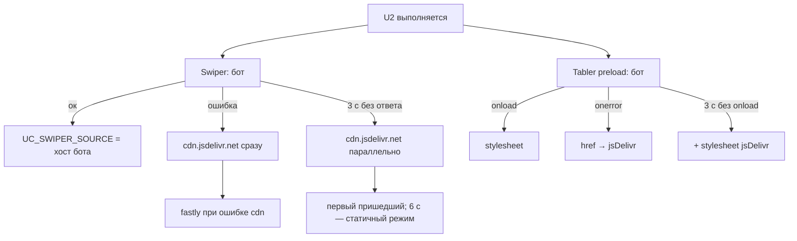

# feat: Swiper и иконки Tabler — с бота, jsDelivr запасной

## Summary

Бот 3.4.2 (на бою с 12.10) раздаёт Swiper 11.2.10 и Tabler Icons 3.44.0 по адресам `…/widget-custom/vendor/…`. U2 начинает брать их с бота первыми, jsDelivr остаётся запасным: для Swiper — через существующий загрузчик (`SWIPER_SOURCES`), для Tabler — новым переключением ссылки на jsDelivr при ошибке или задержке. Защита сборки `Production-test/` от адреса боевого бота сужается: разрешён только путь `/widget-custom/vendor/`. Меняется один блок — U2.

---

## Problem Frame

Swiper и иконки Tabler грузятся только с jsDelivr (`cdn` и `fastly`). Российского адреса нет: загрузить файлы в Tilda не вышло (владелец, 2026-10-09; сводка handoff, пункт «Не сделано» 3). Бот на российском хостинге, страница и так от него зависит (настройки, каталог), а HEAD всех трёх сайтов уже держит `preconnect … crossorigin` к нему — Swiper и Tabler, загружаемые с `crossorigin`, пойдут по тому же соединению.

Из Tabler на странице только стрелки слайдеров: `u3-card-sliders.html` (4 × `ti-chevron-*`) и `u6-gallery.html` (2 ×). Без CSS Tabler стрелок не видно.

---

## Requirements

- R1. Swiper JS и CSS берутся с бота первыми; `cdn.jsdelivr.net` и `fastly.jsdelivr.net` — запасные в прежнем порядке. `integrity` прежние.
- R2. CSS Tabler берётся с бота с `integrity` и `crossorigin="anonymous"`; при ошибке (404, сеть, несовпадение хеша) или задержке ссылка сама переключается на jsDelivr. Стрелки U3 и U6 на месте в обоих случаях.
- R3. В `Production-test/` адрес боевого бота разрешён **только** как начало пути `https://obut-5oaj-5i2u.gw-1a.dockhost.net/widget-custom/vendor/`; любое другое вхождение хоста боевого бота (`/cabinet/api/`, `/catalog/`, голый хост и т.д.) по-прежнему валит сборку. Оба случая закреплены тестом сборки.
- R4. Откат бота на 3.4.1 (адреса vendor → 404) не требует перевставки: Swiper и Tabler сами уходят на jsDelivr.
- R5. Шрифты Google и `preconnect` к `cdn.jsdelivr.net` в HEAD не трогаются (только упомянуты).

---

## Scope Boundaries

- Не трогаем U1, U3, U4, U6, U7 — их сборки байт в байт прежние.
- Не трогаем HEAD сайтов (`preconnect` к `cdn.jsdelivr.net` на demo.autodc.org, Google Fonts — настройки сайта Tilda).
- Не меняем тайминги загрузчика Swiper (3 с на адрес, 6 с всего) — см. Key Technical Decisions.
- Шрифты Tabler не проверяются отдельно: если бот отдал CSS, а шрифт — нет, переключения не будет (см. Risks).

### Deferred to Follow-Up Work

- Удалить `preconnect` к `cdn.jsdelivr.net` из HEAD demo.autodc.org — решение владельца после недели на боте.
- Российский адрес для Google Fonts — вопрос к владельцу, не к этой работе.

---

## Context & Research

### Проверено 2026-10-12 (только чтение)

- `check-live`: haval-demo-new, offer.geely-radar.ru, sale.belgee-radar.ru — все шесть блоков `ok` против `Production/`. Тестовая страница `page154296216` — все шесть `ok` против `Production-test/` (перевставлена 12.10 05:54 UTC; сводка от 09.10 в этом месте устарела), цвет U1 там `#2D5467` / `#3C728D`.
- Бот, все шесть файлов (`Origin: https://demo.autodc.org`): 200, `access-control-allow-origin: *`, `cache-control: public, max-age=31536000, immutable`, `content-encoding: br` у JS и CSS, типы `application/javascript` / `text/css` / `font/woff2|woff|ttf`. SHA-384 совпадает с jsDelivr у всех шести (JS, CSS Swiper, CSS Tabler, woff2, woff, ttf). Несуществующая версия (`swiper/11.2.9`) — 404.
- CSS Tabler на боте ссылается на шрифты относительно: `./fonts/tabler-icons.woff2?v3.44.0`, `.woff?`, `.ttf?v3.44.0`.
- Живые страницы (три боевые, тестовая, `/cabinet`): других файлов с jsDelivr и других версий Swiper / Tabler нет. Есть ещё `preconnect` к `cdn.jsdelivr.net` (HEAD demo.autodc.org — haval, тестовая, `/cabinet`) и Google Fonts: Manrope на demo.autodc.org, Roboto на Geely и Belgee.

### Наблюдение: обрывы загрузки TTF с бота

`…/tabler-icons-webfont/3.44.0/fonts/tabler-icons.ttf` (2 810 988 байт по `content-length`), `curl` с этой машины, 12.10: из пяти загрузок две оборвались — одна в первой проверке (хеш не совпал), одна получила 2 092 292 байта (`cmp`: файл — начало полного). Три следующие подряд — полные, 3,6–3,8 с каждая, хеш совпал. Выводов не делаем.

### Код

- `docs/tilda-blocks/Ver_4_dev/u2-unifiedbot-script.html:12` — `<noscript>` CSS Swiper (jsDelivr).
- `…/u2-unifiedbot-script.html:13` — `<link rel="preload" as="style" onload=…>` Tabler (jsDelivr).
- `…/u2-unifiedbot-script.html:14` — `<noscript>` Tabler (jsDelivr).
- `…/u2-unifiedbot-script.html:56–61` — `SWIPER_SOURCES`; `:63–66` — SRI и тайминги; загрузчик `attempt()` около `:100–125` (ошибка загрузки → сразу следующий адрес).
- `tools/build-production.mjs:41–43` — `FOREIGN` (для `test` — подстрока хоста боевого бота), `:140–145` — проверка `includes`.
- `tools/swiper-fallback-check.py:88–89`, `:125–153` — маршруты и проверки, завязанные на `cdn` как основной адрес; `tools/hero-early-click-check.py:116` — маршрут Swiper только по jsDelivr.
- `docs/testing/dealer-settings-harness/run.py:102` — «ни одного запроса к боту» для заблокированной тестовой сборки считает только `fetch`; `<script>`/`<link>` vendor в счёт не идут.
- Сборка U2 сейчас 15 815 байт — до предела T123 далеко.

---

## Key Technical Decisions

- **Адрес vendor — константа боевого бота в обеих сборках**, не `UC_SITE.botUrl`. Файлы неизменяемые и без заявок; дев-бот за ngrok отдал бы `<script>`/`<link>` страницу-предупреждение ngrok (тот же `ERR_BLOCKED_BY_ORB`, что у prefetch кабинета). Плюс загрузчик Swiper работает до выбора режима.
- **Защита сборки — по началу пути, не по подстроке** (решение владельца 2026-10-12). Каждое вхождение хоста боевого бота в U2 тестовой сборки допустимо только если за ним сразу идёт `/widget-custom/vendor/`. Правило — отдельная функция, а набор фиксированных случаев проверяется при каждом запуске `build-production.mjs` (и `--check`, значит, и хуком): если правило ослабнет, сборка падает.
- **Тайминги Swiper не меняются.** С тремя адресами при медленном боте: бот 0 с, `cdn` с 3 с, `fastly` начал бы на 6 с — ровно на общем пределе, то есть на медленном пути `fastly` не участвует; при ошибках (404, обрыв, хеш) переход мгновенный и все три в игре. Увеличить общий предел — значит дольше держать скелет; не делаем без решения владельца.
- **Tabler: переключение — на самой ссылке плюс таймер в U2.** У ссылки появляется `id`, `integrity`, `crossorigin="anonymous"` и `onerror`, который один раз меняет `href` на jsDelivr (тот же хеш — файлы идентичны). Таймер 3 с в `<script>` U2: если CSS к этому времени не загружен, добавляется второй `stylesheet` с jsDelivr рядом. Оба CSS идентичны, двойное подключение безвредно.

### Как поведёт себя каждая ссылка Tabler

| Ссылка | Бот ок | Бот 404 / обрыв / не тот хеш | Бот тормозит |
|---|---|---|---|
| `preload` (`:13`) | загрузка с бота, `onload` → `rel=stylesheet` | событие `error` → `onerror` меняет `href` на jsDelivr, новая предзагрузка, затем тот же `onload` → `stylesheet` | ждёт; через 3 с таймер U2 добавляет `stylesheet` с jsDelivr; пришедший позже CSS бота тоже применится — одинаковый |
| итоговый `stylesheet` | тот же элемент после `onload`, из кэша предзагрузки — отдельной ошибки уже не бывает | тот же элемент, уже с адресом jsDelivr | см. выше; `@font-face` побеждает по порядку в DOM (добавленный позже — jsDelivr), стрелки рисуются в любом случае |
| `<noscript>` (`:14`, и Swiper `:12`) | грузится с бота | **не переключается**: без JS атрибуты-обработчики не выполняются. Без JS квиз не работает вовсе, ссылка формальная | ждёт |

`<noscript>`-ссылки получают адрес бота с `integrity` и `crossorigin` — для единообразия.

---

## High-Level Technical Design

---

## Implementation Units

### U1. Защита сборки: хост боевого бота в тестовой сборке — только `/widget-custom/vendor/`

**Goal:** `Production-test/` может содержать vendor-адреса бота, но ничего больше от боевого бота.

**Requirements:** R3

**Dependencies:** нет

**Files:**
- Modify: `tools/build-production.mjs`

**Approach:**
- Для режима `test` заменить подстроку в `FOREIGN` правилом: найти каждое вхождение хоста боевого бота; допустимо, только если сразу за хостом стоит `/widget-custom/vendor/`. Для режима `prod` — без изменений (`ngrok-free.dev`, `/cabinet_dev`).
- Набор фиксированных случаев прогоняется в начале каждого запуска; провал — сборка падает с понятным сообщением.

**Test scenarios:**
- `https://obut-5oaj-5i2u.gw-1a.dockhost.net/widget-custom/vendor/swiper/11.2.10/swiper-bundle.min.js` в тестовой U2 → проходит.
- `…dockhost.net/cabinet/api/dealer/` → падает.
- `…dockhost.net/catalog/` → падает.
- голый `'https://obut-5oaj-5i2u.gw-1a.dockhost.net'` (как в `UC_SITE.botUrl`) → падает.
- `…dockhost.net/widget-custom/widget.js` (не vendor) → падает.
- `…dockhost.net/widget-custom/vendorX/` и `…dockhost.net//widget-custom/vendor/` → падают (проверка начала пути, не подстроки).
- текст с vendor-адресом и, дальше, с `/cabinet/api/` → падает (одно допустимое вхождение не прикрывает другое).
- Ручная проверка правила: временно вписать `/cabinet/api/` боевого бота в исходник U2 → `npm run build:prod` падает; вернуть.

**Verification:** самопроверка проходит; `npm run check:prod` зелёный после U2.

---

### U2. U2: Swiper и Tabler с бота, jsDelivr запасной

**Goal:** изменения в блоке U2 по R1, R2, R4.

**Requirements:** R1, R2, R4

**Dependencies:** U1 (иначе тестовая сборка не соберётся)

**Files:**
- Modify: `docs/tilda-blocks/Ver_4_dev/u2-unifiedbot-script.html` (`:12`, `:13`, `:14`, `:56–61`, комментарий загрузчика и заголовок `SWIPER: ЗАГРУЗКА С ЗАПАСНЫМИ АДРЕСАМИ`)
- Rebuild: `docs/tilda-blocks/Ver_4_dev/Production/u2-unifiedbot-script.html`, `docs/tilda-blocks/Ver_4_dev/Production-test/u2-unifiedbot-script.html`

**Approach:**
- `SWIPER_SOURCES`: первой строкой `{ js, css }` бота, затем `cdn`, затем `fastly`.
- `:13`: адрес бота, `id`, `integrity` (SHA-384 Tabler из передачи, сверен), `crossorigin="anonymous"`, `onerror`, однократно переводящий `href` на jsDelivr; `onload` как раньше.
- Таймер Tabler 3 с — в `<script>` U2 рядом с загрузчиком Swiper; признак загрузки ставится в `onload` ссылки.
- `:12`, `:14`: адрес бота + `integrity` + `crossorigin`.
- Комментарий в исходнике: откуда адреса (бот 3.4.2, неизменяемые), почему константа, а не `UC_SITE.botUrl`. Никакого `*/` внутри комментария.

**Test scenarios:** в U3 этого плана (проверки на живом пилоте).

**Verification:** `npm run build:prod` проходит, таблица размеров — U2 под пределом; в обеих сборках U2 есть vendor-адреса, в `Production-test/` нет других адресов боевого бота; U1, U3, U4, U6, U7 сборок не изменились.

---

### U3. Проверки загрузчика и стрелок

**Goal:** тесты знают про бот как основной адрес и проверяют запасные пути Tabler.

**Requirements:** R1, R2, R4

**Dependencies:** U2

**Files:**
- Modify: `tools/swiper-fallback-check.py`, `tools/hero-early-click-check.py`

**Approach:**
- Маршруты Swiper — по трём адресам (бот, `cdn`, `fastly`); прежние сценарии сдвигаются: «основной» теперь бот, «запасной» — `cdn`.
- Новые сценарии Tabler — маршрут на CSS Tabler бота.
- Стрелки «на месте»: шрифт `tabler-icons` загружен (`document.fonts`), у `.ti-chevron-left/right` в U3 (шаг 1) и U6 (после `ucQuiz.goTo(2)`) непустой `::before` и ненулевая ширина.
- В `hero-early-click-check.py` — маршрут Swiper включает адрес бота.

**Test scenarios** (haval-demo-new, Geely, Belgee; 1280 и 390; U2 подменён на `Production/`):
- Бот ок → `UC_SWIPER_SOURCE` = хост бота, CSS Swiper с бота, Tabler с бота, стрелки U3 и U6 на месте, ошибок нет.
- Swiper: бот 404 (откат на 3.4.1) → `cdn` сразу (до 3 с), карточки строятся.
- Swiper: бот +3,5 с, `cdn` +3 с → берётся пришедший первым, второй загрузки после решения нет.
- Swiper: бот отдаёт подменённый файл → `integrity` отсекает, `cdn`.
- Swiper: бот и `cdn` 404 → `fastly`.
- Swiper: все три недоступны → статичный режим к 6 с, стрелки моделей переключают.
- Tabler: бот 404 → `href` ссылки стал jsDelivr, стрелки U3 и U6 на месте.
- Tabler: бот тормозит (+5 с) → через 3 с есть второй `stylesheet` с jsDelivr, стрелки на месте до прихода CSS бота.
- Tabler: бот отдаёт подменённый CSS → `integrity` → jsDelivr, стрелки на месте.
- Tabler и Swiper бота одновременно 404 (полный откат бота) → всё как до перевода: jsDelivr, стрелки, карточки.
- `test:hero`: прежние сценарии зелёные с ботом основным.
- `npm run test:harness` зелёный (обе сборки U2).

**Verification:** `npm run test:swiper`, `npm run test:hero`, `npm run test:harness` зелёные; `npm run test:visual` — при поднятом дев-стенде (иначе записать, что не прогонялся).

---

### U4. Документация и handoff

**Goal:** CLAUDE.md и handoff описывают новое состояние; копия для отката.

**Requirements:** R4, R5

**Dependencies:** U2, U3

**Files:**
- Modify: `CLAUDE.md` (раздел про `window._swiperReady` / `SWIPER_SOURCES`, строка про защиту сборки в «Per-site settings», «PageSpeed Status» R1)
- Modify: `docs/handoff/2026-10-06-release-lk-tab.md` (сводка: пункт 3 «Российский адрес Swiper» → сделано; состояние тестовой страницы на 12.10)
- Create: `docs/handoff/rollback-u2-2026-10-12/u2-unifiedbot-script.html` — `Production/` U2 текущего `HEAD` (то, что сейчас стоит на трёх сайтах)

**Test expectation:** none — документация.

**Verification:** в CLAUDE.md нет утверждения, что Swiper берётся только с jsDelivr, и описано правило защиты сборки по началу пути.

---

## Публикация (делает владелец)

Вставляется **только U2**. U1 не трогается — цвета на страницах не меняются.

1. **Тестовая страница** `page154296216` — U2 (`rec2472574541`) из `Production-test/`. Дев-стенд для этой проверки не нужен: Swiper и Tabler грузятся до данных. Проверка: в консоли `UC_SWIPER_SOURCE` → `obut-5oaj-5i2u.gw-1a.dockhost.net`; в Network `swiper-bundle.min.js` / `.css` и `tabler-icons.min.css` — с бота. Затем `python3 tools/check-live.py` — U2 `ok`.
2. **Пилот** haval-demo-new — U2 (`rec3912976101`) из `Production/`. Проверка (я): `check-live … --prod` — U2 `ok`, остальные пять `ok`; в обычном Chrome — `UC_SWIPER_SOURCE`, источники в Network, стрелки модели и галереи на 1280 и 390, `UC_SITE.mode` = `"prod"`. Контрольных заявок не отправляем.
3. **Geely и Belgee** — U2 из `Production/`, только после моей проверки пилота; та же проверка.

HEAD сайтов не меняется.

---

## Откат

- **Бот вернули на 3.4.1** (vendor → 404): ничего не вставлять. Swiper сразу уходит на `cdn`, Tabler — через `onerror` на jsDelivr. Проверить на одной странице: `UC_SWIPER_SOURCE` = `cdn.jsdelivr.net`, стрелки на месте.
- **Откатить лендинг:** вставить U2 из `docs/handoff/rollback-u2-2026-10-12/` (это `Production/` U2 текущего `HEAD`, совпадает с тем, что стоит на трёх сайтах) на нужные страницы; тестовой странице — `Production-test/` U2 текущего `HEAD` (`git show`). Затем `check-live`.

---

## Risks & Dependencies

| Риск | Что будет | Чем закрыто |
|---|---|---|
| Бот медленный, но отвечает | Swiper — `cdn` с 3 с параллельно; Tabler — второй CSS с 3 с | U2, U3 |
| CSS Tabler с бота пришёл, а шрифт — нет (404 / обрыв) | стрелок нет, `onerror` CSS не срабатывает | риск принят владельцем 2026-10-12; при откате бота CSS и шрифты пропадают вместе |
| `fastly` на медленном пути не участвует (3 адреса × 3 с = 6 с) | при медленном боте и медленном `cdn` — статичный режим к 6 с, как было бы и без бота при двух медленных | тайминги оставлены, решение владельца 2026-10-12 |
| Тестовая сборка снова начнёт ходить в боевой API | заявки в бой с тестовой страницы | U1 — правило по началу пути и самопроверка в каждой сборке |

---

## Open Questions

Закрыты решениями владельца 2026-10-12 (см. ниже). Открытых нет.

---

## Решения владельца 2026-10-12

1. «CSS Tabler пришёл, шрифт — нет»: риск принят, страховку не закладываем.
2. Общий предел Swiper остаётся 6 с (на медленном пути `fastly` не участвует).
3. `preconnect` к `cdn.jsdelivr.net` в HEAD demo.autodc.org пока остаётся — jsDelivr запасной.
4. Google Fonts — не трогать, отдельная задача потом.
5. Обрывы загрузки TTF с бота — достаточно записи в «Наблюдении».
6. Порядок вставки: тестовая страница → haval-demo-new → проверка агента после вставки (`check-live --prod`, Network, стрелки на 1280/390) → только потом Geely и Belgee.

---

## Sources

- Передача агента бота 2026-10-12 (адреса, `integrity`, заголовки, порядок, откат).
- `docs/plans/2026-10-08-002-fix-swiper-wait-and-fallback-plan.md` — загрузчик и `SWIPER_SOURCES`.
- `docs/handoff/2026-10-06-release-lk-tab.md` — «Сводка на 2026-10-09», пункт 3.

---

## Расхождения с планом (реализация 2026-10-12)

- **Tilda перезаписывает `onerror`.** `tilda-fallback-1.0.min.js` при своей загрузке и на `DOMContentLoaded` ставит `onerror = t_fallback__reloadSRC` на **все** `<link>` и `<script>` страницы; для чужих адресов функция ничего не делает. Если это случилось до ответа бота, наш обработчик ошибки не вызывается: Swiper переходит на `cdn` по таймеру через 3 с, а не сразу (замер: 3 из 24 и 6 из ~70 прогонов в Playwright; `err` у тега бота через 2–30 мс, вставка `cdn` — ровно через 3 с после старта), ссылка Tabler остаётся на боте и стрелки приходят через таймер 3 с (второй stylesheet jsDelivr). Восстановление есть, «сразу» — нет. В загрузчике Swiper это было и до плана (с jsDelivr первым). Не исправлено — ждёт решения владельца; исправление — подписка через `addEventListener('error', …)` вместо свойства `onerror` (у Swiper и у ссылки Tabler из `<script>` U2). Проверки «сразу cdn» в `test:swiper` поэтому падают в части прогонов — это и есть этот дефект.
- **Время до `uc:ready` с машины агента** (вне России, RTT до бота ~0,3 с, TTFB бота с холодного соединения ~1,25 с против 0,03 с у jsDelivr): старый U2 против нового, 1280, быстрая сеть, 5 + 5 прогонов на страницу — haval-demo-new медиана 2785 → 3048 мс, Geely 2807 → 2979 мс; Swiper приходит на ~2,7 с вместо ~1,2 с, каталог — на 40–170 мс позже. Из России картина может быть другой — не мерилось.
- **Проверки:** окно сценария `race` — 3–6 с (бот отдаёт файл за ~0,9–1,5 с, а не мгновенно); «сразу» проверяется по старту следующего адреса не позже 300 мс после отказа предыдущего, а не по общему времени (сам `cdn` через `page.route` иногда грузится 2–3 с); на Belgee U3 прячет стрелки (≤ 4 моделей), там проверяется глиф без размера; добавлен контрольный сценарий `tablerNone` (иконок нет нигде — проверка обязана это увидеть).
- **Тест защиты сборки на настоящем исходнике** не закоммичен (P2 ревью): проверено вручную — подстановка в исходник U2 `/cabinet/api/dealer/`, `/catalog/x`, `/widget-custom/widget.js` боевого бота валит сборку (код 2), `/widget-custom/vendor/…` проходит защиту.
- **Копия для отката** — `docs/handoff/rollback-u2-2026-10-12/` (`u2-unifiedbot-script.html` — боевые, `.test.html` — тестовая), сверена с живыми страницами 76/76.

### Второй шаг (решения владельца 2026-10-12, после ревью)

- **Подмена `onerror` Tilda — исправлено.** Загрузчик Swiper слушает `load`/`error` через `addEventListener`; у ссылки Tabler слушатель `error` ставит `<script>` U2, атрибут `onerror` в разметке оставлен на случай ошибки раньше этого скрипта. Новый сценарий `test:swiper` `tildaOverride` (каждому новому `<script>`/`<link>` пустой `onerror`, 404 бота через 0,3 с): на сборке `84398a9` падает (переход на 3-й секунде), на новой — проходит.
- **Защита сборки строже:** хост боевого бота допустим только в нижнем регистре и только с путём, начинающимся с `/widget-custom/vendor/`, без `..` и `%`; самопроверка — 19 строк; плюс проверка на настоящем исходнике U2 (`checkForeignOnRealU2`: `/cabinet/api/dealer/`, `/catalog/x`, `/widget-custom/widget.js` отклоняются, vendor проходит) при каждом запуске сборки.
- **CLAUDE.md:** дата проверки в «Production state», фраза о заблокированной тестовой сборке (vendor-файлы она с бота берёт).
- **`uc:ready` из России** — замер владельцем в своём браузере до и после вставки на haval-demo-new, инструкция: `docs/handoff/2026-10-12-measure-uc-ready.md`. После не хуже → Geely и Belgee; хуже → стоп.
- **На потом (P3 ревью):** запасной CSS Swiper, если бот отдал JS, но не CSS; `fastly` как второй запасной адрес Tabler; прямая проверка в `tablerTamper`, что подменённый CSS не применился. Ревью второго шага (P3): защита сборки пропустит `\` или склейку строк сразу после vendor-пути (`…/vendor/..\..\cabinet`, `'…/vendor/' + '../cabinet'`) — в коде таких нет; лечится белым списком символов пути.

### Пилот haval-demo-new (2026-10-13)

- **Москва (данные владельца, факт).** VPS в Москве (HOSTKEY), 13.10 06:28 МСК, `curl`, 7 загрузок `swiper-bundle.min.js` с каждого адреса, медиана total: `cdn.jsdelivr.net` 0,077 с, бот 0,138 с, `fastly.jsdelivr.net` 0,193 с; все ответы 200. Решение владельца: бот остаётся первым (независимость от внешнего CDN важнее ~0,06 с), порядок `SWIPER_SOURCES` не меняется.
- **Изменено правило решения** (владелец, 13.10): вместо замера владельцем из России и порога «+100 мс» — функциональная проверка агента и замер агента как контроль «ничего не сломалось» (агент и владелец работают не из России). Правило: проверка ок **и** медиана ПОСЛЕ ≤ медиана ДО + 500 мс → Geely и Belgee.
- **Порядок вставки соблюдён:** тестовая страница — владелец, 13.10; haval-demo-new `rec3912976101` ← `Production/` коммита `61929b8` — владелец, 13.10 (last-modified 04:10:56 GMT).
- **Функциональная проверка (агент, 13.10, Chrome под Playwright, кеш отключён, 1280 и 390):** `check-live --prod` — шесть блоков `ok`; `UC_SITE.mode` = `prod`, `UC_SWIPER_SOURCE` = `obut-5oaj-5i2u.gw-1a.dockhost.net`; `swiper-bundle.min.js` / `.css`, `tabler-icons.min.css`, `tabler-icons.woff2?v3.44.0` — 200 с бота, запросов к jsDelivr за ними нет; ссылка Tabler — `stylesheet`, `data-ok=1`, второго stylesheet jsDelivr нет; стрелки U3 (`carousel-arrow` на 1280, `m-img-btn` на 390) и U6 (`gal-nav-btn`) с глифом Tabler, щелчок по «вперёд» в галерее листает (0 → 1 из 6); ошибок в консоли нет. Наблюдение: шрифт Tabler догружается через 1,0–1,9 с после перехода на шаг 1 (отсюда; запрашивается, когда глиф впервые виден).
- **`uc:ready` (агент, не из России, 1280, кеш отключён, 7 + 7 загрузок), мс:** ДО (старый U2, Swiper с `cdn`) — 3224, 1921, 1924, 1877, 1777, 1895, 1877, медиана **1895**; ПОСЛЕ (Swiper с бота) — 3723, 1791, 1905, 1858, 1926, 2014, 2184, медиана **1926**. Разница +31 мс. В обоих столбцах готовность определяет каталог, Swiper приходит раньше (ДО 0,54–1,67 с, ПОСЛЕ 1,48–3,39 с).
- **Итог:** проверка ок, +31 мс ≤ +500 мс — Geely (`rec2406839251`) и Belgee (`rec2407570351`) можно вставлять, U2 из `Production/` коммита `61929b8`.

### Geely и Belgee (2026-10-13)

- **Вставлено владельцем 13.10:** U2 из `Production/` коммита `61929b8` — Geely `rec2406839251` (last-modified 04:23:03 GMT), Belgee `rec2407570351` (04:25:45 GMT). Замер скорости не делался (решение владельца).
- **Проверка агента (13.10, Chrome под Playwright, кеш отключён, 1280 и 390):** на обеих страницах `check-live --prod` — шесть блоков `ok`; `UC_SITE.mode` = `prod`, `UC_SWIPER_SOURCE` = хост бота; `swiper-bundle.min.js` / `.css`, `tabler-icons.min.css`, `tabler-icons.woff2` — 200 с бота, запросов к jsDelivr нет; ссылка Tabler — `stylesheet`, `data-ok=1`. Стрелки U6 видны с глифом, щелчок «вперёд» листает (0 → 1 из 6). Стрелки U3: Geely — видны с глифом на обеих ширинах; Belgee — скрыты самим U3 (≤ 4 моделей), глиф есть. Шрифт Tabler догружается через 1,0–1,9 с после перехода на шаг 1 (отсюда). Ошибок наших блоков в консоли нет.
- **Чужое, не наше:** на Belgee в одном из прогонов — `ERR_CERT_COMMON_NAME_INVALID` на `crm.deepcall.ru/FFFFFF-0.png` (сторонний пиксель, в HTML страницы его нет — его подгружает чей-то скрипт). На Geely в первом прогоне событие `load` не наступило за 30 с; повтор с ожиданием `DOMContentLoaded` — всё в порядке; причину не искал (наши блоки `load` не ждут).
- **Итог плана:** U2 коммита `61929b8` стоит на тестовой странице и на всех трёх боевых. Откат — `docs/handoff/rollback-u2-2026-10-12/`.
