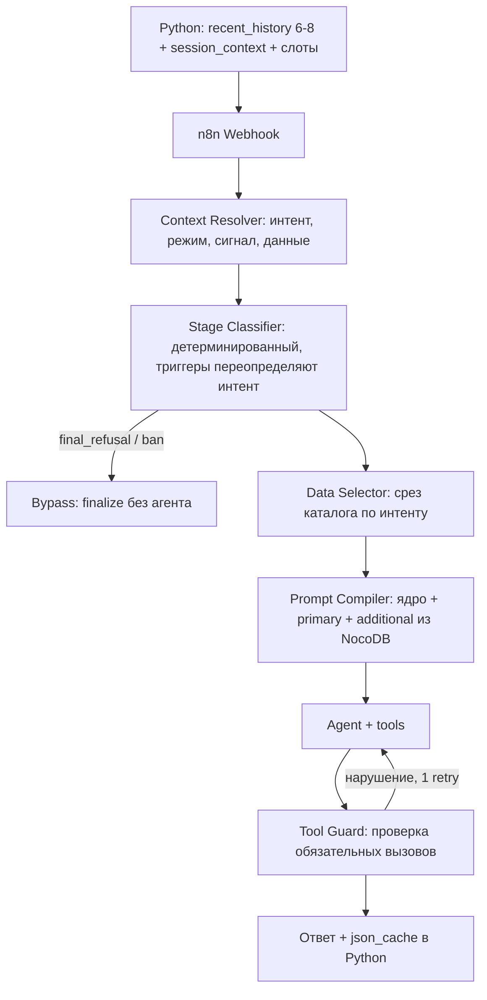

# Рефакторинг AI-оркестрации n8n: конвейер Context Resolver

## Summary

Заменить Switch-роутинг и монолитные промпты в n8n на конвейер Context Resolver → Stage Classifier → Data Selector → Prompt Compiler по спецификации `option/CONTEXT_RESOLVER_SPEC.md`, с библиотекой интентов и промпт-блоков в NocoDB. Обвязка: память и слоты фактов на стороне Python, единый Calc Engine для кредитной математики, детерминированные guard'ы, TTL каталожного кэша и eval-контур на тестовом дилере. Внедрение поэтапное, без остановки продакшена.

---

## Problem Frame

Бот обслуживает несколько дилеров в каналах MAX/Telegram/Web. На каждый ход диалога агент получает статический промпт 4.3–7k токенов (General + сценарные блоки из `Prompts.csv`, тяжелее всего Combo — ~7k), плюс JSON каталога и историю до 20 сообщений — итого ≥9k токенов на ответ. На моделях уровня flash-lite это даёт систематическое игнорирование инструкций: нарушение формата и тона, пропуск обязательных вызовов инструментов, перескакивание шагов воронки.

Главное ограничение роста: в промпт ветки помещается 4–5 сценариев поведения, и это потолок — добавление сценариев увеличивает промпт и ухудшает следование инструкциям. Библиотека сценариев не может расти при текущей архитектуре.

Сопутствующие дефекты, подтверждённые по коду: кредитная математика (`calculatePMT`, `getSmartRate`) скопирована в 4 Code-нодах в 2 файлах воркфлоу; `cached_json` живёт всю сессию без TTL и рефреша (`main.py:497-499`); диалоговая память лежит в 5 нодах Simple Memory внутри n8n (окно 20, привязка к ветке) — состояние внутри «stateless» оркестратора, теряемое при рестарте и разорванное между ветками; stage_map Битрикса продублирован в аварийном мосте `main.py` (комментарий в коде сам называет его копией); в воркфлоу остались мёртвые ноды (DeepSeek, нативный OpenAI, `AI Credit1`, `finalize_deal_old1/1`, `Code in JavaScript_backup`).

---

## Key Decisions

- **Ядро — конвейер по CONTEXT_RESOLVER_SPEC (принят целиком, с поправками ниже).** Спецификация `option/CONTEXT_RESOLVER_SPEC.md` объединяет интент-классификацию, детерминированное управление стадией/инструментами и точечную сборку промпта. Сценарии растут строками в таблицах NocoDB, промпт хода не растёт — это прямо целевой критерий успеха.
- **Сборка промпта переезжает из Python в n8n.** Prompt Compiler в n8n собирает промпт из блоков NocoDB на каждый ход; Dynamic Prompt Engine в Python (`main.py:1201-1257`) в целевом состоянии выводится из эксплуатации. Принято осознанно: один round-trip на ход дороже принципа «логика вне n8n». Контракт это позволяет — Python уже передаёт `system_prompt` в каждом сообщении (`main.py:1008-1027`).
- **Детерминизм переопределяет классификацию.** Валидный телефон, стоп-слова, счётчики (`phone_ask_count`, `msg_count`) — детерминированные триггеры, которые при конфликте побеждают вывод резолвера. Ошибка классификации не должна каскадно ломать промпт, срез данных и доступ к инструментам.
- **Диалоговое состояние — только в Python/Postgres.** История, слоты фактов и стадия живут в Python; n8n получает их в payload и ничего не хранит. Ноды Simple Memory отмирают. Это возвращает n8n к заявленной stateless-роли и чинит потерю памяти при рестарте и разрыв между ветками.
- **Математика остаётся в n8n, но в одном экземпляре.** Единый саб-воркфлоу Calc Engine + тестовый воркфлоу с золотыми кейсами + датированные снапшоты JSON в папке проекта (git в проекте не используется). Вынос в Python/отдельный сервис отклонён — минимум инфраструктурных изменений.
- **Модельный бюджет фиксирован.** Primary — OpenRouter gemini flash-lite, fallback — `gpt-4.1-mini` (текущая живая схема). Качество добирается архитектурой; выбор модели допускается задавать данными (колонка на интент/стадию), не кодом.
- **Таблицы NocoDB читаются на каждый ход, без слоя кэширования.** «Кэш при старте воркфлоу» из спеки в n8n не существует (executions изолированы); принято простейшее решение — 1–3 запроса к NocoDB на ход (+~200–400 мс). Правки не-разработчиков применяются со следующего хода, процедура «перезагрузки кэша» не нужна. Оптимизация — только если замеры покажут проблему.
- **Внедрение — shadow-режим, затем тестовый дилер, затем прод.** В shadow резолвер классифицирует полным словарём из 32 интентов и только логирует; в управление промптом включаются топ-12–15 по частоте и точности из shadow-логов, остальные остаются в `Source=test`.

Целевой конвейер хода:

---

## Requirements

**Конвейер оркестрации**

- R1. Каждый ход обрабатывается конвейером Context Resolver → Stage Classifier → Data Selector → Prompt Compiler → Agent → Tool Guard, заменяющим Switch-роутинг по `request_type`.
- R2. Context Resolver — stateless LLM-вызов (flash-lite) без инструментов и памяти; вход: последние 6–8 сообщений, текущее сообщение, session_context; выход: строгий JSON `{dialog_intent, client_mode, client_signal, key_data_extracted, reasoning}`.
- R3. Список допустимых интентов подставляется в промпт резолвера из NocoDB и фильтруется по `Scenarios`/`Stage_Context` текущего хода.
- R4. Невалидный или неразборчивый ответ резолвера не прерывает ход: промпт собирается по дефолтному блоку текущей стадии, инцидент логируется.
- R5. Детерминированные триггеры (валидный телефон, стоп-слова, `phone_ask_count`, первое сообщение) переопределяют вывод резолвера при конфликте.
- R6. Stage Classifier — детерминированная логика без LLM: вычисляет стадию и открывает инструменты; `final_refusal`/`ban_trigger` уходят в Bypass с вызовом finalize без запуска агента.
- R7. Tool Guard после агента детерминированно проверяет обязательные вызовы (телефон получен → `finalize_deal` вызван) и формат канала; при нарушении — один повторный проход через существующий механизм `__SYSTEM_REMINDER__`.
- R8. Data Selector формирует срез каталожных данных по интенту и стадии, заменяя ручную обрезку `cached_json` в пяти Code-нодах веток.

**Библиотека промптов и интентов (NocoDB)**

- R9. Интенты, промпт-блоки и их связи хранятся в трёх таблицах NocoDB (`Intents`, `Prompt_Blocks`, `Intent_Block_Map`) по схеме спецификации и редактируются не-разработчиками без деплоя.
- R10. Промпт хода = ядро (General) + primary STAGE_TASK + additional-блоки по интенту; целевой статический размер ≤ ~2.5k токенов.
- R11. Версионирование наборов совместимо с существующим механизмом `Prompt_Teg`/`Prompt_Ver` на дилера (`main.py:996-998`) и используется для A/B промптов и канарейки.
- R12. Добавление интента или сценария = строки в таблицах NocoDB; таблицы читаются на каждый ход, правка применяется со следующего хода без перезагрузок, правки кода и деплоя.
- R13. Shadow-режим классифицирует полным словарём (32 интента); в управление промптом включаются топ-12–15 по частоте и точности из shadow-логов, остальные остаются в `Source: test` до подтверждения.

**Память и состояние**

- R14. История диалога, слоты фактов (`collected_data`, `phone_ask_count`, стадия, appointment) хранятся только в Python/Postgres; Python передаёт `recent_history` и `session_context` в каждом запросе к n8n.
- R15. Python обновляет `collected_data` из `key_data_extracted` резолвера; телефон и госномер дополнительно проходят существующую детерминированную валидацию.
- R16. Ноды Simple Memory в n8n выводятся из эксплуатации; n8n не хранит диалоговое состояние.

**Актуальность данных**

- R17. `cached_json` получает TTL (~10 минут, симметрично `CACHE_TTL` каталога) и событийный рефреш при переходе к стадиям расчёта цены и финализации.

**Бизнес-математика**

- R18. `calculatePMT`, `getSmartRate`, `calculateComboScenarios` существуют в одном экземпляре — саб-воркфлоу Calc Engine, вызываемый из Car Search и Combo Calculator.
- R19. Calc Engine покрыт тестовым воркфлоу с золотыми кейсами (вилки ставок, граничные сроки, фолбэк 16%); снапшоты JSON всех воркфлоу сохраняются в папке проекта датированными версиями (git не используется).
- R20. stage_map Битрикса имеет один источник: аварийный мост (`main.py:506-571`) переиспользует маппинг `handle_n8n_callback`, а не хранит копию.

**Наблюдаемость и качество**

- R21. Shadow-режим: резолвер классифицирует и логирует (`dialog_intent` + `reasoning`) на живом трафике, не влияя на ответы, до включения управления промптом.
- R22. Существует золотой набор диалогов на ветку; изменения промптов/интентов прогоняются на тестовом дилере с метриками: следование формату, дисциплина инструментов, точность интентов.
- R23. Полная стоимость хода (резолвер + агент, вход и выход) не превышает текущую (~9k токенов на ответ); добавленная латентность резолвера ≤ ~0.5 с.

**Миграция и гигиена**

- R24. Контракт `/ai-handoff` обратно совместим на время миграции: старый воркфлоу обслуживает прод, новый — тестового дилера; переключение дилеров по одному через дилерский роутинг в Python.
- R25. Мёртвые ноды удаляются: `DeepSeek Chat Model1`, нативный `OpenAI Chat Model`, `AI Credit1`, `finalize_deal_old1`, `finalize_deal1`, `Code in JavaScript_backup`.

---

## Key Flows

- F1. Обычный ход
  - **Trigger:** сообщение клиента в любом канале.
  - **Steps:** Python шлёт `recent_history` + `session_context` → резолвер возвращает интент и извлечённые данные → Stage Classifier применяет детерминированные триггеры и открывает инструменты → Data Selector нарезает каталог → Prompt Compiler собирает ядро + блоки по `Intent_Block_Map` → агент отвечает → Tool Guard проверяет обязательные вызовы → ответ и `json_cache` возвращаются в Python, слоты обновляются из `key_data_extracted`.
  - **Covers:** R1–R8, R14, R15.
- F2. Добавление сценария из практики
  - **Trigger:** в логах найдено поведение клиента, не покрытое интентами.
  - **Steps:** не-разработчик добавляет строку в `Intents` (со статусом test) и маппинг в `Intent_Block_Map` (существующий или новый блок в `Prompt_Blocks`) → правка действует со следующего хода → shadow-мониторинг поля `reasoning` → перевод в practice.
  - **Covers:** R9, R12, R13, R22.
- F3. Канарейка новой архитектуры
  - **Trigger:** готова очередная фаза внедрения.
  - **Steps:** тестовый дилер направляется на новый воркфлоу, остальные — на старый → прогон золотого набора + живой трафик → сравнение метрик → перевод дилеров по одному.
  - **Covers:** R21, R22, R24.

---

## Acceptance Examples

- AE1. **Covers R4.** Резолвер вернул невалидный JSON → промпт собран из дефолтного блока текущей стадии, клиент получил ответ, инцидент в логе.
- AE2. **Covers R5, R7.** Клиент прислал валидный телефон, резолвер классифицировал ход иначе → триггер телефона побеждает; если агент ответил без вызова `finalize_deal` — один повторный проход с системным напоминанием, после которого вызов обязан состояться.
- AE3. **Covers R6.** Клиент пишет категоричный отказ → Bypass: finalize со статусом refuse, агент и Prompt Compiler не запускаются.
- AE4. **Covers R12.** Не-разработчик добавил интент и маппинг в NocoDB → со следующего хода резолвер распознаёт новый интент без правки кода и деплоя.
- AE5. **Covers R17.** Диалог длится дольше TTL, клиент переходит к финализации → перед расчётом кэш перезапрошен, агент называет актуальные цену и наличие.
- AE6. **Covers R23.** Типовой credit-ход: сумма токенов резолвера и агента не больше текущего значения того же хода на старой архитектуре.

---

## Success Criteria

- Число сценариев на ветку может вырасти минимум втрое относительно текущих 4–5 без роста промпта хода и без деплоя.
- На золотом наборе новая архитектура не уступает базлайну ни по одной метрике (формат, дисциплина инструментов, шаги воронки) и превосходит его по сумме; базлайн снимается на старой архитектуре до миграции.
- Стоимость ответа не выше текущей; статический промпт хода ≤ ~2.5k токенов против 4.3–7k.
- Точность интент-классификации по shadow-логам достаточна для включения управления (порог фиксируется по итогам shadow-периода до включения).

---

## Scope Boundaries

**Deferred for later**

- RAG/эмбеддинги по библиотеке блоков — только если интент-схема упрётся в потолок на сотнях сценариев.
- Перенос `intentDataRules` (срезы данных по интенту) из Code-ноды в NocoDB — v3.0 допускает хардкод, структура готова к миграции.
- Данные каталога через инструмент вместо кэша в промпте — после того как Tool Guard докажет дисциплину вызовов.
- Выбор модели на интент/стадию — колонка в таблицах предусмотрена, включение отложено.

**Outside this product's identity**

- Перенос оркестрации из n8n в Python/LangGraph — n8n остаётся stateless-оркестратором.
- Смена модельного провайдера или переход на более дорогие модели.
- Вынос кредитной математики из n8n в отдельный сервис.

---

## Dependencies / Assumptions

- `option/CONTEXT_RESOLVER_SPEC.md` — источник дизайна ядра; расхождения этого документа со спекой (поправки в Key Decisions) имеют приоритет.
- Тестовый дилер/стенд доступен для канарейки и eval-прогонов.
- Python хранит полную историю диалога и способен отдавать `recent_history` — подтверждено (`USER_CONTEXT` + `save_context_to_db`).
- Допущение: точность flash-lite на интент-классификации достаточна — не проверено, снимается shadow-режимом (R21) до любого включения управления.
- Допущение: чтение трёх таблиц NocoDB на каждый ход укладывается в бюджет латентности (~200–400 мс) — проверяется замером в shadow-периоде; при проблеме оптимизация решается на планировании.

---

## Outstanding Questions

**Deferred to planning**

- OQ3. Спецификация Tool Guard: в спеке узел назван в конвейере, но не описан; правила проверок и лимит повторов — на планирование (R7 задаёт минимум).
- OQ4. Маппинг существующих 37 блоков `Prompts.csv` на новую схему `Block_ID`/`Level`/`Stage`/`Intent_Triggers`.
- OQ5. Формат и владелец золотого набора диалогов; чем прогонять (существующий `get-session-logs` как источник сырья).

---

## Sources

- `option/CONTEXT_RESOLVER_SPEC.md` — принятая спецификация ядра (конвейер, схема таблиц, матрицы интентов/режимов/сигналов, процедура добавления интента).
- `main.py:1008-1027` — `system_prompt` передаётся в n8n каждым сообщением (контракт уже допускает по-ходовую сборку); `main.py:996-998` — незадействованный механизм `Prompt_Teg`/`Prompt_Ver`; `main.py:497-499` — `json_cache` без TTL; `main.py:506-571` и `main.py:843-849` — две идентичные копии stage_map.
- `flow/AI Agent v2.0 MAX.json` — Switch на 6 веток, 5 нод Simple Memory (окно 20), systemMessage с `<DATA_FROM_DATABASE>` и хардкод-инструкцией finalize_deal, живая модельная схема (OpenRouter flash-lite + `gpt-4.1-mini` fallback) и мёртвые ноды.
- `flow/Tool - Car Search.json`, `flow/Tool_ Combo Calculator.json` — 4 копии `calculatePMT`/`getSmartRate`.
- `Prompts.csv` — 37 блоков, один набор `base_v01.03`; статические промпты 4.3–7k токенов на сценарий, доминируют WORKFLOW-блоки.
- `doc/N8N_ARCHITECTURE.md`, `doc/TECH_BREAKDOWN.md` — контракт Python↔n8n, каскадный фолбэк, TTL каталога.
