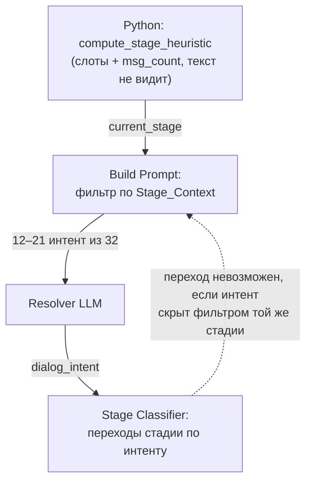

# Резолвер: стадийный фильтр интентов и расширение справочника

## Summary

Снять жёсткий стадийный фильтр списка интентов в резолвере (оставить фильтр по сценарию), добавить 4 новых интента из реальных кластеров логов и расширить Example_Phrases у ~10 существующих интентов реальными формулировками клиентов. Динамический шорт-лист не строить. Всё вместе укладывается в бюджет R23 с большим запасом.

---

## Problem Frame

Гипотеза «резолвер ошибается по построению, а не по слабости модели» **подтверждена**. Механизм:

1. Узел `Get Intents` (`flow/Tool_ Resolver Core.json`) читает из NocoDB все 32 интента без фильтра.
2. Нода `Build Prompt` фильтрует их по `Stage_Context` и `Scenarios` против `session_context.current_stage`.
3. `current_stage` вычисляет Python-эвристика `compute_stage_heuristic` (`payload_v2.py:80` в репозитории unifiedbot_dev_refactor) — только по слотам и счётчику сообщений, не глядя на текст: телефон собран → `closing`, `msg_count == 0` → `greeting`, все обязательные слоты → `tool_needed`, иначе `data_collect`.
4. Нода `Validate` приравнивает интент вне показанного списка к ошибке (`unknown_intent`): даже если модель классифицировала верно, ответ отбрасывается.

Стадийная эвристика по определению отстаёт от фактического состояния разговора, а резолвер не может её поправить, потому что не видит интентов «чужой» стадии. Возникает замкнутый круг: стадия ограничивает список интентов, но переходы стадий даунстрим (Stage Classifier в `nocodb/build_v3_workflow.py`) вычисляются из выбранного интента. Пример: `propose_visit` и `schedule_appointment` видны только в `closing`, но именно они переводят стадию в `closing` — переход «клиент сам захотел приехать» из `data_collect` невозможен в принципе.

Смягчающий фактор: 12 из 32 интентов имеют `Stage_Context: all` (включая большинство возражений), поэтому дыра уже, чем «все возражения». Подтверждённые ловушки по построению:

| Ситуация | Скрытый интент | Что выберет резолвер |
|---|---|---|
| `data_collect`, клиент: «я сама приеду в салон и всё узнаю» | `schedule_appointment`, `propose_visit`, `finalize_agreed` (только `closing`) | `cross_scenario_question` / `off_topic` |
| `greeting` (первое сообщение уже с данными: «хочу кредит, взнос 500 тысяч») | `data_received_complete`, `collect_*` (только `data_collect`) | `greeting_first` |
| `tool_needed`, клиент меняет взнос: «а если взнос 200» | `collect_down_payment`, `data_received_complete` (только `data_collect`) | `price_hierarchy_question` |
| Сценарий `credit`, `closing`, «пересчитайте с другим взносом» | `tool_rerun_needed` (Scenarios: `tradein,combo`) | нет подходящего |
| Сценарий `credit`, «зачем вам мои данные» | `objection_data_privacy` (Scenarios: `tradein,combo`) | `objection_trust` в лучшем случае |

Та же ошибка построения существует и по оси сценария, не только стадии.

---

## Key Decisions

- **Стадия перестаёт быть фильтром и остаётся контекстом.** Строка «Текущая стадия системы» в промпте сохраняется как подсказка модели, но список интентов от стадии не сужается. Фильтр по `Scenarios` и `Active` остаётся. Цена: список растёт с 12–21 до 22–32 интентов, +200–350 токенов на вызов — в пределах R23 (см. токен-математику).
- **Расширение справочника: +4 интента, не +10/+20.** Слепые зоны по 275 реальным репликам из eval-корпуса покрываются четырьмя новыми интентами и расширением примеров у существующих. Массовое добавление интентов увеличивает не столько токены, сколько число путаемых пар для lite-модели.
- **Динамический шорт-лист не строим.** Предварительная грубая фильтрация (эмбеддинги или ключевые слова) воспроизводит тот же баг «нужный интент не показан», только с менее прозрачным фильтром. При 32–40 интентах полный список дешевле и надёжнее; порог пересмотра — ~60+ интентов.

---

## Requirements

**Фильтрация**

- R1. Резолвер видит все активные интенты своего сценария независимо от `current_stage`; стадия передаётся в промпт только как контекст.
- R2. Поле `Stage_Context` в NocoDB сохраняется (пригодно для дефолтной сборки по стадии из R-фолбэка плана), но `Build Prompt` перестаёт использовать его как фильтр.
- R3. Сценарные ограничения `objection_data_privacy` и `tool_rerun_needed` пересматриваются: возражение о данных и запрос пересчёта возможны и в `credit`.

**Справочник интентов**

- R4. Добавляются 4 новых интента (см. «Рекомендации: новые интенты»): передача менеджеру, смена способа оплаты, «данные уже предоставлены», вежливое завершение.
- R5. Example_Phrases расширяются только реальными формулировками из логов/eval-корпуса (см. таблицу); выдуманные примеры не добавляются.
- R6. Каждый новый интент получает маппинг в `intent_block_map` до включения — интент без блока ответа не активируется.
- R7. Список `client_signal` в `Build Prompt` расширяется двумя значениями под новые интенты: `handoff_requested` (запрос живого менеджера) и `satisfied_done` (вежливое завершение без отказа); `client_mode` не меняется.

**Бюджет и валидация**

- R8. Входной промпт резолвера после всех изменений не превышает ~2700 токенов на вызов; стоимость и латентность остаются в бюджете R23 (+≤0.5 с, стоимость хода в пределах бюджета). Порог обновлён 2026-07-17 по фактическому замеру (план U2): текущий промпт — 1017–1076 входных токенов уже при 13 интентах (калибровка «~550 ток. на вызов» из токен-математики ниже занижена вдвое — реальные 3.17–3.33 симв./ток., а не 4.4); проекция самой широкой комбинации после изменений — ~2500 ток.
- R9. Изменения проверяются прогоном golden set (`eval/golden_set.jsonl`) и shadow-отчётом: точность на топ-интентах не хуже базлайна, доля `unknown_intent` не растёт.

---

## Рекомендации: новые интенты

Кластеры из 275 уникальных реплик клиентов (`eval/golden_set.jsonl` + `eval/dialogues_archive.json`), не покрываемые ни одним из 32 интентов даже без стадийного ограничения:

| Intent_ID (предлагаемый) | Группа | Реальные формулировки из логов | Частота в корпусе |
|---|---|---|---|
| `request_human_handoff` | F Системные | «Очень хорошо переключите на менеджера» | редко, но критично для CX |
| `payment_method_change` | B Вопросы | «А можно за наличные купить?»; «За наличку»; «Без кредита»; «Оплата сразу»; «два миллиона деньгами остальное рассрочка» | ~7 реплик |
| `data_already_provided` | E Возражения | «Почитайте диалог выше. Там все уже есть»; «Все данные я вроде предоставил»; «Зачем это делать второй раз?»; «Расчет уже есть» | ~5 реплик |
| `polite_close_satisfied` | D Закрытие | «Спасибо, я удовлетворён вашим ответом»; «Спасибо, пока это все, что мне нужно»; «Я все уже поняла»; «Да я вроде все уточнил» | ~6 реплик |

Пограничный кластер, для которого новый интент **не** нужен — покрыть расширением примеров:

- «посчитайте дистанционно/онлайн» («а онлайн можно посчитать?», «а дистанционно можно сделать расчет по кредиту», «я просто пока в Норильске») → расширить `objection_distance`.

## Рекомендации: расширение Example_Phrases

Реальные формулировки из корпуса для существующих интентов:

| Интент | Добавить примеры |
|---|---|
| `pause_requested` | «напишу позже, когда смогу подъехать»; «после 15 мая»; «ориентируюсь на осень»; «выяснится в начале июля» |
| `objection_trust` | «оценка занижена значительно»; «вы озвучили сумму минимальную»; «проверку по базам сделали за 1 сек?» |
| `objection_price` | «по первоначальному взносу не прохожу»; «пока нет первоначального взноса»; «рассматриваю без первоначального» |
| `objection_no_phone` | «да причём здесь номер телефона, чтобы вы названивали»; «пока не могу разговаривать по телефону» |
| `objection_distance` | «а онлайн можно посчитать?»; «дистанционно можно сделать расчёт?»; «я сейчас в другом городе, вернусь позже» |
| `competitor_comparison` | «на озоне цена такая, а у вас ещё бонусы и скидки?»; «смотрю авто в Москве, предложения по цене интереснее» |
| `cross_scenario_question` | «на тест-драйв сразу записаться можно?»; «дайте стоимость киа спортейдж»; «стоимость всех комплектаций» |
| `price_hierarchy_question` | «какая скидка за трейд-ин?»; «какие скидки персональные есть?»; «сколько переплата в деньгах от цены?» |
| `collect_plate` | «не помню»; «марки и года выпуска недостаточно?»; «я на работе, машина на стоянке» |
| `schedule_appointment` | «в пятницу»; «завтра»; «удобно подъехать»; «я сама приеду в салон» |

---

## Токен-математика

Фактические размеры по `nocodb/intents.csv`: строка интента в промпте (`Intent_ID | Description | Примеры: …`) — в среднем 123 символа; Description — 51 символ, Example_Phrases — 39 символов (2.3 примера на интент). Калибровка по заявленным ~550 токенам на вызов даёт ~25–30 токенов на строку интента.

| Изменение | Прирост на вызов | Промпт после |
|---|---|---|
| Снятие стадийного фильтра (12–21 → 22–32 интентов) | +200–350 ток | ~750–900 ток |
| +4 новых интента (рекомендация) | +100–120 ток | ~850–1000 ток |
| Расширение Example_Phrases ×2 у всех видимых | +125–165 ток | — |
| Гипотетические +10 интентов | +250–300 ток | не рекомендуется |
| Гипотетические +20 интентов | +500–600 ток | не рекомендуется |

Стоимость: на `gemini-2.5-flash-lite` (~$0.10/M входных токенов) даже +500 токенов — это +$0.00005 на вызов, около +$5 на 100 тыс. ходов. Латентность prefill — десятки миллисекунд. **Бюджет R23 не является ограничением для любого из рассмотренных вариантов.** Реальная цена расширения — рост числа путаемых пар интентов для lite-модели, поэтому ограничителем служит точность на golden set (R8), а не токены.

---

## Динамический шорт-лист: оценка

Технически осуществим на текущем стеке без векторной БД: эмбеддинги 36 интентов прекомпьютятся скриптом (по образцу `nocodb/build_tables_data.py`) и хранятся как JSON в NocoDB; в рантайме — один вызов embedding-API на сообщение клиента плюс косинусная близость в Code-ноде. Оценка встраивания: ~1–2 дня работы, +1 API-зависимость, +50–150 мс латентности, новый режим отказа (недоступность embedding-API) и обязательный ре-прекомпьют при каждой правке Example_Phrases.

Не рекомендуется сейчас: шорт-лист — это ещё один фильтр перед моделью, а Задача 1 показала, что именно фильтры порождают ошибки «неверно по построению». Recall шорт-листа на коротких репликах («хорошо», «завтра», «К174НХ») будет заведомо хуже полного списка. Вариант с ключевыми словами ещё хуже из-за русской морфологии. Порог пересмотра — рост справочника до ~60+ интентов, когда полный список перестанет помещаться в разумный промпт; это согласуется с Deferred-скоупом плана (RAG/эмбеддинги).

---

## Acceptance Examples

- AE1. **Covers R1.** Given стадия `data_collect` (взнос не собран), when клиент пишет «я сама приеду в салон и все узнаю», then `schedule_appointment` присутствует в списке резолвера и `Validate` принимает его без `unknown_intent`.
- AE2. **Covers R1.** Given `msg_count == 0` и первое сообщение «хочу кредит, взнос 500 тысяч», then `data_received_complete` присутствует в списке резолвера.
- AE3. **Covers R3.** Given сценарий `credit`, стадия `closing`, when клиент пишет «пересчитайте с другим взносом», then `tool_rerun_needed` присутствует в списке.
- AE4. **Covers R4.** Given любая стадия, when клиент пишет «переключите на менеджера», then резолвер возвращает `request_human_handoff`.
- AE5. **Covers R9.** Given прогон golden set до и после изменений, then точность на топ-интентах ≥ базлайна и доля `unknown_intent` не выросла.

---

## Scope Boundaries

- Динамический шорт-лист (эмбеддинги, ключевые слова) — отложен до ~60+ интентов; RAG/эмбеддинги остаются в Deferred плана рефакторинга.
- Замена Python-эвристики стадии на LLM-классификацию стадии — вне скоупа: после R1 неточность эвристики перестаёт быть блокирующей (стадия — контекст, а не фильтр).
- Массовое расширение справочника до 42–52 интентов — отклонено: бюджет позволяет, точность lite-модели — нет.

## Outstanding Questions

**Deferred to Planning**

- Нужен ли `polite_close_satisfied` отдельный блок ответа или он маппится на существующий блок закрытия в `intent_block_map`.
- Приоритеты (`Priority`) новых интентов относительно существующих групп.
- Точная формулировка Description новых интентов — по конвенциям `docs/solutions/conventions`.

## Sources / Research

- `flow/Tool_ Resolver Core.json` — ноды `Get Intents`, `Build Prompt` (фильтр), `Validate` (`unknown_intent`).
- `payload_v2.py:80` (репозиторий unifiedbot_dev_refactor) — `compute_stage_heuristic`, слотовая эвристика стадии.
- `nocodb/build_v3_workflow.py` — Stage Classifier: переходы стадии по выбранному интенту (`TOOL_INTENTS`, `CLOSE_INTENTS`).
- `nocodb/intents.csv` — 32 интента, матрица `Stage_Context` × `Scenarios`, замеры размеров.
- `eval/golden_set.jsonl` (271 ход), `eval/dialogues_archive.json` (104 диалога) — корпус из 275 уникальных реплик клиентов для анализа слепых зон.
- `docs/plans/2026-07-04-001-refactor-n8n-context-resolver-pipeline-plan.md` — R23 (бюджет), R4-расширение (интент вне списка = невалидный ответ), Deferred (RAG/эмбеддинги).
