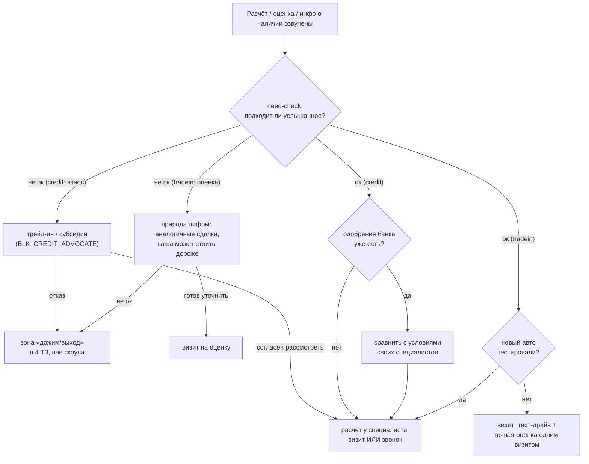

# Need-check перед закрытием хода (визит/звонок) в credit / tradein / combo / stock

## Summary

Между «бот озвучил расчёт / оценку / информацию о наличии» и «бот зовёт на визит или звонок» вводится промежуточный шаг need-check: бот сначала спрашивает, насколько услышанное клиенту подходит, и только по ответу выбирает следующий ход. Реализация — новые/правленые Prompt_Blocks (черновики v3.03) плюс два новых интента резолвера; state machine стадий и жёсткие правила Python не меняются. Всё — только [TEST]-контур.

---

## Анализ диалогов (`doc/Dialogues_Archive_exported.csv`)

В выгрузке 125 диалогов (в постановке задачи упоминалась цифра 131 — фактических строк 125): combo 52, credit 43, tradein 25, stock 5. Телефон получен только в 2 (оба — уже после ручной передачи специалисту).

### Где именно умирают диалоги

40 диалогов гибнут до точки расчёта (сбор взноса/госномера/пробега) — вне скоупа этой задачи. Среди дошедших до расчёта/информации точка «расчёт + приглашение → полная тишина клиента» даёт:

| Группа | Точка смерти | Тишина сразу после | Всего в группе |
|---|---|---|---|
| credit | «Отлично, зафиксировал! … В какой день вам было бы удобно приехать?» | 7 | 43 |
| credit | границы взноса «Чтобы уложиться в такой платёж… На какую сумму ориентируетесь?» | 13 | — |
| combo | комбо-расчёт «Если взять эту сумму как первый взнос… В какой день удобно приехать?» | 10 | 52 |
| tradein | «В среднем цена была X руб… В какой день удобно приехать к нам?» | 6 | 25 |
| stock | «модель в поставке → переключу на менеджера → оставите номер?» | 5 | 5 |

Ещё ~26 диалогов отвечают на связку «расчёт+приглашение» не согласием, а вопросом / «спасибо» / паузой — бот в ответ снова давит на визит или телефон, после чего клиент тоже замолкает. Прямых согласий на визит после этой связки — единицы.

Вторая по массовости кредитная точка (13 смертей на вопросе о сумме взноса) — стадия data_collect, формально вне скоупа need-check; вынесена в Scope Boundaries.

### Разброс формулировок «before» (как бот доносит расчёт)

Формулировки — почти дословно шаблоны живых блоков, вариативность минимальна:

- tradein (`ST_TRADEIN_TOOL_NEEDED`): «Посмотрел стоимость сделок по похожим авто. В среднем цена была X руб. Точную стоимость вашей машины сможем назвать только после осмотра. В какой день вам было бы удобно приехать к нам?»
- combo (`ST_COMBO_TOOL_NEEDED`): то же + «Если взять эту сумму как первый взнос за новый [Модель], то … платёж/срок … Более точный расчёт сможем сделать уже в салоне после осмотра. В какой день вам было бы удобно приехать?»
- credit (`BLK_CREDIT_PAYMENT_ACCEPTED`): «Отлично, зафиксировал! Если приедете к нам в салон, сотрудники отдела кредитования смогут подобрать программу и сразу отправить заявки в банки. В какой день вам было бы удобно приехать?»
- stock: приветствие + «модель в поставке / в наличии нет, сроков не вижу» + «переключу на менеджера» + «оставите номер телефона?» — всё в одном первом AI-сообщении.

### Разброс формулировок закрытия

- Монокультура: «В какой день вам было бы удобно приехать (к нам)?» и вариации — 30+ вхождений во всех сценариях; между сценариями меняется только обвязка («после осмотра», «для теста и расчёта»), сам ход всегда «дата визита».
- Звонок как первичная мягкая альтернатива почти не предлагается — он появляется только после явного отказа/паузы клиента («Давайте наш специалист просто позвонит…»). Исключения-хорошие примеры: «Вам удобнее подъехать в салон, или чтобы специалист дистанционно всё рассчитал и набрал вас?» (единичные диалоги дилера ВСК).
- В stock и в части credit-хвостов запрос телефона склеен с предложением менеджера/звонка в одном сообщении — прямое нарушение живого правила «СТРОГО ЗАПРЕЩЕНО просить телефон в одном сообщении с предложением визита» (`CS_STOCK` п.3, `CS_CREDIT` п.1).

### Реакции клиентов, когда они всё же отвечают на связку

Типажи из хвостов (материал для Example_Phrases новых интентов): «Подумаю», «спасибо, я подумаю», «я сообщу, спасибо», «пока повременю, постараюсь без кредита», «оценка занижена значительно», «Проверку по базам сделали за 1 сек?», «А если на 60 месяцев какой платёж», «сколько должен быть взнос чтобы платёж 10000», «пока не могу разговаривать по телефону, выберу время и подъеду», «на механике такие есть?», «интересует комплектация АКТИВ в наличии».

---

## Key Decisions

- **Need-check — не новая стадия, а состав блоков внутри существующих стадий.** После плана 2026-07-17-001 стадия влияет только на контекст промпта резолвера и на дефолтный primary-блок; видимость интентов она не ограничивает. Новая стадия потребовала бы правок Python-эвристики, `TOOL_INTENTS`/`CLOSE_INTENTS`, линта и [TEST]-регенерации — и ничего не дала бы сверх того, что дают map-строки. Need-check живёт на той стадии, где случился расчёт (tool_needed → closing в tradein/combo, tool_needed в credit), новые интенты стадию не двигают (falls through к стадии Python); финальное закрытие двигают существующие `propose_visit`/`request_phone`/`finalize_agreed`.
- **Два новых интента вместо четырёх.** Ответы «да/нет» на проверочный вопрос классифицируются парой `need_check_ok` / `need_check_not_ok`; какой именно вопрос был задан (комфортность взноса, соответствие оценки, тест-драйв, одобрение банка, готовность ждать поставку) — определяет агент по истории диалога внутри bridge/router-блока. Вариант «интент на каждую ветку» (`bank_preapproval_status`, `test_drive_status_*` и т.п.) отклонён: +4 строки в списке интентов съедают бюджет R8 плана 2026-07-17-001 (см. «Непротиворечивость»), а различать «да, взнос комфортен» и «да, тест-драйв был» резолверу и не нужно — это делает агент, у которого есть полная история.
- **Развёрнутые возражения остаются в существующих интентах.** «Дорого», «не прохожу по взносу» → `objection_price` → `BLK_CREDIT_ADVOCATE`; «оценка занижена», «откуда цифры» → `objection_trust` → `BLK_TRADEIN_SKEPTIC`/`BLK_COMBO_SKEPTIC`. Новые интенты ловят только короткие да/нет-ответы, у которых сейчас нет своего интента (и которые иначе утекают в `request_phone`-ловушку: «давайте», «хорошо» — его примеры).
- **Переиспользование тактик, а не новые тексты.** Ветка «взнос некомфортен» — это дословно живой `BLK_CREDIT_ADVOCATE` (трейд-ин как способ снизить взнос / субсидированные программы / «Хотите, специалист наберёт вас»); ветка «сомнение в оценке» — соседняя с `BLK_TRADEIN_SKEPTIC`. Новые блоки пишутся только там, где готовой тактики нет: мост «одобрение банка», мост «тест-драйв», stock-вопрос, combo-маршрутизатор.
- **Порядок в combo: сначала trade-in-need-check, потом кредитный (решение владельца 2026-07-21).** Первый вопрос — про соответствие оценки ожиданиям: речь о машине клиента, это эмоционально ближе и легче вовлекает в ответ; кредитный чек платежа запускается только если оценка ок. Альтернатива «кредит первым» (кредитный барьер виден прямо в цифрах: минимальный платёж в погибших диалогах систематически выше желаемого — 32 000 при желаемых 20 000; 69 000 при 50 000) рассматривалась и отклонена владельцем. После первого выявленного барьера второе дерево не запускается.
- **Выкатка — строго по конвенции черновиков** (`docs/solutions/conventions/plan-prompt-block-changes-from-live-nocodb.md`): новые строки с уникальными Block_ID, `Active=false`, `Version_Set=v3.03`, правки существующих блоков — через `*_V2`-варианты с фолбэком в компиляторе; все цифры и Block_ID перепроверяются по свежему снапшоту живых таблиц перед исполнением плана. Прод и его таблица Prompts не затрагиваются; импортируются только [TEST]-копии.

---

## Целевое поведение

### Requirements

**Кредит (credit и кредитная часть combo)**

- R1. После фиксации/озвучивания кредитного расчёта бот задаёт вопрос комфортности взноса (платежа) и не предлагает визит/телефон в том же ходе. Существующая «ПРОВЕРКА ДОСТАТОЧНОСТИ» (очевидно-недостаточный взнос → сразу тактика адвоката, без вопроса) сохраняется.
- R2. «Не комфортен» → предложить (а) трейд-ин для снижения взноса и/или (б) субсидированные программы; при согласии рассмотреть — расчёт у специалиста (визит или звонок на выбор). Отказ падает на существующее поведение закрытия («отработай возражение, не дави»); дожим/грациозный выход — отдельный бриф (see Scope Boundaries).
- R3. «Комфортен» → спросить про одобрение кредита в каком-либо банке: «не получал» → расчёт у специалиста (визит/звонок); «уже одобрено где-то» → нейтральное предложение сравнить с условиями собственных специалистов, без обещаний выгоды (решение владельца; ограничение `CS_CREDIT` п.4 в силе).

**Trade-in (tradein и trade-in часть combo)**

- R4. После озвучивания оценки бот спрашивает, насколько она соответствует ожиданиям, и не предлагает визит в том же ходе.
- R5. «Ниже ожиданий» → объяснить природу цифры (средняя по аналогичным сделкам; состояние тех авто неизвестно; конкретно его авто в хорошем состоянии может стоить существенно дороже); при готовности уточнить на месте — приглашение на оценку (визит). Отказ падает на существующее поведение; дожим — отдельный бриф.
- R6. «Соответствует» → спросить, тестировал ли клиент новый автомобиль: «не тестировал» → визит с двумя поводами (тест-драйв + точная оценка текущего авто); «тестировал» → закрытие с выбором «визит или звонок специалиста» для оформления (решение владельца).

**Combo**

- R7. Need-check последовательный: сначала trade-in часть (R4–R6), затем кредитная (R1–R3) — порядок выбран владельцем; после первого выявленного барьера второе дерево не запускается, клиент не гоняется по обоим.

**Stock**

- R8. При отсутствии модели бот сначала спрашивает только о готовности ждать поставку (срок уточнит менеджер) — без предложения похожих комплектаций/цветов по своей инициативе (решение владельца, согласуется с `CS_STOCK` п.1) и без менеджера с запросом телефона в том же ходе.

**Общие правила закрытия**

- R9. Закрытие после положительного need-check предлагает выбор «визит или звонок специалиста», а не только дату визита.
- R10. Детерминированные правила приоритетнее need-check в любой точке: стоп-слово → `final_refusal`, валидный телефон в сообщении → принудительный `finalize_agreed`.

**Классификация и выкатка**

- R11. Короткие ответы на проверочный вопрос классифицируются новыми интентами `need_check_ok` / `need_check_not_ok`; развёрнутые возражения продолжают уходить в `objection_price` / `objection_trust`; описание `request_phone` уточняется, чтобы «да» на need-check не притягивалось к согласию на визит/звонок.
- R12. Все изменения — черновиками `Active=false`, `Version_Set=v3.03`, в живой NocoDB; в n8n импортируются только [TEST]-копии; прод не затрагивается.
- R13. Вход резолвера после добавления интентов остаётся в бюджете R8 плана 2026-07-17-001 (8560 симв.), либо порог пересматривается по фактическому замеру до старта реализации (конвенция `docs/solutions/best-practices/token-budget-calibration-via-n8n-executions.md`).

---

## Prompt_Blocks: новые и правленые

Драфты ниже — суть блока, не финальный промпт-текст (финальные тексты — контент владельца). Все Block_ID перепроверить по свежему снапшоту живой таблицы перед планом.

### Новые блоки

- **`BLK_CREDIT_APPROVAL_BRIDGE`** — primary @ `need_check_ok` (credit). Суть: клиент подтвердил комфортность взноса → спроси, получал ли он уже одобрение по кредиту в каком-либо банке. Если НЕ получал — предложи расчёт у специалиста: «удобнее приехать в салон или чтобы специалист набрал вас?». Если получал — нейтральное сравнение без обещаний выгоды: «отлично, что одобрение уже есть; наши специалисты часто подбирают условия интереснее — можно сравнить с вашим вариантом» (визит/звонок на выбор). Не запрашивать телефон в том же ходе, где задан вопрос об одобрении. ~600–800 симв.
- **`BLK_TRADEIN_TESTDRIVE_BRIDGE`** — primary @ `need_check_ok` (tradein). Суть: оценка клиента устроила → спроси, тестировал ли он новый автомобиль, который выбирает. Не тестировал — пригласи совместить тест-драйв с точной оценкой его авто одним визитом (два повода — усиление мотивации). Тестировал — закрытие с выбором: «удобнее приехать для оформления или чтобы специалист набрал вас?». ~500–700 симв.
- **`BLK_TRADEIN_VALUE_DEFENSE`** — primary @ `need_check_not_ok` (tradein). Суть: оценка ниже ожиданий → объясни: цифра — средняя по аналогичным сделкам из баз, состояние тех машин неизвестно; конкретно его авто в хорошем состоянии может стоить существенно дороже — точный ответ даст только осмотр. При готовности клиента — визит на оценку. Отличие от `BLK_TRADEIN_SKEPTIC`: скептик легализует технологию («откуда цифры за 1 сек»), value-defense работает с разочарованием суммой; блоки сознательно раздельные (решение владельца). ~400–600 симв.
- **`BLK_COMBO_NEEDCHECK_ROUTER`** — primary @ `need_check_ok` и `need_check_not_ok` (combo). Суть: дерево комбо, trade-in первым. Определи по истории, какой проверочный вопрос был задан последним. Оценка не устроила → тактика value-defense (природа цифры, осмотр может дать больше). Оценка ок → чек кредитной части («а такой ежемесячный платёж вам комфортен?»); платёж не ок → тактика кредитного адвоката с акцентом на субсидированные программы и срок (трейд-ин уже задействован как взнос); всё ок → мост тест-драйва/оформления. Жёсткое правило: после первого выявленного барьера — работа только с ним, второй чек не запускается. ~800–1000 симв.
- **`BLK_STOCK_NEED_CHECK`** — primary @ `need_check_not_ok` (stock) + additional @ `greeting_first` (stock, деталь привязки — в план). Суть: модели нет в наличии → вместо немедленного «переключу на менеджера, оставьте номер» задай один вопрос: готов ли клиент ждать поставку — точный срок уточнит менеджер. Похожие комплектации/цвета по своей инициативе не предлагать (`CS_STOCK` п.1); телефон в этом ходе не запрашивать (`CS_STOCK` п.3 — блок подкрепляет правило, которое текущие диалоги нарушают). Ответ клиента (`need_check_ok`) → существующий ШАГ 2 `ST_STOCK_DATA_COLLECT` (согласие на менеджера → телефон). ~300–500 симв.

### Правки существующих (через `*_V2`-черновики с фолбэком в компиляторе)

- **`BLK_CREDIT_PAYMENT_ACCEPTED_V2`** — заменить «Как только взнос назван — СРАЗУ предлагай визит» на: зафиксируй взнос → задай вопрос комфортности («Скажите, такая сумма взноса для вас комфортна?»). «ПРОВЕРКА ДОСТАТОЧНОСТИ» сохраняется без изменений.
- **`ST_TRADEIN_TOOL_NEEDED_V2`** — в SUCCESS-шаблоне заменить хвост «В какой день вам было бы удобно приехать к нам?» на вопрос соответствия ожиданиям («Скажите, такая оценка соответствует вашим ожиданиям?»). Ветки ошибок (INVALID_DATA / IN_PROGRESS / NOT_FOUND) не трогать.
- **`ST_COMBO_TOOL_NEEDED_V2`** — в шаблонах success/impossible заменить хвост-приглашение на trade-in-need-check («Скажите, такая оценка вашего авто соответствует ожиданиям?» — порядок trade-in-первым, решение владельца). Ветки ошибок не трогать.
- **`CS_CREDIT_V2` / `CS_TRADEIN_V2` / `CS_COMBO_V2`** — точечная правка правила 1 «ДВИЖЕНИЕ К ЦЕЛИ»: сейчас оно требует «получив взнос / озвучив оценку — СРАЗУ предлагай визит или звонок» и прямо противоречит need-check. Новая редакция: «озвучив расчёт — сначала убедись, что предложение клиенту подходит (проверочный вопрос), затем предлагай следующий этап». Без этой правки ядро промпта будет спорить с новыми блоками на каждом ходе.
- **`ST_STOCK_CLOSING` / `ST_STOCK_GREETING`** — проверить на этапе плана: где именно генерится первый stock-ход «нет в наличии → менеджер+телефон» и куда встроить вопрос о готовности ждать (кандидат — V2 соответствующего блока).

---

## Новые интенты (по образцу раздела 5 `docs/resolver-rules.md`)

| Интент | Когда | Примеры | Блок |
|---|---|---|---|
| need_check_ok (13) | Клиент утвердительно отвечает на проверочный вопрос бота (комфортность взноса/платежа, соответствие оценки, тест-драйв, одобрение, готовность ждать) | «да, нормально»; «потяну»; «да, устраивает»; «подходит»; «комфортно»; «да, одобрили в Сбере»; «уже катался»; «готов подождать» | credit → BLK_CREDIT_APPROVAL_BRIDGE; tradein → BLK_TRADEIN_TESTDRIVE_BRIDGE; combo → BLK_COMBO_NEEDCHECK_ROUTER; stock → ST_STOCK_DATA_COLLECT (ШАГ 2) |
| need_check_not_ok (13) | Отрицательный ответ на проверочный вопрос без развёрнутого возражения | «нет»; «не подходит»; «многовато»; «не потяну»; «ожидал больше»; «маловато за мою машину»; «ещё не тестировал» | credit → BLK_CREDIT_ADVOCATE; tradein → BLK_TRADEIN_VALUE_DEFENSE; combo → BLK_COMBO_NEEDCHECK_ROUTER; stock → BLK_STOCK_NEED_CHECK |

Обоснование против альтернатив:

- Существующими интентами эти ответы не покрываются: `objection_price` требует финансового содержания («дорого», сумма), `data_received_complete` — передачи параметра, `answer_question_in_json` — вопроса. Голое «да»/«нет» на вопрос бота сейчас чаще всего утекает в `request_phone` («давайте», «хорошо» — его примеры) — то есть бот перескочит дерево и запросит телефон, что убивает весь смысл need-check.
- Сопутствующие правки описаний существующих интентов (PATCH Description, по образцу решения кейса test3 в `docs/resolver-rules.md`): `request_phone` — дописать «НЕ путать с ответом “да” на проверочный вопрос о комфортности расчёта/оценки»; `propose_visit` — дописать «НЕ выбирать, когда клиент отвечает на проверочный вопрос бота».
- `need_check_not_ok` с «ещё не тестировал»: формально это негативный ответ на вопрос о тест-драйве, ведущий в позитивную ветку «визит с двумя поводами» — маршрутизацию делает блок; варианты реализации — в Outstanding Questions.

### Изменения Intent_Block_Map (черновые строки, `Active=false`, v3.03)

| Intent_ID | Block_ID | Role | Scenario_Filter | Stage_Filter |
|---|---|---|---|---|
| need_check_ok | BLK_CREDIT_APPROVAL_BRIDGE | primary | credit | all |
| need_check_ok | BLK_TRADEIN_TESTDRIVE_BRIDGE | primary | tradein | all |
| need_check_ok | BLK_COMBO_NEEDCHECK_ROUTER | primary | combo | all |
| need_check_ok | ST_STOCK_DATA_COLLECT | primary | stock | all |
| need_check_not_ok | BLK_CREDIT_ADVOCATE | primary | credit | all |
| need_check_not_ok | BLK_TRADEIN_VALUE_DEFENSE | primary | tradein | all |
| need_check_not_ok | BLK_COMBO_NEEDCHECK_ROUTER | primary | combo | all |
| need_check_not_ok | BLK_STOCK_NEED_CHECK | primary | stock | all |
| greeting_first | BLK_STOCK_NEED_CHECK | additional | stock | all |

`consult` в Scenarios новых интентов не включается — в consult нет расчёта и точки need-check. Новые интенты не добавляются ни в `TOOL_INTENTS`, ни в `CLOSE_INTENTS` (`nocodb/build_v3_workflow.py:116-117`) — стадию не двигают.

---

## Acceptance Examples

- AE1. **Covers R1.** Credit, взнос назван и достаточен → реплика бота фиксирует взнос и спрашивает комфортность; в реплике нет приглашения на визит и запроса телефона.
- AE2. **Covers R3.** Credit, клиент: «да, нормально» после вопроса комфортности → бот спрашивает про одобрение банка (не запрашивает телефон).
- AE3. **Covers R2, R11.** Credit, клиент: «нет, много» → тактика адвоката (трейд-ин/субсидии), без повторного требования суммы взноса.
- AE4. **Covers R4.** Tradein, инструмент вернул SUCCESS → бот озвучивает оценку и спрашивает соответствие ожиданиям, без «в какой день приедете».
- AE5. **Covers R5.** Tradein, клиент: «ожидал больше» → объяснение природы цифры + «ваша может стоить дороже после осмотра», приглашение только при готовности.
- AE6. **Covers R6.** Tradein, клиент: «да, нормально» → вопрос про тест-драйв; на «ещё не тестировал» → приглашение совместить тест-драйв с оценкой.
- AE7. **Covers R7.** Combo, после расчёта бот спрашивает про соответствие оценки; клиент: «маловато за мою машину» → value-defense-ветка; кредитный чек платежа не запускается.
- AE8. **Covers R8.** Stock, модели нет → бот спрашивает о готовности ждать поставку; похожие комплектации не предлагает, телефон и «переключу на менеджера» — не в этом ходе.
- AE9. **Covers R10.** В любой точке need-check клиент присылает валидный телефон → принудительный `finalize_agreed`, вызов finalize_deal; стоп-слово → детерминированный отказ.

---

## Непротиворечивость с текущей логикой

**[TEST] Tool: Blocks Lint** (`nocodb/lint_check.py`, зеркало в `build_lint_workflow.py`):

- ERRORS — битые ссылки Intent_ID/Block_ID в карте: новые map-строки вставлять после POST интентов и блоков (порядок как в U4 плана 2026-07-17-001), иначе линт красный.
- WARNINGS «привязка на неактивный блок» — ожидаемы для черновиков v3.03 до активации; не ошибка.
- Бюджет скомпилированного промпта (2500 ток. контента, итерация по всем стадиям каждого активного интента): новые primary-комбинации добавляются, но блоки лёгкие (≤1000 симв.); после активации прогнать линт и посмотреть на worst-case.
- Бюджет входа резолвера (R8 плана 2026-07-17-001: 8560 симв.): два новых интента с Description и 6–8 примерами — ≈ +350–450 симв. к worst-case combo, который уже ~8120 симв. Вероятен warning/превышение. До реализации: фактический замер по конвенции `token-budget-calibration-via-n8n-executions`, затем либо сжатие Example_Phrases существующих интентов, либо осознанный пересмотр порога в плане.

**Жёсткие правила Python** (`Stage Classifier`): стоп-слова → `final_refusal` и валидный телефон → принудительный `finalize_agreed` срабатывают до резолвера — need-check их не блокирует по построению (R10, AE9). В sim-тест добавить кейс «телефон в ответ на need-check вопрос».

**Golden-кейсы / teacher-forcing** (`eval/`, `run_golden_v3.py` против [TEST]-вебхука): `eval/score.py` метит реплики (tech_leak, re_greeting, over_length), интентов в golden set нет — покрытие need-check веток добавляется новыми golden-кейсами по AE1–AE8 (по одному диалоговому срезу на ветку: credit fix→вопрос, ok→банк, not_ok→адвокат; tradein SUCCESS→вопрос, mismatch→защита цифры, ok→тест-драйв; combo→кредит-первым; stock→вопрос без телефона). Критерий ворот из `docs/test-contour-checklist.md`: ни одна метрика не хуже базлайна, сумма лучше. Падение старых кейсов — сначала проверять дрейф живых таблиц (конвенция).

**Токен-бюджет:** need-check добавляет минимум один обмен на каждый диалог, дошедший до расчёта: ≈ +1 вызов резолвера (~2500 вх. ток. после снятия фильтра) + 1 ход агента (~4.7–5.5k ток.) ≈ +7–8k ток./диалог; в combo дерево может дать +2 обмена — правило «закрытие после первого барьера» (R7) это ограничивает. Новые блоки подключаются точечно как primary и постоянного веса не добавляют. Компенсация не в скоупе, но упомянутые кандидаты на сжатие (G-02, CS_*) уже частично отработаны; смотреть суммарную стоимость на воротах D.

---

## Scope Boundaries

- Дожим и грациозный выход после отказа клиента от альтернатив need-check (п.4 исходного ТЗ) — отдельный бриф; в этой итерации ветки «не ок → отказ» падают на существующее поведение закрытия («отработай возражение эмпатично, не дави»).
- Точка потерь на вопросе о сумме взноса в credit (13 диалогов замолкают на «На какую сумму взноса вы ориентируетесь?» после озвучивания границ, стадия data_collect) — need-check её не лечит; отдельная итерация по подаче этого вопроса, если владелец решит ей заняться.
- Прод и его таблица Prompts не затрагиваются; деплой любых изменений — вне этого документа (он аналитический).

## Outstanding Questions

Deferred to Planning:

- Точка встройки stock-вопроса: какой живой блок генерит первый ход «нет в наличии» (`ST_STOCK_GREETING` / `ST_STOCK_DATA_COLLECT`) — определить по свежему снапшоту при планировании.
- Маршрутизация «ещё не тестировал»: оставить в `need_check_not_ok` с взаимной ссылкой блоков или в самоветвящемся мосте `need_check_ok` — решить в плане по результатам sim-прогонов.

---

## Риски и что проверить до плана

- **Бюджет R8 входа резолвера — впритык.** Combo worst-case ~8120 симв. при пороге 8560; +2 интента могут пробить. До плана: замер, решение о сжатии примеров или пересмотре порога (R13).
- **Ловушка `request_phone`.** Если резолвер классифицирует «да» на need-check как согласие на визит/звонок, бот запросит телефон в обход дерева — регресс к текущему поведению. Митигация: правки Description (R11), sim-кейсы на разводку, ручная проверка в 5-сценарийном прогоне.
- **Рост списка интентов 36 → 38.** Риск точности flash-lite (риск уже зафиксирован в плане 2026-07-17-001); ворота те же — shadow-отчёт и ручная разметка.
- **Router-блоки полагаются на историю.** Определение «какой вопрос был задан» делает агент по истории; у резолвера окно 8 сообщений — в длинных диалогах проверочный вопрос может выпасть из окна классификатора, и ответ уйдёт в другой интент. Проверить на длинных сценариях в [TEST]-прогоне.
- **Конфликт с CS-ядрами.** Без `CS_*_V2` правило «СРАЗУ предлагай визит» будет спорить с need-check в каждом промпте — правка CS обязательна, не опциональна.
- **Дрейф живых таблиц.** 100 блоков против 53 в локальном CSV уже сейчас; все Block_ID и тексты в этом документе — по снапшоту живых таблиц от 2026-07-21; перед исполнением плана снять свежий снапшот и пересмотреть (конвенция).
- **Гипотеза удержания не доказана.** Need-check добавляет обмен — теоретически лишняя точка отвала. Валидация: golden-кейсы + 5-сценарийный прогон + сравнение доли диалогов, погибших на связке «расчёт→закрытие», в shadow-логах [TEST]-контура до/после.
- **Данные:** в выгрузке 125 диалогов, а не 131 из постановки — если существует более полная выгрузка, стоит сверить (на выводы вряд ли повлияет: паттерн однороден).

---

## Sources / Research

- `doc/Dialogues_Archive_exported.csv` — 125 диалогов; разбор точек смерти и формулировок — раздел «Анализ» выше.
- `docs/resolver-rules.md` — устройство резолвера, таблица интентов, кейс test3 (образец разводки описаний).
- `docs/prompt-blocks-mapping.md` — модель сборки промпта, токен-арифметика.
- `docs/plans/2026-07-17-001-feat-resolver-intent-visibility-expansion-plan.md` — снятие стадийного фильтра, порядок вставки интентов/map-строк (U3/U4), бюджет R8.
- `docs/solutions/conventions/plan-prompt-block-changes-from-live-nocodb.md` — конвенция черновиков и живого канона.
- `docs/solutions/best-practices/token-budget-calibration-via-n8n-executions.md` — методика замера порогов.
- `docs/test-contour-checklist.md` — критерии приёмки [TEST]-контура, раздел F.
- `nocodb/lint_check.py` — состав проверок линта; `nocodb/build_v3_workflow.py:116-121` — TOOL_INTENTS/CLOSE_INTENTS.
- Живые таблицы NocoDB (снапшот 2026-07-21, read-only): 100 блоков, 36 интентов, 181 map-строка — тексты `ST_*_TOOL_NEEDED`, `BLK_CREDIT_PAYMENT_ACCEPTED`, `BLK_CREDIT_ADVOCATE`, `BLK_TRADEIN_SKEPTIC`, `CS_*`, `ST_STOCK_*` цитируются по нему.
