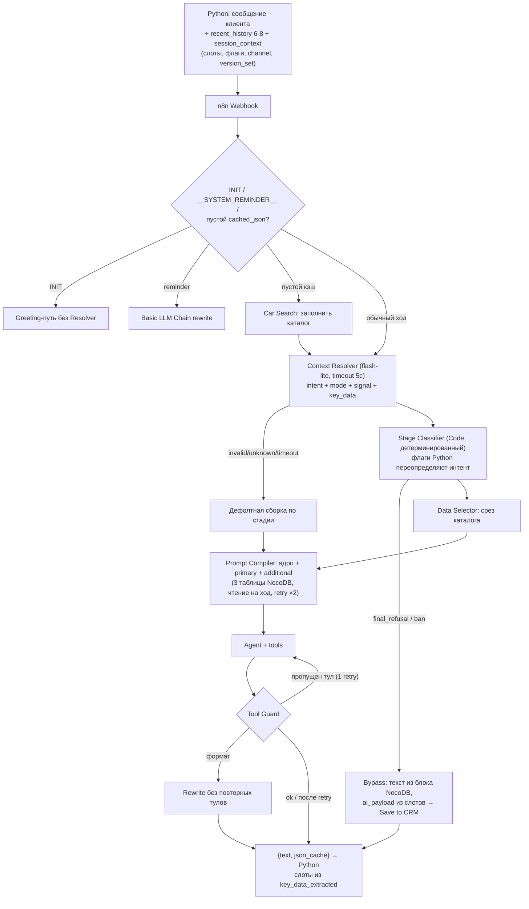
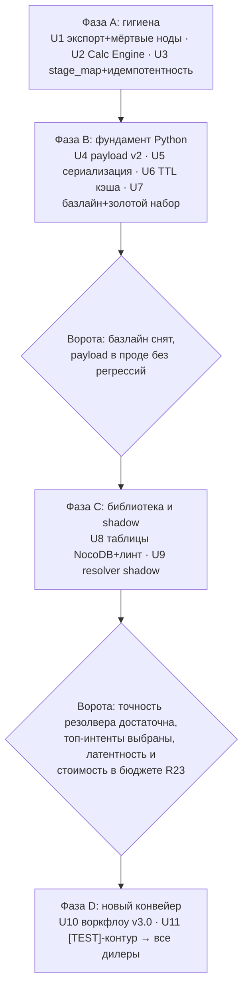

# refactor: Конвейер Context Resolver в AI-оркестрации n8n

## Summary

Поэтапно заменить Switch-роутинг и монолитные промпты в n8n на конвейер Context Resolver → Stage Classifier → Data Selector → Prompt Compiler → Agent → Tool Guard по `option/CONTEXT_RESOLVER_SPEC.md`, с библиотекой интентов/блоков в NocoDB, переносом диалогового состояния в Python и единым Calc Engine. Четыре фазы, каждая независимо поставляема; продакшен не останавливается — новый конвейер включается через shadow-режим, тестового дилера и поканареечный перевод.

**Целевой проект и процесс поставки (git не используется):** Python-код (`main.py` и модули) живёт в `/Users/vitaln/Yandex.Disk.localized/ADC/Products/Landing/DEV/BOT/UNIFIEDBOT/MULTY/unifiedbot_dev_refactor`; правки собираются в Docker-образ и пушатся в Docker Hub вручную. JSON воркфлоу n8n хранятся в `flow/` рабочей папки плана (датированные снапшоты) и импортируются в n8n вручную через веб-интерфейс. Пути `main.py` и `tests/` в юнитах относятся к целевому проекту; `flow/`, `eval/`, `docs/` — к рабочей папке плана.

---

## Problem Frame

Статический промпт 4.3–7k токенов на flash-lite даёт систематическое игнорирование инструкций (формат, вызовы инструментов, шаги воронки), а потолок — 4–5 сценариев на ветку: библиотека сценариев не может расти. Детали и подтверждённые дефекты — в origin-документе (see origin: `docs/brainstorms/2026-07-04-n8n-ai-orchestration-refactor-requirements.md`).

---

## Requirements

R1–R25 наследуются из origin-документа без изменений. Трассировка на юниты:

| R-ID | Суть | Юниты |
|---|---|---|
| R1 | Конвейер вместо Switch | U10 |
| R2–R3 | Context Resolver: контракт входа/выхода, динамический список интентов | U9 |
| R4 | Фолбэк при невалидном ответе резолвера | U9, U10 |
| R5 | Детерминированные триггеры переопределяют резолвер | U4, U10 |
| R6 | Stage Classifier + Bypass | U10 |
| R7 | Tool Guard + один retry | U10 |
| R8 | Data Selector по интенту/стадии | U10 |
| R9, R12 | Три таблицы NocoDB, правки без деплоя | U8 |
| R10 | Промпт хода ≤ ~2.5k токенов | U8, U10 |
| R11 | Версионирование наборов через Prompt_Teg/Prompt_Ver | U4, U8, U10 |
| R13 | Shadow на 32 интентах, включение топ-12–15 | U9, U11 |
| R14–R16 | Состояние в Python/Postgres, Simple Memory отмирают | U4, U10 |
| R17 | TTL + событийный рефреш cached_json | U6 |
| R18–R19 | Единый Calc Engine + тесты + снапшоты воркфлоу | U1, U2 |
| R20 | Единый stage_map | U3 |
| R21 | Shadow-режим без влияния на ответы | U9 |
| R22 | Золотой набор + eval на тестовом дилере | U7, U11 |
| R23 | Стоимость хода не выше текущей, латентность +≤0.5 с | U9, U11 |
| R24 | Обратная совместимость, перевод дилеров по одному | U4, U11 |
| R25 | Удаление мёртвых нод | U1 |

Требования, добавленные планом по итогам flow-анализа (продолжение нумерации origin):

- R26. Первый ход обрабатывается детерминированно: `INIT_AI_HANDOFF` и входящий `__SYSTEM_REMINDER__` минуют Resolver; пустой `cached_json` заполняется вызовом Car Search до Data Selector.
- R27. Bypass возвращает валидный `{text, json_cache}` (кэш — passthrough без изменений) и синтезирует `ai_payload` для finalize детерминированно, без агента.
- R28. Повторные вызовы `/n8n_callback` по одной сделке идемпотентны: дубль (deal_id + status) в рамках сессии игнорируется.
- R29. Ходы одного пользователя сериализуются: второе сообщение ждёт завершения текущего round-trip к n8n, состояние не перетирается last-write-wins.
- R30. Payload к n8n расширяется полями `recent_history`, обогащённым `session_context` (слоты, детерминированные флаги, `channel`, `version_set`) с обратной совместимостью — старый воркфлоу новые поля игнорирует.
- R31. Не более 3 вызовов Calc Engine за один ход в сценариях TradeIn и Combo.

---

## Key Technical Decisions

**Границы конвейера и контракты**

- **INIT и `__SYSTEM_REMINDER__` минуют Resolver.** Первое сообщение — детерминированный greeting-путь; входящий системный ремайндер от Python — существующий rewrite-путь. Резолверу нечего классифицировать в не-клиентских сообщениях, а его 32 интента их не содержат.
- **Заполнение каталога на первом ходе остаётся в конвейере до Data Selector.** Как сейчас: пустой `cached_json` → Car Search → полный кэш возвращается в Python как `json_cache`. Data Selector только нарезает, не добывает.
- **Bypass — детерминированная Code-нода.** Текст отказа/бана берётся из NocoDB-блока (не генерируется), `ai_payload` собирается из слотов session_context, Save to CRM вызывается напрямую. `json_cache` возвращается как пришёл, чтобы не затирать кэш Python.
- **Дельты к спеке зафиксированы: чтение таблиц NocoDB на каждый ход.** Код `loadTable`-при-старте и «Шаг 4 — Рестарт воркфлоу» из `option/CONTEXT_RESOLVER_SPEC.md` не реализуются — в n8n executions изолированы, кэша между запусками нет. Правки таблиц действуют со следующего хода автоматически.

**Детерминизм и надёжность**

- **Детерминированные триггеры вычисляет Python до отправки хода.** Телефон-regex, валидность госномера, стоп-слова, счётчики — флагами в `session_context` (`has_valid_phone_in_msg`, `has_valid_plate`, `stop_word_detected`). n8n Stage Classifier только читает флаги. Единый источник регэкспов — тот же класс дедупликации, что R20 для stage_map; инструменты открываются только по провалидированным данным (закрывает противоречие R15 ↔ пример 3 спеки).
- **Tool Guard: полный повтор агента только при пропущенном вызове инструмента.** Чисто форматные нарушения чинятся rewrite-вызовом Basic LLM Chain (существующий механизм ремайндера) без повторного запуска инструментов — иначе retry повторно дёргает Car Search/Combo Calculator. Ровно один retry; после неудачи ответ уходит клиенту как есть + инцидент в лог. Отклонённый черновик в `recent_history` не сохраняется. Пропущенный finalize не теряется между ходами: в слотах держится персистентное условие `phone_collected && !deal_finalized`, и Stage Classifier принудительно открывает finalize-путь на каждом последующем ходе, пока finalize не отработал успешно.
- **Невалидный, неизвестный или просроченный ответ резолвера → дефолтная сборка по стадии.** Таймаут резолвера 5 с, модельного fallback у резолвера нет (иначе ломается потолок стоимости R23). Intent вне предложенного списка приравнивается к невалидному JSON (расширение R4).
- **Отказ чтения NocoDB посреди хода: ретрай ×2, затем ошибка в Python.** Существующий каскадный фолбэк Python (90 с → извинение → менеджер) — терминальное поведение; встроенного аварийного промпта в n8n нет.
- **Идемпотентность finalize — на стороне Python.** `/n8n_callback` дедуплицирует по (deal_id, status) в рамках сессии: retry агента и Save-to-CRM-retry 5×3с не создают дублей стадий Битрикса и повторных алертов дилеру.
- **Конкурентные ходы сериализуются per-user в Python.** Второе сообщение ждёт завершения текущего round-trip (asyncio-лок на user_id); слоты и `json_cache` не перетираются параллельными executions.
- **Аварийный мост `<function_calls>` остаётся на время миграции.** Tool Guard дополнительно вырезает утёкший тул-текст в n8n; мост переиспользует единый stage_map (R20) и выводится только после полного перевода дилеров.

**Shadow и миграция**

- **Shadow — асинхронный fire-and-forget из Python к отдельному resolver-воркфлоу.** Не встраивается в старый воркфлоу: ноль добавленной латентности и ноль новых точек отказа в проде. `recent_history` Python берёт из собственного хранилища (оно уже полное), поэтому shadow не ждёт переноса памяти.
- **Тестирование v3 — в изолированном [TEST]-контуре; перевод дилеров — все сразу.** Канареечный этап на одном тестовом дилере отменён. v3 тестируется параллельным набором воркфлоу с префиксом `[TEST]` и webhook-суффиксом `-test` на том же инстансе, с локальным ботом `unifiedbot_dev_refactor`; прод-воркфлоу не перезаписываются и не упоминаются по ID (read-only шарится только `TOOL: AUTO.RU EVALUATION`; finalize в тесте идёт в существующий тестовый Save to CRM). После приёмки — одновременное переключение всех дилеров, только для новых сессий (начатые диалоги дозавершаются на старом воркфлоу); мягкий откат — обратным переключением флага. Жёсткая эвакуация активных v3-сессий отложена (см. Scope Boundaries).
- **`version_set` дилера едет в payload.** Существующий `prompt_key` (`Prompt_Teg`/`Prompt_Ver`, `main.py:996-998`) передаётся в n8n, Prompt Compiler фильтрует таблицы по нему — это и есть механизм A/B и канарейки промптов (R11).
- **Рефреш `cached_json` решает Python перед отправкой хода.** Триггеры: возраст кэша > TTL или стадия предыдущего хода — расчёт цены/финализация. Data Selector внутри хода кэш не перезапрашивает.
- **До фазы D стадию вычисляет Python эвристически** — из слотов, статусов `/n8n_callback` и `request_type`; старый воркфлоу возвращает только `{text, json_cache}`, поэтому обновление стадии и `key_data_extracted` из ответа n8n включается только на v3-сессиях. Событийный рефреш кэша по стадии активируется в фазе D.
- **`recent_history` подаётся агенту транскриптом в промпте.** Memory-ноды у агента v3.0 нет; история рендерится детерминированным текстовым транскриптом, её токены входят в бюджет хода и в сравнение AE6.

**Процесс поставки и данные (без git)**

- **Версионирование без git.** Код: `unifiedbot_dev_refactor` → Docker-образ → Docker Hub, вручную. Воркфлоу: датированные снапшоты JSON в `flow/` + ручной импорт через веб-интерфейс n8n; фиксация «до/после» и откат — снапшотами. Формулировка origin «экспорт в git» (R19) выполняется этим механизмом.
- **PII не маскируется.** Shadow-логи, payload-логи и golden set содержат телефоны/госномера как есть: NocoDB/Postgres и файлы `eval/` живут на локальном сервере/машине вне облака, golden set в Docker-образ не включается. Решение владельца; пересматривается при переезде в облако или расширении круга доступа (см. Scope Boundaries).
- **Контент промпт-блоков правит только владелец проекта.** Content-safety-проверка и audit log не вводятся; линт U8 проверяет только техническую целостность.
- **Ручное тестирование — только законченных юнитов.** Промежуточные состояния воркфлоу не прогоняются (тестовая схема дорогая относительно ценности шага): единственная точка ручной проверки юнита — один прогон всех 5 сценариев на тестовом дилере, когда юнит целиком готов к переносу в прод. Субтрактивные изменения с программной проверкой (U1) идут без отдельного прогона.

---

## High-Level Technical Design

Целевой ход диалога (фаза D):

Фазы внедрения и ворота между ними:

---

## Implementation Units

### Фаза A — гигиена (независима, низкий риск)

### U1. Снапшоты воркфлоу и удаление мёртвых нод

- **Goal:** зафиксировать снапшоты «до/после» всех воркфлоу в папке проекта и убрать мусор, искажающий картину.
- **Requirements:** R19 (снапшоты), R25.
- **Dependencies:** нет.
- **Files:** `flow/AI Agent v2.0 MAX.json`, `flow/Tool - Car Search.json`, `flow/Tool_ Combo Calculator.json`, `flow/TOOL_ AUTO.RU EVALUATION.json`, `flow/TOOL_ Save to CRM.json`, `flow/archive/` (новая папка датированных снапшотов).
- **Approach:** сначала экспорт как есть в `flow/archive/<дата>-baseline/`, затем в n8n (веб-интерфейс) удалить: `DeepSeek Chat Model1`, нативный `OpenAI Chat Model`, `AI Credit1`, `finalize_deal_old1`, `finalize_deal1`, `Code in JavaScript_backup` — и переэкспортировать в `flow/`. Процедура дальше: любое изменение воркфлоу = ручной экспорт в `flow/` + датированная копия в `flow/archive/`; откат = ручной импорт снапшота.
- **Test scenarios:** в экспортированных JSON нет нод с пустыми connections (программная проверка). Отдельный ручной прогон не делается — изменение чисто субтрактивное; сценарии прогоняются один раз при сдаче U2 (см. процесс тестирования в KTD).
- **Verification:** baseline- и очищенный снапшоты лежат в `flow/archive/`.

### U2. Единый Calc Engine с золотыми тестами

- **Goal:** одна реализация `calculatePMT`/`getSmartRate`/`calculateComboScenarios` вместо четырёх копий.
- **Requirements:** R18, R19, R31.
- **Dependencies:** U1.
- **Files:** новый `flow/Tool_ Calc Engine.json`, новый `flow/Test_ Calc Engine.json`, правки `flow/Tool - Car Search.json`, `flow/Tool_ Combo Calculator.json`.
- **Approach:** вынести функции в саб-воркфлоу (Execute Workflow), интерфейс — сценарный: операции `calculateCreditScenarios`/`calculateComboScenarios` принимают весь список машин и сроков и возвращают готовый результат, а не элементарные PMT-вызовы; Code-ноды Car Search/Combo Calculator режутся на подготовку входа и обработку выхода вокруг вызова. Лимит R31: не более 3 вызовов Calc Engine за ход в TradeIn/Combo. Тестовый воркфлоу гоняет золотые кейсы и падает при расхождении.
- **Execution note:** characterization-first — сначала золотые кейсы фиксируют текущее поведение всех четырёх копий (они должны совпасть между собой), потом консолидация.
- **Test scenarios:** PMT на известной тройке (сумма/ставка/срок) совпадает с ручным расчётом; ставка ≈0 → линейное деление; getSmartRate точное попадание в вилку term/downPct; мягкий фолбэк на ближайшую вилку по term; жёсткий дефолт 16% при пустом списке ставок; combo: `full_coverage` при tradein ≥ цены; `error` при неуспешной оценке; перебор сроков останавливается на первом pmt ≤ целевого; Max_Term ограничивает список сроков; Covers R31: прогон TradeIn- и Combo-хода — счётчик executions Calc Engine ≤ 3.
- **Verification:** тестовый воркфлоу зелёный; diff ответов Car Search и Combo Calculator до/после консолидации на 3 реальных сценариях — нулевой.

### U3. Единый stage_map и идемпотентность callback

- **Goal:** одна копия маппинга стадий Битрикса; дубли `/n8n_callback` не создают повторных обновлений сделки.
- **Requirements:** R20, R28.
- **Dependencies:** нет.
- **Files:** `main.py` (аварийный мост ~506-571, `handle_n8n_callback` ~814-849) и новый `tests/test_callback.py` — в целевом проекте `unifiedbot_dev_refactor`.
- **Approach:** stage_map — модульная константа, обе точки читают её; в `handle_n8n_callback` дедуп по (deal_id, status) с памятью в контексте сессии.
- **Execution note:** test-first — в целевом проекте нет тестов; юнит заводит pytest-каркас там (полный код и зависимости живут в `unifiedbot_dev_refactor`, pytest запускается локально, без CI).
- **Test scenarios:** Covers AE-класс R28: два одинаковых callback подряд → второй игнорируется (один вызов Bitrix API); тот же deal_id с другим status → обрабатывается; аварийный мост и callback используют один объект stage_map (тест тождества); невалидный status → дефолт "call" (текущее поведение сохранено).
- **Verification:** pytest зелёный; ручной прогон finalize на тестовом дилере — одна смена стадии в Bitrix.

---

### Фаза B — фундамент в Python

### U4. Payload v2: слоты, флаги, история

- **Goal:** Python становится единственным источником диалогового состояния и передаёт его в n8n каждым ходом.
- **Requirements:** R5 (флаги), R11 (`version_set`), R14, R15, R24 (обратная совместимость), R30.
- **Dependencies:** U3 (тестовый каркас).
- **Files:** `main.py` (`send_chat_message_to_n8n`, `send_handoff_webhook`, обработка ответа n8n), `tests/test_payload.py` (новый).
- **Approach:** в payload добавляются `recent_history` (6–8 последних сообщений из хранилища Python), обогащённый `session_context` (слоты `collected_data`, `phone_ask_count`, `current_stage`, `msg_count`, `appointment`; флаги `has_valid_phone_in_msg`, `has_valid_plate`, `stop_word_detected`; `channel`; `version_set` из `prompt_key`). До фазы D стадию вычисляет Python эвристически (слоты, статусы `/n8n_callback`, `request_type`); обновление стадии и `key_data_extracted` из ответа n8n включается только на v3-сессиях (фаза D). Старый воркфлоу новые поля игнорирует — включается в прод сразу.
- **Test scenarios:** Covers R30: старый воркфлоу с новым payload отвечает без изменений (интеграционный прогон на тестовом дилере); телефон в сообщении → флаг true, мусорный номер → false; стоп-слово из списка → флаг; `recent_history` обрезается до 8 и не содержит технических сообщений (`__SYSTEM_REMINDER__`, INIT); слоты переживают рестарт Python (Postgres); эвристическая стадия корректна на типовых переходах (телефон получен → finalize-стадия); обновление слотов из ответа n8n проверяется в фазе D на v3-сессиях.
- **Verification:** payload в логах содержит новые поля; прод-метрики без регрессий неделю на живом трафике.

### U5. Сериализация конкурентных ходов

- **Goal:** параллельные сообщения одного пользователя не перетирают состояние.
- **Requirements:** R29.
- **Dependencies:** U4.
- **Files:** `main.py`, `tests/test_concurrency.py` (новый).
- **Approach:** надстройка над существующим механизмом склейки (`USER_MESSAGE_BUFFERS` + `delayed_sender`, `main.py:1803-1846`), отдельный параллельный механизм не создаётся: asyncio-лок на user_id берётся внутри `delayed_sender` вокруг цикла «собрать payload → n8n → применить ответ»; сообщение, пришедшее во время in-flight запроса, кладётся в существующий буфер и уходит следующим ходом.
- **Test scenarios:** два сообщения с интервалом 100 мс → склеены существующим дебаунсом до отправки (текущее поведение сохранено); сообщение во время in-flight запроса к n8n → попало в буфер и ушло следующим ходом, не потеряно; слоты консистентны после обоих ходов; лок одного пользователя не блокирует других.
- **Verification:** нагрузочный прогон (2 пользователя × параллельные сообщения) без гонок в логах.

### U6. TTL и событийный рефреш cached_json

- **Goal:** агент не называет устаревшие цены и наличие.
- **Requirements:** R17.
- **Dependencies:** U4 (стадия в session_context).
- **Files:** `main.py`, `tests/test_cache_refresh.py` (новый).
- **Approach:** перед отправкой хода Python сбрасывает `cached_json` в payload (пустое значение → n8n сам перезапросит Car Search, механизм первого хода), если возраст кэша > 10 мин или стадия — расчёт цены/финализация (до фазы D — эвристическая стадия Python; событийный триггер по стадии из ответа n8n активируется в фазе D, TTL-триггер работает с фазы B). Выбранная комплектация при сбросе переносится в `qualification_context.complectation_id` — поле, которое старый воркфлоу читает первым приоритетом; перенос через session_context — механизм v3.0.
- **Test scenarios:** Covers AE5: кэш старше TTL + переход к финализации → в payload пустой кэш, n8n перезапрашивает; свежий кэш на обычном ходе → передан как есть; сброс не теряет выбранную комплектацию — `complectation_id` уехал в `qualification_context` и агент старого воркфлоу продолжает говорить о выбранной машине.
- **Verification:** в логах виден перезапрос каталога после TTL; цена в ответе совпадает с NocoDB после изменения тестовой записи.

### U7. Базлайн качества и золотой набор

- **Goal:** измеримая точка отсчёта до любых изменений промптов и объективный порог для ворот фаз C/D.
- **Requirements:** R22; закрывает OQ5 origin-документа.
- **Dependencies:** U4 (для скоринга нужен channel/стадия в логах — по возможности), может идти параллельно U5–U6.
- **Files:** `eval/golden_set.jsonl` (новый), `eval/score.py` (новый), `docs/eval-methodology.md` (новый).
- **Approach:** базлайн снимается наблюдением, не реплеем (Simple Memory делает реплей на старой архитектуре невоспроизводимым): выборка ~30 живых диалогов на ветку из `get-session-logs`, скоринг по трём метрикам — соблюдение формата (детерминированные проверки), дисциплина инструментов (телефон есть / finalize вызван), шаги воронки (LLM-judge на дешёвой модели + ручная сверка выборки). Золотой набор — те же диалоги в пофразовом режиме (teacher-forcing): каждый ход прогоняется с записанной историей на входе, оценивается один сгенерированный ответ v3.0 в этой точке против фактического ответа старой архитектуры; полный реплей диалога от начала до конца не делается, сквозное поведение оценивается отдельно на живом трафике тестового дилера. Набор хранится локально в `eval/` рабочей папки и в Docker-образ не включается; PII не маскируется (хранилище локальное, решение владельца).
- **Test scenarios:** `eval/score.py` на эталонном мини-наборе из 5 размеченных вручную диалогов даёт ожидаемые метрики; формат-чекер ловит заведомое нарушение (ответ 2000 символов при лимите); тул-чекер ловит диалог с телефоном без finalize.
- **Verification:** базлайн-отчёт с цифрами по трём метрикам на ветку зафиксирован в `docs/eval-methodology.md`; золотой набор ≥ 30 диалогов на ветку.

---

### Фаза C — библиотека NocoDB и shadow-резолвер

### U8. Таблицы Intents / Prompt_Blocks / Intent_Block_Map и миграция блоков

- **Goal:** библиотека интентов и блоков в NocoDB по схеме спеки, наполненная из текущих 37 блоков, с защитой от битых ссылок.
- **Requirements:** R9, R10 (нарезка WORKFLOW-блоков — основной источник экономии), R11 (`Version_Set`), R12; закрывает OQ4.
- **Dependencies:** U1 (гигиена), U7 (базлайн зафиксирован до изменения контента).
- **Files:** `docs/prompt-blocks-mapping.md` (новый — карта 37 блоков → новая схема), новый `flow/Tool_ Blocks Lint.json`.
- **Approach:** три таблицы по схеме спеки (`Intents` — 32 строки, `Prompt_Blocks`, `Intent_Block_Map`). Миграция контента: General-блоки → ядро (G-*); блоки `WORKFLOW` (5.3–8.6k символов) режутся на stage-task-блоки по стадиям — это контентная работа владельца промптов, план фиксирует карту и правила нарезки, не тексты. Lint-воркфлоу (ручной запуск + по расписанию) проверяет: у каждого активного интента есть primary-маппинг, все Block_ID существуют и активны, размер собранного промпта на каждую пару интент×стадия ≤ бюджета.
- **Test scenarios:** линт ловит интент без единого mapping; ссылку на несуществующий Block_ID; ссылку на блок с `Active=false`; пару интент×стадия с собранным промптом > 2.5k токенов (предупреждение).
- **Verification:** карта миграции покрывает все 37 блоков (перенесён / разрезан / осознанно выведен); линт зелёный на наполненных таблицах.

### U9. Resolver-воркфлоу и shadow-режим из Python

- **Goal:** резолвер классифицирует живой трафик всеми 32 интентами, не влияя на ответы, и даёт данные для ворот фазы D.
- **Requirements:** R2, R3, R4 (фолбэк-вердикт), R13, R21, R23 (замер стоимости).
- **Dependencies:** U4 (`recent_history` в Python), U8 (таблица Intents).
- **Files:** новый `flow/AI Resolver.json`, `main.py` (fire-and-forget вызов), `tests/test_shadow.py` (новый).
- **Approach:** отдельный n8n-воркфлоу: webhook → загрузка Intents (фильтр по Scenarios/Stage_Context) → Basic LLM Chain (flash-lite, без tools/памяти, timeout 5 с) → валидация JSON и принадлежности интента списку → лог в NocoDB/Postgres (session_id, ход, intent, client_mode, client_signal, key_data_extracted, reasoning, латентность, токены). Python вызывает его `asyncio.create_task` после отправки основного запроса; любые ошибки shadow глотаются и логируются. Shadow-логи живут в локальных NocoDB/Postgres (вне облака); маскирование PII не применяется — решение владельца.
- **Test scenarios:** Covers AE1-класс: невалидный JSON от модели → вердикт `parse_error` в логе, исключения нет; интент вне списка → вердикт `unknown_intent`; таймаут 5 с → вердикт `timeout`, основной ответ пользователю не задержан (замер); валидный ход → все поля в логе; стоимость shadow-вызова ≤ 15% стоимости основного хода (по логам токенов).
- **Verification:** неделя shadow на живом трафике; отчёт: распределение интентов по частоте, точность на ручной выборке ≥ 100 ходов, p95 латентности резолвера. Ворота фазы D — три критерия из данных shadow-отчёта: выбраны топ-12–15 интентов и точность на них достаточна (порог фиксируется в отчёте); p95 латентности резолвера + экстраполяция NocoDB-чтений укладывается в бюджет R23 (+≤0.5 с); стоимость резолвера на ход оставляет запас под агента в пределах текущей стоимости ответа.

---

### Фаза D — новый конвейер и канарейка

### U10. Воркфлоу конвейера v3.0

- **Goal:** рабочий конвейер Resolver → Stage Classifier → Data Selector → Prompt Compiler → Agent → Tool Guard, готовый к трафику тестового дилера.
- **Requirements:** R1, R4–R8, R10, R11, R14 (без Simple Memory), R26, R27.
- **Dependencies:** U8, U9; U2 (Calc Engine), U6 (контракт кэша).
- **Files:** новый `flow/AI Agent v3.0.json`, правки `flow/AI Resolver.json` (переиспользуется как первый узел или инлайн).
- **Approach:** новый воркфлоу на отдельном webhook-пути, старый не трогается. Пре-роутинг: INIT → greeting-путь; `__SYSTEM_REMINDER__` → rewrite; пустой `cached_json` → Car Search. Stage Classifier — Code-нода: флаги Python переопределяют интент; `final_refusal`/`ban_trigger` → Bypass (текст из NocoDB-блока, `ai_payload` из слотов, прямой вызов Save to CRM, `json_cache` passthrough). Data Selector — по `intentDataRules` (хардкод v3.0, как в спеке). Prompt Compiler — чтение 3 таблиц (retry ×2, при отказе — ошибка в Python), фильтр по `version_set`. Один агент без memory-ноды: `recent_history` рендерится детерминированным текстовым транскриптом в промпт, токены транскрипта входят в бюджет хода и в AE6. Tool Guard — Code-нода после агента: пропущенный finalize при `has_valid_phone_in_msg` или персистентном условии `phone_collected && !deal_finalized` → один retry с системным напоминанием; форматные нарушения → rewrite-цепочка; утёкший `<function_calls>`-текст вырезается; отклонённый черновик не логируется в историю; в управление включаются только интенты из отчёта U9, остальные падают в дефолтную сборку по стадии.
- **Test scenarios:** Covers AE1: невалидный JSON резолвера → ответ по дефолтной сборке, инцидент в логе. Covers AE2: валидный телефон + чужой интент → finalize-путь; агент без вызова → ровно один retry, после него вызов состоялся. Covers AE3: категоричный отказ → Bypass, finalize(refuse), агент не запускался. Covers AE4: новый интент в таблице → распознан на следующем ходе. Covers AE6: суммарные токены хода ≤ базлайна U7. Плюс: первый ход INIT → приветствие без резолвера, каталог заполнен; отказ NocoDB (эмуляция неверного table_id) → ошибка в Python, каскадный фолбэк сработал; format-only нарушение → rewrite без повторного вызова Car Search (по логам executions); дубль finalize при retry → одна смена стадии в Bitrix (интеграция с U3); транскрипт `recent_history` даёт агенту контекст, эквивалентный Simple Memory старой архитектуры (сравнение на 3 диалогах); телефон получен на ходе N, retry провален → на ходе N+1 finalize-путь открыт принудительно (персистентное условие); промпт хода на каждой паре ветка×стадия ≤ 2.5k токенов статики.
- **Verification:** полный золотой набор U7 прогнан на тестовом дилере; все AE origin-документа зелёные; get-session-logs показывает ожидаемую последовательность нод.

### U11. Роутинг на v3.0 и перевод дилеров

- **Goal:** приёмка v3.0 в изолированном [TEST]-контуре с локальным ботом и одновременный перевод всех дилеров с мгновенным мягким откатом.
- **Requirements:** R13 (включение топ-интентов), R22, R23, R24; критерии успеха origin-документа.
- **Dependencies:** U10, U7.
- **Files:** `main.py` (выбор webhook-пути по флагу и признаку сессии), `tests/test_routing.py` (новый), `eval/run_golden_v3.py` (новый — teacher-forcing раннер против [TEST]-вебхука).
- **Approach:** приёмка на [TEST]-контуре: smoke 5 сценариев локальным ботом, прогон золотого набора против `[TEST] AI Agent v3.0`, shadow-метрики. Затем глобальный флаг `PIPELINE_VERSION` (env: old/v3) переключает всех дилеров сразу; действует только на новые сессии — начатые диалоги дозавершаются на старом воркфлоу. Откат = флаг обратно.
- **Test scenarios:** флаг v3 → новые сессии идут на `/webhook/ai-handoff-v3`; сессия, начатая до переключения, → старый webhook до конца диалога; откат флага → новые сессии на старом пути, активные v3-сессии дозавершаются на v3; флаг не задан → старый путь (дефолт).
- **Verification:** критерии приёмки [TEST]-контура (см. docs/test-contour-checklist) зелёные; teacher-forcing: ни одна метрика U7 не хуже базлайна, сумма лучше; стоимость и p95-латентность хода в пределах R23; после переключения — сутки без деградации алертов/жалоб по всем дилерам.

---

## Scope Boundaries

**Deferred for later** (из origin-документа, без изменений)

- RAG/эмбеддинги по библиотеке блоков; перенос `intentDataRules` в NocoDB; данные каталога через инструмент вместо кэша; выбор модели на интент/стадию.

**Outside this product's identity** (из origin-документа)

- Перенос оркестрации из n8n в Python/LangGraph; смена модельного провайдера; вынос математики из n8n.

### Deferred to Follow-Up Work

- Смена `request_type` посреди сессии (credit→combo как постоянный переход): остаётся текущим механизмом Python-квалификации; резолверный сигнал перманентной смены сценария — отдельная итерация после v3.0.
- Вывод аварийного моста `<function_calls>` из `main.py` — после перевода всех дилеров на v3.0.
- Автоматический прогон золотого набора по расписанию (CI для промптов) — после ручной обкатки процедуры U7/U11.
- Жёсткий откат (эвакуация активных v3-сессий на старый воркфлоу) — перед переводом боевых дилеров; на этапе тестовых клиентов достаточно мягкого отката по новым сессиям.
- Content-safety-контроль и audit log промпт-блоков — при расширении круга редакторов за пределы владельца проекта.
- Маскирование PII в payload-логах, shadow-логах и golden set — при переезде хранилищ в облако или расширении круга доступа.

---

## Risks & Dependencies

- **Точность резолвера ниже пригодной** — главный риск дизайна. Митигация: ворота между C и D по отчёту U9; включение управления только на подтверждённых интентах; дефолтная сборка по стадии как поведение по умолчанию.
- **Латентность NocoDB-чтений на каждый ход** — принятое решение без замеров. Митигация: shadow-период U9 измеряет p95; при провале — эскалация к внешнему кэшу как отдельное решение (сейчас вне скоупа).
- **Нарезка WORKFLOW-блоков — контентная работа не-разработчиков** и узкое горлышко фазы C. Митигация: карта миграции и линт (U8) делают ошибки видимыми, не блокируя правки.
- **JSON-дисциплина flash-lite** в резолвере. Митигация: строгая валидация + фолбэк (R4), замер доли parse_error в shadow.
- **Session continuity при канарейке** покрыта правилом «только новые сессии» (U11), но требует честного признака сессии в Python — тестируется явно.
- **Зависимость от владельца контента**: наполнение таблиц (U8) и разметка базлайна (U7) требуют времени человека, а не только кода — закладывается в порядок фаз.

---

## Open Questions

- Порог точности резолвера для ворот фазы D — фиксируется по факту отчёта U9 (данных до shadow нет).
- Точные значения таймаутов/ретраев NocoDB-чтений — подбираются на замерах U9.
- Правила нарезки конкретных WORKFLOW-блоков на стадии — контентные решения владельца промптов в рамках U8; план задаёт схему, не тексты.

---

## Sources

- Origin: `docs/brainstorms/2026-07-04-n8n-ai-orchestration-refactor-requirements.md` (R1–R25, F1–F3, AE1–AE6, критерии успеха).
- Канонический Python-код: `/Users/vitaln/Yandex.Disk.localized/ADC/Products/Landing/DEV/BOT/UNIFIEDBOT/MULTY/unifiedbot_dev_refactor`; `file:line`-указатели ниже сверены по рабочей копии `main.py` в папке плана — перед правками сверить смещения с канонической версией.
- Спецификация ядра: `option/CONTEXT_RESOLVER_SPEC.md` (конвейер, схема таблиц, матрицы интентов; дельта — чтение таблиц на каждый ход, см. Key Technical Decisions).
- Проверенные факты кода: `main.py:1008-1027` (payload каждого хода), `main.py:996-998` (`prompt_key`), `main.py:497-499` (кэш без TTL), `main.py:506-571`/`843-849` (двойной stage_map), `flow/AI Agent v2.0 MAX.json` (Switch 6 веток, 5 Simple Memory, мёртвые ноды), 4 копии математики в `flow/Tool - Car Search.json` и `flow/Tool_ Combo Calculator.json`.
- Flow-анализ (26 пробелов) — закрыт решениями в Key Technical Decisions и требованиями R26–R30.
- Контракты и фолбэки: `doc/N8N_ARCHITECTURE.md`, `doc/TECH_BREAKDOWN.md`, `doc/ARCHITECTURE.md` (каналы, каскадный фолбэк, TTL каталога).
