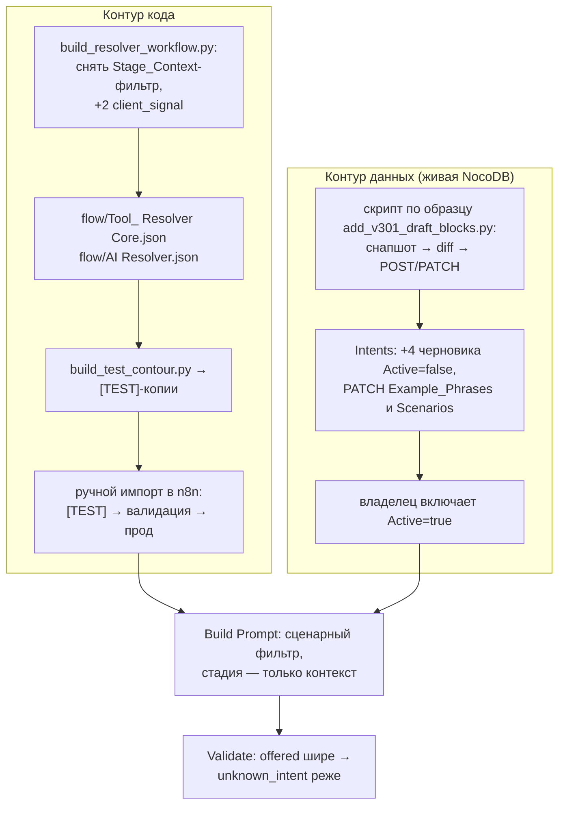

# feat: Снять стадийный фильтр резолвера и расширить справочник интентов

## Summary

Убрать фильтрацию списка интентов по `Stage_Context` в Build Prompt резолвера (стадия остаётся контекстной строкой промпта), добавить 4 новых интента черновиками в живую таблицу NocoDB, расширить Example_Phrases десяти существующих интентов реальными фразами из логов и два значения `client_signal`. Валидация — первый sim-тест на код Build Prompt, прогон 5 сценариев в [TEST]-контуре и shadow-отчёт.

---

## Problem Frame

Резолвер ошибается «по построению»: Python-эвристика стадии не видит текст сообщения, а Build Prompt скрывает интенты чужих стадий, поэтому нужный интент часто физически отсутствует в списке, и Validate отклоняет даже верный ответ модели как `unknown_intent`. Подтверждённые ловушки и слепые зоны по 275 реальным репликам — в origin-документе (see origin: docs/brainstorms/2026-07-16-resolver-stage-filter-and-intent-expansion-requirements.md).

---

## Requirements

Перенесены из origin-документа; нумерация совпадает.

**Фильтрация**

- R1. Резолвер видит все активные интенты своего сценария независимо от `current_stage`; стадия передаётся в промпт только как контекст.
- R2. Поле `Stage_Context` в таблице Intents сохраняется, но перестаёт использоваться как фильтр в Build Prompt.
- R3. `Scenarios` у `objection_data_privacy` и `tool_rerun_needed` расширяются значением `credit`.

**Справочник интентов**

- R4. Добавляются 4 новых интента: `request_human_handoff`, `payment_method_change`, `data_already_provided`, `polite_close_satisfied` — черновиками `Active=false`.
- R5. Example_Phrases расширяются только реальными формулировками из логов (таблица в origin-документе).
- R6. Каждый новый интент получает маппинг в Intent_Block_Map до активации.
- R7. `client_signal` расширяется значениями `handoff_requested` и `satisfied_done`; `client_mode` не меняется.

**Бюджет и валидация**

- R8. Входной промпт резолвера не превышает ~2700 токенов на вызов (~8560 символов при консервативных 3.17 симв./ток.). Порог обновлён по фактическому замеру 2026-07-17 (U2, n8n exec 2449–2494 [TEST] Tool: Resolver Core): текущий промпт — 1017–1076 входных токенов уже при 13 интентах (исходная калибровка ~550 ток. занижена вдвое), фактические 3.17–3.33 симв./ток.; проекция самой широкой комбинации после снятия фильтра (combo, 36 активных интентов с расширенными фразами, история 8×150 симв.) — ~2500 ток. Стоимость/латентность остаются в бюджете R23 (~$0.00025/вызов на flash-lite).
- R9. Точность на топ-интентах не хуже базлайна, доля `unknown_intent` не растёт (shadow-отчёт + прогон сценариев).

---

## Key Technical Decisions

- **Живая NocoDB канонична; изменения таблиц — точечными API-операциями.** По конвенции `docs/solutions/conventions/plan-prompt-block-changes-from-live-nocodb.md`: контент-владелец правит таблицы в UI, локальные CSV — стартовый снапшот. Новые интенты — POST-вставки, расширение Example_Phrases — PATCH с дописыванием к живому значению строки (не перезапись значением из CSV). `push_tables.py --replace-data` запрещён.
- **Двухфазный rollout новых интентов.** Строки заезжают с `Active=false` и заметкой об активации; фильтр `.filter(i => i.Active)` в Build Prompt уже даёт нужную семантику. Владелец включает интенты в NocoDB без реимпорта workflow.
- **`polite_close_satisfied` переводит стадию в closing.** Добавляется в `CLOSE_INTENTS` Stage Classifier; остальные три новых интента стадию не двигают — попадают в ветку дефолтной стадии Python.
- **Новые интенты маппятся на существующие блоки.** Prompt Compiler для несмаппленного интента падает на дефолтный блок `ST_{SCEN}_{STAGE}`, поэтому активация без маппинга даёт generic-ответ. Черновые map-строки указывают на существующие блоки; новый блок под `request_human_handoff` — контент владельца (см. Deferred).
- **Деплой workflow — регенерация + ручной импорт.** `build_resolver_workflow.py` только генерирует JSON; после правки перегенерировать `flow/Tool_ Resolver Core.json`, `flow/AI Resolver.json`, затем `build_test_contour.py` для [TEST]-копий, затем ручной импорт в n8n (сначала [TEST], после валидации — прод).
- **Первый тест на код Build Prompt.** Кода резолверного фильтра не касается ни один тест (`v3_pipeline_sim.test.mjs` мокает выход резолвера). Новый sim-тест исполняет jsCode из сгенерированного JSON — по образцу извлечения в `flow/lib/v3_pipeline_sim.test.mjs`.

---

## High-Level Technical Design

Два независимых контура доставки: код (генератор → JSON → ручной импорт) и данные (скрипт → живая таблица → активация владельцем). Поведение меняется только на пересечении: новый JSON импортирован И интент активирован.

---

## Implementation Units

### U1. Снятие стадийного фильтра и новые сигналы в генераторе резолвера

- **Goal:** Build Prompt фильтрует интенты только по `Active` и `Scenarios`; `CLIENT_SIGNALS` содержит два новых значения.
- **Requirements:** R1, R2, R7.
- **Dependencies:** нет.
- **Files:** `nocodb/build_resolver_workflow.py` (фильтр — строка ~45, `CLIENT_SIGNALS` — строки 28–29), перегенерируемые `flow/Tool_ Resolver Core.json`, `flow/AI Resolver.json`, `flow/test-contour/[TEST] Tool_ Resolver Core.json`, `flow/test-contour/[TEST] AI Resolver.json`.
- **Approach:** удалить строку `.filter(... Stage_Context ...)` из `BUILD_JS`, сохранив фильтры `Active` и `Scenarios` и строку «Текущая стадия системы» в тексте промпта. Добавить `handoff_requested`, `satisfied_done` в `CLIENT_SIGNALS`. Перегенерировать оба JSON и [TEST]-копии через `build_test_contour.py`.
- **Patterns to follow:** существующая структура `BUILD_JS`; регенерация — docstring `nocodb/build_resolver_workflow.py`.
- **Test scenarios:** покрываются U2 (sim-тест исполняет сгенерированный jsCode); для самого генератора — Test expectation: none — декларативная генерация JSON, поведение проверяется в U2.
- **Verification:** в сгенерированном `flow/Tool_ Resolver Core.json` нет фильтра по `Stage_Context`; список client_signal в тексте промпта содержит 11 значений; [TEST]-копии перегенерированы.

### U2. Sim-тест кода Build Prompt

- **Goal:** первый автоматический тест, исполняющий jsCode ноды Build Prompt из сгенерированного JSON.
- **Requirements:** R1, R3, R9; AE1, AE2, AE3.
- **Dependencies:** U1; U3 — только для тест-кейса AE3 (патч Scenarios должен попасть в снапшот).
- **Files:** `flow/lib/resolver_prompt_sim.test.mjs` (новый), снапшот-режим с таблицей Intents в `nocodb/add_intents_v2.py` (скелет создаётся здесь, раньше остального U3), правка пути снапшота в `flow/lib/v3_pipeline_sim.test.mjs`; читает `flow/Tool_ Resolver Core.json`.
- **Approach:** первый деливерабл — снапшот-инструментарий: режим снапшота с включением Intents (существующий `add_v301_draft_blocks.py --snapshot-only` снимает только Prompt_Blocks и Intent_Block_Map) и стабильный путь снапшота, единый для обоих sim-тестов — вместо эфемерного scratchpad-пути, захардкоженного в `v3_pipeline_sim.test.mjs:12`. Затем извлечь jsCode ноды Build Prompt из JSON (образец — чтение `flow/AI Agent v3.0.json` в `flow/lib/v3_pipeline_sim.test.mjs`), подменить `$('Get Intents')`/`$('Execute Workflow Trigger')` фикстурами из снапшота. Проверять состав `offered` и текст промпта. Порог размера промпта калибровать по фактическому замеру: снять входной токен-каунт одного реального вызова резолвера из статистики OpenRouter, вывести из него порог в символах; расчётные калибровки (2.5 симв/токен в `lint_check.py` против ~4.4 в origin-математике) расходятся в 1.8 раза и порогом не являются. Если замер после снятия фильтра превышает ~1100 токенов — обновить R8 в плане и origin до старта U1, а не подгонять тест.
- **Execution note:** написать тест на новое поведение до правки генератора — красный на текущем JSON, зелёный после U1.
- **Test scenarios:**
  - Covers AE1. Стадия `data_collect`, сценарий `combo`: `offered` содержит `schedule_appointment` и `propose_visit`.
  - Covers AE2. `msg_count == 0`, стадия `greeting`, сценарий `credit`: `offered` содержит `data_received_complete`.
  - Covers AE3. Сценарий `credit`, стадия `closing`: `offered` содержит `tool_rerun_needed` (зелёный после U3-патча Scenarios в снапшоте).
  - Сценарный фильтр сохранён: в сценарии `credit` нет `collect_plate` (Scenarios: tradein,combo).
  - Фильтр Active сохранён: интент с `Active=false` (новые черновики) отсутствует в `offered` до активации.
  - Строка «Текущая стадия системы: <stage>» присутствует в промпте.
  - Размер промпта: для самой широкой комбинации (combo, история 8 сообщений по ~150 символов) длина промпта в символах не превышает порога R8, выведенного из фактического замера токен-каунта (см. Approach).
- **Verification:** тест зелёный на свежесгенерированном JSON и свежем снапшоте живой таблицы.

### U3. Черновики новых интентов и патчи живой таблицы Intents

- **Goal:** 4 новых интента черновиками в живой таблице; Example_Phrases и Scenarios обновлены точечными PATCH.
- **Requirements:** R3, R4, R5.
- **Dependencies:** нет (независим от U1/U2 по коду; U2-кейс AE3 зависит от патча Scenarios).
- **Files:** `nocodb/add_intents_v2.py` (новый), `nocodb/table_ids.json` (чтение).
- **Approach:** по образцу `nocodb/add_v301_draft_blocks.py`: снять снапшот живой таблицы Intents, задиффить с планируемыми изменениями, затем идемпотентно по `Intent_ID`: POST четырёх новых строк (`Active=false`, `Version_Set` следующий, `Notes` с условием активации; Description/Example_Phrases — из таблиц origin-документа; Priority: `request_human_handoff` 12, `data_already_provided` 9, `payment_method_change` 8, `polite_close_satisfied` 7), PATCH Example_Phrases десяти интентов дописыванием `;`-фраз к живому значению (пропускать уже присутствующие), PATCH Scenarios `objection_data_privacy` и `tool_rerun_needed` добавлением `credit`. Скрипт печатает diff до применения и требует флаг подтверждения.
- **Patterns to follow:** идемпотентность по ID и снапшот — `nocodb/add_v301_draft_blocks.py`; запрет `--replace-data` — `nocodb/push_tables.py:13-16`.
- **Test scenarios:**
  - Повторный запуск скрипта не создаёт дублей и не дописывает фразы второй раз (идемпотентность).
  - PATCH Example_Phrases сохраняет фразы, добавленные владельцем в живую таблицу после снапшота CSV.
  - Запуск без флага подтверждения печатает diff и ничего не пишет.
- **Verification:** в живой таблице 36 строк, 4 новых с `Active=false`; выборочная проверка двух пропатченных интентов в UI NocoDB; свежий снапшот для U2 пересобран.

### U4. Stage Classifier, маппинг блоков и линт токен-бюджета

- **Goal:** `polite_close_satisfied` переводит стадию в closing; новые интенты имеют черновые map-строки; линт считает бюджет по новой семантике видимости.
- **Requirements:** R6; KTD о стадийном переходе.
- **Dependencies:** U3 (линт требует существования Intent_ID в таблице до появления map-строк — `nocodb/lint_check.py:56-61`).
- **Files:** `nocodb/build_v3_workflow.py` (`CLOSE_INTENTS`, строки ~117-118), перегенерируемый `flow/AI Agent v3.0.json` и его [TEST]-копия, черновые строки в живой таблице Intent_Block_Map, `nocodb/lint_check.py:82-97`, `nocodb/build_lint_workflow.py:29,36`, перегенерируемый `flow/Tool_ Blocks Lint.json`.
- **Approach:** добавить `polite_close_satisfied` в `CLOSE_INTENTS`. Вставить в живую Intent_Block_Map черновые строки (`Active=false`) для четырёх интентов с маппингом на существующие блоки закрытия/возражений — конкретные Block_ID выбрать по свежему снапшоту живой таблицы (в живой таблице блоки мигрировали на BLK_*-праймери, локальный CSV отстал). Линт — два раздельных шага: (1) сохранить существующий бюджет скомпилированного промпта в `lint_check.py:82-97` (порог 2500 токенов контента блоков), но итерировать все стадии для каждого активного интента вместо `expand(Stage_Context)` — после R1 поле не ограничивает, на какой стадии интент может быть предсказан; (2) добавить отдельную проверку входа резолвера — сумма длин строк `Intent_ID | Description | Примеры` по сценарию против порога R8. Обе зеркалить в `build_lint_workflow.py`.
- **Patterns to follow:** структура map-строк — `nocodb/intent_block_map.csv` (колонки `Intent_ID,Block_ID,Role,Scenario_Filter,Stage_Filter,Version_Set,Active`); вставка черновиков — U3-скрипт.
- **Test scenarios:**
  - `lint_check.py` зелёный после вставки map-строк (нет ERROR о несуществующих Intent_ID).
  - Кейс в `flow/lib/v3_pipeline_sim.test.mjs`: интент `polite_close_satisfied` (фикстура резолвера) даёт `turn.stage == "closing"`.
  - Кейс: `request_human_handoff` не меняет стадию (falls through к стадии Python).
  - Линт-бюджет компилятора: проверка блочного контента итерирует все стадии для активного интента (не `expand(Stage_Context)`) и по-прежнему срабатывает на пороге 2500 токенов.
  - Линт-бюджет входа резолвера: новая проверка срабатывает на пороге R8 для самого широкого сценария (combo, 32+4 интентов).
- **Verification:** линт зелёный; перегенерированный `flow/AI Agent v3.0.json` содержит расширенный `CLOSE_INTENTS`; map-строки видны в UI NocoDB со статусом черновика.

### U5. Синхронизация документации и локальных снапшотов

- **Goal:** документация и стартовые CSV отражают новую семантику.
- **Requirements:** R2, R7 (документирование).
- **Dependencies:** U1, U3, U4.
- **Files:** `docs/resolver-rules.md` (список client_signal — строки ~35-36, семантика фильтрации), `nocodb/build_tables_data.py` (список `INTENTS`), регенерируемые `nocodb/intents.csv`, `nocodb/intent_block_map.csv`.
- **Approach:** зафиксировать в resolver-rules: стадия — контекст, не фильтр; `Stage_Context` — справочное поле; 11 значений client_signal. Добавить 4 интента в `INTENTS` `build_tables_data.py` и перегенерировать локальные CSV (снапшот-паритет; канон — живая таблица).
- **Test scenarios:** Test expectation: none — документация и снапшоты без поведенческой логики.
- **Verification:** grep по `Stage_Context` в docs не находит упоминаний фильтрации; локальный `intents.csv` содержит 36 строк.

### U6. Валидация: [TEST]-контур, 5 сценариев, shadow-отчёт

- **Goal:** подтвердить R8/R9 до продового импорта и до активации интентов владельцем.
- **Requirements:** R8, R9; AE4, AE5.
- **Dependencies:** U1–U4.
- **Files:** `eval/golden_set.jsonl`, `nocodb/shadow_report.py`, `docs/test-contour-checklist.md` (критерии приёмки).
- **Approach:** явное решение по воротам R9/AE5: буквальное сравнение точности по golden set до/после невыполнимо — golden set не содержит меток интентов (`eval/score.py` оценивает реплики), поэтому принятый прокси — прогон 5 сценариев в [TEST]-контуре + shadow-отчёт + ручная разметка ≥100 ok-ходов (механизм ворот фазы D из `shadow_report.py`). Импортировать [TEST]-копии в n8n; прогнать 5 сценариев (credit, tradein, combo, stock, consult) по чек-листу [TEST]-контура — юниты тестируются только готовыми, без промежуточных прогонов. Для AE4: в [TEST]-контуре временно активировать черновики в снапшоте (по конвенции — мутация снапшота, не отдельные фикстуры) и убедиться, что «переключите на менеджера» даёт `request_human_handoff`. После продового импорта — неделя shadow, затем `shadow_report.py`: доля `unknown_intent` не выше базлайна прошлого отчёта, латентность p95 в бюджете, распределение топ-интентов без аномалий. Если падают ранее зелёные golden-кейсы — сначала проверить дрейф живых таблиц, потом код.
- **Test scenarios:**
  - Covers AE4. [TEST]-контур, активированный черновик: «переключите на менеджера» → `request_human_handoff`.
  - Covers AE5. `shadow_report.py` после недели: `unknown_intent` ≤ базлайна, p95 в бюджете R23.
  - Реплики-ловушки из origin-таблицы («я сама приеду в салон» в data_collect; первое сообщение с данными) классифицируются верно в [TEST]-прогоне.
- **Verification:** чек-лист [TEST]-контура зелёный; shadow-отчёт соответствует порогам; после этого владельцу передаётся список черновиков на активацию.

---

## Scope Boundaries

- Динамический шорт-лист (эмбеддинги/ключевые слова) — вне скоупа до ~60+ интентов (see origin).
- Замена Python-эвристики стадии — вне скоупа: после R1 её неточность не блокирует.
- Массовое расширение справочника (+10/+20 интентов) — отклонено в origin-документе.
- `client_mode` не меняется (R7).

### Deferred to Follow-Up Work

- Контент нового блока ответа под `request_human_handoff` — деливерабл контент-владельца; до появления блока активированный интент получает дефолтный `ST_{SCEN}_{STAGE}`.
- Кейсы новых интентов в `flow/lib/v3_pipeline_sim.test.mjs` сверх стадийных (полный Prompt Compiler-путь) — после активации блоков владельцем.
- Захват конвенции именования интентов в `docs/solutions/` (`/ce-compound`) — пробел зафиксирован learnings-агентом.

---

## Risks & Dependencies

- **PATCH Scenarios действует сразу на активных строках** (`objection_data_privacy`, `tool_rerun_needed`) — в отличие от черновиков, эта правка меняет поведение в момент применения. Митигация: применять вместе с продовым импортом U6, предупредить владельца.
- **Дрейф живой таблицы против golden set** — владелец правит интенты в UI; упавший старый кейс сначала проверять на дрейф (конвенция). Снапшот для U2 пересобирать перед каждым прогоном.
- **Ручной импорт в n8n можно забыть** — регенерация JSON не деплоит; чек-лист U6 включает импорт и [TEST]-копий, и прода, и перевыбор саб-workflow в обёртке.
- **Рост списка до 22–36 интентов** — риск точности lite-модели, а не бюджета; ворота — shadow-отчёт U6 (R9). Откат: вернуть фильтр одной строкой в генераторе и реимпортировать.

---

## Sources / Research

- `nocodb/build_resolver_workflow.py:42-46` — фильтр; `:28-29` — `CLIENT_SIGNALS`; `:115` — Validate против `offered`.
- `nocodb/build_v3_workflow.py:116-120` — `TOOL_INTENTS`/`CLOSE_INTENTS`; `:191-197` — дефолтный блок для несмаппленного интента.
- `nocodb/lint_check.py:56-61` — реф-проверка Intent_ID; `:82-97` — токен-бюджет по стадиям (пересчитать).
- `nocodb/add_v301_draft_blocks.py` — образец идемпотентных вставок черновиков и снапшота живой таблицы.
- `nocodb/push_tables.py:13-16` — запрет `--replace-data`; `nocodb/table_ids.json` — ID таблиц.
- `nocodb/build_test_contour.py:39-84` — регенерация [TEST]-копий.
- `flow/lib/v3_pipeline_sim.test.mjs:12-14,59-60` — образец исполнения jsCode из JSON и мок резолвера.
- `nocodb/shadow_report.py:63-82` — метрики валидации; `eval/score.py` метит реплики, не интенты — точность интентов только через shadow + ручную разметку.
- `docs/solutions/conventions/plan-prompt-block-changes-from-live-nocodb.md` — конвенция живой NocoDB и двухфазного rollout.
