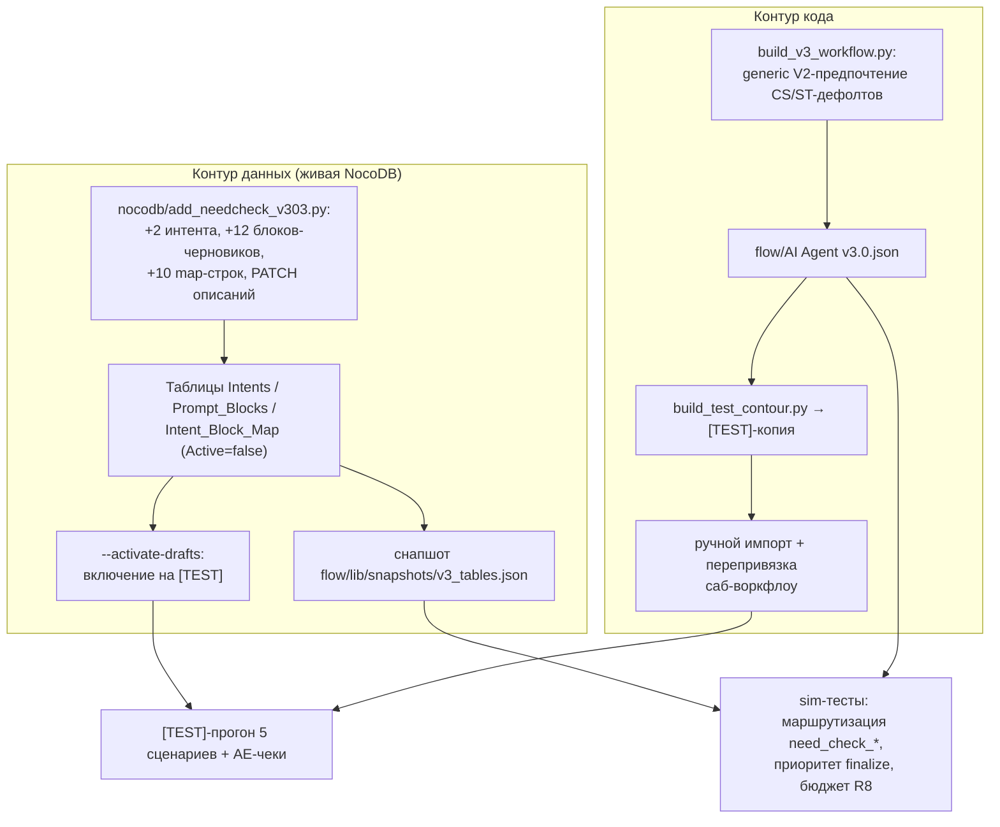

# feat: Need-check перед закрытием хода в credit / tradein / combo / stock

## Summary

Ввести промежуточный шаг need-check между «бот озвучил расчёт/оценку/инфо о наличии» и «бот зовёт на визит или звонок»: два новых интента (`need_check_ok` / `need_check_not_ok`), пять новых блоков и `*_V2`-правки существующих — всё черновиками v3.03 в живой NocoDB, единственная правка кода — generic-предпочтение `*_V2`-блоков в Prompt Compiler. Деплой и валидация — только [TEST]-контур.

---

## Problem Frame

По анализу 125 диалогов (см. origin: docs/brainstorms/2026-07-21-closing-need-check.md) 41 диалог умирает полной тишиной сразу после связки «расчёт + приглашение»; формулировка закрытия — монокультура «В какой день удобно приехать?», звонок как альтернатива почти не предлагается, в stock запрос телефона склеен с переводом на менеджера вопреки правилу «одна цель на ход». Целевое поведение по сценариям, дизайн-решения владельца и границы — в origin-документе.

---

## Requirements

Перенесены из origin-документа; нумерация совпадает (R1–R13, AE1–AE9 — см. origin). Ключевые для трассировки юнитов:

- R1–R3 — кредитное дерево: вопрос комфортности взноса → адвокат / мост одобрения банка (нейтральное сравнение).
- R4–R6 — trade-in дерево: вопрос соответствия оценки → value-defense / мост тест-драйва.
- R7 — combo: trade-in-чек первым, закрытие после первого барьера.
- R8 — stock: только вопрос готовности ждать поставку, без телефона в том же ходе.
- R9–R10 — закрытие «визит или звонок»; детерминированные правила приоритетнее need-check.
- R11 — классификация: два новых интента, развод с `objection_price`/`objection_trust`/`request_phone`.
- R12 — только черновики v3.03, только [TEST]-контур, прод не затрагивается.
- R13 — вход резолвера в бюджете R8 плана 2026-07-17-001 (8560 симв.) либо порог пересматривается по фактическому замеру.

---

## Key Technical Decisions

- **Данные — идемпотентным скриптом по образцу `nocodb/add_intents_v2.py`.** Живая NocoDB канонична (конвенция `docs/solutions/conventions/plan-prompt-block-changes-from-live-nocodb.md`): POST-черновики с `Active=false`, PATCH — дописыванием к живому значению, diff-preview без флагов, `--activate-drafts` для [TEST]-развёртывания, снапшот в `flow/lib/snapshots/v3_tables.json`.
- **Двухслойная механика `*_V2`.** Primary-блоки, управляемые картой (`BLK_CREDIT_PAYMENT_ACCEPTED_V2`, `ST_TRADEIN_TOOL_NEEDED_V2`, `ST_COMBO_TOOL_NEEDED_V2`), катятся черновыми map-строками на новые Block_ID — код не нужен. Блоки, выбираемые компилятором по имени (`CS_{SCEN}`, дефолтный `ST_{SCEN}_{STAGE}`), получают generic-предпочтение `active(id + "_V2") ? id + "_V2" : id` по образцу `G-02_VOICE_V2` (`nocodb/build_v3_workflow.py:202`). Один хелпер вместо трёх точечных if — будущие V2 не потребуют правок кода.
- **State machine не трогаем.** `need_check_ok`/`not_ok` не входят в `TOOL_INTENTS`/`CLOSE_INTENTS` (`nocodb/build_v3_workflow.py:116-119`) — стадия остаётся по эвристике Python; финальное закрытие двигают существующие интенты. Bypass и принудительный `finalize_agreed` срабатывают до выбора блоков (`build_v3_workflow.py:107-113`) — R10 выполняется by construction, проверяется sim-кейсом.
- **Бюджет R8 держим сжатием примеров, не порогом.** Расчёт по снапшоту 2026-07-21: combo worst-case 8073 симв., полные драфты двух интентов добавляют ~470 → 8543 из 8560. Тексты Description/Example_Phrases новых интентов ужимаются до суммарной добавки ≤430 симв. (запас ≥50). Порог меняется только по фактическому замеру (конвенция `docs/solutions/best-practices/token-budget-calibration-via-n8n-executions.md`) с синхронным обновлением трёх констант: `nocodb/lint_check.py:27`, `nocodb/build_lint_workflow.py`, `flow/lib/resolver_prompt_sim.test.mjs` (`PROMPT_CHAR_BUDGET`).
- **AE-покрытие — sim-тесты + [TEST]-прогон.** Teacher-forcing раннер `eval/run_golden_v3.py` из `docs/test-contour-checklist.md` не существует в репо; раннер в скоуп не входит (подтверждено при планировании). Ветки AE1–AE9 покрываются кейсами `flow/lib/v3_pipeline_sim.test.mjs` / `resolver_prompt_sim.test.mjs` и ручным прогоном 5 сценариев.
- **Драфт-контент блоков — в Content черновиков.** Скрипт кладёт черновые тексты из origin-раздела «Prompt_Blocks» прямо в неактивные строки; владелец дорабатывает в UI до активации. TODO-заглушки не используются.
- **Маршрутизация «ещё не тестировал» — взаимная строка в обоих tradein-блоках.** `need_check_not_ok` после вопроса о тест-драйве — не барьер: и `BLK_TRADEIN_VALUE_DEFENSE`, и `BLK_TRADEIN_TESTDRIVE_BRIDGE` несут по одному предложению «если последний вопрос был про тест-драйв и ответ "нет" — предложи визит с двумя поводами». Закрывает deferred-вопрос origin без нового интента.
- **Тестирование — готовыми юнитами.** Оффлайн-проверки (sim, lint) — по мере готовности юнитов; живой [TEST]-контур — один заход в U5 прогоном 5 сценариев, без промежуточных прогонов.

---

## High-Level Technical Design

Два независимых контура доставки, как в плане 2026-07-17-001: поведение меняется только на пересечении «новый JSON импортирован И черновики активированы».



Выбор блока на need-check ходе (директивная схема, не спецификация):

```text
интент need_check_ok      -> primary из map: APPROVAL_BRIDGE | TESTDRIVE_BRIDGE | COMBO_ROUTER | ST_STOCK_DATA_COLLECT
интент need_check_not_ok  -> primary из map: BLK_CREDIT_ADVOCATE | VALUE_DEFENSE | COMBO_ROUTER | BLK_STOCK_NEED_CHECK
стадия                    -> не меняется (falls through к эвристике Python)
телефон в сообщении       -> finalize_agreed до резолвера (need-check не участвует)
```

---

## Implementation Units

### U1. Скрипт черновиков v3.03: интенты, блоки, map-строки

- **Goal:** Все данные need-check лежат в живых таблицах черновиками; снапшот пересобран.
- **Requirements:** R1–R9, R11, R12.
- **Dependencies:** нет.
- **Files:** `nocodb/add_needcheck_v303.py` (новый), `nocodb/table_ids.json` (чтение), `flow/lib/snapshots/v3_tables.json` (перегенерация).
- **Approach:** по образцу `nocodb/add_intents_v2.py`: снапшот → diff → идемпотентные операции. POST 2 интентов (`need_check_ok`, `need_check_not_ok`, Priority 13, `Scenarios=credit,tradein,combo,stock`, `Active=false`, `Version=v3.03` — поле версии в Intents называется `Version`, `Version_Set` есть только у Prompt_Blocks и Intent_Block_Map, как в `add_intents_v2.py`; Description/Example_Phrases — из origin-таблицы, ужатые под бюджет U3). POST блоков-черновиков с драфт-контентом из origin: новые `BLK_CREDIT_APPROVAL_BRIDGE`, `BLK_TRADEIN_TESTDRIVE_BRIDGE`, `BLK_TRADEIN_VALUE_DEFENSE`, `BLK_COMBO_NEEDCHECK_ROUTER`, `BLK_STOCK_NEED_CHECK`; V2-варианты `BLK_CREDIT_PAYMENT_ACCEPTED_V2`, `ST_TRADEIN_TOOL_NEEDED_V2`, `ST_COMBO_TOOL_NEEDED_V2`, `CS_CREDIT_V2`, `CS_TRADEIN_V2`, `CS_COMBO_V2` (+ V2 stock-блока первого хода — Block_ID определить по свежему снапшоту, см. Open Questions). POST 10 map-строк: 8 из origin-таблицы «Изменения Intent_Block_Map», `greeting_first → BLK_STOCK_NEED_CHECK` [additional, scen=stock, stage=all] — вход в stock-need-check на первом ходе — и черновая primary-строка `data_received_complete → BLK_CREDIT_PAYMENT_ACCEPTED_V2` (credit). Для `ST_{TRADEIN,COMBO}_TOOL_NEEDED_V2` map-строки не нужны: после деактивации старых primary-строк tool-интентов их подключает дефолт стадии `ST_{SCEN}_TOOL_NEEDED` через V2-предпочтение U2. PATCH Description `request_phone` и `propose_visit` — дописывание разводки «НЕ путать с ответом на проверочный вопрос» (по образцу решения кейса test3 в `docs/resolver-rules.md`).
- **Patterns to follow:** `nocodb/add_intents_v2.py` (идемпотентность по Intent_ID / (Intent_ID, Block_ID), diff-preview, `--activate-drafts`, снапшот); запрет `--replace-data` — `nocodb/push_tables.py:13-16`.
- **Test scenarios:**
  - Повторный запуск не создаёт дублей и не дописывает PATCH-фразы второй раз.
  - Запуск без флагов печатает diff и ничего не пишет.
  - PATCH сохраняет правки владельца, внесённые в живую таблицу после снапшота.
  - Снапшот после применения содержит 38 интентов и все новые Block_ID.
- **Verification:** в UI NocoDB — 38 интентов (2 с `Active=false`), новые блоки и map-строки видны черновиками; `python3 nocodb/lint_check.py` — 0 errors (warnings о неактивных черновиках — норма).

### U2. Generic V2-предпочтение в Prompt Compiler

- **Goal:** Компилятор предпочитает `<Block_ID>_V2` при `Active=true` для name-selected блоков; [TEST]-копия перегенерирована.
- **Requirements:** R1, R4, R7, R12 (механика подмены CS/ST).
- **Dependencies:** нет (код независим от U1).
- **Files:** `nocodb/build_v3_workflow.py` (`PROMPT_COMPILER_JS`, строки ~192-207), перегенерируемые `flow/AI Agent v3.0.json`, `flow/test-contour/[TEST] AI Agent v3.0.json` (через `nocodb/build_test_contour.py`).
- **Approach:** хелпер `pick(id) = active(id+"_V2") ? id+"_V2" : id`, применить к `CS_${up}` и обоим местам выбора дефолтного `ST_${up}_${stage}` (primary-дефолт и фолбэк) — через дефолт подключаются `ST_*_TOOL_NEEDED_V2` после деактивации старых primary-строк и V2 stock-блока первого хода. `D_${up}` не оборачивать — V2 для D-блоков в этом плане нет. Существующий `voiceId` оставить как есть. `TOOL_INTENTS`/`CLOSE_INTENTS` не менять.
- **Patterns to follow:** `const voiceId = active("G-02_VOICE_V2") ? ... : "G-02_VOICE"` (`nocodb/build_v3_workflow.py:202`); регенерация — docstring генератора.
- **Test scenarios:** покрываются U4 (sim исполняет сгенерированный jsCode); для самого генератора — Test expectation: none — декларативная генерация JSON.
- **Verification:** в сгенерированном `flow/AI Agent v3.0.json` присутствует V2-предпочтение; diff [TEST]-копии — только эта правка.

### U3. Бюджет R8: ужатие текстов и контроль констант

- **Goal:** Вход резолвера после добавления интентов остаётся в бюджете 8560 симв. с запасом ≥50.
- **Requirements:** R13.
- **Dependencies:** U1 (совместное авторство скрипта: ужатие текстов — до применения U1 к живой таблице).
- **Files:** тексты Description/Example_Phrases в `nocodb/add_needcheck_v303.py` (правка до применения), при пересмотре порога — `nocodb/lint_check.py:27`, `nocodb/build_lint_workflow.py`, `flow/lib/resolver_prompt_sim.test.mjs`, перегенерируемый `flow/Tool_ Blocks Lint.json`.
- **Approach:** расчёт и ужатие выполняются на этапе авторинга скрипта U1, до применения: идемпотентный POST не обновляет уже созданные строки, правка текстов после применения — только точечным PATCH по Id. Пересчитать worst-case (combo) по свежему снапшоту формулой линта (фикс-часть 2433 + строки активных интентов); ужать примеры новых интентов до суммарной добавки ≤430 симв. Если запас не достигается ужатием — фактический замер по конвенции (n8n executions, симв/ток) и синхронное обновление трёх констант с фиксацией замера в комментарии; порог без замера не поднимать.
- **Test scenarios:**
  - Расчётный worst-case combo с активированными need_check-интентами ≤ 8510 симв.
  - Линт не выдаёт warning «вход резолвера combo > бюджета R8» на активированном снапшоте.
- **Verification:** `python3 nocodb/lint_check.py` без R8-warning; кейс бюджета в `resolver_prompt_sim.test.mjs` зелёный.

### U4. Sim-кейсы: маршрутизация, приоритет finalize, бюджет

- **Goal:** Оффлайн-тесты фиксируют поведение need-check до живого прогона.
- **Requirements:** R1, R4, R7, R10, R11, R13; AE1, AE4, AE7, AE9.
- **Dependencies:** U1 (снапшот с черновиками), U2 (перегенерированный JSON).
- **Files:** `flow/lib/v3_pipeline_sim.test.mjs`, `flow/lib/resolver_prompt_sim.test.mjs`; читают `flow/AI Agent v3.0.json`, `flow/Tool_ Resolver Core.json`, `flow/lib/snapshots/v3_tables.json`.
- **Approach:** кейсы «после активации» строить мутацией снапшота, не отдельными фикстурами — конвенция. Мутация включает `Active=true` у черновиков v3.03 И `Active=false` у замещаемых старых primary-строк (тот же список замен, что печатает скрипт в U5): компилятор берёт первую подходящую primary-строку (`rows.find`), «перебивания» старой строки новой нет. Мокая выход резолвера, проверять состав блоков компилятора и стадию.
- **Test scenarios:**
  - Covers AE1. credit, `data_received_complete`, V2-черновики активны в мутации: primary = `BLK_CREDIT_PAYMENT_ACCEPTED_V2`.
  - Covers AE4. tradein, `ready_for_tool`, старая primary-строка деактивирована в мутации: primary = `ST_TRADEIN_TOOL_NEEDED_V2` (дефолт стадии + V2-предпочтение).
  - Covers AE7. combo, `need_check_ok` и `need_check_not_ok`: primary = `BLK_COMBO_NEEDCHECK_ROUTER`; стадия хода не изменилась.
  - credit, `need_check_not_ok`: primary = `BLK_CREDIT_ADVOCATE` (переиспользование без нового блока).
  - Covers AE9. `has_valid_phone_in_msg=true` при любом need-check интенте: интент принудительно `finalize_agreed`, `finalize_required=true`.
  - CS-подмена: `CS_CREDIT_V2` активен → в промпте текст V2, старый `CS_CREDIT` отсутствует; V2 неактивен → старый текст (фолбэк).
  - resolver_prompt_sim: `offered` содержит `need_check_ok`/`not_ok` в credit/tradein/combo/stock и НЕ содержит в consult; до активации — отсутствуют.
  - resolver_prompt_sim: worst-case длина промпта (combo, история 8×150) ≤ `PROMPT_CHAR_BUDGET`.
- **Verification:** `node flow/lib/v3_pipeline_sim.test.mjs` и `node flow/lib/resolver_prompt_sim.test.mjs` зелёные на свежем снапшоте и свежесгенерированных JSON.

### U5. Активация на [TEST] и живая валидация

- **Goal:** Подтвердить целевое поведение need-check на [TEST]-контуре одним прогоном.
- **Requirements:** R1–R12; AE1–AE9.
- **Dependencies:** U1–U4.
- **Files:** `docs/test-contour-checklist.md` (порядок привязок, раздел E), `nocodb/shadow_report.py`.
- **Approach:** `add_needcheck_v303.py --activate-drafts` (интенты + map-строки + блоки v3.03; одновременно деактивировать замещённые map-строки на старые primary — скрипт печатает список замен и выполняет активацию/деактивацию одним запуском, чтобы не оставлять контур в частично применённом состоянии); реимпорт `[TEST] AI Agent v3.0.json` с перепривязкой саб-воркфлоу по таблице раздела E (импорт не сохраняет ссылки); `[TEST] Tool: Blocks Lint` → 0 errors. Затем один прогон 5 сценариев через локального бота (credit, tradein, combo, stock, consult) с диалоговыми проверками AE1–AE8 и ловушек. По факту прогонов — `python3 nocodb/shadow_report.py --days 1`: вердикты ok, доля `unknown_intent`, латентность p95.
- **Test scenarios (диалоговые чеки прогона):**
  - Covers AE1–AE3. credit: взнос → вопрос комфортности; «да, нормально» → вопрос об одобрении; «нет, много» → трейд-ин/субсидии без повторного требования взноса.
  - Covers AE4–AE6. tradein: SUCCESS → вопрос соответствия; «ожидал больше» → value-defense; «да, нормально» → вопрос о тест-драйве; «ещё не сидел за рулём» → визит «два повода».
  - Covers AE7. combo: расчёт → вопрос про оценку авто первым; «маловато» → value-defense, чек платежа не запускается.
  - Covers AE8. stock: модели нет → вопрос о готовности ждать, без телефона и менеджера в том же ходе.
  - Covers AE9. телефон в ответ на need-check вопрос → finalize дошёл до тестового Save to CRM, callback получен.
  - Ловушка `request_phone`: «да, устраивает» после need-check вопроса НЕ классифицируется как согласие на визит (телефон не запрашивается в обход дерева).
  - consult: поведение не изменилось (новые интенты не видны).
- **Verification:** чек-лист раздела F выполнен для этой итерации: lint зелёный, 5 сценариев + AE-чеки без дефектов, shadow-срез без роста `unknown_intent`; прод не затронут.

### U6. Синхронизация документации и локальных снапшотов

- **Goal:** Документация и стартовые CSV отражают need-check.
- **Requirements:** R11, R12 (документирование).
- **Dependencies:** U1, U2.
- **Files:** `docs/resolver-rules.md` (таблица раздела 5: +2 интента, счётчик 38), `docs/prompt-blocks-mapping.md` (упоминание V2-механики компилятора), `nocodb/build_tables_data.py` (`INTENTS` +2), регенерируемые `nocodb/intents.csv`, `nocodb/intent_block_map.csv`.
- **Approach:** по образцу U5 плана 2026-07-17-001: канон — живая таблица, CSV — снапшот-паритет.
- **Test scenarios:** Test expectation: none — документация и снапшоты без поведенческой логики.
- **Verification:** `intents.csv` содержит 38 строк; resolver-rules описывает need_check-интенты и их блоки.

---

## Scope Boundaries

Перенесены из origin: дожим/грациозный выход после отказа от альтернатив (п.4 исходного ТЗ) — отдельный бриф; точка потерь на вопросе о сумме взноса (data_collect) — вне скоупа; прод и таблица Prompts не затрагиваются.

### Deferred to Follow-Up Work

- Teacher-forcing раннер `eval/run_golden_v3.py` (упомянут в `docs/test-contour-checklist.md`, в репо отсутствует) — отдельная работа; после появления перенести AE1–AE9 в golden-кейсы.
- Финальные тексты всех блоков — контент владельца в NocoDB UI поверх драфтов U1.
- Пересмотр порога R8 «по-хорошему» (полный фактический замер после стабилизации) — если U3 обошёлся ужатием.

---

## Open Questions

Deferred to implementation:

- Точка встройки stock-вопроса: какой живой блок генерит первый ход «нет в наличии» (`ST_STOCK_GREETING` или `ST_STOCK_DATA_COLLECT`) — определить по свежему снапшоту в U1 и завести V2 соответствующего блока.
- Точный список замещаемых map-строк при активации (старые primary на `ST_*_TOOL_NEEDED` / `BLK_CREDIT_PAYMENT_ACCEPTED`) — вывести diff-ом скрипта в U5 по живому состоянию на момент активации.

---

## Risks & Dependencies

- **Бюджет R8 впритык** (8543/8560 расчётно). Митигация — U3: ужатие до ≤8510, порог только по замеру. Ворота — lint и sim-кейс бюджета.
- **Ловушка `request_phone`:** «да» на need-check может уйти в согласие на визит и запрос телефона в обход дерева. Митигация — PATCH Description (U1), sim-кейс разводки нет (резолвер — LLM, оффлайн не проверить), поэтому явный диалоговый чек в U5; при систематических промахах — расширять Example_Phrases, не логику.
- **Дрейф живых таблиц:** владелец правит контент параллельно. Перед U1 и перед активацией в U5 — свежий снапшот; падение старых sim-кейсов сначала проверять на дрейф (конвенция).
- **Точность flash-lite на 38 интентах** — риск уже принят планом 2026-07-17-001; ворота — shadow-срез в U5. Откат: деактивация черновиков v3.03 + реактивация замещённых старых map-строк по списку замен, напечатанному скриптом при активации (минимум `data_received_complete` → `BLK_CREDIT_PAYMENT_ACCEPTED`, credit) + реимпорт прежнего JSON.
- **Ручной реимпорт можно забыть или потерять привязки** — U5 включает перепривязку по таблице раздела E чек-листа.
- **Гипотеза удержания не доказана:** need-check добавляет обмен (+1 вызов резолвера ~2500 вх. ток., +1 ход агента ~5k ток. на диалог). Сравнение доли смертей на связке «расчёт→закрытие» до/после — по shadow-логам [TEST] после накопления диалогов.

---

## Sources / Research

- Origin: `docs/brainstorms/2026-07-21-closing-need-check.md` — целевое поведение, драфты блоков, таблицы интентов и map-строк, решения владельца.
- `nocodb/build_v3_workflow.py:107-133` — Stage Classifier (bypass, finalize, стадии); `:165-229` — Prompt Compiler (map-выбор, name-выбор CS/D/ST, образец V2-предпочтения `:202`).
- `nocodb/add_intents_v2.py` — образец скрипта данных: идемпотентность, diff-preview, `--activate-drafts`, снапшот в `flow/lib/snapshots/v3_tables.json`.
- `nocodb/lint_check.py:19-29,113-125` — константы и формула бюджета входа резолвера.
- `flow/lib/resolver_prompt_sim.test.mjs`, `flow/lib/v3_pipeline_sim.test.mjs` — образцы исполнения jsCode из JSON и мутации снапшота.
- `docs/test-contour-checklist.md` разделы E-F — привязки, критерии приёмки, решение «только [TEST]».
- Расчёт бюджета 2026-07-21 по живому снапшоту: credit 7853, tradein 7932, combo 8073, stock/consult 6624 симв.; добавка полных драфтов интентов ~470 симв.
