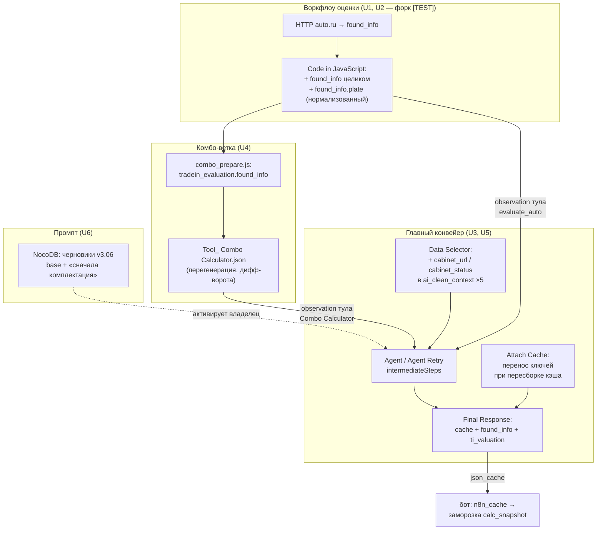

# feat: доставка данных оценки трейд-ина в json_cache + промпт «сначала комплектация, потом ссылка»

## Summary

Личный кабинет замораживает снапшот кредитного калькулятора по данным из `n8n_cache` и ждёт там два ключа верхнего уровня — `found_info` (сырой блок auto.ru плюс госномер) и `ti_valuation` (число). Сейчас оба живут только внутри n8n и наружу не уходят: терминальная нода воркфлоу оценки **выбрасывает `found_info`**, оставляя шесть плоских полей для CRM. План чинит данные в источнике (одна Code-нода в `TOOL_ AUTO.RU EVALUATION.json`), доставляет их в `json_cache` правкой одной ноды главного конвейера (`Final Response`), покрывает обе ветки — чистый трейд-ин и комбо, — и вносит промпт-вставки кабинета черновиками v3.06. Развёртывание и валидация — только [TEST]-контур.

Два места, где ТЗ недооценивает объём работ, вскрыты при планировании и разведены по юнитам: воркфлоу оценки **шарится с продом** (форк — U2), а переменные `cabinet_url`/`cabinet_status` **не доходят до модели** — Data Selector отдаёт в промпт белый список полей (U5). Задача 2 не является чисто промптовой.

## Статус исполнения (2026-08-10)

| Юнит | Статус | Коммит |
|---|---|---|
| U1. `found_info` + госномер в воркфлоу оценки | готов | `33eab3a` |
| U2. Форк воркфлоу оценки на [TEST] | готов | `9451ff4` |
| U3. Ключи оценки в `json_cache` | готов | `cc1cd37` |
| U4. Комбо-ветка: `found_info` в `tradein_evaluation` | готов, ворота диффа пройдены | `10705e5` |
| U5. `cabinet_url`/`cabinet_status` в контексте модели | готов | `bf59a60` |
| U6. Черновики v3.06 + `ti_valuation` в контекст | готов, черновики `Active=false` | `07f9b29` |
| U7. Регрессионные кейсы (32 → 48) | готов | `07f9b29` |
| U8. Развёртывание и живая валидация | чек-лист готов (раздел H), исполнение за владельцем | — |

Вне плана, попутно: `3c24d90` — починка красного `v3_pipeline_sim` (ассерты
выбора блоков переведены с дословных цитат на содержимое снапшота).

**U8 частично заблокирован внешней зависимостью:** перенос оценки между ходами
держится на `qualification_context.evaluation_carryover`, который бот пока не
шлёт (контракт согласован 2026-08-10, реализация за кабинетной стороной). До
выкатки проверяемы все шаги раздела H, кроме шага 5 — данные доедут в
`json_cache` на ходе оценки, но не переживут первую пересборку кэша.

---

## Problem Frame

`Final Response` (`nocodb/build_v3_workflow.py:285`) возвращает боту `{ text, json_cache, session_context_update }`, где `json_cache` наполняется исключительно результатом Car Search. Данные оценки auto.ru не доходят до бота ни по одному каналу:

- **Терминальная нода оценки теряет `found_info`.** `TOOL_ AUTO.RU EVALUATION.json`, нода `Code in JavaScript`: из `inputData.found_info` вынимаются шесть полей (`tradein_make/model/year/horse_power/transmission/steering_wheel`), сам блок в ответ не попадает. `mileage`, `photos`, `owners_count`, `pts_original`, `plate` теряются здесь и не восстановимы ниже по течению.
- **Госномера нет в ответе сервиса** — он приходит на вход (`Execute Workflow Trigger.plate`) и нормализуется нодой `Code in JavaScript1` (upper-case, без пробелов и тире). Кабинетный фронт ждёт его как `found_info.plate`.
- **Комбо-ветка несёт только сумму.** `flow/lib/combo_prepare.js:48` читает `autoEvalData.tradein_price_to`, `:202-204` кладёт её в `response.tradein_evaluation.estimated_value`; `found_info` в комбо-ответе отсутствует по той же причине.

Следствие для кабинета: клиент видит анкету трейд-ина с редактируемыми полями вместо блока «Ваш автомобиль», в комбо — без строки зачёта.

---

## Requirements

Перенесены из `docs/N8N_HANDOFF_CABINET.md`; нумерация введена здесь для трассировки юнитов.

- **R1.** `json_cache.found_info` — блок `found_info` ответа auto.ru **целиком, как отдал сервис**; ключи не переименовывать, не фильтровать, URL фото не нормализовать (`photos.main` остаётся протокол-относительным).
- **R2.** `json_cache.ti_valuation` — число, сумма зачёта (текущие `estimated_value` / `tradein_price_to`).
- **R3.** Госномер вкладывается внутрь `found_info` под ключом `plate`.
- **R4.** Работает в **обеих** ветках оценки: чистый трейд-ин (тул `evaluate_auto`) и комбо (тул `Combo Calculator`).
- **R5.** Сценарии без оценки: ключей **просто нет** (или `null`). Пустые объекты и нули не подставлять.
- **R6.** `found_info`/`ti_valuation` — **добавка** к существующему `json_cache` Car Search, не замена; наполнение Car Search не затрагивается.
- **R7.** Данные переживают Cache Gate: появившись после оценки, остаются в `json_cache` на последующих ходах.
- **R8.** Не класть данные оценки в `ai_payload` колбэка Save-to-CRM.
- **R9.** Промпт: довести подбор до выбора конкретной комплектации, ссылку на кабинет предлагать только после этого; плюс базовая вставка про `cabinet_url`/`cabinet_status` (в живых блоках отсутствует — проверено).
- **R10.** Спорные места решать в пользу **минимальной правки** воркфлоу: приёмная сторона бота зафиксирована тестами и меняться не будет.
- **R11.** Проверка — на [TEST]-контуре, прод не затрагивается.
- **R12.** Файлы канона Calc Engine (`calc_engine.js`, `calc_engine.golden.test.mjs`, `golden_cases.json`, `build_calc_engine_workflow.py`, `Tool_`/`Test_ Calc Engine.json`) не менять: автотесты кабинета сверяют статику с каноном побайтово.

---

## Key Technical Decisions

- **Чиним в источнике, а не в промпт-гардах.** `found_info` пробрасывается терминальной нодой воркфлоу оценки — одна правка кормит обе ветки (чистый трейд-ин видит его в observation тула, комбо — через `autoEvalData.found_info` в `combo_prepare.js`). Это ровно паттерн `docs/solutions/design-patterns/fix-data-gaps-at-source-not-in-llm-prompt-guards.md`; альтернатива «собирать `found_info` по кускам в главном воркфлоу» невозможна — данные уже уничтожены выше.

- **Канал доставки в главный конвейер — `intermediateSteps` агента.** У `Agent` и `Agent Retry` включён `returnIntermediateSteps: true`, и `Tool Guard` уже читает `out.intermediateSteps` для детекции `finalize` — канал рабочий и проверенный в проде, новых нод не требуется. Оттуда берётся и observation тула (данные), и `action.toolInput.plate` (запасной источник госномера). Отвергнутая альтернатива: обращение к саб-воркфлоу тула из main-ветки через `$('evaluate_auto')` — доступность run-data tool-нод в `$()` зависит от версии n8n и нигде в проекте не используется; принимать такой риск ради того же результата смысла нет.

- **Госномер — из ноды нормализации, а не из `toolInput`.** В терминальной ноде оценки доступен уже очищенный номер (`Code in JavaScript1` → upper-case, без разделителей). Кладём в `found_info.plate` именно его: `toolInput.plate` — сырой текст от модели («с683ек124», «А 123 БВ 777»), кабинет отрисует его как есть. `toolInput` остаётся фолбэком на случай, если у ответа не окажется `found_info` (см. U3).

- **Ключи пишутся только при реальной оценке.** Гейт — `status === "SUCCESS"` **и** непустой `found_info` / положительный `ti_valuation`. `IN_PROGRESS`, `NOT_FOUND`, `INVALID_DATA` и нулевая цена не пишут ничего: R5 требует отсутствия ключей, а не «пустых» значений. Отдельно: `ti_valuation` и `found_info` пишутся независимо друг от друга — если сервис вернул цену без деталей, уезжает только цена.

- **Переживание Cache Gate достигается местом хранения, а не новым механизмом.** Данные кладутся **внутрь** объекта `json_cache`, который бот сохраняет как `n8n_cache` и возвращает в `qualification_context.cached_json`. Дальше они переживают все четыре выхода воркфлоу без единой дополнительной правки: `Final Response` (`fresh_cache || cached_json`), `Bypass Respond` (та же формула), `Reminder Respond` (`cached_json || null`), а `Cache Gate` при непустом `cached_json` вообще уводит ход мимо Car Search. Единственная точка, где объект заменяется целиком, — `Attach Cache`; туда добавляется перенос двух ключей из прежнего `cached_json` (U3), как страховка на будущее.

- **Комбо-ветку правим `combo_prepare.js` — риск перегенерации снят замером.** Прогон `build_calc_engine_workflow.py` на неизменных исходниках даёт **пустой `git diff`** по всем четырём воркфлоу, включая оба защищённых Calc Engine JSON (проверено 2026-08-10 после init git). Значит правка `combo_prepare.js` + билд не трогают канон и согласование инкремента `CALC_ENGINE_VERSION` не требуется. Ворота вынесены в U4: если дифф по Calc Engine непустой — юнит останавливается и вопрос идёт на согласование, а не «чинится» руками.

- **Воркфлоу оценки форкается на [TEST].** `nocodb/build_test_contour.py:34` держит `TOOL: AUTO.RU EVALUATION` в `SHARED_REFS` — «read-only вызов, в тестовой фазе не модифицируется». U1 это допущение отменяет: правка шаренного воркфлоу немедленно меняет observation тула на проде (лишние поля в контексте LLM, рост токенов на ходах оценки). R11 требует форка — перенос в `FORK_REFS`.

- **`cabinet_url`/`cabinet_status` требуют правки кода, а не только промпта.** Data Selector собирает `ai_clean_context` белым списком (`user_id`, `deal_id`, `model`, `user_data`, `user_request`, `complectations`) в каждой из пяти trim-веток, а Prompt Compiler отдаёт в промпт только его (`JSON.stringify(item.ai_clean_context, …)`). Блок, ссылающийся на `qualification_context.cabinet_url`, ссылался бы на данные, которых модель не видит. U5 добавляет две переменные в белый список всех пяти веток.

- **Промпт-блоки — черновиками от живой NocoDB.** Канон — живые таблицы (116 блоков против 52 в CSV-снапшоте), конвенция `docs/solutions/conventions/plan-prompt-block-changes-from-live-nocodb.md`: новые Block_ID, `Active=false`, `Version_Set=v3.06`, активация владельцем одним заходом. Упоминаний кабинета в живых блоках нет — вносятся **обе** вставки из `CABINET_PROMPT_NOTE.md`, базовая и дополнение. Бюджет R8 (вход резолвера, 8560 симв.) не затрагивается: блоки идут в системный промпт агента, а не в промпт резолвера.

- **Тестирование — готовыми юнитами.** Оффлайн — sim-кейсы по мере готовности; живой [TEST] — один заход прогоном 5 сценариев в U8, без промежуточных прогонов.

---

## High-Level Technical Design

Два независимых контура, как в планах 2026-07-17-001 и 2026-07-21-001: данные (U6, живая NocoDB) и код (U1–U5, JSON-воркфлоу). Поведение промпта меняется только на пересечении «новый JSON импортирован И черновики активированы».

---

## Implementation Units

### U1. Проброс `found_info` и госномера в терминальной ноде воркфлоу оценки

- **Goal:** Ответ тула оценки содержит `found_info` целиком плюс `found_info.plate`; шесть плоских CRM-полей и все статусы сохраняются 1:1. Расхождение прод-файла с живым прод-воркфлоу помечено так, чтобы случайный импорт не увёз правку в бой.
- **Requirements:** R1, R3, R4, R5, R10, R11.
- **Dependencies:** нет.
- **Files:** `flow/TOOL_ AUTO.RU EVALUATION.json` (нода `Code in JavaScript` + новая нода-стикер), `docs/test-contour-checklist.md` (запись о расхождении).
- **Approach:** в обе SUCCESS-ветки (`inputData.prices.tradein` и `inputData.price_range`) добавить `found_info: {...inputData.found_info, plate}`, где `plate` — нормализованный номер из `$('Code in JavaScript1').first().json.plate` с фолбэком на `$('Execute Workflow Trigger').first().json.plate`. Существующий `carDetails` не трогать — комбо и CRM читают именно его. Ветки `IN_PROGRESS` / `NOT_FOUND` / `INVALID_DATA` не менять: там `found_info` нет по определению. Если `inputData.found_info` пуст — ключ не добавлять вовсе (R5), а не класть `{plate}` в одиночку. Округление цен (`round10k`) не трогать: `ti_valuation` должен совпадать с суммой, которую называет Александр.
- **Пометка расхождения (обязательная часть юнита).** После U1 файл на диске расходится с воркфлоу, живущим в боевом n8n, и расхождение сохраняется до конца плана — выкат в прод вне скоупа. Три уровня пометки, от самого дешёвого к самому заметному: (а) шапка-комментарий в jsCode правленой ноды — путешествует вместе с кодом и видна тому, кто откроет ноду; (б) нода `n8n-nodes-base.stickyNote` на канве воркфлоу — n8n рисует её сразу при импорте из файла, то есть **до** сохранения, что и есть нужный момент перехвата; (в) запись в `docs/test-contour-checklist.md` о том, что прод-копия воркфлоу оценки в n8n не переимпортируется до отдельного согласования. Стикер — новый для проекта тип ноды (в репозитории их сейчас нет), выполнения не затрагивает; текст формулируется так, чтобы оставаться верным и в форкнутой [TEST]-копии, которую U2 создаст из этого же файла.
- **Patterns to follow:** `docs/solutions/design-patterns/fix-data-gaps-at-source-not-in-llm-prompt-guards.md`; стиль ноды — прямые правки jsCode в JSON (воркфлоу оценки не генерируется скриптом).
- **Test scenarios:**
  - SUCCESS по параметрам (вторая ветка) → в ответе `found_info` со всеми полями сервиса и `plate` в верхнем регистре без разделителей.
  - SUCCESS по первому запросу (`price_range`) → то же.
  - `NOT_FOUND` / `IN_PROGRESS` / `INVALID_DATA` → ответ побайтово прежний, ключа `found_info` нет.
  - Ответ сервиса без `found_info`, но с ценой → `found_info` не появляется, цена уезжает.
  - Стикер не влияет на исполнение: у ноды нет входов и выходов, `connections` не изменились.
- **Verification:** ручной прогон [TEST]-копии воркфлоу (после U2) с реальным госномером; в выводе ноды — `found_info` с `mark/model/year/steering_wheel/mileage/photos/plate`. Пометка расхождения присутствует на всех трёх уровнях.

### U2. Форк воркфлоу оценки на [TEST]-контур

- **Goal:** [TEST]-контур зовёт собственную копию воркфлоу оценки; прод продолжает звать неизменённый оригинал.
- **Requirements:** R11.
- **Dependencies:** U1 (форкается уже правленый файл).
- **Files:** `nocodb/build_test_contour.py:25-34` (перенос `TOOL: AUTO.RU EVALUATION` из `SHARED_REFS` в `FORK_REFS`, правка докстринга `:1-9` и финального `print` `:93`), новый `flow/test-contour/[TEST] TOOL_ AUTO.RU EVALUATION.json`, перегенерируемые `[TEST] AI Agent v3.0.json` и `[TEST] Tool_ Combo Calculator.json` (обе ноды-вызова получают плейсхолдер `SELECT_AFTER_IMPORT`).
- **Approach:** добавить `TOOL_ AUTO.RU EVALUATION.json` в список `FILES`, ключ `"TOOL: AUTO.RU EVALUATION": "[TEST] TOOL: AUTO.RU EVALUATION"` в `FORK_REFS`, убрать из `SHARED_REFS`. Проверить, что в [TEST] AI Agent нода `evaluate_auto`, а в [TEST] Combo Calculator нода `Execute Workflow` получили плейсхолдер и попали в печатаемый отчёт «выбрать после импорта».
- **Patterns to follow:** существующая механика `FORK_REFS` (`build_test_contour.py:70-73`); конвенция префикса `[TEST] ` и суффикса `-test` для webhook-путей.
- **Test scenarios:**
  - Прод-файлы после прогона не изменились (`git diff` пуст по `flow/*.json` вне `test-contour/`).
  - В `[TEST] AI Agent v3.0.json` нет ссылки на прод-ID воркфлоу оценки.
  - Отчёт скрипта перечисляет обе ноды, требующие ручного выбора.
- **Verification:** `git diff --stat` после прогона — изменения только в `flow/test-contour/` и `nocodb/build_test_contour.py`.

### U3. `found_info` / `ti_valuation` в `json_cache` главного конвейера

- **Goal:** Обе ветки оценки кладут ключи в `json_cache`; сценарии без оценки не затронуты; данные переживают пересборку кэша.
- **Requirements:** R1, R2, R4, R5, R6, R7, R8, R10.
- **Dependencies:** U1 (данные должны существовать в observation).
- **Files:** `nocodb/build_v3_workflow.py` — общий `EVAL_KEYS_JS` плюс три выхода: `FINAL_RESPONSE_JS`, `BYPASS_RESPOND_JS`, `REMINDER_RESPOND_JS`; перегенерируемые `flow/AI Agent v3.0.json` и (через U2) `flow/test-contour/[TEST] AI Agent v3.0.json`. `ATTACH_CACHE_JS` **не трогаем** — см. ниже.
- **Approach (переработан 2026-08-10 после ответа кабинетного CE):** канал переноса — не `cached_json`, а новый узкий ключ `qualification_context.evaluation_carryover`, который бот шлёт на каждом ходе. Прежний кэш на rebuild-ходе недоступен ни под каким ключом (бот перезаписывает контекст целиком и обнуляет `cached_json`), поэтому перенос «из старого кэша в новый» в `Attach Cache` нереализуем в принципе — правка этой ноды из плана убрана.
  - В `FINAL_RESPONSE_JS` — извлекатель по `intermediateSteps` обоих агентов: `safe('Agent')` и `safe('Agent Retry')` (у `Post Guard` шагов нет — он возвращает только `final_text`, поэтому retry-путь иначе терял бы данные). Шаги сканируются в обратном порядке, побеждает последний успешный вызов. Observation в n8n приходит строкой — парсить через `try { JSON.parse } catch { пропустить }`, объект принимать как есть.
  - Разбор по имени тула: `evaluate_auto` → `found_info` из observation, `ti_valuation` из `tradein_price_to`; `Combo Calculator` → `response.tradein_evaluation.found_info` и `response.tradein_evaluation.estimated_value`. Фолбэк госномера: если `found_info` без `plate`, взять `action.toolInput.plate` (сырой) — лучше неидеальный номер, чем пустой блок.
  - Мерж — в **копию** объекта кэша через общий `withEvalKeys(cache, keys)`. Если ключей нет — возвращается `cache || null`, то есть текущее поведение бит-в-бит (R5, R6). Если кэша нет, а ключи есть (чистый трейд-ин без Car Search) — `json_cache` состоит только из них, что и нужно кабинету.
  - Приоритет источников: `Object.assign({}, carryover, fromSteps)` — свежая оценка перебивает carryover. Бутстрап покрыт автоматически: на первом ходе с оценкой carryover ещё пуст, ключи приходят из observation.
  - Хелпер подмешивается во **все три выхода**, возвращающие `json_cache`, а не только в `Final Response`. Причина: кабинет морозит снапшот на каждом ходе, поэтому ход-байпас (`ban`/`final_refusal`) или ход-напоминание, вернувший кэш без ключей, обнулил бы снапшот. `Bypass Respond` и `Reminder Respond` тулов не вызывают — им достаточно carryover.
  - **Порядок относительно Cache Gate — критичен.** Подмешивать только ПОСЛЕ гейта. Гейт различает ходы по непустоте `qualification_context.cached_json`; если влить carryover в него до гейта, rebuild-ход увидел бы непустой объект, ушёл бы в обход Car Search, и каталог перестал бы обновляться вовсе. Ход-напоминание идёт мимо гейта (`Route → Reminder Chain`), поэтому там подмешивание безопасно.
  - `ATTACH_CACHE_JS`, `TOOL_ Save to CRM.json` и `ai_payload` не трогаем (R8).
- **Patterns to follow:** существующий `safe(name)` в `FINAL_RESPONSE_JS`; разбор шагов в `TOOL_GUARD_JS` как образец работы с `intermediateSteps`.
- **Test scenarios:**
  - Ход с `evaluate_auto` SUCCESS → в `json_cache` появились оба ключа, `user_request`/`complectations` Car Search на месте.
  - Ход с `Combo Calculator` SUCCESS → то же, значения из `tradein_evaluation`.
  - Ход без тулов оценки → `json_cache` идентичен текущему поведению, ключей нет.
  - Ход с `NOT_FOUND` → ключей нет.
  - Оценка выполнена на ходе N; на ходе N+1 (без тулов) ключи присутствуют в `json_cache`.
  - Ход, где сработал retry (`Agent Retry` вызвал `evaluate_auto`) → ключи доехали.
  - **Пересборка кэша после TTL** (бот прислал `cached_json = null`, отработал Car Search) → ключи оценки на месте в свежем `json_cache`. Главный сценарий R7 — именно он, а не «ход без тулов»: без переноса данные живут ~10 минут.
  - Пересборка кэша при переходе к стадии расчёта → то же.
  - Вырожденный carryover (ключа нет вовсе / `null` / строка / `ti_valuation = 0` / `found_info = {}`) → ключей нет, ветка не падает.
  - `Bypass Respond` и `Reminder Respond`: с carryover → ключи в кэше; без него → результат идентичен прежнему.
  - Ход-напоминание при `cached_json = null` и непустом carryover → `json_cache` состоит только из ключей оценки.
- **Verification:** кейсы U7 зелёные; в сгенерированном `flow/AI Agent v3.0.json` дифф ограничен тремя выходными нодами, `connections` не изменились.

### U4. Комбо-ветка: `found_info` в `tradein_evaluation`

- **Goal:** Ответ Combo Calculator несёт `found_info`, не ломая канон Calc Engine.
- **Requirements:** R1, R3, R4, R12.
- **Dependencies:** U1.
- **Files:** `flow/lib/combo_prepare.js` (`:202-204`, блок `tradein_evaluation`), перегенерируемые `flow/Tool_ Combo Calculator.json` и `flow/Tool - Car Search.json`; под запретом на изменение — `flow/Tool_ Calc Engine.json`, `flow/Test_ Calc Engine.json`.
- **Approach:** в `tradein_evaluation` добавить `found_info: autoEvalData.found_info || null` (после U1 блок приезжает уже с `plate` — второй раз номер не вкладывать; `user_request.plate` в комбо-ответе остаётся как есть). Прогон `python3 flow/lib/build_calc_engine_workflow.py --browser-out <каталог статики кабинета>`; при отсутствии доступа к репозиторию кабинета — во временный каталог, поскольку `calc_engine.js` и `golden_cases.json` не менялись и браузерная статика выйдет байт-идентичной уже собранной.
- **Ворота юнита:** после билда `git diff --stat` по `flow/Tool_ Calc Engine.json` и `flow/Test_ Calc Engine.json` **обязан быть пуст**. Идемпотентность замерена 2026-08-10 (пустой дифф по всем четырём файлам на неизменных исходниках). Непустой дифф = юнит останавливается, правка `combo_prepare.js` откатывается через `git checkout`, вопрос инкремента `CALC_ENGINE_VERSION` и совместного билда идёт владельцу кабинетного репозитория.
- **Patterns to follow:** докстринг `build_calc_engine_workflow.py:1-10` (порядок «golden-тест → билд»); golden-тест перед билдом не нужен — математика не менялась.
- **Test scenarios:**
  - Комбо с SUCCESS-оценкой → `response.tradein_evaluation.found_info` заполнен, `estimated_value` не изменился.
  - Комбо с `IN_PROGRESS`/`NOT_FOUND` → ранний возврат из `combo_prepare.js` не затронут, `found_info` не появляется.
  - `git diff` по двум Calc Engine JSON пуст.
- **Verification:** `node flow/lib/pipeline_sim.test.mjs` зелёный; дифф ограничен `combo_prepare.js`, `Tool_ Combo Calculator.json` и (техническим переписыванием) `Tool - Car Search.json`.

### U5. `cabinet_url` / `cabinet_status` в контексте модели

- **Goal:** Модель видит переменные кабинета во всех пяти сценариях — иначе промпт-блок U6 ссылается на несуществующие данные.
- **Requirements:** R9.
- **Dependencies:** нет (независим от U1–U4).
- **Files:** `nocodb/build_v3_workflow.py:318` (`build_data_selector_js`, пять веток `trim_credit` / `trim_consult` / `trim_stock` / `trim_tradein` / `trim_combo` — блоки `ai_clean_context` на строках 64, 109, 170, 253, 331 генерируемого jsCode); перегенерируемые `flow/AI Agent v3.0.json` и `[TEST]`-копия.
- **Approach (уточнён при исполнении):** добавлять поля **в диспетчере**, а не в пяти ветках. Причина вскрылась в коде генератора: `build_data_selector_js()` копирует jsCode trim-веток дословно из legacy-воркфлоу (`OLD_NODES[node_name]`), и правка веток означала бы либо строковую хирургию по чужому коду, либо правку прод-файла `AI Agent v2.0 MAX.json`. Диспетчер уже оборачивает результат `fn(...)`, поэтому одна точка вместо пяти: `ai_clean_context` дополняется `cabinet_url`/`cabinet_status` после вызова ветки, дословность переноса сохраняется полностью. **Ключей может не быть вовсе:** выдача токена на стороне бота обёрнута в `try/except` (`main.py:1050-1055`), и при сбое `cabinet_url`/`cabinet_status` отсутствуют в `qualification_context`, а не приходят пустыми. Идиома `qc.cabinet_url || ""` покрывает оба случая — `undefined` и пустую строку — и нормализует их в одно значение, чтобы модель не видела разницы между «дилер без кабинета» и «токен не выдался»: поведение в обоих случаях одинаковое — кабинет не упоминать. Обращение строго через `qc.` без деструктуризации и без `qc.cabinet_url.length`. Больше в Data Selector не менять — trim-логика перенесена дословно из legacy и является гарантией паритета.
- **Patterns to follow:** дословность trim-веток (`build_v3_workflow.py:10-11`); добавка полей, а не переработка структуры.
- **Test scenarios:**
  - Пять сценариев: при заполненном `qualification_context.cabinet_url` он присутствует в `ai_clean_context`.
  - **Ключей нет в `qualification_context` вовсе** (сбой выдачи токена) → пустые строки, не `undefined`, ветка не падает.
  - Ключи есть, но пустые (дилер без кабинета) → результат тот же, что и в предыдущем кейсе.
  - Остальные поля `ai_clean_context` не изменились ни в одной ветке.
- **Verification:** кейс в `flow/lib/v3_pipeline_sim.test.mjs`; в исполнении [TEST]-контура — `cabinet_url` виден в скомпилированном промпте.

### U6. Промпт-блоки кабинета черновиками v3.06

- **Goal:** В живой NocoDB лежат неактивные черновики с обеими вставками; активацию делает владелец.
- **Requirements:** R9.
- **Dependencies:** U5 (без него блок ссылается на невидимые модели переменные — активировать бессмысленно).
- **Files:** `nocodb/add_cabinet_v306.py` (новый), `nocodb/table_ids.json` (чтение), `flow/lib/snapshots/v3_tables.json` (перегенерация снапшота).
- **Approach:** по образцу `nocodb/add_needcheck_v303.py`: снапшот → diff без флагов → идемпотентный POST. Один новый блок `G-07_CABINET` (`Level=general`, `Scenario=all`, `Stage=all`, `Version_Set=v3.06`, `Active=false`) с обоими абзацами из `docs/CABINET_PROMPT_NOTE.md` — базовым (`cabinet_url`/`cabinet_status`, предложение один раз и ненавязчиво, молчание при пустой переменной) и дополнением 2026-08-10 (ссылку предлагать только после выбора конкретной комплектации). Один блок, а не два: тексты связаны условием «когда предлагать», разнесение по блокам породило бы риск активации половины правила. Формулировка условия молчания берётся в виде «если `cabinet_url` пустая **или отсутствует**» — при сбое выдачи токена бот не присылает ключ вовсе (`main.py:1050-1055`), и инструкция «если пустая» без этой оговорки читается моделью как неприменимая. Подключение — по общему правилу выбора general-блоков компилятором; новых map-строк не требуется. Notes — инструкция активации.
- **Patterns to follow:** `docs/solutions/conventions/plan-prompt-block-changes-from-live-nocodb.md` (черновики `Active=false`, уникальный Block_ID, переключение владельцем); `nocodb/add_needcheck_v303.py` (идемпотентность, `--snapshot-only`, `--activate-drafts`, `--rollback`).
- **Test scenarios:**
  - Повторный запуск не создаёт дублей.
  - Запуск без флагов печатает diff и ничего не пишет.
  - Снапшот после применения содержит `G-07_CABINET`.
  - `python3 nocodb/lint_check.py` — 0 errors.
- **Verification:** блок виден в UI NocoDB черновиком; после `--activate-drafts` присутствует в скомпилированном промпте всех пяти сценариев (кейс U7).

### U7. Sim-кейсы: контракт без оценки, переживание кэша, видимость переменных

- **Goal:** Оффлайн-тесты фиксируют оба опасных места до живого прогона.
- **Requirements:** R5, R6, R7, R9.
- **Dependencies:** U3, U5, U6.
- **Files:** `flow/lib/v3_pipeline_sim.test.mjs` (новые кейсы), при необходимости — свежий снапшот таблиц.
- **Approach:** кейсы исполняют сгенерированный jsCode нод, как уже делают существующие. Покрытие: (а) ход без тулов оценки — `json_cache` бит-в-бит равен текущему поведению, ключей нет; (б) ход с `evaluate_auto` — оба ключа, `user_request`/`complectations` не пострадали; (в) ход с `Combo Calculator` — то же; (г) ход N+1 после оценки — ключи на месте; (д) `Attach Cache` при непустом прежнем `cached_json` — ключи перенесены; (е) статусы `NOT_FOUND`/`IN_PROGRESS` — ключей нет; (ж) `cabinet_url` в `ai_clean_context` пяти веток; (з) при активированном черновике `G-07_CABINET` текст присутствует в скомпилированном промпте. Оба состояния промпта (до/после активации) — двусторонней мутацией клона снапшота, не чтением сырого снапшота (конвенция; инцидент 2026-07-22).
- **Patterns to follow:** структура существующих кейсов `v3_pipeline_sim.test.mjs`; громкие `assert(row, "…нет в снапшоте — пересоберите …")` на каждую мутацию.
- **Test scenarios:** перечислены в Approach — они и есть предмет юнита.
- **Verification:** `node flow/lib/v3_pipeline_sim.test.mjs` и `node flow/lib/pipeline_sim.test.mjs` зелёные.

### U8. Развёртывание на [TEST] и живая валидация

- **Goal:** Контракт подтверждён на дев-базе бота запросами из раздела 3 ТЗ.
- **Requirements:** R1–R11.
- **Dependencies:** U1–U7.
- **Files:** импорт `flow/test-contour/*` в n8n; `docs/test-contour-checklist.md` (раздел перепривязок).
- **Approach:** импорт [TEST]-воркфлоу; ручная перепривязка саб-воркфлоу по плейсхолдерам — новый `[TEST] TOOL: AUTO.RU EVALUATION` в двух местах (нода `evaluate_auto` главного воркфлоу и `Execute Workflow` внутри [TEST] Combo Calculator) и `REPLACE_WITH_CALC_ENGINE_ID` в трёх нодах `Calc Engine` (Test, Car Search, Combo) — билд-скрипт оставляет плейсхолдер по построению. Активация черновика `G-07_CABINET` владельцем. Прогон 5 сценариев одним заходом (трейд-ин с госномером, комбо с госномером, чистый кредит, сток, консультация), подбор доводится до выбора комплектации. Замер токенов на ходах оценки по конвенции `docs/solutions/best-practices/token-budget-calibration-via-n8n-executions.md` — фиксируем цену проброса `found_info` в контекст LLM.
- **Patterns to follow:** `docs/test-contour-checklist.md` (порядок импорта и таблица перепривязок); memory: тестировать готовыми юнитами, один заход, без промежуточных прогонов.
- **Test scenarios:**
  - Трейд-ин и комбо: SQL раздела 3 п.1 к дев-базе — `n8n_cache.found_info` отдаёт объект с `mark/model/year/steering_wheel/mileage/plate/photos`, `n8n_cache.ti_valuation` — число.
  - Те же два сценария, п.2: `calc_snapshot.found_info.plate` и `calc_snapshot.ti_valuation` непустые; в логе бота строка `cabinet: снапшот калькулятора … заморожен` без исключений.
  - Кредит / сток / консультация: оба `json_extract` дают `NULL`, диалог не деградировал.
  - Ход после оценки: значения в `n8n_cache` те же (не исчезли).
  - `photos.main` в базе остался протокол-относительным (`//avatars…`) — нормализация на стороне бота, не n8n.
  - Промпт: ссылка на кабинет не предлагается до выбора комплектации, предлагается после.
- **Verification:** оба SQL раздела 3 дают ожидаемый результат на трейд-ин/комбо и `NULL` на трёх остальных сценариях; прод-воркфлоу в n8n не переимпортировались.

---

## Scope Boundaries

- Прод не затрагивается: правки едут только в [TEST]-копии (R11). Прод-файлы `flow/*.json` меняются как исходники для форка, но в n8n не переимпортируются.
- `ai_payload` колбэка Save-to-CRM и `TOOL_ Save to CRM.json` не трогаем (R8).
- Канон Calc Engine не трогаем (R12); `combo_prepare.js` правится, но под дифф-воротами U4.
- Нормализация URL фото, переименование и фильтрация ключей `found_info` — вне скоупа сознательно (R1).
- Кабинетный репозиторий не читаем и не правим; браузерная статика пересобирается только если U4 её затронет (не ожидается).

### Deferred to Follow-Up Work

- Сквозная проверка п.3 раздела 3 ТЗ (`GET /cabinet/api/me`, рендер блока «Ваш автомобиль» и строки зачёта) — сторона кабинета, за владельцем кабинетного репозитория.
- Финальные формулировки блока `G-07_CABINET` — контент владельца поверх черновика.
- Возврат `TOOL: AUTO.RU EVALUATION` в общий доступ (слияние форка в прод) — после приёмки на [TEST], отдельным заходом. В тот же заход входит снятие всех трёх пометок расхождения из U1: пока прод не синхронизирован, они обязаны оставаться; после синхронизации обязаны исчезнуть.
- Сообщение автору ТЗ о неполной таблице раздела 0 (билд-скрипт переписывает четыре воркфлоу, а не два) — за владельцем проекта.

---

## Open Questions

**Закрыты 2026-08-10 грепом по коду бота (ответ кабинетного CE):**

- **Очищает ли бот `n8n_cache`** — нет, никогда, но **перезаписывает целиком**. Единственная операция записи — полная перезапись контекста ответом n8n (`main.py:526-527`). При истечении TTL (`CACHE_TTL_SECONDS = 600`) или переходе к стадии расчёта бот присылает `cached_json = None` (`main.py:1123-1130`), `Cache Gate` уводит ход на Car Search, и свежий `json_cache` затирает прежний объект целиком. **Следствие, меняющее вес юнита:** перенос `found_info`/`ti_valuation` в `Attach Cache` — не страховка «на будущее», а несущая конструкция R7. Без него данные оценки исчезают на первой же пересборке каталога, то есть примерно на десятой минуте диалога, и снапшот кабинета замораживается пустым. Второй канал хранения (`session_context_update`) не нужен. Переформулировано в U3; обязательный сценарий — «кэш пересобран после TTL → ключи оценки на месте».
- **Присылает ли бот `cabinet_url`/`cabinet_status`** — да, в обоих путях сборки вебхука (`main.py:1111` и `1213` → `_attach_cabinet_context`, `main.py:1052-1053`), проводка запинена source-grep-тестами. **Нюанс:** блок обёрнут в `try/except` (`main.py:1050-1055`) — при сбое выдачи токена ключей в `qualification_context` **нет вовсе**, а не приходит пустое значение. U5 и U6 обязаны терпеть отсутствие ключа, а не только пустую строку.

Deferred to implementation:

- **Формат `observation` в `intermediateSteps`** — строка или объект (зависит от версии n8n и тула). U3 обрабатывает оба, но фактический формат фиксируется по первому исполнению [TEST] и упрощает код, если вариант один.
- **Объём `found_info` в токенах.** Замер в U8; если проброс дорог на длинных диалогах, обсуждается урезание списка полей с владельцем кабинета — но только после замера и только по согласованию (R1 запрещает фильтрацию по умолчанию).

---

## Risks & Dependencies

- **Правка шаренного воркфлоу оценки задевает прод.** Главный риск плана: без U2 правка U1 немедленно меняет observation тула на боевом контуре. Митигация — U2 идёт до любого импорта в n8n; ворота — отсутствие прод-ID воркфлоу оценки в [TEST]-файлах.
- **Прод-файл воркфлоу оценки расходится с живым прод-воркфлоу — и остаётся расходящимся.** С момента U1 и до конца плана `flow/TOOL_ AUTO.RU EVALUATION.json` содержит правку, которой нет в боевом n8n: выкат в прод вне скоупа. Опасность не в самом расхождении, а в том, что оно молчаливое и долгоживущее — обычный «импортну актуальный файл» увезёт непроверенную правку в бой. Митигация — трёхуровневая пометка в U1 (шапка в jsCode, стикер на канве, запись в чек-листе). Остаточный риск: пометки снимает только фактическая синхронизация — она вынесена в Deferred to Follow-Up Work и должна выполняться вместе с удалением всех трёх пометок, иначе они протухнут и перестанут читаться как настоящее предупреждение.
- **Перегенерация Calc Engine JSON.** Снята замером (пустой дифф), но остаётся при будущем дрейфе билд-скрипта. Ворота U4 — обязательная проверка диффа; откат — `git checkout` по двум файлам, вопрос на согласование.
- **Плейсхолдеры саб-воркфлоу теряются при импорте.** Билд-скрипты сознательно кладут `REPLACE_WITH_CALC_ENGINE_ID` и `SELECT_AFTER_IMPORT`; забытая перепривязка даёт молчаливо сломанный тул. Митигация — таблица перепривязок в U8, пять точек перечислены поимённо.
- **Контракт «ключей просто нет» легко нарушить случайно.** Спред пустого объекта, `|| 0`, `|| {}` в мерже — и кабинет получит пустой блок вместо редактируемых полей. Митигация — кейсы (а) и (е) U7 сравнивают `json_cache` с текущим поведением бит-в-бит, а не «на непустоту».
- **Данные оценки не переживут пересборку кэша.** Не гипотетический, а гарантированный сценарий: бот перезаписывает контекст целиком и присылает `cached_json = null` по TTL 600 с — без переноса в `Attach Cache` данные оценки живут около десяти минут диалога, после чего снапшот кабинета замораживается пустым. Митигация — перенос в U3 плюс обязательный кейс «пересборка после TTL». Остаточный риск: если на ходе пересборки прежний кэш не приходит ни под каким ключом, перенос нечем питать (открытый пункт U3).
- **Рост контекста LLM на ходах оценки.** `found_info` попадает в observation тула. Митигация — замер в U8; порог не трогать без фактического замера (конвенция).
- **Дрейф живых таблиц NocoDB.** Владелец правит контент параллельно. Перед U6 и перед активацией — свежий снапшот; падение старых sim-кейсов сначала проверять на дрейф.
- **Retry-путь.** `Post Guard` не переносит `intermediateSteps`; если бы U3 читал только `Tool Guard`, данные терялись бы на ходах с retry — редкий и потому особенно неприятный баг. Закрыто чтением обоих агентов и кейсом U7.

---

## Sources / Research

- Origin: `docs/N8N_HANDOFF_CABINET.md` (контракт, SQL-проверки, запреты), `docs/CABINET_PROMPT_NOTE.md` (тексты вставок).
- `flow/TOOL_ AUTO.RU EVALUATION.json`, нода `Code in JavaScript` — точка потери `found_info`; `Code in JavaScript1` — нормализация госномера.
- `nocodb/build_v3_workflow.py:90` (`ATTACH_CACHE_JS`), `:252` (`TOOL_GUARD_JS`, образец работы с `intermediateSteps`), `:285` (`FINAL_RESPONSE_JS`), `:318` (`build_data_selector_js`).
- `flow/lib/combo_prepare.js:48,202-204` — источник `estimated_value` в комбо-ветке.
- `nocodb/build_test_contour.py:25-34` — `FORK_REFS` / `SHARED_REFS`, допущение о read-only воркфлоу оценки.
- Замер идемпотентности билда 2026-08-10: `python3 flow/lib/build_calc_engine_workflow.py --browser-out <tmp>` → пустой `git diff` по четырём воркфлоу.
- Снапшот живых таблиц 2026-08-10: 116 блоков, 38 интентов, 191 map-строка; упоминаний кабинета — 0.
- Конвенции: `docs/solutions/conventions/plan-prompt-block-changes-from-live-nocodb.md`, `docs/solutions/design-patterns/fix-data-gaps-at-source-not-in-llm-prompt-guards.md`, `docs/solutions/best-practices/token-budget-calibration-via-n8n-executions.md`, `docs/test-contour-checklist.md`.
