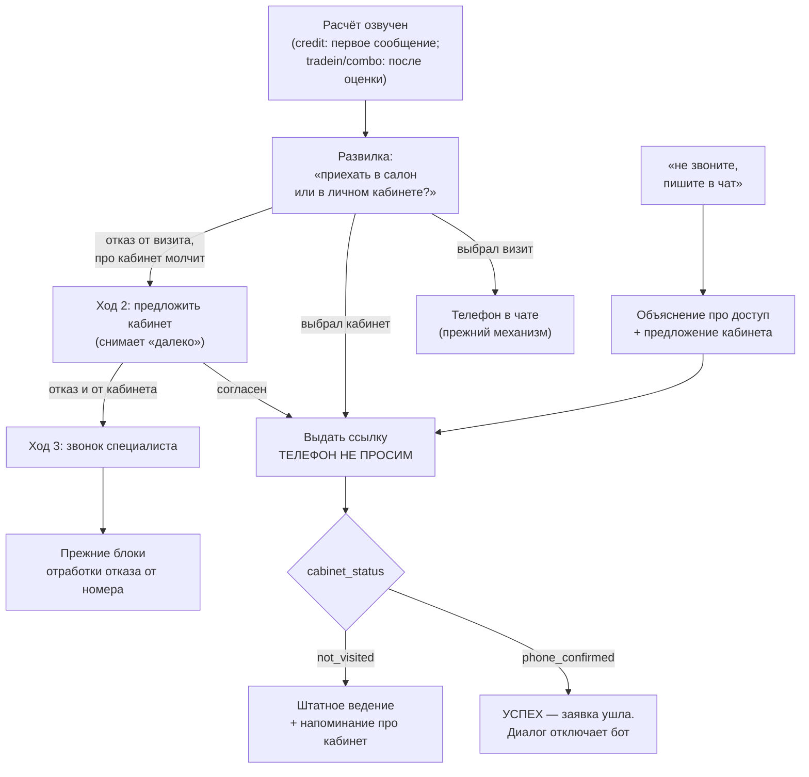
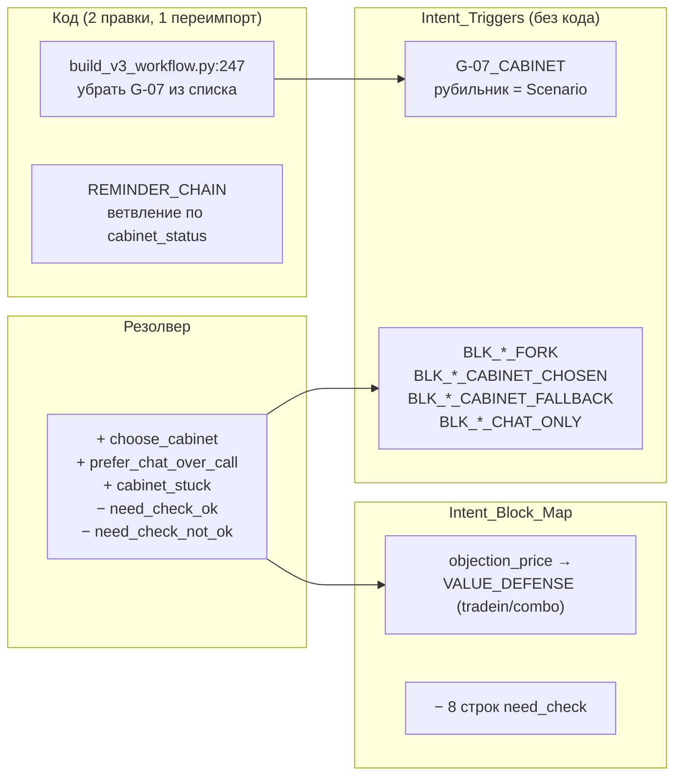

# feat: Диалоговая тактика под личный кабинет — развилка «визит или кабинет»

## Summary

Александр получает третий механизм добычи телефона — личный кабинет, где клиент
подтверждает номер кодом сам. Вопрос о комфортности условий («устраивает ли
взнос», «соответствует ли оценка ожиданиям») выводится из оборота: вместо него
сразу предлагается выбор из двух вариантов — визит в салон или кабинет.

План касается **конструкции**: интентов, карты, способов подключения блоков,
ветки напоминаний и порядка выката. Тексты блоков пишет владелец продукта
отдельно — здесь только Block_ID, место подключения и назначение.

Кабинет включается только в `credit`, `tradein`, `combo`. В `stock` и `consult`
тактика не меняется, но попутная расчистка их задевает — по решению владельца
она делается целиком.

---

## Часть A. Что установлено до планирования

Всё снято с живых таблиц NocoDB (снапшот 2026-08-14: 38 интентов, 118 блоков,
191 строка карты) и с исполнений `[TEST] AI Agent v3.0` в n8n (16 ходов,
11–12 августа). Факты и гипотезы разделены явно.

### A1. Откуда берётся позиция каталога — **владелец прав, эхо не при чём**

**Факт.** `model_id` и `complectation_id` приходят в `qualification_context`
**на каждом ходе, включая нулевой** (`INIT_AI_HANDOFF`). Проверено на пяти
INIT-исполнениях: `ex_2994` (13/11), `ex_3005` (21/11), `ex_3021` (20/11),
`ex_3039` (19/11), `ex_3057` (14/12).

**Факт.** `dealer_code = 99` присутствует **только на INIT-ходе**, на всех
последующих его нет. Это прямо указывает на источник — параметры лендинга,
а не состояние диалога. Тройка `99 / 12 / 11` соответствует диплинку
`991211PW` из утверждения владельца.

**Факт.** `qualification_context.cached_json` на INIT-ходе **отсутствует**.
Значит путь «через эхо `qualification_context` внутри `n8n_cache`», описанный
в документации бота, на нулевом ходе не работает физически — кэша ещё нет.

**Вывод.** Пара «модель + комплектация» доступна с первого же сообщения.
**Кабинет можно предлагать в первом сообщении кредита** — снапшот соберётся.

**Гипотеза (не проверяемо из этого репозитория).** Эхо через `n8n_cache`
работает как источник на последующих ходах, а диплинк — на нулевом. Код бота
вне репозитория; проверять эту развилку должен агент, который будет писать
план правок бота.

### A2. G-07_CABINET — что нужно для перевода на Intent_Triggers

**Факт.** Блок сейчас: `Active=false`, `Level=general`, `Scenario=all`,
`Stage=all`, `Intent_Triggers` пуст, 257 токенов. Ни одной строки карты на него
нет.

**Факт.** Подключается жёстким списком имён в JS-коде ноды:
`nocodb/build_v3_workflow.py:247` — массив
`["G-01_ROLE", voiceId, "G-03_GOAL", "G-04_FORMAT", "G-07_CABINET"]`.

**Факт.** Цикл `Intent_Triggers` в том же файле (`PROMPT_COMPILER_JS`) отбирает
блок по трём условиям: `Active`, интент входит в `Intent_Triggers`, и
`Scenario` равен `all` либо содержит текущий сценарий. Колонки `Level` и `Stage`
не читаются.

**Что нужно для перевода — три шага, из них один в коде:**

1. Убрать `"G-07_CABINET"` из массива в `build_v3_workflow.py:247`,
   перегенерировать воркфлоу и переимпортировать `[TEST] AI Agent v3.0`.
   Это **единственная** правка кода в блочной части плана.
2. Заполнить `Intent_Triggers` блока списком интентов развилки.
3. Сменить `Scenario` с `all` на список сценариев — это же поле служит
   рубильником поэтапного выката (см. U8).

**Факт про ошибочное правило.** Текст блока содержит: «ПРЕЖДЕ чем предлагать
кабинет, доведи подбор до выбора КОНКРЕТНОЙ комплектации… Ссылка, выданная
раньше, открывает кабинет без калькулятора». По A1 это неверно: комплектация
приходит с лендинга на нулевом ходе.

**Факт.** На это правило не опирается ничего: строк карты на блок нет, ни один
другой блок его не цитирует. Единственное совпадение по поиску —
`D_STOCK`, где «комплектация» и «ссылка» встречаются в другом смысле (описание
переменных склада). Правило удаляется без последствий.

### A3. Доходят ли `cabinet_url` и `cabinet_status` до модели — **да, уже работает**

**Факт.** Оба поля приходят в `qualification_context` **на каждом из 16
проверенных ходов**, включая INIT, и оба **фактически присутствуют в
`ai_clean_context`**, который Prompt Compiler вставляет в блок
`<DATA_FROM_DATABASE>`. Проверено по выходу ноды `Data Selector` в живых
исполнениях, а не по коду.

**Факт.** `cabinet_status` живой и меняется: в `ex_3034` он равен
`phone_confirmed`, в остальных — `not_visited`.

**Факт с последствием для внешних зависимостей.** В `ex_3034` статус был
`phone_confirmed`, и диалог при этом **продолжался** (пятый ход, клиент задал
новый вопрос, Александр ответил). То есть отключение диалога по факту
подтверждения номера сейчас **не реализовано** — см. внешнюю зависимость D1.

### A4. Ветка напоминаний — что получает на входе

**Факт.** `__SYSTEM_REMINDER__` уходит нодой `Route` в `Reminder Chain` —
это `chainLlm` с **захардкоженным текстом промпта в параметрах ноды**, блоки
туда не собираются вовсе. Модель — `google/gemini-2.5-flash-lite`.

**Факт.** На входе у неё ровно одна переменная:
`{{ $json.qualification_context.last_bot_message }}`. Текст промпта:
«Твое предыдущее сообщение клиенту было: …Клиент не отвечает уже 30 минут.
Перефразируй свой вопрос или мысль в короткое, вежливое напоминание».

**Факт.** `$json` на этой ветке — выход ноды `Edit Fields`, то есть **весь**
`qualification_context` доступен, включая `cabinet_url` и `cabinet_status`
(A3). Данных достаточно; не хватает только ветвления в тексте промпта.

**Вывод.** Различить случай «ссылка выдана, клиент не авторизовался» можно
правкой текста промпта в `REMINDER_CHAIN` (`nocodb/build_v3_workflow.py`) —
условие по `cabinet_status`. Это **вторая и последняя правка кода** в плане.
Через Intent_Triggers это недостижимо в принципе: ветка идёт мимо
Prompt Compiler.

### A5. Судьба `need_check_ok` / `need_check_not_ok`

**Факт.** У каждого по 4 активные строки карты, все в роли `primary`:

| Интент | credit | tradein | combo | stock |
|---|---|---|---|---|
| `need_check_ok` | `BLK_CREDIT_APPROVAL_BRIDGE` | `BLK_TRADEIN_TESTDRIVE_BRIDGE` | `BLK_COMBO_NEEDCHECK_ROUTER` | `ST_STOCK_DATA_COLLECT` |
| `need_check_not_ok` | `BLK_CREDIT_ADVOCATE` | `BLK_TRADEIN_VALUE_DEFENSE` | `BLK_COMBO_NEEDCHECK_ROUTER` | `BLK_STOCK_NEED_CHECK` |

**Факт.** Блоки под `need_check_ok` — это «мосты» после подтверждения
комфортности (`APPROVAL_BRIDGE` — спроси про одобрение банка;
`TESTDRIVE_BRIDGE` — спроси про тест-драйв). Они существуют только ради
вопроса, который убирается, и вместе с ним теряют смысл целиком.

**Факт.** Блоки под `need_check_not_ok` — наоборот, отрабатывают барьер,
который никуда не денется: `BLK_TRADEIN_VALUE_DEFENSE` («оценка ниже
ожиданий»), `BLK_CREDIT_ADVOCATE` («дорого, нет взноса»).

**Факт.** Уже существует интент `objection_price` (приоритет 10, `Scenarios=all`),
описанный как «Финансовый барьер: дорого, взнос ниже расчётного», с примерами
«дорого; нет таких денег; 200к это много». У него **одна** активная строка карты —
`primary → BLK_CREDIT_ADVOCATE` в credit. Для tradein и combo строк нет.

**Решение: оба интента выводятся из оборота, барьер переезжает на
`objection_price`.** Обоснование: `need_check_not_ok` и `objection_price`
описывают одно и то же состояние клиента, различаясь лишь тем, был ли задан
проверочный вопрос — а его больше не будет. Держать два интента под один
барьер значит гарантированно путать резолвер. `objection_price` старше,
шире по сценариям и уже имеет рабочую строку в credit.

**Что делаем с блоками:**

| Блок | Судьба |
|---|---|
| `BLK_TRADEIN_VALUE_DEFENSE` | остаётся, перевешивается на `objection_price` (tradein) |
| `BLK_CREDIT_ADVOCATE` | остаётся как есть — уже висит на `objection_price` (credit) |
| `BLK_COMBO_NEEDCHECK_ROUTER` | выводится: маршрутизатор двух проверочных вопросов, оба исчезают |
| `BLK_CREDIT_APPROVAL_BRIDGE` | выводится вместе с вопросом |
| `BLK_TRADEIN_TESTDRIVE_BRIDGE` | выводится вместе с вопросом |
| `BLK_STOCK_NEED_CHECK` | **остаётся** — это need-check наличия на складе, к комфортности отношения не имеет |

**Пробел, требующий нового блока.** В combo нет аналога
`BLK_TRADEIN_VALUE_DEFENSE`: защиту оценки там нёс маршрутизатор, который
выводится. Нужен `BLK_COMBO_VALUE_DEFENSE` (текст — за владельцем).

### A6. Бюджет промпта резолвера — **запас есть**

**Факт.** Формула из `nocodb/lint_check.py:27-29`: порог 8560 символов,
фикс-часть 2433 символа, остальное — строки `Intent_ID | Description | Примеры`.

**Факт.** Замер по живым таблицам:

| Сценарий | Интентов | Строки списка | Всего с фикс-частью | Запас |
|---|---|---|---|---|
| credit | 36 | 5795 | 8228 | 332 |
| tradein | 37 | 5874 | 8307 | 253 |
| **combo** | **38** | **6015** | **8448** | **112** |
| stock | 27 | 4566 | 6999 | 1561 |
| consult | 25 | 4233 | 6666 | 1894 |

**Факт.** `client_mode` и `client_signal` занимают в шаблоне 435 символов:
строка допустимых `client_mode` 149, `client_signal` 164, две строки схемы
ответа 122. Это 35% шаблона без списка интентов.

**Факт.** Строки выводимых интентов: `need_check_ok` 174 символа,
`need_check_not_ok` 159. Итого 333.

**Расчёт по combo (худший сценарий):**

| Шаг | Символов | Итог | Запас |
|---|---|---|---|
| сейчас | — | 8448 | 112 |
| − `client_mode`/`client_signal` | −435 | 8013 | 547 |
| − два `need_check` | −333 | 7680 | 880 |
| + 4 новых интента (~165 каждый) | +660 | 8340 | **220** |

**Вывод: запаса хватает, резать ничего не нужно.** Даже при пяти новых
интентах остаётся ~55 символов. Порог не трогаем.

**Ограничение.** Запас узкий: 220 символов — это примерно полторы строки
интента. Юнит U2 обязан пересчитать бюджет фактически (`nocodb/lint_check.py`)
после заведения интентов, а не полагаться на эту оценку.

### A7. Стадия закрытия — **однообразие сильнее, чем предполагалось**

**Факт.** Прогоном логики компилятора по всем 38 активным интентам на стадии
`closing`:

| Сценарий | Интентов | Различных составов промпта | Интентов с одинаковым базовым составом |
|---|---|---|---|
| credit | 38 | 18 | **15** |
| tradein | 38 | 16 | **22** |
| combo | 38 | 15 | **22** |
| stock | 38 | 8 | **31** |
| consult | 38 | 5 | **34** |

**Расхождение с нашим прежним разбором.** В прошлой сессии называлось
«13–14 интентов в трейд-ине и комбо, 17 в stock и consult». Фактически хуже:
22 и 31/34 соответственно. Истина — цифры выше.

**Факт.** Базовый состав на closing одинаков во всех сценариях:
`G-01_ROLE`, `G-02_VOICE_V2`, `G-03_GOAL`, `G-04_FORMAT`, `CS_{СЦЕН}_V2`,
`D_{СЦЕН}`, `ST_{СЦЕН}_CLOSING`, `T_FINALIZE`, `G-06_CHECKLIST`. То есть
22 разных состояния клиента в трейд-ине получают **дословно один и тот же
текст**, целиком определяемый блоком `ST_{СЦЕН}_CLOSING`.

**Вывод для плана.** Развилка «визит или кабинет» живёт именно на closing,
и различать её ветви сейчас нечем: `propose_visit`, `request_phone`,
`propose_call`, `objection_distance` и ещё восемнадцать интентов дают
идентичный промпт. Новые ветви **обязаны** получить собственные строки карты
или Intent_Triggers, иначе тактика физически не сможет различить «клиент
выбрал кабинет» и «клиент выбрал визит».

### A8. Проверка выкладки владельца по 25 строкам со `Stage_Filter`

**Выкладка подтверждается полностью.** Из 25 активных строк со
`Stage_Filter = data_collect` десять ведут на блоки stock и consult; восемь из
них привязаны к `collect_down_payment`, `collect_plate`, `collect_mileage`,
`collect_plate_and_mileage`, у которых в `Scenarios` нет ни stock, ни consult —
резолвер физически не может вернуть эти интенты там, строки недостижимы.

Работают только две: `data_already_provided → ST_STOCK_DATA_COLLECT` и
`data_already_provided → ST_CONSULT_DATA_COLLECT`, интент объявлен `all`.

**Уточнение, которого в выкладке не было.** Недостижимых строк не восемь, а
**девять**: к ним добавляется `collect_down_payment → ST_TRADEIN_REQUIRED_DATA`
(интент объявлен только для credit и combo). Достижимых строк 16 из 25.

**Разделяющий признак — роль строки, а не сценарий:**

| Интент | Роль | Строк | Эффект снятия фильтра |
|---|---|---|---|
| `collect_*` (четыре интента) | `additional` | 20 | блок **добавляется** к промпту на других стадиях — аддитивно, основной блок стадии не трогается |
| `data_already_provided` | `primary` | 5 | блок **замещает** основной блок стадии: на closing вместо `ST_*_CLOSING` встанет `ST_*_DATA_COLLECT`, вместе с ним пропадут шаблоны запроса телефона |

**Решение: снимаем фильтр с 20 строк `collect_*`, оставляем на 5 строках
`data_already_provided`.** Обоснование — роль, а не сценарий: замещающие
строки меняют поведение на всех стадиях всех пяти сценариев, включая credit,
tradein и combo, а не только stock и consult. Владелец предложил оставить с
фильтром две строки stock/consult; по данным правильнее оставить все пять —
риск одинаков в каждом сценарии.

**`ST_STOCK_GREETING` архивируется без изменения поведения** — подтверждено:
он недостижим, его вытесняет `ST_STOCK_GREETING_V2` механизмом `_V2`.

### A9. Расхождения данных с документацией

| Документация утверждает | Факт |
|---|---|
| `docs/prompt-branches-map.md` §6.2: на closing в tradein/combo «13–14 интентов дают один состав» | 22 интента (A7) |
| Документация бота: позиция каталога попадает в снапшот через эхо `qualification_context` внутри `n8n_cache` | на нулевом ходе `cached_json` отсутствует; `model_id`/`complectation_id`/`dealer_code` приходят напрямую (A1) |
| `SESSION_HANDOFF.md` §5.2: «бот пока не шлёт `cabinet_url`/`cabinet_status`» — не установлено | шлёт на каждом ходе, поля доезжают до `ai_clean_context` (A3) |
| `G-07_CABINET`: «доведи подбор до выбора конкретной комплектации» | комплектация приходит с лендинга на нулевом ходе (A1); правило ошибочно |
| `nocodb/prompt_blocks.csv` — 52 блока | в живой таблице 118 |

---

## Problem Frame

Цель диалога не менялась — получить контактный телефон. Два существующих
механизма работают плохо: визит требует от клиента поездки, звонок специалиста
упирается в нежелание разговаривать. Кабинет снимает оба барьера: клиент
подтверждает номер кодом сам, не выходя из чата и не разговаривая с человеком.

Конструкция под это не готова по трём причинам, установленным в части A:

- **Развилку нечем различить.** На closing 22 интента в tradein и combo дают
  дословно один промпт (A7). «Клиент выбрал кабинет» и «клиент выбрал визит»
  придут в одну и ту же точку.
- **Блок кабинета выключен и прибит к коду.** `G-07_CABINET` подключается
  жёстким списком имён (A2), то есть владелец не может включить его сам, и
  содержит ошибочное правило про выбор комплектации.
- **Тактика комфортности занимает место новой.** Два интента и три блока
  обслуживают вопрос, который убирается (A5), и держат 333 символа бюджета
  резолвера, которого не хватает на новые интенты (A6).

Плюс накопленный мусор, который при переименованиях выстрелит молча: девять
недостижимых строк карты, семь активных, но недостижимых блоков, и два поля
резолвера, которые никто не читает.

---

## Requirements

Перенесены из ТЗ владельца; нумерация введена здесь для трассировки юнитов.

- **R1.** Вопрос о комфортности условий выводится из оборота во всех трёх
  сценариях; вместо него — предложение выбора «визит или кабинет».
- **R2.** Развилка отрабатывается тремя ходами: выбран визит → телефон в чате
  прежним механизмом; выбран кабинет → телефон в чате **не просим**, выдаём
  ссылку; отказ от визита без ответа про кабинет → кабинет вторым ходом;
  отказ и от кабинета → звонок специалиста третьим ходом, дальше прежние блоки.
- **R3.** «Не звоните, пишите в чат» отрабатывается прежним объяснением
  (у специалистов нет доступа к чату) **плюс** предложением кабинета.
- **R4.** Кабинет активен только в `credit`, `tradein`, `combo`.
- **R5.** Новые блоки подключаются **только через `Intent_Triggers`**; каждое
  исключение обосновано отдельно.
- **R6.** Текст напоминания различает случай «ссылка выдана, клиент не
  авторизовался».
- **R7.** Черновики готовятся одним пакетом, включаются поэтапно:
  трейд-ин → кредит → комбо. Для каждого этапа — явный откат и признак
  переключённости.
- **R8.** Расчистка: снять `Stage_Filter` с недостижимых/аддитивных строк,
  удалить `client_mode`/`client_signal`, архивировать семь блоков с пометкой
  `[АРХИВ дата] заменён на <Block_ID>`.
- **R9.** Вход резолвера остаётся в бюджете 8560 символов.
- **R10.** Правки Python-бота в объём не входят — только список внешних
  зависимостей с контрактом.
- **R11.** Тексты блоков в объём не входят — только Block_ID, точка
  подключения и назначение.
- **R12.** Всё едет на [TEST]-контур; прод не затрагивается.

---

## Key Technical Decisions

- **Развилка различается новыми интентами, а не стадией.** A7 показывает, что
  стадия `closing` неразличима: 22 интента дают один промпт. Добавлять пятую
  стадию нельзя — стадию вычисляет бот (`Stage Classifier` только
  переопределяет её по интенту), а правки бота вне объёма. Значит различение
  ложится на интенты и `Intent_Triggers`.

- **`need_check_*` выводятся, барьер переезжает на `objection_price`.**
  Обоснование в A5: интенты описывают одно состояние клиента, различаясь лишь
  наличием проверочного вопроса. Держать оба — гарантированно путать резолвер.
  Побочно освобождает 333 символа бюджета, без которых новые интенты не влезали
  бы (A6).

- **Блоки тактики — свои у каждого сценария; общий блок ровно один.**
  Поэтапный выкат по сценариям (R7) требует, чтобы включение трейд-ина не
  задевало кредит. Все новые блоки заводятся с `Scenario` одного сценария.
  **Исключение — `G-07_CABINET`**, он общий. Рубильник для него — колонка
  `Scenario`: цикл `Intent_Triggers` читает её, поэтому этап включается
  дописыванием сценария в это поле (`tradein` → `tradein,credit` →
  `tradein,credit,combo`). Это и есть «общий блок, который нельзя включить, не
  затронув все три сценария», о котором просил сказать владелец — но он
  управляется без правки кода.

- **Две правки кода, обе неизбежны.** (1) Убрать `G-07_CABINET` из жёсткого
  списка (`build_v3_workflow.py:247`) — иначе блок включается только правкой
  кода, что нарушает R5. (2) Ветвление текста напоминания по `cabinet_status`
  в `REMINDER_CHAIN` — ветка идёт мимо Prompt Compiler, блоки туда не
  собираются в принципе (A4). Обе — в одном юните, один переимпорт.

- **`Stage_Filter` снимается по роли строки, не по сценарию.** A8: `additional`
  добавляет блок (безопасно), `primary` замещает основной блок стадии (меняет
  поведение на всех стадиях всех сценариев). Снимаем с 20 `additional`,
  оставляем на 5 `primary`.

- **Черновики одним пакетом, `Active=false`.** Конвенция проекта
  (`docs/solutions/conventions/plan-prompt-block-changes-from-live-nocodb.md`):
  живая NocoDB канонична, черновики катятся неактивными, переключает владелец.
  Скрипт по образцу `nocodb/add_cabinet_v306.py`.

- **Признак переключённости этапа — колонка `Scenario` блока `G-07_CABINET`.**
  Один взгляд в таблицу отвечает на вопрос «какие сценарии уже на новой
  тактике». Дублировать это флагом в другом месте не нужно.

---

## High-Level Technical Design

Целевая тактика хода после расчёта или оценки:

Как это ложится на конструкцию — что чем подключается:

---

## Implementation Units

### U1. Две правки кода: рубильник кабинета и ветка напоминаний

- **Goal:** `G-07_CABINET` управляется из таблицы; напоминание различает случай
  «ссылка выдана, не авторизовался».
- **Requirements:** R5, R6.
- **Dependencies:** нет — идёт первым, чтобы дальше всё катилось таблицами.
- **Files:** `nocodb/build_v3_workflow.py` (`PROMPT_COMPILER_JS` — жёсткий
  список general-блоков; `REMINDER_CHAIN` — текст промпта), перегенерируемые
  `flow/AI Agent v3.0.json` и `flow/test-contour/[TEST] AI Agent v3.0.json`
  (через `nocodb/build_test_contour.py`).
- **Approach:** удалить `"G-07_CABINET"` из массива general-блоков — после
  этого блок подключается только через `Intent_Triggers`, и пока поле пусто,
  промпт не меняется ни на символ. В `REMINDER_CHAIN` добавить в текст промпта
  ветвление по `qualification_context.cabinet_status`: при `not_visited` и
  непустом `cabinet_url` — напоминание про кабинет («удалось ли справиться,
  нужна ли помощь»), иначе — прежнее перефразирование `last_bot_message`.
  Обе переменные уже доступны на этой ветке (A4), новых входов не нужно.
- **Patterns to follow:** генерация нод как есть; переимпорт по разделу H
  `docs/test-contour-checklist.md`.
- **Test scenarios:**
  - Промпт при пустом `Intent_Triggers` у `G-07_CABINET` побайтово совпадает
    с текущим во всех пяти сценариях и четырёх стадиях.
  - `cabinet_status = not_visited` и непустой `cabinet_url` → текст промпта
    напоминания содержит кабинетную ветку.
  - `cabinet_status = phone_confirmed` → кабинетной ветки в промпте нет.
  - Ключей кабинета нет вовсе → ветка не срабатывает, нода не падает.
  - Дифф сгенерированного `AI Agent v3.0.json` ограничен двумя нодами,
    `connections` не изменились.
- **Verification:** `node flow/lib/v3_pipeline_sim.test.mjs` зелёный;
  дифф по двум нодам.
- **Риск:** низкий. Обе правки нейтральны до заполнения таблиц.
- **Откат:** `git revert` юнита + переимпорт прежнего JSON.

### U2. Интенты: три новых, два выводимых, чистка описаний

- **Goal:** резолвер различает ветви развилки; выведенные интенты не мешают;
  бюджет в пороге.
- **Requirements:** R1, R2, R3, R9.
- **Dependencies:** нет (данные независимы от U1).
- **Files:** `nocodb/add_cabinet_tactic_v307.py` (новый), `nocodb/table_ids.json`
  (чтение), `flow/lib/snapshots/v3_tables.json` (перегенерация снапшота).
- **Approach:** идемпотентный POST по образцу `nocodb/add_cabinet_v306.py`.
  Все новые строки `Active=false`, `Version=v3.07`.

  **Новые интенты (заготовки — финальные формулировки за владельцем):**

  | Intent_ID | Prio | Scenarios | Описание (черновик) | Примеры (черновик) |
  |---|---|---|---|---|
  | `choose_cabinet` | 16 | credit, tradein, combo | Клиент выбирает самостоятельный путь в личном кабинете вместо визита | в кабинете; сам посмотрю; онлайн удобнее; давайте ссылку; второй вариант; на сайте |
  | `prefer_chat_over_call` | 11 | all | Клиент отказывается от звонка и просит продолжить общение в чате | не звоните; пишите сюда; давайте в чате; только перепиской; звонить не надо |
  | `cabinet_stuck` | 13 | credit, tradein, combo | Клиент открыл кабинет и не справился либо задаёт вопрос по нему | не получается в кабинете; код не приходит; не разобрался; что там заполнять |

  Четвёртый интент — «клиент выбрал визит» — **не заводится**: его роль уже
  играет `request_phone` («Клиент согласился на визит или звонок — запросить
  телефон»), приоритет 12. Заводить второй интент под то же состояние значит
  повторить ошибку `need_check_not_ok` / `objection_price` (A5).

  **Примеры фраз для половин развилки (добавлено при исполнении).** У
  `request_phone` в живой таблице **ноль** примеров, только описание, тогда как
  у `choose_cabinet` их шесть — половина развилки распознавалась бы заметно
  хуже другой. Добавляем: `приеду;давайте в салон;лучше подъеду;готов приехать;
  первый вариант`.

  **`propose_visit` примеров НЕ получает — и это не упущение.** Проверка
  показала, что это интент **состояния, а не реплики клиента**: описание
  «Расчёт озвучен — пора предлагать визит», ровно как у `tool_result_received`,
  у которого вместо примеров стоит маркер `(системный переход после расчёта)`.
  Клиентские фразы там сделали бы хуже: резолвер начал бы возвращать
  `propose_visit` на реплики, принадлежащие `request_phone` и
  `schedule_appointment`. Вместо примеров ставим такой же системный маркер.

  **Выводимые интенты:** `need_check_ok`, `need_check_not_ok` — `Active=false`,
  в `Notes` пометка `[АРХИВ 2026-08-14] заменён на objection_price`.

  **Чистка описаний** (PATCH, дописыванием): из `request_phone` и
  `propose_visit` убрать оговорки «НЕ путать с "да" на need-check вопрос» и
  «НЕ выбирать как ответ на need-check вопрос» — вопроса больше нет, оговорки
  начнут сбивать резолвер. Взамен в `request_phone` — разводка с
  `choose_cabinet`.
- **Patterns to follow:** `nocodb/add_cabinet_v306.py` (идемпотентность,
  `--snapshot-only`, `--activate-drafts`, `--rollback`, громкая проверка
  существования триггеров в живой таблице).
- **Test scenarios:**
  - Повторный запуск не создаёт дублей и не дописывает PATCH второй раз.
  - Запуск без флагов печатает diff и ничего не пишет.
  - Снапшот после применения содержит три новых интента с `Active=false`.
  - `python3 nocodb/lint_check.py` — 0 ошибок; **вход резолвера combo при
    активированных черновиках ≤ 8560 символов** (расчёт A6 даёт ~8340).
  - PATCH сохраняет правки владельца, внесённые после снятия снапшота.
- **Verification:** линт зелёный; фактический замер бюджета combo, а не оценка.
- **Риск:** средний — бюджет узкий (запас ~220 символов). Если замер покажет
  превышение, ужимать `Example_Phrases` новых интентов, а не поднимать порог.
- **Откат:** `--rollback` возвращает `Active` в прежнее состояние; PATCH
  описаний откатывается точечно по `Id`.

### U3. Блоки развилки: заготовки под три сценария

- **Goal:** каждая ветвь развилки имеет собственный блок, подключаемый без
  правки кода.
- **Requirements:** R2, R3, R4, R5, R11.
- **Dependencies:** U2 (триггеры ссылаются на новые интенты — скрипт обязан
  падать громко, если интента нет).
- **Files:** тот же `nocodb/add_cabinet_tactic_v307.py`.
- **Approach:** двенадцать новых блоков, `Active=false`, `Version_Set=v3.07`,
  подключение **только** `Intent_Triggers`, `Scenario` — один сценарий на блок.
  Тексты — заглушки-однострочники с назначением; наполняет владелец.

  | Block_ID (× credit / tradein / combo) | Intent_Triggers | Назначение |
  |---|---|---|
  | `BLK_{СЦЕН}_FORK` | `tool_result_received`, `data_received_complete`, `greeting_first`¹ | Развилка: озвучить природу цифры и предложить выбор из двух вариантов |
  | `BLK_{СЦЕН}_CABINET_CHOSEN` | `choose_cabinet` | Клиент выбрал кабинет: выдать ссылку, телефон в чате НЕ просить |
  | `BLK_{СЦЕН}_CABINET_FALLBACK` | `objection_distance`, `propose_call` | Отказ от визита → кабинет вторым ходом как снятие барьера «далеко» |
  | `BLK_{СЦЕН}_CHAT_ONLY` | `prefer_chat_over_call` | Объяснить, что у специалистов нет доступа к чату, + предложить кабинет |

  ¹ `greeting_first` — только у `BLK_CREDIT_FORK`: в кредите развилка стоит в
  первом сообщении (A1 подтверждает, что позиция каталога на нулевом ходе
  доступна). В tradein и combo развилка идёт после оценки, там `greeting_first`
  не нужен.

  Плюс вне сетки — один обязательный и три условных, итого до шестнадцати
  блоков в скрипте:
  - `BLK_COMBO_VALUE_DEFENSE` (обязательный, один) — пробел, вскрытый в A5:
    защита оценки в combo после вывода маршрутизатора. Подключается картой
    (`objection_price`), а не триггером, — обоснование в U4.
  - `BLK_{СЦЕН}_CABINET_HELP` (условные, три — по одному на сценарий) —
    поддержка при `cabinet_stuck`, триггер `cabinet_stuck`. **Гипотеза**, что
    нужен отдельный блок: возможно, достаточно строки внутри
    `BLK_*_CABINET_CHOSEN`. Решение за владельцем при написании текстов;
    в скрипт заводятся, активируются по усмотрению. Если владелец решит, что
    не нужны, — остаются неактивными и на поведение не влияют.
- **Patterns to follow:** `G-05_DEFENSE` — единственный живой блок, работающий
  на `Intent_Triggers` без строк карты; повторяем его схему.
- **Test scenarios:**
  - При `Active=false` промпт не меняется ни в одном сочетании.
  - После активации только tradein: `BLK_TRADEIN_FORK` появляется на
    `tool_result_received` в tradein и **не появляется** в credit и combo.
  - `BLK_CREDIT_FORK` появляется на `greeting_first` в credit и не появляется
    в stock и consult (проверка гейта `Scenario`).
  - `choose_cabinet` в tradein → `BLK_TRADEIN_CABINET_CHOSEN` в промпте.
  - `prefer_chat_over_call` в consult → ни один из новых блоков не появляется.
  - Скрипт падает громко, если интента из `Intent_Triggers` нет в живой таблице.
- **Verification:** кейсы U6 зелёные; блоки видны черновиками в UI NocoDB.
- **Риск:** низкий до активации.
- **Откат:** `--rollback`.

### U4. Карта: перевешивание барьера и снятие строк need-check

- **Goal:** барьер «дорого / мало даёте» отрабатывается через `objection_price`
  во всех трёх сценариях; строки выведенных интентов сняты.
- **Requirements:** R1, R2.
- **Dependencies:** U2 (интенты), U3 (`BLK_COMBO_VALUE_DEFENSE`).
- **Files:** тот же скрипт.
- **Approach:**

  | Действие | Строка |
  |---|---|
  | добавить (`Active=false`) | `objection_price` → `BLK_TRADEIN_VALUE_DEFENSE`, primary, tradein |
  | добавить (`Active=false`) | `objection_price` → `BLK_COMBO_VALUE_DEFENSE`, primary, combo |
  | снять (`Active=false`) | 4 строки `need_check_ok` |
  | снять (`Active=false`) | 4 строки `need_check_not_ok` |
  | оставить как есть | `objection_price` → `BLK_CREDIT_ADVOCATE` (credit) — уже работает |

  `BLK_STOCK_NEED_CHECK` сохраняется: он про наличие на складе, к комфортности
  отношения не имеет (A5). Его строка на `need_check_not_ok` снимается, но сам
  блок остаётся подключённым через `greeting_first` (строка карты уже есть).

  **Почему `BLK_COMBO_VALUE_DEFENSE` подключается картой, а не триггером
  (исключение из R5).** Он должен быть `primary` — замещать основной блок
  стадии, как это делает `BLK_TRADEIN_VALUE_DEFENSE` сегодня. Механизм
  `Intent_Triggers` умеет только добавлять блок, роли `primary` у него нет
  (`PROMPT_COMPILER_JS`, цикл по `Intent_Triggers` — `parts.push`). Замещение
  выражается исключительно строкой карты.
- **Test scenarios:**
  - `objection_price` в tradein после активации → `BLK_TRADEIN_VALUE_DEFENSE`
    основной блок хода; до активации — прежний дефолт стадии.
  - `objection_price` в combo → `BLK_COMBO_VALUE_DEFENSE`.
  - `objection_price` в credit → поведение не изменилось.
  - `need_check_ok` / `need_check_not_ok` после снятия строк → дефолт стадии,
    промпт собирается без падения.
  - Ни один блок stock не потерял подключения.
- **Verification:** кейсы U6; `nocodb/lint_check.py` без ошибок.
- **Риск:** средний — снятие 8 строк меняет поведение на живых интентах. До
  активации черновиков v3.07 интенты `need_check_*` ещё активны и остаются без
  блоков; поэтому снятие строк и деактивация интентов (U2) обязаны включаться
  **одним заходом**.
- **Откат:** `--rollback` возвращает и строки, и интенты.

### U5. Расчистка

- **Goal:** снят мусор, который выстрелит при переименованиях.
- **Requirements:** R8.
- **Dependencies:** нет; выполняется параллельно U2–U4, включается вместе с
  общим слоем.
- **Files:** тот же скрипт (таблицы), `nocodb/build_resolver_workflow.py`
  (`client_mode`/`client_signal`), перегенерируемые `flow/Tool_ Resolver Core.json`
  и `[TEST]`-копия.
- **Approach:**

  1. **`Stage_Filter`** — снять (выставить `all`) на **20 строках** четырёх
     интентов `collect_*` (роль `additional`). На **5 строках**
     `data_already_provided` (роль `primary`) фильтр **оставить** — обоснование
     в A8: замещающая строка меняет поведение во всех пяти сценариях, а не
     только в stock и consult.
  2. **`client_mode` / `client_signal`** — удалить из шаблона промпта
     (`build_resolver_workflow.py:26-28`, строки «Допустимые …» и две строки
     схемы ответа) и из возврата ноды `Validate` (`:124-125`). Оставить в
     `Prepare Log` shadow-воркфлоу нельзя — поля исчезнут из ответа; строку
     лога тоже правим (`:142`). Освобождает 435 символов бюджета (A6).
     Константу `RESOLVER_FIXED_CHARS` в `nocodb/lint_check.py:28` пересчитать
     фактическим замером, а не вычитанием.
  3. **Семь архивных блоков** — `Active=false` плюс `Notes` в формате
     `[АРХИВ 2026-08-14] заменён на <Block_ID>`:

     | Блок | Заменён на |
     |---|---|
     | `CS_CREDIT` | `CS_CREDIT_V2` |
     | `CS_TRADEIN` | `CS_TRADEIN_V2` |
     | `CS_COMBO` | `CS_COMBO_V2` |
     | `ST_TRADEIN_TOOL_NEEDED` | `ST_TRADEIN_TOOL_NEEDED_V2` |
     | `ST_COMBO_TOOL_NEEDED` | `ST_COMBO_TOOL_NEEDED_V2` |
     | `ST_STOCK_GREETING` | `ST_STOCK_GREETING_V2` |
     | `BLK_CREDIT_PAYMENT_ACCEPTED` | `BLK_CREDIT_PAYMENT_ACCEPTED_V2` |
- **Test scenarios:**
  - Снятие `Stage_Filter` с `collect_*`: промпт на `data_collect` не изменился;
    на `tool_needed` и `closing` появился соответствующий `ST_*_REQUIRED_DATA`
    как `additional`, основной блок стадии сохранён.
  - `data_already_provided` на `closing` → основной блок по-прежнему
    `ST_*_CLOSING` (фильтр не снят).
  - Ответ резолвера не содержит `client_mode`/`client_signal`; `Validate`
    не падает; shadow-лог пишется.
  - Замер: вход резолвera combo уменьшился примерно на 435 символов.
  - Семь блоков `Active=false`; промпт во всех сочетаниях не изменился
    (они и так недостижимы).
- **Verification:** `node flow/lib/v3_pipeline_sim.test.mjs`,
  `node flow/lib/resolver_prompt_sim.test.mjs`, `nocodb/lint_check.py`.
- **Риск:** низкий по блокам и `client_*`; **средний** по `Stage_Filter` — это
  единственная часть расчистки, меняющая живое поведение (20 строк начинают
  срабатывать на трёх новых стадиях).
- **Откат:** обратный PATCH `Stage_Filter`; `git revert` правки резолвера +
  переимпорт.

### U6. Симуляционные кейсы на новую конструкцию

- **Goal:** поведение зафиксировано до живого прогона; оба состояния черновиков
  проверяемы.
- **Requirements:** R1–R5, R8.
- **Dependencies:** U1–U5.
- **Files:** `flow/lib/v3_pipeline_sim.test.mjs` (новые кейсы),
  `flow/lib/resolver_prompt_sim.test.mjs` (бюджет и отсутствие `client_*`).
- **Approach:** оба состояния (до и после активации) выводить **двусторонней
  мутацией клона снапшота**, как требует конвенция — сырое содержимое снапшота
  не считать ни «до», ни «после». Каждая мутация сопровождается громкой
  проверкой существования строки.
  Отдельно — покейсовая проверка поэтапности: активирован только tradein →
  credit и combo дают прежний промпт.
- **Test scenarios:** перечислены в U1–U5; здесь они становятся постоянными
  кейсами. Дополнительно:
  - Полный перебор: после активации всех трёх сценариев ни один блок не стал
    недостижимым сверх ожидаемых семи архивных.
  - Бюджет резолвера combo при активированных черновиках ≤ 8560.
- **Verification:** все четыре набора зелёные.
- **Риск:** низкий.
- **Откат:** не требуется (только тесты).

### U7. Развёртывание общего слоя на [TEST]

- **Goal:** код и общий слой данных на контуре; поведение ещё прежнее.
- **Requirements:** R7, R12.
- **Dependencies:** U1–U6.
- **Files:** импорт `flow/test-contour/[TEST] AI Agent v3.0.json`,
  `[TEST] Tool_ Resolver Core.json`; `docs/test-contour-checklist.md` (новый
  раздел приёмки).
- **Approach:** переимпорт двух воркфлоу с перепривязкой саб-воркфлоу по
  таблице раздела H чек-листа. Применить скрипт v3.07 (`--apply`), оставив всё
  `Active=false`. Применить расчистку: `Stage_Filter`, архивные пометки.
  Общий слой по сценариям не делится и едет целиком.
- **Test scenarios:**
  - После импорта и применения скрипта промпт во всех пяти сценариях и четырёх
    стадиях совпадает с прежним (черновики неактивны).
  - Прогон одного диалога каждого сценария — поведение не изменилось.
- **Verification:** `[TEST] Tool: Blocks Lint` → 0 errors; прогон 5 сценариев.
- **Риск:** средний — переимпорт теряет привязки саб-воркфлоу; ловушка
  переименования `Execute Workflow` описана в разделе H чек-листа.
- **Откат:** `--rollback` скрипта + переимпорт прежних JSON.

### U8. Поэтапное включение: трейд-ин → кредит → комбо

- **Goal:** новая тактика включается по одному сценарию с точечным откатом.
- **Requirements:** R2, R4, R7.
- **Dependencies:** U7 **и переписанные тексты блоков стадий** — см. блокер ниже.

> **БЛОКЕР ЭТАПА: одних заготовок v3.07 недостаточно.**
> Вопрос о комфортности задаётся не интентом, а **текстом внутри блоков стадий** —
> `ST_CREDIT_GREETING_V2`, `ST_TRADEIN_TOOL_NEEDED_V2`, `ST_COMBO_TOOL_NEEDED_V2`
> и соседних. Эти тексты пишет владелец продукта, в объём плана они не входят.
>
> Если включить блоки развилки раньше, чем тексты переписаны, промпт будет
> содержать одновременно новый выбор «салон или кабинет» и старый вопрос
> «устраивает ли взнос» — прямое противоречие внутри одного промпта.
>
> Поэтому этап сценария начинается **только после** того, как тексты блоков
> стадий этого сценария переписаны. Заполненные заготовки v3.07 — необходимое,
> но не достаточное условие. Скрипт печатает это предупреждение при каждом
> `--activate-scenario`.
- **Files:** живая NocoDB (переключение владельцем либо
  `--activate-scenario <name>` скрипта).
- **Approach:** этап = один сценарий. На каждом этапе одним заходом:
  1. активировать четыре блока `BLK_{СЦЕН}_*` этого сценария;
  2. дописать сценарий в колонку `Scenario` блока `G-07_CABINET`;
  3. для tradein и combo — активировать строку `objection_price → *_VALUE_DEFENSE`;
  4. на **первом** этапе дополнительно: активировать три новых интента,
     деактивировать `need_check_*` и снять 8 строк карты (общий слой, по
     сценариям не делится).

  **Признак переключённости:** колонка `Scenario` блока `G-07_CABINET`.
  `tradein` → первый этап пройден; `tradein,credit` → второй; полный список —
  все три. Один взгляд в таблицу.

  **Порядок обоснован владельцем:** в трейд-ине развилка срабатывает после
  оценки, до неё доходит меньше диалогов, цена ошибки ниже; трейд-ин и комбо
  уже проверены живьём до кабинета включительно. В кредите развилка стоит в
  первом сообщении и её видят все — идём туда вторыми, с обратной связью.
  Комбо последним как самый сложный.
- **Test scenarios:**
  - После этапа 1: tradein даёт новую развилку; credit и combo — прежнюю
    тактику, промпт совпадает с доэтапным.
  - После этапа 2: credit на новой тактике; combo по-прежнему прежний.
  - Откат этапа: `Scenario` возвращён, блоки деактивированы → промпт сценария
    совпадает с доэтапным побайтово.
- **Verification:** прогон сценария этапа + контрольный прогон одного
  невключённого сценария на каждом этапе.
- **Риск:** **высокий** — меняется живая тактика. Митигация: этапность,
  признак переключённости, точечный откат.
- **Откат этапа:** снять сценарий из `Scenario` блока `G-07_CABINET`,
  деактивировать четыре блока сценария, деактивировать строку `objection_price`
  этого сценария. Общий слой (интенты, снятые строки need-check) откатывается
  только вместе с первым этапом.

---

## Внешние зависимости: контракты к Python-боту

Правки бота в объём не входят (R10). Ниже — что от него требуется, с точным
контрактом. Каждая проверяема со стороны n8n.

### D1. Отключение диалога по факту подтверждения номера

**Статус: не реализовано.** Установлено в A3: в исполнении `ex_3034`
`cabinet_status = phone_confirmed`, и диалог продолжался — бот прислал
следующий ход.

**Контракт.** При переходе `cabinet_status` в `phone_confirmed` бот
прекращает слать вебхуки в n8n по этой сессии и не возобновляет их, даже если
клиент пишет в чат. Отключение — обязанность бота; Александр по своей
инициативе диалог не завершает и признака «пора замолчать» не получает.
Заполненность анкеты значения не имеет — заявка уже передана.

**Проверка со стороны n8n:** после подтверждения номера в кабинете исполнений
`[TEST] AI Agent v3.0` по этой сессии больше нет.

### D2. Учёт полученной оценки при вычислении стадии

**Контракт.** Если по сессии уже получена оценка (`evaluation_carryover.ti_valuation > 0`),
бот не выставляет `current_stage = tool_needed` повторно и не инициирует новый
сбор госномера и пробега. Цель — не переспрашивать auto.ru: вызов платный, а
сабфлоу оценки исполняется безусловно при каждом вызове Combo Calculator.

**Связь с существующим.** Промптовая половина этого механизма уже заведена
черновиком `BLK_EVAL_REUSE` (`Active=false`), и `ti_valuation` уже выводится
моделью в `ai_clean_context`. Без правки бота промпт-правило работает, но бот
может вернуть диалог на стадию сбора и спровоцировать повтор.

### D3. Выдача ссылки на кабинет

**Статус: уже работает.** Установлено в A3: `cabinet_url` и `cabinet_status`
приходят на каждом ходе, включая нулевой, и доезжают до модели.

**Контракт (сохранить).** `cabinet_url` — персональная ссылка с токеном,
идемпотентна в пределах сессии. `cabinet_status` принимает значения
`not_visited` / `phone_confirmed` / `form_submitted`. При сбое выдачи токена
ключей нет вовсе — не пустая строка, а отсутствие ключа; конструкция это
терпит.

### D4. Данные для напоминания

**Контракт.** На ходе `__SYSTEM_REMINDER__` бот присылает
`qualification_context.last_bot_message`, `cabinet_url` и `cabinet_status` —
всё три уже приходят (A4). Требуется только не потерять их при правках бота:
ветвление текста напоминания (U1) построено на `cabinet_status`.

### D5. Позиция каталога на нулевом ходе

**Статус: работает.** `model_id`, `complectation_id`, `dealer_code` приходят
на INIT-ходе (A1).

**Контракт (сохранить).** Пара «модель + комплектация» доступна с первого
сообщения — на этом стоит возможность предлагать кабинет в первом сообщении
кредита. Если источник изменится (например, переезд на эхо через `n8n_cache`),
тактика кредита сломается молча: развилка окажется в первом сообщении без
данных для снапшота.

---

## Scope Boundaries

- Формулировки текстов блоков — за владельцем продукта. План даёт Block_ID,
  точку подключения и назначение.
- Сценарии `stock` и `consult` — тактика не меняется. Расчистка их задевает и
  делается целиком (решение владельца).
- Правки Python-бота — отдельным планом другому агенту; здесь только контракты.
- Прод не затрагивается; всё на [TEST]-контуре.
- Пятая стадия диалога не вводится: стадию вычисляет бот, правки бота вне
  объёма.

### Deferred to Follow-Up Work

- Однообразие стадии `closing` (A7: 22 интента → один промпт в tradein и combo)
  чинится только в объёме развилки. Полная нарезка закрывающих блоков по
  интентам — отдельная работа.
- `BLK_*_CABINET_HELP` под `cabinet_stuck` — заводится черновиком, решение об
  активации за владельцем при написании текстов.
- Метрика успеха (доля диалогов, дошедших до `phone_confirmed`) — нужен срез
  по shadow-логу после накопления данных; ретенция исполнений n8n ~2.5 суток,
  сбор включать заранее.
- Возврат `Stage_Filter` на пяти строках `data_already_provided` к `all` — если
  владелец решит, что замещение основного блока приемлемо.
- **Ловушка в названии `propose_call`** — отдельный пункт, вне этого объёма.
  Интент описан как «Клиент отказался от визита — предложить звонок», примеры
  «приехать не смогу; далеко ехать». То есть по содержанию это **отказ от
  визита**, а не просьба о звонке, и он почти дублирует `objection_distance`
  («Логистический барьер: далеко, нет времени ехать»). Использовать оба как
  триггеры второго хода корректно, но название вводит в заблуждение и при
  написании текстов приведёт к ошибке — автор текста будет думать, что пишет
  реакцию на просьбу о звонке.
  **Проверить по данным не удалось:** в `Resolver_Shadow_Log` 29 записей, и ни
  `propose_call`, ни `objection_distance` не встречаются ни разу — конкурируют
  они за одни фразы или нет, не наблюдалось. Решать после накопления лога:
  либо развести описания (`propose_call` → «клиент просит звонок»,
  `objection_distance` → «клиент не может приехать»), либо свести в один интент.

---

## Open Questions

**Чем запускается третий ход развилки — не установлено, решение отложено.**

Первый ход — предложить выбор (`BLK_*_FORK`). Второй — предложить кабинет
отказавшемуся от визита (`BLK_*_CABINET_FALLBACK` на `objection_distance` и
`propose_call`). Третий — звонок специалиста тому, кто отказался **и** от
кабинета. Требование R2 его описывает, триггер не назначен.

**Что дали данные.** Подходящего интента в живой таблице нет: проверены все 38.
Ближайшие по смыслу означают другое — `propose_call` это отказ от визита (то
есть триггер **второго** хода), `objection_no_phone` — отказ дать телефон,
`pause_requested`, `final_refusal`, `polite_close_satisfied` — завершение
диалога, а не отказ от предложения. Shadow-лог решить вопрос не помогает: в нём
29 записей, и **ни одной** с `propose_call` или `objection_distance`, то есть
поведение резолвера в этой области не наблюдалось ни разу.

**Два варианта, выбор за владельцем:**

| Вариант | Плюс | Минус |
|---|---|---|
| Новый интент `decline_cabinet` | явная ветвь, отлаживается отдельно | резолверу придётся различать два коротких отказа подряд («не надо» на визит и «не надо» на кабинет) по одной лишь истории; бюджет позволяет — запас 364 симв. |
| Правило внутри текста `BLK_*_CABINET_FALLBACK` | ничего не стоит, ничего не ломает, обратимо | опирается на то, что модель заметит в истории собственное предложение кабинета |

**Интерим на время неопределённости — второй вариант:** третий ход описывается
правилом в тексте `BLK_*_CABINET_FALLBACK`. Он не требует ни интента, ни блока,
ни бюджета, и его легко заменить на первый вариант, если первый этап покажет,
что модель ход пропускает. Обратное — снять уже заведённый интент — дороже.

Deferred to implementation:

- **Нужен ли отдельный блок `BLK_*_CABINET_HELP`** или достаточно строки внутри
  `BLK_*_CABINET_CHOSEN`. Ответ зависит от текстов, которые пишет владелец.
- **Как отличить «клиент выбрал визит» от «клиент назвал дату визита»** на
  уровне резолвера: `request_phone` и `schedule_appointment` близки, а после
  введения `choose_cabinet` список закрывающих интентов станет плотнее.
  Проверяется shadow-срезом после первого этапа; при систематических промахах
  расширять `Example_Phrases`, а не заводить новый интент.
- **Достаточно ли `objection_distance` и `propose_call` как триггеров
  `BLK_*_CABINET_FALLBACK`.** Второй ход развилки распознаётся косвенно —
  прямого интента «отказ от визита без ответа про кабинет» нет. Проверяется на
  первом этапе.

---

## Risks & Dependencies

- **Бюджет резолвера узкий** (запас ~220 символов после всех правок, A6).
  Митигация: фактический замер в U2, ужимать примеры, а не поднимать порог.
- **Снятие 8 строк карты и деактивация `need_check_*` обязаны идти одним
  заходом.** Иначе активные интенты останутся без блоков и промпт соберётся
  по дефолту стадии — молчаливая деградация. Ворота: скрипт применяет обе
  операции вместе, тест U6 проверяет отсутствие промежуточного состояния.
- **`G-07_CABINET` — единственный общий блок тактики.** Управляется колонкой
  `Scenario` без правки кода, но ошибка в этом поле включает кабинет сразу
  везде. Ворота: кейс U6 «активирован только tradein».
- **Переимпорт теряет привязки саб-воркфлоу** и переименовывает
  `Execute Workflow` в комбо, ломая `Prepare Combo` невалидным JS. Ловушка
  описана в разделе H `docs/test-contour-checklist.md`; U7 включает
  перепривязку по таблице.
- **D1 не реализован.** До правки бота диалог продолжается после подтверждения
  номера — ровно тот провал, ради которого вводится отключение. Тактику можно
  катить и без D1, но приёмка по успеху неполна.
- **Нестабильность `gemini-2.5-flash-lite` на tool-calling** (открытый вопрос
  из `SESSION_HANDOFF.md` §5.1) не связана с этим планом, но будет портить
  прогоны: 2 фолбэка из 13 ходов. Решение по модели принимается отдельно.
- **Дрейф живых таблиц.** Владелец правит контент параллельно. Перед U2 и перед
  каждым этапом U8 — свежий снапшот; падение старых кейсов сначала проверять
  на дрейф, потом подозревать регрессию.

---

## Verification & Acceptance

**До выката (оффлайн):**

| Что | Как |
|---|---|
| Промпт не изменился при неактивных черновиках | полный перебор сценарий × стадия × интент, сравнение с базой |
| Поэтапность работает | активирован tradein → credit и combo дают прежний промпт |
| Бюджет резолвера | `nocodb/lint_check.py`, combo ≤ 8560 при активированных черновиках |
| Расчистка нейтральна | семь архивных блоков не меняют промпт; `Stage_Filter` — только аддитивно |
| Ветка напоминаний | три состояния `cabinet_status` дают три разных промпта |

**На [TEST]-контуре, по этапам.** На каждом этапе — прогон включённого
сценария и контрольный прогон одного невключённого.

Диалоговые чеки этапа (сценарий этапа):

1. Развилка предлагается после расчёта/оценки, вопроса о комфортности нет.
2. Клиент выбирает визит → телефон запрошен в чате.
3. Клиент выбирает кабинет → **телефон в чате не запрашивается**, выдана ссылка.
4. Клиент отказался от визита, про кабинет молчит → вторым ходом предложен
   кабинет.
5. Отказ и от кабинета → третьим ходом звонок специалиста, дальше прежние блоки.
6. «Не звоните, пишите в чат» → объяснение про доступ + кабинет.
7. Клиент говорит «дорого» / «мало даёте» → отработка барьера через
   `objection_price` (проверка, что вывод `need_check_not_ok` ничего не сломал).
8. Напоминание после выдачи ссылки при `not_visited` → текст про кабинет, а не
   перефразирование прошлого сообщения.

**Приёмка этапа:** пункты 1–8 без дефектов; контрольный невключённый сценарий
не изменился; `[TEST] Tool: Blocks Lint` 0 errors.

**Приёмка работы целиком:** три этапа приняты; `cabinet_status` доходит до
`phone_confirmed` хотя бы в одном сквозном прогоне; после подтверждения бот
прекращает диалог (требует D1 — до его выкатки пункт фиксируется как
невыполнимый, а не как провал).

---

## Sources / Research

- Живые таблицы NocoDB, снапшот 2026-08-14: 38 интентов, 118 блоков, 191 строка
  карты.
- Исполнения `[TEST] AI Agent v3.0` в n8n, 16 ходов 11–12 августа (`ex_2994` …
  `ex_3062`) — источник фактов A1, A3, A4.
- `nocodb/build_v3_workflow.py` — `PROMPT_COMPILER_JS` (жёсткий список
  general-блоков, цикл `Intent_Triggers`, выбор основного блока),
  `STAGE_CLASSIFIER_JS`, `REMINDER_CHAIN`.
- `nocodb/build_resolver_workflow.py:26-28,58,124-125,142` — `client_mode`,
  `client_signal`, строка стадии, возврат `Validate`, shadow-лог.
- `nocodb/lint_check.py:27-29` — формула бюджета входа резолвера.
- `docs/prompt-branches-map.md` — карта веток (расхождение по A7 отмечено в A9).
- `docs/plans/2026-08-10-001-feat-cabinet-evaluation-data-and-prompt-plan.md` —
  предыдущий план: `G-07_CABINET`, `BLK_EVAL_REUSE`, `ti_valuation` в контексте.
- `docs/solutions/conventions/plan-prompt-block-changes-from-live-nocodb.md` —
  конвенция черновиков.
- `docs/test-contour-checklist.md` раздел H — порядок импорта и ловушка
  переименования `Execute Workflow`.
