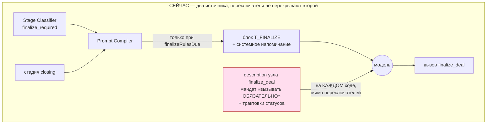
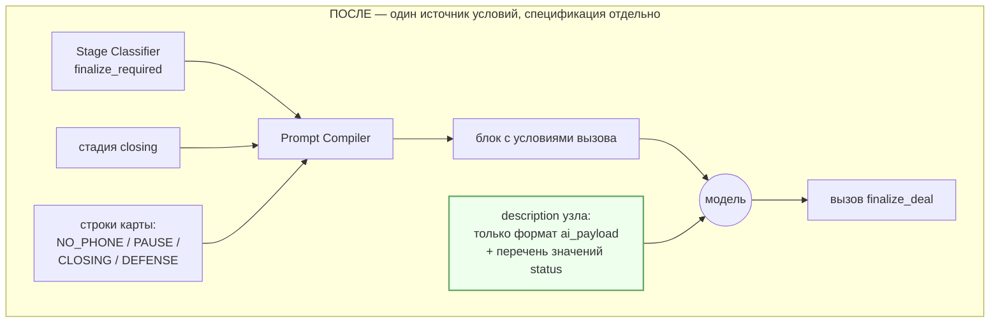
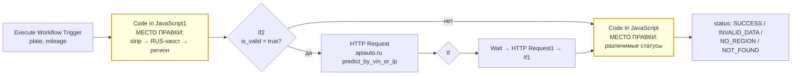

# fix: мандат в описании `finalize_deal` и нормализация госномера

Две независимые темы в одном плане: их объединяет только общий выкат n8n.
Порядок между темами свободен; порядок юнитов внутри темы — обязателен.

Пометки источника: `[код]` — вывод из чтения кода или файлов репозитория,
`[живое]` — факт, снятый с работающей системы (API n8n, API NocoDB, прогон).

---

## Сводка

**Тема 1.** Параметр `description` узла `finalize_deal` (3404 символа) несёт
собственный мандат «Вызывать ОБЯЗАТЕЛЬНО при выполнении любого из условий» и
полный справочник статусов. n8n отдаёт его модели на каждом ходе, независимо от
`tools_open` и `finalize_required`. Это вторая система правил, которую
переключатели конвейера не перекрывают; на ходе #4084 сработала именно она.
План разводит спецификацию формата (остаётся в описании) и условия вызова
(уезжают в блоки), плюс даёт механизм правки, которого сейчас нет.

**Тема 2.** Узел `Code in JavaScript1` в `TOOL: AUTO.RU EVALUATION` нормализует
госномер слишком узко: не отрезает хвост `RUS`, не проверяет код региона, отдаёт
один нерасчленимый `is_valid=false`. Блоки `ST_*_TOOL_NEEDED_V2` на этот сигнал
отвечают одной фразой без выхода из цикла. План правит обе половины.

**Два уточнения к вводным, снятые с живых исполнений** — они меняют приоритеты,
подробности в разделе «Уточнения к постановке».

---

## Уточнения к постановке (проверено, влияет на приоритеты)

### У1. В кейсе А буквы госномера — КИРИЛЛИЦА, не латиница

`[живое]` Исполнение **#3932** (`TOOL: AUTO.RU EVALUATION`, id `XCPe53sUwk8i9e3T`),
вход `plate = 'Т582ХР 33 rus'`. Посимвольный разбор кодовых точек:

```
С = U+0421 CYRILLIC CAPITAL LETTER ES
1 5 2
У = U+0423 CYRILLIC CAPITAL LETTER U
У = U+0423 CYRILLIC CAPITAL LETTER U
3 3
r = U+0072 LATIN SMALL LETTER R
u = U+0075 LATIN SMALL LETTER U
s = U+0073 LATIN SMALL LETTER S
```

То же в **#3937** (`'т582хр 33rus'`). Латинскими были только три символа хвоста
`rus`. Тело номера — кириллица.

**Следствие.** Кейс А чинится **одним только отрезанием хвоста**. Правка
гомоглифов к этому кейсу отношения не имеет и своей доказанной надобности не
имеет вовсе — см. У3. Это меняет очерёдность: хвост — первый юнит, гомоглифы —
последний и условный.

### У2. В кейсе Б номер «К647МУ211» существует и прошёл валидацию

`[живое]` Исполнение **#3974**, вход `plate = 'К647му 211'`, буквы кириллические.
Узел `Code in JavaScript1` вернул `plate = 'К647МУ211'`, **`is_valid = true`**.
Ход прошёл `If2` по ветке true, ушёл в `HTTP Request` к auto.ru, дальше по
цепочке `If → If Params Exist → Wait → HTTP Request1 → If1 → If Params Exist1`,
и терминальный `Code in JavaScript` отдал:

```json
{"status": "NOT_FOUND",
 "message": "Автомобиль не найден в базах. Сообщи об этом клиенту и сразу
             предложи приехать в салон для точной живой оценки..."}
```

**Утверждение «строки К647МУ211 нет нигде» опровергается этим исполнением.**
Инструмент неполный номер не отвергал — он принял склейку `399нв` + `211` как
номер с регионом 211, спросил auto.ru и получил «не найдено».

**Следствие.** Валидация кода региона — не гипотетическая страховка, а правка с
живым прецедентом: она превращает немой `NOT_FOUND` в конкретный вопрос
«проверьте код региона». Приоритет повышается со «страховки» до «второй по
важности правки».

### У3. Латинского тела номера в ретенции не было ни разу

`[живое]` Все 11 исполнений `TOOL: AUTO.RU EVALUATION` в ретенции — тело номера
кириллическое (`Р491НК37`, `о427вн37`, `в295мт37`, `Н718АР98`, `т346ус37`,
`М736ОТ37`, `К647му 211`, `Х529ом37`, `о427вн`, `Т582ХР 33 rus`, `т582хр 33rus`).
Доказательств, что латинское тело вообще доходит до инструмента, нет; равно нет и
доказательств, что auto.ru его принимает или отвергает.

**Следствие.** Гомоглифы остаются в плане, но отдельным юнитом с собственной
развилкой — см. В2 в разделе «Вопросы к владельцу».

### У4. Узел называется `Code in JavaScript1`, а не «Забираем номер»

`[код]` `flow/TOOL_ AUTO.RU EVALUATION.json`. «Забираем номер из входящих данных» —
первая строка комментария внутри `jsCode`, а не имя узла. Ограничение «имена
узлов не менять» относится к строке `Code in JavaScript1`.

### У5. Репозиторная копия инструмента совпадает с боевой побайтово

`[код]` + `[живое]` Сверка `flow/TOOL_ AUTO.RU EVALUATION.json` с живым
`XCPe53sUwk8i9e3T` через API: набор узлов идентичен (14 узлов), `jsCode` узлов
`Code in JavaScript1` и `Code in JavaScript` совпадает строка в строку. Файл
репозитория — честный источник, правка идёт в него.

---

## Постановка задачи

### Тема 1

Решение «звать ли `finalize_deal`» принимается в двух местах одновременно.
Первое — конвейер: `finalize_required` (`nocodb/build_v3_workflow.py:154`),
стадия `closing`, подключение блока `T_FINALIZE`
(`nocodb/build_v3_workflow.py:318-319, 363`), системное напоминание
(`:371-373`), требование сторожа `needFinalize` (`:477, 488`). Второе — параметр
`description` узла инструмента, который живёт вне этой системы и виден модели
всегда.

`[живое]` На ходе #4084 первая система молчала целиком (`finalize_required:false`,
`tools_open:false`, `need_finalize:false`, блока и напоминания в промпте ноль
вхождений), вторая сработала. Клиент получил ссылку на кабинет и в ту же секунду
остался без ассистента.

### Тема 2

`[живое]` Кейс А: два хода подряд с одинаковой фразой «номер кажется неполным» и
уход по таймауту. Причина — `is_valid=false` из-за хвоста `RUS`. Кейс Б:
`NOT_FOUND` вместо указания на несуществующий регион 211.

Обе половины нужны вместе: без различимых статусов ошибок промпту нечем
формулировать конкретный вопрос, а без правки промпта различимые статусы никто не
озвучит.

---

## Требования

- **Т1.** Условие «когда вызывать `finalize_deal`» существует ровно в одном месте
  системы правил. Спецификация формата `ai_payload` остаётся доступной модели
  всегда.
- **Т2.** Правка описаний инструментов выполняется генератором и переживает
  перегенерацию. Патч-скрипты поверх готового файла запрещены.
- **Т3.** Покрытие ситуаций, где финализация действительно нужна, не сужается —
  для каждой такой ситуации в промпте есть подключённый блок с инструкцией.
- **Т4.** Хвост `RUS` / `РУС` / `RU` не мешает валидации госномера.
- **Т5.** Код региона проверяется: двузначный 01–99, трёхзначный только с ведущей
  1, 7 или 9.
- **Т6.** Инструмент возвращает различимые причины отказа вместо одного
  `is_valid=false`.
- **Т7.** Пять контрольных номеров продолжают проходить валидацию без изменений
  (таблица в разделе «Прогон нормализации»).
- **Т8.** После второй неудачи с номером диалог не зацикливается: предлагается
  осмотр в салоне.
- **Т9.** Имена узлов и подписи `cachedResultName` не меняются.

---

## Ключевые технические решения

### КТР-1. Описания инструментов правятся через таблицу-оверрайд в генераторе

`[код]` `nocodb/build_v3_workflow.py:869-886`, функция `clone_tool`: параметры
узлов инструментов копируются **целиком из `OLD_NODES`**, то есть из
`flow/AI Agent v2.0 MAX.json` (`:50-51`) — боевого файла v2, который обслуживает
живой трафик. Собственного текста описаний генератор не содержит.

Значит «править в генераторе» сегодня физически невозможно без механизма.
Вариантов два, и первый отпадает:

- Править `flow/AI Agent v2.0 MAX.json` — задевает живой v2 и ломает роль файла
  как слепка прода.
- **Принято:** ввести словарь-оверрайд рядом с уже существующим
  `TOOL_WF_OVERRIDE` (`nocodb/build_v3_workflow.py:53-80`) и применять его в
  `clone_tool` тем же приёмом, что и подмену `workflowId`. Прецедент в коде уже
  есть, форма узла проверяется, при расхождении сборка падает с внятным
  сообщением.

Оверрайд обязан падать, если исходное описание в v2 изменилось — иначе правка
молча разойдётся с тем, поверх чего её задумывали.

### КТР-2. Граница «спецификация против условий» проходит по назначению текста

`[живое]` Полный `description` узла `finalize_deal`, снятый с боевого
`fQAS3wmAjVqrKATM`, делится на четыре части:

| Часть | Объём | Что это | Куда должно уехать |
|---|---|---|---|
| Вводная фраза + «Вызывать ОБЯЗАТЕЛЬНО при выполнении любого из условий: 1)…4)» | ~470 симв. | **условия вызова** | в блоки |
| «ПРАВИЛА ИЗВЛЕЧЕНИЯ ДАННЫХ И ЗАПОЛНЕНИЯ ai_payload», пункты 1–4 | ~700 симв. | спецификация формата (валидный JSON, обязательность `status`, «не включай пустые ключи») | остаётся |
| Расшифровка значений `status` — пять маркированных строк «'visit' — клиент согласился приехать… И предоставил номер» | ~640 симв. | **гибрид**: перечень допустимых значений — спецификация; трактовка каждого через поведение клиента — условие вызова | перечень остаётся, трактовки уезжают |
| «СПРАВОЧНИК КЛЮЧЕЙ ДЛЯ JSON» — 18 ключей от `report` до `next_step_time` | ~1600 симв. | спецификация формата | остаётся |

Третья часть — самое тонкое место и именно она дала статус на ходе #4084.
`[живое]` Модель выбрала `in_progress` по остаточному принципу: `visit` и `call`
там привязаны к наличию номера, `refuse` — к категорическому отказу, `ban` — к
неадекватности; `in_progress` описан как «клиент согласился приехать в салон, НО
отказался оставить номер телефона» — не подходило тоже, но оказалось наименее
противоречивым. Оставлять трактовки в описании — значит оставлять этот механизм.

### КТР-3. Болезнь — только у `finalize_deal`

`[живое]` Описания двух других инструментов боевого `fQAS3wmAjVqrKATM`:

- **`evaluate_auto`** (≈200 симв.) — чистая спецификация параметров: `plate`,
  `mileage`, плюс «Если клиент написал "50 тыс", обязательно преобразуй это в
  "50000"». Условий вызова нет. Мандата нет.
- **`combo_calculator`** (≈330 симв.) — те же параметры плюс одна фраза «После
  получения ответа от этого инструмента ты ОБЯЗАН использовать эти данные для
  написания текстового ответа клиенту». Это предписание об **обработке ответа**,
  не об условии вызова: оно не может само инициировать вызов.

Масштаб проблемы — один инструмент из трёх. Расширять правку на два других
оснований нет.

### КТР-4. Покрытие блоками при снятии мандата — полное, с одной оговоркой

`[живое]` Сверка по живой карте (41 интент, 134 блока, 193 строки карты; активных
блоков 97) и `[код]` по правилам подключения:

| Ситуация | Интент | Стадия `closing`? | `T_FINALIZE`? | Блок с инструкцией |
|---|---|---|---|---|
| Клиент прислал телефон | флаг → `finalize_required` | да | **да** | `T_FINALIZE` |
| Телефон уже в базе, есть согласие | `phone_collected` → `finalize_required` | да | **да** | `T_FINALIZE` |
| Согласие на визит / звонок | `propose_visit`, `propose_call` | да (`CLOSE_INTENTS`) | **да** | `T_FINALIZE` |
| Клиент назвал номер текстом | `request_phone` | да | **да** | `T_FINALIZE` |
| Назначение времени | `schedule_appointment` | да | **да** | `T_FINALIZE` |
| Вежливое завершение | `polite_close_satisfied` | да | **да** | `T_FINALIZE` |
| Результат инструмента | `tool_result_received` | да | **да** | `T_FINALIZE` |
| Сравнение с конкурентом | `competitor_comparison` | да | **да** | `T_FINALIZE` |
| **Отказ дать телефон** | `objection_no_phone`, `..._repeat` | **нет** | нет | `BLK_*_NO_PHONE`, `BLK_*_NO_PHONE_REPEAT` — строки карты активны |
| **Пауза** | `pause_requested` | **нет** | нет | `BLK_*_PAUSE` — строки карты активны |
| **Передача человеку** | `request_human_handoff` | **нет** | нет | `ST_*_CLOSING` как `primary` из карты — блок содержит инструкции финализации |
| Спам / троллинг | `off_topic` → эскалация | нет | нет | `G-05_DEFENSE`: «Немедленно вызывай `finalize_deal` со статусом `ban`» |
| Категорический отказ | `final_refusal` | — | — | ветка `Bypass`: агент не участвует, `ai_payload` собирается кодом (`BYPASS_BUILD_JS`) |
| Бан-триггер | `ban_trigger` | — | — | там же |

Ни одной ситуации без инструкции не обнаружено. `[код]` Строка карты с
`Role="primary"` перебивает дефолт по стадии (`nocodb/build_v3_workflow.py:322-324`),
поэтому `request_human_handoff` получает `ST_*_CLOSING` независимо от стадии.

**Оговорка, которая и есть остаточный риск варианта (а):** покрытие держится на
том, что резолвер присвоил ходу правильный интент. Если он ошибётся и телефон при
этом не поймается флагом — инструкции не будет нигде. Телефонный путь при этом
покрыт дважды (флаг `has_valid_phone_in_msg` **и** интент), поэтому остаточный
риск узкий, но не нулевой.

### КТР-5. Нормализация номера правится в файле воркфлоу, генератора у неё нет

`[код]` `TOOL: AUTO.RU EVALUATION` ни одним генератором не строится:
`nocodb/build_v3_workflow.py` собирает только `AI Agent v3.0`; в `nocodb/`
генератора для инструмента оценки нет. Единственный скрипт, который его читает, —
`nocodb/build_test_contour.py` (форкает в `[TEST]`, `FORK_REFS` и `FILES`).

Значит ограничение 2.5 «правки идут в генератор» к теме 2 неприменимо буквально:
источником правды для этого воркфлоу является сам файл
`flow/TOOL_ AUTO.RU EVALUATION.json`. Правка идёт в него, `[TEST]`-копия
перегенерируется `build_test_contour.py`. Патч-скрипты по-прежнему запрещены —
здесь их и не требуется.

### КТР-6. Правка достаёт обе ветки оценки одним изменением

`[живое]` Живой `Tool: Combo Calculator` (`GD3ZCj8GiVyB7YBw`), узел
`Execute Workflow`, ссылается на `XCPe53sUwk8i9e3T` — тот же воркфлоу оценки, что
зовёт `evaluate_auto` из `AI Agent v3.0`. Правка нормализации автоматически
покрывает и прямой вызов оценки, и комбо-расчёт. Отдельного юнита под комбо не
нужно.

---

## Высокоуровневая схема

Два источника решения о вызове `finalize_deal` сегодня и после правки:





Путь госномера в инструменте оценки и место правки:



---

## Реализационные юниты

Порядок внутри темы обязателен. Между темами — свободен.

### U1. Механизм оверрайда описаний инструментов в генераторе

**Цель.** Дать генератору возможность подменять `description` клонируемых узлов
инструментов, не трогая `flow/AI Agent v2.0 MAX.json`.

**Требования.** Т2.

**Зависимости.** Нет. Первый юнит темы 1.

**Файлы.**
- `nocodb/build_v3_workflow.py` — новый словарь рядом с блоком привязок
  (строки 53–80, где живёт `TOOL_WF_OVERRIDE`); применение в `clone_tool`
  (строки 869–886).
- `flow/AI Agent v3.0.json` — перегенерируется.
- `flow/test-contour/[TEST] AI Agent v3.0.json` — перегенерируется.
- `flow/lib/v3_pipeline_sim.test.mjs` — проверка, что оверрайд доехал.

**Подход.** Словарь `имя узла v3 → новый текст описания`. В `clone_tool` после
подмены `workflowId` — подмена `parameters["description"]`. Обязательная
страховка по образцу существующей: если у клонируемого узла нет ключа
`description` либо его текущее значение не совпадает с зафиксированным исходником,
сборка падает с сообщением, называющим файл и константу. Без этого правка молча
разойдётся с тем v2-текстом, поверх которого её задумывали.

Сам текст описания в этом юните не меняется — оверрайд вводится с текстом,
идентичным нынешнему. Юнит проверяется тем, что перегенерация даёт побайтово
прежний `flow/AI Agent v3.0.json`.

**Образец для подражания.** `TOOL_WF_OVERRIDE` и его применение в `clone_tool`:
та же форма словаря, та же проверка формы узла, то же аварийное сообщение.

**Сценарии тестов** (`flow/lib/v3_pipeline_sim.test.mjs`):
- Узел `finalize_deal` в собранном `flow/AI Agent v3.0.json` содержит непустой
  `description`.
- Описания `evaluate_auto` и `combo_calculator` не изменились относительно
  `flow/AI Agent v2.0 MAX.json` — оверрайд их не задел.
- Подпись `cachedResultName` у всех трёх узлов не изменилась (Т9); при её сдвиге
  `fork()` в `build_test_contour.py` перестал бы подменять ссылку и боевые адреса
  протекли бы в тестовый контур.
- Отрицательный: при отсутствии ключа `description` у исходного узла сборка
  завершается ненулевым кодом с сообщением, называющим `TOOL_WF_OVERRIDE`-подобную
  константу.

**Проверка готовности.** `python3 nocodb/build_v3_workflow.py` отрабатывает,
`git diff flow/AI\ Agent\ v3.0.json` пуст, четыре набора тестов зелёные.

---

### U2. Новый текст описания `finalize_deal`

**Цель.** Развести спецификацию формата и условия вызова согласно решению
владельца по развилке В1.

**Требования.** Т1, Т3.

**Зависимости.** U1. **Заблокирован решением владельца по В1** — до ответа не
начинать.

**Файлы.**
- `nocodb/build_v3_workflow.py` — текст в словаре из U1.
- `flow/AI Agent v3.0.json`, `flow/test-contour/[TEST] AI Agent v3.0.json` —
  перегенерируются.

**Подход.** Зависит от выбранного варианта — см. раздел «Развилка 1.4». Общее для
всех вариантов: сохраняются пункты «ПРАВИЛА ИЗВЛЕЧЕНИЯ ДАННЫХ» (валидный JSON
строкой, обязательность `status`, «не включай ключи без данных»), перечень
допустимых значений `status` и справочник 18 ключей. Формулировка «ФАТАЛЬНАЯ
ОШИБКА… система полностью сломается» остаётся: `[код]` `status` действительно
обязателен — `crm_mapping.resolve_callback_status` на стороне бота ведёт
нераспознанный статус в `DEFAULT_STAGE`.

**Замечание о длине.** `[живое]` Промпт хода #4084 — 11 113 символов при описании
инструмента в 3404 символа. Сокращение описания примерно вдвое ощутимо разгружает
контекст; это побочная выгода, не цель.

**Сценарии тестов** (`flow/lib/v3_pipeline_sim.test.mjs`):
- Описание содержит все 18 ключей справочника и все пять значений `status` —
  спецификация не пострадала.
- При варианте (а): описание не содержит слов «Вызывать ОБЯЗАТЕЛЬНО» и не
  содержит трактовок значений через поведение клиента.
- При варианте (б): описание содержит явный запрет вызывать, пока выдана ссылка
  на кабинет и `cabinet_status` не изменился с `not_visited`.
- Текст описания в файле воркфлоу совпадает с текстом в генераторе —
  расхождение роняет сборку (по образцу проверки служебной фразы,
  `nocodb/build_v3_workflow.py:703-714`).

**Проверка готовности.** Тесты зелёные; сценарии прогона из U3 отработаны.

**Примечание по исполнению.** Текст правится один раз и проверяется прогоном
(U3), а не итерациями на боевом контуре.

---

### U3. Сценарии проверки поведения модели на `[TEST]`-контуре

**Цель.** Убедиться, что после U2 финализация не пропала там, где нужна, и не
осталась там, где не нужна. Модельное поведение юнит-тестом не фиксируется —
нужен прогон.

**Требования.** Т1, Т3.

**Зависимости.** U2.

**Файлы.**
- `docs/test-contour-checklist.md` — добавить раздел со сценариями.
- `flow/test-contour/[TEST] AI Agent v3.0.json` — контур прогона.

**Подход.** Прогон на `[TEST]`-контуре, прод не затрагивается. Каждый сценарий —
подготовленное тело вебхука; смотрим три поля данных исполнения:
`intermediateSteps` узла `Agent` (был ли вызов и с каким `status`),
`turn.finalize_required`, `guard.called_finalize` / `need_finalize` / `action`.

Каждый сценарий гоняется **трижды**: `[живое]` на ходе #4084 модель приняла
решение, не предписанное ни одним блоком, значит выбор вероятностный и однократный
прогон ничего не доказывает.

Обязательный минимум — восемь сценариев, четыре «должна вызвать» и четыре «не
должна»:

| # | Сценарий | Вход | Ожидание |
|---|---|---|---|
| С1 | Клиент прислал телефон | `message` с валидным номером, `flags.has_valid_phone_in_msg=true` | вызов, `status` = `call` или `visit` |
| С2 | Согласие на визит, телефон уже в базе | интент `propose_visit`, `phone_collected=true` | вызов, `status=visit` |
| С3 | Повторный отказ от телефона, согласие на паузу | интент `objection_no_phone_repeat`, стадия не `closing` | вызов, `status=in_progress`, `next_step="chat"`, `next_step_time` в формате DD.MM.YYYY |
| С4 | Троллинг после режима защиты | интент `off_topic`, вторая грубость | вызов, `status=ban` |
| С5 | **Воспроизведение #4084** | интент `choose_cabinet`, `cabinet_status=not_visited`, `cabinet_url` заполнен, `finalize_required=false`, стадия `data_collect` | **вызова нет**; текст по `BLK_*_CABINET_CHOSEN` с маркером `[CABINET_LINK]` |
| С6 | Вопрос по условиям в середине диалога | интент `price_hierarchy_question`, стадия `data_collect` | вызова нет |
| С7 | Сбор данных | интент `collect_mileage` | вызова нет |
| С8 | Клиент в кабинете авторизовался | `cabinet_status=phone_confirmed`, вопрос по анкете | вызова нет; про вход не переспрашивает |

Критерий приёмки: С1–С4 дают вызов во всех трёх прогонах; С5–С8 не дают ни в
одном. Любое отклонение — текст описания дорабатывается, прогон повторяется
целиком.

**Проверка готовности.** Таблица результатов 8×3 приложена к отчёту, отклонений
нет.

---

### U4. Воспроизведение случая #4084 до правки

**Цель.** Отделить системную склонность от разового выбора модели: тот же вход,
поданный повторно на текущем описании.

**Требования.** Диагностика; на решение по В1 влияет.

**Зависимости.** Нет. Выполняется **до** U2 и независимо от него.

**Файлы.** `docs/test-contour-checklist.md` — раздел с телом запроса.

**Подход.** Сценарий С5 из U3, но на `[TEST]`-контуре с **нынешним** описанием
инструмента. Тело запроса восстанавливается из исполнения #4084: `message` = «мне
удобно тута», `session_context` с `phone_collected:false`, `deal_finalized:false`,
`msg_count:11`, `current_stage:"data_collect"`, `qualification_context` с
`cabinet_status:"not_visited"` и заполненным `cabinet_url`, `recent_history` из
восьми последних реплик. Десять прогонов.

**Что даёт результат.** Доля прогонов с вызовом `finalize_deal` — это оценка
частоты. Ноль вызовов из десяти означал бы разовый выброс и понизил бы срочность;
существенная доля подтверждает системность и обосновывает вариант (а).

**Проверка готовности.** Доля вызовов из десяти прогонов зафиксирована в отчёте.

**Ограничение честности.** Десять прогонов дают широкий доверительный интервал.
Задача — отличить «почти никогда» от «регулярно», не измерить частоту точно.

---

### U5. Отрезание хвоста `RUS` / `РУС` / `RU`

**Цель.** Закрыть кейс А. Наивысший приоритет темы 2: `[живое]` два исполнения
подряд (#3932, #3937) провалились ровно на этом и стоили клиента.

**Требования.** Т4, Т7, Т9.

**Зависимости.** Нет. Первый юнит темы 2.

**Файлы.**
- `flow/TOOL_ AUTO.RU EVALUATION.json` — `jsCode` узла `Code in JavaScript1`.
- `flow/test-contour/[TEST] TOOL_ AUTO.RU EVALUATION.json` — перегенерируется
  `nocodb/build_test_contour.py`.
- `flow/lib/plate_normalize.test.mjs` — **новый файл**.

**Подход.** В очистке строки к нынешнему классу разделителей `[\s-]` добавить
точку и запятую, затем отрезать хвост `RUS` / `РУС` / `RU` **только с конца
строки**, после приведения к верхнему регистру. Якорь на конец обязателен: без
него `RU` вырежется из середины и испортит номера с буквой `У`.

**Направляющий эскиз** (не спецификация реализации):

```
clean = raw.replace(/[\s\-.,]/g, '').toUpperCase()
clean = clean.replace(/(RUS|РУС|RU)$/, '')
```

**Образец для подражания.** `payload_v2.normalize_plate` в репозитории бота
решает смежную задачу через `str.maketrans` и `re.sub`; логику не переносить —
предикаты у бота и у инструмента разные и объединению не подлежат.

**Сценарии тестов** (`flow/lib/plate_normalize.test.mjs`):
- Счастливый путь: `«Т582ХР 33 rus»` → `Т582ХР33`, валиден.
- Регистр и слипание: `«т582хр 33rus»` → `Т582ХР33`, валиден.
- Кириллический хвост: `«Т582ХР33РУС»` → `Т582ХР33`, валиден.
- Короткий хвост: `«Т582ХР33RU»` → `Т582ХР33`, валиден.
- Граница якоря: `«Х318ТЕ750»` не теряет `У` — хвост режется только с конца.
- Пять контрольных номеров из Т7 дают прежний результат.
- Мусор: `«96000»` остаётся невалидным.

**Проверка готовности.** Таблица «до / после» воспроизводится (раздел «Прогон
нормализации»), все пять контрольных номеров валидны.

**Примечание по исполнению.** Характеризационные тесты на текущее поведение
пишутся **до** правки — узел живой, регрессия дороже правки.

---

### U6. Валидация кода региона

**Цель.** Закрыть кейс Б: `[живое]` исполнение #3974 приняло регион 211 и
получило немой `NOT_FOUND`.

**Требования.** Т5, Т7.

**Зависимости.** U5.

**Файлы.**
- `flow/TOOL_ AUTO.RU EVALUATION.json` — `Code in JavaScript1`.
- `flow/test-contour/[TEST] TOOL_ AUTO.RU EVALUATION.json`.
- `flow/lib/plate_normalize.test.mjs`.

**Подход.** Разбирать номер на группы вместо цельной проверки одним анкер-регэкспом:
буква, три цифры, две буквы, необязательный регион. Регион отдельно: двузначный —
01–99, трёхзначный — только с ведущей 1, 7 или 9. Отсутствие региона и
неправильный регион различаются — это питает U7.

**Направляющий эскиз** (не спецификация реализации):

```
body = /^([АВЕКМНОРСТУХ])(\d{3})([АВЕКМНОРСТУХ]{2})(\d{2,3})?$/
нет совпадения      → NOT_A_PLATE
совпадение без 4-й группы → NO_REGION
двузначный вне 01..99     → BAD_REGION
трёхзначный не с 1/7/9    → BAD_REGION
```

**Сценарии тестов:**
- `«К647МУ211»` — валиден сейчас, становится `BAD_REGION`.
- `«Х318ТЕ750»`, `«Х318ТЕ177»`, `«Х318ТЕ799»` — трёхзначные с 7, 1, 7 — валидны.
- `«Х318ТЕ250»` — `BAD_REGION`.
- `«А123ВС00»` — валиден сейчас, становится `BAD_REGION`.
- `«А123ВС01»`, `«А123ВС99»` — границы двузначного диапазона, валидны.
- `«о427вн»` — `NO_REGION`, не `NOT_A_PLATE`.
- `«О427ВН3396000»` (склейка с пробегом) — `NOT_A_PLATE`.
- Пять контрольных номеров из Т7 — валидны.

**Проверка готовности.** Таблица «до / после» полна, отличия только в четырёх
ожидаемых строках.

**Открытый вопрос.** Список трёхзначных кодов проверяется правилом «ведущая 1, 7
или 9», а не перечнем. Правило покрывает известные коды (102, 116, 123, 154, 161,
174, 177, 178, 190, 196, 197, 199, 716, 750, 761, 763, 777, 790, 797, 799, 977) и
переживает появление новых. Перечень был бы строже, но требует сопровождения.

---

### U7. Различимые статусы ошибок на выходе инструмента

**Цель.** Дать промпту материал для конкретного вопроса вместо одного
`is_valid=false`.

**Требования.** Т6.

**Зависимости.** U5, U6.

**Файлы.**
- `flow/TOOL_ AUTO.RU EVALUATION.json` — `Code in JavaScript1` (проброс причины)
  и терминальный `Code in JavaScript` (ветка `is_valid === false`, где сейчас
  формируется единственный `INVALID_DATA`).
- `flow/test-contour/[TEST] TOOL_ AUTO.RU EVALUATION.json`.
- `flow/lib/plate_normalize.test.mjs`.

**Подход.** `Code in JavaScript1` дополнительно возвращает поле с причиной
(`NOT_A_PLATE` / `NO_REGION` / `BAD_REGION`). Узел `If2` не трогается — он
по-прежнему смотрит только `is_valid`, форма ветвления сохраняется. Терминальный
`Code in JavaScript` в ветке отказа отдаёт статус, зависящий от причины, и
`message`, который модель озвучивает.

Три исходящих статуса вместо одного:

| Причина | Статус наружу | Смысл для модели |
|---|---|---|
| `NO_REGION` | `NO_REGION` | номер похож на номер, не хватает кода региона |
| `NOT_A_PLATE`, `BAD_REGION` | `INVALID_DATA` | на номер не похоже либо регион не существует |
| валиден, авто не найдено | `NOT_FOUND` — **существует, не меняется** | номер в порядке, авто в базе нет |

**Совместимость.** `NOT_FOUND` уже описан в блоках `D_TRADEIN` и `D_COMBO` и
обрабатывается в `ST_TRADEIN_TOOL_NEEDED_V2` / `ST_COMBO_TOOL_NEEDED_V2`. Новый
статус `NO_REGION` этим блокам неизвестен — его обязан добавить U8, иначе модель
получит незнакомый статус и начнёт импровизировать. **U7 без U8 выкатывать
нельзя.**

**Сценарии тестов:**
- `«о427вн»` → статус `NO_REGION`, `message` про код региона.
- `«К647МУ211»` → `INVALID_DATA`.
- `«96000»` → `INVALID_DATA`.
- `«Т582ХР 33 rus»` → валиден, до узла ошибок не доходит.
- Ветка успеха не изменилась: при `is_valid=true` терминальный узел отдаёт тот же
  набор ключей, что и раньше, включая `found_info` с добавленным `plate`
  (контракт кабинета, `docs/N8N_HANDOFF_CABINET.md`).
- Интеграционный: `found_info.plate` берётся из `Code in JavaScript1` — после
  правки там лежит номер **без хвоста** `RUS`; проверить, что кабинет получает
  очищенное значение, а не сырое.

**Проверка готовности.** Три статуса различимы на выходе, ветка успеха
не изменилась.

---

### U8. Поведение блоков при ошибке номера и выход из цикла

**Цель.** Убрать тупик кейса А: `[живое]` две одинаковые фразы подряд и уход по
таймауту.

**Требования.** Т6, Т8.

**Зависимости.** U7. Выкатывается вместе с ним.

**Файлы.** Живые таблицы NocoDB — блоки `ST_TRADEIN_TOOL_NEEDED_V2`,
`ST_COMBO_TOOL_NEEDED_V2` (оба активны), плюс `D_TRADEIN` и `D_COMBO` (в них
перечислен словарь статусов инструмента).

**Текущая формулировка**, одинаковая в обоих блоках `[живое]`:

> `- INVALID_DATA: скажи, что номер кажется неполным, и попроси корректный
> госномер. Получив новый номер — снова вызови инструмент.`

Выхода из цикла нет — отсюда две одинаковые реплики подряд.

**Подход.** Три правки в каждом из двух блоков:

1. **Развести причины.** Отдельная строка на `NO_REGION` — вопрос именно про код
   региона, с указанием, какой номер уже разобран («вижу `Т582ХР`, не хватает
   кода региона — напишите его целиком»). Строка `INVALID_DATA` остаётся для
   «на номер не похоже».
2. **Не повторять формулировку дословно.** Второе обращение по тому же поводу
   формулируется иначе — сегодня блок этого не запрещает.
3. **Выход после второй неудачи.** После двух неуспешных попыток инструмент
   больше не звать: извиниться и предложить осмотр в салоне либо звонок
   оценщика — по образцу уже существующей в этих блоках ветки
   `IN_PROGRESS / NOT_FOUND / error`, которая ровно так и устроена («отключи
   правило "Зеркальность", извинись за техническую задержку баз своими словами и
   СРАЗУ предложи приехать в салон для живого осмотра»).

**Как считается «вторая неудача».** `[код]` Счётчика попыток по номеру в
`session_context` нет: есть `phone_ask_count`, аналога `plate_ask_count` нет.
Модель считает по `recent_history` — окно из восьми реплик это позволяет, но
надёжность ниже, чем у счётчика. Развилка В3.

**Формулировки на утверждение.** Тексты блоков пишутся владельцу на утверждение
до записи в NocoDB — по установившейся практике: тексты, которые видит клиент,
утверждает владелец.

**Сценарии тестов** (`flow/lib/v3_pipeline_sim.test.mjs`, симуляция Prompt
Compiler на снапшоте таблиц):
- При стадии `tool_needed` и сценарии `tradein` в промпт попадает
  `ST_TRADEIN_TOOL_NEEDED_V2` с новыми строками статусов.
- То же для `combo`.
- `D_TRADEIN` и `D_COMBO` содержат `NO_REGION` в перечне статусов —
  словарь и обработчик не разошлись.
- Блоки не содержат прежней формулировки «номер кажется неполным» в единственном
  экземпляре на оба случая.

**Проверка готовности.** Прогон сценария кейса А на `[TEST]`-контуре: ввод
`«Т582ХР 33 rus»` → оценка выполняется; ввод `«о427вн»` → вопрос именно про код
региона; третий неуспешный ввод → предложение осмотра, не повтор вопроса.

---

## Развилка 1.4 — решение владельца

Что закрывает каждый вариант, чего не закрывает, чем проверяется, какой остаётся
риск.

### Вариант (а) — убрать условия вызова из описания, оставить спецификацию формата

**Закрывает.** Устраняет второй источник правил целиком. Решение «звать или нет»
остаётся ровно в одном месте — системе блоков, у которой есть переключатели
(`finalize_required`, стадия, строки карты, `Intent_Triggers`) и наблюдаемость
(`guard.called_finalize`, `need_finalize`). Правило, живущее в одном месте,
проверяемо: сегодня, чтобы понять, почему ход финализировался, нужно читать и
блоки, и параметр узла, и они могут противоречить друг другу — что и произошло с
`G-07_CABINET` на ходе #4084.

**Чего не закрывает.** Случаи, где резолвер присвоил неверный интент **и** флаг
телефона не сработал: инструкции не будет нигде. По КТР-4 таких дыр в покрытии
сегодня не видно, но покрытие держится на правильной классификации.

**Чем проверяется.** Сценарии С1–С4 из U3 (должна вызвать) и С5–С8 (не должна),
по три прогона каждый.

**Остаточный риск.** Пропуск финализации там, где она нужна. Ущерб асимметричен
и в нашу пользу: пропущенный вызов оставляет диалог живым и допускает вызов на
следующем ходе; лишний вызов диалог убивает необратимо — `[код]` колбэк
безусловно гасит `is_smartbot_active` и выгружает стенограмму.

### Вариант (б) — переписать условия так, чтобы не противоречили `G-07_CABINET`

**Закрывает.** Конкретный сценарий #4084: явный запрет «не вызывать, пока выдана
ссылка и `cabinet_status` остаётся `not_visited`».

**Чего не закрывает.** Двойственность источника сохраняется. Каждое новое правило
в блоках придётся зеркалить в описании вручную, и рано или поздно копии разойдутся
— ровно тем механизмом, каким описание уже разошлось с `G-07_CABINET`. Кроме того,
описание — не блок: оно не читает `cabinet_status`, а лишь просит модель на него
посмотреть; исполнимость правила ниже, чем у блока, который подключается по факту
интента.

**Чем проверяется.** Те же сценарии U3, но С5 придётся расширить вариациями
кабинетной ветки — проверять надо именно исполнимость запрета.

**Остаточный риск.** Следующее расхождение двух источников на сценарии, который
сегодня не назван. Плюс рост описания: оно уже 3404 символа при промпте в 11 113.

### Вариант (в) — описание не трогать, противовес поставить в блок кабинетной тактики

**Закрывает.** Тот же единичный сценарий, что и (б), и только его.

**Чего не закрывает.** Мандат остаётся включённым всегда и продолжает работать на
всех интентах, где нет специального противовеса. Это не устранение конфликта, а
добавление третьей стороны в спор: описание требует, `G-07_CABINET` запрещает,
`BLK_*_CABINET_CHOSEN` запрещает ещё раз. Модель разрешает противоречие сама, и
исход #4084 показывает, чем это кончается.

**Чем проверяется.** Только сценарий С5; остальные не затрагиваются.

**Остаточный риск.** Наивысший из трёх. Каждый новый сценарий требует нового
противовеса, а мандат применяется по умолчанию.

### Рекомендация — вариант (а)

Довод владельца о единственном месте правила решает эту развилку сам по себе, и
разбор его подтверждает тремя фактами:

1. `[живое]` Покрытие блоками полное (КТР-4): для каждой ситуации, где
   финализация нужна, есть подключённый блок с инструкцией. Мандат в описании не
   закрывает ни одной ситуации, которую не закрывали бы блоки, — он только
   добавляет ситуации, где вызов происходит без предписания.
2. `[живое]` Он уже создал такую ситуацию: ход #4084 при молчащем конвейере и
   прямо противоположном требовании `G-07_CABINET`.
3. Асимметрия ущерба на стороне (а): лишний вызов необратим, пропущенный —
   исправим следующим ходом.

Варианты (б) и (в) лечат симптом на одном сценарии и сохраняют механизм, который
даст следующий. Промежуточная позиция на случай осторожности владельца — сделать
(а), но оставить в описании одну строку про `ban` при неадекватном поведении:
`[код]` это единственный статус, где промедление имеет цену (клиент продолжает
грубить), и он уже продублирован в `G-05_DEFENSE`.

---

## Прогон нормализации — таблица «до / после» (Т7)

`[живое]` Прогон обеих реализаций на одном входе. «Сейчас» — код узла
`Code in JavaScript1` из боевого `XCPe53sUwk8i9e3T`; «после» — эскизы U5 и U6.

| Вход | Сейчас `plate` | Сейчас | После `plate` | После | Причина |
|---|---|---|---|---|---|
| `Р491НК37` | `Р491НК37` | valid | `Р491НК37` | valid | OK |
| `в295мт37` | `В295МТ37` | valid | `В295МТ37` | valid | OK |
| `о427вн37` | `О427ВН37` | valid | `О427ВН37` | valid | OK |
| `Х318ТЕ750` | `Х318ТЕ750` | valid | `Х318ТЕ750` | valid | OK |
| `Р836ВЕ33` | `Р836ВЕ33` | valid | `Р836ВЕ33` | valid | OK |
| `Т582ХР 33 rus` | `Т582ХР33RUS` | **invalid** | `Т582ХР33` | **valid** | OK — кейс А починен |
| `т582хр 33rus` | `Т582ХР33RUS` | **invalid** | `Т582ХР33` | **valid** | OK — кейс А починен |
| `К647МУ211` | `К647МУ211` | **valid** | `К647МУ211` | **invalid** | `BAD_REGION` — кейс Б |
| `о427вн` | `О427ВН` | invalid | `О427ВН` | invalid | `NO_REGION` (различимо) |
| `Х318ТЕ177` | `Х318ТЕ177` | valid | `Х318ТЕ177` | valid | OK |
| `Х318ТЕ799` | `Х318ТЕ799` | valid | `Х318ТЕ799` | valid | OK |
| `Х318ТЕ250` | `Х318ТЕ250` | **valid** | `Х318ТЕ250` | **invalid** | `BAD_REGION` |
| `А123ВС01` | `А123ВС01` | valid | `А123ВС01` | valid | OK |
| `А123ВС99` | `А123ВС99` | valid | `А123ВС99` | valid | OK |
| `А123ВС00` | `А123ВС00` | **valid** | `А123ВС00` | **invalid** | `BAD_REGION` |
| `Р491НК 37` | `Р491НК37` | valid | `Р491НК37` | valid | OK |
| `р491нк-37` | `Р491НК37` | valid | `Р491НК37` | valid | OK |
| `96000` | `96000` | invalid | `96000` | invalid | `NOT_A_PLATE` |
| `О427ВН3396000` | `О427ВН3396000` | invalid | `О427ВН3396000` | invalid | `NOT_A_PLATE` |
| `в295мт37 96000` | `В295МТ3796000` | invalid | `В295МТ3796000` | invalid | `NOT_A_PLATE` |

**Итог.** Все пять контрольных номеров Т7 не затронуты. Меняются пять строк: две
чинятся (кейс А), три ужесточаются (несуществующие коды региона 211, 250, 00).
Регрессий среди валидных номеров нет.

Строка `P491HK37` с **латинским** телом в таблицу не включена намеренно: её
поведение зависит от развилки В2. Сейчас она валидна и уходит в auto.ru как есть;
с конвертацией гомоглифов уйдёт как `Р491НК37`.

---

## Границы работ

### Не входит в объём

- Извлечение телефона, слоты бота, запись полей в Битрикс — зона второго агента.
- `Reminder LM` (`google/gemini-2.5-flash-lite`) — осознанное решение владельца.
- `Tool: Resolver Core` и его модель — решения нет.
- Описания `evaluate_auto` и `combo_calculator` — мандатов не содержат (КТР-3).
- Логика самого запроса к auto.ru, обработка `found_info`, контракт кабинета.
- Проверка перестановки повтора на `openai/gpt-4.1-mini` — отдельная задача,
  остаток риска Р8.

### Отложено в последующую работу

- **Гомоглифы латиница → кириллица.** Юнита нет до ответа по В2: `[живое]`
  латинского тела номера в ретенции не встречалось ни разу, а поведение auto.ru
  на латинской записи не проверено.
- **Побочные нарушения хода 03:47 (пункт 1.7).** `[живое]` На ходе #4082 модель
  напечатала голый URL вместо маркера `[CABINET_LINK]` и вставила ссылку в
  сообщение с самой развилкой. **Это отдельная тема, не следствие мандата.**
  Корень другой: правило маркера живёт **только** в блоках
  `BLK_*_CABINET_CHOSEN`, а они подключаются по `Intent_Triggers: choose_cabinet`;
  на ходе #4082 интент был `price_hierarchy_question`, блок не подключился, и
  модель взяла адрес из `ai_clean_context.cabinet_url` напрямую. `G-07_CABINET`
  был в промпте, но правила маркера не содержит — он говорит только «В сообщении
  с самой развилкой ссылки быть не должно». Ущерба не случилось: `[код]`
  страховочная ветка `cabinet_link_render.py` узнала голый URL и обернула его в
  анкор (`marker_found: False, applied: 1`). Кандидат на правку — перенести
  правило маркера в `G-07_CABINET`, который подключается на всех кабинетных
  интентах. Отдельным решением владельца.
- **Расхождение репозиторной копии комбо-калькулятора с боевой.** `[код]` +
  `[живое]` `flow/Tool_ Combo Calculator.json` ссылается на
  `ZYVac3Twp_ugyP3Jngwhj` (исторический прод-тул), живой `GD3ZCj8GiVyB7YBw`
  ссылается на `XCPe53sUwk8i9e3T`; `Calc Engine` в файле — плейсхолдер
  `REPLACE_WITH_CALC_ENGINE_ID`, в живом — `IzHcJxOxP9SI3LNv`. Импорт этого файла
  поверх боевого молча увёл бы комбо-ветку на старый инструмент оценки мимо всех
  правок этого плана. Механизм тот же, что дал инцидент #3871. Правок в этом
  плане нет — тема требует отдельного решения.
- **Счётчик попыток по госномеру в `session_context`** — см. В3.

---

## Системное влияние

- **Клиенты.** Тема 2 напрямую: кейс А сегодня заканчивается потерей клиента.
  Тема 1 — снижает риск преждевременно закрытого диалога.
- **Менеджеры дилера.** Тема 1 меняет поток сделок в «Нет номера»
  (`C9:UC_MDA6RZ`): их станет меньше при варианте (а).
- **Второй агент (репозиторий бота).** Прямых зависимостей нет. Пересечение одно:
  чистка воронкового слота на его стороне и отрезание хвоста `RUS` на нашей
  решают одну задачу в двух точках. Пересечение безвредно — оба приводят к одному
  результату, — но координацию по выкату владелец берёт на себя.
- **Кабинет.** U7 меняет значение `found_info.plate`: после U5 туда попадает
  номер без хвоста `RUS`. Кабинет получает более чистое значение; контракт
  `docs/N8N_HANDOFF_CABINET.md` не меняется. Проверяется интеграционным сценарием
  в U7.
- **Выкат.** `[код]` Публичный API n8n не может писать боевой воркфлоу — схема
  отвергает `binaryMode`. Импорт обоих файлов выполняет владелец в интерфейсе.
  Файлов два: `flow/AI Agent v3.0.json` (тема 1) и
  `flow/TOOL_ AUTO.RU EVALUATION.json` (тема 2). Целевой воркфлоу оценки —
  **`XCPe53sUwk8i9e3T`**, не `ZYVac3Twp_ugyP3Jngwhj`: на инстансе есть пара
  одноимённых воркфлоу, второй обслуживает живой `AI Agent v2.0 MAX`, и правка не
  того экземпляра внешне ничем не отличается.

---

## Риски

| Риск | Вероятность | Ущерб | Что делаем |
|---|---|---|---|
| После снятия мандата модель перестаёт звать `finalize_deal` там, где нужно | средняя | средний — сделка не уходит менеджеру | Сценарии С1–С4 в U3, по три прогона; U4 даёт базу для сравнения |
| Правка описания не даёт устойчивого эффекта: поведение вероятностное | средняя | средний | Трёхкратный прогон каждого сценария; критерий приёмки — все три |
| Ужесточение региона отвергает реальный номер с кодом, не покрытым правилом «1/7/9» | низкая | высокий — клиент не может оценить авто | Таблица прогона; статус `BAD_REGION` формулирует конкретный вопрос, а не тупик; при спорном коде клиент называет его повторно |
| Хвост `RU` режется из середины и портит номер | низкая | высокий | Якорь на конец строки; отдельный тест на `Х318ТЕ750` |
| Новый статус `NO_REGION` доезжает до модели раньше, чем блоки о нём узнают | средняя | средний — модель импровизирует на незнакомом статусе | U7 и U8 выкатываются одной поставкой; словарь статусов в `D_TRADEIN` / `D_COMBO` правится тем же заходом |
| Импорт правки в `ZYVac3Twp_ugyP3Jngwhj` вместо `XCPe53sUwk8i9e3T` | низкая | высокий — правка не доедет, а старый тул изменится | Идентификатор назван в разделе «Системное влияние»; сверка после импорта |
| Оверрайд описания расходится с исходником v2 после правки боевого v2 | низкая | средний | Аварийная проверка в `clone_tool` (U1) роняет сборку |

---

## Вопросы к владельцу

**В1 — блокирует U2.** Развилка 1.4: вариант (а), (б) или (в)? Рекомендация — (а),
обоснование в разделе «Развилка». Подвариант на случай осторожности: (а) плюс одна
сохранённая строка про `ban`.

**В2 — определяет судьбу юнита гомоглифов.** `[живое]` Латинского тела номера в
ретенции не было ни разу; поведение auto.ru на латинской записи не проверено.
Три варианта:
- отложить до появления живого случая (правки нет);
- проверить поведение auto.ru прогоном на `[TEST]`-контуре — один вызов оценки с
  латинской записью заведомо существующего номера и сравнение с кириллической;
  после этого решать;
- конвертировать без проверки — гомоглифы для кириллицы безопасны, но при этом мы
  меняем то, что уходит во внешний сервис, вслепую.

Замечание: у прогона есть цена — обращение к платному партнёрскому API auto.ru на
вашем токене. Без вашего слова я туда не пойду.

**В3 — влияет на исполнимость U8.** Как считать «вторую неудачу» по госномеру?
`[код]` Счётчика в `session_context` нет — есть `phone_ask_count`, аналога
`plate_ask_count` нет. Либо модель считает по `recent_history` (дешевле, менее
надёжно), либо счётчик заводится на стороне бота — а это зона второго агента и
отдельная координация.

**В4 — тексты для клиента.** Формулировки новых веток в
`ST_TRADEIN_TOOL_NEEDED_V2` и `ST_COMBO_TOOL_NEEDED_V2` (U8) готовить на
утверждение до записи в NocoDB или писать сразу по образцу уже существующей ветки
`IN_PROGRESS / NOT_FOUND / error`?

**В5 — порядок выката.** Темы независимы. Тема 2 закрывает потерю клиентов и
проверяется прогоном по таблице; тема 1 требует восьми сценариев по три прогона.
Выкатывать одной поставкой или темой 2 вперёд?

**В6 — уточнения У1 и У2.** Разбор кабинетного агента в двух местах расходится с
данными исполнений: буквы в кейсе А кириллические, а номер «К647МУ211» существует
в исполнении #3974 и валидацию прошёл. Уточнения принимаются или сначала сверить
с кабинетным агентом?

---

## Что проверить не удалось и почему

- **Принимает ли auto.ru латинскую запись госномера.** Требует обращения к
  платному партнёрскому API на токене владельца. Не выполнялось — см. В2.
- **Устойчивость решения модели на сценарии #4084.** Требует прогона на
  `[TEST]`-контуре; в ретенции ход единственный, статистики нет. Оформлено как U4.
- **Полный перечень действующих трёхзначных кодов региона РФ.** Правило «ведущая
  1, 7 или 9» выведено из известных кодов, а не из официального перечня;
  официальный источник не сверялся.
- **Поведение блоков `ST_*_TOOL_NEEDED_V2` на новом статусе `NO_REGION`.**
  Проверяется только после U7 и U8 — сегодня статуса не существует.

---

## Окружение и порядок работы

| Что | Как |
|---|---|
| Боевой `AI Agent v3.0` | id `fQAS3wmAjVqrKATM`, вебхук `/webhook/ai-handoff-v3` |
| Боевой инструмент оценки | **`XCPe53sUwk8i9e3T`**; `ZYVac3Twp_ugyP3Jngwhj` — исторический тул живого v2, не трогать |
| Боевой комбо-калькулятор | `GD3ZCj8GiVyB7YBw`, зовёт `XCPe53sUwk8i9e3T` |
| Доступ к n8n | `N8N_API_URL`, `N8N_API_KEY` в `.env`. **Только чтение.** Рабочие пути — `/executions`, `/workflows` без префикса `/api/v1` (он уже в значении переменной) |
| Перегенерация | `python3 nocodb/build_v3_workflow.py && python3 nocodb/build_test_contour.py` |
| Наборы тестов | `node flow/lib/{v3_pipeline_sim,pipeline_sim,resolver_prompt_sim,calc_engine.golden}.test.mjs` |
| Снимок таблиц NocoDB | `python3 nocodb/add_cabinet_tactic_v307.py --snapshot-only --snapshot <путь>` (read-only) |
| Канон промптов | живые таблицы NocoDB, не `nocodb/*.csv` |
| Правки воркфлоу | через генератор (тема 1) либо в файл `flow/` (тема 2, генератора нет — КТР-5). Патч-скрипты поверх готового файла запрещены |
| Смежные документы | `docs/handoff/2026-09-07-empty-agent-response-and-model-rollback.md`, `docs/handoff/2026-09-07-phone-flag-recon.md`, `docs/test-contour-checklist.md` |
