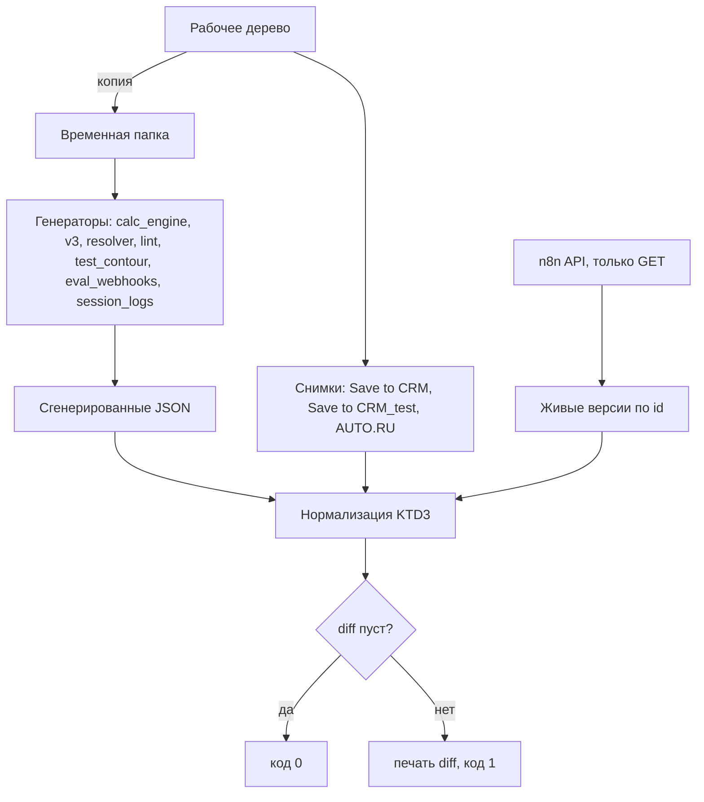

# refactor: генераторы и flow/ = бой (§6.2 handoff)

## Summary

Перенести в генераторы, `flow/lib` и закоммиченные снимки все правки, которые с
2026-09-30 вносились в боевые воркфлоу точечно (`apply_workflow_patch.py`), и
завести одну команду сверки «исходники = бой» (только чтение из n8n), которая
падает на любом расхождении. После этого перегенерация не может молча откатить бой.

---

## Problem Frame

Боевые Car Search и Combo с 2026-09-30 правились набором `apply_workflow_patch.py`
(N4, N5, сток, Active, колонка активности), Save to CRM — секретом колбэка, агент —
Header Auth. Генераторы и `flow/*.json` отстают: перегенерация Car Search / Combo
вернёт код до N4/N5 и старые Where / returnAll (handoff §6.2). Сверка 2026-10-09
показала и обратное: часть изменений есть в генераторах, но на бой не выкатывалась —
перегенерация молча выкатит их.

Сверка проведена так: `git archive HEAD` → временная папка → все генераторы
(`build_calc_engine_workflow.py`, `build_v3_workflow.py`, `build_resolver_workflow.py`,
`build_lint_workflow.py`, `build_test_contour.py`, `build_eval_webhooks.py`,
`build_session_logs.py` без `--apply`) → нормализованное сравнение по именам нод с
живыми версиями всех 46 воркфлоу (только GET). Генераторы на закоммиченных файлах
идемпотентны, кроме `flow/test-contour/[TEST] Tool - Car Search.json` (отстаёт:
старый jsCode, нет `executeOnce` у Get Stock) и `[TEST] AI Agent v3.0.json`
(только порядок ключей).

---

## Requirements

**Соответствие бою**

- R1. Перегенерация каждого воркфлоу с генератором даёт живую версию с точностью
  до полей из списка «выставляет n8n» (KTD3).
- R2. Для воркфлоу без генератора источник правды — закоммиченный снимок JSON;
  снимок = бой с той же нормализацией.
- R3. Каждое расхождение класса «генератор впереди боя» и «необъяснённое» решено
  владельцем по отдельности; молча не переносится и не откатывается.

**Контроль**

- R4. Одна команда сверки: только чтение из n8n, генерация во временную папку,
  ненулевой код и нормализованный diff при любом расхождении.
- R5. Тесты генераторов и sim-тесты зелёные; наборы `prod-*` / `*-rollback` в
  `apply_workflow_patch.py` сохраняют побайтовые «до» / «после».

**Границы**

- R6. Ни одна запись в n8n (бой и `[TEST]`) в этой работе не выполняется.
- R7. `[TEST]`-контур сохраняет свои пути `-test`, тестовые credentials и адреса;
  его сгенерированные файлы сверяются с живыми `[TEST]`-копиями так же, как бой.
- R8. Пять пробелов handoff от 07.10 закрыты.

---

## Inventory: правки боя и их место в исходниках

| Правка | Воркфлоу (id) | На бою сейчас | В исходниках |
|---|---|---|---|
| N4 (программа по Model id, `Min_Down_Payment`) | Car Search `mZqzmEnnQiDbvtir`, Combo `GD3ZCj8GiVyB7YBw` | `98082d40` / `dbf1e548` | нет: код только в `flow/cabinet-web-entry/active-field/`; Where `Get Program` и `returnAll` у `Get Rates` — нигде |
| N5 (база комбо = Price old − Cash in hook) | Combo | `dbf1e548` | нет (только `active-field/combo_prepare.js`) |
| Сток по slug + Active | Car Search, Combo | то же | частично: сток в `flow/lib/car_search_prepare.js` (без N4); `executeOnce` у `Get Stock` — в генераторе и `flow/Tool - Car Search.json` |
| Колонка активности (`prod-*-active-field`) | Car Search, Combo | то же | нет (только `active-field/*.js`) |
| Секрет колбэка (`prod-save-crm-callback`) | Save to CRM `vQ-eYIoZ_w85mu17FHGdJ` | `f57eb4e6` | нет: снимок `flow/TOOL_ Save to CRM.json` без аутентификации |
| Header Auth агента (`prod-agent-auth`) | AI Agent v3.0 `fQAS3wmAjVqrKATM` | `4fbba141` | **есть**: `INBOUND_AUTH` = PROD, `flow/AI Agent v3.0.json` перегенерирован |
| Вебхук оценки | `MMhfTj8QJe2UIMSB` / `[TEST]` `99SEbXjbQta3SGSH` | `4b2f4885` / `b69530e7` | генератор `build_eval_webhooks.py` есть, но credential выбран в n8n руками |
| Get Session Logs | `I7r3lWLiKmW1HojQ` / `[TEST]` `7DKkilzDzHtRLkpt` | `e00f47fa` / `265bd5d8` | **есть**: `build_session_logs.py`, расхождений нет |

Код Prepare-нод на бою побайтово равен `flow/cabinet-web-entry/active-field/car_search_prepare.js`
и `combo_prepare.js`; `[TEST]`-копии Car Search / Combo по коду Prepare равны бою;
`Merge Calc` в обоих — равен `flow/lib/*_merge.js`.

---

## Divergence Table

Классы: **П** — известная правка боя, не перенесённая; **С** — ссылка на
саб-воркфлоу (генератор пишет заглушку); **Г** — генератор впереди боя (собрано,
не выкачено); **Н** — необъяснённое или странное на бою; **n8n** — поле, которое
выставляет сам n8n (уходит в нормализацию, KTD3).

| # | Воркфлоу | Нода / поле | Генерация → бой | Класс | Источник правды | Действие |
|---|---|---|---|---|---|---|
| 1 | Car Search | `Prepare Data.jsCode` | lib (сток, 11 089) → N4+сток+колонка (13 931) | П | `flow/lib/car_search_prepare.js` | U2 |
| 2 | Car Search, Combo | `Get Program.options.where` | `.json.Id` → `.json['Model id']` | П | генератор | U3 |
| 3 | Car Search, Combo | `Get Rates.returnAll` | нет → `true` | П | генератор | U3 |
| 4 | Combo | `Prepare Combo.jsCode` | lib (до N5, 9 306) → N4+N5+Active+колонка (13 089) | П | `flow/lib/combo_prepare.js` | U2 |
| 5 | Save to CRM | `HTTP Request` auth + credential «Bot Callback Secret [PROD]» | нет → есть | П | снимок | U5 |
| 6 | Вебхук оценки (бой и `[TEST]`) | `Webhook.credentials` | нет → «Cabinet Eval Secret [PROD/TEST]» | П | генератор | U5 |
| 7 | Car Search, Combo, Test: Calc Engine | `Calc Engine.workflowId.value` | `REPLACE_WITH_CALC_ENGINE_ID` → `IzHcJxOxP9SI3LNv` | С | генератор | U3 |
| 8 | Combo | `Execute Workflow.workflowId` | **`ZYVac3Twp_ugyP3Jngwhj`** (старый AUTO.RU, май) → `XCPe53sUwk8i9e3T` | С | генератор | U3; перегенерация сейчас привязала бы Combo к старой оценке без `found_info` |
| 9 | AI Resolver (shadow) | `Resolver Core.workflowId.value` | `REPLACE_WITH_RESOLVER_CORE_ID` → `qsotmM7sbmyckg3E` | С | генератор | U4, зависит от Q3 |
| 10 | `[TEST]`-контур, все ссылки | `workflowId.value` | `SELECT_AFTER_IMPORT` → id `[TEST]`-копий | С | генератор контура | U4 |
| 11 | Все Execute Workflow / toolWorkflow | `workflowInputs` (агент: `schema` у `Save CRM Direct`) | нет / `[]` → значения, выставленные редактором n8n | С | генераторы | U3, U4 |
| 12 | AI Agent v3.0 | `finalize_deal.description` | без мандата (`effa014`, 2026-09-08) → старый текст «Вызывать ОБЯЗАТЕЛЬНО…» | Г | — | **Q1** |
| 13 | Tool: Resolver Core | `Build Prompt`, `Validate` jsCode | без `client_mode` / `client_signal` (`f2de42d`, U5 плана 2026-08-14) → с ними | Г | — | **Q2**; `[TEST]` Resolver Core = генератор |
| 14 | AI Resolver (shadow) | `Prepare Log.jsCode` | без `client_mode` / `client_signal` → с ними | Г | — | **Q2** (вместе с #13) |
| 15 | Tool: Blocks Lint (выключен) | `Lint.jsCode` | новый (`RESOLVER_FIXED_CHARS` 1993, `_V2`) → старый (2433) | Г | — | **Q4** |
| 16 | Car Search, Combo, Test: Calc Engine | `Calc Engine.workflowId.cachedResultName` | «Tool: Calc Engine» → «**[TEST]** Tool: Calc Engine» при боевом id | Н | — | **Q5** |
| 17 | Combo | `Execute Workflow.workflowId.cachedResultName` | → «**[TEST]** TOOL: AUTO.RU EVALUATION» при боевом id `XCPe…` | Н | — | **Q5** |
| 18 | AI Resolver (shadow) `F3eluZCNKGAcPwOT` | имя, путь, credential, ссылка | имя без `[TEST]`, путь `-test`, credential [TEST], но зовёт **боевой** Resolver Core `qsot…` | Н | — | **Q3** |
| 19 | Все | `id` и `position` нод | различаются у всех нод (бой не импортировался из текущих генераторов) | n8n | — | KTD3 |
| 20 | Все | `settings.availableInMCP`, `settings.callerPolicy`, `settings.binaryMode` | нет → `false` / `workflowsFromSameOwner` / `separate` (у созданных через API `binaryMode` нет) | n8n | — | KTD3 |
| 21 | Ссылки на саб-воркфлоу | `workflowId.cachedResultUrl` | нет → `/workflow/<id>` | n8n | — | KTD3 |
| 22 | AI Resolver | `Webhook.responseMode` | `onReceived` → нет (значение по умолчанию) | n8n | — | KTD3 |
| 23 | AUTO.RU EVALUATION (бой и `[TEST]`) | `connections["Code in JavaScript"]` | `{"main": [[]]}` → нет | n8n | — | KTD3 |

Вне сверки, но замечено: активны `Tool - Car Search` (`qunUsxh-zt4J-gc38lijX`),
`Tool: Combo Calculator` (`y4ee1N5dlH1tZyq4`) и `TOOL: AUTO.RU EVALUATION`
(`ZYVac3Twp_ugyP3Jngwhj`) — их зовут только выключенные агенты v2.

---

## Key Technical Decisions

- KTD1. **Бой — эталон для классов П и С; для Г и Н — решение владельца по
  каждому пункту.** Это прямое требование владельца (R3); генератор, ушедший
  вперёд, — такой же источник молчаливой выкатки, как отставший.
- KTD2. **`flow/lib/*_prepare.js` становятся боевым кодом, а нынешнее их
  содержимое замораживается под явными именами** в `flow/cabinet-web-entry/live/`
  (`car_search_prepare.stock.js` — бой «сток» 10-05, `combo_prepare.pre-n5.js` —
  бой до N5). Тесты N4 / N5 / сток, эталон N2 (`build_price_reference.mjs`),
  патч-скрипты `apply_n4.py` / `apply_n5.py` и наборы `apply_workflow_patch.py`
  (`prod-combo-n5`, `prod-car-stock`, `prod-car-n4`, откаты) читают `flow/lib` как
  «до»; перевод на замороженные файлы с тем же содержимым сохраняет их смысл
  побайтово. `apply_stock.py` в lib **пишет** — его вывод переводится на
  `live/car_search_prepare.stock.js`, иначе повторный запуск откатит lib к коду
  «только сток». После U2 ни один скрипт из `patches/` в `flow/lib` не пишет.
- KTD3. **Нормализация сверки** игнорирует только поля, которые выставляет n8n:
  верхний уровень (`id`, `versionId`, `activeVersionId`, `active`, `createdAt`,
  `updatedAt`, `meta`, `pinData`, `staticData`, `tags`, `shared`, `activeVersion`,
  `versionCounter`, `triggerCount`, `isArchived`, `description`); `settings.availableInMCP`,
  `settings.callerPolicy` при значении `workflowsFromSameOwner`, `settings.binaryMode`
  только когда с одной стороны его нет, а с другой — `separate`;
  `id` и `position` нод; `workflowId.cachedResultUrl`; пустые группы в `connections`;
  `responseMode` вебхука со значением по умолчанию. Всё остальное — функционально
  и должно совпадать. `cachedResultName` — по Q5. Отдельно, не через
  нормализацию: `activeVersionId` ≠ `versionId` (черновик редактора отличается от
  рабочей версии) — ошибка сверки, сравнение ведётся с `activeVersion.nodes`, если
  поле есть; ожидаемый флаг `active` хранится в таблице пар и сверяется.
- KTD4. **Генераторы пишут настоящие id саб-воркфлоу** по образцу
  `RESOLVER_CORE_WF` / `CAR_SEARCH_WF` в `nocodb/build_v3_workflow.py`; заглушки
  `REPLACE_WITH_*` уходят. Для `[TEST]`-контура `build_test_contour.py` получает
  таблицу «имя → id `[TEST]`-копии» вместо `SELECT_AFTER_IMPORT`; ссылку на
  `TOOL: Save to CRM_test` ставит по id `12IRy1rcYOuZzV7m`.
- KTD5. **Where / returnAll — в генератор, а не правкой базового JSON руками**,
  по образцу `execute_once()` в `flow/lib/build_calc_engine_workflow.py`
  (идемпотентная функция с проверкой ноды). Базовый `flow/*.json` и генератор
  остаются согласованными, повторный запуск — тот же результат.
- KTD6. **Снимки — для воркфлоу без генератора:** `flow/TOOL_ Save to CRM.json`
  (обновить), новый снимок `TOOL: Save to CRM_test`, `flow/TOOL_ AUTO.RU EVALUATION.json`
  (уже совпадает). Снимок пишется в нормализованном виде (без серверных полей),
  чтобы diff в git показывал только содержательные изменения.
- KTD7. **Команда сверки генерирует в копию рабочего дерева без `.env`** во
  временной папке: генераторы правят `flow/*.json` на месте и требуют
  `--browser-out`, поэтому запуск поверх рабочих файлов исключён; копия рабочего
  дерева (а не `git archive HEAD`) видит незакоммиченные правки генераторов во
  время U3–U4. `build_session_logs.py` импортирует `apply_workflow_patch.py`,
  который читает `.env`: команда вызывает его функцию сборки из исходного дерева,
  а не запускает скрипт в копии, — секреты во временную папку не копируются.
- KTD8. **Известные расхождения — в закоммиченном файле ожиданий**, а не в
  исключениях кода: id воркфлоу, нода.поле, ожидаемые значения генерации и боя,
  решение (Q#) и ссылка на отложенную выкатку. Сверка гасит запись, только пока
  обе стороны равны записанным значениям; дрейф любой стороны — ошибка; запись,
  у которой бой догнал генератор, — помечается устаревшей. Так выбор «оставить
  генератор» по Q1–Q4 и Q3 не делает сверку вечно красной.
- KTD9. **Июльская сверка Prepare-нод в `flow/lib/pipeline_sim.test.mjs`
  переносится на замороженный код до N4** (`live/car_search_prepare.stock.js`,
  `live/combo_prepare.pre-n5.js`), а не снимается: она проверяет, что вынос
  математики в Calc Engine не изменил результат исходных нод.
  Исходная формулировка: снимается. Она сравнивает текущий Prepare с кодом 2026-07-05 на моках
  программы без `Program_id` / `Min_Down_Payment`; N4 меняет выбор программы
  намеренно (проверено на копии: после U2 тест падает на `car search, payment=0`).
  Поведение N4 / N5 / стока / колонки активности уже покрыто своими тестами в
  `flow/cabinet-web-entry/*/`. Остальные проверки файла сохраняются.

---

## High-Level Technical Design

Таблица «файл → id живого воркфлоу → ожидаемый `active`» — часть команды:

| Файл | Бой | Файл `[TEST]` | `[TEST]` |
|---|---|---|---|
| `flow/AI Agent v3.0.json` | `fQAS3wmAjVqrKATM` | `test-contour/[TEST] AI Agent v3.0.json` | `pkA3mmrvv9XqmZRE` |
| `flow/Tool - Car Search.json` | `mZqzmEnnQiDbvtir` | `test-contour/[TEST] Tool - Car Search.json` | `o3vH8ZVKW5dNMkK2` |
| `flow/Tool_ Combo Calculator.json` | `GD3ZCj8GiVyB7YBw` | `test-contour/[TEST] Tool_ Combo Calculator.json` | `GjppGA6LqjbaqX4G` |
| `flow/Tool_ Calc Engine.json` | `IzHcJxOxP9SI3LNv` | `test-contour/[TEST] Tool_ Calc Engine.json` | `1K9aRaJrWRCF4InF` |
| `flow/Tool_ Resolver Core.json` | `qsotmM7sbmyckg3E` | `test-contour/[TEST] Tool_ Resolver Core.json` | `phecB9jOVAR1DqnX` |
| `flow/TOOL_ AUTO.RU EVALUATION.json` | `XCPe53sUwk8i9e3T` | `test-contour/[TEST] TOOL_ AUTO.RU EVALUATION.json` | `ToF5ApgK6qkk4mcH` |
| `flow/AI Resolver.json` | — (по Q3) | `test-contour/[TEST] AI Resolver.json` | `F3eluZCNKGAcPwOT` (по Q3) |
| `flow/Test_ Calc Engine.json` | `a5ZW1e4HESAdOeNk` (выкл.) | `test-contour/[TEST] Test_ Calc Engine.json` | без пары |
| `flow/Tool_ Blocks Lint.json` | `iod4uzsk1Eb1Drd0` (выкл., по Q4) | `test-contour/[TEST] Tool_ Blocks Lint.json` | без пары |
| `flow/TOOL_ Save to CRM.json` (снимок) | `vQ-eYIoZ_w85mu17FHGdJ` | снимок `TOOL: Save to CRM_test` (Q6) | `12IRy1rcYOuZzV7m` |
| `cabinet-web-entry/WEBHOOK_ Cabinet Tradein Eval.json` | `MMhfTj8QJe2UIMSB` | `cabinet-web-entry/[TEST] WEBHOOK_ …` | `99SEbXjbQta3SGSH` |
| `cabinet-web-entry/session-logs/Get Session Logs (API).json` | `I7r3lWLiKmW1HojQ` | `session-logs/[TEST] Get Session Logs (API).json` | `7DKkilzDzHtRLkpt` |

Файлы «без пары» — намеренно: активных `[TEST]`-копий в n8n нет (есть только
выключенные `… copy`). Остальные 25 воркфлоу инстанса (бэкапы, v2, копии,
устаревшие дубли) в сверку не входят.

---

## Implementation Units

### U1. Команда сверки «исходники = бой»

- **Goal:** одна команда только чтения из n8n, падающая на любом функциональном
  расхождении (R4); до переноса она красная ровно по Divergence Table.
- **Requirements:** R1, R2, R4, R6
- **Dependencies:** нет
- **Files:** `flow/cabinet-web-entry/api/check_sources_vs_live.py` (новый),
  `flow/cabinet-web-entry/api/test_check_sources_vs_live.py` (новый),
  `flow/cabinet-web-entry/api/expected_divergences.json` (новый, KTD8),
  `flow/cabinet-web-entry/README.md`
- **Approach:** копия дерева во временную папку → запуск всех генераторов
  (`--browser-out` во временную папку, `build_session_logs.py` без `--apply`) →
  загрузка живых версий через `call("GET", …)` из `apply_workflow_patch.py` →
  нормализация KTD3 → сравнение по именам нод. Флаг `--only <id>` для одной пары.
  Вывод — строки вида «воркфлоу · нода.поле: ген → бой», длинные строки — длиной
  и unified diff.
- **Patterns to follow:** `check_inbound_header.py` (только чтение, не печатает
  секреты), `diff()` в `apply_workflow_patch.py`.
- **Test scenarios:**
  - Одинаковые JSON, различающиеся только `position`, `id` нод и серверными
    полями верхнего уровня → пустой diff.
  - `settings.binaryMode` есть только с одной стороны → пустой diff;
    `settings.callerPolicy` = `workflowsFromSameOwner` с одной стороны → пустой;
    другое значение `callerPolicy` → расхождение.
  - `connections` с пустой группой `{"main": [[]]}` против отсутствия ключа → пустой diff.
  - Изменён `jsCode` одной ноды → одна строка расхождения с длинами; код выхода 1.
  - Нода есть только с одной стороны → строка «только на бою» / «только в генерации».
  - `credentials` у ноды отличаются → расхождение (не нормализуется).
  - Нет сети / ответ API не 200 → понятная ошибка и ненулевой код, без частичного
    «зелёного» результата.
  - `activeVersionId` ≠ `versionId` у пары → отдельная ошибка; `active` не равен
    ожидаемому из таблицы пар → ошибка.
  - `settings.binaryMode` = `combined` с одной стороны → расхождение.
  - Запись в файле ожиданий, обе стороны равны записанным → пара зелёная; одна
    сторона изменилась → ошибка с указанием записи; бой равен генератору →
    «запись устарела».
- **Verification:** на текущем HEAD с пустым файлом ожиданий команда печатает
  ровно пункты 1–18 Divergence Table и ни одного из 19–23.

### U2. `flow/lib` = боевой код Prepare-нод

- **Goal:** `flow/lib/car_search_prepare.js` и `combo_prepare.js` равны боевым;
  прежние состояния заморожены, все ссылки на «до» сохраняют смысл (KTD2).
- **Requirements:** R1, R5
- **Dependencies:** нет
- **Files:** `flow/lib/car_search_prepare.js`, `flow/lib/combo_prepare.js`,
  `flow/cabinet-web-entry/live/car_search_prepare.stock.js` (новый),
  `flow/cabinet-web-entry/live/combo_prepare.pre-n5.js` (новый),
  `flow/cabinet-web-entry/api/apply_workflow_patch.py`,
  `flow/cabinet-web-entry/n4-min-down-payment/n4_program.test.mjs`,
  `flow/cabinet-web-entry/n5-combo-price-old/n5_combo_price.test.mjs`,
  `flow/cabinet-web-entry/stock-slug-active/stock.test.mjs`,
  `flow/cabinet-web-entry/n2-price-reference/build_price_reference.mjs`,
  `flow/cabinet-web-entry/patches/apply_stock.py`, `apply_n4.py`, `apply_n5.py`,
  `flow/lib/pipeline_sim.test.mjs`
- **Approach:** сначала заморозить нынешнее содержимое lib в два новых файла и
  перевести на них все ссылки из списка (вывод `apply_stock.py` — на
  `live/car_search_prepare.stock.js`, KTD2); затем скопировать `active-field/*.js`
  в lib. `active-field/*.js` остаются (на них ссылаются наборы `prod-*-active-field`).
  В `pipeline_sim.test.mjs` снять июльскую сверку Prepare-нод (KTD9).
- **Execution note:** сначала на текущем HEAD прогнать затронутые тесты и снять
  офлайн-отпечаток наборов: для каждой записи `SETS` в `apply_workflow_patch.py` —
  содержимое файлов «до» / «после». Живой холостой прогон наборов, ссылающихся на
  lib, бесполезен: их «до» на бою уже нет, они останавливаются и до, и после U2.
- **Test scenarios:**
  - `stock.test.mjs`, `n4_program.test.mjs`, `n5_combo_price.test.mjs`,
    `combo_active.test.mjs`, `active_field.test.mjs` — зелёные без изменения ожиданий.
  - Эталон N2 без пересборки (она читает NocoDB и пишет `generated_at`):
    sha256[:12] каждого входа `CODE` в `build_price_reference.mjs` после U2 равен
    `code_sha256_12` в закоммиченном `price_reference.json`.
  - Офлайн-отпечаток `SETS` после U2 побайтово равен снятому до U2 (каждый путь
    «до» / «после» разрешается в файл с тем же содержимым).
  - Ни один скрипт в `flow/cabinet-web-entry/patches/` не содержит записи в `flow/lib`.
  - `pipeline_sim.test.mjs` — зелёный без июльской сверки Prepare.
  - `flow/lib/car_search_prepare.js` побайтово равен `active-field/car_search_prepare.js`;
    то же для Combo.
  - Замороженные файлы побайтово равны lib на HEAD до правки.
- **Verification:** `git diff` по тестам и эталонам — только пути (и снятая
  проверка в `pipeline_sim`); офлайн-отпечаток `SETS` не изменился; живой
  холостой прогон — только `prod-car-active-field-rollback` /
  `prod-combo-active-field-rollback` как дымовая проверка (только чтение).

### U3. Генератор Car Search / Combo / Calc Engine = бой

- **Goal:** `build_calc_engine_workflow.py` выдаёт боевые Car Search, Combo,
  Calc Engine, Test: Calc Engine без функциональных расхождений (пункты 2, 3, 7, 8, 11).
- **Requirements:** R1
- **Dependencies:** U2, решение Q5
- **Files:** `flow/lib/build_calc_engine_workflow.py`, `flow/Tool - Car Search.json`,
  `flow/Tool_ Combo Calculator.json`, `flow/Tool_ Calc Engine.json`,
  `flow/Test_ Calc Engine.json`
- **Approach:** функции по образцу `execute_once()`: Where у `Get Program`,
  `returnAll` у `Get Rates` (оба воркфлоу); id `Tool: Calc Engine` вместо
  `PLACEHOLDER_ID`; ссылка `Execute Workflow` в Combo на `XCPe53sUwk8i9e3T`;
  `workflowInputs` как у живых нод. Подпись `cachedResultName` — по Q5.
  Перегенерация рабочих `flow/*.json` — после зелёного U1 на временной копии.
- **Test scenarios:**
  - Повторный запуск генератора не меняет файлы (идемпотентность).
  - Сверка U1 для `mZqzmEnnQiDbvtir`, `GD3ZCj8GiVyB7YBw`, `IzHcJxOxP9SI3LNv`,
    `a5ZW1e4HESAdOeNk` — пустая.
  - `node --test flow/lib/*.test.mjs` — зелёные (golden Calc Engine не меняется).
  - Combo больше нигде не ссылается на `ZYVac3Twp_ugyP3Jngwhj`.
- **Verification:** U1 зелёный по четырём парам.

### U4. Агент, резолвер и `[TEST]`-контур

- **Goal:** `build_v3_workflow.py`, `build_resolver_workflow.py`,
  `build_lint_workflow.py`, `build_test_contour.py` выдают живые версии (пункты 9–11, 12–15 по решениям Q1–Q4, 18 по Q3).
- **Requirements:** R1, R3, R7
- **Dependencies:** U3, решения Q1–Q4
- **Files:** `nocodb/build_v3_workflow.py`, `nocodb/build_resolver_workflow.py`,
  `nocodb/build_lint_workflow.py`, `nocodb/build_test_contour.py`,
  `flow/AI Agent v3.0.json`, `flow/Tool_ Resolver Core.json`, `flow/AI Resolver.json`,
  `flow/Tool_ Blocks Lint.json`, `flow/test-contour/*.json`, `nocodb/lint_check.py`
  (при Q4 «генератор = бой» — `RESOLVER_FIXED_CHARS` в паре с `build_lint_workflow.py`),
  `flow/lib/v3_pipeline_sim.test.mjs`, `flow/lib/resolver_prompt_sim.test.mjs`
  (ожидания — по Q1 / Q2), `nocodb/test_build_test_contour.py` (новый)
- **Approach:** `workflowInputs` (включая `schema` у `Save CRM Direct`) как у
  живых нод; настоящий id Resolver Core в shadow; `build_test_contour.py` —
  таблица «имя → id `[TEST]`-копии» вместо `SELECT_AFTER_IMPORT` (KTD4). Для
  пунктов класса Г: если владелец оставляет бой — генератор получает боевое
  значение и комментарий с отсылкой к невыкатанному коммиту; если выбирает
  генератор — пункт записывается в файл ожиданий (KTD8) и переходит в
  отложенную выкатку (вне этой работы, R6).
- **Test scenarios:**
  - `node --test flow/lib/*.test.mjs` (в том числе `v3_pipeline_sim`,
    `resolver_prompt_sim`) — зелёные при выбранных значениях.
  - `nocodb/lint_check.py` и `Lint` в `flow/Tool_ Blocks Lint.json` используют
    одну константу `RESOLVER_FIXED_CHARS` (они зеркалят друг друга).
  - Сверка U1 для агента, Resolver Core, shadow и всех `[TEST]`-пар — пустая.
  - Ни в одном `flow/test-contour/*.json` нет боевых credentials и боевого адреса бота.
  - Каждый `workflowId.value` в `flow/test-contour/*.json` входит в множество id
    `[TEST]`-копий и ни один — в множество боевых id таблицы пар; исключение для
    shadow по Q3 — явно в тесте. Ошибка в таблице «имя → id» не проходит молча:
    сверка с живым `[TEST]` её бы не поймала, если бой уже перекрёстно связан (#18).
- **Verification:** U1 зелёный по этим парам с учётом файла ожиданий;
  `flow/test-contour/` после перегенерации совпадает с живым `[TEST]`-контуром.

### U5. Вебхук оценки и снимки

- **Goal:** credential вебхука оценки — в генераторе; снимки Save to CRM
  (бой и `_test`) равны бою (пункты 5, 6; R2).
- **Requirements:** R1, R2
- **Dependencies:** U1
- **Files:** `flow/cabinet-web-entry/build_eval_webhooks.py`,
  `flow/cabinet-web-entry/WEBHOOK_ Cabinet Tradein Eval.json`,
  `flow/cabinet-web-entry/[TEST] WEBHOOK_ Cabinet Tradein Eval.json`,
  `flow/cabinet-web-entry/eval_webhook.test.mjs`, `flow/TOOL_ Save to CRM.json`,
  снимок `TOOL: Save to CRM_test` (место — Q6)
- **Approach:** в `VARIANTS` — credential по варианту (`KhaneOxa4PaPKXOM` /
  `zFKZt2QNOgURSnX8`); снимки пишутся из живых версий в нормализованном виде (KTD6).
- **Test scenarios:**
  - `eval_webhook.test.mjs` — зелёный; в сгенерированном JSON у `Webhook` есть
    credential своего варианта, у `[TEST]` — тестовый.
  - Сверка U1 для `MMhfTj8QJe2UIMSB`, `99SEbXjbQta3SGSH`, `vQ-eYIoZ_w85mu17FHGdJ`,
    `12IRy1rcYOuZzV7m`, `XCPe53sUwk8i9e3T` — пустая.
- **Verification:** U1 зелёный по пяти парам.

### U6. Handoff и CLAUDE.md

- **Goal:** закрыть пять пробелов 07.10 и отразить итог переноса (R8).
- **Requirements:** R8
- **Dependencies:** U1–U5
- **Files:** `docs/handoff/2026-10-06-release-v3.4.0-n8n-handoff.md`, `CLAUDE.md`
- **Approach:** §7 — единый порядок (§6.2 первым, пункт 5 удалить или
  переписать); конец §6.2 — «откатит N4, N5 и колонку активности», затем пометка
  «сделано» со ссылкой на команду сверки; начало §4 — заменить «ещё не проверено»
  итогом исполнений 5425–5430; §8 «Сквозная проверка с дев-ботом 3.4.1» —
  результат или явное «не проведена»; §4 — имена `prod-car-active-field` и
  `prod-combo-active-field`. В `CLAUDE.md` — ссылка на команду сверки вместо
  предупреждения о §6.2.
- **Test expectation:** none — документация.
- **Verification:** все пять мест прочитаны после правки; противоречий порядка в §7 нет.

---

## Decisions (владелец, 2026-10-09)

Принцип: работа не меняет поведение боя; всё, в чём генераторы впереди боя,
откатывается в генераторе и уходит в отложенные выкатки (handoff §9.3).

- Q1 — генератор = бой; `effa014` — отложенная выкатка (откат в генераторе `a3cecdf`).
- Q2 — генератор = бой; `f2de42d` — отложенная выкатка (откат `e72a13d`, только генератор резолвера).
- Q3 — shadow оставлен как есть; исключение — в `build_test_contour.py` и файле ожиданий; перевод на `[TEST]` Resolver Core — в отложенных.
- Q4 — Blocks Lint исключён из сверки.
- Q5 — сверка игнорирует `cachedResultName`; бой не правится.
- Q6 — снимок `TOOL: Save to CRM_test` — `flow/test-contour/TOOL_ Save to CRM_test.json`.
- Устаревшие дубли — отдельная задача `docs/plans/2026-10-09-002-chore-legacy-duplicate-workflows-plan.md`.

## Open Questions (исходные, решены выше)

Решения владельца, по одному на пункт Divergence Table:

- Q1. **#12 описание `finalize_deal`.** Бой — старое описание с мандатом,
  генератор — без него (`effa014`, «собрано, не выкачено» с 09-08). Варианты:
  генератор = бой (вернуть старый текст в генерацию, `effa014` — в отложенную
  выкатку) / оставить генератор и выкатить отдельно / уточнить.
- Q2. **#13–14 `client_mode` / `client_signal` в Resolver Core и shadow.** Бой —
  с ними, генератор и `[TEST]` — без (`f2de42d`). Те же варианты, что Q1.
  Удаление меняет промпт боевого резолвера.
- Q3. **#18 AI Resolver (shadow) `F3eluZCNKGAcPwOT`.** Догадка: при защите
  [TEST]-вебхуков 10-03 shadow стал `[TEST]`-копией (путь `-test`, тестовый
  секрет), но имя и ссылка на боевой Resolver Core остались. Варианты: признать
  его членом `[TEST]`-контура и перевести на `[TEST] Tool: Resolver Core`
  (`phecB9jOVAR1DqnX`) — запись в `[TEST]`, вне этой работы / оставить как есть и
  описать исключение в генераторе / уточнить.
- Q4. **#15 Tool: Blocks Lint (выключен).** Генератор новее боя. Варианты:
  исключить из сверки как выключенный / генератор = бой.
- Q5. **#16–17 подпись `cachedResultName` «[TEST] …» при боевых id.** Догадка:
  ноды скопированы из `[TEST]`-копий при выкатке N4/N5 через API. На работу не
  влияет (n8n зовёт по `value`). Генератор в любом случае пишет боевую подпись:
  по `cachedResultName` `build_test_contour.py` опознаёт ссылки для подмены на
  `[TEST]`-копии, «[TEST]»-подпись в исходнике оставила бы в контуре боевые id.
  Варианты: нормализация игнорирует подпись / подпись в файле ожиданий (KTD8), а
  бой поправить отдельной записью позже.
- Q6. **Место снимка `TOOL: Save to CRM_test`:** `flow/TOOL_ Save to CRM_test.json`
  рядом с боевым или `flow/test-contour/` (каталог вывода генератора контура).

---

## Scope Boundaries

- Записи в n8n нет ни для боя, ни для `[TEST]` (R6). Решения Q1–Q5, требующие
  записи, уходят в отложенную работу.
- Ротация ключа apiauto.ru — не трогаем.

### Deferred to Follow-Up Work

- Выкатка на бой пунктов класса Г, если владелец выберет генератор (Q1, Q2).
- Переподключение shadow к `[TEST] Tool: Resolver Core` (Q3).
- Выключение активных устаревших дублей `qunUsxh-zt4J-gc38lijX`,
  `y4ee1N5dlH1tZyq4`, `ZYVac3Twp_ugyP3Jngwhj`.

---

## Risks & Dependencies

| Риск | Смягчение |
|---|---|
| Перевод «до» в тестах и наборах `apply_workflow_patch.py` ломает проверку отката | KTD2: замороженные файлы побайтово равны прежнему lib; офлайн-отпечаток `SETS` до и после U2 |
| Ретенция исполнений n8n ~2,5 суток | Сверка читает воркфлоу, а не исполнения; ретенция не влияет |
| Кто-то правит бой во время работы | U1 сравнивает с живой версией в момент запуска; versionId из Inventory сверяются перед финальным прогоном |
| Сверка доказывает «базовые `flow/*.json` = бой», а не «логика генератора воспроизводит бой»: нефункциональные для генератора поля берутся из базового JSON | Принято: базовый JSON — часть источника правды; правки, которые делает генератор (код, Where, returnAll, executeOnce, ссылки), в базовый JSON руками не вносятся (KTD5) |
| Генератор правит `flow/*.json` на месте | KTD7: сверка и разведка — только на копии; рабочие файлы перегенерируются осознанно в U3–U4 и попадают в diff коммита |

---

## Sources & Research

- `docs/handoff/2026-10-06-release-v3.4.0-n8n-handoff.md` — §1, §3, §6.2, §7, §8.
- `docs/handoff/2026-09-09-plate-normalization-and-cabinet-finalize.md` — `effa014` «собрано, не выкачено».
- `docs/handoff/2026-08-17-dialog-tactic-state.md`, `docs/plans/2026-08-14-001-feat-cabinet-dialog-tactic-plan.md` — `f2de42d`, удаление `client_mode` / `client_signal`.
- `docs/solutions/bugs/rollback-snapshot-overwritten-by-repeat-apply.md` — снапшот «до» пишется один раз.
- Разведка 2026-10-09: генерация на `git archive HEAD` (`9b1aea4`) во временную папку, живые версии всех 46 воркфлоу через API (только GET).
