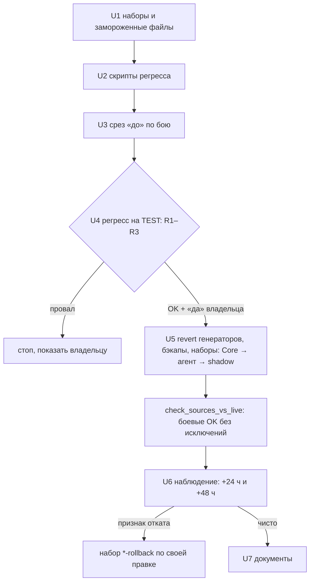

# feat: выкатка effa014 и f2de42d на бой — бой = [TEST]

> **Статус: ОТЛОЖЕН владельцем 2026-10-09.** Мало живого трафика — 18 вызовов
> резолвера и 8 финализаций за ~3 суток: наблюдение после выкатки не даст
> надёжного сигнала, выкатка без него не оправдана. Бой работает корректно,
> защита от #4084 (`a1bf7c0`) на бою есть. `[TEST]` к боевому состоянию не
> возвращается — расхождение учтено в `expected_divergences.json`. Разведка,
> регресс, пороги и вопросы Q1–Q6 ниже сохранены как есть; возврат — по
> условию в handoff §9.3. Правки выкатываются вместе и только с регрессом U4.

## Summary

Выкатить на бой две правки, которые с сентября работают только на `[TEST]`:
описание `finalize_deal` без мандата (`effa014`) и шаблон резолвера без
`client_mode` / `client_signal` (`f2de42d`). Перед выкаткой — регресс на
`[TEST]` по двум группам признаков; выкатка точечными наборами
`apply_workflow_patch.py`; после — сверка `check_sources_vs_live.py` и
наблюдение по исполнениям. Откат каждой правки независим.

---

## Problem Frame

План 2026-10-09-001 откатил обе правки в генераторах (`a3cecdf`, `e72a13d`),
чтобы генерация совпала с боем. С тех пор `[TEST]` впереди боя: прогоны на
`[TEST]` не воспроизводят боевое поведение по описанию `finalize_deal` и
шаблону резолвера (3 из 7 записей в `expected_divergences.json`). Решение
владельца — выровнять, выкатив обе правки на бой одной выкаткой.

Разведка 2026-10-09 (только чтение) показала два факта:

- **Бой вне ориентира R8 по стоимости входа резолвера** на синтетическом
  худшем случае (история 8×150, сообщение 100 симв.): 8789 симв. в combo при
  8560; на шаблоне `f2de42d` — 8349. Это известная задача З-1
  (`docs/SESSION_HANDOFF.md`, решение владельца 2026-09-16 — не трогать).
  `f2de42d` закрывает её побочно; **основанием для выкатки это не служит и
  планку регресса не снижает**.
- **Живого трафика мало для статистики.** За окно ретенции (~3 суток)
  боевой `Tool: Resolver Core` вызван **18** раз, `TOOL: Save to CRM` — **8**
  (агент — 452 исполнения). Наблюдение после выкатки ловит только грубые
  сбои; основное доказательство — регресс на `[TEST]` до выкатки.

---

## Preconditions (разведка 2026-10-09, только чтение)

**а) Запрет `a1bf7c0` — на бою есть.** Таблица `Prompt_Blocks`
(`mbbecemi1ac6awi`) общая для боевого и `[TEST]`-агента (`Get Blocks` в обоих
читает её). Блоки `BLK_CREDIT_CABINET_CHOSEN` (Id 132),
`BLK_TRADEIN_CABINET_CHOSEN` (127), `BLK_COMBO_CABINET_CHOSEN` (137) — `Active`,
sha Content `5f1254ff33ce` = значению после `a1bf7c0`, обе строки запрета в
конце; `_V2`-вариантов нет. Картина не меняется: на бою и на `[TEST]` запрет
действует одинаково, и регресс `[TEST]` измеряет `effa014` поверх него — как
будет на бою.

**б) Потребители `client_mode` / `client_signal`** (поиск по всем 46 воркфлоу):

| Где | Что делает | После `f2de42d` |
|---|---|---|
| `Tool: Resolver Core` (`qsot…`) — `Build Prompt`, `Validate` | просит поля у LLM и возвращает их | исчезают из промпта и ответа |
| `AI Agent v3.0` (`fQAS…`) и `[TEST]` — `Preset Greeting` | **записывает** константы `collector` / `neutral` в объект `resolver` | не меняется; никто их не читает |
| `AI Agent v3.0` — `Attach Resolver`, `Stage Classifier` | берут `verdict`, `dialog_intent` | не затронуто |
| `AI Agent v3.0` — `Final Response`, `Bypass Respond` → **боту** | `session_context_update`: `stage`, `dialog_intent`, `key_data_extracted`, `resolver_verdict`, `guard_action` | **`client_mode` / `client_signal` боту не уходят** и не уходили; ответ боту не меняется |
| `AI Resolver (shadow)` `F3eluZCNKGAcPwOT` — `Prepare Log` → `Resolver_Shadow_Log` | пишет поля в NocoDB через `autoMapInputData` | ключи станут `undefined` и выпадут из JSON; колонки останутся пустыми, запись не упадёт. Shadow за окно ретенции не вызывался ни разу (0 исполнений) |
| Выключенные копии (`… copy`, `v3.0_backup`) | те же ноды | вне выкатки |

Проверка на стороне бота формально не нужна: поля в бот не передаются. Для
агента кабинета — одна фраза: «`session_context_update` от n8n не меняется;
`client_mode` / `client_signal` в нём не было».

**в) Бюджет резолвера (живые 41 интент, `Get Intents` без фильтра Active —
все активны).** Худший вход по сценариям, бой → `[TEST]`: combo 8789 → 8349,
tradein 8650 → 8210, прочие ниже. Бюджет 8560. Снапшот
`flow/lib/snapshots/v3_tables.json`, на котором стоит `resolver_prompt_sim`,
устарел (там часть интентов неактивна) — тест «текущие интенты на боевом
шаблоне в бюджете» зелёный на снапшоте и красный на живых данных.

**г) Прочие различия `[TEST]` ↔ бой в затронутых воркфлоу** (нормализованный
diff живых версий): кроме двух правок — только штатные подмены контура (имя,
путь `-test`, credential [TEST], id саб-воркфлоу) и два артефакта редактора на
`[TEST]`-агенте (`workflowInputs` у `Call Car Search`, пустая `schema` у
`Save CRM Direct`). Код всех остальных нод совпадает.

---

## Requirements

**Регресс до выкатки**

- R1. Финализация не теряется там, где нужна: С1–С3 чек-листа J.2 — вызов
  агентом с верным `status` во всех прогонах; С4 — финализация через Bypass
  (путь, который `effa014` не затрагивает).
- R2. Финализации нет там, где не нужна: С6–С8 — ни одного вызова; С5 (#4084)
  — вызовов на описании `effa014` не больше, чем на боевом.
- R3. Резолвер на шаблоне `f2de42d` классифицирует не хуже боевого шаблона
  (критерии — KTD5).

**Выкатка**

- R4. Меняются только `finalize_deal.description` (агент), `jsCode` у
  `Build Prompt` и `Validate` (Resolver Core) и `Prepare Log` (shadow);
  Header Auth агента и `binaryMode: "separate"` не затрагиваются.
- R5. После выкатки `check_sources_vs_live.py` — боевые OK без исключений, из
  `expected_divergences.json` уходят три записи (Q1, Q2×2).
- R6. Каждая правка откатывается независимо готовым набором.

**Наблюдение и документы**

- R7. Срез «до» снят до выкатки; «после» — в пределах ретенции; признаки
  разделены на группу `effa014` и группу `f2de42d`.
- R8. Handoff и CLAUDE.md отражают новое состояние; отмечено, что запись
  «`client_mode` / `client_signal` удалены в августе» в CABINET_CONTEXT
  владельца была неверна для боя до этой выкатки.

---

## Key Technical Decisions

- KTD1. **Выкатка точечными наборами `apply_workflow_patch.py`** (решение
  владельца): проверка «до» побайтово, diff после, наборы `*-rollback`. PUT
  не передаёт `binaryMode` — сервер сохраняет `separate`; Header Auth живёт в
  ноде `Webhook`, которую наборы не трогают; diff после записи это подтвердит.
- KTD2. **«До» и «после» — замороженные файлы**, а не строки в коде набора:
  `flow/cabinet-web-entry/rollout-effa014-f2de42d/` с текущими боевыми
  значениями и целевыми, записанными байт в байт из источника (без
  добавленного перевода строки: вид `code` сравнивает «до» через `strip()`, а
  «после» пишет как есть, сверка — точная). Целевые описание `finalize_deal`,
  `Build Prompt` и `Validate` сверяются с живым `[TEST]` и с генерацией после
  `git revert a3cecdf e72a13d` — три источника совпадают побайтово (проверено
  офлайн ревьюером на копии HEAD). Для `Prepare Log` shadow живого `[TEST]`-источника
  нет — только генерация после revert.
- KTD3. **Новый вид правки `param`** в `apply_workflow_patch.py`: строковый
  параметр ноды целиком («до» из файла, «после» из файла) — для `description`.
  Код Resolver Core и shadow — существующий вид `code`.
- KTD4. **Shadow входит в выкатку как `[TEST]`-запись** (по правилу API-записи
  разрешена): без правки `Prepare Log` после revert генератора сверка покажет
  новое расхождение на `F3eluZCNKGAcPwOT`. Исключение Q3 (имя, боевой Resolver
  Core) сохраняется.
- KTD5. **Регресс резолвера — A/B на одних и тех же входах**, а не сверка с
  разовой записью боя: LLM недетерминирован. Оба шаблона вызываются из
  временных `[TEST]`-воркфлоу (пробник с вебхуком и копия ядра со старым
  шаблоном); боевой `qsot…` не вызывается. Каждый вход — по 3 раза на каждом
  шаблоне. Наборы:
  - **(2) реальные — основное доказательство:** входы боевого Resolver Core из
    исполнений (сообщение, `recent_history`, `session_context` как есть). За
    ретенцию их ~18, поэтому входы копятся во временную папку вне репозитория
    до **≥ 50** (Q1). Критерий — в штуках, не в процентах: расхождений
    «новый ↔ старый» по `dialog_intent` не больше, чем «старый ↔ старый», **+1 вход**.
  - **(1) размеченный — по 2 перефраза на интент**, которых нет в
    `Example_Phrases` (они стоят в самом промпте, и классификация их — почти
    поиск строки), с `request_type` из `Scenarios` интента, стадией из
    `Stage_Context` и реалистичной историей до 8 реплик; перефразы — файл в
    репозитории на просмотр владельцу до прогона. Критерий: верных ответов у
    нового шаблона не меньше, чем у старого, **−2 входа**.
  - `Example_Phrases` как есть — только дымовая проверка формата и `Validate`.
  - Для обоих наборов: `verdict ≠ ok` и пустой `key_data_extracted` (уходит
    боту) — не больше, чем у старого шаблона, +1 вход.
- KTD6. **Регресс финализации — прогоны чек-листа J.2 / J.3** через
  `[TEST] AI Agent v3.0`, **с контрольным плечом**: те же входы на описании
  `effa014` и на боевом описании (на время контрольной серии описание
  `[TEST]`-агента ставится боевым набором `test-agent-finalize-desc-prod` и
  возвращается его откатом). Объёмы: С1–С3 — по 5 на плечо; С5 (#4084) — 30
  на плечо; С6–С8 — по 3 на плечо. Что дают числа: 0 из 30 ограничивает долю
  ложных вызовов в С5 ~10 % (95 %); 5 из 5 — долю пропусков в каждом из С1–С3
  ~45 %. Регресс ловит грубое ухудшение относительно боя, не тонкое — это
  сказано владельцу при решении. Сравнение плеч — в штуках: вызовов в С5 у
  `effa014` не больше, чем у боя.
  **С4 (бан) идёт через ветку Bypass** (`Bypass Build → Save CRM Direct`), агент
  не участвует и описание на неё не влияет — С4 проверяется по факту
  финализации Bypass со `status=ban`, как контроль пути, не как доказательство
  `effa014`.
  **Тело С5** исполнения #4084 удалено ретенцией; оно восстанавливается по полям
  J.3 и тексту handoff 2026-09-09 §3.1 в замороженную фикстуру (клиентский
  текст — вне репозитория). Результаты 2026-09-09 (2 из 6 до запрета, 0 из 6
  после) получены на другом теле — только контекст, не порог.
  Изоляция по `docs/solutions/conventions/test-contour-runs-isolation-from-live-crm.md`:
  без `deal_id` (проверка до отправки и по исполнению; строка «None» — стоп),
  поля боевой сессии #4084 (сделка 51499, боевые `user_id` / `session_id`)
  раннер отклоняет до отправки, дилер 99, `user_id` с префиксом `test-`,
  заголовок `X-N8N-Secret` [TEST]. Перед U4 — перечитать обработчик
  `/n8n_callback` дев-бота (условие `if bx_url and deal_id`, Q5).
- KTD7. **Порядок записи:** Resolver Core → агент → shadow, подряд, время
  каждой записи фиксируется. **Правки связаны через `choose_cabinet`:** запрет
  `a1bf7c0` попадает в промпт агента только при `dialog_intent = choose_cabinet`,
  а интент выдаёт резолвер. Если шаблон `f2de42d` реже метит такие ходы, вместе
  с запретом пропадает и признак отката `effa014` («вызов на `choose_cabinet`»).
  Поэтому доля `choose_cabinet` — признак группы `f2de42d`, а откат одной
  правки без другой даёт сочетание, которого регресс не видел: сразу после
  такого отката — повтор С5 и С1–С3 на `[TEST]` в получившемся сочетании.

---

## High-Level Technical Design

---

## Implementation Units

### U1. Наборы выкатки и отката

- **Goal:** готовые наборы для трёх воркфлоу с проверкой «до» и откатами; в
  n8n ничего не пишется.
- **Requirements:** R4, R6
- **Dependencies:** нет
- **Files:** `flow/cabinet-web-entry/api/apply_workflow_patch.py`,
  `flow/cabinet-web-entry/rollout-effa014-f2de42d/` (замороженные: описание
  `finalize_deal` боя и `effa014`; `Build Prompt`, `Validate` боя и `f2de42d`;
  `Prepare Log` shadow до и после), `flow/cabinet-web-entry/api/test_apply_workflow_patch.py` (новый)
- **Approach:** вид `param` (KTD3); наборы `prod-agent-finalize-desc`,
  `prod-resolver-f2de42d` (две ноды), `test-shadow-f2de42d`,
  `test-agent-finalize-desc-prod` и их `*-rollback`.
  Целевые значения берутся из живого `[TEST]` и сверяются с генерацией после
  revert во временной копии (KTD2).
- **Patterns to follow:** `prod-agent-auth` / `prod-*-active-field` в
  `apply_workflow_patch.py`.
- **Test scenarios:**
  - `param`: живое значение = «до» → новое значение = «после», остальные ключи
    ноды не тронуты.
  - `param`: живое значение ≠ «до» → стоп без записи.
  - Набор и его `*-rollback` взаимно обратны (после → до побайтово).
  - Холостой прогон трёх наборов на живых воркфлоу — проверка «до» OK; трёх
    откатов — стоп («откатывать нечего»).
  - Целевые файлы = живой `[TEST]` = генерация после revert (побайтово, без
    `strip`); для `Prepare Log` — = генерации после revert.
  - Набор `test-agent-finalize-desc-prod` и его откат (контрольное плечо KTD6).
- **Verification:** холостые прогоны OK; тесты зелёные.

### U2. Скрипты регресса

- **Goal:** воспроизводимые прогоны обеих групп с отчётом и изоляцией.
- **Requirements:** R1, R2, R3
- **Dependencies:** нет
- **Files:** `nocodb/finalize_regress_runs.py` (новый; С1–С8 по J.2, С5 по J.3),
  `flow/cabinet-web-entry/api/resolver_ab.py` (новый; A/B резолвера и сборщик
  входов), `flow/cabinet-web-entry/rollout-effa014-f2de42d/resolver_paraphrases.json`
  (перефразы набора (1), на просмотр владельцу),
  `docs/test-contour-checklist.md` (раздел про этот регресс)
- **Approach:** раннер финализации по образцу `nocodb/debrand_testruns.py`
  (вебхук `ai-handoff-v3-test`, `cached_json` чтобы обойти Car Search, разбор
  `intermediateSteps` узла `Agent` **и** ветки `Bypass Build → Save CRM Direct`
  со `status` из `ai_payload`, `turn.finalize_required`, `guard.*`). A/B
  резолвера (KTD5): `POST /workflows` — копия ядра со старым шаблоном и пробник
  (Webhook с Header Auth credential [TEST] `8WHmaHbGppnSXL9F`, запрос с
  `X-N8N-Secret` [TEST]); активация / публикация обоих; дымовой вызов каждого
  шаблона; прогон; деактивация и удаление в `finally`; id созданных
  воркфлоу — в отчёт для ручной уборки (Q2). Сборщик реальных входов копит их
  из исполнений `qsot…` во временную папку вне репозитория; в отчёт —
  агрегаты.
- **Patterns to follow:** `nocodb/debrand_testruns.py` (изоляция, отчёт),
  `nocodb/shadow_report.py` (вердикты, интенты).
- **Test scenarios:**
  - Тело запроса раннера: нет `deal_id`, `user_id` начинается с `test-`,
    дилер 99, заголовок секрета [TEST] — проверяется до отправки, иначе стоп.
  - После каждого прогона по исполнению: `deal_id` пуст (не «None»), иначе
    стоп серии.
  - Разбор вызова: в `intermediateSteps` есть `finalize_deal` → «агент», статус
    из `ai_payload`; сработала ветка Bypass с `Save CRM Direct` → «bypass»,
    статус оттуда; иначе — «без вызова».
  - Тело С5 содержит боевые `deal_id` / `user_id` / `session_id` #4084 → стоп до
    отправки.
  - A/B: оба временных воркфлоу удалены и при ошибке посередине прогона.
- **Verification:** пробный прогон по одному сценарию каждой группы проходит
  изоляцию и даёт разбор.

### U3. Срез «до» по бою

- **Goal:** базовая линия по живым исполнениям до записи (их потом не взять).
- **Requirements:** R7
- **Dependencies:** нет
- **Files:** `flow/cabinet-web-entry/api/observe_rollout.py` (новый, только
  чтение; `--label before|after`)
- **Approach:** группа `effa014` — ходов агента, вызовов `finalize_deal` по
  `status`, вызовов на интенте `choose_cabinet`, вызовов при
  `finalize_required=false`, `guard.action` (повторы). Группа `f2de42d` — ходов
  с резолвером, вердикты, доля пустого `dialog_intent`, распределение
  `dialog_intent`, доля непустого `key_data_extracted`, латентность,
  исполнения `qsot…` со статусом `error`. Только агрегаты в файл среза.
- **Patterns to follow:** `nocodb/debrand_observe.py` (`--label`, срезы не
  перезаписывают друг друга).
- **Test scenarios:**
  - Ход без резолвера (Cache Gate / Preset) не попадает в метрики резолвера.
  - Ход Bypass с финализацией учитывается отдельно от вызова агентом.
- **Verification:** срез «before» снят и закоммичен до U5.

### U4. Регресс на `[TEST]`

- **Goal:** решение «выкатывать / нет» на фактах.
- **Requirements:** R1, R2, R3
- **Dependencies:** U2, «да» владельца
- **Files:** отчёт в `docs/handoff/` (агрегаты)
- **Approach:** прогоны KTD5, KTD6. **Провал** — любое из: на плече
  `effa014` С1–С3 без вызова агентом или с неверным `status` хотя бы в одном
  прогоне; С4 без финализации Bypass со `status=ban`; вызов агентом в С6–С8;
  в С5 вызовов на плече `effa014` больше, чем на боевом; критерии KTD5 не
  выполнены; `deal_id` не пуст (или «None») в любом исполнении. При провале —
  стоп и показать владельцу, без правок текста.
- **Test expectation:** none — это сам прогон; сценарии перечислены в KTD5, KTD6.
- **Verification:** отчёт с цифрами по каждому сценарию и по A/B; решение владельца.

### U5. Выкатка на бой

- **Goal:** бой = `[TEST]` по двум правкам; генераторы = бой.
- **Requirements:** R4, R5
- **Dependencies:** U1, U3, U4, команда владельца
- **Files:** revert `a3cecdf`, `e72a13d` (генераторы, `flow/*.json`,
  `flow/test-contour/*.json`, тесты), `flow/cabinet-web-entry/api/expected_divergences.json`,
  `flow/backups/<дата>-pre-effa014-f2de42d/`
- **Approach:** сначала revert и перегенерация; три записи Q1 / Q2×2 из файла
  ожиданий удаляются в том же коммите. Сверка до записи обязана показать ровно
  **4 неожиданных расхождения** — `fQAS…` `finalize_deal.description`, `qsot…`
  `Build Prompt` и `Validate`, `F3el…` `Prepare Log` — и ничего больше; это
  проверка того, что наборы попадут точно (без удаления записей сверка покажет
  ещё 3 «устаревших» на `pkA3…` / `phec…`). Затем бэкапы «до» трёх воркфлоу
  (репозиторий и `~/.config/autodc/n8n-backups/`), холостой прогон, `--apply` в
  порядке KTD7, diff после каждой записи; сверка — зелёная.
- **Test scenarios:**
  - Diff после записи агента: изменилось только `finalize_deal.description`;
    `Webhook.authentication = headerAuth`, credential [PROD], `binaryMode`
    `separate` — на месте.
  - Diff Resolver Core: только два `jsCode`.
  - `node --test flow/lib/*.test.mjs`, `pytest` — зелёные после revert
    (`resolver_prompt_sim` возвращается к проверке на шаблоне `f2de42d`).
- **Verification:** `check_sources_vs_live.py` — 20 пар OK, ожиданий 4 (два
  артефакта редактора, Q3×2); время каждой записи в handoff.

### U6. Наблюдение после выкатки

- **Goal:** поймать грубый сбой до ухода исполнений по ретенции.
- **Requirements:** R6, R7
- **Dependencies:** U5
- **Files:** `flow/cabinet-web-entry/api/observe_rollout.py` (`--label after-24h`, `after-48h`)
- **Approach:** срезы через ~24 и ~48 ч, сравнение с «before». Признаки
  отката — раздел Rollback.
- **Test expectation:** none — наблюдение.
- **Verification:** два среза в handoff; решение «оставить / откатить» по каждой правке.

### U7. Документы

- **Goal:** R8.
- **Dependencies:** U5 (и U6 для итога наблюдения)
- **Files:** `docs/handoff/2026-10-06-release-v3.4.0-n8n-handoff.md` (блок
  «Итог / холд», §9.3, новые versionId), `CLAUDE.md`, `docs/test-contour-checklist.md`
- **Approach:** снять пометку «`[TEST]` впереди боя»; таблица отложенного —
  Q1/Q2 выкачены; отметить, что CABINET_CONTEXT владельца (вне репозитория)
  утверждал удаление `client_mode` / `client_signal` в августе — для боя это
  было неверно до этой выкатки; текст для владельца — в итоге.
- **Test expectation:** none — документация.

---

## Rollback

| Правка | Команда (`flow/cabinet-web-entry/api/`) | Признаки отката |
|---|---|---|
| `effa014` | `apply_workflow_patch.py --wf fQAS3wmAjVqrKATM --set prod-agent-finalize-desc-rollback --apply` | вызов `finalize_deal` агентом на ходе `choose_cabinet`; ход с валидным телефоном в сообщении или согласием на визит (`propose_visit`) без финализации — по ручному разбору каждого такого хода на +24 ч и +48 ч (ловит частичную потерю заявок, включая случаи как #4003); ноль финализаций агентом за 48 ч — признак включается, только если срез U3 показал частоту финализаций **агентом** (без Bypass) не ниже 2 в сутки; жалоба владельца или бота на потерянные заявки |
| `f2de42d` | `apply_workflow_patch.py --wf qsotmM7sbmyckg3E --set prod-resolver-f2de42d-rollback --apply` (+ `test-shadow-f2de42d-rollback` на `F3el…`) | исполнение `qsot…` со статусом `error`; `verdict = parse_error` хотя бы раз; `verdict ≠ ok` — на 2 и более хода больше среза «до»; доля `choose_cabinet` среди ходов с `cabinet_status = not_visited` заметно ниже среза «до» (отключает запрет `a1bf7c0`, KTD7); пустой `key_data_extracted` (уходит боту) заметно чаще |

При малом трафике (~6 вызовов резолвера в сутки, единицы ходов `choose_cabinet`
за 48 ч) чистое наблюдение — слабое свидетельство; решающий аргумент — U4.

После отката — revert соответствующего revert-коммита в генераторах и возврат
записей в `expected_divergences.json`, чтобы сверка снова была зелёной. Откат одной правки без другой — сразу повтор С5 и С1–С3 на `[TEST]` в
получившемся сочетании (KTD7).

---

## Risks & Dependencies

| Риск | Смягчение |
|---|---|
| Малый живой трафик (18 вызовов резолвера, 8 финализаций за ~3 суток) — наблюдение не докажет «не хуже» | Основание выкатки — регресс U4; наблюдение ловит только грубые сбои (признаки в Rollback рассчитаны на малые числа) |
| Прогоны С1–С2 дают `visit` / `call` → дев-бот шлёт алерт в группу | Q3: согласовать группу дев-бота заранее |
| Регресс финализации — 31 прогон агента, A/B — до сотен вызовов flash-lite | Стоимость оценивается до запуска по `docs/solutions/best-practices/token-budget-calibration-via-n8n-executions.md`; пробный прогон по одному сценарию |
| Запись в активный воркфлоу сразу рабочая | Наборы с проверкой «до», откат одной командой, бэкапы |
| Устаревший снапшот `v3_tables.json` прячет перерасход бюджета | Обновление снапшота — в отложенном (затрагивает несколько тестов) |

---

## Open Questions

- Q1. **Набор (2) для A/B резолвера:** копить реальные входы до ≥ 50
  (при ~6 в сутки — около недели) или снизить порог.
- Q2. **Временные `[TEST]`-воркфлоу для A/B** (пробник и копия ядра со старым
  шаблоном): создание и активацию разрешает правило API; удаление после
  прогона — подтвердите. Открыто техническое: какая версия саб-воркфлоу
  исполняется через Execute Workflow при модели черновик / публикация —
  проверяется дымовым вызовом до прогона.
- Q3. **Алерты дев-бота в группу** на `visit` / `call` в С1–С2 (до 10 прогонов
  на плечо): в какую группу уходят и допустимы ли.
- Q4. **Пороги:** KTD5 (в штуках: +1 вход на наборе (2), −2 входа на наборе
  (1)) и признаки отката — подтвердите или задайте свои.
- Q5. **Обработчик `/n8n_callback` дев-бота** (условие `if bx_url and deal_id`)
  живёт в репозитории бота: перечитать его до U4 — сам (дайте путь) или через
  агента кабинета.
- Q6. **Одна выкатка или две.** Правки связаны через `choose_cabinet` (KTD7).
  Ваше решение — одна выкатка; альтернатива: сначала `f2de42d`, сверить долю
  `choose_cabinet`, затем `effa014`. Оставляем одну?

---

## Scope Boundaries

- Записи в NocoDB (промпт-блоки, интенты) — нет.
- Сторона бота — не меняется; агенту кабинета передаётся только фраза из п. б).

### Deferred to Follow-Up Work

- Повторяемый сценарий для паттерна #4003 (законная финализация при
  `finalize_required=false`) — в J.2 его нет; до тех пор — ручной разбор в U6.
- Обновление `flow/lib/snapshots/v3_tables.json` до живых интентов (все 41
  активны) и пересмотр тестов, которые на нём стоят.
- Перевод shadow на `[TEST]` Resolver Core (Q3 плана 2026-10-09-001).
- Константы Blocks Lint становятся верными после `f2de42d`; сам Blocks Lint
  (выключен) не выкатывается.

---

## Sources & Research

- `docs/handoff/2026-09-09-plate-normalization-and-cabinet-finalize.md` — `effa014`, #4084, прогоны 8×3.
- `docs/test-contour-checklist.md` — J.2 (С1–С8), J.3 (#4084).
- `docs/plans/2026-08-14-001-feat-cabinet-dialog-tactic-plan.md` — U5 (`f2de42d`).
- `nocodb/apply_cabinet_finalize_ban.py`, коммит `a1bf7c0` — запрет на `choose_cabinet`.
- `docs/solutions/conventions/test-contour-runs-isolation-from-live-crm.md`.
- Разведка 2026-10-09: живые версии 46 воркфлоу, `Prompt_Blocks` (фильтр `CABINET_CHOSEN`), `Intents` (41 строка), счётчики исполнений.
